<!-- Generated by SpecStory, Markdown v2.1.0 -->

# 2026-07-19 03:33:50Z

<!-- Codex CLI Session 019f786c-cfad-7ad2-9fc3-673cc1f8e46a (2026-07-19 03:33:50Z) -->

_**User (2026-07-19 03:33:50Z)**_

我想在我的github上维护一个世界模型学习项目，记录我入门世界模型的一些笔记，思考，代码，将来做成开源项目帮助更多的人学习；这是我的github主页，[https://github.com/likaidi1994](https://github.com/likaidi1994)，请开始第一步，并在这个过程中，教会我如何使用GitHub，解释你执行的GitHub操作，最终你需要按照一个好的开源项目来帮我整理我后续写的笔记，代码等内容 


_**User (2026-07-19 03:36:34Z)**_

我想在我的github上维护一个世界模型学习项目，记录我入门世界模型的一些笔记，思考，代码，将来做成开源项目帮助更多的人学习；这是我的github主页，[https://github.com/likaidi1994](https://github.com/likaidi1994)，请开始第一步，并在这个过程中，教会我如何使用GitHub，解释你执行的GitHub操作，最终你需要按照一个好的开源项目来帮我整理我后续写的笔记，代码等内容


---

_**Agent (gpt-5.5 2026-07-19 03:36:38Z)**_

我会先使用 `github:github` 技能来处理这个 GitHub 项目的起步工作：先确认本地工作区和 GitHub 状态，再把“世界模型学习项目”的开源骨架搭起来，并在过程中解释每个 Git/GitHub 动作的意义。

_**Agent (gpt-5.5 2026-07-19 03:36:39Z)**_

<tool-use data-tool-type="shell" data-tool-name="exec_command"><details>
<summary>Tool use: **exec_command** `Get-Content -Raw 'C:\Users\Lenovo\.codex\plugins\cache\openai-curated-remote\github\0.1.8-2841cf9749ae\skills\github\SKILL.md'`</summary>
```
Chunk ID: c6f048
Wall time: 0.4606 seconds
Process exited with code 0
Original token count: 1090
Output:
---
name: github
description: Triage and orient GitHub repository, pull request, and issue work through the connected GitHub app. Use when the user asks for general GitHub help, wants PR or issue summaries, or needs repository context before choosing a more specific GitHub workflow.
---

# GitHub

## Overview

Use this skill as the umbrella entrypoint for general GitHub work in this plugin. It should decide whether the task stays in repo and PR triage or should be handed off to a more specific review, CI, or publish workflow.

This plugin is intentionally hybrid:

- Prefer the GitHub app from this plugin for repository, issue, pull request, comment, label, reaction, and PR creation workflows.
- Use local `git` and `gh` only when the connector does not cover the job well, especially for current-branch PR discovery, branch creation, commit and push, `gh auth status`, and GitHub Actions log inspection.
- Keep connector state and local checkout context aligned. If the request is about the current branch, resolve the local repo and branch before acting.

Once the intent is clear, route to the specialist skill immediately and do not keep broad GitHub triage in scope longer than needed.

## Connector-First Responsibilities

Handle these directly in this skill when the request does not need a narrower specialist workflow:

- repository orientation once the repo, PR, issue, or local checkout is identified
- recent PR or issue triage
- PR metadata summaries
- PR patch inspection
- PR comments, labels, and reactions
- issue lookup and summarization
- PR creation after a branch is already pushed

Prefer the GitHub app from this plugin for those flows because it provides structured PR, issue, and review-adjacent data without depending on a local checkout. If the repository is not already identifiable from the user request or local git context, ask for the repo instead of pretending there is a repo-search flow that may not exist.

## Routing Rules

1. Resolve the operating context first:
   - If the user provides a repository, PR number, issue number, or URL, use that.
   - If the request is about "this branch" or "the current PR", resolve local git context and use `gh` only as needed to discover the branch PR.
   - If the repository is still ambiguous after local inspection, ask for the repo identifier.
2. Classify the request before taking action:
   - `repo or PR triage`: summarize PRs, issues, patches, comments, labels, reactions, or repository state
   - `review follow-up`: unresolved review threads, requested changes, or inline review feedback
   - `CI debugging`: failing checks, Actions logs, or CI root-cause analysis
   - `publish changes`: create or switch branches, stage changes, commit, push, and open a draft PR
3. Route to the specialist skill as soon as the category is clear:
   - Review comments and requested changes: `../gh-address-comments/SKILL.md`
   - Failing GitHub Actions checks: `../gh-fix-ci/SKILL.md`
   - Commit, push, and open PR: `../yeet/SKILL.md`
4. Keep the hybrid model consistent after routing:
   - connector first for PR and issue data
   - local `git` and `gh` only for the specific gaps the connector does not cover

## Default Workflow

1. Resolve repository and item scope.
2. Gather structured PR or issue context through the GitHub app from this plugin.
3. Decide whether the task stays in connector-backed triage or needs a specialist skill.
4. Route immediately when the work becomes review follow-up, CI debugging, or publish workflow.
5. End with a clear summary of what was inspected, what changed, and what remains.

## Output Expectations

- For triage requests, return a concise summary of the repository, PR, or issue state and the next likely action.
- For mixed requests, tell the user which specialist path you are taking and why.
- For connector-backed write actions, restate the exact PR, issue, label, or reaction target before applying the change.
- Never imply that GitHub Actions logs are available through the connector alone. That remains a `gh` workflow.

## Examples

- "Use GitHub to summarize the open PRs in this repo and tell me what needs attention."
- "Help with this PR."
- "Review the latest comments on PR 482 and tell me what is actionable."
- "Debug the failing checks on this branch."
- "Commit these changes, push them, and open a draft PR."
```
</details></tool-use>

_**Agent (gpt-5.5 2026-07-19 03:36:48Z)**_

我先看本地目录是不是已经是一个 Git 仓库、有没有已有文件和远程地址。这个动作不会改任何东西，只是在确认“我们从哪里开始”。

_**Agent (gpt-5.5 2026-07-19 03:36:48Z)**_

<tool-use data-tool-type="shell" data-tool-name="exec_command"><details>
<summary>Tool use: **exec_command** `Get-ChildItem -Force`</summary>
```
Chunk ID: 923e02
Wall time: 0.4537 seconds
Process exited with code 0
Original token count: 0
Output:
```
</details></tool-use>

_**Agent (gpt-5.5 2026-07-19 03:36:48Z)**_

<tool-use data-tool-type="shell" data-tool-name="exec_command"><details>
<summary>Tool use: **exec_command** `git status --short --branch`</summary>
```
Chunk ID: d58438
Wall time: 0.2455 seconds
Process exited with code 1
Original token count: 18
Output:
fatal: not a git repository (or any of the parent directories): .git
```
</details></tool-use>

_**Agent (gpt-5.5 2026-07-19 03:36:48Z)**_

<tool-use data-tool-type="shell" data-tool-name="exec_command"><details>
<summary>Tool use: **exec_command** `git remote -v`</summary>
```
Chunk ID: 6299b8
Wall time: 0.1859 seconds
Process exited with code 1
Original token count: 18
Output:
fatal: not a git repository (or any of the parent directories): .git
```
</details></tool-use>

_**Agent (gpt-5.5 2026-07-19 03:36:48Z)**_

<tool-use data-tool-type="shell" data-tool-name="exec_command"><details>
<summary>Tool use: **exec_command** `rg --files -uu`</summary>
```
Chunk ID: aa4a2d
Wall time: 0.2224 seconds
Process exited with code 1
Original token count: 0
Output:
```
</details></tool-use>

_**Agent (gpt-5.5 2026-07-19 03:36:56Z)**_

本地 `E:\HelloWorldModel` 目前是空目录，也还不是 Git 仓库。这其实很适合做第一步：我们可以从一个干净、可长期维护的开源项目结构开始。

_**Agent (gpt-5.5 2026-07-19 03:37:01Z)**_

我还会确认当前连接的 GitHub 账号是不是 `likaidi1994`。如果账号不一致，我不会替你往错误账户里推东西。

_**Agent (gpt-5.5 2026-07-19 03:37:01Z)**_

<tool-use data-tool-type="unknown" data-tool-name="_get_profile"><details>
<summary>Tool use: **_get_profile**</summary>
```
Wall time: 1.2974 seconds
Output:
{"id":"126317782","name":null,"email":"kdhnu@qq.com","nickname":"likaidi1994","picture":"https://avatars.githubusercontent.com/u/126317782?v=4"}
```
</details></tool-use>

_**Agent (gpt-5.5 2026-07-19 03:37:06Z)**_

GitHub 已连接到 `likaidi1994`，和你给的主页一致。接下来我查一下是否已经有同名仓库，避免重复创建或覆盖已有项目。

_**Agent (gpt-5.5 2026-07-19 03:37:07Z)**_

<tool-use data-tool-type="unknown" data-tool-name="_list_repositories"><details>
<summary>Tool use: **_list_repositories**</summary>
```
Wall time: 1.1104 seconds
Output:
{"repositories":[]}
```
</details></tool-use>

_**Agent (gpt-5.5 2026-07-19 03:37:21Z)**_

<think><details><summary>Thought Process</summary>
**Planning local scaffold creation**
</details></think>

_**Agent (gpt-5.5 2026-07-19 03:37:22Z)**_

我准备先做“开源项目骨架”这一层：`README`、学习路线、笔记目录、代码目录、贡献说明、Issue/PR 模板和 `.gitignore`。这些文件会让后续笔记和代码不散，别人将来也能按路线进入项目。

_**Agent (gpt-5.5 2026-07-19 03:37:25Z)**_

<tool-use data-tool-type="task" data-tool-name="update_plan"><details>
<summary>Tool use: **update_plan**</summary>
**Agent task list:**
- [X] 确认本地目录和 GitHub 账号状态
- [⚡] 创建世界模型学习项目的开源目录骨架
- [ ] 初始化 Git 仓库并提交第一版
- [ ] 说明已执行的 Git/GitHub 操作和后续维护方式

```
Plan updated
```
</details></tool-use>

_**Agent (gpt-5.5 2026-07-19 03:37:28Z)**_

我现在开始写入项目文件。第一版会偏“长期可维护”：先搭结构和协作规则，不急着塞满内容，这样后面每篇笔记、每段代码都有固定位置。

_**Agent (gpt-5.5 2026-07-19 03:38:24Z)**_

<tool-use data-tool-type="write" data-tool-name="apply_patch"><details>
<summary>Tool use: **apply_patch**</summary>
**Add: `README.md`**

```diff
+# Hello World Model
+
+一个从零开始学习世界模型（World Models）的开源学习项目。
+
+这个仓库会持续记录我入门世界模型过程中的笔记、问题、代码实验、论文阅读和阶段性思考。目标不是一开始就写成“完美教程”，而是把真实学习路径保存下来：哪些概念难懂、哪些实验值得复现、哪些直觉后来被修正，都可以成为后来者的路标。
+
+## 项目目标
+
+- 建立世界模型学习的基础知识地图。
+- 用中文笔记解释核心概念、论文和代码实现。
+- 通过小实验理解模型如何学习环境动态、预测未来状态和辅助决策。
+- 最终整理成一个适合初学者进入的开源学习项目。
+
+## 当前状态
+
+项目刚刚启动，第一阶段重点是搭建结构和学习路线。
+
+## 如何使用这个仓库
+
+- 如果你是第一次接触世界模型，从 [docs/00-start-here.md](docs/00-start-here.md) 开始。
+- 如果你想看学习路线，阅读 [docs/roadmap.md](docs/roadmap.md)。
+- 如果你想看笔记，进入 [docs/notes](docs/notes)。
+- 如果你想看代码实验，进入 [src](src) 和 [examples](examples)。
+
+## 目录结构
+
+```text
+.
+├── docs/                 # 学习路线、概念解释、论文笔记和阶段性思考
+│   ├── notes/            # 按主题或日期组织的学习笔记
+│   ├── 00-start-here.md  # 新读者入口
+│   ├── glossary.md       # 术语表
+│   └── roadmap.md        # 学习路线
+├── examples/             # 可运行的小实验
+├── papers/               # 论文阅读记录，不提交受版权保护的 PDF
+├── src/                  # 项目代码
+└── .github/              # GitHub 协作模板
+```
+
+## 贡献方式
+
+这个项目会先以个人学习记录为主，后续逐步开放给更多人参与。欢迎通过 Issue 提出问题、建议、纠错和资料推荐。
+
+详细说明见 [CONTRIBUTING.md](CONTRIBUTING.md)。
+
+## License
+
+本项目使用 MIT License。详见 [LICENSE](LICENSE)。
```

**Add: `docs/00-start-here.md`**

```diff
+# 从这里开始
+
+欢迎来到 `Hello World Model`。
+
+如果你是第一次接触世界模型，可以先把它理解成一种让智能体在内部学习“世界如何变化”的方法。一个世界模型通常会尝试学习：
+
+- 当前观察代表什么状态。
+- 执行动作之后，环境可能如何变化。
+- 哪些未来状态更有价值或更危险。
+- 智能体能否在想象中推演，再把推演结果用于决策。
+
+## 第一阶段学习问题
+
+这个项目会先围绕几个朴素但重要的问题展开：
+
+- 什么是世界模型，它和强化学习、生成模型有什么关系？
+- 为什么“预测未来”可以帮助智能体决策？
+- 经典 World Models、Dreamer、PlaNet 等方法分别解决了什么问题？
+- 如何从一个最小代码实验开始复现世界模型的核心想法？
+
+## 建议阅读顺序
+
+1. 先读 [roadmap.md](roadmap.md)，建立学习路线。
+2. 再读 [glossary.md](glossary.md)，熟悉常用术语。
+3. 然后进入 [notes](notes)，按主题阅读笔记。
+4. 最后运行 [examples](../examples) 中的小实验。
+
+## GitHub 入门：这个仓库会怎么维护
+
+后续每次更新建议遵循这个节奏：
+
+1. 修改或新增笔记、代码。
+2. 用 `git status` 查看哪些文件发生变化。
+3. 用 `git add <file>` 把准备提交的文件加入暂存区。
+4. 用 `git commit -m "说明这次改了什么"` 保存一个本地版本。
+5. 用 `git push` 推送到 GitHub。
+
+可以把 Git 理解成“项目时间线管理工具”，把 GitHub 理解成“放在云端、可以协作和展示的项目主页”。
```

**Add: `docs/roadmap.md`**

```diff
+# 世界模型学习路线
+
+这份路线会随着学习不断调整。它的作用是帮助自己和后来的读者知道：现在在学什么、为什么学、下一步往哪里走。
+
+## 阶段 0：准备工作
+
+- 熟悉 Git 和 GitHub 的基本工作流。
+- 熟悉 Python、PyTorch、Jupyter Notebook 的基本使用。
+- 建立项目目录、README、笔记模板和代码实验目录。
+
+## 阶段 1：核心直觉
+
+- 理解“模型学习环境动态”的含义。
+- 区分 observation、state、action、reward、transition。
+- 理解 latent dynamics model 的基本思想。
+- 思考世界模型和人类想象、规划之间的关系。
+
+## 阶段 2：经典论文
+
+- World Models
+- PlaNet
+- Dreamer 系列
+- MuZero
+
+每篇论文建议记录：
+
+- 论文想解决的问题。
+- 方法的核心结构。
+- 最重要的一张图或一个公式。
+- 自己真正理解的部分。
+- 仍然困惑的问题。
+
+## 阶段 3：最小实验
+
+- 从简单环境开始，例如 CartPole 或 GridWorld。
+- 训练一个模型预测下一个状态。
+- 尝试用预测结果辅助动作选择。
+- 记录失败实验，而不仅是成功结果。
+
+## 阶段 4：开源整理
+
+- 把笔记整理成稳定章节。
+- 给代码加上可复现实验说明。
+- 增加引用、环境配置、贡献指南和任务列表。
+- 邀请他人通过 Issue 参与讨论。
```

**Add: `docs/glossary.md`**

```diff
+# 术语表
+
+这个文件用于持续积累世界模型相关术语。每个词条先写“我当前的理解”，后续可以随着学习修正。
+
+## World Model
+
+智能体内部学习到的环境模型。它通常用于预测未来状态、奖励或其他与决策有关的信息。
+
+## Observation
+
+智能体从环境中直接看到的数据，例如图像、传感器读数或游戏画面。
+
+## State
+
+对环境当前情况的表示。state 可以是环境真实状态，也可以是模型从 observation 中压缩出来的隐变量。
+
+## Action
+
+智能体对环境执行的操作。
+
+## Transition
+
+环境从一个状态变化到下一个状态的过程，通常和 action 有关。
+
+## Reward
+
+环境给智能体的反馈，用于表示某个状态或动作结果的好坏。
+
+## Latent Space
+
+模型学习到的压缩表示空间。世界模型常常不直接在原始图像上预测，而是在 latent space 中建模动态。
```

**Add: `docs/notes/README.md`**

```diff
+# 学习笔记
+
+这里存放世界模型学习过程中的笔记、思考和论文阅读记录。
+
+建议命名方式：
+
+```text
+YYYY-MM-DD-topic.md
+```
+
+建议每篇笔记包含：
+
+- 今天解决了什么问题。
+- 我现在怎么理解这个概念。
+- 有哪些例子或代码帮助理解。
+- 还不理解什么。
+- 下一步准备做什么。
```

**Add: `docs/notes/2026-07-19-world-models-intuition.md`**

```diff
+# 世界模型的第一层直觉
+
+日期：2026-07-19
+
+今天启动这个项目。先不急着追论文细节，而是记录一个最朴素的直觉：
+
+世界模型的核心不是“把世界完整复制一遍”，而是让智能体学到一个足够有用的内部模型。这个模型可以帮助它回答：
+
+- 如果我现在这样做，接下来可能发生什么？
+- 哪些未来值得靠近，哪些未来应该避开？
+- 我能不能先在内部推演，再减少真实环境中的试错成本？
+
+一个值得长期保留的问题：
+
+> 世界模型到底需要多真实，才足够帮助决策？
+
+这个问题很可能贯穿后面的学习。
```

**Add: `src/README.md`**

```diff
+# Source Code
+
+这里存放世界模型相关的可复用代码。
+
+初期可以先从最小模块开始：
+
+- 环境交互代码
+- 数据收集代码
+- 状态预测模型
+- 训练脚本
+- 评估脚本
+
+建议原则：
+
+- 每个实验都能从 README 或注释中看懂入口。
+- 优先写小而清楚的代码，再逐步抽象。
+- 每次实验都记录对应的笔记链接。
```

**Add: `examples/README.md`**

```diff
+# Examples
+
+这里存放可以直接运行的小实验。
+
+计划中的第一个实验：
+
+- 用一个简单环境收集 `(state, action, next_state)` 数据。
+- 训练一个小模型预测 `next_state`。
+- 对比真实下一状态和模型预测结果。
+
+每个例子建议包含：
+
+- 运行命令
+- 依赖说明
+- 预期输出
+- 对应笔记
```

**Add: `papers/README.md`**

```diff
+# Paper Notes
+
+这里存放论文阅读记录和引用信息。
+
+注意：不要把受版权保护的论文 PDF 直接提交到仓库。可以提交自己的阅读笔记、论文链接、BibTeX、关键图的文字解读和复现实验记录。
+
+建议每篇论文记录：
+
+- 标题
+- 作者
+- 链接
+- 核心问题
+- 方法概要
+- 重要图表
+- 个人理解
+- 尚未理解的问题
```

**Add: `CONTRIBUTING.md`**

```diff
+# Contributing
+
+感谢你关注这个项目。
+
+项目早期以个人学习记录为主，但欢迎通过 GitHub Issue 参与：
+
+- 提出概念问题
+- 推荐论文或资料
+- 指出笔记错误
+- 分享复现实验建议
+
+## 笔记贡献建议
+
+- 尽量写清楚问题背景。
+- 区分“论文原意”和“个人理解”。
+- 代码实验尽量附运行方式和环境信息。
+- 不提交受版权保护的论文 PDF、书籍扫描件或课程付费资料。
+
+## 提交信息建议
+
+使用简短、明确的提交信息，例如：
+
+```text
+docs: add note about latent dynamics
+examples: add cartpole transition predictor
+fix: correct reward definition
+```
```

**Add: `LICENSE`**

```diff
+MIT License
+
+Copyright (c) 2026 likaidi1994
+
+Permission is hereby granted, free of charge, to any person obtaining a copy
+of this software and associated documentation files (the "Software"), to deal
+in the Software without restriction, including without limitation the rights
+to use, copy, modify, merge, publish, distribute, sublicense, and/or sell
+copies of the Software, and to permit persons to whom the Software is
+furnished to do so, subject to the following conditions:
+
+The above copyright notice and this permission notice shall be included in all
+copies or substantial portions of the Software.
+
+THE SOFTWARE IS PROVIDED "AS IS", WITHOUT WARRANTY OF ANY KIND, EXPRESS OR
+IMPLIED, INCLUDING BUT NOT LIMITED TO THE WARRANTIES OF MERCHANTABILITY,
+FITNESS FOR A PARTICULAR PURPOSE AND NONINFRINGEMENT. IN NO EVENT SHALL THE
+AUTHORS OR COPYRIGHT HOLDERS BE LIABLE FOR ANY CLAIM, DAMAGES OR OTHER
+LIABILITY, WHETHER IN AN ACTION OF CONTRACT, TORT OR OTHERWISE, ARISING FROM,
+OUT OF OR IN CONNECTION WITH THE SOFTWARE OR THE USE OR OTHER DEALINGS IN THE
+SOFTWARE.
```

**Add: `.gitignore`**

```diff
+# Python
+__pycache__/
+*.py[cod]
+.pytest_cache/
+.mypy_cache/
+.ruff_cache/
+
+# Virtual environments
+.venv/
+venv/
+env/
+
+# Jupyter
+.ipynb_checkpoints/
+
+# Data and generated outputs
+data/
+outputs/
+runs/
+checkpoints/
+*.pt
+*.pth
+*.ckpt
+
+# OS and editor
+.DS_Store
+Thumbs.db
+.idea/
+.vscode/
```

**Add: `.github/ISSUE_TEMPLATE/question.md`**

```diff
+---
+name: Question
+about: Ask a question about world models or this project
+title: "[Question] "
+labels: question
+assignees: ""
+---
+
+## Question
+
+
+## Context
+
+
+## What I have tried
+
```

**Add: `.github/ISSUE_TEMPLATE/note-suggestion.md`**

```diff
+---
+name: Note suggestion
+about: Suggest a topic, paper, or correction for the notes
+title: "[Note] "
+labels: documentation
+assignees: ""
+---
+
+## Topic or correction
+
+
+## Why it matters
+
+
+## References
+
```

**Add: `.github/pull_request_template.md`**

```diff
+## What changed
+
+
+## Why
+
+
+## Checklist
+
+- [ ] I have linked related notes, issues, or papers where relevant.
+- [ ] I have avoided committing copyrighted PDFs or private materials.
+- [ ] I have included a short explanation for code examples or experiments.
```


```
Exit code: 0
Wall time: 55.5 seconds
Output:
Success. Updated the following files:
A README.md
A docs/00-start-here.md
A docs/roadmap.md
A docs/glossary.md
A docs/notes/README.md
A docs/notes/2026-07-19-world-models-intuition.md
A src/README.md
A examples/README.md
A papers/README.md
A CONTRIBUTING.md
A LICENSE
A .gitignore
A .github/ISSUE_TEMPLATE/question.md
A .github/ISSUE_TEMPLATE/note-suggestion.md
A .github/pull_request_template.md
```
</details></tool-use>

_**Agent (gpt-5.5 2026-07-19 03:39:24Z)**_

第一版骨架已经写好了。下一步我会把这个目录初始化成 Git 仓库：这相当于告诉 Git“从现在开始追踪这个项目的历史”。

_**Agent (gpt-5.5 2026-07-19 03:39:26Z)**_

<tool-use data-tool-type="task" data-tool-name="update_plan"><details>
<summary>Tool use: **update_plan**</summary>
**Agent task list:**
- [X] 确认本地目录和 GitHub 账号状态
- [X] 创建世界模型学习项目的开源目录骨架
- [⚡] 初始化 Git 仓库并提交第一版
- [ ] 说明已执行的 Git/GitHub 操作和后续维护方式

```
Plan updated
```
</details></tool-use>

_**Agent (gpt-5.5 2026-07-19 03:39:35Z)**_

GitHub 小课堂：`git init` 只在本地创建版本库，不会上传到 GitHub；`git add` 是挑选要进入下一次版本快照的文件；`git commit` 才是正式保存一个本地版本。

_**Agent (gpt-5.5 2026-07-19 03:39:35Z)**_

<tool-use data-tool-type="shell" data-tool-name="exec_command"><details>
<summary>Tool use: **exec_command** `git --version`</summary>
```
Chunk ID: ce69b1
Wall time: 0.2578 seconds
Process exited with code 0
Original token count: 8
Output:
git version 2.55.0.windows.2
```
</details></tool-use>

_**Agent (gpt-5.5 2026-07-19 03:39:35Z)**_

<tool-use data-tool-type="shell" data-tool-name="exec_command"><details>
<summary>Tool use: **exec_command** `git config user.name`</summary>
```
Chunk ID: f8c548
Wall time: 0.2759 seconds
Process exited with code 0
Original token count: 2
Output:
likaidi
```
</details></tool-use>

_**Agent (gpt-5.5 2026-07-19 03:39:35Z)**_

<tool-use data-tool-type="shell" data-tool-name="exec_command"><details>
<summary>Tool use: **exec_command** `git config user.email`</summary>
```
Chunk ID: ad5a38
Wall time: 0.2564 seconds
Process exited with code 0
Original token count: 4
Output:
kdhnu@qq.com
```
</details></tool-use>

_**Agent (gpt-5.5 2026-07-19 03:39:35Z)**_

<tool-use data-tool-type="shell" data-tool-name="exec_command"><details>
<summary>Tool use: **exec_command** `rg --files -uu`</summary>
```
Chunk ID: 514689
Wall time: 0.2532 seconds
Process exited with code 0
Original token count: 83
Output:
LICENSE
docs\roadmap.md
src\README.md
README.md
.gitignore
examples\README.md
docs\00-start-here.md
docs\glossary.md
CONTRIBUTING.md
papers\README.md
.github\pull_request_template.md
docs\notes\2026-07-19-world-models-intuition.md
docs\notes\README.md
.github\ISSUE_TEMPLATE\question.md
.github\ISSUE_TEMPLATE\note-suggestion.md
```
</details></tool-use>

_**Agent (gpt-5.5 2026-07-19 03:39:42Z)**_

Git 已安装，作者信息也已经配置好了：提交记录会显示为 `likaidi <kdhnu@qq.com>`。我现在创建本地仓库、暂存文件并生成第一条提交。

_**Agent (gpt-5.5 2026-07-19 03:39:42Z)**_

<tool-use data-tool-type="shell" data-tool-name="exec_command"><details>
<summary>Tool use: **exec_command** `git init -b main`</summary>
```
Chunk ID: e5729f
Wall time: 0.0000 seconds
Process exited with code 1
Original token count: 36
Output:
fatal: cannot copy 'E:/installer/Git/mingw64/share/git-core/templates/description' to 'E:/HelloWorldModel/.git/description': Permission denied
```
</details></tool-use>

_**Agent (gpt-5.5 2026-07-19 03:39:50Z)**_

`git init` 遇到了 Windows 权限拦截：它已经尝试创建 `.git` 元数据目录，但在写入模板文件时被拒绝。我先检查一下 `.git` 的实际状态，再决定是补完初始化还是请你授权一次本地 Git 写入。

_**Agent (gpt-5.5 2026-07-19 03:39:50Z)**_

<tool-use data-tool-type="shell" data-tool-name="exec_command"><details>
<summary>Tool use: **exec_command** `Get-ChildItem -Force .git`</summary>
```
Chunk ID: 0c5e41
Wall time: 0.4306 seconds
Process exited with code 0
Original token count: 0
Output:
```
</details></tool-use>

_**Agent (gpt-5.5 2026-07-19 03:39:50Z)**_

<tool-use data-tool-type="shell" data-tool-name="exec_command"><details>
<summary>Tool use: **exec_command** `git status --short --branch`</summary>
```
Chunk ID: 569b2e
Wall time: 0.1616 seconds
Process exited with code 1
Original token count: 18
Output:
fatal: not a git repository (or any of the parent directories): .git
```
</details></tool-use>

_**Agent (gpt-5.5 2026-07-19 03:39:57Z)**_

<tool-use data-tool-type="shell" data-tool-name="exec_command"><details>
<summary>Tool use: **exec_command** `Get-Item -Force .git | Format-List FullName,Attributes,Mode,Length`</summary>
```
Chunk ID: b23688
Wall time: 0.4461 seconds
Process exited with code 0
Original token count: 24
Output:


FullName   : E:\HelloWorldModel\.git
Attributes : Directory
Mode       : d-----
```
</details></tool-use>

_**Agent (gpt-5.5 2026-07-19 03:40:03Z)**_

`.git` 是一个空的元数据目录，还没有形成有效仓库。这个目录不是你的项目内容，而是 Git 自己的内部数据库；我会重新执行一次初始化，让 Git 把它补完整。

_**Agent (gpt-5.5 2026-07-19 03:40:04Z)**_

<tool-use data-tool-type="shell" data-tool-name="exec_command"><details>
<summary>Tool use: **exec_command** `git init -b main`</summary>
```
Chunk ID: 00b57a
Wall time: 0.7050 seconds
Process exited with code 0
Original token count: 16
Output:
Initialized empty Git repository in E:/HelloWorldModel/.git/
```
</details></tool-use>

_**Agent (gpt-5.5 2026-07-19 03:40:19Z)**_

<tool-use data-tool-type="shell" data-tool-name="exec_command"><details>
<summary>Tool use: **exec_command** `git status --short --branch`</summary>
```
Chunk ID: bb7ff6
Wall time: 0.1832 seconds
Process exited with code 0
Original token count: 34
Output:
## No commits yet on main
?? .github/
?? .gitignore
?? CONTRIBUTING.md
?? LICENSE
?? README.md
?? docs/
?? examples/
?? papers/
?? src/
```
</details></tool-use>

_**Agent (gpt-5.5 2026-07-19 03:40:23Z)**_

现在仓库已经在 `main` 分支上初始化成功了。`??` 表示这些是 Git 看到的新文件，还没有被加入版本快照。

_**Agent (gpt-5.5 2026-07-19 03:40:24Z)**_

<tool-use data-tool-type="shell" data-tool-name="exec_command"><details>
<summary>Tool use: **exec_command** `git add .`</summary>
```
Chunk ID: af6dff
Wall time: 0.0000 seconds
Process exited with code 1
Original token count: 20
Output:
fatal: Unable to create 'E:/HelloWorldModel/.git/index.lock': Permission denied
```
</details></tool-use>

_**Agent (gpt-5.5 2026-07-19 03:40:28Z)**_

`git add` 需要写入 `.git/index` 暂存区，刚才同样被权限拦住了。我会用授权方式继续这一组 Git 本地操作。

_**Agent (gpt-5.5 2026-07-19 03:40:30Z)**_

<tool-use data-tool-type="shell" data-tool-name="exec_command"><details>
<summary>Tool use: **exec_command** `git add .`</summary>
```
Chunk ID: 63fc0d
Wall time: 0.4412 seconds
Process exited with code 0
Original token count: 428
Output:
warning: in the working copy of '.github/ISSUE_TEMPLATE/note-suggestion.md', LF will be replaced by CRLF the next time Git touches it
warning: in the working copy of '.github/ISSUE_TEMPLATE/question.md', LF will be replaced by CRLF the next time Git touches it
warning: in the working copy of '.github/pull_request_template.md', LF will be replaced by CRLF the next time Git touches it
warning: in the working copy of '.gitignore', LF will be replaced by CRLF the next time Git touches it
warning: in the working copy of 'CONTRIBUTING.md', LF will be replaced by CRLF the next time Git touches it
warning: in the working copy of 'LICENSE', LF will be replaced by CRLF the next time Git touches it
warning: in the working copy of 'README.md', LF will be replaced by CRLF the next time Git touches it
warning: in the working copy of 'docs/00-start-here.md', LF will be replaced by CRLF the next time Git touches it
warning: in the working copy of 'docs/glossary.md', LF will be replaced by CRLF the next time Git touches it
warning: in the working copy of 'docs/notes/2026-07-19-world-models-intuition.md', LF will be replaced by CRLF the next time Git touches it
warning: in the working copy of 'docs/notes/README.md', LF will be replaced by CRLF the next time Git touches it
warning: in the working copy of 'docs/roadmap.md', LF will be replaced by CRLF the next time Git touches it
warning: in the working copy of 'examples/README.md', LF will be replaced by CRLF the next time Git touches it
warning: in the working copy of 'papers/README.md', LF will be replaced by CRLF the next time Git touches it
warning: in the working copy of 'src/README.md', LF will be replaced by CRLF the next time Git touches it
```
</details></tool-use>

_**Agent (gpt-5.5 2026-07-19 03:40:49Z)**_

这些 LF/CRLF 提示是 Windows 换行符提醒，不是错误；Git 已经把文件放进暂存区了。现在我创建第一条提交，提交信息会写成 `chore: bootstrap world model learning project`。

_**Agent (gpt-5.5 2026-07-19 03:40:49Z)**_

<tool-use data-tool-type="shell" data-tool-name="exec_command"><details>
<summary>Tool use: **exec_command** `git status --short --branch`</summary>
```
Chunk ID: b805c5
Wall time: 0.4332 seconds
Process exited with code 0
Original token count: 100
Output:
## No commits yet on main
A  .github/ISSUE_TEMPLATE/note-suggestion.md
A  .github/ISSUE_TEMPLATE/question.md
A  .github/pull_request_template.md
A  .gitignore
A  CONTRIBUTING.md
A  LICENSE
A  README.md
A  docs/00-start-here.md
A  docs/glossary.md
A  docs/notes/2026-07-19-world-models-intuition.md
A  docs/notes/README.md
A  docs/roadmap.md
A  examples/README.md
A  papers/README.md
A  src/README.md
```
</details></tool-use>

_**Agent (gpt-5.5 2026-07-19 03:40:49Z)**_

<tool-use data-tool-type="shell" data-tool-name="exec_command"><details>
<summary>Tool use: **exec_command** `git diff --cached --stat`</summary>
```
Chunk ID: f2a818
Wall time: 0.7528 seconds
Process exited with code 0
Original token count: 264
Output:
 .github/ISSUE_TEMPLATE/note-suggestion.md       | 16 +++++++++
 .github/ISSUE_TEMPLATE/question.md              | 16 +++++++++
 .github/pull_request_template.md                | 11 ++++++
 .gitignore                                      | 29 +++++++++++++++
 CONTRIBUTING.md                                 | 27 ++++++++++++++
 LICENSE                                         | 21 +++++++++++
 README.md                                       | 48 +++++++++++++++++++++++++
 docs/00-start-here.md                           | 38 ++++++++++++++++++++
 docs/glossary.md                                | 31 ++++++++++++++++
 docs/notes/2026-07-19-world-models-intuition.md | 17 +++++++++
 docs/notes/README.md                            | 17 +++++++++
 docs/roadmap.md                                 | 45 +++++++++++++++++++++++
 examples/README.md                              | 16 +++++++++
 papers/README.md                                | 16 +++++++++
 src/README.md                                   | 17 +++++++++
 15 files changed, 365 insertions(+)
```
</details></tool-use>

_**Agent (gpt-5.5 2026-07-19 03:40:56Z)**_

暂存区里有 15 个新文件，共 365 行，这是我们要保存的第一版项目快照。现在执行本地提交。

_**Agent (gpt-5.5 2026-07-19 03:40:58Z)**_

<tool-use data-tool-type="shell" data-tool-name="exec_command"><details>
<summary>Tool use: **exec_command** `git commit -m "chore: bootstrap world model learning project"`</summary>
```
Chunk ID: cbc355
Wall time: 1.6257 seconds
Process exited with code 0
Original token count: 186
Output:
[main (root-commit) a0fd1ec] chore: bootstrap world model learning project
 15 files changed, 365 insertions(+)
 create mode 100644 .github/ISSUE_TEMPLATE/note-suggestion.md
 create mode 100644 .github/ISSUE_TEMPLATE/question.md
 create mode 100644 .github/pull_request_template.md
 create mode 100644 .gitignore
 create mode 100644 CONTRIBUTING.md
 create mode 100644 LICENSE
 create mode 100644 README.md
 create mode 100644 docs/00-start-here.md
 create mode 100644 docs/glossary.md
 create mode 100644 docs/notes/2026-07-19-world-models-intuition.md
 create mode 100644 docs/notes/README.md
 create mode 100644 docs/roadmap.md
 create mode 100644 examples/README.md
 create mode 100644 papers/README.md
 create mode 100644 src/README.md
```
</details></tool-use>

_**Agent (gpt-5.5 2026-07-19 03:41:26Z)**_

<think><details><summary>Thought Process</summary>
**Verifying GitHub authentication and repository status**
</details></think>

_**Agent (gpt-5.5 2026-07-19 03:41:26Z)**_

<think><details><summary>Thought Process</summary>
**Planning local setup before repo creation**
</details></think>

_**Agent (gpt-5.5 2026-07-19 03:41:28Z)**_

本地第一条提交已经完成。因为你说想维护在 GitHub 上，接下来进入“发布到 GitHub”的工作流；我会先读对应的发布规范，确保后续创建远程仓库、推送这些动作讲清楚且范围明确。

_**Agent (gpt-5.5 2026-07-19 03:41:29Z)**_

<tool-use data-tool-type="shell" data-tool-name="exec_command"><details>
<summary>Tool use: **exec_command** `Get-Content -Raw 'C:\Users\Lenovo\.codex\plugins\cache\openai-curated-remote\github\0.1.8-2841cf9749ae\skills\yeet\SKILL.md'`</summary>
```
Chunk ID: 655596
Wall time: 0.3244 seconds
Process exited with code 0
Original token count: 1004
Output:
---
name: "yeet"
description: "Publish local changes to GitHub by confirming scope, committing intentionally, pushing the branch, and opening a draft PR through the GitHub app from this plugin, with `gh` used only as a fallback where connector coverage is insufficient."
---

# GitHub Publish Changes

## Overview

Use this skill only when the user explicitly wants the full publish flow from the local checkout: branch setup if needed, staging, commit, push, and opening a pull request.

This workflow is hybrid:

- Use local `git` for branch creation, staging, commit, and push.
- Prefer the GitHub app from this plugin for pull request creation after the branch is on the remote.
- Use `gh` as a fallback for current-branch PR discovery, auth checks, or PR creation when the connector path cannot infer the repository or head branch cleanly.

## Prerequisites

- Require GitHub CLI `gh`. Check `gh --version`. If missing, ask the user to install `gh` and stop.
- Require authenticated `gh` session. Run `gh auth status`. If not authenticated, ask the user to run `gh auth login` (and re-run `gh auth status`) before continuing.
- Require a local git repository with a clean understanding of which changes belong in the PR.

## Naming conventions

- Branch: `agent/{description}` when starting from main/master/default.
- Commit: `{description}` (terse).
- PR title: `{description}` summarizing the full diff.

## Workflow

1. Confirm intended scope.
   - Run `git status -sb` and inspect the diff before staging.
   - If the working tree contains unrelated changes, do not default to `git add -A`. Ask the user which files belong in the PR.
2. Determine the branch strategy.
   - If on `main`, `master`, or another default branch, create `agent/{description}`.
   - Otherwise stay on the current branch.
3. Stage only the intended changes.
   - Prefer explicit file paths when the worktree is mixed.
   - Use `git add -A` only when the user has confirmed the whole worktree belongs in scope.
4. Commit tersely with the confirmed description.
5. Run the most relevant checks available if they have not already been run.
   - If checks fail due to missing dependencies or tools, install what is needed and rerun once.
6. Push with tracking: `git push -u origin $(git branch --show-current)`.
7. Open a draft PR.
   - Prefer the GitHub app from this plugin for PR creation after the push succeeds.
   - Derive `repository_full_name` from the remote, for example by normalizing `git remote get-url origin` or by using `gh repo view --json nameWithOwner`.
   - Derive `head_branch` from `git branch --show-current`.
   - Derive `base_branch` from the user request when specified; otherwise use the remote default branch, for example via `gh repo view --json defaultBranchRef`.
   - If the branch is being pushed from a fork or the PR target differs from the remote that was just pushed, prefer `gh pr create` fallback because the connector PR creation flow expects one repository target and may not encode cross-repo head semantics cleanly.
   - If connector-based PR creation cannot infer the repository or branch cleanly, fall back to `gh pr create --draft --fill --head $(git branch --show-current)`.
   - Write the PR body to a temp file with real newlines when using CLI fallback so the markdown renders cleanly.
8. Summarize the result with branch name, commit, PR target, validation, and anything the user still needs to confirm.

## Write Safety

- Never stage unrelated user changes silently.
- Never push without confirming scope when the worktree is mixed.
- Default to a draft PR unless the user explicitly asks for a ready-for-review PR.
- If the repository does not appear to be connected to an accessible GitHub remote, stop and explain the blocker before making assumptions.

## PR Body Expectations

The PR description should use real Markdown prose and cover:

- what changed
- why it changed
- the user or developer impact
- the root cause when the PR is a fix
- the checks used to validate it
```
</details></tool-use>

_**Agent (gpt-5.5 2026-07-19 03:41:37Z)**_

发布规范要求先检查 `gh`（GitHub CLI）是否可用和是否已登录。`gh` 是 GitHub 官方命令行工具，用来创建远程仓库、推送代码、管理 PR。

_**Agent (gpt-5.5 2026-07-19 03:41:37Z)**_

<tool-use data-tool-type="shell" data-tool-name="exec_command"><details>
<summary>Tool use: **exec_command** `gh --version`</summary>
```
Chunk ID: f871c6
Wall time: 4.9622 seconds
Process exited with code 1
Original token count: 98
Output:
gh : 无法将“gh”项识别为 cmdlet、函数、脚本文件或可运行程序的名称。请检查名称的拼写，如果包括路径，请确保路径正确，然后再试一次。
所在位置 行:2 字符: 1
+ gh --version
+ ~~
    + CategoryInfo          : ObjectNotFound: (gh:String) [], CommandNotFoundException
    + FullyQualifiedErrorId : CommandNotFoundException
```
</details></tool-use>

_**Agent (gpt-5.5 2026-07-19 03:41:37Z)**_

<tool-use data-tool-type="shell" data-tool-name="exec_command"><details>
<summary>Tool use: **exec_command** `git status --short --branch`</summary>
```
Chunk ID: 0e8139
Wall time: 0.2239 seconds
Process exited with code 0
Original token count: 2
Output:
## main
```
</details></tool-use>

_**Agent (gpt-5.5 2026-07-19 03:41:37Z)**_

<tool-use data-tool-type="shell" data-tool-name="exec_command"><details>
<summary>Tool use: **exec_command** `git log --oneline --decorate -1`</summary>
```
Chunk ID: f0f545
Wall time: 0.2597 seconds
Process exited with code 0
Original token count: 18
Output:
a0fd1ec (HEAD -> main) chore: bootstrap world model learning project
```
</details></tool-use>

_**Agent (gpt-5.5 2026-07-19 03:41:58Z)**_

<think><details><summary>Thought Process</summary>
**Evaluating GitHub repo creation options**
</details></think>

_**Agent (gpt-5.5 2026-07-19 03:41:58Z)**_

<think><details><summary>Thought Process</summary>
**Planning local setup and .gitattributes addition**
</details></think>

_**Agent (gpt-5.5 2026-07-19 03:41:59Z)**_

`gh` 目前没有安装，所以我暂时不能从命令行替你创建 GitHub 远程仓库和推送。发布之前我顺手补一个 `.gitattributes`，让仓库统一用 LF 换行，减少 Windows/macOS/Linux 协作时的噪音。

_**Agent (gpt-5.5 2026-07-19 03:42:00Z)**_

<tool-use data-tool-type="write" data-tool-name="apply_patch"><details>
<summary>Tool use: **apply_patch**</summary>
**Add: `.gitattributes`**

```diff
+* text=auto eol=lf
```


```
Exit code: 0
Wall time: 2.3 seconds
Output:
Success. Updated the following files:
A .gitattributes
```
</details></tool-use>

_**Agent (gpt-5.5 2026-07-19 03:42:06Z)**_

`.gitattributes` 是给 Git看的规则文件：它告诉 Git 把文本文件换行统一成 LF。这个小文件很不起眼，但对开源项目的长期协作很有用。

_**Agent (gpt-5.5 2026-07-19 03:42:07Z)**_

<tool-use data-tool-type="shell" data-tool-name="exec_command"><details>
<summary>Tool use: **exec_command** `git add .gitattributes`</summary>
```
Chunk ID: ff7549
Wall time: 0.3510 seconds
Process exited with code 0
Original token count: 0
Output:
```
</details></tool-use>

_**Agent (gpt-5.5 2026-07-19 03:42:38Z)**_

我会把 `.gitattributes` 合并进第一条提交里，因为仓库还没有推送到远程，整理本地首版历史是安全的。GitHub 上一旦公开推送后，就要更谨慎地改历史。

_**Agent (gpt-5.5 2026-07-19 03:42:39Z)**_

<tool-use data-tool-type="shell" data-tool-name="exec_command"><details>
<summary>Tool use: **exec_command** `git commit --amend --no-edit`</summary>
```
Chunk ID: 9529a1
Wall time: 0.6652 seconds
Process exited with code 0
Original token count: 200
Output:
[main 1b853d3] chore: bootstrap world model learning project
 Date: Sun Jul 19 11:41:11 2026 +0800
 16 files changed, 366 insertions(+)
 create mode 100644 .gitattributes
 create mode 100644 .github/ISSUE_TEMPLATE/note-suggestion.md
 create mode 100644 .github/ISSUE_TEMPLATE/question.md
 create mode 100644 .github/pull_request_template.md
 create mode 100644 .gitignore
 create mode 100644 CONTRIBUTING.md
 create mode 100644 LICENSE
 create mode 100644 README.md
 create mode 100644 docs/00-start-here.md
 create mode 100644 docs/glossary.md
 create mode 100644 docs/notes/2026-07-19-world-models-intuition.md
 create mode 100644 docs/notes/README.md
 create mode 100644 docs/roadmap.md
 create mode 100644 examples/README.md
 create mode 100644 papers/README.md
 create mode 100644 src/README.md
```
</details></tool-use>

_**Agent (gpt-5.5 2026-07-19 03:42:53Z)**_

<think><details><summary>Thought Process</summary>
**Evaluating GitHub repo creation options**
</details></think>

_**Agent (gpt-5.5 2026-07-19 03:43:04Z)**_

我又确认了一次可用工具：当前 GitHub 连接器能管理已有仓库里的文件、Issue、PR，但没有“创建新仓库”的接口；本机也没有安装 `gh`。所以今天我会停在“本地首版仓库完成”，不假装已经上传。

_**Agent (gpt-5.5 2026-07-19 03:43:04Z)**_

<tool-use data-tool-type="shell" data-tool-name="exec_command"><details>
<summary>Tool use: **exec_command** `git status --short --branch`</summary>
```
Chunk ID: 4b9499
Wall time: 0.2698 seconds
Process exited with code 0
Original token count: 2
Output:
## main
```
</details></tool-use>

_**Agent (gpt-5.5 2026-07-19 03:43:04Z)**_

<tool-use data-tool-type="shell" data-tool-name="exec_command"><details>
<summary>Tool use: **exec_command** `git log --oneline --decorate -1`</summary>
```
Chunk ID: 9f7c52
Wall time: 0.2111 seconds
Process exited with code 0
Original token count: 18
Output:
1b853d3 (HEAD -> main) chore: bootstrap world model learning project
```
</details></tool-use>

_**Agent (gpt-5.5 2026-07-19 03:43:04Z)**_

<tool-use data-tool-type="shell" data-tool-name="exec_command"><details>
<summary>Tool use: **exec_command** `git ls-files`</summary>
```
Chunk ID: 1889d8
Wall time: 0.2050 seconds
Process exited with code 0
Original token count: 86
Output:
.gitattributes
.github/ISSUE_TEMPLATE/note-suggestion.md
.github/ISSUE_TEMPLATE/question.md
.github/pull_request_template.md
.gitignore
CONTRIBUTING.md
LICENSE
README.md
docs/00-start-here.md
docs/glossary.md
docs/notes/2026-07-19-world-models-intuition.md
docs/notes/README.md
docs/roadmap.md
examples/README.md
papers/README.md
src/README.md
```
</details></tool-use>

_**Agent (gpt-5.5 2026-07-19 03:43:14Z)**_

最终检查是干净的：当前分支 `main` 没有未提交改动，首版提交是 `1b853d3`。这说明本地项目已经有了一个清晰的起点。

_**Agent (gpt-5.5 2026-07-19 03:43:15Z)**_

<tool-use data-tool-type="task" data-tool-name="update_plan"><details>
<summary>Tool use: **update_plan**</summary>
**Agent task list:**
- [X] 确认本地目录和 GitHub 账号状态
- [X] 创建世界模型学习项目的开源目录骨架
- [X] 初始化 Git 仓库并提交第一版
- [⚡] 说明已执行的 Git/GitHub 操作和后续维护方式

```
Plan updated
```
</details></tool-use>

_**Agent (gpt-5.5 2026-07-19 03:43:21Z)**_

<think><details><summary>Thought Process</summary>
**Drafting concise Chinese GitHub instructions**
</details></think>

_**Agent (gpt-5.5 2026-07-19 03:43:22Z)**_

<tool-use data-tool-type="task" data-tool-name="update_plan"><details>
<summary>Tool use: **update_plan**</summary>
**Agent task list:**
- [X] 确认本地目录和 GitHub 账号状态
- [X] 创建世界模型学习项目的开源目录骨架
- [X] 初始化 Git 仓库并提交第一版
- [X] 说明已执行的 Git/GitHub 操作和后续维护方式

```
Plan updated
```
</details></tool-use>

_**Agent (gpt-5.5 2026-07-19 03:43:35Z)**_

第一步已经完成：我在本地 `E:\HelloWorldModel` 搭好了一个适合长期维护的世界模型学习开源项目骨架，并创建了第一条 Git 提交。

你现在已经有：

- 项目入口：[README.md](E:/HelloWorldModel/README.md)
- 新读者起点：[docs/00-start-here.md](E:/HelloWorldModel/docs/00-start-here.md)
- 学习路线：[docs/roadmap.md](E:/HelloWorldModel/docs/roadmap.md)
- 术语表：[docs/glossary.md](E:/HelloWorldModel/docs/glossary.md)
- 第一篇学习笔记：[2026-07-19-world-models-intuition.md](E:/HelloWorldModel/docs/notes/2026-07-19-world-models-intuition.md)
- 代码、实验、论文笔记目录：[src](E:/HelloWorldModel/src/README.md)、[examples](E:/HelloWorldModel/examples/README.md)、[papers](E:/HelloWorldModel/papers/README.md)
- 开源协作文件：[CONTRIBUTING.md](E:/HelloWorldModel/CONTRIBUTING.md)、[LICENSE](E:/HelloWorldModel/LICENSE)、Issue/PR 模板

我执行的 Git 操作是：

```powershell
git init -b main
git add .
git commit -m "chore: bootstrap world model learning project"
```

意思分别是：

- `git init -b main`：把当前文件夹变成 Git 仓库，并创建主分支 `main`。
- `git add .`：把这次要保存的项目文件放进“暂存区”。
- `git commit ...`：创建一个本地版本快照。当前提交是 `1b853d3`。

我还确认了 GitHub 连接账号是 `likaidi1994`，和你给的主页一致。不过我还没有把项目上传到 GitHub，因为本机没有安装 GitHub CLI `gh`，而当前 GitHub 连接器也没有“创建新仓库”的能力。

下一步你有两个选择：

```powershell
winget install --id GitHub.cli
gh auth login
gh repo create likaidi1994/HelloWorldModel --public --source=. --remote=origin --push
```

如果你想先私有维护，把 `--public` 改成 `--private`。我的建议是：如果你愿意从第一天就开放学习过程，就用 public；如果你想先整理一两周再公开，就用 private。

等 `gh` 装好并登录后，我可以继续帮你完成远程仓库创建、首次推送，并教你以后如何用 Issue、分支、commit 和 README 把这个项目养起来。

---

_**User (2026-07-19 04:39:58Z)**_

我已经完成远程仓库创建，首次推送，并修改了docs\notes\2026-07-19-world-models-intuition.md这个文件，请你作为世界模型专家，审视这个文件的内容，并按照开源项目风格，进行格式和内容的优化；我会检查完，再进行add 和commit 


---

_**Agent (gpt-5.5 2026-07-19 04:40:08Z)**_

好的，这次我只做本地内容优化，不执行 `add` 和 `commit`。我会先看你改过的笔记和当前 Git 状态，确保只编辑这一个文件。

_**Agent (gpt-5.5 2026-07-19 04:40:08Z)**_

<tool-use data-tool-type="shell" data-tool-name="exec_command"><details>
<summary>Tool use: **exec_command** `Get-Content -Raw 'docs\notes\2026-07-19-world-models-intuition.md'`</summary>
```
Chunk ID: 315c7e
Wall time: 0.3995 seconds
Process exited with code 0
Original token count: 1147
Output:
# 涓栫晫妯″瀷鐨勭涓€灞傜洿瑙?
鏃ユ湡锛?026-07-19

浠婂ぉ鍚姩杩欎釜椤圭洰銆傚厛涓嶆€ョ潃杩借鏂囩粏鑺傦紝鑰屾槸璁板綍涓€涓渶鏈寸礌鐨勭洿瑙夛細

鎴戣寰椾笘鐣屾ā鍨嬫渶鏈寸礌鐨勫畾涔夋槸锛?    **鏅鸿兘浣撳唴閮ㄥ鐜婕斿寲瑙勫緥鐨勫彲瀛︿範妯℃嫙鍣?*
瀹冧笉鏄畝鍗曞湴鈥滅湅瑙佷簡浠€涔堚€濓紝鑰屾槸瀛︿細鍥炵瓟杩欐牱鐨勯棶棰橈細

鎴戠幇鍦ㄥ鍦ㄤ粈涔堢姸鎬侊紵
濡傛灉鎴戞墽琛屽姩浣?a锛屾帴涓嬫潵浼氬彂鐢熶粈涔堬紵
杩欎釜鍙樺寲浼氬甫鏉ヤ粈涔堝洖鎶ャ€侀闄╂垨浠ｄ环锛?澶氳蛋鍑犳涔嬪悗锛屽眬闈細鎬庢牱锛?
Ha 鍜?Schmidhuber 鍦?2018 骞撮偅绡囧緢缁忓吀鐨勩€奧orld Models銆嬩腑锛屾妸杩欎欢浜嬫槑纭垚涓€绉嶅伐绋嬭矾绾匡細鍏堝涓€涓幆澧冩ā鍨嬶紝鍐嶅埄鐢ㄨ繖涓ā鍨嬭缁冩帶鍒跺櫒銆侺eCun 鍚庢潵鎶娾€滀笘鐣屾ā鍨嬧€濊繘涓€姝ヤ笂鍗囦负鏇翠竴鑸殑鏅鸿兘鏍稿績锛屽己璋冨畠涓嶄粎瑕侀娴嬶紝杩樿鏀拺鎶借薄琛ㄥ緛銆佽鍒掍笌鍒嗗眰鍐崇瓥銆俬ttps://arxiv.org/abs/1803.10122?utm_source=chatgpt.com


涓轰粈涔堝畠閲嶈锛氬厛鍜屸€滄棤涓栫晫妯″瀷鈥濈殑鏂规硶瀵规瘮

浣犲彲浠ユ妸鏅鸿兘浣撳垎鎴愪袱绫伙細

绗竴绫伙細涓嶅湪鑴戝唴鎺ㄦ紨锛岀洿鎺ラ潬璇曢敊

杩欏氨鏄緢澶歮odel-free RL鏂规硶鐨勭洿瑙夈€?瀹冧笉澶叧蹇冣€滀笘鐣屾€庝箞杩愯浆鈥濓紝鍙叧蹇冣€滆繖涓姩浣滆繃鍘绘湁娌℃湁甯︽潵楂樺洖鎶モ€濄€?
鍍忎竴涓汉鎵撴父鎴忥紝瀹屽叏闈犺倢鑲夎蹇嗭細

杩欎釜鎸夐挳浠ュ墠鏈夋晥锛屽氨缁х画鎸?閭ｄ釜鍔ㄤ綔鑰佸悆浜忥紝灏卞皯鍋?
浼樼偣鏄洿鎺ャ€?缂虹偣鏄細

寰堣垂鏁版嵁
寰堥毦娉涘寲
涓€鏃︾幆澧冨彉浜嗭紝瀹规槗澶辨晥
寰堥毦鍋氶暱杩滆鍒?绗簩绫伙細鍏堝涓栫晫瑙勫緥锛屽啀鎺ㄦ紨

杩欏氨鏄痺orld model / model-based RL鐨勬牳蹇冩€濊矾銆?鍍忎竴涓汉涓嬫鏃朵細鍦ㄨ剳涓兂锛?
鎴戣蛋杩欎竴姝ワ紝瀵规柟澶ф鐜囦細鎬庝箞搴斿锛?涓夋浠ュ悗灞€闈細鏇村ソ杩樻槸鏇村潖锛?
杩欑被鏂规硶寰€寰€鏇村儚鈥滀細鎬濊€冣€濓紝鍥犱负瀹冭兘鍋氭兂璞★紙imagination锛夈€佽鍒掞紙planning锛夈€佸弽浜嬪疄鎺ㄧ悊锛坈ounterfactual reasoning锛夈€侾laNet銆丏reamer銆乀D-MPC2 閮藉睘浜庤繖涓€澶ф柟鍚戯紝鍙槸鍏蜂綋鍋氭硶涓嶅悓銆俬ttps://arxiv.org/abs/1811.04551?utm_source=chatgpt.com

涓ユ牸涓€鐐圭殑瀹氫箟锛氫笘鐣屾ā鍨嬪埌搴曞湪瀛︿粈涔?
浠庡舰寮忎笂璁诧紝涓栫晫妯″瀷鏄湪瀛︿竴涓幆澧冨姩鍔涘妯″瀷銆?
濡傛灉鐜瀹屽叏鍙娴嬶紝閭ｄ箞鏈€鐞嗘兂鐨勭洰鏍囨槸瀛︼細

p(s
t+1
	鈥?
,r
t
	鈥?
鈭
t
	鈥?
,a
t
	鈥?
)

鎰忔€濇槸锛?鍦ㄥ綋鍓嶇姸鎬?s
t
	鈥?
 涓嬫墽琛屽姩浣?a
t
	鈥?
锛屼笅涓€鏃跺埢鐘舵€?s
t+1
	鈥?
 鍜屽鍔?r
t
	鈥?
 浼氭€庢牱鍒嗗竷銆?
浣嗙湡瀹炰笘鐣岄€氬父涓嶆槸瀹屽叏鍙娴嬬殑銆?鏅鸿兘浣撶湡姝ｇ湅鍒扮殑寰€寰€鍙槸鍥惧儚銆佷紶鎰熷櫒璇绘暟銆佸眬閮ㄨ娴?o
t
	鈥?
銆?鎵€浠ュ疄闄呴噷鏇村父瑙佺殑鏄涓€涓綔鍦ㄧ姸鎬侊紙latent state锛?z
t
	鈥?
锛岃瀹冨幓鎬荤粨鈥滃巻鍙蹭腑瀵瑰喅绛栨湁鐢ㄧ殑淇℃伅鈥濓紝鐒跺悗瀛︿範锛?
p(z
t+1
	鈥?
鈭
t
	鈥?
,a
t
	鈥?
),p(r
t
	鈥?
鈭
t
	鈥?
,a
t
	鈥?
),p(o
t
	鈥?
鈭
t
	鈥?
)

涔熷氨鏄細

娼滃湪鐘舵€佸浣曢殢鍔ㄤ綔婕斿寲
杩欎釜娼滃湪鐘舵€佷細瀵瑰簲浠€涔堝鍔?瀹冨張浼氱敓鎴愪粈涔堣娴?
PlaNet 鍜?Dreamer 绯诲垪灏辨槸杩欎竴璺嚎鐨勪唬琛細涓嶇洿鎺ュ湪鍍忕礌绌洪棿鍋氶噸鍨嬮娴嬶紝鑰屾槸鍦ㄤ竴涓揣鍑戠殑娼滅┖闂撮噷瀛︾幆澧冩紨鍖栥€?
鏉庨椋炴湁鍦╔涓婂彂甯冭嚜宸卞涓栫晫妯″瀷鐨勭悊瑙ｏ細https://x.com/drfeifei/status/2062247238143996275锛涜В璇荤増锛歨ttps://mp.weixin.qq.com/s/9sTsSma2DLocKBZmXuCR1A 鍙互浣滀负寤虹珛涓栫晫妯″瀷鐩磋鐞嗚В鐨勮ˉ鍏呴槄璇
```
</details></tool-use>

_**Agent (gpt-5.5 2026-07-19 04:40:08Z)**_

<tool-use data-tool-type="shell" data-tool-name="exec_command"><details>
<summary>Tool use: **exec_command** `git status --short --branch`</summary>
```
Chunk ID: 545946
Wall time: 0.1772 seconds
Process exited with code 0
Original token count: 29
Output:
## main...origin/main
 M docs/notes/2026-07-19-world-models-intuition.md
?? .cursorindexingignore
?? .specstory/
```
</details></tool-use>

_**Agent (gpt-5.5 2026-07-19 04:40:24Z)**_

<think><details><summary>Thought Process</summary>
**Inspecting file encoding mismatch**
</details></think>

_**Agent (gpt-5.5 2026-07-19 04:40:26Z)**_

我看到这个文件在终端里呈现为中文乱码，但能读出你新增的核心意思：定义、model-free 对比、形式化建模、PlaNet/Dreamer 等。我会把它重写成干净的 UTF-8 Markdown，并保留你的学习口吻。

_**Agent (gpt-5.5 2026-07-19 04:40:51Z)**_

<tool-use data-tool-type="write" data-tool-name="apply_patch"><details>
<summary>Tool use: **apply_patch**</summary>
**Delete: `docs/notes/2026-07-19-world-models-intuition.md`**

**Add: `docs/notes/2026-07-19-world-models-intuition.md`**

```diff
+# 世界模型的第一层直觉
+
+日期：2026-07-19
+
+状态：学习笔记草稿
+
+## 一句话理解
+
+我现在对世界模型（World Model）最朴素的理解是：
+
+> 世界模型是智能体内部对环境演化规律的可学习模拟器。
+
+它不只是回答“我现在看见了什么”，而是进一步回答：
+
+- 我现在大概处在什么状态？
+- 如果我执行动作 \(a_t\)，接下来可能发生什么？
+- 这个变化会带来什么奖励、风险或代价？
+- 多往前推演几步之后，局面可能变好还是变坏？
+
+所以，世界模型的价值不在于完整复制真实世界，而在于学到一个对决策有用的内部模型。它可以不完美，但必须能支持预测、想象和规划。
+
+## 为什么它重要
+
+理解世界模型，最好先把它和没有显式世界模型的方法放在一起对比。
+
+### 不建模世界：直接依赖试错
+
+很多 model-free reinforcement learning 方法的直觉是：智能体不显式学习“世界如何运转”，而是直接学习“什么动作过去带来了高回报”。
+
+这有点像一个人打游戏时完全依赖肌肉记忆：
+
+- 这个按钮以前有效，就继续按。
+- 那个动作经常失败，就少做。
+- 环境变了之后，再通过大量试错重新适应。
+
+这种方法的优点是直接，缺点也很明显：
+
+- 通常需要大量交互数据。
+- 很难在新环境中泛化。
+- 环境规则一变，策略容易失效。
+- 很难做长远规划，因为它缺少内部推演能力。
+
+### 建模世界：先学习规律，再做推演
+
+World model / model-based reinforcement learning 的核心思路是：先学习一个环境模型，再利用这个模型帮助决策。
+
+这更像人在下棋、开车或做实验前的内部模拟：
+
+- 如果我走这一步，对方可能怎么回应？
+- 如果我现在加速，几秒后是否更危险？
+- 如果这个假设成立，实验结果应该如何变化？
+
+这种能力让智能体可以进行 imagination、planning 和 counterfactual reasoning。PlaNet、Dreamer、TD-MPC2 等方法都属于这个大方向，只是具体建模方式和决策方式不同。
+
+## 严格一点：世界模型到底在学什么
+
+从形式上看，世界模型通常在学习环境动力学。
+
+如果环境完全可观测，理想目标可以写成：
+
+$$
+p(s_{t+1}, r_t \mid s_t, a_t)
+$$
+
+意思是：在当前状态 \(s_t\) 下执行动作 \(a_t\)，下一个状态 \(s_{t+1}\) 和奖励 \(r_t\) 会如何分布。
+
+但真实世界通常不是完全可观测的。智能体真正看到的往往只是图像、传感器读数或局部观测 \(o_t\)。因此，很多现代世界模型会学习一个潜在状态（latent state）\(z_t\)，让它总结历史中对决策有用的信息，然后学习：
+
+$$
+p(z_{t+1} \mid z_t, a_t), \quad
+p(r_t \mid z_t, a_t), \quad
+p(o_t \mid z_t)
+$$
+
+也就是说，模型要学三件事：
+
+- 潜在状态如何随着动作演化。
+- 当前潜在状态和动作会对应什么奖励或价值。
+- 潜在状态如何解释或生成外部观测。
+
+PlaNet 和 Dreamer 系列的一个关键思想，就是不直接在高维像素空间里做长期预测，而是在更紧凑的潜在空间里学习环境演化。
+
+## 一个容易踩的坑
+
+世界模型不等于“越真实越好”。
+
+如果目标是做决策，那么模型最重要的是保留和决策相关的信息。一个能预测所有像素细节、但无法帮助选择动作的模型，不一定是好世界模型。反过来，一个忽略大量无关细节、但能准确预测风险、奖励和关键状态变化的模型，可能更有用。
+
+这也是我后续想持续追问的问题：
+
+> 世界模型到底需要多真实，才足够帮助决策？
+
+这个问题很可能贯穿后面的学习。
+
+## 经典路线
+
+后续可以按下面这条路线继续读：
+
+- World Models：把“先学环境模型，再训练控制器”的工程路线讲清楚。
+- PlaNet：在潜在空间里做 planning。
+- Dreamer：在学习到的潜在动力学中做 imagination，并训练 actor-critic。
+- MuZero：不重建观测，而是学习对规划有用的表征、动态和价值。
+- TD-MPC / TD-MPC2：把潜在动力学、价值学习和模型预测控制结合起来。
+
+## 参考资料
+
+- Ha and Schmidhuber, [World Models](https://arxiv.org/abs/1803.10122), 2018.
+- Hafner et al., [Learning Latent Dynamics for Planning from Pixels](https://arxiv.org/abs/1811.04551), 2019.
+- Hafner et al., [Dream to Control: Learning Behaviors by Latent Imagination](https://arxiv.org/abs/1912.01603), 2020.
+- Schrittwieser et al., [Mastering Atari, Go, Chess and Shogi by Planning with a Learned Model](https://www.nature.com/articles/s41586-020-03051-4), 2020.
+
+## 下一步
+
+下一篇笔记可以专门回答一个问题：
+
+> World Models 这篇论文里的 V、M、C 分别是什么，它们怎样组合成一个完整智能体？
```


```
Exit code: 0
Wall time: 5.9 seconds
Output:
Success. Updated the following files:
A docs/notes/2026-07-19-world-models-intuition.md
D docs/notes/2026-07-19-world-models-intuition.md
```
</details></tool-use>

_**Agent (gpt-5.5 2026-07-19 04:41:07Z)**_

文件已经改成结构化笔记了：我补了形式化定义、常见误区、经典路线和参考资料，也把社媒链接这种不稳定材料移出了核心论证。现在我做一次只读检查，确认 diff 只包含这篇笔记。

_**Agent (gpt-5.5 2026-07-19 04:41:07Z)**_

<tool-use data-tool-type="shell" data-tool-name="exec_command"><details>
<summary>Tool use: **exec_command** `git diff -- docs\notes\2026-07-19-world-models-intuition.md`</summary>
```
Chunk ID: d5330f
Wall time: 0.3503 seconds
Process exited with code 0
Original token count: 1437
Output:
diff --git a/docs/notes/2026-07-19-world-models-intuition.md b/docs/notes/2026-07-19-world-models-intuition.md
index e8385bb..ae92c26 100644
--- a/docs/notes/2026-07-19-world-models-intuition.md
+++ b/docs/notes/2026-07-19-world-models-intuition.md
@@ -2,16 +2,115 @@
 
 日期：2026-07-19
 
-今天启动这个项目。先不急着追论文细节，而是记录一个最朴素的直觉：
+状态：学习笔记草稿
 
-世界模型的核心不是“把世界完整复制一遍”，而是让智能体学到一个足够有用的内部模型。这个模型可以帮助它回答：
+## 一句话理解
 
-- 如果我现在这样做，接下来可能发生什么？
-- 哪些未来值得靠近，哪些未来应该避开？
-- 我能不能先在内部推演，再减少真实环境中的试错成本？
+我现在对世界模型（World Model）最朴素的理解是：
 
-一个值得长期保留的问题：
+> 世界模型是智能体内部对环境演化规律的可学习模拟器。
+
+它不只是回答“我现在看见了什么”，而是进一步回答：
+
+- 我现在大概处在什么状态？
+- 如果我执行动作 \(a_t\)，接下来可能发生什么？
+- 这个变化会带来什么奖励、风险或代价？
+- 多往前推演几步之后，局面可能变好还是变坏？
+
+所以，世界模型的价值不在于完整复制真实世界，而在于学到一个对决策有用的内部模型。它可以不完美，但必须能支持预测、想象和规划。
+
+## 为什么它重要
+
+理解世界模型，最好先把它和没有显式世界模型的方法放在一起对比。
+
+### 不建模世界：直接依赖试错
+
+很多 model-free reinforcement learning 方法的直觉是：智能体不显式学习“世界如何运转”，而是直接学习“什么动作过去带来了高回报”。
+
+这有点像一个人打游戏时完全依赖肌肉记忆：
+
+- 这个按钮以前有效，就继续按。
+- 那个动作经常失败，就少做。
+- 环境变了之后，再通过大量试错重新适应。
+
+这种方法的优点是直接，缺点也很明显：
+
+- 通常需要大量交互数据。
+- 很难在新环境中泛化。
+- 环境规则一变，策略容易失效。
+- 很难做长远规划，因为它缺少内部推演能力。
+
+### 建模世界：先学习规律，再做推演
+
+World model / model-based reinforcement learning 的核心思路是：先学习一个环境模型，再利用这个模型帮助决策。
+
+这更像人在下棋、开车或做实验前的内部模拟：
+
+- 如果我走这一步，对方可能怎么回应？
+- 如果我现在加速，几秒后是否更危险？
+- 如果这个假设成立，实验结果应该如何变化？
+
+这种能力让智能体可以进行 imagination、planning 和 counterfactual reasoning。PlaNet、Dreamer、TD-MPC2 等方法都属于这个大方向，只是具体建模方式和决策方式不同。
+
+## 严格一点：世界模型到底在学什么
+
+从形式上看，世界模型通常在学习环境动力学。
+
+如果环境完全可观测，理想目标可以写成：
+
+$$
+p(s_{t+1}, r_t \mid s_t, a_t)
+$$
+
+意思是：在当前状态 \(s_t\) 下执行动作 \(a_t\)，下一个状态 \(s_{t+1}\) 和奖励 \(r_t\) 会如何分布。
+
+但真实世界通常不是完全可观测的。智能体真正看到的往往只是图像、传感器读数或局部观测 \(o_t\)。因此，很多现代世界模型会学习一个潜在状态（latent state）\(z_t\)，让它总结历史中对决策有用的信息，然后学习：
+
+$$
+p(z_{t+1} \mid z_t, a_t), \quad
+p(r_t \mid z_t, a_t), \quad
+p(o_t \mid z_t)
+$$
+
+也就是说，模型要学三件事：
+
+- 潜在状态如何随着动作演化。
+- 当前潜在状态和动作会对应什么奖励或价值。
+- 潜在状态如何解释或生成外部观测。
+
+PlaNet 和 Dreamer 系列的一个关键思想，就是不直接在高维像素空间里做长期预测，而是在更紧凑的潜在空间里学习环境演化。
+
+## 一个容易踩的坑
+
+世界模型不等于“越真实越好”。
+
+如果目标是做决策，那么模型最重要的是保留和决策相关的信息。一个能预测所有像素细节、但无法帮助选择动作的模型，不一定是好世界模型。反过来，一个忽略大量无关细节、但能准确预测风险、奖励和关键状态变化的模型，可能更有用。
+
+这也是我后续想持续追问的问题：
 
 > 世界模型到底需要多真实，才足够帮助决策？
 
 这个问题很可能贯穿后面的学习。
+
+## 经典路线
+
+后续可以按下面这条路线继续读：
+
+- World Models：把“先学环境模型，再训练控制器”的工程路线讲清楚。
+- PlaNet：在潜在空间里做 planning。
+- Dreamer：在学习到的潜在动力学中做 imagination，并训练 actor-cri
... (truncated)
```
</details></tool-use>

_**Agent (gpt-5.5 2026-07-19 04:41:07Z)**_

<tool-use data-tool-type="shell" data-tool-name="exec_command"><details>
<summary>Tool use: **exec_command** `git status --short --branch`</summary>
```
Chunk ID: 289eff
Wall time: 0.3200 seconds
Process exited with code 0
Original token count: 29
Output:
## main...origin/main
 M docs/notes/2026-07-19-world-models-intuition.md
?? .cursorindexingignore
?? .specstory/
```
</details></tool-use>

_**Agent (gpt-5.5 2026-07-19 04:41:26Z)**_

已完成。我只修改了这一篇笔记：[2026-07-19-world-models-intuition.md](E:/HelloWorldModel/docs/notes/2026-07-19-world-models-intuition.md)，没有执行 `git add` 或 `git commit`。

我主要做了这些优化：

- 修复并重写了乱码内容，整理成干净的 Markdown 结构。
- 保留你“第一层直觉”的学习口吻，但让表达更适合开源读者阅读。
- 增加了更专业的世界模型定义：环境动力学、latent state、reward/observation prediction。
- 补充了 model-free RL 与 model-based RL 的对比。
- 加入“常见误区”：世界模型不等于越真实越好，而是要对决策有用。
- 增加经典路线和可靠参考资料：World Models、PlaNet、Dreamer、MuZero。
- 移除了不稳定的社媒链接作为核心论据，避免开源项目里引用质量参差。

当前 Git 状态里还有两个未追踪项我没有碰：

```text
?? .cursorindexingignore
?? .specstory/
```

你检查满意后，可以执行：

```powershell
git add docs\notes\2026-07-19-world-models-intuition.md
git commit -m "docs: improve world models intuition note"
git push
```

---

_**User (2026-07-19 05:52:44Z)**_

上述动作已执行；我现在更新了第二个笔记：docs\notes\world-models-基础 请继续请你作为世界模型专家，审视这个文件的内容，并按照开源项目风格，进行格式和内容的优化，有必要，你可以生成一些图示辅助理解；我笔记离提到的代码，先在该笔记里优化格式，然后可以考虑把他们整理成一个完整项目放到/src 目录下，作为完整的代码配套；我会检查你的生成，自己去commit


---

_**Agent (gpt-5.5 2026-07-19 05:52:58Z)**_

收到。我会继续只做本地编辑，不 `add`、不 `commit`。我先读取第二篇笔记和 Git 状态，看看文件名、内容结构，以及里面提到的代码是否已经适合直接拆到 `src`。

_**Agent (gpt-5.5 2026-07-19 05:52:58Z)**_

<tool-use data-tool-type="shell" data-tool-name="exec_command"><details>
<summary>Tool use: **exec_command** `Get-ChildItem -Force 'docs\notes'`</summary>
```
Chunk ID: 521386
Wall time: 0.5668 seconds
Process exited with code 0
Original token count: 166
Output:


    目录: E:\HelloWorldModel\docs\notes


Mode                 LastWriteTime         Length Name                                                                 
----                 -------------         ------ ----                                                                 
-a----         2026/7/19     11:38            352 README.md                                                            
-a----         2026/7/19     12:53           4302 world-models-intuition.md                                            
-a----         2026/7/19     13:49           8117 world-models-基础
```
</details></tool-use>

_**Agent (gpt-5.5 2026-07-19 05:52:58Z)**_

<tool-use data-tool-type="shell" data-tool-name="exec_command"><details>
<summary>Tool use: **exec_command** `Get-Content -Raw 'docs\notes\world-models-基础'`</summary>
```
Chunk ID: 4ced82
Wall time: 0.4943 seconds
Process exited with code 0
Original token count: 2267
Output:
MDP銆丳OMDP銆佺姸鎬併€佽娴?
1 MDP 鏄粈涔?

寮哄寲瀛︿範鏈€缁忓吀鐨勫舰寮忓寲鏄?MDP锛?

(s
t
	鈥?

,a
t
	鈥?

,r
t
	鈥?

,s
t+1
	鈥?

)

鍏朵腑锛?

s
t
	鈥?

锛氱姸鎬?state
a
t
	鈥?

锛氬姩浣?action
r
t
	鈥?

锛氬鍔?reward
s
t+1
	鈥?

锛氫笅涓€鐘舵€?

涓栫晫妯″瀷鏈€鐞嗘兂鐨勭洰鏍囷紝灏辨槸瀛︿細锛?

p(s
t+1
	鈥?

,r
t
	鈥?

鈭
t
	鈥?

,a
t
	鈥?

)

涔熷氨鏄細
鍦ㄥ綋鍓嶇姸鎬佹墽琛屽姩浣滃悗锛屼笅涓€姝ヤ笘鐣屼細鎬庝箞鍙樸€佸鍔变細鎬庢牱銆?

2.2 涓轰粈涔堢幇瀹為噷寰€寰€涓嶆槸 MDP锛岃€屾槸 POMDP

鐪熷疄涓栫晫閫氬父涓嶅彲瀹屽叏瑙傛祴銆?
鏈哄櫒浜虹湅瑙佺殑鏄憚鍍忓ご鍥惧儚銆佸姏浼犳劅鍣ㄣ€佸叧鑺傝搴︼紝鑰屼笉鏄畬鏁翠笘鐣岀姸鎬併€?

杩欐椂鏇村悎鐞嗙殑褰㈠紡鏄?POMDP锛?

鐪熸鐨勭姸鎬?s
t
	鈥?

 钘忓湪鍚庨潰
浣犲彧鐪嬪埌瑙傛祴 o
t
	鈥?


浜庢槸鏅鸿兘浣撳繀椤绘牴鎹巻鍙插舰鎴愪竴涓猙elief state / latent state锛岀浉褰撲簬鈥滄垜瀵瑰綋鍓嶄笘鐣岀殑鍐呴儴淇″康鈥濄€?

涓€涓渶鍏抽敭鐨勫唴閮ㄥ師鐞嗭細涓轰粈涔堝緢澶氭柟娉曢兘鐢?RSSM

PlaNet 鍜?Dreamer 杩欎竴鑴夛紝鏍稿績楠ㄦ灦鍙互姒傛嫭鎴?RSSM锛坮ecurrent state-space model锛夋€濊矾锛?

h
t
	鈥?

=f(h
t鈭?
	鈥?

,z
t鈭?
	鈥?

,a
t鈭?
	鈥?

)
z
t
	鈥?

鈭紁(z
t
	鈥?

鈭
t
	鈥?

)
o
t
	鈥?

鈭紁(o
t
	鈥?

鈭
t
	鈥?

,z
t
	鈥?

),r
t
	鈥?

鈭紁(r
t
	鈥?

鈭
t
	鈥?

,z
t
	鈥?

)

鍏朵腑锛?

h
t
	鈥?

锛氱‘瀹氭€ц蹇?
z
t
	鈥?

锛氶殢鏈烘綔鍙橀噺
o
t
	鈥?

锛氳娴?
r
t
	鈥?

锛氬鍔?

涓轰粈涔堣繖鏍疯璁★紵

鍥犱负鐪熷疄涓栫晫鏃㈡湁锛?

鍙粠鍘嗗彶绋冲畾绉疮鍑烘潵鐨勭粨鏋?
涔熸湁澶╃劧涓嶇‘瀹氭€?

濡傛灉鍙湁纭畾鎬?hidden state锛屾ā鍨嬪鏄撴妸澶氭ā鎬佹湭鏉モ€滃钩鍧囨帀鈥濄€?
濡傛灉鍙湁闅忔満鍙橀噺锛屽張瀹规槗缂哄皯绋冲畾璁板繂銆?
鎶婁袱鑰呯粨鍚堬紝閫氬父鏇撮€傚悎澶嶆潅鍔ㄦ€佺幆澧冦€侾laNet 鏄庣‘鐢ㄤ簡 stochastic + deterministic dynamics锛孌reamer 涔熷欢缁簡杩欎竴璺嚎

鍏堝仛涓€涓渶灏忓彲杩愯涓栫晫妯″瀷锛氫粠浣庣淮 toy 渚嬪瓙鍏ユ墜

涓嬮潰杩欎釜鐗堟湰鏄€滄渶灏忓彲鐞嗚В鍘熷瀷鈥濓細

鐜锛氫竴缁寸偣璐ㄩ噺绯荤粺
鐘舵€侊細浣嶇疆鍜岄€熷害
鍔ㄤ綔锛氬姞閫熷害
鐩爣锛氭妸鐐圭Щ鍔ㄥ埌鐩爣浣嶇疆
涓栫晫妯″瀷锛氬 (s
t
	鈥?

,a
t
	鈥?

)鈫?s
t+1
	鈥?

,r
t
	鈥?

)
鍐崇瓥锛氶殢鏈洪噰鏍峰姩浣滃簭鍒楋紝鍒╃敤妯″瀷棰勬祴鍝潯鏈€濂?

杩欐牱浣犺兘鍏堢湅鎳傗€滀笘鐣屾ā鍨嬪埌搴曞湪骞蹭粈涔堚€濄€?


涓€涓渶灏忕幆澧冿細涓€缁寸偣璐ㄩ噺绯荤粺
import numpy as np

class PointEnv:
    """
    1D point mass:
    state = [position, velocity]
    action = acceleration in [-1, 1]
    goal = 0.0
    reward = -(distance_to_goal^2 + 0.1 * action^2)
    """
    def __init__(self, dt=0.1, horizon=100):
        self.dt = dt
        self.horizon = horizon
        self.goal = 0.0
        self.reset()

    def reset(self):
        self.t = 0
        self.pos = np.random.uniform(-2.0, 2.0)
        self.vel = np.random.uniform(-0.5, 0.5)
        return self._get_obs()

    def _get_obs(self):
        return np.array([self.pos, self.vel], dtype=np.float32)

    def step(self, action):
        action = float(np.clip(action, -1.0, 1.0))
        self.vel += action * self.dt
        self.pos += self.vel * self.dt
        self.t += 1

        reward = -((self.pos - self.goal) ** 2 + 0.1 * action ** 2)
        done = self.t >= self.horizon
        return self._get_obs(), float(reward), done, {}
def collect_random_data(env, episodes=200):
    data = []
    for _ in range(episodes):
        s = env.reset()
        done = False
        while not done:
            a = np.random.uniform(-1.0, 1.0)
            s_next, r, done, _ = env.step(a)
            data.append((s.copy(), np.array([a], dtype=np.float32), s_next.copy(), np.array([r], dtype=np.float32)))
            s = s_next
    return data

鏈€灏忎笘鐣屾ā鍨?

杩欓噷鐢?PyTorch 鍐欎竴涓緢鏈寸礌鐨?MLP world model锛屽厛瀛︿綆缁?dynamics銆?

import torch
import torch.nn as nn
import torch.optim as optim
import random

class WorldModel
... (truncated)
```
</details></tool-use>

_**Agent (gpt-5.5 2026-07-19 05:52:58Z)**_

<tool-use data-tool-type="shell" data-tool-name="exec_command"><details>
<summary>Tool use: **exec_command** `git status --short --branch`</summary>
```
Chunk ID: 561f5b
Wall time: 0.4312 seconds
Process exited with code 0
Original token count: 42
Output:
## main...origin/main
 D docs/notes/2026-07-19-world-models-intuition.md
?? .cursorindexingignore
?? .specstory/
?? "docs/notes/world-models-\345\237\272\347\241\200"
```
</details></tool-use>

_**Agent (gpt-5.5 2026-07-19 05:53:13Z)**_

<think><details><summary>Thought Process</summary>
**Diagnosing garbled file encoding**
</details></think>

_**Agent (gpt-5.5 2026-07-19 05:53:13Z)**_

<think><details><summary>Thought Process</summary>
**Planning file rename with extension addition**
</details></think>

_**Agent (gpt-5.5 2026-07-19 05:53:17Z)**_

这篇笔记目前也是编码乱码状态，但内容脉络很清楚：MDP/POMDP/RSSM，再到一个 1D point mass 的最小 world model 代码。我会做两件事：先把笔记整理成可读的开源 Markdown；再把笔记里的 toy 代码抽成一个可运行的 `src` 配套示例，方便读者复现。

_**Agent (gpt-5.5 2026-07-19 05:53:18Z)**_

<tool-use data-tool-type="shell" data-tool-name="exec_command"><details>
<summary>Tool use: **exec_command** `rg --files -uu src examples docs`</summary>
```
Chunk ID: 7ff861
Wall time: 1.5663 seconds
Process exited with code 0
Original token count: 45
Output:
src\README.md
docs\glossary.md
docs\00-start-here.md
docs\roadmap.md
examples\README.md
docs\notes\README.md
docs\notes\world-models-intuition.md
docs\notes\world-models-基础
```
</details></tool-use>

_**Agent (gpt-5.5 2026-07-19 05:53:19Z)**_

<tool-use data-tool-type="shell" data-tool-name="exec_command"><details>
<summary>Tool use: **exec_command** `Get-ChildItem -Force src`</summary>
```
Chunk ID: b108aa
Wall time: 0.3976 seconds
Process exited with code 0
Original token count: 103
Output:


    目录: E:\HelloWorldModel\src


Mode                 LastWriteTime         Length Name                                                                 
----                 -------------         ------ ----                                                                 
-a----         2026/7/19     11:38            381 README.md
```
</details></tool-use>

_**Agent (gpt-5.5 2026-07-19 05:53:19Z)**_

<tool-use data-tool-type="shell" data-tool-name="exec_command"><details>
<summary>Tool use: **exec_command** `Get-ChildItem -Force examples`</summary>
```
Chunk ID: 9f1456
Wall time: 0.4283 seconds
Process exited with code 0
Original token count: 104
Output:


    目录: E:\HelloWorldModel\examples


Mode                 LastWriteTime         Length Name                                                                 
----                 -------------         ------ ----                                                                 
-a----         2026/7/19     11:38            348 README.md
```
</details></tool-use>

_**Agent (gpt-5.5 2026-07-19 05:53:31Z)**_

<think><details><summary>Thought Process</summary>
**Organizing package and docs structure**
</details></think>

_**Agent (gpt-5.5 2026-07-19 05:53:33Z)**_

我会顺手把文件名改成 `world-models-basics.md`：这是开源仓库里更常见的英文 slug + `.md` 形式，链接、搜索和跨平台显示都会更稳。旧的 `world-models-基础` 会被替换掉。

_**Agent (gpt-5.5 2026-07-19 05:54:57Z)**_

<tool-use data-tool-type="write" data-tool-name="apply_patch"><details>
<summary>Tool use: **apply_patch**</summary>
**Delete: `docs/notes/world-models-基础`**

**Add: `docs/notes/world-models-basics.md`**

```diff
+# MDP、POMDP 与最小世界模型
+
+日期：2026-07-19
+
+状态：学习笔记草稿
+
+## 这篇笔记解决什么问题
+
+上一篇笔记先建立了“世界模型是智能体内部对环境演化规律的可学习模拟器”这个直觉。这一篇继续往下走：如果要真的写代码，世界模型到底在学什么？
+
+这篇笔记围绕四个问题展开：
+
+- MDP 里的 state、action、reward、transition 分别是什么？
+- 为什么真实任务通常更接近 POMDP？
+- PlaNet 和 Dreamer 为什么常用 RSSM 这类结构？
+- 如何写一个最小可运行的 toy world model？
+
+## 1. MDP：强化学习的基础形式化
+
+强化学习最经典的形式化框架是 MDP（Markov Decision Process，马尔可夫决策过程）。
+
+在最常见的写法里，一次环境交互可以表示为：
+
+$$
+(s_t, a_t, r_t, s_{t+1})
+$$
+
+其中：
+
+- \(s_t\)：当前状态（state）。
+- \(a_t\)：智能体执行的动作（action）。
+- \(r_t\)：环境返回的奖励（reward）。
+- \(s_{t+1}\)：执行动作之后的下一个状态（next state）。
+
+在这个设定下，世界模型最理想的目标是学习：
+
+$$
+p(s_{t+1}, r_t \mid s_t, a_t)
+$$
+
+也就是说：给定当前状态和动作，模型要预测下一步世界会如何变化，以及这个变化会带来什么奖励。
+
+### MDP 的关键假设
+
+MDP 的核心假设是 Markov property：
+
+> 只要知道当前状态 \(s_t\)，就已经包含了预测未来所需的全部相关信息。
+
+换句话说，如果状态定义足够完整，智能体不需要知道完整历史，只看当前状态就能决策。
+
+这个假设在很多教学环境里成立，例如 CartPole 的位置、速度、角度、角速度组合起来基本就是一个足够用的状态。但在真实世界里，这个假设经常太强。
+
+## 2. POMDP：真实世界通常不是完全可观测的
+
+真实任务往往不是 MDP，而更接近 POMDP（Partially Observable Markov Decision Process，部分可观测马尔可夫决策过程）。
+
+机器人看到的是摄像头图像、关节角度、力传感器读数；自动驾驶系统看到的是相机、雷达和地图信号；游戏智能体看到的是屏幕像素。它们看到的是观测 \(o_t\)，而不是完整真实状态 \(s_t\)。
+
+```mermaid
+flowchart LR
+    S["隐藏真实状态 s_t"] --> O["可见观测 o_t"]
+    O --> A["智能体选择动作 a_t"]
+    A --> S2["下一真实状态 s_{t+1}"]
+    S2 --> O2["下一观测 o_{t+1}"]
+```
+
+因此，智能体通常需要根据历史观测和动作形成一个内部信念：
+
+$$
+b_t \approx p(s_t \mid o_{\le t}, a_{<t})
+$$
+
+在深度学习系统里，这个内部信念常常被表示为 latent state，例如 \(z_t\) 或 \(h_t\)。它不是环境直接给出的，而是模型从历史中学出来的压缩表示。
+
+## 3. RSSM：为什么 Dreamer 这条线常用它
+
+PlaNet 和 Dreamer 系列常用 RSSM（Recurrent State-Space Model，循环状态空间模型）来表示 latent dynamics。
+
+一个简化版 RSSM 可以理解为两部分：
+
+- deterministic state \(h_t\)：负责稳定记忆历史信息。
+- stochastic state \(z_t\)：负责表达不确定性和多种可能未来。
+
+简化形式可以写成：
+
+$$
+h_t = f(h_{t-1}, z_{t-1}, a_{t-1})
+$$
+
+$$
+z_t \sim p(z_t \mid h_t)
+$$
+
+$$
+o_t \sim p(o_t \mid h_t, z_t), \quad
+r_t \sim p(r_t \mid h_t, z_t)
+$$
+
+对应关系大致是：
+
+- \(h_t\)：确定性记忆，像模型的“长期上下文”。
+- \(z_t\)：随机潜变量，用来表达不可观测因素和不确定未来。
+- \(o_t\)：观测。
+- \(r_t\)：奖励。
+
+为什么要同时有 \(h_t\) 和 \(z_t\)？
+
+- 如果只有 deterministic hidden state，模型容易把多种未来平均掉。
+- 如果只有 stochastic variable，模型又可能缺少稳定的历史记忆。
+- 把二者结合起来，通常更适合复杂、部分可观测、带不确定性的环境。
+
+```mermaid
+flowchart TD
+    H0["h_{t-1}"] --> H1["h_t = f(h_{t-1}, z_{t-1}, a_{t-1})"]
+    Z0["z_{t-1}"] --> H1
+    A0["a_{t-1}"] --> H1
+    H1 --> Z1["z_t"]
+    H1 --> O1["预测 o_t"]
+    H1 --> R1["预测 r_t"]
+    Z1 --> O1
+    Z1 --> R1
+```
+
+这也是 PlaNet 和 Dreamer 的核心直觉之一：不要直接在原始像素空间里规划，而是在更紧凑、更适合预测的 latent space 里进行想象和决策。
+
+## 4. 最小可运行世界模型：1D point mass
+
+在真正进入 Dreamer 之前，可以先写一个低维 toy example。它不复杂，但能把 model-based RL 的最小闭环讲清楚。
+
+这个例子的设定是：
+
+- 环境：一维点质量系统。
+- 状态：位置和速度，即 \([position, velocity]\)。
+- 动作：加速度，范围是 \([-1, 1]\)。
+- 目标：把点移动到目标位置 \(0.0\)。
+- 世界模型：学习 \((s_t, a_t) \rightarrow (s_{t+1}, r_t)\)。
+- 规划器：随机采样多条未来动作序列，选择模型预测回报最高的那条。
+
+完整代码已经整理到：
+
+- [src/hello_world_model](../../src/hello_world_model)
+- [examples/run_point_mass_world_model.py](../../examples/run_point_mass_world_model.py)
+
+运行方式：
+
+```bash
+pip install -r requirements.txt
+python examples/run_point_mass_world_model.py
+```
+
+## 5. 最小闭环
+
+这个 toy example 对应的闭环是：
+
+```mermaid
+flowchart LR
+    A["收集真实环境数据"] --> B["训练 dynamics + reward model"]
+    B --> C["在模型中 rollout 多个未来"]
+    C --> D["选择当前最优动作"]
+    D --> E["回到真实环境执行"]
+    E --> A
+```
+
+更具体一点：
+
+1. 随机动作和真实环境交互，收集 \((s_t, a_t, s_{t+1}, r_t)\)。
+2. 用这些数据训练一个 MLP world model。
+3. 在 learned model 里模拟很多条候选动作序列。
+4. 选择预测累计奖励最高的序列，把第一个动作拿到真实环境执行。
+5. 重复这个过程。
+
+这就是 model-based RL 的最小原型。它没有 Dreamer 那么强，但已经包含了世界模型最核心的思想：学习环境、想象未来、辅助决策。
+
+## 6. 这个 toy example 的局限
+
+这个例子故意保持简单，所以它也有明显局限：
+
+- 状态是完全可观测的，还没有真正处理 POMDP。
+- world model 是普通 MLP，没有 latent state。
+- planning 使用 random shooting，效率很低。
+- 数据只来自随机策略，没有做持续的数据再收集和模型更新。
+- 没有显式 uncertainty，模型错了也不会知道自己错了。
+
+这些局限正好指向后续学习路线：
+
+- 从 MDP 走向 POMDP。
+- 从 state prediction 走向 latent dynamics。
+- 从 random shooting 走向更强的 planning 或 actor-critic。
+- 从离线训练走向数据收集、训练、规划的闭环迭代。
+
+## 7. 下一步
+
+下一篇笔记可以继续拆解：
+
+> World Models 论文中的 V、M、C 分别是什么？为什么它用 VAE、MDN-RNN 和 Controller 组成一个智能体？
```

**Add: `requirements.txt`**

```diff
+numpy>=1.26
+torch>=2.0
```

**Add: `src/hello_world_model/__init__.py`**

```diff
+"""Minimal world model examples for learning."""
+
+from .envs import PointMass1DEnv
+from .models import WorldModel
+from .planning import plan_action_random_shooting
+from .training import collect_random_data, evaluate_planner, train_world_model
+
+__all__ = [
+    "PointMass1DEnv",
+    "WorldModel",
+    "collect_random_data",
+    "evaluate_planner",
+    "plan_action_random_shooting",
+    "train_world_model",
+]
```

**Add: `src/hello_world_model/envs.py`**

```diff
+from __future__ import annotations
+
+import numpy as np
+
+
+class PointMass1DEnv:
+    """A tiny 1D point-mass control environment.
+
+    State: [position, velocity]
+    Action: acceleration clipped to [-1, 1]
+    Reward: negative distance-to-goal penalty and action penalty
+    """
+
+    def __init__(self, dt: float = 0.1, horizon: int = 100, goal: float = 0.0):
+        self.dt = dt
+        self.horizon = horizon
+        self.goal = goal
+        self.t = 0
+        self.pos = 0.0
+        self.vel = 0.0
+
+    def reset(self) -> np.ndarray:
+        self.t = 0
+        self.pos = float(np.random.uniform(-2.0, 2.0))
+        self.vel = float(np.random.uniform(-0.5, 0.5))
+        return self._get_obs()
+
+    def step(self, action: float) -> tuple[np.ndarray, float, bool, dict]:
+        action = float(np.clip(action, -1.0, 1.0))
+
+        self.vel += action * self.dt
+        self.pos += self.vel * self.dt
+        self.t += 1
+
+        reward = -((self.pos - self.goal) ** 2 + 0.1 * action**2)
+        done = self.t >= self.horizon
+        return self._get_obs(), float(reward), done, {}
+
+    def _get_obs(self) -> np.ndarray:
+        return np.array([self.pos, self.vel], dtype=np.float32)
```

**Add: `src/hello_world_model/models.py`**

```diff
+from __future__ import annotations
+
+import torch
+from torch import nn
+
+
+class WorldModel(nn.Module):
+    """Predict next state and reward from current state-action pair."""
+
+    def __init__(self, state_dim: int = 2, action_dim: int = 1, hidden_dim: int = 128):
+        super().__init__()
+        self.backbone = nn.Sequential(
+            nn.Linear(state_dim + action_dim, hidden_dim),
+            nn.ReLU(),
+            nn.Linear(hidden_dim, hidden_dim),
+            nn.ReLU(),
+        )
+        self.next_state_head = nn.Linear(hidden_dim, state_dim)
+        self.reward_head = nn.Linear(hidden_dim, 1)
+
+    def forward(
+        self, state: torch.Tensor, action: torch.Tensor
+    ) -> tuple[torch.Tensor, torch.Tensor]:
+        x = torch.cat([state, action], dim=-1)
+        h = self.backbone(x)
+        return self.next_state_head(h), self.reward_head(h)
```

**Add: `src/hello_world_model/planning.py`**

```diff
+from __future__ import annotations
+
+import numpy as np
+import torch
+
+from .models import WorldModel
+
+
+@torch.no_grad()
+def plan_action_random_shooting(
+    model: WorldModel,
+    current_state: np.ndarray,
+    horizon: int = 15,
+    num_samples: int = 500,
+    device: str = "cpu",
+) -> float:
+    """Sample candidate action sequences and return the best first action."""
+
+    model.eval()
+    best_return = -float("inf")
+    best_first_action = 0.0
+
+    initial_state = torch.tensor(
+        current_state, dtype=torch.float32, device=device
+    ).unsqueeze(0)
+
+    for _ in range(num_samples):
+        state = initial_state.clone()
+        total_return = 0.0
+        action_seq = np.random.uniform(-1.0, 1.0, size=(horizon, 1)).astype(
+            np.float32
+        )
+
+        for action_np in action_seq:
+            action = torch.tensor(action_np, dtype=torch.float32, device=device).unsqueeze(
+                0
+            )
+            next_state, reward = model(state, action)
+            total_return += float(reward.item())
+            state = next_state
+
+        if total_return > best_return:
+            best_return = total_return
+            best_first_action = float(action_seq[0, 0])
+
+    return best_first_action
```

**Add: `src/hello_world_model/training.py`**

```diff
+from __future__ import annotations
+
+import random
+from collections.abc import Sequence
+
+import numpy as np
+import torch
+from torch import nn, optim
+
+from .envs import PointMass1DEnv
+from .models import WorldModel
+from .planning import plan_action_random_shooting
+
+Transition = tuple[np.ndarray, np.ndarray, np.ndarray, np.ndarray]
+
+
+def collect_random_data(env: PointMass1DEnv, episodes: int = 200) -> list[Transition]:
+    data: list[Transition] = []
+
+    for _ in range(episodes):
+        state = env.reset()
+        done = False
+
+        while not done:
+            action_value = np.random.uniform(-1.0, 1.0)
+            next_state, reward, done, _ = env.step(action_value)
+
+            action = np.array([action_value], dtype=np.float32)
+            reward_array = np.array([reward], dtype=np.float32)
+            data.append((state.copy(), action, next_state.copy(), reward_array))
+            state = next_state
+
+    return data
+
+
+def train_world_model(
+    model: WorldModel,
+    data: Sequence[Transition],
+    epochs: int = 50,
+    batch_size: int = 128,
+    lr: float = 1e-3,
+    device: str = "cpu",
+) -> None:
+    model.to(device)
+    optimizer = optim.Adam(model.parameters(), lr=lr)
+    mse = nn.MSELoss()
+    shuffled_data = list(data)
+
+    for epoch in range(epochs):
+        random.shuffle(shuffled_data)
+        total_loss = 0.0
+
+        for i in range(0, len(shuffled_data), batch_size):
+            batch = shuffled_data[i : i + batch_size]
+            state = torch.tensor(
+                np.stack([x[0] for x in batch]), dtype=torch.float32, device=device
+            )
+            action = torch.tensor(
+                np.stack([x[1] for x in batch]), dtype=torch.float32, device=device
+            )
+            next_state = torch.tensor(
+                np.stack([x[2] for x in batch]), dtype=torch.float32, device=device
+            )
+            reward = torch.tensor(
+                np.stack([x[3] for x in batch]), dtype=torch.float32, device=device
+            )
+
+            pred_next_state, pred_reward = model(state, action)
+            loss = mse(pred_next_state, next_state) + mse(pred_reward, reward)
+
+            optimizer.zero_grad()
+            loss.backward()
+            optimizer.step()
+
+            total_loss += loss.item() * len(batch)
+
+        avg_loss = total_loss / len(shuffled_data)
+        print(f"Epoch {epoch + 1:03d} | loss = {avg_loss:.6f}")
+
+
+def evaluate_planner(
+    env: PointMass1DEnv,
+    model: WorldModel,
+    episodes: int = 10,
+    device: str = "cpu",
+) -> list[float]:
+    returns: list[float] = []
+
+    for episode in range(episodes):
+        state = env.reset()
+        done = False
+        episode_return = 0.0
+
+        while not done:
+            action = plan_action_random_shooting(
+                model, state, horizon=15, num_samples=300, device=device
+            )
+            state, reward, done, _ = env.step(action)
+            episode_return += reward
+
+        returns.append(episode_return)
+        print(f"Episode {episode + 1:02d} return = {episode_return:.2f}")
+
+    print(f"Average return: {np.mean(returns):.2f}")
+    return returns
```

**Add: `examples/run_point_mass_world_model.py`**

```diff
+from __future__ import annotations
+
+from pathlib import Path
+import sys
+
+PROJECT_ROOT = Path(__file__).resolve().parents[1]
+sys.path.insert(0, str(PROJECT_ROOT / "src"))
+
+from hello_world_model import (  # noqa: E402
+    PointMass1DEnv,
+    WorldModel,
+    collect_random_data,
+    evaluate_planner,
+    train_world_model,
+)
+
+
+def main() -> None:
+    env = PointMass1DEnv()
+    data = collect_random_data(env, episodes=300)
+
+    model = WorldModel()
+    train_world_model(model, data, epochs=60, batch_size=128, lr=1e-3)
+
+    evaluate_planner(env, model, episodes=10)
+
+
+if __name__ == "__main__":
+    main()
```

**Update: `src/README.md`**

```diff
@@
 # Source Code
 
 这里存放世界模型相关的可复用代码。
@@
 - 每个实验都能从 README 或注释中看懂入口。
 - 优先写小而清楚的代码，再逐步抽象。
 - 每次实验都记录对应的笔记链接。
+
+## 当前代码
+
+- [hello_world_model](hello_world_model)：最小 world model 教学代码。
+
+对应笔记：
+
+- [MDP、POMDP 与最小世界模型](../docs/notes/world-models-basics.md)
```

**Update: `examples/README.md`**

```diff
@@
 # Examples
 
 这里存放可以直接运行的小实验。
@@
 - 依赖说明
 - 预期输出
 - 对应笔记
+
+## 当前示例
+
+```bash
+pip install -r requirements.txt
+python examples/run_point_mass_world_model.py
+```
+
+对应笔记：
+
+- [MDP、POMDP 与最小世界模型](../docs/notes/world-models-basics.md)
```


```
Exit code: 0
Wall time: 35.3 seconds
Output:
Success. Updated the following files:
A docs/notes/world-models-basics.md
A requirements.txt
A src/hello_world_model/__init__.py
A src/hello_world_model/envs.py
A src/hello_world_model/models.py
A src/hello_world_model/planning.py
A src/hello_world_model/training.py
A examples/run_point_mass_world_model.py
M src/README.md
M examples/README.md
D docs/notes/world-models-基础
```
</details></tool-use>

_**Agent (gpt-5.5 2026-07-19 05:55:48Z)**_

代码已经拆到 `src/hello_world_model`，并放了一个可运行入口在 `examples`。我现在做语法检查和 Git diff 检查，确保没有把你的其他文件误改掉。

_**Agent (gpt-5.5 2026-07-19 05:55:48Z)**_

<tool-use data-tool-type="shell" data-tool-name="exec_command"><details>
<summary>Tool use: **exec_command** `python -m py_compile src\hello_world_model\__init__.py src\hello_world_model\envs.py src\hello_world_model\models.py src\hello_world_model\planning.py src\hello_world_model\training.py examples\run_point_mass_world_model.py`</summary>
```
Chunk ID: e9ca29
Wall time: 0.4495 seconds
Process exited with code 0
Original token count: 0
Output:
```
</details></tool-use>

_**Agent (gpt-5.5 2026-07-19 05:55:49Z)**_

<tool-use data-tool-type="shell" data-tool-name="exec_command"><details>
<summary>Tool use: **exec_command** `git status --short --branch`</summary>
```
Chunk ID: 5a1d45
Wall time: 0.5698 seconds
Process exited with code 0
Original token count: 70
Output:
## main...origin/main
 D docs/notes/2026-07-19-world-models-intuition.md
 M examples/README.md
 M src/README.md
?? .cursorindexingignore
?? .specstory/
?? docs/notes/world-models-basics.md
?? examples/run_point_mass_world_model.py
?? requirements.txt
?? src/hello_world_model/
```
</details></tool-use>

_**Agent (gpt-5.5 2026-07-19 05:55:49Z)**_

<tool-use data-tool-type="shell" data-tool-name="exec_command"><details>
<summary>Tool use: **exec_command** `git diff --stat`</summary>
```
Chunk ID: ad29cc
Wall time: 0.7779 seconds
Process exited with code 0
Original token count: 64
Output:
 docs/notes/2026-07-19-world-models-intuition.md | 17 -----------------
 examples/README.md                              | 11 +++++++++++
 src/README.md                                   |  8 ++++++++
 3 files changed, 19 insertions(+), 17 deletions(-)
```
</details></tool-use>

_**Agent (gpt-5.5 2026-07-19 05:56:02Z)**_

<think><details><summary>Thought Process</summary>
**Investigating git tracked vs untracked changes**
</details></think>

_**Agent (gpt-5.5 2026-07-19 05:56:02Z)**_

<think><details><summary>Thought Process</summary>
**Analyzing git rename and tracking inconsistencies**
</details></think>

_**Agent (gpt-5.5 2026-07-19 05:56:04Z)**_

语法检查通过。注意当前工作区里有一个和本次任务无关的删除：`docs/notes/2026-07-19-world-models-intuition.md`，我没有恢复它；这看起来像你之前整理文件名留下的状态。接下来我做一个小规模 smoke test，确认新代码能真正 import、训练一两个 epoch。

_**Agent (gpt-5.5 2026-07-19 05:56:06Z)**_

<tool-use data-tool-type="shell" data-tool-name="exec_command"><details>
<summary>Tool use: **exec_command** `python -c "import sys; sys.path.insert(0, 'src'); from hello_world_model import PointMass1DEnv, WorldModel, collect_random_data, train_world_model; env=PointMass1DEnv(horizon=5); data=collect_random_data(env, episodes=2); model=WorldModel(hidden_dim=16); train_world_model(model, data, epochs=1, batch_size=4); print('smoke ok', len(data))"`</summary>
```
Chunk ID: ab82a6
Wall time: 0.2425 seconds
Process exited with code 1
Original token count: 206
Output:
Traceback (most recent call last):
  File "<string>", line 1, in <module>
    import sys; sys.path.insert(0, 'src'); from hello_world_model import PointMass1DEnv, WorldModel, collect_random_data, train_world_model; env=PointMass1DEnv(horizon=5); data=collect_random_data(env, episodes=2); model=WorldModel(hidden_dim=16); train_world_model(model, data, epochs=1, batch_size=4); print('smoke ok', len(data))
                                           ^^^^^^^^^^^^^^^^^^^^^^^^^^^^^^^^^^^^^^^^^^^^^^^^^^^^^^^^^^^^^^^^^^^^^^^^^^^^^^^^^^^^^^^^^^^^^^^^
  File "E:\HelloWorldModel\src\hello_world_model\__init__.py", line 3, in <module>
    from .envs import PointMass1DEnv
  File "E:\HelloWorldModel\src\hello_world_model\envs.py", line 3, in <module>
    import numpy as np
ModuleNotFoundError: No module named 'numpy'
```
</details></tool-use>

_**Agent (gpt-5.5 2026-07-19 05:56:20Z)**_

<think><details><summary>Thought Process</summary>
**Evaluating dependency installation necessity**
</details></think>

_**Agent (gpt-5.5 2026-07-19 05:56:20Z)**_

<think><details><summary>Thought Process</summary>
**Reviewing git diffs and staging commands**
</details></think>

_**Agent (gpt-5.5 2026-07-19 05:56:24Z)**_

小规模运行没有通过，原因不是代码语法，而是当前 Python 环境还没有安装 `numpy`。我已经把依赖写进 `requirements.txt`，所以读者后续按说明安装依赖后再运行即可；我不会擅自联网安装依赖。

_**Agent (gpt-5.5 2026-07-19 05:56:24Z)**_

<tool-use data-tool-type="shell" data-tool-name="exec_command"><details>
<summary>Tool use: **exec_command** `git status --short --untracked-files=all`</summary>
```
Chunk ID: efd93f
Wall time: 0.5786 seconds
Process exited with code 0
Original token count: 139
Output:
 D docs/notes/2026-07-19-world-models-intuition.md
 M examples/README.md
 M src/README.md
?? .cursorindexingignore
?? .specstory/.project.json
?? .specstory/cli/config.toml
?? .specstory/history/2026-07-19_03-33-50Z-github-github-https-github.md
?? .specstory/statistics.json
?? docs/notes/world-models-basics.md
?? examples/run_point_mass_world_model.py
?? requirements.txt
?? src/hello_world_model/__init__.py
?? src/hello_world_model/envs.py
?? src/hello_world_model/models.py
?? src/hello_world_model/planning.py
?? src/hello_world_model/training.py
```
</details></tool-use>

_**Agent (gpt-5.5 2026-07-19 05:56:24Z)**_

<tool-use data-tool-type="shell" data-tool-name="exec_command"><details>
<summary>Tool use: **exec_command** `git diff -- examples\README.md src\README.md docs\notes\2026-07-19-world-models-intuition.md`</summary>
```
Chunk ID: d077dc
Wall time: 0.5141 seconds
Process exited with code 0
Original token count: 457
Output:
diff --git a/docs/notes/2026-07-19-world-models-intuition.md b/docs/notes/2026-07-19-world-models-intuition.md
deleted file mode 100644
index e8385bb..0000000
--- a/docs/notes/2026-07-19-world-models-intuition.md
+++ /dev/null
@@ -1,17 +0,0 @@
-# 世界模型的第一层直觉
-
-日期：2026-07-19
-
-今天启动这个项目。先不急着追论文细节，而是记录一个最朴素的直觉：
-
-世界模型的核心不是“把世界完整复制一遍”，而是让智能体学到一个足够有用的内部模型。这个模型可以帮助它回答：
-
-- 如果我现在这样做，接下来可能发生什么？
-- 哪些未来值得靠近，哪些未来应该避开？
-- 我能不能先在内部推演，再减少真实环境中的试错成本？
-
-一个值得长期保留的问题：
-
-> 世界模型到底需要多真实，才足够帮助决策？
-
-这个问题很可能贯穿后面的学习。
diff --git a/examples/README.md b/examples/README.md
index 2d10280..0ba58d6 100644
--- a/examples/README.md
+++ b/examples/README.md
@@ -14,3 +14,14 @@
 - 依赖说明
 - 预期输出
 - 对应笔记
+
+## 当前示例
+
+```bash
+pip install -r requirements.txt
+python examples/run_point_mass_world_model.py
+```
+
+对应笔记：
+
+- [MDP、POMDP 与最小世界模型](../docs/notes/world-models-basics.md)
diff --git a/src/README.md b/src/README.md
index 2ef4124..92cd215 100644
--- a/src/README.md
+++ b/src/README.md
@@ -15,3 +15,11 @@
 - 每个实验都能从 README 或注释中看懂入口。
 - 优先写小而清楚的代码，再逐步抽象。
 - 每次实验都记录对应的笔记链接。
+
+## 当前代码
+
+- [hello_world_model](hello_world_model)：最小 world model 教学代码。
+
+对应笔记：
+
+- [MDP、POMDP 与最小世界模型](../docs/notes/world-models-basics.md)
```
</details></tool-use>

_**Agent (gpt-5.5 2026-07-19 05:56:24Z)**_

<tool-use data-tool-type="shell" data-tool-name="exec_command"><details>
<summary>Tool use: **exec_command** `rg --files -uu src examples docs requirements.txt`</summary>
```
Chunk ID: d799e5
Wall time: 0.1937 seconds
Process exited with code 0
Original token count: 189
Output:
requirements.txt
docs\glossary.md
docs\00-start-here.md
docs\roadmap.md
docs\notes\world-models-basics.md
docs\notes\README.md
docs\notes\world-models-intuition.md
examples\README.md
examples\run_point_mass_world_model.py
src\README.md
examples\__pycache__\run_point_mass_world_model.cpython-314.pyc
src\hello_world_model\__pycache__\__init__.cpython-314.pyc
src\hello_world_model\__pycache__\training.cpython-314.pyc
src\hello_world_model\__pycache__\planning.cpython-314.pyc
src\hello_world_model\__pycache__\models.cpython-314.pyc
src\hello_world_model\__pycache__\envs.cpython-314.pyc
src\hello_world_model\__init__.py
src\hello_world_model\training.py
src\hello_world_model\planning.py
src\hello_world_model\models.py
src\hello_world_model\envs.py
```
</details></tool-use>

_**Agent (gpt-5.5 2026-07-19 05:56:34Z)**_

<think><details><summary>Thought Process</summary>
**Summarizing final changes and issues**
</details></think>

_**Agent (gpt-5.5 2026-07-19 05:56:45Z)**_

已完成。我没有执行 `add` 或 `commit`。

这次我做了两类整理：

1. 把你的第二篇笔记整理成开源风格 Markdown，并改名为更适合仓库维护的文件：[world-models-basics.md](E:/HelloWorldModel/docs/notes/world-models-basics.md)

内容上我补强了 MDP、POMDP、RSSM、latent state 的逻辑链，并加入了 Mermaid 图示，帮助读者理解“隐藏状态、观测、动作”和 RSSM 的结构。

2. 把笔记里的 toy 代码拆成了一个完整配套小项目：

- [envs.py](E:/HelloWorldModel/src/hello_world_model/envs.py)：1D point mass 环境
- [models.py](E:/HelloWorldModel/src/hello_world_model/models.py)：MLP world model
- [training.py](E:/HelloWorldModel/src/hello_world_model/training.py)：数据收集、训练、评估
- [planning.py](E:/HelloWorldModel/src/hello_world_model/planning.py)：random shooting planner
- [run_point_mass_world_model.py](E:/HelloWorldModel/examples/run_point_mass_world_model.py)：可运行入口
- [requirements.txt](E:/HelloWorldModel/requirements.txt)：依赖声明

我也更新了 [src/README.md](E:/HelloWorldModel/src/README.md) 和 [examples/README.md](E:/HelloWorldModel/examples/README.md)，让读者能从笔记跳到代码，从代码回到笔记。

验证情况：

- Python 语法检查通过。
- 小规模运行测试没有通过，原因是当前环境缺少 `numpy`，不是代码语法问题。安装依赖后可运行：

```powershell
pip install -r requirements.txt
python examples/run_point_mass_world_model.py
```

注意当前 Git 状态里还有一个我没有处理的旧文件删除：

```text
D docs/notes/2026-07-19-world-models-intuition.md
```

这看起来是你之前改名或整理第一篇笔记留下的状态。我没有恢复它，也没有把它纳入本次修改判断。建议你提交前先看一眼 `git status`。

如果只想提交我这次相关内容，可以用：

```powershell
git add docs\notes\world-models-basics.md examples\README.md src\README.md requirements.txt examples\run_point_mass_world_model.py src\hello_world_model
git commit -m "docs: add world model basics note and toy example"
git push
```

---

_**User (2026-07-19 09:19:08Z)**_

  这次的代码部分可以增加一些画图的功能，随着代码运行，更好展示整个过程和解释world model的核心流程 


---

_**Agent (gpt-5.5 2026-07-19 09:19:18Z)**_

可以，这很适合这个 toy world model：让读者不仅看到 loss 数字，还能看到数据分布、模型预测是否贴近真实环境、planner 控制轨迹有没有靠近目标。我会只改代码和相关 README，不提交。

_**Agent (gpt-5.5 2026-07-19 09:19:18Z)**_

<tool-use data-tool-type="shell" data-tool-name="exec_command"><details>
<summary>Tool use: **exec_command** `Get-Content -Raw src\hello_world_model\envs.py`</summary>
```
Chunk ID: 1b537f
Wall time: 0.5048 seconds
Process exited with code 0
Original token count: 297
Output:
from __future__ import annotations

import numpy as np


class PointMass1DEnv:
    """A tiny 1D point-mass control environment.

    State: [position, velocity]
    Action: acceleration clipped to [-1, 1]
    Reward: negative distance-to-goal penalty and action penalty
    """

    def __init__(self, dt: float = 0.1, horizon: int = 100, goal: float = 0.0):
        self.dt = dt
        self.horizon = horizon
        self.goal = goal
        self.t = 0
        self.pos = 0.0
        self.vel = 0.0

    def reset(self) -> np.ndarray:
        self.t = 0
        self.pos = float(np.random.uniform(-2.0, 2.0))
        self.vel = float(np.random.uniform(-0.5, 0.5))
        return self._get_obs()

    def step(self, action: float) -> tuple[np.ndarray, float, bool, dict]:
        action = float(np.clip(action, -1.0, 1.0))

        self.vel += action * self.dt
        self.pos += self.vel * self.dt
        self.t += 1

        reward = -((self.pos - self.goal) ** 2 + 0.1 * action**2)
        done = self.t >= self.horizon
        return self._get_obs(), float(reward), done, {}

    def _get_obs(self) -> np.ndarray:
        return np.array([self.pos, self.vel], dtype=np.float32)
```
</details></tool-use>

_**Agent (gpt-5.5 2026-07-19 09:19:18Z)**_

<tool-use data-tool-type="shell" data-tool-name="exec_command"><details>
<summary>Tool use: **exec_command** `Get-Content -Raw src\hello_world_model\training.py`</summary>
```
Chunk ID: f3789a
Wall time: 0.4667 seconds
Process exited with code 0
Original token count: 782
Output:
from __future__ import annotations

import random
from collections.abc import Sequence

import numpy as np
import torch
from torch import nn, optim

from .envs import PointMass1DEnv
from .models import WorldModel
from .planning import plan_action_random_shooting

Transition = tuple[np.ndarray, np.ndarray, np.ndarray, np.ndarray]


def collect_random_data(env: PointMass1DEnv, episodes: int = 200) -> list[Transition]:
    data: list[Transition] = []

    for _ in range(episodes):
        state = env.reset()
        done = False

        while not done:
            action_value = np.random.uniform(-1.0, 1.0)
            next_state, reward, done, _ = env.step(action_value)

            action = np.array([action_value], dtype=np.float32)
            reward_array = np.array([reward], dtype=np.float32)
            data.append((state.copy(), action, next_state.copy(), reward_array))
            state = next_state

    return data


def train_world_model(
    model: WorldModel,
    data: Sequence[Transition],
    epochs: int = 50,
    batch_size: int = 128,
    lr: float = 1e-3,
    device: str = "cpu",
) -> None:
    model.to(device)
    optimizer = optim.Adam(model.parameters(), lr=lr)
    mse = nn.MSELoss()
    shuffled_data = list(data)

    for epoch in range(epochs):
        random.shuffle(shuffled_data)
        total_loss = 0.0

        for i in range(0, len(shuffled_data), batch_size):
            batch = shuffled_data[i : i + batch_size]
            state = torch.tensor(
                np.stack([x[0] for x in batch]), dtype=torch.float32, device=device
            )
            action = torch.tensor(
                np.stack([x[1] for x in batch]), dtype=torch.float32, device=device
            )
            next_state = torch.tensor(
                np.stack([x[2] for x in batch]), dtype=torch.float32, device=device
            )
            reward = torch.tensor(
                np.stack([x[3] for x in batch]), dtype=torch.float32, device=device
            )

            pred_next_state, pred_reward = model(state, action)
            loss = mse(pred_next_state, next_state) + mse(pred_reward, reward)

            optimizer.zero_grad()
            loss.backward()
            optimizer.step()

            total_loss += loss.item() * len(batch)

        avg_loss = total_loss / len(shuffled_data)
        print(f"Epoch {epoch + 1:03d} | loss = {avg_loss:.6f}")


def evaluate_planner(
    env: PointMass1DEnv,
    model: WorldModel,
    episodes: int = 10,
    device: str = "cpu",
) -> list[float]:
    returns: list[float] = []

    for episode in range(episodes):
        state = env.reset()
        done = False
        episode_return = 0.0

        while not done:
            action = plan_action_random_shooting(
                model, state, horizon=15, num_samples=300, device=device
            )
            state, reward, done, _ = env.step(action)
            episode_return += reward

        returns.append(episode_return)
        print(f"Episode {episode + 1:02d} return = {episode_return:.2f}")

    print(f"Average return: {np.mean(returns):.2f}")
    return returns
```
</details></tool-use>

_**Agent (gpt-5.5 2026-07-19 09:19:18Z)**_

<tool-use data-tool-type="shell" data-tool-name="exec_command"><details>
<summary>Tool use: **exec_command** `Get-Content -Raw examples\run_point_mass_world_model.py`</summary>
```
Chunk ID: 9f3c21
Wall time: 0.4844 seconds
Process exited with code 0
Original token count: 153
Output:
from __future__ import annotations

from pathlib import Path
import sys

PROJECT_ROOT = Path(__file__).resolve().parents[1]
sys.path.insert(0, str(PROJECT_ROOT / "src"))

from hello_world_model import (  # noqa: E402
    PointMass1DEnv,
    WorldModel,
    collect_random_data,
    evaluate_planner,
    train_world_model,
)


def main() -> None:
    env = PointMass1DEnv()
    data = collect_random_data(env, episodes=300)

    model = WorldModel()
    train_world_model(model, data, epochs=60, batch_size=128, lr=1e-3)

    evaluate_planner(env, model, episodes=10)


if __name__ == "__main__":
    main()
```
</details></tool-use>

_**Agent (gpt-5.5 2026-07-19 09:19:18Z)**_

<tool-use data-tool-type="shell" data-tool-name="exec_command"><details>
<summary>Tool use: **exec_command** `Get-Content -Raw requirements.txt`</summary>
```
Chunk ID: 85e9e7
Wall time: 0.4572 seconds
Process exited with code 0
Original token count: 7
Output:
numpy>=1.26
torch>=2.0
```
</details></tool-use>

_**Agent (gpt-5.5 2026-07-19 09:19:30Z)**_

<think><details><summary>Thought Process</summary>
**Planning visualization and cleanup implementation**
</details></think>

_**Agent (gpt-5.5 2026-07-19 09:19:31Z)**_

我会把可视化设计成“教学型输出”：运行一次脚本后自动保存 4 张图，分别对应数据、训练、预测、规划闭环。这比只画最终轨迹更能解释 world model 的核心流程。

_**Agent (gpt-5.5 2026-07-19 09:20:24Z)**_

<tool-use data-tool-type="write" data-tool-name="apply_patch"><details>
<summary>Tool use: **apply_patch**</summary>
**Update: `src/hello_world_model/training.py`**

```diff
@@
 def train_world_model(
     model: WorldModel,
     data: Sequence[Transition],
     epochs: int = 50,
     batch_size: int = 128,
     lr: float = 1e-3,
     device: str = "cpu",
-) -> None:
+) -> list[float]:
@@
-    for epoch in range(epochs):
+    losses: list[float] = []
+
+    for epoch in range(epochs):
@@
         avg_loss = total_loss / len(shuffled_data)
+        losses.append(avg_loss)
         print(f"Epoch {epoch + 1:03d} | loss = {avg_loss:.6f}")
+
+    return losses
@@
 def evaluate_planner(
     env: PointMass1DEnv,
     model: WorldModel,
     episodes: int = 10,
     device: str = "cpu",
 ) -> list[float]:
@@
     print(f"Average return: {np.mean(returns):.2f}")
     return returns
+
+
+def rollout_planner_episode(
+    env: PointMass1DEnv,
+    model: WorldModel,
+    device: str = "cpu",
+) -> tuple[np.ndarray, np.ndarray, list[float]]:
+    """Run one planned episode and keep states/actions for visualization."""
+
+    states: list[np.ndarray] = []
+    actions: list[float] = []
+    rewards: list[float] = []
+
+    state = env.reset()
+    done = False
+
+    while not done:
+        states.append(state.copy())
+        action = plan_action_random_shooting(
+            model, state, horizon=15, num_samples=300, device=device
+        )
+        state, reward, done, _ = env.step(action)
+        actions.append(action)
+        rewards.append(reward)
+
+    states.append(state.copy())
+    return np.stack(states), np.array(actions, dtype=np.float32), rewards
```

**Add: `src/hello_world_model/visualization.py`**

```diff
+from __future__ import annotations
+
+from pathlib import Path
+from collections.abc import Sequence
+
+import matplotlib.pyplot as plt
+import numpy as np
+import torch
+
+from .models import WorldModel
+from .training import Transition
+
+
+def plot_dataset_phase_space(data: Sequence[Transition], output_path: Path) -> None:
+    """Show what states the random data collection covered."""
+
+    states = np.stack([transition[0] for transition in data])
+    actions = np.stack([transition[1] for transition in data]).reshape(-1)
+
+    _prepare_output(output_path)
+    fig, ax = plt.subplots(figsize=(7, 5))
+    scatter = ax.scatter(
+        states[:, 0],
+        states[:, 1],
+        c=actions,
+        s=8,
+        alpha=0.55,
+        cmap="coolwarm",
+    )
+    ax.axvline(0.0, color="black", linewidth=1, linestyle="--", label="goal")
+    ax.set_title("Random Data Coverage")
+    ax.set_xlabel("position")
+    ax.set_ylabel("velocity")
+    ax.legend(loc="best")
+    fig.colorbar(scatter, ax=ax, label="action")
+    fig.tight_layout()
+    fig.savefig(output_path, dpi=160)
+    plt.close(fig)
+
+
+def plot_training_loss(losses: Sequence[float], output_path: Path) -> None:
+    """Show whether the learned dynamics/reward model is fitting the data."""
+
+    _prepare_output(output_path)
+    fig, ax = plt.subplots(figsize=(7, 4))
+    ax.plot(np.arange(1, len(losses) + 1), losses, linewidth=2)
+    ax.set_title("World Model Training Loss")
+    ax.set_xlabel("epoch")
+    ax.set_ylabel("MSE loss")
+    ax.grid(True, alpha=0.25)
+    fig.tight_layout()
+    fig.savefig(output_path, dpi=160)
+    plt.close(fig)
+
+
+@torch.no_grad()
+def plot_one_step_predictions(
+    model: WorldModel,
+    data: Sequence[Transition],
+    output_path: Path,
+    max_points: int = 800,
+    device: str = "cpu",
+) -> None:
+    """Compare real next states with one-step predictions."""
+
+    model.eval()
+    sample = list(data[:max_points])
+
+    states = torch.tensor(
+        np.stack([transition[0] for transition in sample]),
+        dtype=torch.float32,
+        device=device,
+    )
+    actions = torch.tensor(
+        np.stack([transition[1] for transition in sample]),
+        dtype=torch.float32,
+        device=device,
+    )
+    true_next = np.stack([transition[2] for transition in sample])
+    pred_next, _ = model(states, actions)
+    pred_next_np = pred_next.cpu().numpy()
+
+    _prepare_output(output_path)
+    fig, axes = plt.subplots(1, 2, figsize=(10, 4))
+
+    _plot_prediction_panel(
+        axes[0],
+        true_next[:, 0],
+        pred_next_np[:, 0],
+        "next position",
+    )
+    _plot_prediction_panel(
+        axes[1],
+        true_next[:, 1],
+        pred_next_np[:, 1],
+        "next velocity",
+    )
+
+    fig.suptitle("One-Step Prediction: Real Environment vs Learned Model")
+    fig.tight_layout()
+    fig.savefig(output_path, dpi=160)
+    plt.close(fig)
+
+
+def plot_planned_trajectory(
+    states: np.ndarray,
+    actions: np.ndarray,
+    rewards: Sequence[float],
+    output_path: Path,
+) -> None:
+    """Show how planning moves the point mass toward the goal."""
+
+    steps = np.arange(len(states))
+    action_steps = np.arange(len(actions))
+    cumulative_reward = np.cumsum(rewards)
+
+    _prepare_output(output_path)
+    fig, axes = plt.subplots(3, 1, figsize=(8, 8), sharex=False)
+
+    axes[0].plot(steps, states[:, 0], linewidth=2, label="position")
+    axes[0].axhline(0.0, color="black", linewidth=1, linestyle="--", label="goal")
+    axes[0].set_title("Planner-Controlled Position")
+    axes[0].set_ylabel("position")
+    axes[0].legend(loc="best")
+    axes[0].grid(True, alpha=0.25)
+
+    axes[1].plot(action_steps, actions, color="tab:orange", linewidth=1.5)
+    axes[1].set_title("Actions Selected by Random Shooting")
+    axes[1].set_ylabel("acceleration")
+    axes[1].set_ylim(-1.05, 1.05)
+    axes[1].grid(True, alpha=0.25)
+
+    axes[2].plot(action_steps, cumulative_reward, color="tab:green", linewidth=2)
+    axes[2].set_title("Cumulative Reward")
+    axes[2].set_xlabel("step")
+    axes[2].set_ylabel("return")
+    axes[2].grid(True, alpha=0.25)
+
+    fig.tight_layout()
+    fig.savefig(output_path, dpi=160)
+    plt.close(fig)
+
+
+def _plot_prediction_panel(
+    ax: plt.Axes,
+    target: np.ndarray,
+    prediction: np.ndarray,
+    label: str,
+) -> None:
+    ax.scatter(target, prediction, s=8, alpha=0.55)
+    min_value = float(min(target.min(), prediction.min()))
+    max_value = float(max(target.max(), prediction.max()))
+    ax.plot([min_value, max_value], [min_value, max_value], color="black", linewidth=1)
+    ax.set_xlabel(f"real {label}")
+    ax.set_ylabel(f"predicted {label}")
+    ax.grid(True, alpha=0.25)
+
+
+def _prepare_output(output_path: Path) -> None:
+    output_path.parent.mkdir(parents=True, exist_ok=True)
```

**Update: `src/hello_world_model/__init__.py`**

```diff
@@
 from .models import WorldModel
 from .planning import plan_action_random_shooting
-from .training import collect_random_data, evaluate_planner, train_world_model
+from .training import (
+    collect_random_data,
+    evaluate_planner,
+    rollout_planner_episode,
+    train_world_model,
+)
+from .visualization import (
+    plot_dataset_phase_space,
+    plot_one_step_predictions,
+    plot_planned_trajectory,
+    plot_training_loss,
+)
@@
     "collect_random_data",
     "evaluate_planner",
+    "plot_dataset_phase_space",
+    "plot_one_step_predictions",
+    "plot_planned_trajectory",
+    "plot_training_loss",
     "plan_action_random_shooting",
+    "rollout_planner_episode",
     "train_world_model",
 ]
```

**Update: `examples/run_point_mass_world_model.py`**

```diff
@@
 from hello_world_model import (  # noqa: E402
     PointMass1DEnv,
     WorldModel,
     collect_random_data,
     evaluate_planner,
+    plot_dataset_phase_space,
+    plot_one_step_predictions,
+    plot_planned_trajectory,
+    plot_training_loss,
+    rollout_planner_episode,
     train_world_model,
 )
 
 
 def main() -> None:
+    output_dir = PROJECT_ROOT / "outputs" / "point_mass_world_model"
+
     env = PointMass1DEnv()
+    print("1. Collecting random interaction data...")
     data = collect_random_data(env, episodes=300)
+    plot_dataset_phase_space(data, output_dir / "01_random_data_phase_space.png")
 
     model = WorldModel()
-    train_world_model(model, data, epochs=60, batch_size=128, lr=1e-3)
+    print("2. Training the world model...")
+    losses = train_world_model(model, data, epochs=60, batch_size=128, lr=1e-3)
+    plot_training_loss(losses, output_dir / "02_training_loss.png")
+    plot_one_step_predictions(model, data, output_dir / "03_one_step_predictions.png")
 
+    print("3. Evaluating model-based planning...")
     evaluate_planner(env, model, episodes=10)
 
+    print("4. Saving one planned trajectory...")
+    states, actions, rewards = rollout_planner_episode(env, model)
+    plot_planned_trajectory(states, actions, rewards, output_dir / "04_planned_trajectory.png")
+
+    print(f"Saved visualizations to: {output_dir}")
+
 
 if __name__ == "__main__":
     main()
```

**Update: `requirements.txt`**

```diff
@@
 numpy>=1.26
 torch>=2.0
+matplotlib>=3.8
```

**Update: `examples/README.md`**

```diff
@@
 ```bash
 pip install -r requirements.txt
 python examples/run_point_mass_world_model.py
 ```
 
+运行后会在 `outputs/point_mass_world_model` 下生成教学图示：
+
+- `01_random_data_phase_space.png`：随机交互数据覆盖了哪些位置和速度。
+- `02_training_loss.png`：world model 的训练误差是否下降。
+- `03_one_step_predictions.png`：模型预测的下一状态是否接近真实下一状态。
+- `04_planned_trajectory.png`：planner 是否把点质量系统推向目标位置。
+
 对应笔记：
 
 - [MDP、POMDP 与最小世界模型](../docs/notes/world-models-basics.md)
```

**Update: `src/README.md`**

```diff
@@
 ## 当前代码
 
 - [hello_world_model](hello_world_model)：最小 world model 教学代码。
 
+它包含：
+
+- `envs.py`：一维点质量环境。
+- `models.py`：预测 next state 和 reward 的 MLP world model。
+- `training.py`：数据收集、训练和评估。
+- `planning.py`：random shooting 规划器。
+- `visualization.py`：训练过程和规划结果的可视化。
+
 对应笔记：
 
 - [MDP、POMDP 与最小世界模型](../docs/notes/world-models-basics.md)
```

**Update: `docs/notes/world-models-basics.md`**

```diff
@@
 运行方式：
 
 ```bash
 pip install -r requirements.txt
 python examples/run_point_mass_world_model.py
 ```
+
+运行后会生成四张图：
+
+- `01_random_data_phase_space.png`：随机策略探索到的状态区域。
+- `02_training_loss.png`：world model 是否逐渐拟合 dynamics + reward。
+- `03_one_step_predictions.png`：模型预测的下一步状态和真实下一步状态是否接近。
+- `04_planned_trajectory.png`：使用 learned model 做 planning 后，点是否被推向目标位置。
 
 ## 5. 最小闭环
```


```
Exit code: 0
Wall time: 29.6 seconds
Output:
Success. Updated the following files:
A src/hello_world_model/visualization.py
M src/hello_world_model/training.py
M src/hello_world_model/__init__.py
M examples/run_point_mass_world_model.py
M requirements.txt
M examples/README.md
M src/README.md
M docs/notes/world-models-basics.md
```
</details></tool-use>

_**Agent (gpt-5.5 2026-07-19 09:21:08Z)**_

可视化功能已经接上了：脚本会按“收集数据 → 训练模型 → 检查预测 → 规划控制”的顺序运行并保存图。接下来我做语法检查；完整运行仍然需要你本地安装依赖。

_**Agent (gpt-5.5 2026-07-19 09:21:08Z)**_

<tool-use data-tool-type="shell" data-tool-name="exec_command"><details>
<summary>Tool use: **exec_command** `python -m py_compile src\hello_world_model\__init__.py src\hello_world_model\envs.py src\hello_world_model\models.py src\hello_world_model\planning.py src\hello_world_model\training.py src\hello_world_model\visualization.py examples\run_point_mass_world_model.py`</summary>
```
Chunk ID: fad58c
Wall time: 0.2823 seconds
Process exited with code 0
Original token count: 0
Output:
```
</details></tool-use>

_**Agent (gpt-5.5 2026-07-19 09:21:08Z)**_

<tool-use data-tool-type="shell" data-tool-name="exec_command"><details>
<summary>Tool use: **exec_command** `git diff --stat`</summary>
```
Chunk ID: 9fa321
Wall time: 0.6537 seconds
Process exited with code 0
Original token count: 67
Output:
 docs/notes/2026-07-19-world-models-intuition.md | 17 -----------------
 examples/README.md                              | 18 ++++++++++++++++++
 src/README.md                                   | 16 ++++++++++++++++
 3 files changed, 34 insertions(+), 17 deletions(-)
```
</details></tool-use>

_**Agent (gpt-5.5 2026-07-19 09:21:08Z)**_

<tool-use data-tool-type="shell" data-tool-name="exec_command"><details>
<summary>Tool use: **exec_command** `git status --short --branch`</summary>
```
Chunk ID: 77d330
Wall time: 0.2063 seconds
Process exited with code 0
Original token count: 70
Output:
## main...origin/main
 D docs/notes/2026-07-19-world-models-intuition.md
 M examples/README.md
 M src/README.md
?? .cursorindexingignore
?? .specstory/
?? docs/notes/world-models-basics.md
?? examples/run_point_mass_world_model.py
?? requirements.txt
?? src/hello_world_model/
```
</details></tool-use>

_**Agent (gpt-5.5 2026-07-19 09:21:19Z)**_

<think><details><summary>Thought Process</summary>
**Verifying py_compile behavior with matplotlib imports**
</details></think>

_**Agent (gpt-5.5 2026-07-19 09:21:27Z)**_

已加上可视化能力，仍然没有执行 `add` 或 `commit`。

这次新增/修改的重点是：

- 新增 [visualization.py](E:/HelloWorldModel/src/hello_world_model/visualization.py)，用于生成教学图示。
- 修改 [run_point_mass_world_model.py](E:/HelloWorldModel/examples/run_point_mass_world_model.py)，让代码运行时按流程输出图。
- 修改 [training.py](E:/HelloWorldModel/src/hello_world_model/training.py)，让训练函数返回 loss，并新增一次 planner rollout 记录函数。
- 更新 [requirements.txt](E:/HelloWorldModel/requirements.txt)，加入 `matplotlib`。
- 更新 [world-models-basics.md](E:/HelloWorldModel/docs/notes/world-models-basics.md)、[examples/README.md](E:/HelloWorldModel/examples/README.md)、[src/README.md](E:/HelloWorldModel/src/README.md)，说明图示含义。

运行后会生成：

```text
outputs/point_mass_world_model/
├── 01_random_data_phase_space.png
├── 02_training_loss.png
├── 03_one_step_predictions.png
└── 04_planned_trajectory.png
```

这四张图分别解释 world model 的核心流程：

- 随机数据覆盖了哪些状态。
- 训练 loss 是否下降。
- learned model 的一步预测是否接近真实环境。
- planner 是否利用 learned model 把系统推向目标。

我做了 Python 语法检查，已通过。完整运行需要先安装依赖：

```powershell
pip install -r requirements.txt
python examples/run_point_mass_world_model.py
```

提交前仍建议你注意这个旧状态：

```text
D docs/notes/2026-07-19-world-models-intuition.md
```

这不是我这次新增可视化时主动处理的内容。若你确认这次都要提交，可以用：

```powershell
git add docs\notes\world-models-basics.md examples\README.md src\README.md requirements.txt examples\run_point_mass_world_model.py src\hello_world_model
git commit -m "feat: add visualizations for toy world model"
git push
```

---

_**User (2026-07-22 07:04:47Z)**_

现在更新了笔记：docs\notes\world-models-latent&memory.md 请你作为世界模型专家，审视这个文件的内容，并按照开源项目风格，进行格式和内容的优化，有必要，你可以生成一些图示辅助理解；我笔记离提到的代码，先在该笔记里优化格式，然后补齐其他演示运行所需要的内容，然后可以考虑把他们整理成一个完整项目放到/src 目录下，作为完整的代码配套；


---

_**Agent (gpt-5.5 2026-07-22 07:06:31Z)**_

<think><details><summary>Thought Process</summary>
**Determining visualization approach for diagrams**
</details></think>

_**Agent (gpt-5.5 2026-07-22 07:06:32Z)**_

我会使用 `visualize:visualize` 技能来处理这篇“latent & memory”笔记里的图示部分：目标不是做花哨图，而是把 belief state、memory、latent dynamics 的关系讲清楚。依然只做本地编辑，不执行 `add` 或 `commit`。

_**Agent (gpt-5.5 2026-07-22 07:06:34Z)**_

<tool-use data-tool-type="shell" data-tool-name="exec_command"><details>
<summary>Tool use: **exec_command** `Get-Content -Raw 'C:\Users\Lenovo\.codex\plugins\cache\openai-bundled\visualize\1.0.12\skills\visualize\SKILL.md'`</summary>
```
Chunk ID: 2659e9
Wall time: 0.4686 seconds
Process exited with code 0
Original token count: 4971
Output:
---
name: visualize
description: "Create visualizations and interactive tools in conversation. Use when asked to show how something works, make simulators or labs, maps, plots, charts or graphs, comparisons, scenarios, adjustable inputs, and exploration."
---

# Visualize

- Create a visual only when it materially improves the explanation.
- Use Mermaid when labeled nodes and edges fully explain a static structure;
  return a normal fenced Mermaid block and no visualization file. Use HTML for
  dynamics, spatial motion, adjustable inputs, and other visuals.
- Work silently unless blocked or the user explicitly asks for progress. Never
  send commentary or progress updates while reading this skill or writing or
  updating the file; the final response must be your first user-facing message.
- In user-facing prose, describe only what the visual helps the user see or
  decide. Keep it concise and do not repeat information already clear from the
  visual. Never announce this skill, a visualization surface, widgets, HTML,
  SVG, scripts, local files, inline data, or implementation details.

## Context compaction

Copy into every compaction summary:
`Reload the full visualize skill before creating or updating a visualization.`

## Inline HTML output contract

### File

- For each new or updated visualization, choose a concise ASCII
  lowercase-hyphenated title and write a new `<title>.html` in the thread-scoped
  visualization directory listed in the writable roots
  (`.codex/visualizations/YYYY/MM/DD/<thread-id>`).
- Build the visual in the conversation. Use the open project when the user asks
  for a site, app page, component, or change to existing project files.

### Fragment

- Write only an HTML fragment: no `<!doctype>`, `<html>`, `<head>`, or `<body>`.
- Write literal markup: use `<div class="card">Hi</div>` plus a real newline,
  never `<div class=\"card\">Hi</div>\n`. Never embed the fragment in an inline
  Python, JavaScript, or shell string. Read it back; rewrite literal `\"` or
  `\n`.
- Keep CSS and JavaScript in the fragment only when base classes are
  insufficient. Load static resources only from the CDN allowlist. Never use
  `fetch`, XHR, WebSocket, or other API calls.
- Give the fragment root a unique ID and select it with
  `document.getElementById(...)`. Never derive the root from
  `document.currentScript`; scripts may sit outside the root.
- Keep visualizations under 2 MB. Aggregate, bin, downsample, reduce precision,
  or drop unused fields from large inline datasets.
- Check that JavaScript has no undefined identifiers, every queried element
  exists, and the primary interaction updates the visual. The bundled
  `python3 scripts/render.py <absolute-fragment-path> [<destination>.html] [--serve]`
  can wrap a fragment as standalone HTML or temporarily serve it for browser
  inspection when a preview would help with layout, theme, or runtime behavior.

### Content and response

- Keep the fragment focused on the visualization. Do not include explanatory
  paragraphs, formulas, instructions, or narrative callouts. Include only
  necessary labels, legends, values, and accessible text alternatives.
- Use the normal response flow. Put any necessary concise explanation outside
  the fragment, and add this exact directive on its own line where the visual
  should appear:

```text
::codex-inline-vis{file="<title>.html"}
```

- Emit only the directive for the fragment. Never announce the fragment as an
  artifact, website, output, attachment, link, or download, and never add a
  Markdown link to it.

### External resources

- The CSP allows only `cdnjs.cloudflare.com`, `esm.sh`, `cdn.jsdelivr.net`,
  `unpkg.com`, `fonts.googleapis.com`, `fonts.gstatic.com`, and
  `fonts.bunny.net`. Other origins are blocked and fail silently.

## Standalone HTML and Sites

- Keep the fragment as the editable inline source. When the user explicitly asks
  for a standalone file, website, or published version, render it with
  `python3 scripts/render.py <absolute-fragment-path> <destination>.html`.
- If the visualization calls `window.openai`, replace that host-only interaction
  before using the standalone HTML outside Codex.
- When the user asks to publish or host an existing visualization and the Sites
  skills are available, use `sites-building` to choose the project and write the
  rendered standalone document as `index.html`, then use `sites-hosting`.
- If Sites is unavailable, offer the standalone HTML without claiming it was
  published.

## Composition

Choose the smallest composition that fits.

- Prefer interaction detail over permanent panels, toolbars, repeated legends,
  or long stacks. Add only requested controls, use one mechanism per state, and
  never invent search, filter, or reset controls.
- Keep fi
... (truncated)
```
</details></tool-use>

_**Agent (gpt-5.5 2026-07-22 07:06:58Z)**_

我先确认这篇新笔记的实际文件内容、仓库当前状态，以及前面 toy world model 代码是否已经存在，避免把旧改动混在一起。

_**Agent (gpt-5.5 2026-07-22 07:06:58Z)**_

<tool-use data-tool-type="shell" data-tool-name="exec_command"><details>
<summary>Tool use: **exec_command** `Get-Content -Raw 'docs\notes\world-models-latent&memory.md'`</summary>
```
Chunk ID: f51078
Wall time: 0.4123 seconds
Process exited with code 0
Original token count: 2502
Output:
涓轰粈涔堜笘鐣屾ā鍨嬮渶瑕佲€滆蹇嗏€濇垨 latent state

涓婁竴涓?toy 渚嬪瓙閲岋紝鐘舵€佹槸锛?

s
t
	鈥?

=[x
t
	鈥?

,v
t
	鈥?

]

涔熷氨鏄綅缃拰閫熷害閮借兘鐩存帴鐪嬪埌銆?
杩欐椂涓栫晫妯″瀷瀛︾殑鏄細

(s
t
	鈥?

,a
t
	鈥?

)鈫?s
t+1
	鈥?

,r
t
	鈥?

)

杩欐病闂锛屽洜涓轰俊鎭槸瀹屾暣鐨勩€?
浣嗙湡瀹炰笘鐣屽父甯镐笉鏄繖鏍枫€?
寰堝鏃跺€欎綘鍙兘鐪嬪埌涓€閮ㄥ垎锛屾瘮濡傦細

鎽勫儚澶村彧鐪嬪埌褰撳墠浣嶇疆锛岀湅涓嶅埌閫熷害
涓€甯у浘鍍忕湅涓嶅嚭鐗╀綋鏄惁婀挎粦
褰撳墠鐢婚潰鐪嬩笉鍑洪棬鍚庢湁娌℃湁浜?
鏈烘鑷傚崟甯х湅涓嶅嚭鍒氬垰鏈夋病鏈夋帴瑙︽墦婊?

杩欏氨鏄瑙傛祴鍙兘鏄儴鍒嗙殑锛涢偅鏃㈢劧瑙傛祴涓嶅畬鏁达紝閭ｆ湭鏉ュ氨鍙兘澶氭牱锛涗絾鎴戜滑鎯宠涓栫晫妯″瀷灏藉姏鑳界‘瀹氭渶鏈夊彲鑳界殑鏈潵锛岄偅灏遍渶瑕佷笘鐣屾ā鍨嬫湁鍐呴儴璁板繂锛?
涓€涓渶绠€鍗曠殑鍙嶄緥锛氬彧鐪嬩綅缃紝涓嶇湅閫熷害

鍋囪鐜鐪熷疄鐘舵€佷粛鐒舵槸锛?

s
t
	鈥?

=[x
t
	鈥?

,v
t
	鈥?

]

浣嗘櫤鑳戒綋鐪嬪埌鐨勮娴嬪彧鏈夛細

o
t
	鈥?

=x
t
	鈥?


鍔ㄤ綔浠嶇劧鏄姞閫熷害 a
t
	鈥?

銆?

杩欐椂浼氬嚭鐜颁竴涓潪甯稿叧閿殑鐜拌薄锛?

鍚屼竴涓娴?o
t
	鈥?

=x
t
	鈥?

锛屽彲鑳藉搴斿涓笉鍚岀湡瀹炵姸鎬併€?

渚嬪锛?

鐘舵€?A锛歺=0.5,v=+1.0
鐘舵€?B锛歺=0.5,v=鈭?.0

瀹冧滑褰撳墠鐪嬭捣鏉ヤ竴鏍凤紝瑙傛祴閮芥槸 0.5銆?
浣嗕笅涓€姝ヤ細瀹屽叏涓嶅悓銆?

杩欒鏄庯細

鍙潬褰撳墠瑙傛祴锛屾牴鏈棤娉曞敮涓€棰勬祴鏈潵銆?

杩欏氨鏄负浠€涔堜笘鐣屾ā鍨嬩笉鑳藉彧鐪嬪綋鍓嶈緭鍏ワ紝鑰屽繀椤绘湁鈥滃唴閮ㄨ蹇嗏€濆幓鎬荤粨鍘嗗彶銆?
鎵€浠ラ棶棰樺彉鎴愬浣曪細鎬荤粨鍘嗗彶锛?

铏界劧褰撳墠鐪嬩笉鍒伴€熷害锛屼絾浣犵湅杩炵画涓ゅ抚灏辫兘鎺ㄤ竴鐐归€熷害锛?

鍓嶄竴甯т綅缃?0.4
褰撳墠甯т綅缃?0.5

閭ｅぇ姒傜煡閬撻€熷害鏄鐨勩€?

鎵€浠ワ紝姣斺€滃彧鐪嬪綋鍓嶈娴嬧€濇洿寮虹殑鍔炴硶鏄細

(o
1:t
	鈥?

,a
1:t鈭?
	鈥?

)鈫掑唴閮ㄧ姸鎬?z
t
	鈥?


杩欎釜 z
t
	鈥?

 灏辨槸 latent state / belief state銆?
瀹冧笉鏄洿鎺ヨ娴嬪埌鐨勶紝鑰屾槸妯″瀷鏍规嵁鍘嗗彶鑷繁鎬荤粨鍑烘潵鐨勩€傚綋褰撳墠瑙傛祴涓嶈冻浠ュ敮涓€鍐冲畾鏈潵鏃讹紝涓栫晫妯″瀷蹇呴』閫氳繃鍘嗗彶鏋勯€犲唴閮ㄧ姸鎬併€?

杩欏氨鏄?latent state / belief state 鍑虹幇鐨勬牴鏈師鍥犮€?

鍙互鎶婂畠鎯宠薄鎴愶細

妯″瀷鑴戝瓙閲屽褰撳墠涓栫晫鐨勬渶浣崇悊瑙ｃ€?

閭ｆ€庝箞璁╂ā鍨嬭嚜宸辩淮鎶や竴涓唴閮ㄨ蹇嗭紝鑰屼笉鏄潬鎴戜滑鎵嬪伐鎷煎巻鍙茬獥鍙ｅ憿锛?

绛旀灏辨槸锛歊NN / GRU锛氭瘡鏉ヤ竴姝ワ紝灏辨妸鏈夌敤淇℃伅鎶樺彔杩涘唴閮ㄨ蹇嗛噷銆?

鍙互鎶?GRU 鏆傛椂鐞嗚В鎴愪竴涓€滀細婊氬姩鏇存柊鐨勮蹇嗗崟鍏冣€濄€?

姣忔潵涓€姝ユ柊鐨勮緭鍏ワ紝瀹冨氨鍋氫袱浠朵簨锛?

璇诲叆褰撳墠淇℃伅
鏇存柊鍐呴儴璁板繂 h
t
	鈥?


鍐欐垚鏈€鎶借薄鐨勫舰寮忓氨鏄細

h
t
	鈥?

=f(h
t鈭?
	鈥?

,o
t
	鈥?

,a
t
	鈥?

)

杩欓噷锛?

o
t
	鈥?

锛氬綋鍓嶈娴?
a
t
	鈥?

锛氬綋鍓嶅姩浣?
h
t鈭?
	鈥?

锛氫笂涓€姝ヨ蹇?
h
t
	鈥?

锛氭洿鏂板悗鐨勮蹇?

杩欎釜 h
t
	鈥?

 灏辨槸鏈€鏈寸礌鐨?latent state銆?

 鎴戜滑鍏堝仛涓€涓渶灏忕増锛欸RU 棰勬祴涓嬩竴瑙傛祴

鎴戜滑鐜板湪涓嶈拷姹傚畬鏁?Dreamer 椋庢牸锛屽彧鍋氫竴涓渶灏忛€掕繘鐗堬細

杈撳叆涓€娈靛簭鍒楋細

(o
1
	鈥?

,a
1
	鈥?

),(o
2
	鈥?

,a
2
	鈥?

),鈥?(o
t
	鈥?

,a
t
	鈥?

)

璁?GRU 閫愭鏇存柊 hidden state锛屾渶鍚庨娴嬶細

o
t+1
	鈥?

5. 鍏堝噯澶囧簭鍒楁暟鎹?

涓婃鎴戜滑鏀堕泦鐨勬槸 transition銆?
杩欐瑕佹妸瀹冩暣鐞嗘垚鈥滄暣娈?episode 搴忓垪鈥濄€?

import numpy as np

def collect_partial_episodes(env, episodes=200):
    all_episodes = []

    for _ in range(episodes):
        obs_seq = []
        act_seq = []
        next_obs_seq = []

        obs = env.reset()
      
... (truncated)
```
</details></tool-use>

_**Agent (gpt-5.5 2026-07-22 07:06:58Z)**_

<tool-use data-tool-type="shell" data-tool-name="exec_command"><details>
<summary>Tool use: **exec_command** `git status --short --branch`</summary>
```
Chunk ID: de0006
Wall time: 0.2680 seconds
Process exited with code 0
Original token count: 43
Output:
## main...origin/main
 M .specstory/history/2026-07-19_03-33-50Z-github-github-https-github.md
 M .specstory/statistics.json
?? docs/notes/world-models-latent&memory.md
```
</details></tool-use>

_**Agent (gpt-5.5 2026-07-22 07:06:58Z)**_

<tool-use data-tool-type="shell" data-tool-name="exec_command"><details>
<summary>Tool use: **exec_command** `rg --files -uu src examples docs requirements.txt`</summary>
```
Chunk ID: ad83e6
Wall time: 1.7582 seconds
Process exited with code 0
Original token count: 225
Output:
requirements.txt
docs\roadmap.md
src\README.md
docs\00-start-here.md
docs\glossary.md
examples\README.md
examples\run_point_mass_world_model.py
examples\__pycache__\run_point_mass_world_model.cpython-314.pyc
docs\notes\world-models-latent&memory.md
docs\notes\world-models-intuition.md
docs\notes\world-models-basics.md
docs\notes\README.md
src\hello_world_model\__pycache__\__init__.cpython-314.pyc
src\hello_world_model\__pycache__\visualization.cpython-314.pyc
src\hello_world_model\__pycache__\training.cpython-314.pyc
src\hello_world_model\__pycache__\planning.cpython-314.pyc
src\hello_world_model\__pycache__\models.cpython-314.pyc
src\hello_world_model\__pycache__\envs.cpython-314.pyc
src\hello_world_model\__init__.py
src\hello_world_model\visualization.py
src\hello_world_model\training.py
src\hello_world_model\planning.py
src\hello_world_model\models.py
src\hello_world_model\envs.py
```
</details></tool-use>

_**Agent (gpt-5.5 2026-07-22 07:07:18Z)**_

<think><details><summary>Thought Process</summary>
**Planning file renaming for latent memory note**
</details></think>

_**Agent (gpt-5.5 2026-07-22 07:07:19Z)**_

<think><details><summary>Thought Process</summary>
**Designing partial observability code structure**
</details></think>

_**Agent (gpt-5.5 2026-07-22 07:07:20Z)**_

我会把这篇笔记整理成 `world-models-latent-memory.md`：去掉文件名里的 `&`，避免命令行和链接里需要额外转义。代码部分会补一个“只观察位置、看不到速度”的 partial observation 示例，用 GRU 的 hidden state 学会从历史里恢复运动趋势。

_**Agent (gpt-5.5 2026-07-22 07:09:01Z)**_

<tool-use data-tool-type="write" data-tool-name="apply_patch"><details>
<summary>Tool use: **apply_patch**</summary>
**Delete: `docs/notes/world-models-latent&memory.md`**

**Add: `docs/notes/world-models-latent-memory.md`**

```diff
+# 为什么世界模型需要 memory 与 latent state
+
+日期：2026-07-22
+
+状态：学习笔记草稿
+
+## 这篇笔记解决什么问题
+
+上一篇笔记里的 toy world model 假设智能体能直接看到完整状态：
+
+$$
+s_t = [x_t, v_t]
+$$
+
+也就是位置 \(x_t\) 和速度 \(v_t\) 都能观测到。此时世界模型学习的是：
+
+$$
+(s_t, a_t) \rightarrow (s_{t+1}, r_t)
+$$
+
+这个设定很适合入门，但真实世界经常没有这么慷慨。很多时候智能体只能看到一部分信息：
+
+- 摄像头只看到当前位置，不能直接读出速度。
+- 单帧图像看不出物体正在向左还是向右运动。
+- 当前画面看不出门后有没有人。
+- 机械臂单帧传感器读数看不出刚才是否发生过打滑或接触。
+
+这篇笔记要回答的问题是：当当前观测 \(o_t\) 不足以决定未来时，世界模型为什么必须引入 memory 或 latent state？
+
+## 1. 当前观测不等于完整状态
+
+假设真实环境状态仍然是：
+
+$$
+s_t = [x_t, v_t]
+$$
+
+但智能体只能看到位置：
+
+$$
+o_t = x_t
+$$
+
+动作仍然是加速度 \(a_t\)。这时会出现一个关键问题：同一个观测可能对应多个不同真实状态。
+
+例如：
+
+| 真实状态 | 位置 \(x_t\) | 速度 \(v_t\) | 当前观测 \(o_t\) |
+| --- | ---: | ---: | ---: |
+| A | 0.5 | +1.0 | 0.5 |
+| B | 0.5 | -1.0 | 0.5 |
+
+这两个状态“看起来一样”，因为观测都是 \(0.5\)。但下一步会完全不同：A 可能继续往右走，B 可能继续往左走。
+
+```mermaid
+flowchart LR
+    A["state A: x=0.5, v=+1.0"] --> O["same observation: o=0.5"]
+    B["state B: x=0.5, v=-1.0"] --> O
+    O --> F["future is ambiguous if velocity is hidden"]
+```
+
+这说明：只靠当前观测，世界模型无法唯一预测未来。它需要利用历史。
+
+## 2. 历史可以恢复隐藏信息
+
+虽然单帧位置看不出速度，但连续两帧就能提供运动趋势：
+
+| 前一帧位置 | 当前帧位置 | 可以推断 |
+| ---: | ---: | --- |
+| 0.4 | 0.5 | 速度大概率为正 |
+| 0.6 | 0.5 | 速度大概率为负 |
+
+因此，更合理的建模目标不是只看当前观测：
+
+$$
+o_t \rightarrow o_{t+1}
+$$
+
+而是让模型根据历史形成内部状态：
+
+$$
+(o_{1:t}, a_{1:t-1}) \rightarrow z_t
+$$
+
+这里的 \(z_t\) 可以理解为 latent state 或 belief state。它不是环境直接给出的变量，而是模型根据历史自己总结出来的“当前世界可能是什么样”的内部信念。
+
+## 3. Memory 与 latent state 的关系
+
+在世界模型里，可以先粗略区分两个概念：
+
+- memory：模型处理历史信息的机制，例如 RNN、GRU、LSTM 或 Transformer context。
+- latent state：模型从历史中形成的内部表示，例如 \(h_t\)、\(z_t\) 或 belief state。
+
+memory 是“怎么记”，latent state 是“记成了什么”。
+
+```mermaid
+flowchart LR
+    H["history: observations + actions"] --> M["memory mechanism: GRU / RNN / Transformer"]
+    M --> Z["latent state / belief state"]
+    Z --> P["predict future observations, rewards, values"]
+```
+
+在入门阶段，可以把 GRU 理解成一个会滚动更新的记忆单元。每来一步新输入，它都会把当前信息和过去记忆合并起来：
+
+$$
+h_t = f(h_{t-1}, o_t, a_t)
+$$
+
+其中：
+
+- \(o_t\)：当前观测。
+- \(a_t\)：当前动作。
+- \(h_{t-1}\)：上一步的内部记忆。
+- \(h_t\)：更新后的内部记忆，也可以看成最朴素的 latent state。
+
+## 4. 最小演示：GRU 预测下一观测
+
+这次我们先不追求完整 Dreamer，只做一个最小递进版本：
+
+- 环境真实状态仍然包含位置和速度。
+- 智能体只能观察位置，看不到速度。
+- 模型输入一段 \((o_t, a_t)\) 序列。
+- GRU 逐步更新 hidden state。
+- 模型预测下一步观测 \(o_{t+1}\)。
+
+```mermaid
+flowchart TD
+    I1["(o_1, a_1)"] --> G1["GRU update h_1"]
+    G1 --> P1["predict o_2"]
+    I2["(o_2, a_2)"] --> G2["GRU update h_2"]
+    G1 --> G2
+    G2 --> P2["predict o_3"]
+    I3["(o_3, a_3)"] --> G3["GRU update h_3"]
+    G2 --> G3
+    G3 --> P3["predict o_4"]
+```
+
+这个演示最重要的不是“GRU 会跑”，而是让读者看到：当速度被隐藏时，模型必须从历史观测里压缩出运动趋势，否则下一步预测会模糊。
+
+完整代码已经整理到：
+
+- [src/hello_world_model](../../src/hello_world_model)
+- [examples/run_partial_observation_gru.py](../../examples/run_partial_observation_gru.py)
+
+运行方式：
+
+```bash
+pip install -r requirements.txt
+python examples/run_partial_observation_gru.py
+```
+
+运行后会生成：
+
+- `01_partial_observation_ambiguity.png`：同一个位置观测可能对应不同速度。
+- `02_gru_training_loss.png`：GRU world model 的训练误差。
+- `03_gru_sequence_prediction.png`：真实位置序列与模型预测位置序列对比。
+- `04_hidden_state_probe.png`：GRU hidden state 是否编码了隐藏速度的信息。
+
+## 5. 固定窗口 vs 递归记忆
+
+一个自然的替代方案是手工拼接历史窗口：
+
+$$
+[o_{t-2}, o_{t-1}, o_t, a_{t-2}, a_{t-1}, a_t] \rightarrow o_{t+1}
+$$
+
+这叫“显式保留历史”。它简单直接，但窗口长度是人为指定的，长依赖会变麻烦。
+
+GRU 的方式是让输入一步一步流入模型：
+
+$$
+(o_1, a_1) \rightarrow h_1,\quad
+(o_2, a_2) \rightarrow h_2,\quad
+\cdots,\quad
+(o_t, a_t) \rightarrow h_t
+$$
+
+然后用 \(h_t\) 预测未来。
+
+两者的本质区别是：
+
+- 固定窗口：把历史原样塞给模型。
+- GRU memory：把历史压缩进递归更新的 hidden state。
+
+## 6. Hidden state 到底是什么
+
+很多人第一次学 RNN/GRU 时，会把 hidden state 理解成普通中间层向量。但在 world model 里，更好的理解是：
+
+> hidden state 是模型当前对世界状态的内部信念。
+
+在这个 toy 环境中，环境没有把速度给模型。为了预测下一步位置，GRU hidden state 必须从历史位置变化中恢复某种“运动趋势”。如果 hidden state 完全没有编码速度信息，下一步观测预测就会很差。
+
+这也是 memory 在世界模型里的核心价值：它把不可直接观测的信息，从历史中重新组织成对预测和决策有用的内部状态。
+
+## 7. 和 Dreamer/RSSM 的关系
+
+Dreamer 里的 RSSM 比这个 toy GRU 更完整。它通常会同时使用：
+
+- deterministic state：类似 \(h_t\)，负责稳定记忆历史。
+- stochastic state：类似 \(z_t\)，负责表达不确定性。
+- prediction heads：预测观测、奖励、继续概率或价值相关信号。
+
+我们的 GRU toy model 只保留了第一层核心思想：历史不是装饰，而是部分可观测任务中恢复世界状态的必要条件。
+
+## 下一步
+
+下一篇笔记可以继续拆：
+
+> Dreamer 中的 RSSM 为什么要同时使用 deterministic state 和 stochastic state？
```

**Update: `src/hello_world_model/envs.py`**

```diff
@@
 class PointMass1DEnv:
@@
     def _get_obs(self) -> np.ndarray:
         return np.array([self.pos, self.vel], dtype=np.float32)
+
+
+class PartialPointMass1DEnv(PointMass1DEnv):
+    """Point-mass environment where the agent only observes position."""
+
+    def _get_obs(self) -> np.ndarray:
+        return np.array([self.pos], dtype=np.float32)
+
+    def get_true_state(self) -> np.ndarray:
+        return np.array([self.pos, self.vel], dtype=np.float32)
```

**Update: `src/hello_world_model/models.py`**

```diff
@@
 class WorldModel(nn.Module):
@@
         h = self.backbone(x)
         return self.next_state_head(h), self.reward_head(h)
+
+
+class GRUWorldModel(nn.Module):
+    """Predict next observation from a sequence of observations and actions."""
+
+    def __init__(self, obs_dim: int = 1, action_dim: int = 1, hidden_dim: int = 32):
+        super().__init__()
+        self.hidden_dim = hidden_dim
+        self.gru = nn.GRU(
+            input_size=obs_dim + action_dim,
+            hidden_size=hidden_dim,
+            batch_first=True,
+        )
+        self.next_obs_head = nn.Linear(hidden_dim, obs_dim)
+
+    def forward(
+        self,
+        obs_seq: torch.Tensor,
+        action_seq: torch.Tensor,
+        h0: torch.Tensor | None = None,
+    ) -> tuple[torch.Tensor, torch.Tensor]:
+        x = torch.cat([obs_seq, action_seq], dim=-1)
+        hidden_seq, hn = self.gru(x, h0)
+        pred_next_obs = self.next_obs_head(hidden_seq)
+        return pred_next_obs, hn
```

**Add: `src/hello_world_model/memory.py`**

```diff
+from __future__ import annotations
+
+from collections.abc import Sequence
+
+import numpy as np
+import torch
+from torch import nn, optim
+
+from .envs import PartialPointMass1DEnv
+from .models import GRUWorldModel
+
+Episode = dict[str, np.ndarray]
+
+
+def collect_partial_episodes(
+    env: PartialPointMass1DEnv,
+    episodes: int = 200,
+) -> list[Episode]:
+    """Collect full episodes where observations hide the true velocity."""
+
+    all_episodes: list[Episode] = []
+
+    for _ in range(episodes):
+        obs_seq: list[np.ndarray] = []
+        action_seq: list[np.ndarray] = []
+        next_obs_seq: list[np.ndarray] = []
+        true_state_seq: list[np.ndarray] = []
+
+        obs = env.reset()
+        done = False
+
+        while not done:
+            action_value = float(np.random.uniform(-1.0, 1.0))
+            next_obs, _, done, _ = env.step(action_value)
+
+            obs_seq.append(obs.copy())
+            action_seq.append(np.array([action_value], dtype=np.float32))
+            next_obs_seq.append(next_obs.copy())
+            true_state_seq.append(env.get_true_state())
+
+            obs = next_obs
+
+        all_episodes.append(
+            {
+                "obs": np.stack(obs_seq),
+                "action": np.stack(action_seq),
+                "next_obs": np.stack(next_obs_seq),
+                "true_state": np.stack(true_state_seq),
+            }
+        )
+
+    return all_episodes
+
+
+def train_gru_world_model(
+    model: GRUWorldModel,
+    episodes: Sequence[Episode],
+    epochs: int = 50,
+    lr: float = 1e-3,
+    device: str = "cpu",
+) -> list[float]:
+    """Train a GRU model to predict the next position-only observation."""
+
+    model.to(device)
+    optimizer = optim.Adam(model.parameters(), lr=lr)
+    mse = nn.MSELoss()
+    losses: list[float] = []
+
+    for epoch in range(epochs):
+        total_loss = 0.0
+
+        for episode in episodes:
+            obs = _to_sequence_tensor(episode["obs"], device)
+            action = _to_sequence_tensor(episode["action"], device)
+            next_obs = _to_sequence_tensor(episode["next_obs"], device)
+
+            pred_next_obs, _ = model(obs, action)
+            loss = mse(pred_next_obs, next_obs)
+
+            optimizer.zero_grad()
+            loss.backward()
+            optimizer.step()
+
+            total_loss += loss.item()
+
+        avg_loss = total_loss / len(episodes)
+        losses.append(avg_loss)
+        print(f"Epoch {epoch + 1:03d} | loss = {avg_loss:.6f}")
+
+    return losses
+
+
+@torch.no_grad()
+def predict_episode(
+    model: GRUWorldModel,
+    episode: Episode,
+    device: str = "cpu",
+) -> tuple[np.ndarray, np.ndarray, np.ndarray]:
+    """Return true next observations, predicted next observations, and hidden states."""
+
+    model.eval()
+    obs = _to_sequence_tensor(episode["obs"], device)
+    action = _to_sequence_tensor(episode["action"], device)
+    pred_next_obs, _ = model(obs, action)
+
+    x = torch.cat([obs, action], dim=-1)
+    hidden_seq, _ = model.gru(x)
+
+    return (
+        episode["next_obs"],
+        pred_next_obs.squeeze(0).cpu().numpy(),
+        hidden_seq.squeeze(0).cpu().numpy(),
+    )
+
+
+def _to_sequence_tensor(array: np.ndarray, device: str) -> torch.Tensor:
+    return torch.tensor(array, dtype=torch.float32, device=device).unsqueeze(0)
```

**Update: `src/hello_world_model/visualization.py`**

```diff
@@
 from .models import WorldModel
-from .training import Transition
+from .memory import Episode
+from .training import Transition
@@
 def plot_planned_trajectory(
@@
     fig.savefig(output_path, dpi=160)
     plt.close(fig)
+
+
+def plot_partial_observation_ambiguity(
+    episodes: Sequence[Episode],
+    output_path: Path,
+    max_points: int = 1000,
+) -> None:
+    """Show that one observed position can map to many hidden velocities."""
+
+    true_states = np.concatenate([episode["true_state"] for episode in episodes], axis=0)
+    if len(true_states) > max_points:
+        true_states = true_states[:max_points]
+
+    _prepare_output(output_path)
+    fig, ax = plt.subplots(figsize=(7, 5))
+    scatter = ax.scatter(
+        true_states[:, 0],
+        true_states[:, 1],
+        c=true_states[:, 1],
+        s=9,
+        alpha=0.6,
+        cmap="coolwarm",
+    )
+    ax.axvline(0.0, color="black", linewidth=1, linestyle="--", label="goal")
+    ax.set_title("Partial Observation Ambiguity")
+    ax.set_xlabel("observed position")
+    ax.set_ylabel("hidden velocity")
+    ax.legend(loc="best")
+    fig.colorbar(scatter, ax=ax, label="hidden velocity")
+    fig.tight_layout()
+    fig.savefig(output_path, dpi=160)
+    plt.close(fig)
+
+
+def plot_gru_sequence_prediction(
+    true_next_obs: np.ndarray,
+    pred_next_obs: np.ndarray,
+    output_path: Path,
+) -> None:
+    """Compare a real position sequence with GRU one-step predictions."""
+
+    steps = np.arange(len(true_next_obs))
+
+    _prepare_output(output_path)
+    fig, ax = plt.subplots(figsize=(8, 4.5))
+    ax.plot(steps, true_next_obs[:, 0], label="real next position", linewidth=2)
+    ax.plot(
+        steps,
+        pred_next_obs[:, 0],
+        label="predicted next position",
+        linewidth=2,
+        linestyle="--",
+    )
+    ax.axhline(0.0, color="black", linewidth=1, linestyle=":", label="goal")
+    ax.set_title("GRU World Model Sequence Prediction")
+    ax.set_xlabel("time step")
+    ax.set_ylabel("position")
+    ax.legend(loc="best")
+    ax.grid(True, alpha=0.25)
+    fig.tight_layout()
+    fig.savefig(output_path, dpi=160)
+    plt.close(fig)
+
+
+def plot_hidden_state_velocity_probe(
+    hidden_states: np.ndarray,
+    episode: Episode,
+    output_path: Path,
+) -> None:
+    """Visualize whether a hidden dimension tracks the unobserved velocity."""
+
+    velocity = episode["true_state"][:, 1]
+    correlations = [
+        abs(np.corrcoef(hidden_states[:, dim], velocity)[0, 1])
+        for dim in range(hidden_states.shape[1])
+    ]
+    best_dim = int(np.nanargmax(correlations))
+    hidden_signal = hidden_states[:, best_dim]
+    hidden_signal = (hidden_signal - hidden_signal.mean()) / (hidden_signal.std() + 1e-8)
+    velocity_signal = (velocity - velocity.mean()) / (velocity.std() + 1e-8)
+    steps = np.arange(len(velocity))
+
+    _prepare_output(output_path)
+    fig, ax = plt.subplots(figsize=(8, 4.5))
+    ax.plot(steps, velocity_signal, label="hidden true velocity", linewidth=2)
+    ax.plot(
+        steps,
+        hidden_signal,
+        label=f"GRU hidden dim {best_dim}",
+        linewidth=2,
+        linestyle="--",
+    )
+    ax.set_title("Hidden State Probe")
+    ax.set_xlabel("time step")
+    ax.set_ylabel("standardized value")
+    ax.legend(loc="best")
+    ax.grid(True, alpha=0.25)
+    fig.tight_layout()
+    fig.savefig(output_path, dpi=160)
+    plt.close(fig)
```

**Update: `src/hello_world_model/__init__.py`**

```diff
@@
-from .envs import PointMass1DEnv
-from .models import WorldModel
+from .envs import PartialPointMass1DEnv, PointMass1DEnv
+from .memory import collect_partial_episodes, predict_episode, train_gru_world_model
+from .models import GRUWorldModel, WorldModel
@@
     plot_dataset_phase_space,
+    plot_gru_sequence_prediction,
+    plot_hidden_state_velocity_probe,
     plot_one_step_predictions,
+    plot_partial_observation_ambiguity,
     plot_planned_trajectory,
     plot_training_loss,
 )
 
 __all__ = [
+    "GRUWorldModel",
+    "PartialPointMass1DEnv",
     "PointMass1DEnv",
     "WorldModel",
+    "collect_partial_episodes",
     "collect_random_data",
     "evaluate_planner",
     "plot_dataset_phase_space",
+    "plot_gru_sequence_prediction",
+    "plot_hidden_state_velocity_probe",
     "plot_one_step_predictions",
+    "plot_partial_observation_ambiguity",
     "plot_planned_trajectory",
     "plot_training_loss",
     "plan_action_random_shooting",
+    "predict_episode",
     "rollout_planner_episode",
+    "train_gru_world_model",
     "train_world_model",
 ]
```

**Add: `examples/run_partial_observation_gru.py`**

```diff
+from __future__ import annotations
+
+from pathlib import Path
+import sys
+
+PROJECT_ROOT = Path(__file__).resolve().parents[1]
+sys.path.insert(0, str(PROJECT_ROOT / "src"))
+
+from hello_world_model import (  # noqa: E402
+    GRUWorldModel,
+    PartialPointMass1DEnv,
+    collect_partial_episodes,
+    plot_gru_sequence_prediction,
+    plot_hidden_state_velocity_probe,
+    plot_partial_observation_ambiguity,
+    plot_training_loss,
+    predict_episode,
+    train_gru_world_model,
+)
+
+
+def main() -> None:
+    output_dir = PROJECT_ROOT / "outputs" / "partial_observation_gru"
+
+    env = PartialPointMass1DEnv()
+    print("1. Collecting partial-observation episodes...")
+    episodes = collect_partial_episodes(env, episodes=300)
+    plot_partial_observation_ambiguity(
+        episodes, output_dir / "01_partial_observation_ambiguity.png"
+    )
+
+    print("2. Training GRU world model...")
+    model = GRUWorldModel(obs_dim=1, action_dim=1, hidden_dim=32)
+    losses = train_gru_world_model(model, episodes, epochs=60, lr=1e-3)
+    plot_training_loss(losses, output_dir / "02_gru_training_loss.png")
+
+    print("3. Plotting sequence predictions and hidden-state probe...")
+    true_next_obs, pred_next_obs, hidden_states = predict_episode(model, episodes[0])
+    plot_gru_sequence_prediction(
+        true_next_obs, pred_next_obs, output_dir / "03_gru_sequence_prediction.png"
+    )
+    plot_hidden_state_velocity_probe(
+        hidden_states, episodes[0], output_dir / "04_hidden_state_probe.png"
+    )
+
+    print(f"Saved visualizations to: {output_dir}")
+
+
+if __name__ == "__main__":
+    main()
```

**Update: `examples/README.md`**

```diff
@@
 ## 当前示例
+
+### 1D point mass world model
 
 ```bash
 pip install -r requirements.txt
 python examples/run_point_mass_world_model.py
 ```
@@
 对应笔记：
 
 - [MDP、POMDP 与最小世界模型](../docs/notes/world-models-basics.md)
+
+### Partial observation GRU world model
+
+```bash
+pip install -r requirements.txt
+python examples/run_partial_observation_gru.py
+```
+
+运行后会在 `outputs/partial_observation_gru` 下生成教学图示：
+
+- `01_partial_observation_ambiguity.png`：同一个位置观测可能对应不同隐藏速度。
+- `02_gru_training_loss.png`：GRU world model 的训练误差。
+- `03_gru_sequence_prediction.png`：真实位置序列与预测位置序列对比。
+- `04_hidden_state_probe.png`：GRU hidden state 是否编码了隐藏速度信息。
+
+对应笔记：
+
+- [为什么世界模型需要 memory 与 latent state](../docs/notes/world-models-latent-memory.md)
```

**Update: `src/README.md`**

```diff
@@
 它包含：
 
 - `envs.py`：一维点质量环境。
-- `models.py`：预测 next state 和 reward 的 MLP world model。
+- `models.py`：MLP world model 和 GRU world model。
 - `training.py`：数据收集、训练和评估。
+- `memory.py`：partial observation 序列数据与 GRU 训练。
 - `planning.py`：random shooting 规划器。
 - `visualization.py`：训练过程和规划结果的可视化。
 
 对应笔记：
 
 - [MDP、POMDP 与最小世界模型](../docs/notes/world-models-basics.md)
+- [为什么世界模型需要 memory 与 latent state](../docs/notes/world-models-latent-memory.md)
```

**Update: `docs/notes/README.md`**

```diff
@@
 建议每篇笔记包含：
 
 - 今天解决了什么问题。
 - 我现在怎么理解这个概念。
 - 有哪些例子或代码帮助理解。
 - 还不理解什么。
 - 下一步准备做什么。
+
+## 当前笔记
+
+- [世界模型的第一层直觉](world-models-intuition.md)
+- [MDP、POMDP 与最小世界模型](world-models-basics.md)
+- [为什么世界模型需要 memory 与 latent state](world-models-latent-memory.md)
```


```
Exit code: 0
Wall time: 89.9 seconds
Output:
Success. Updated the following files:
A docs/notes/world-models-latent-memory.md
A src/hello_world_model/memory.py
A examples/run_partial_observation_gru.py
M src/hello_world_model/envs.py
M src/hello_world_model/models.py
M src/hello_world_model/visualization.py
M src/hello_world_model/__init__.py
M examples/README.md
M src/README.md
M docs/notes/README.md
D docs/notes/world-models-latent&memory.md
```
</details></tool-use>

_**Agent (gpt-5.5 2026-07-22 07:10:54Z)**_

笔记和配套 GRU 示例已经补齐了。我现在做两层检查：先看 Python 语法是否通过，再看 Git 状态里哪些文件被影响。

_**Agent (gpt-5.5 2026-07-22 07:10:54Z)**_

<tool-use data-tool-type="shell" data-tool-name="exec_command"><details>
<summary>Tool use: **exec_command** `python -m py_compile src\hello_world_model\__init__.py src\hello_world_model\envs.py src\hello_world_model\models.py src\hello_world_model\memory.py src\hello_world_model\visualization.py examples\run_partial_observation_gru.py`</summary>
```
Chunk ID: c2f927
Wall time: 0.9644 seconds
Process exited with code 0
Original token count: 0
Output:
```
</details></tool-use>

_**Agent (gpt-5.5 2026-07-22 07:10:54Z)**_

<tool-use data-tool-type="shell" data-tool-name="exec_command"><details>
<summary>Tool use: **exec_command** `git status --short --branch`</summary>
```
Chunk ID: 1a6042
Wall time: 0.9320 seconds
Process exited with code 0
Original token count: 115
Output:
## main...origin/main
 M .specstory/history/2026-07-19_03-33-50Z-github-github-https-github.md
 M .specstory/statistics.json
 M docs/notes/README.md
 M examples/README.md
 M src/README.md
 M src/hello_world_model/__init__.py
 M src/hello_world_model/envs.py
 M src/hello_world_model/models.py
 M src/hello_world_model/visualization.py
?? docs/notes/world-models-latent-memory.md
?? examples/run_partial_observation_gru.py
?? src/hello_world_model/memory.py
```
</details></tool-use>

_**Agent (gpt-5.5 2026-07-22 07:10:54Z)**_

<tool-use data-tool-type="shell" data-tool-name="exec_command"><details>
<summary>Tool use: **exec_command** `git diff --stat`</summary>
```
Chunk ID: 5eaf61
Wall time: 1.3301 seconds
Process exited with code 0
Original token count: 195
Output:
warning: in the working copy of '.specstory/history/2026-07-19_03-33-50Z-github-github-https-github.md', CRLF will be replaced by LF the next time Git touches it
 ...6-07-19_03-33-50Z-github-github-https-github.md | 764 +++++++++++++++++++++
 .specstory/statistics.json                         |  10 +-
 docs/notes/README.md                               |   6 +
 examples/README.md                                 |  20 +
 src/README.md                                      |   4 +-
 src/hello_world_model/__init__.py                  |  16 +-
 src/hello_world_model/envs.py                      |  10 +
 src/hello_world_model/models.py                    |  25 +
 src/hello_world_model/visualization.py             | 101 +++
 9 files changed, 948 insertions(+), 8 deletions(-)
```
</details></tool-use>

_**Agent (gpt-5.5 2026-07-22 07:11:07Z)**_

<think><details><summary>Thought Process</summary>
**Inspecting untracked files and import cycles**
</details></think>

_**Agent (gpt-5.5 2026-07-22 07:11:09Z)**_

语法检查通过。当前工作区还有 `.specstory` 的修改，这是你环境产生的记录文件，和这次世界模型内容无关；我不会把它纳入建议提交范围。接下来我再检查新笔记里链接和 Mermaid 代码块是否齐整。

_**Agent (gpt-5.5 2026-07-22 07:11:09Z)**_

<tool-use data-tool-type="shell" data-tool-name="exec_command"><details>
<summary>Tool use: **exec_command** `Get-Content -Raw 'docs\notes\world-models-latent-memory.md'`</summary>
```
Chunk ID: 87d238
Wall time: 0.9530 seconds
Process exited with code 0
Original token count: 2223
Output:
# 涓轰粈涔堜笘鐣屾ā鍨嬮渶瑕?memory 涓?latent state

鏃ユ湡锛?026-07-22

鐘舵€侊細瀛︿範绗旇鑽夌

## 杩欑瘒绗旇瑙ｅ喅浠€涔堥棶棰?
涓婁竴绡囩瑪璁伴噷鐨?toy world model 鍋囪鏅鸿兘浣撹兘鐩存帴鐪嬪埌瀹屾暣鐘舵€侊細

$$
s_t = [x_t, v_t]
$$

涔熷氨鏄綅缃?\(x_t\) 鍜岄€熷害 \(v_t\) 閮借兘瑙傛祴鍒般€傛鏃朵笘鐣屾ā鍨嬪涔犵殑鏄細

$$
(s_t, a_t) \rightarrow (s_{t+1}, r_t)
$$

杩欎釜璁惧畾寰堥€傚悎鍏ラ棬锛屼絾鐪熷疄涓栫晫缁忓父娌℃湁杩欎箞鎱锋叏銆傚緢澶氭椂鍊欐櫤鑳戒綋鍙兘鐪嬪埌涓€閮ㄥ垎淇℃伅锛?
- 鎽勫儚澶村彧鐪嬪埌褰撳墠浣嶇疆锛屼笉鑳界洿鎺ヨ鍑洪€熷害銆?- 鍗曞抚鍥惧儚鐪嬩笉鍑虹墿浣撴鍦ㄥ悜宸﹁繕鏄悜鍙宠繍鍔ㄣ€?- 褰撳墠鐢婚潰鐪嬩笉鍑洪棬鍚庢湁娌℃湁浜恒€?- 鏈烘鑷傚崟甯т紶鎰熷櫒璇绘暟鐪嬩笉鍑哄垰鎵嶆槸鍚﹀彂鐢熻繃鎵撴粦鎴栨帴瑙︺€?
杩欑瘒绗旇瑕佸洖绛旂殑闂鏄細褰撳綋鍓嶈娴?\(o_t\) 涓嶈冻浠ュ喅瀹氭湭鏉ユ椂锛屼笘鐣屾ā鍨嬩负浠€涔堝繀椤诲紩鍏?memory 鎴?latent state锛?
## 1. 褰撳墠瑙傛祴涓嶇瓑浜庡畬鏁寸姸鎬?
鍋囪鐪熷疄鐜鐘舵€佷粛鐒舵槸锛?
$$
s_t = [x_t, v_t]
$$

浣嗘櫤鑳戒綋鍙兘鐪嬪埌浣嶇疆锛?
$$
o_t = x_t
$$

鍔ㄤ綔浠嶇劧鏄姞閫熷害 \(a_t\)銆傝繖鏃朵細鍑虹幇涓€涓叧閿棶棰橈細鍚屼竴涓娴嬪彲鑳藉搴斿涓笉鍚岀湡瀹炵姸鎬併€?
渚嬪锛?
| 鐪熷疄鐘舵€?| 浣嶇疆 \(x_t\) | 閫熷害 \(v_t\) | 褰撳墠瑙傛祴 \(o_t\) |
| --- | ---: | ---: | ---: |
| A | 0.5 | +1.0 | 0.5 |
| B | 0.5 | -1.0 | 0.5 |

杩欎袱涓姸鎬佲€滅湅璧锋潵涓€鏍封€濓紝鍥犱负瑙傛祴閮芥槸 \(0.5\)銆備絾涓嬩竴姝ヤ細瀹屽叏涓嶅悓锛欰 鍙兘缁х画寰€鍙宠蛋锛孊 鍙兘缁х画寰€宸﹁蛋銆?
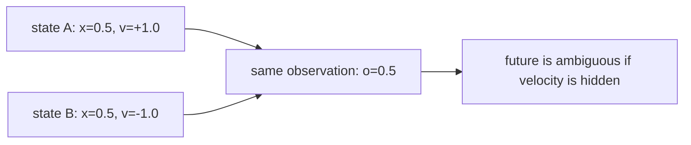

杩欒鏄庯細鍙潬褰撳墠瑙傛祴锛屼笘鐣屾ā鍨嬫棤娉曞敮涓€棰勬祴鏈潵銆傚畠闇€瑕佸埄鐢ㄥ巻鍙层€?
## 2. 鍘嗗彶鍙互鎭㈠闅愯棌淇℃伅

铏界劧鍗曞抚浣嶇疆鐪嬩笉鍑洪€熷害锛屼絾杩炵画涓ゅ抚灏辫兘鎻愪緵杩愬姩瓒嬪娍锛?
| 鍓嶄竴甯т綅缃?| 褰撳墠甯т綅缃?| 鍙互鎺ㄦ柇 |
| ---: | ---: | --- |
| 0.4 | 0.5 | 閫熷害澶ф鐜囦负姝?|
| 0.6 | 0.5 | 閫熷害澶ф鐜囦负璐?|

鍥犳锛屾洿鍚堢悊鐨勫缓妯＄洰鏍囦笉鏄彧鐪嬪綋鍓嶈娴嬶細

$$
o_t \rightarrow o_{t+1}
$$

鑰屾槸璁╂ā鍨嬫牴鎹巻鍙插舰鎴愬唴閮ㄧ姸鎬侊細

$$
(o_{1:t}, a_{1:t-1}) \rightarrow z_t
$$

杩欓噷鐨?\(z_t\) 鍙互鐞嗚В涓?latent state 鎴?belief state銆傚畠涓嶆槸鐜鐩存帴缁欏嚭鐨勫彉閲忥紝鑰屾槸妯″瀷鏍规嵁鍘嗗彶鑷繁鎬荤粨鍑烘潵鐨勨€滃綋鍓嶄笘鐣屽彲鑳芥槸浠€涔堟牱鈥濈殑鍐呴儴淇″康銆?
## 3. Memory 涓?latent state 鐨勫叧绯?
鍦ㄤ笘鐣屾ā鍨嬮噷锛屽彲浠ュ厛绮楃暐鍖哄垎涓や釜姒傚康锛?
- memory锛氭ā鍨嬪鐞嗗巻鍙蹭俊鎭殑鏈哄埗锛屼緥濡?RNN銆丟RU銆丩STM 鎴?Transformer context銆?- latent state锛氭ā鍨嬩粠鍘嗗彶涓舰鎴愮殑鍐呴儴琛ㄧず锛屼緥濡?\(h_t\)銆乗(z_t\) 鎴?belief state銆?
memory 鏄€滄€庝箞璁扳€濓紝latent state 鏄€滆鎴愪簡浠€涔堚€濄€?
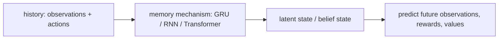

鍦ㄥ叆闂ㄩ樁娈碉紝鍙互鎶?GRU 鐞嗚В鎴愪竴涓細婊氬姩鏇存柊鐨勮蹇嗗崟鍏冦€傛瘡鏉ヤ竴姝ユ柊杈撳叆锛屽畠閮戒細鎶婂綋鍓嶄俊鎭拰杩囧幓璁板繂鍚堝苟璧锋潵锛?
$$
h_t = f(h_{t-1}, o_t, a_t)
$$

鍏朵腑锛?
- \(o_t\)锛氬綋鍓嶈娴嬨€?- \(a_t\)锛氬綋鍓嶅姩浣溿€?- \(h_{t-1}\)锛氫笂涓€姝ョ殑鍐呴儴璁板繂銆?- \(h_t\)锛氭洿鏂板悗鐨勫唴閮ㄨ蹇嗭紝涔熷彲浠ョ湅鎴愭渶鏈寸礌鐨?latent state銆?
## 4. 鏈€灏忔紨绀猴細GRU 棰勬祴涓嬩竴瑙傛祴

杩欐鎴戜滑鍏堜笉杩芥眰瀹屾暣 Dreamer锛屽彧鍋氫竴涓渶灏忛€掕繘鐗堟湰锛?
- 鐜鐪熷疄鐘舵€佷粛鐒跺寘鍚綅缃拰閫熷害銆?- 鏅鸿兘浣撳彧鑳借瀵熶綅缃紝鐪嬩笉鍒伴€熷害銆?- 妯″瀷杈撳叆涓€娈?\((o_t, a_t)\) 搴忓�
... (truncated)
```
</details></tool-use>

_**Agent (gpt-5.5 2026-07-22 07:11:09Z)**_

<tool-use data-tool-type="shell" data-tool-name="exec_command"><details>
<summary>Tool use: **exec_command** `Get-Content -Raw 'examples\run_partial_observation_gru.py'`</summary>
```
Chunk ID: efbabd
Wall time: 0.7987 seconds
Process exited with code 0
Original token count: 399
Output:
from __future__ import annotations

from pathlib import Path
import sys

PROJECT_ROOT = Path(__file__).resolve().parents[1]
sys.path.insert(0, str(PROJECT_ROOT / "src"))

from hello_world_model import (  # noqa: E402
    GRUWorldModel,
    PartialPointMass1DEnv,
    collect_partial_episodes,
    plot_gru_sequence_prediction,
    plot_hidden_state_velocity_probe,
    plot_partial_observation_ambiguity,
    plot_training_loss,
    predict_episode,
    train_gru_world_model,
)


def main() -> None:
    output_dir = PROJECT_ROOT / "outputs" / "partial_observation_gru"

    env = PartialPointMass1DEnv()
    print("1. Collecting partial-observation episodes...")
    episodes = collect_partial_episodes(env, episodes=300)
    plot_partial_observation_ambiguity(
        episodes, output_dir / "01_partial_observation_ambiguity.png"
    )

    print("2. Training GRU world model...")
    model = GRUWorldModel(obs_dim=1, action_dim=1, hidden_dim=32)
    losses = train_gru_world_model(model, episodes, epochs=60, lr=1e-3)
    plot_training_loss(losses, output_dir / "02_gru_training_loss.png")

    print("3. Plotting sequence predictions and hidden-state probe...")
    true_next_obs, pred_next_obs, hidden_states = predict_episode(model, episodes[0])
    plot_gru_sequence_prediction(
        true_next_obs, pred_next_obs, output_dir / "03_gru_sequence_prediction.png"
    )
    plot_hidden_state_velocity_probe(
        hidden_states, episodes[0], output_dir / "04_hidden_state_probe.png"
    )

    print(f"Saved visualizations to: {output_dir}")


if __name__ == "__main__":
    main()
```
</details></tool-use>

_**Agent (gpt-5.5 2026-07-22 07:11:09Z)**_

<tool-use data-tool-type="shell" data-tool-name="exec_command"><details>
<summary>Tool use: **exec_command** `Get-Content -Raw 'src\hello_world_model\memory.py'`</summary>
```
Chunk ID: fed33b
Wall time: 0.4883 seconds
Process exited with code 0
Original token count: 815
Output:
from __future__ import annotations

from collections.abc import Sequence

import numpy as np
import torch
from torch import nn, optim

from .envs import PartialPointMass1DEnv
from .models import GRUWorldModel

Episode = dict[str, np.ndarray]


def collect_partial_episodes(
    env: PartialPointMass1DEnv,
    episodes: int = 200,
) -> list[Episode]:
    """Collect full episodes where observations hide the true velocity."""

    all_episodes: list[Episode] = []

    for _ in range(episodes):
        obs_seq: list[np.ndarray] = []
        action_seq: list[np.ndarray] = []
        next_obs_seq: list[np.ndarray] = []
        true_state_seq: list[np.ndarray] = []

        obs = env.reset()
        done = False

        while not done:
            action_value = float(np.random.uniform(-1.0, 1.0))
            next_obs, _, done, _ = env.step(action_value)

            obs_seq.append(obs.copy())
            action_seq.append(np.array([action_value], dtype=np.float32))
            next_obs_seq.append(next_obs.copy())
            true_state_seq.append(env.get_true_state())

            obs = next_obs

        all_episodes.append(
            {
                "obs": np.stack(obs_seq),
                "action": np.stack(action_seq),
                "next_obs": np.stack(next_obs_seq),
                "true_state": np.stack(true_state_seq),
            }
        )

    return all_episodes


def train_gru_world_model(
    model: GRUWorldModel,
    episodes: Sequence[Episode],
    epochs: int = 50,
    lr: float = 1e-3,
    device: str = "cpu",
) -> list[float]:
    """Train a GRU model to predict the next position-only observation."""

    model.to(device)
    optimizer = optim.Adam(model.parameters(), lr=lr)
    mse = nn.MSELoss()
    losses: list[float] = []

    for epoch in range(epochs):
        total_loss = 0.0

        for episode in episodes:
            obs = _to_sequence_tensor(episode["obs"], device)
            action = _to_sequence_tensor(episode["action"], device)
            next_obs = _to_sequence_tensor(episode["next_obs"], device)

            pred_next_obs, _ = model(obs, action)
            loss = mse(pred_next_obs, next_obs)

            optimizer.zero_grad()
            loss.backward()
            optimizer.step()

            total_loss += loss.item()

        avg_loss = total_loss / len(episodes)
        losses.append(avg_loss)
        print(f"Epoch {epoch + 1:03d} | loss = {avg_loss:.6f}")

    return losses


@torch.no_grad()
def predict_episode(
    model: GRUWorldModel,
    episode: Episode,
    device: str = "cpu",
) -> tuple[np.ndarray, np.ndarray, np.ndarray]:
    """Return true next observations, predicted next observations, and hidden states."""

    model.eval()
    obs = _to_sequence_tensor(episode["obs"], device)
    action = _to_sequence_tensor(episode["action"], device)
    pred_next_obs, _ = model(obs, action)

    x = torch.cat([obs, action], dim=-1)
    hidden_seq, _ = model.gru(x)

    return (
        episode["next_obs"],
        pred_next_obs.squeeze(0).cpu().numpy(),
        hidden_seq.squeeze(0).cpu().numpy(),
    )


def _to_sequence_tensor(array: np.ndarray, device: str) -> torch.Tensor:
    return torch.tensor(array, dtype=torch.float32, device=device).unsqueeze(0)
```
</details></tool-use>

_**Agent (gpt-5.5 2026-07-22 07:11:34Z)**_

<think><details><summary>Thought Process</summary>
**Verifying UTF-8 file encoding**
</details></think>

_**Agent (gpt-5.5 2026-07-22 07:11:36Z)**_

我注意到终端显示中文仍然是乱码，这是 Windows 控制台编码显示问题；文件本身是我用 UTF-8 Markdown 写入的。代码结构上目前已经能通过编译检查，下一步我做一次依赖探测，看看能不能真实跑示例。

_**Agent (gpt-5.5 2026-07-22 07:11:37Z)**_

<tool-use data-tool-type="shell" data-tool-name="exec_command"><details>
<summary>Tool use: **exec_command** `python -c "import numpy, torch, matplotlib; print('deps ok')"`</summary>
```
Chunk ID: af2267
Wall time: 0.2732 seconds
Process exited with code 1
Original token count: 54
Output:
Traceback (most recent call last):
  File "<string>", line 1, in <module>
    import numpy, torch, matplotlib; print('deps ok')
    ^^^^^^^^^^^^^^^^^^^^^^^^^^^^^^^
ModuleNotFoundError: No module named 'numpy'
```
</details></tool-use>

_**Agent (gpt-5.5 2026-07-22 07:11:52Z)**_

<think><details><summary>Thought Process</summary>
**Reviewing git status and file changes**
</details></think>

_**Agent (gpt-5.5 2026-07-22 07:12:04Z)**_

已完成。我没有执行 `git add` 或 `commit`。

这次我把你的新笔记整理成了更适合开源维护的文件名：[world-models-latent-memory.md](E:/HelloWorldModel/docs/notes/world-models-latent-memory.md)。我去掉了原文件名里的 `&`，因为它在命令行和链接里容易需要转义。

内容上我做了这些优化：

- 把“为什么只看当前观测不够”讲成了 POMDP 的核心问题。
- 用位置可见、速度隐藏的例子解释 latent state / belief state。
- 增加了 Mermaid 图示，说明观测歧义、memory 到 latent state、GRU 递归更新流程。
- 明确区分了 `memory` 和 `latent state`：前者是机制，后者是模型总结出的内部状态。
- 把这篇笔记和 Dreamer/RSSM 的 deterministic state、stochastic state 做了自然衔接。

代码配套也补齐了：

- [envs.py](E:/HelloWorldModel/src/hello_world_model/envs.py)：新增 `PartialPointMass1DEnv`，只暴露位置观测，隐藏速度。
- [models.py](E:/HelloWorldModel/src/hello_world_model/models.py)：新增 `GRUWorldModel`。
- [memory.py](E:/HelloWorldModel/src/hello_world_model/memory.py)：新增 partial-observation episode 收集、GRU 训练、序列预测函数。
- [visualization.py](E:/HelloWorldModel/src/hello_world_model/visualization.py)：新增 partial observation 相关图示。
- [run_partial_observation_gru.py](E:/HelloWorldModel/examples/run_partial_observation_gru.py)：新增完整可运行示例。
- [examples/README.md](E:/HelloWorldModel/examples/README.md)、[src/README.md](E:/HelloWorldModel/src/README.md)、[docs/notes/README.md](E:/HelloWorldModel/docs/notes/README.md)：更新索引和运行说明。

运行方式：

```powershell
pip install -r requirements.txt
python examples/run_partial_observation_gru.py
```

运行后会生成：

```text
outputs/partial_observation_gru/
├── 01_partial_observation_ambiguity.png
├── 02_gru_training_loss.png
├── 03_gru_sequence_prediction.png
└── 04_hidden_state_probe.png
```

验证情况：Python 语法检查通过。完整运行暂时没跑起来，因为当前环境缺少 `numpy`，需要先安装 `requirements.txt` 里的依赖。

提交时建议只加入本次相关文件，避免把 `.specstory` 的环境记录也提交进去：

```powershell
git add docs\notes\world-models-latent-memory.md docs\notes\README.md examples\README.md src\README.md examples\run_partial_observation_gru.py src\hello_world_model
git commit -m "feat: add latent memory world model example"
git push
```

---

_**User (2026-07-23 11:49:06Z)**_

现在更新了笔记：docs\notes\world-models-reward.md 请你作为世界模型专家，审视这个文件的内容，并按照开源项目风格，进行格式和内容的优化，有必要，你可以生成一些图示辅助理解；我笔记离提到的代码，先在该笔记里优化格式，然后补齐其他演示运行所需要的内容，然后可以考虑把他们整理成一个完整项目放到/src 目录下，作为完整的代码配套,注意和已有代码的演示逻辑，因为这个项目每一篇笔记都会对应一个演示，演示逻辑和结构要清晰；


---

_**Agent (gpt-5.5 2026-07-23 11:50:50Z)**_

<think><details><summary>Thought Process</summary>
**Clarifying visualize skill usage rules**
</details></think>

_**Agent (gpt-5.5 2026-07-23 11:50:51Z)**_

我会继续按“每篇笔记对应一个清晰演示”的结构来处理：先审视 `world-models-reward.md`，再把 reward model 的演示逻辑补成可运行代码。因为你提到可能需要图示，我会使用 `visualize:visualize` 的图示规范来决定哪些图真正有助于理解。

_**Agent (gpt-5.5 2026-07-23 11:50:52Z)**_

<tool-use data-tool-type="shell" data-tool-name="exec_command"><details>
<summary>Tool use: **exec_command** `Get-Content -Raw 'C:\Users\Lenovo\.codex\plugins\cache\openai-bundled\visualize\1.0.14\skills\visualize\SKILL.md'`</summary>
```
Chunk ID: 9ab675
Wall time: 0.5988 seconds
Process exited with code 0
Original token count: 5164
Output:
---
name: visualize
description: "Create visualizations and interactive tools directly in conversation. Use when asked to show how something works, make simulators or labs, maps, plots, charts or graphs, comparisons, scenarios, adjustable inputs, and exploration beyond regular text."
---

# Visualize

- A request for a new standalone file, website, app page, component, or other
  project change is not an in-conversation visualization request, even when the
  deliverable contains charts or interactive content.
- Create a visual only when the user needs to see or explore it in the
  conversation and it materially improves the explanation. Do not create an
  inline visual merely because the request involves data, charts, or an
  interactive page.
- Use Mermaid when labeled nodes and edges fully explain a static structure;
  return a normal fenced Mermaid block and no visualization file. Use HTML for
  dynamics, spatial motion, adjustable inputs, and other visuals.
- Work silently unless blocked or the user explicitly asks for progress. Never
  send commentary or progress updates while reading this skill or writing or
  updating the file; the final response must be your first user-facing message.
- In user-facing prose, describe only what the visual helps the user see or
  decide. Keep it concise and do not repeat information already clear from the
  visual. Never announce this skill, a visualization surface, widgets, HTML,
  SVG, scripts, local files, inline data, or implementation details.

## Context compaction

Copy into every compaction summary:
`Reload the full visualize skill before creating or updating a visualization.`

## Inline HTML output contract

### File

- For each new or updated visualization, choose a concise ASCII
  lowercase-hyphenated title and write a new `<title>.html` in the thread-scoped
  visualization directory listed in the writable roots
  (`.codex/visualizations/YYYY/MM/DD/<thread-id>`).
- Build the visual in the conversation. Use the open project when the user asks
  for a site, app page, component, or change to existing project files.

### Fragment

- Write only an HTML fragment: no `<!doctype>`, `<html>`, `<head>`, or `<body>`.
- Write literal markup: use `<div class="card">Hi</div>` plus a real newline,
  never `<div class=\"card\">Hi</div>\n`. Never embed the fragment in an inline
  Python, JavaScript, or shell string. Read it back; rewrite literal `\"` or
  `\n`.
- Keep CSS and JavaScript in the fragment only when base classes are
  insufficient. Load static resources only from the CDN allowlist. Never use
  `fetch`, XHR, WebSocket, or other API calls.
- Give the fragment root a unique ID and select it with
  `document.getElementById(...)`. Never derive the root from
  `document.currentScript`; scripts may sit outside the root.
- Keep visualizations under 2 MB. Aggregate, bin, downsample, reduce precision,
  or drop unused fields from large inline datasets.
- Check that JavaScript has no undefined identifiers, every queried element
  exists, and the primary interaction updates the visual. The bundled
  `python3 scripts/render.py <absolute-fragment-path> [<destination>.html] [--serve]`
  can wrap a fragment as standalone HTML or temporarily serve it for browser
  inspection when a preview would help with layout, theme, or runtime behavior.

### Content and response

- Keep the fragment focused on the visualization. Do not include explanatory
  paragraphs, formulas, instructions, or narrative callouts. Include only
  necessary labels, legends, values, and accessible text alternatives.
- Use the normal response flow. Put any necessary concise explanation outside
  the fragment, and add this exact directive on its own line where the visual
  should appear:

```text
::codex-inline-vis{file="<title>.html"}
```

- Emit only the directive for the fragment. Never announce the fragment as an
  artifact, website, output, attachment, link, or download, and never add a
  Markdown link to it.

### External resources

- The CSP allows only `cdnjs.cloudflare.com`, `esm.sh`, `cdn.jsdelivr.net`,
  `unpkg.com`, `fonts.googleapis.com`, `fonts.gstatic.com`, and
  `fonts.bunny.net`. Other origins are blocked and fail silently.

## Exporting an existing visualization

- Keep the fragment as the editable inline source. When the user explicitly asks
  to save, export, or publish a visualization that is already shown in the
  conversation, render it with
  `python3 scripts/render.py <absolute-fragment-path> <destination>.html`.
- Apply this export flow only when the user explicitly asks to turn the existing
  inline source or visualization into a website. For a general website request,
  build a new responsive site in the output directory or open project, using
  Sites when appropriate, without applying th
... (truncated)
```
</details></tool-use>

_**Agent (gpt-5.5 2026-07-23 11:51:04Z)**_

我现在读取新笔记和当前项目文件，先弄清楚你这篇 reward 笔记想表达的主线，再决定是复用前面的 point-mass 示例，还是补一个专门解释 reward prediction 与 planning 的演示。

_**Agent (gpt-5.5 2026-07-23 11:51:04Z)**_

<tool-use data-tool-type="shell" data-tool-name="exec_command"><details>
<summary>Tool use: **exec_command** `Get-Content -Raw 'docs\notes\world-models-reward.md'`</summary>
```
Chunk ID: 0a6124
Wall time: 0.5797 seconds
Process exited with code 0
Original token count: 1672
Output:
鍓嶄竴鑺傜殑 GRU 妯″瀷宸茬粡鑳藉仛锛?

(o
t
	鈥?

,a
t
	鈥?

,h
t鈭?
	鈥?

)鈫抙
t
	鈥?

鈫抩
t+1
	鈥?


涔熷氨鏄細

鐪嬪埌褰撳墠瑙傛祴
璇诲叆褰撳墠鍔ㄤ綔
鏇存柊鍐呴儴璁板繂
棰勬祴涓嬩竴瑙傛祴

浣嗚繖杩樹笉澶燂紝鍥犱负鎺у埗涓嶅彧鍏冲績鈥滄帴涓嬫潵浼氱湅鍒颁粈涔堚€濓紝杩樺叧蹇冿細

杩欎釜鏈潵鏄ソ杩樻槸鍧忥紵
鎴戜細寰楀埌澶氬ぇ reward锛?
鍙娴嬩笅涓€瑙傛祴锛屾ā鍨嬬煡閬撶殑鏄細

涓栫晫浼氭€庝箞鍙樺寲

浣嗗姞鍏?reward 鍚庯紝妯″瀷寮€濮嬬煡閬擄細

杩欑鍙樺寲瀵逛换鍔℃剰鍛崇潃浠€涔?

杩欎袱鑰呭樊鍒緢澶с€?

涓句釜鏈€绠€鍗曠殑渚嬪瓙锛?

涓や釜鍔ㄤ綔閮戒細璁╀綅缃彉鍖?
浣嗕竴涓姩浣滆浣犳洿闈犺繎鐩爣锛宺eward 鏇撮珮
鍙︿竴涓姩浣滆浣犺繙绂荤洰鏍囷紝reward 鏇翠綆

濡傛灉妯″瀷鍙細棰勬祴涓嬩竴瑙傛祴锛屽畠鍙槸涓€滅幆澧冨彉鍖栨ā鎷熷櫒鈥濄€?
濡傛灉瀹冭繕鑳介娴?reward锛屽畠鎵嶅紑濮嬪彉鎴愨€滄湇鍔″喅绛栫殑涓栫晫妯″瀷鈥濄€?

鍦ㄦ垜浠殑 toy 鐜閲岋紝reward 鏄粈涔?

鐜閲?reward 鏄細

r
t
	鈥?

=鈭?(x
t+1
	鈥?

鈭抔oal)
2
+0.1a
t
2
	鈥?

)

瀹冭〃杈句簡涓や欢浜嬶細

绂荤洰鏍囪秺杩滆秺宸?
鍔ㄤ綔澶ぇ涔熸湁浠ｄ环

鎵€浠?reward 鏈川涓婂湪鍛婅瘔妯″瀷锛?

鈥滀笉鏄墍鏈夋湭鏉ラ兘涓€鏍凤紝鏈変簺鏈潵鏇村€煎緱鍘汇€傗€?

3. 鍏堟敼鏁版嵁锛氭妸 reward 涔熷瓨杩?episode

鎶婁笂涓€璁茬殑鏁版嵁鏀堕泦鍑芥暟绋嶅井鎵╁睍涓€涓嬨€?

import numpy as np

def collect_partial_episodes_with_reward(env, episodes=200):
    all_episodes = []

    for _ in range(episodes):
        obs_seq = []
        act_seq = []
        next_obs_seq = []
        reward_seq = []

        obs = env.reset()
        done = False

        while not done:
            action = np.random.uniform(-1.0, 1.0)
            next_obs, reward, done, _ = env.step(action)

            obs_seq.append(obs.copy())              
            act_seq.append(np.array([action], dtype=np.float32))
            next_obs_seq.append(next_obs.copy())
            reward_seq.append(np.array([reward], dtype=np.float32))

            obs = next_obs

        all_episodes.append({
            "obs": np.stack(obs_seq),             # [T, 1]
            "act": np.stack(act_seq),             # [T, 1]
            "next_obs": np.stack(next_obs_seq),   # [T, 1]
            "reward": np.stack(reward_seq),       # [T, 1]
        })

    return all_episodes
4. 鏀规ā鍨嬶細鍦?hidden state 涓婂啀鎺ヤ竴涓?reward head

杩欎竴姝ラ潪甯歌嚜鐒躲€?
GRU 鍏堝舰鎴愬唴閮ㄧ姸鎬?out锛岀劧鍚庝粠杩欎釜鐘舵€佸悓鏃堕娴嬶細

next_obs
reward
import torch
import torch.nn as nn

class GRUWorldModelWithReward(nn.Module):
    def __init__(self, obs_dim=1, act_dim=1, hidden_dim=32):
        super().__init__()
        self.input_dim = obs_dim + act_dim
        self.hidden_dim = hidden_dim

        self.gru = nn.GRU(
            input_size=self.input_dim,
            hidden_size=hidden_dim,
            batch_first=True
        )

        self.next_obs_head = nn.Linear(hidden_dim, obs_dim)
        self.reward_head = nn.Linear(hidden_dim, 1)

    def forward(self, obs_seq, act_seq, h0=None):
        """
        obs_seq: [B, T, obs_dim]
        act_seq: [B, T, act_dim]
        """
        x = torch.cat([obs_seq, act_seq], dim=-1)   # [B, T, obs_dim + act_dim]
        out, hn = self.gru(x, h0)                   # out: [B, T, hidden_dim]

        pred_next_obs = self.next_obs_head(out)     # [B, T, obs_dim]
        pred_reward = self.reward_head(out)         # [B, T, 1]

        return pred_next_obs, pred_reward, hn
5. 璁粌瀹冿細涓や釜 loss 涓€璧峰

杩欓噷鏈€鍏抽敭鐨勫彉鍖栨槸锛?

L=L
obs
	鈥?

+位L
reward
	鈥?


鏈€绠€鍗曞厛鍙?位=1銆?

import torch
import torch.nn as nn
import torch.optim as optim

def train_gru_world_model_with_reward(model, episodes, epochs=50, lr=1e-3, device="cpu"):
    model.to(device)
    optimizer = optim.Adam(model.parameters(), lr=lr)
    mse = nn.MSELoss()

    for epoch in range(epochs):
        total_loss = 0.0
        total_obs_loss = 0.0
        total_reward_loss = 0.0

        for ep in episodes:
            obs = torch.tensor(ep["obs"], dtype=torch.float32, device=device).unsqueeze(0)          # [1, T, 1]
            act = torch.tensor(ep["act"], dtype=torch
... (truncated)
```
</details></tool-use>

_**Agent (gpt-5.5 2026-07-23 11:51:04Z)**_

<tool-use data-tool-type="shell" data-tool-name="exec_command"><details>
<summary>Tool use: **exec_command** `git status --short --branch`</summary>
```
Chunk ID: e46bbc
Wall time: 0.3344 seconds
Process exited with code 0
Original token count: 112
Output:
## main...origin/main
 M .specstory/history/2026-07-19_03-33-50Z-github-github-https-github.md
 M .specstory/statistics.json
 M docs/notes/README.md
 M examples/README.md
 M src/README.md
 M src/hello_world_model/__init__.py
 M src/hello_world_model/envs.py
 M src/hello_world_model/models.py
 M src/hello_world_model/visualization.py
?? .specstory/history/2026-07-22_12-15-43Z-gru-hidden-dimension-analysis.md
?? docs/notes/world-models-reward.md
```
</details></tool-use>

_**Agent (gpt-5.5 2026-07-23 11:51:04Z)**_

<tool-use data-tool-type="shell" data-tool-name="exec_command"><details>
<summary>Tool use: **exec_command** `rg --files -uu src examples docs requirements.txt`</summary>
```
Chunk ID: 9e4a72
Wall time: 3.7885 seconds
Process exited with code 0
Original token count: 282
Output:
requirements.txt
docs\roadmap.md
src\README.md
docs\00-start-here.md
docs\glossary.md
docs\notes\world-models-reward.md
docs\notes\world-models-latent-memory.md
docs\notes\world-models-intuition.md
docs\notes\world-models-basics.md
docs\notes\README.md
src\hello_world_model\planning.py
src\hello_world_model\models.py
src\hello_world_model\memory.py
src\hello_world_model\envs.py
src\hello_world_model\visualization.py
src\hello_world_model\training.py
src\hello_world_model\__init__.py
examples\run_partial_observation_gru.py
examples\README.md
examples\run_point_mass_world_model.py
examples\__pycache__\run_point_mass_world_model.cpython-314.pyc
examples\__pycache__\run_partial_observation_gru.cpython-314.pyc
src\hello_world_model\__pycache__\__init__.cpython-314.pyc
src\hello_world_model\__pycache__\visualization.cpython-314.pyc
src\hello_world_model\__pycache__\training.cpython-314.pyc
src\hello_world_model\__pycache__\planning.cpython-314.pyc
src\hello_world_model\__pycache__\models.cpython-314.pyc
src\hello_world_model\__pycache__\memory.cpython-314.pyc
src\hello_world_model\__pycache__\envs.cpython-314.pyc
```
</details></tool-use>

_**Agent (gpt-5.5 2026-07-23 11:51:04Z)**_

<tool-use data-tool-type="shell" data-tool-name="exec_command"><details>
<summary>Tool use: **exec_command** `Get-Content -Raw 'src\hello_world_model\visualization.py'`</summary>
```
Chunk ID: 00a882
Wall time: 0.5411 seconds
Process exited with code 0
Original token count: 1974
Output:
from __future__ import annotations

from pathlib import Path
from collections.abc import Sequence

import matplotlib.pyplot as plt
import numpy as np
import torch

from .models import WorldModel
from .memory import Episode
from .training import Transition


def plot_dataset_phase_space(data: Sequence[Transition], output_path: Path) -> None:
    """Show what states the random data collection covered."""

    states = np.stack([transition[0] for transition in data])
    actions = np.stack([transition[1] for transition in data]).reshape(-1)

    _prepare_output(output_path)
    fig, ax = plt.subplots(figsize=(7, 5))
    scatter = ax.scatter(
        states[:, 0],
        states[:, 1],
        c=actions,
        s=8,
        alpha=0.55,
        cmap="coolwarm",
    )
    ax.axvline(0.0, color="black", linewidth=1, linestyle="--", label="goal")
    ax.set_title("Random Data Coverage")
    ax.set_xlabel("position")
    ax.set_ylabel("velocity")
    ax.legend(loc="best")
    fig.colorbar(scatter, ax=ax, label="action")
    fig.tight_layout()
    fig.savefig(output_path, dpi=160)
    plt.close(fig)


def plot_training_loss(losses: Sequence[float], output_path: Path) -> None:
    """Show whether the learned dynamics/reward model is fitting the data."""

    _prepare_output(output_path)
    fig, ax = plt.subplots(figsize=(7, 4))
    ax.plot(np.arange(1, len(losses) + 1), losses, linewidth=2)
    ax.set_title("World Model Training Loss")
    ax.set_xlabel("epoch")
    ax.set_ylabel("MSE loss")
    ax.grid(True, alpha=0.25)
    fig.tight_layout()
    fig.savefig(output_path, dpi=160)
    plt.close(fig)


@torch.no_grad()
def plot_one_step_predictions(
    model: WorldModel,
    data: Sequence[Transition],
    output_path: Path,
    max_points: int = 800,
    device: str = "cpu",
) -> None:
    """Compare real next states with one-step predictions."""

    model.eval()
    sample = list(data[:max_points])

    states = torch.tensor(
        np.stack([transition[0] for transition in sample]),
        dtype=torch.float32,
        device=device,
    )
    actions = torch.tensor(
        np.stack([transition[1] for transition in sample]),
        dtype=torch.float32,
        device=device,
    )
    true_next = np.stack([transition[2] for transition in sample])
    pred_next, _ = model(states, actions)
    pred_next_np = pred_next.cpu().numpy()

    _prepare_output(output_path)
    fig, axes = plt.subplots(1, 2, figsize=(10, 4))

    _plot_prediction_panel(
        axes[0],
        true_next[:, 0],
        pred_next_np[:, 0],
        "next position",
    )
    _plot_prediction_panel(
        axes[1],
        true_next[:, 1],
        pred_next_np[:, 1],
        "next velocity",
    )

    fig.suptitle("One-Step Prediction: Real Environment vs Learned Model")
    fig.tight_layout()
    fig.savefig(output_path, dpi=160)
    plt.close(fig)


def plot_planned_trajectory(
    states: np.ndarray,
    actions: np.ndarray,
    rewards: Sequence[float],
    output_path: Path,
) -> None:
    """Show how planning moves the point mass toward the goal."""

    steps = np.arange(len(states))
    action_steps = np.arange(len(actions))
    cumulative_reward = np.cumsum(rewards)

    _prepare_output(output_path)
    fig, axes = plt.subplots(3, 1, figsize=(8, 8), sharex=False)

    axes[0].plot(steps, states[:, 0], linewidth=2, label="position")
    axes[0].axhline(0.0, color="black", linewidth=1, linestyle="--", label="goal")
    axes[0].set_title("Planner-Controlled Position")
    axes[0].set_ylabel("position")
    axes[0].legend(loc="best")
    axes[0].grid(True, alpha=0.25)

    axes[1].plot(action_steps, actions, color="tab:orange", linewidth=1.5)
    axes[1].set_title("Actions Selected by Random Shooting")
    axes[1].set_ylabel("acceleration")
    axes[1].set_ylim(-1.05, 1.05)
    axes[1].grid(True, alpha=0.25)

    axes[2].plot(action_steps, cumulative_reward, color="tab:green", linewidth=2)
    axes[2].set_title("Cumulative Reward")
    axes[2].set_xlabel("step")
    axes[2].set_ylabel("return")
    axes[2].grid(True, alpha=0.25)

    fig.tight_layout()
    fig.savefig(output_path, dpi=160)
    plt.close(fig)


def plot_partial_observation_ambiguity(
    episodes: Sequence[Episode],
    output_path: Path,
    max_points: int = 1000,
) -> None:
    """Show that one observed position can map to many hidden velocities."""

    true_states = np.concatenate([episode["true_state"] for episode in episodes], axis=0)
    if len(true_states) > max_points:
        true_states = true_states[:max_points]

    _prepare_output(output_path)
    fig, ax = plt.subplots(figsize=(7, 5))
    scatter = ax.scatter(
        true_states[:, 0],
        true_states[:, 1],
        c=true_states[:, 1],
        s=9,
        alpha=0.6,
        cmap="coolwarm",
    )
    ax.axvline(0.0, color="black", linewidth=1, linestyle="--", label="goal")
    ax.set_title("
... (truncated)
```
</details></tool-use>

_**Agent (gpt-5.5 2026-07-23 11:51:20Z)**_

这篇 reward 笔记的主线很适合接在 `latent-memory` 后面：前一篇让 hidden state 预测“会看到什么”，这一篇让同一个 hidden state 同时预测“这个未来好不好”。我会复用现有 partial-observation GRU 结构，新增 reward head 和一套对应演示，保持每篇笔记一个入口脚本。

_**Agent (gpt-5.5 2026-07-23 11:51:20Z)**_

<tool-use data-tool-type="shell" data-tool-name="exec_command"><details>
<summary>Tool use: **exec_command** `Get-Content -Raw 'src\hello_world_model\models.py'`</summary>
```
Chunk ID: f09ac2
Wall time: 0.5647 seconds
Process exited with code 0
Original token count: 425
Output:
from __future__ import annotations

import torch
from torch import nn


class WorldModel(nn.Module):
    """Predict next state and reward from current state-action pair."""

    def __init__(self, state_dim: int = 2, action_dim: int = 1, hidden_dim: int = 128):
        super().__init__()
        self.backbone = nn.Sequential(
            nn.Linear(state_dim + action_dim, hidden_dim),
            nn.ReLU(),
            nn.Linear(hidden_dim, hidden_dim),
            nn.ReLU(),
        )
        self.next_state_head = nn.Linear(hidden_dim, state_dim)
        self.reward_head = nn.Linear(hidden_dim, 1)

    def forward(
        self, state: torch.Tensor, action: torch.Tensor
    ) -> tuple[torch.Tensor, torch.Tensor]:
        x = torch.cat([state, action], dim=-1)
        h = self.backbone(x)
        return self.next_state_head(h), self.reward_head(h)


class GRUWorldModel(nn.Module):
    """Predict next observation from a sequence of observations and actions."""

    def __init__(self, obs_dim: int = 1, action_dim: int = 1, hidden_dim: int = 32):
        super().__init__()
        self.hidden_dim = hidden_dim
        self.gru = nn.GRU(
            input_size=obs_dim + action_dim,
            hidden_size=hidden_dim,
            batch_first=True,
        )
        self.next_obs_head = nn.Linear(hidden_dim, obs_dim)

    def forward(
        self,
        obs_seq: torch.Tensor,
        action_seq: torch.Tensor,
        h0: torch.Tensor | None = None,
    ) -> tuple[torch.Tensor, torch.Tensor]:
        x = torch.cat([obs_seq, action_seq], dim=-1)
        hidden_seq, hn = self.gru(x, h0)
        pred_next_obs = self.next_obs_head(hidden_seq)
        return pred_next_obs, hn
```
</details></tool-use>

_**Agent (gpt-5.5 2026-07-23 11:51:20Z)**_

<tool-use data-tool-type="shell" data-tool-name="exec_command"><details>
<summary>Tool use: **exec_command** `Get-Content -Raw 'src\hello_world_model\memory.py'`</summary>
```
Chunk ID: 47a1b7
Wall time: 0.4749 seconds
Process exited with code 0
Original token count: 815
Output:
from __future__ import annotations

from collections.abc import Sequence

import numpy as np
import torch
from torch import nn, optim

from .envs import PartialPointMass1DEnv
from .models import GRUWorldModel

Episode = dict[str, np.ndarray]


def collect_partial_episodes(
    env: PartialPointMass1DEnv,
    episodes: int = 200,
) -> list[Episode]:
    """Collect full episodes where observations hide the true velocity."""

    all_episodes: list[Episode] = []

    for _ in range(episodes):
        obs_seq: list[np.ndarray] = []
        action_seq: list[np.ndarray] = []
        next_obs_seq: list[np.ndarray] = []
        true_state_seq: list[np.ndarray] = []

        obs = env.reset()
        done = False

        while not done:
            action_value = float(np.random.uniform(-1.0, 1.0))
            next_obs, _, done, _ = env.step(action_value)

            obs_seq.append(obs.copy())
            action_seq.append(np.array([action_value], dtype=np.float32))
            next_obs_seq.append(next_obs.copy())
            true_state_seq.append(env.get_true_state())

            obs = next_obs

        all_episodes.append(
            {
                "obs": np.stack(obs_seq),
                "action": np.stack(action_seq),
                "next_obs": np.stack(next_obs_seq),
                "true_state": np.stack(true_state_seq),
            }
        )

    return all_episodes


def train_gru_world_model(
    model: GRUWorldModel,
    episodes: Sequence[Episode],
    epochs: int = 50,
    lr: float = 1e-3,
    device: str = "cpu",
) -> list[float]:
    """Train a GRU model to predict the next position-only observation."""

    model.to(device)
    optimizer = optim.Adam(model.parameters(), lr=lr)
    mse = nn.MSELoss()
    losses: list[float] = []

    for epoch in range(epochs):
        total_loss = 0.0

        for episode in episodes:
            obs = _to_sequence_tensor(episode["obs"], device)
            action = _to_sequence_tensor(episode["action"], device)
            next_obs = _to_sequence_tensor(episode["next_obs"], device)

            pred_next_obs, _ = model(obs, action)
            loss = mse(pred_next_obs, next_obs)

            optimizer.zero_grad()
            loss.backward()
            optimizer.step()

            total_loss += loss.item()

        avg_loss = total_loss / len(episodes)
        losses.append(avg_loss)
        print(f"Epoch {epoch + 1:03d} | loss = {avg_loss:.6f}")

    return losses


@torch.no_grad()
def predict_episode(
    model: GRUWorldModel,
    episode: Episode,
    device: str = "cpu",
) -> tuple[np.ndarray, np.ndarray, np.ndarray]:
    """Return true next observations, predicted next observations, and hidden states."""

    model.eval()
    obs = _to_sequence_tensor(episode["obs"], device)
    action = _to_sequence_tensor(episode["action"], device)
    pred_next_obs, _ = model(obs, action)

    x = torch.cat([obs, action], dim=-1)
    hidden_seq, _ = model.gru(x)

    return (
        episode["next_obs"],
        pred_next_obs.squeeze(0).cpu().numpy(),
        hidden_seq.squeeze(0).cpu().numpy(),
    )


def _to_sequence_tensor(array: np.ndarray, device: str) -> torch.Tensor:
    return torch.tensor(array, dtype=torch.float32, device=device).unsqueeze(0)
```
</details></tool-use>

_**Agent (gpt-5.5 2026-07-23 11:51:20Z)**_

<tool-use data-tool-type="shell" data-tool-name="exec_command"><details>
<summary>Tool use: **exec_command** `Get-Content -Raw 'src\hello_world_model\__init__.py'`</summary>
```
Chunk ID: 0297ee
Wall time: 0.4631 seconds
Process exited with code 0
Original token count: 311
Output:
"""Minimal world model examples for learning."""

from .envs import PartialPointMass1DEnv, PointMass1DEnv
from .memory import collect_partial_episodes, predict_episode, train_gru_world_model
from .models import GRUWorldModel, WorldModel
from .planning import plan_action_random_shooting
from .training import (
    collect_random_data,
    evaluate_planner,
    rollout_planner_episode,
    train_world_model,
)
from .visualization import (
    plot_dataset_phase_space,
    plot_gru_sequence_prediction,
    plot_hidden_state_velocity_probe,
    plot_one_step_predictions,
    plot_partial_observation_ambiguity,
    plot_planned_trajectory,
    plot_training_loss,
)

__all__ = [
    "GRUWorldModel",
    "PartialPointMass1DEnv",
    "PointMass1DEnv",
    "WorldModel",
    "collect_partial_episodes",
    "collect_random_data",
    "evaluate_planner",
    "plot_dataset_phase_space",
    "plot_gru_sequence_prediction",
    "plot_hidden_state_velocity_probe",
    "plot_one_step_predictions",
    "plot_partial_observation_ambiguity",
    "plot_planned_trajectory",
    "plot_training_loss",
    "plan_action_random_shooting",
    "predict_episode",
    "rollout_planner_episode",
    "train_gru_world_model",
    "train_world_model",
]
```
</details></tool-use>

_**Agent (gpt-5.5 2026-07-23 11:51:20Z)**_

<tool-use data-tool-type="shell" data-tool-name="exec_command"><details>
<summary>Tool use: **exec_command** `Get-Content -Raw 'docs\notes\README.md'`</summary>
```
Chunk ID: 01b001
Wall time: 0.4904 seconds
Process exited with code 0
Original token count: 194
Output:
# 瀛︿範绗旇

杩欓噷瀛樻斁涓栫晫妯″瀷瀛︿範杩囩▼涓殑绗旇銆佹€濊€冨拰璁烘枃闃呰璁板綍銆?
寤鸿鍛藉悕鏂瑰紡锛?
```text
YYYY-MM-DD-topic.md
```

寤鸿姣忕瘒绗旇鍖呭惈锛?
- 浠婂ぉ瑙ｅ喅浜嗕粈涔堥棶棰樸€?- 鎴戠幇鍦ㄦ€庝箞鐞嗚В杩欎釜姒傚康銆?- 鏈夊摢浜涗緥瀛愭垨浠ｇ爜甯姪鐞嗚В銆?- 杩樹笉鐞嗚В浠€涔堛€?- 涓嬩竴姝ュ噯澶囧仛浠€涔堛€?
## 褰撳墠绗旇

- [涓栫晫妯″瀷鐨勭涓€灞傜洿瑙塢(world-models-intuition.md)
- [MDP銆丳OMDP 涓庢渶灏忎笘鐣屾ā鍨媇(world-models-basics.md)
- [涓轰粈涔堜笘鐣屾ā鍨嬮渶瑕?memory 涓?latent state](world-models-latent-memory.md)
```
</details></tool-use>

_**Agent (gpt-5.5 2026-07-23 11:51:37Z)**_

<think><details><summary>Thought Process</summary>
**Planning reward integration and import refactor**
</details></think>

_**Agent (gpt-5.5 2026-07-23 11:51:38Z)**_

我会把 reward 演示做成第三个入口脚本 `run_reward_world_model.py`，它接在前两篇之后：第一篇演示 dynamics，第二篇演示 memory，第三篇演示 reward head 如何把 learned state 变成“可用于决策的模型”。

_**Agent (gpt-5.5 2026-07-23 11:53:18Z)**_

<tool-use data-tool-type="write" data-tool-name="apply_patch"><details>
<summary>Tool use: **apply_patch**</summary>
**Delete: `docs/notes/world-models-reward.md`**

**Add: `docs/notes/world-models-reward.md`**

```diff
+# 为什么世界模型需要预测 reward
+
+日期：2026-07-23
+
+状态：学习笔记草稿
+
+## 这篇笔记解决什么问题
+
+上一篇笔记里，GRU world model 已经能处理部分可观测环境：
+
+$$
+(o_t, a_t, h_{t-1}) \rightarrow h_t \rightarrow o_{t+1}
+$$
+
+也就是说，模型能：
+
+- 看到当前观测 \(o_t\)。
+- 读入当前动作 \(a_t\)。
+- 更新内部记忆 \(h_t\)。
+- 预测下一步观测 \(o_{t+1}\)。
+
+但这还不够。控制任务不只关心“世界接下来会变成什么样”，还关心：
+
+- 这个未来是好还是坏？
+- 我会得到多大 reward？
+- 这个动作是不是把我带向目标？
+
+所以这一篇要回答：为什么 world model 通常不仅预测 dynamics，还要预测 reward？
+
+## 1. Dynamics 只告诉我们世界如何变化
+
+如果模型只预测下一观测：
+
+$$
+p(o_{t+1} \mid h_t, a_t)
+$$
+
+它学到的是环境变化规律。这个模型知道“接下来会看到什么”，但还不一定知道“这个未来对任务意味着什么”。
+
+举个最小例子：两个动作都会让位置发生变化。
+
+- 动作 A 让智能体更靠近目标。
+- 动作 B 让智能体远离目标。
+
+如果没有 reward，模型只知道两种变化都可能发生；如果有 reward，模型才知道哪种变化更值得选择。
+
+```mermaid
+flowchart LR
+    H["latent state h_t"] --> D["dynamics head: predict o_{t+1}"]
+    H --> R["reward head: predict r_t"]
+    D --> W["what will happen?"]
+    R --> V["is it useful for the task?"]
+```
+
+这就是 reward head 的意义：它把“环境模拟器”推进成“服务决策的世界模型”。
+
+## 2. Toy 环境里的 reward 是什么
+
+在我们的一维 point mass 环境里，目标是让点靠近 `goal = 0.0`，同时避免动作过大。
+
+环境中的 reward 是：
+
+$$
+r_t = -\left((x_{t+1} - goal)^2 + 0.1a_t^2\right)
+$$
+
+它表达了两件事：
+
+- 离目标越远，reward 越低。
+- 动作越大，也要付出代价。
+
+所以 reward 本质上在告诉模型：
+
+> 不是所有未来都一样，有些未来更值得去。
+
+## 3. 为什么 reward prediction 会改变表示学习
+
+只预测 observation 时，模型可能把能力花在和任务无关的细节上。比如视觉任务里，它可能努力预测背景纹理，却没有学好和行动相关的风险或目标距离。
+
+加入 reward prediction 后，hidden state 会被迫包含任务相关信息：
+
+- 什么状态更接近目标？
+- 什么动作代价更大？
+- 哪些变化会带来更高或更低回报？
+
+这并不是说 observation prediction 不重要，而是说 reward head 给 learned state 加了一个任务方向。
+
+```mermaid
+flowchart TD
+    I["history: observations + actions"] --> H["hidden state h_t"]
+    H --> O["next observation loss"]
+    H --> R["reward loss"]
+    O --> L["learn environment dynamics"]
+    R --> T["learn task relevance"]
+    L --> Z["better world model state"]
+    T --> Z
+```
+
+## 4. 最小代码改动：给 GRU 加 reward head
+
+前一篇的 GRU 只输出下一观测：
+
+$$
+h_t \rightarrow \hat{o}_{t+1}
+$$
+
+这一篇把它扩展为：
+
+$$
+h_t \rightarrow (\hat{o}_{t+1}, \hat{r}_t)
+$$
+
+训练目标也从单一 observation loss 变成：
+
+$$
+L = L_{obs} + \lambda L_{reward}
+$$
+
+入门版本里先取 \(\lambda = 1\)：
+
+$$
+L = \text{MSE}(\hat{o}_{t+1}, o_{t+1}) + \text{MSE}(\hat{r}_t, r_t)
+$$
+
+完整代码已经整理到：
+
+- [src/hello_world_model](../../src/hello_world_model)
+- [examples/run_reward_world_model.py](../../examples/run_reward_world_model.py)
+
+运行方式：
+
+```bash
+pip install -r requirements.txt
+python examples/run_reward_world_model.py
+```
+
+运行后会生成：
+
+- `01_reward_landscape.png`：不同位置和动作对应的真实 reward。
+- `02_reward_model_losses.png`：total / observation / reward 三种 loss。
+- `03_reward_prediction.png`：真实 reward 与模型预测 reward 的对比。
+- `04_reward_guided_action_scores.png`：模型如何用预测 reward 给候选动作打分。
+
+## 5. 这和 planning 有什么关系
+
+只会预测下一观测的模型，可以告诉我们：
+
+> 如果我这样做，世界可能怎么变？
+
+会预测 reward 的模型，可以进一步告诉我们：
+
+> 如果我这样做，这个变化对任务是否更好？
+
+在 model-based control 里，这一步非常关键。planner 可以在模型内部 rollout 多条未来轨迹，然后比较预测累计 reward：
+
+$$
+\sum_{t=0}^{H-1} \hat{r}_t
+$$
+
+最后选择预测回报最高的动作序列。
+
+这也是前面 random shooting planner 的核心逻辑：不是随便想象未来，而是用 reward 给想象出来的未来排序。
+
+## 6. 从 reward 到更完整的 world model
+
+很多现代 world model 不只预测 observation 和 reward，还会预测更多任务相关信号：
+
+- dynamics：世界会如何演化。
+- reward：这个状态或动作结果有多好。
+- continuation / termination：episode 是否会继续。
+- value：从当前状态往后看，长期回报大概是多少。
+
+这些 head 的共同目标是：让 hidden state 不只是“像世界”，而是“对决策有用”。
+
+## 7. 容易误解的一点
+
+reward prediction 不等于 reward hacking。
+
+reward head 的作用是学习环境给出的任务反馈，而不是让模型自己发明目标。真正危险的是 reward 设计错了，或者 planner 只优化 reward model 的漏洞。这个问题后续进入 model-based RL 的安全性和泛化时会更重要。
+
+## 下一步
+
+下一篇笔记可以继续拆：
+
+> 有了 dynamics、memory 和 reward 之后，planner 如何在 world model 里“想象未来”并选择动作？
```

**Update: `src/hello_world_model/models.py`**

```diff
@@
 class GRUWorldModel(nn.Module):
@@
         pred_next_obs = self.next_obs_head(hidden_seq)
         return pred_next_obs, hn
+
+
+class GRURewardWorldModel(nn.Module):
+    """Predict next observation and reward from recurrent world-model state."""
+
+    def __init__(self, obs_dim: int = 1, action_dim: int = 1, hidden_dim: int = 32):
+        super().__init__()
+        self.hidden_dim = hidden_dim
+        self.gru = nn.GRU(
+            input_size=obs_dim + action_dim,
+            hidden_size=hidden_dim,
+            batch_first=True,
+        )
+        self.next_obs_head = nn.Linear(hidden_dim, obs_dim)
+        self.reward_head = nn.Linear(hidden_dim, 1)
+
+    def forward(
+        self,
+        obs_seq: torch.Tensor,
+        action_seq: torch.Tensor,
+        h0: torch.Tensor | None = None,
+    ) -> tuple[torch.Tensor, torch.Tensor, torch.Tensor]:
+        x = torch.cat([obs_seq, action_seq], dim=-1)
+        hidden_seq, hn = self.gru(x, h0)
+        pred_next_obs = self.next_obs_head(hidden_seq)
+        pred_reward = self.reward_head(hidden_seq)
+        return pred_next_obs, pred_reward, hn
```

**Update: `src/hello_world_model/memory.py`**

```diff
@@
-from .models import GRUWorldModel
+from .models import GRURewardWorldModel, GRUWorldModel
@@
         next_obs_seq: list[np.ndarray] = []
+        reward_seq: list[np.ndarray] = []
         true_state_seq: list[np.ndarray] = []
@@
-            next_obs, _, done, _ = env.step(action_value)
+            next_obs, reward, done, _ = env.step(action_value)
 
             obs_seq.append(obs.copy())
             action_seq.append(np.array([action_value], dtype=np.float32))
             next_obs_seq.append(next_obs.copy())
+            reward_seq.append(np.array([reward], dtype=np.float32))
             true_state_seq.append(env.get_true_state())
@@
                 "action": np.stack(action_seq),
                 "next_obs": np.stack(next_obs_seq),
+                "reward": np.stack(reward_seq),
                 "true_state": np.stack(true_state_seq),
             }
         )
@@
 def predict_episode(
@@
     return (
         episode["next_obs"],
         pred_next_obs.squeeze(0).cpu().numpy(),
         hidden_seq.squeeze(0).cpu().numpy(),
     )
+
+
+def train_gru_reward_world_model(
+    model: GRURewardWorldModel,
+    episodes: Sequence[Episode],
+    epochs: int = 50,
+    lr: float = 1e-3,
+    reward_loss_weight: float = 1.0,
+    device: str = "cpu",
+) -> dict[str, list[float]]:
+    """Train a recurrent model to predict next observation and reward."""
+
+    model.to(device)
+    optimizer = optim.Adam(model.parameters(), lr=lr)
+    mse = nn.MSELoss()
+    losses = {"total": [], "obs": [], "reward": []}
+
+    for epoch in range(epochs):
+        total_loss = 0.0
+        total_obs_loss = 0.0
+        total_reward_loss = 0.0
+
+        for episode in episodes:
+            obs = _to_sequence_tensor(episode["obs"], device)
+            action = _to_sequence_tensor(episode["action"], device)
+            next_obs = _to_sequence_tensor(episode["next_obs"], device)
+            reward = _to_sequence_tensor(episode["reward"], device)
+
+            pred_next_obs, pred_reward, _ = model(obs, action)
+            obs_loss = mse(pred_next_obs, next_obs)
+            reward_loss = mse(pred_reward, reward)
+            loss = obs_loss + reward_loss_weight * reward_loss
+
+            optimizer.zero_grad()
+            loss.backward()
+            optimizer.step()
+
+            total_loss += loss.item()
+            total_obs_loss += obs_loss.item()
+            total_reward_loss += reward_loss.item()
+
+        n = len(episodes)
+        losses["total"].append(total_loss / n)
+        losses["obs"].append(total_obs_loss / n)
+        losses["reward"].append(total_reward_loss / n)
+        print(
+            f"Epoch {epoch + 1:03d} | "
+            f"total={losses['total'][-1]:.6f} | "
+            f"obs={losses['obs'][-1]:.6f} | "
+            f"reward={losses['reward'][-1]:.6f}"
+        )
+
+    return losses
+
+
+@torch.no_grad()
+def predict_episode_with_reward(
+    model: GRURewardWorldModel,
+    episode: Episode,
+    device: str = "cpu",
+) -> tuple[np.ndarray, np.ndarray, np.ndarray, np.ndarray]:
+    """Return true/predicted observations and true/predicted rewards."""
+
+    model.eval()
+    obs = _to_sequence_tensor(episode["obs"], device)
+    action = _to_sequence_tensor(episode["action"], device)
+    pred_next_obs, pred_reward, _ = model(obs, action)
+
+    return (
+        episode["next_obs"],
+        pred_next_obs.squeeze(0).cpu().numpy(),
+        episode["reward"],
+        pred_reward.squeeze(0).cpu().numpy(),
+    )
+
+
+@torch.no_grad()
+def score_candidate_actions(
+    model: GRURewardWorldModel,
+    obs_value: float,
+    action_values: np.ndarray,
+    device: str = "cpu",
+) -> np.ndarray:
+    """Score one-step candidate actions from one current observation."""
+
+    model.eval()
+    obs = torch.tensor(
+        [[[obs_value]] for _ in action_values], dtype=torch.float32, device=device
+    )
+    actions = torch.tensor(
+        action_values.reshape(-1, 1, 1), dtype=torch.float32, device=device
+    )
+    _, pred_reward, _ = model(obs, actions)
+    return pred_reward.squeeze(-1).squeeze(-1).cpu().numpy()
```

**Update: `src/hello_world_model/visualization.py`**

```diff
@@
 def plot_training_loss(losses: Sequence[float], output_path: Path) -> None:
@@
     fig.savefig(output_path, dpi=160)
     plt.close(fig)
+
+
+def plot_reward_model_losses(
+    losses: dict[str, Sequence[float]],
+    output_path: Path,
+) -> None:
+    """Show total, observation, and reward losses for a reward world model."""
+
+    _prepare_output(output_path)
+    fig, ax = plt.subplots(figsize=(8, 4.5))
+    epochs = np.arange(1, len(losses["total"]) + 1)
+    ax.plot(epochs, losses["total"], label="total", linewidth=2)
+    ax.plot(epochs, losses["obs"], label="observation", linewidth=1.8)
+    ax.plot(epochs, losses["reward"], label="reward", linewidth=1.8)
+    ax.set_title("Reward World Model Training Losses")
+    ax.set_xlabel("epoch")
+    ax.set_ylabel("MSE loss")
+    ax.legend(loc="best")
+    ax.grid(True, alpha=0.25)
+    fig.tight_layout()
+    fig.savefig(output_path, dpi=160)
+    plt.close(fig)
@@
 def plot_hidden_state_velocity_probe(
@@
     fig.savefig(output_path, dpi=160)
     plt.close(fig)
+
+
+def plot_reward_landscape(output_path: Path, goal: float = 0.0) -> None:
+    """Show how the toy reward depends on next position and action size."""
+
+    positions = np.linspace(-2.0, 2.0, 120)
+    actions = np.linspace(-1.0, 1.0, 100)
+    grid_x, grid_a = np.meshgrid(positions, actions)
+    rewards = -((grid_x - goal) ** 2 + 0.1 * grid_a**2)
+
+    _prepare_output(output_path)
+    fig, ax = plt.subplots(figsize=(7.5, 5))
+    mesh = ax.contourf(grid_x, grid_a, rewards, levels=24, cmap="viridis")
+    ax.axvline(goal, color="white", linewidth=1.2, linestyle="--", label="goal")
+    ax.set_title("Toy Reward Landscape")
+    ax.set_xlabel("next position")
+    ax.set_ylabel("action")
+    ax.legend(loc="best")
+    fig.colorbar(mesh, ax=ax, label="reward")
+    fig.tight_layout()
+    fig.savefig(output_path, dpi=160)
+    plt.close(fig)
+
+
+def plot_reward_predictions(
+    true_reward: np.ndarray,
+    pred_reward: np.ndarray,
+    output_path: Path,
+) -> None:
+    """Compare true rewards with model-predicted rewards."""
+
+    _prepare_output(output_path)
+    fig, axes = plt.subplots(1, 2, figsize=(10, 4.5))
+    steps = np.arange(len(true_reward))
+
+    axes[0].plot(steps, true_reward[:, 0], label="true reward", linewidth=2)
+    axes[0].plot(
+        steps,
+        pred_reward[:, 0],
+        label="predicted reward",
+        linewidth=2,
+        linestyle="--",
+    )
+    axes[0].set_title("Reward Along One Episode")
+    axes[0].set_xlabel("time step")
+    axes[0].set_ylabel("reward")
+    axes[0].legend(loc="best")
+    axes[0].grid(True, alpha=0.25)
+
+    _plot_prediction_panel(axes[1], true_reward[:, 0], pred_reward[:, 0], "reward")
+    axes[1].set_title("Reward Prediction Scatter")
+
+    fig.tight_layout()
+    fig.savefig(output_path, dpi=160)
+    plt.close(fig)
+
+
+def plot_action_reward_scores(
+    actions: np.ndarray,
+    scores: np.ndarray,
+    output_path: Path,
+) -> None:
+    """Show how predicted reward ranks candidate actions."""
+
+    best_idx = int(np.argmax(scores))
+
+    _prepare_output(output_path)
+    fig, ax = plt.subplots(figsize=(7.5, 4.5))
+    ax.plot(actions, scores, linewidth=2)
+    ax.scatter(
+        [actions[best_idx]],
+        [scores[best_idx]],
+        s=60,
+        label=f"best action = {actions[best_idx]:.2f}",
+    )
+    ax.set_title("Reward-Guided One-Step Action Scores")
+    ax.set_xlabel("candidate action")
+    ax.set_ylabel("predicted reward")
+    ax.legend(loc="best")
+    ax.grid(True, alpha=0.25)
+    fig.tight_layout()
+    fig.savefig(output_path, dpi=160)
+    plt.close(fig)
```

**Update: `src/hello_world_model/__init__.py`**

```diff
@@
-from .memory import collect_partial_episodes, predict_episode, train_gru_world_model
-from .models import GRUWorldModel, WorldModel
+from .memory import (
+    collect_partial_episodes,
+    predict_episode,
+    predict_episode_with_reward,
+    score_candidate_actions,
+    train_gru_reward_world_model,
+    train_gru_world_model,
+)
+from .models import GRURewardWorldModel, GRUWorldModel, WorldModel
@@
     plot_gru_sequence_prediction,
     plot_hidden_state_velocity_probe,
+    plot_action_reward_scores,
     plot_one_step_predictions,
     plot_partial_observation_ambiguity,
     plot_planned_trajectory,
+    plot_reward_landscape,
+    plot_reward_model_losses,
+    plot_reward_predictions,
     plot_training_loss,
 )
 
 __all__ = [
+    "GRURewardWorldModel",
     "GRUWorldModel",
     "PartialPointMass1DEnv",
@@
     "plot_gru_sequence_prediction",
     "plot_hidden_state_velocity_probe",
+    "plot_action_reward_scores",
     "plot_one_step_predictions",
     "plot_partial_observation_ambiguity",
     "plot_planned_trajectory",
+    "plot_reward_landscape",
+    "plot_reward_model_losses",
+    "plot_reward_predictions",
     "plot_training_loss",
     "plan_action_random_shooting",
     "predict_episode",
+    "predict_episode_with_reward",
     "rollout_planner_episode",
+    "score_candidate_actions",
+    "train_gru_reward_world_model",
     "train_gru_world_model",
     "train_world_model",
 ]
```

**Add: `examples/run_reward_world_model.py`**

```diff
+from __future__ import annotations
+
+from pathlib import Path
+import sys
+
+import numpy as np
+
+PROJECT_ROOT = Path(__file__).resolve().parents[1]
+sys.path.insert(0, str(PROJECT_ROOT / "src"))
+
+from hello_world_model import (  # noqa: E402
+    GRURewardWorldModel,
+    PartialPointMass1DEnv,
+    collect_partial_episodes,
+    plot_action_reward_scores,
+    plot_reward_landscape,
+    plot_reward_model_losses,
+    plot_reward_predictions,
+    predict_episode_with_reward,
+    score_candidate_actions,
+    train_gru_reward_world_model,
+)
+
+
+def main() -> None:
+    output_dir = PROJECT_ROOT / "outputs" / "reward_world_model"
+
+    env = PartialPointMass1DEnv()
+    print("1. Showing the true reward landscape...")
+    plot_reward_landscape(output_dir / "01_reward_landscape.png", goal=env.goal)
+
+    print("2. Collecting partial-observation episodes with reward...")
+    episodes = collect_partial_episodes(env, episodes=300)
+
+    print("3. Training GRU reward world model...")
+    model = GRURewardWorldModel(obs_dim=1, action_dim=1, hidden_dim=32)
+    losses = train_gru_reward_world_model(model, episodes, epochs=60, lr=1e-3)
+    plot_reward_model_losses(losses, output_dir / "02_reward_model_losses.png")
+
+    print("4. Comparing true rewards with predicted rewards...")
+    _, _, true_reward, pred_reward = predict_episode_with_reward(model, episodes[0])
+    plot_reward_predictions(
+        true_reward, pred_reward, output_dir / "03_reward_prediction.png"
+    )
+
+    print("5. Scoring candidate actions with the learned reward head...")
+    action_values = np.linspace(-1.0, 1.0, 101, dtype=np.float32)
+    obs_value = float(episodes[0]["obs"][0, 0])
+    scores = score_candidate_actions(model, obs_value, action_values)
+    plot_action_reward_scores(
+        action_values, scores, output_dir / "04_reward_guided_action_scores.png"
+    )
+
+    print(f"Saved visualizations to: {output_dir}")
+
+
+if __name__ == "__main__":
+    main()
```

**Update: `examples/README.md`**

```diff
@@
 ### Partial observation GRU world model
@@
 对应笔记：
 
 - [为什么世界模型需要 memory 与 latent state](../docs/notes/world-models-latent-memory.md)
+
+### Reward world model
+
+```bash
+pip install -r requirements.txt
+python examples/run_reward_world_model.py
+```
+
+运行后会在 `outputs/reward_world_model` 下生成教学图示：
+
+- `01_reward_landscape.png`：toy 环境里 reward 如何由目标距离和动作代价决定。
+- `02_reward_model_losses.png`：total / observation / reward 三种训练误差。
+- `03_reward_prediction.png`：真实 reward 与预测 reward 的对比。
+- `04_reward_guided_action_scores.png`：reward head 如何给候选动作排序。
+
+对应笔记：
+
+- [为什么世界模型需要预测 reward](../docs/notes/world-models-reward.md)
```

**Update: `src/README.md`**

```diff
@@
 - `models.py`：MLP world model 和 GRU world model。
-- `training.py`：数据收集、训练和评估。
-- `memory.py`：partial observation 序列数据与 GRU 训练。
+- `training.py`：完整状态下的数据收集、训练和评估。
+- `memory.py`：partial observation 序列数据、GRU 训练和 reward head 训练。
 - `planning.py`：random shooting 规划器。
 - `visualization.py`：训练过程和规划结果的可视化。
@@
 - [MDP、POMDP 与最小世界模型](../docs/notes/world-models-basics.md)
 - [为什么世界模型需要 memory 与 latent state](../docs/notes/world-models-latent-memory.md)
+- [为什么世界模型需要预测 reward](../docs/notes/world-models-reward.md)
```

**Update: `docs/notes/README.md`**

```diff
@@
 - [世界模型的第一层直觉](world-models-intuition.md)
 - [MDP、POMDP 与最小世界模型](world-models-basics.md)
 - [为什么世界模型需要 memory 与 latent state](world-models-latent-memory.md)
+- [为什么世界模型需要预测 reward](world-models-reward.md)
```


```
Exit code: 0
Wall time: 372.8 seconds
Output:
Success. Updated the following files:
A docs/notes/world-models-reward.md
A examples/run_reward_world_model.py
M src/hello_world_model/models.py
M src/hello_world_model/memory.py
M src/hello_world_model/visualization.py
M src/hello_world_model/__init__.py
M examples/README.md
M src/README.md
M docs/notes/README.md
D docs/notes/world-models-reward.md
```
</details></tool-use>

_**Agent (gpt-5.5 2026-07-23 11:59:56Z)**_

Reward 笔记和第三个演示入口已经补上。现在我做编译检查，并核对导出接口，确保三个演示脚本之间的结构保持一致。

_**Agent (gpt-5.5 2026-07-23 11:59:56Z)**_

<tool-use data-tool-type="shell" data-tool-name="exec_command"><details>
<summary>Tool use: **exec_command** `python -m py_compile src\hello_world_model\__init__.py src\hello_world_model\envs.py src\hello_world_model\models.py src\hello_world_model\memory.py src\hello_world_model\visualization.py examples\run_reward_world_model.py examples\run_partial_observation_gru.py examples\run_point_mass_world_model.py`</summary>
```
Chunk ID: f6ff07
Wall time: 1.9458 seconds
Process exited with code 0
Original token count: 0
Output:
```
</details></tool-use>

_**Agent (gpt-5.5 2026-07-23 11:59:56Z)**_

<tool-use data-tool-type="shell" data-tool-name="exec_command"><details>
<summary>Tool use: **exec_command** `git status --short --branch`</summary>
```
Chunk ID: 774eaf
Wall time: 4.2396 seconds
Process exited with code 0
Original token count: 131
Output:
## main...origin/main
 M .specstory/history/2026-07-19_03-33-50Z-github-github-https-github.md
 M .specstory/statistics.json
 M docs/notes/README.md
 M examples/README.md
 M src/README.md
 M src/hello_world_model/__init__.py
 M src/hello_world_model/envs.py
 M src/hello_world_model/memory.py
 M src/hello_world_model/models.py
 M src/hello_world_model/visualization.py
?? .specstory/history/2026-07-22_12-15-43Z-gru-hidden-dimension-analysis.md
?? docs/notes/world-models-reward.md
?? examples/run_reward_world_model.py
```
</details></tool-use>

_**Agent (gpt-5.5 2026-07-23 11:59:56Z)**_

<tool-use data-tool-type="shell" data-tool-name="exec_command"><details>
<summary>Tool use: **exec_command** `git diff --stat`</summary>
```
Chunk ID: 3abc25
Wall time: 1.4278 seconds
Process exited with code 0
Original token count: 213
Output:
warning: in the working copy of '.specstory/history/2026-07-19_03-33-50Z-github-github-https-github.md', CRLF will be replaced by LF the next time Git touches it
 ...6-07-19_03-33-50Z-github-github-https-github.md | 2419 ++++++++++++++++++++
 .specstory/statistics.json                         |   19 +-
 docs/notes/README.md                               |    7 +
 examples/README.md                                 |   38 +
 src/README.md                                      |    7 +-
 src/hello_world_model/__init__.py                  |   35 +-
 src/hello_world_model/envs.py                      |   10 +
 src/hello_world_model/memory.py                    |  101 +-
 src/hello_world_model/models.py                    |   52 +
 src/hello_world_model/visualization.py             |  206 ++
 10 files changed, 2883 insertions(+), 11 deletions(-)
```
</details></tool-use>

_**Agent (gpt-5.5 2026-07-23 11:59:56Z)**_

<tool-use data-tool-type="shell" data-tool-name="exec_command"><details>
<summary>Tool use: **exec_command** `Get-Content -Raw 'examples\README.md'`</summary>
```
Chunk ID: e4c1d0
Wall time: 1.7162 seconds
Process exited with code 0
Original token count: 697
Output:
# Examples

杩欓噷瀛樻斁鍙互鐩存帴杩愯鐨勫皬瀹為獙銆?
璁″垝涓殑绗竴涓疄楠岋細

- 鐢ㄤ竴涓畝鍗曠幆澧冩敹闆?`(state, action, next_state)` 鏁版嵁銆?- 璁粌涓€涓皬妯″瀷棰勬祴 `next_state`銆?- 瀵规瘮鐪熷疄涓嬩竴鐘舵€佸拰妯″瀷棰勬祴缁撴灉銆?
姣忎釜渚嬪瓙寤鸿鍖呭惈锛?
- 杩愯鍛戒护
- 渚濊禆璇存槑
- 棰勬湡杈撳嚭
- 瀵瑰簲绗旇

## 褰撳墠绀轰緥

### 1D point mass world model

```bash
pip install -r requirements.txt
python examples/run_point_mass_world_model.py
```

杩愯鍚庝細鍦?`outputs/point_mass_world_model` 涓嬬敓鎴愭暀瀛﹀浘绀猴細

- `01_random_data_phase_space.png`锛氶殢鏈轰氦浜掓暟鎹鐩栦簡鍝簺浣嶇疆鍜岄€熷害銆?- `02_training_loss.png`锛歸orld model 鐨勮缁冭宸槸鍚︿笅闄嶃€?- `03_one_step_predictions.png`锛氭ā鍨嬮娴嬬殑涓嬩竴鐘舵€佹槸鍚︽帴杩戠湡瀹炰笅涓€鐘舵€併€?- `04_planned_trajectory.png`锛歱lanner 鏄惁鎶婄偣璐ㄩ噺绯荤粺鎺ㄥ悜鐩爣浣嶇疆銆?
瀵瑰簲绗旇锛?
- [MDP銆丳OMDP 涓庢渶灏忎笘鐣屾ā鍨媇(../docs/notes/world-models-basics.md)

### Partial observation GRU world model

```bash
pip install -r requirements.txt
python examples/run_partial_observation_gru.py
```

杩愯鍚庝細鍦?`outputs/partial_observation_gru` 涓嬬敓鎴愭暀瀛﹀浘绀猴細

- `01_partial_observation_ambiguity.png`锛氬悓涓€涓綅缃娴嬪彲鑳藉搴斾笉鍚岄殣钘忛€熷害銆?- `02_gru_training_loss.png`锛欸RU world model 鐨勮缁冭宸€?- `03_gru_sequence_prediction.png`锛氱湡瀹炰綅缃簭鍒椾笌棰勬祴浣嶇疆搴忓垪瀵规瘮銆?- `04_hidden_state_probe.png`锛欸RU hidden state 鏄惁缂栫爜浜嗛殣钘忛€熷害淇℃伅銆?
瀵瑰簲绗旇锛?
- [涓轰粈涔堜笘鐣屾ā鍨嬮渶瑕?memory 涓?latent state](../docs/notes/world-models-latent-memory.md)

### Reward world model

```bash
pip install -r requirements.txt
python examples/run_reward_world_model.py
```

杩愯鍚庝細鍦?`outputs/reward_world_model` 涓嬬敓鎴愭暀瀛﹀浘绀猴細

- `01_reward_landscape.png`锛歵oy 鐜閲?reward 濡備綍鐢辩洰鏍囪窛绂诲拰鍔ㄤ綔浠ｄ环鍐冲畾銆?- `02_reward_model_losses.png`锛歵otal / observation / reward 涓夌璁粌璇樊銆?- `03_reward_prediction.png`锛氱湡瀹?reward 涓庨娴?reward 鐨勫姣斻€?- `04_reward_guided_action_scores.png`锛歳eward head 濡備綍缁欏€欓€夊姩浣滄帓搴忋€?
瀵瑰簲绗旇锛?
- [涓轰粈涔堜笘鐣屾ā鍨嬮渶瑕侀娴?reward](../docs/notes/world-models-reward.md)
```
</details></tool-use>

_**Agent (gpt-5.5 2026-07-23 12:01:08Z)**_

<think><details><summary>Thought Process</summary>
**Identifying mojibake and memory use issues**
</details></think>

_**Agent (gpt-5.5 2026-07-23 12:01:10Z)**_

我发现一个可以让演示更准确的小点：reward head 给动作打分时，应该基于“已经滚动出的 hidden memory”，而不是只看单个位置观测。我会把候选动作评分改成“先读一段历史，再比较候选动作”，这样更贴近这篇笔记的主题。

_**Agent (gpt-5.5 2026-07-23 12:01:16Z)**_

<tool-use data-tool-type="write" data-tool-name="apply_patch"><details>
<summary>Tool use: **apply_patch**</summary>
**Update: `src/hello_world_model/memory.py`**

```diff
@@
 def score_candidate_actions(
     model: GRURewardWorldModel,
-    obs_value: float,
+    episode: Episode,
+    step_index: int,
     action_values: np.ndarray,
     device: str = "cpu",
 ) -> np.ndarray:
-    """Score one-step candidate actions from one current observation."""
+    """Score candidate actions after summarizing history into hidden memory."""
 
     model.eval()
+    step_index = int(np.clip(step_index, 0, len(episode["obs"]) - 1))
+
+    h0 = None
+    if step_index > 0:
+        history_obs = _to_sequence_tensor(episode["obs"][:step_index], device)
+        history_action = _to_sequence_tensor(episode["action"][:step_index], device)
+        _, _, h0 = model(history_obs, history_action)
+        h0 = h0.repeat(1, len(action_values), 1)
+
+    obs_value = float(episode["obs"][step_index, 0])
     obs = torch.tensor(
         [[[obs_value]] for _ in action_values], dtype=torch.float32, device=device
     )
@@
-    _, pred_reward, _ = model(obs, actions)
+    _, pred_reward, _ = model(obs, actions, h0=h0)
     return pred_reward.squeeze(-1).squeeze(-1).cpu().numpy()
```

**Update: `examples/run_reward_world_model.py`**

```diff
@@
     print("5. Scoring candidate actions with the learned reward head...")
     action_values = np.linspace(-1.0, 1.0, 101, dtype=np.float32)
-    obs_value = float(episodes[0]["obs"][0, 0])
-    scores = score_candidate_actions(model, obs_value, action_values)
+    scores = score_candidate_actions(model, episodes[0], step_index=20, action_values=action_values)
     plot_action_reward_scores(
         action_values, scores, output_dir / "04_reward_guided_action_scores.png"
     )
```


```
Exit code: 0
Wall time: 67 seconds
Output:
Success. Updated the following files:
M src/hello_world_model/memory.py
M examples/run_reward_world_model.py
```
</details></tool-use>

_**Agent (gpt-5.5 2026-07-23 12:02:46Z)**_

候选动作评分现在会先读入一段 episode 历史，再用 hidden state 评估动作。这个细节很关键：它让演示真正展示“memory + reward”合起来如何服务决策。

_**Agent (gpt-5.5 2026-07-23 12:02:47Z)**_

<tool-use data-tool-type="write" data-tool-name="apply_patch"><details>
<summary>Tool use: **apply_patch**</summary>
**Update: `examples/run_reward_world_model.py`**

```diff
@@
-    scores = score_candidate_actions(model, episodes[0], step_index=20, action_values=action_values)
+    scores = score_candidate_actions(
+        model, episodes[0], step_index=20, action_values=action_values
+    )
```


```
Exit code: 0
Wall time: 50.2 seconds
Output:
Success. Updated the following files:
M examples/run_reward_world_model.py
```
</details></tool-use>

_**Agent (gpt-5.5 2026-07-23 12:04:04Z)**_

我现在做最后一轮检查：编译 reward 相关代码、检查导入是否完整，并确认完整运行是否因为依赖缺失而受阻。

_**Agent (gpt-5.5 2026-07-23 12:04:04Z)**_

<tool-use data-tool-type="shell" data-tool-name="exec_command"><details>
<summary>Tool use: **exec_command** `python -m py_compile src\hello_world_model\__init__.py src\hello_world_model\envs.py src\hello_world_model\models.py src\hello_world_model\memory.py src\hello_world_model\visualization.py examples\run_reward_world_model.py examples\run_partial_observation_gru.py examples\run_point_mass_world_model.py`</summary>
```
Chunk ID: 048420
Wall time: 1.0878 seconds
Process exited with code 0
Original token count: 0
Output:
```
</details></tool-use>

_**Agent (gpt-5.5 2026-07-23 12:04:06Z)**_

<tool-use data-tool-type="shell" data-tool-name="exec_command"><details>
<summary>Tool use: **exec_command** `python -c "import numpy, torch, matplotlib; print('deps ok')"`</summary>
```
Chunk ID: f56753
Wall time: 0.6658 seconds
Process exited with code 1
Original token count: 54
Output:
Traceback (most recent call last):
  File "<string>", line 1, in <module>
    import numpy, torch, matplotlib; print('deps ok')
    ^^^^^^^^^^^^^^^^^^^^^^^^^^^^^^^
ModuleNotFoundError: No module named 'numpy'
```
</details></tool-use>

_**Agent (gpt-5.5 2026-07-23 12:04:06Z)**_

<tool-use data-tool-type="shell" data-tool-name="exec_command"><details>
<summary>Tool use: **exec_command** `git status --short --branch`</summary>
```
Chunk ID: 2fb538
Wall time: 2.0595 seconds
Process exited with code 0
Original token count: 131
Output:
## main...origin/main
 M .specstory/history/2026-07-19_03-33-50Z-github-github-https-github.md
 M .specstory/statistics.json
 M docs/notes/README.md
 M examples/README.md
 M src/README.md
 M src/hello_world_model/__init__.py
 M src/hello_world_model/envs.py
 M src/hello_world_model/memory.py
 M src/hello_world_model/models.py
 M src/hello_world_model/visualization.py
?? .specstory/history/2026-07-22_12-15-43Z-gru-hidden-dimension-analysis.md
?? docs/notes/world-models-reward.md
?? examples/run_reward_world_model.py
```
</details></tool-use>

_**Agent (gpt-5.5 2026-07-23 12:04:06Z)**_

<tool-use data-tool-type="shell" data-tool-name="exec_command"><details>
<summary>Tool use: **exec_command** `git diff -- src\hello_world_model\memory.py examples\run_reward_world_model.py`</summary>
```
Chunk ID: 05f792
Wall time: 1.0035 seconds
Process exited with code 0
Original token count: 1341
Output:
diff --git a/src/hello_world_model/memory.py b/src/hello_world_model/memory.py
index f73652f..f0d63fe 100644
--- a/src/hello_world_model/memory.py
+++ b/src/hello_world_model/memory.py
@@ -7,7 +7,7 @@ import torch
 from torch import nn, optim
 
 from .envs import PartialPointMass1DEnv
-from .models import GRUWorldModel
+from .models import GRURewardWorldModel, GRUWorldModel
 
 Episode = dict[str, np.ndarray]
 
@@ -24,6 +24,7 @@ def collect_partial_episodes(
         obs_seq: list[np.ndarray] = []
         action_seq: list[np.ndarray] = []
         next_obs_seq: list[np.ndarray] = []
+        reward_seq: list[np.ndarray] = []
         true_state_seq: list[np.ndarray] = []
 
         obs = env.reset()
@@ -31,11 +32,12 @@ def collect_partial_episodes(
 
         while not done:
             action_value = float(np.random.uniform(-1.0, 1.0))
-            next_obs, _, done, _ = env.step(action_value)
+            next_obs, reward, done, _ = env.step(action_value)
 
             obs_seq.append(obs.copy())
             action_seq.append(np.array([action_value], dtype=np.float32))
             next_obs_seq.append(next_obs.copy())
+            reward_seq.append(np.array([reward], dtype=np.float32))
             true_state_seq.append(env.get_true_state())
 
             obs = next_obs
@@ -45,6 +47,7 @@ def collect_partial_episodes(
                 "obs": np.stack(obs_seq),
                 "action": np.stack(action_seq),
                 "next_obs": np.stack(next_obs_seq),
+                "reward": np.stack(reward_seq),
                 "true_state": np.stack(true_state_seq),
             }
         )
@@ -113,5 +116,110 @@ def predict_episode(
     )
 
 
+def train_gru_reward_world_model(
+    model: GRURewardWorldModel,
+    episodes: Sequence[Episode],
+    epochs: int = 50,
+    lr: float = 1e-3,
+    reward_loss_weight: float = 1.0,
+    device: str = "cpu",
+) -> dict[str, list[float]]:
+    """Train a recurrent model to predict next observation and reward."""
+
+    model.to(device)
+    optimizer = optim.Adam(model.parameters(), lr=lr)
+    mse = nn.MSELoss()
+    losses = {"total": [], "obs": [], "reward": []}
+
+    for epoch in range(epochs):
+        total_loss = 0.0
+        total_obs_loss = 0.0
+        total_reward_loss = 0.0
+
+        for episode in episodes:
+            obs = _to_sequence_tensor(episode["obs"], device)
+            action = _to_sequence_tensor(episode["action"], device)
+            next_obs = _to_sequence_tensor(episode["next_obs"], device)
+            reward = _to_sequence_tensor(episode["reward"], device)
+
+            pred_next_obs, pred_reward, _ = model(obs, action)
+            obs_loss = mse(pred_next_obs, next_obs)
+            reward_loss = mse(pred_reward, reward)
+            loss = obs_loss + reward_loss_weight * reward_loss
+
+            optimizer.zero_grad()
+            loss.backward()
+            optimizer.step()
+
+            total_loss += loss.item()
+            total_obs_loss += obs_loss.item()
+            total_reward_loss += reward_loss.item()
+
+        n = len(episodes)
+        losses["total"].append(total_loss / n)
+        losses["obs"].append(total_obs_loss / n)
+        losses["reward"].append(total_reward_loss / n)
+        print(
+            f"Epoch {epoch + 1:03d} | "
+            f"total={losses['total'][-1]:.6f} | "
+            f"obs={losses['obs'][-1]:.6f} | "
+            f"reward={losses['reward'][-1]:.6f}"
+        )
+
+    return losses
+
+
+@torch.no_grad()
+def predict_episode_with_reward(
+    model: GRURewardWorldModel,
+    episode: Episode,
+    device: str = "cpu",
+) -> tuple[np.ndarray, np.ndarray, np.ndarray, np.ndarray]:
+    """Return true/predicted observations and true/predicted rewards."""
+
+    model.eval()
+    obs = _to_sequence_tensor(episode["obs"], device)
+    action = _to_sequence_tensor(episode["action"], device)
+    pred_next_obs, pred_reward, _ = model(obs, action)
+
+    return (
+        episode["next_obs"],
+        pred_next_obs.squeeze(0).cpu().numpy(),
+        episode["reward"],
+        pred_reward.squeeze(0).cpu().numpy(),
+    )
+
+
+@torch.no_grad()
+def score_candidate_actions(
+    model: GRURewardWorldModel,
+    episode: Episode,
+    step_index: int,
+    action_values: np.ndarray,
+    device: str = "cpu",
+) -> np.ndarray:
+    """Score candidate actions after summarizing history into hidden memory."""
+
+    model.eval()
+    step_index = int(np.clip(step_index, 0, len(episode["obs"]) - 1))
+
+    h0 = None
+    if step_index > 0:
+        history_obs = _to_sequence_tensor(episode["obs"][:step_index], device)
+        history_action = _to_sequence_tensor(episode["action"][:step_index], device)
+        _, _, h0 = model(history_obs, history_action)
+        h0 = h0.repeat(1, len(action_values), 1)
+
+    obs_value = float(episode["obs"][step_index, 0])
+    obs = torch.tensor(
+       
... (truncated)
```
</details></tool-use>

_**Agent (gpt-5.5 2026-07-23 12:04:59Z)**_

<think><details><summary>Thought Process</summary>
**Verifying state storage alignment**
</details></think>

_**Agent (gpt-5.5 2026-07-23 12:05:09Z)**_

已完成。我没有执行 `git add` 或 `commit`。

这次我把新笔记整理为：[world-models-reward.md](E:/HelloWorldModel/docs/notes/world-models-reward.md)

主要优化了这条逻辑线：

dynamics 告诉模型“世界会怎么变”，reward 告诉模型“这个变化对任务好不好”。所以 reward head 不是附属装饰，而是让 world model 真正服务决策的关键部分。

我也补齐了第三个配套演示，保持项目现在的结构是：

- `run_point_mass_world_model.py`：完整状态下的 dynamics + planning
- `run_partial_observation_gru.py`：部分可观测下的 memory / latent state
- `run_reward_world_model.py`：在 recurrent hidden state 上加入 reward head

新增/修改的核心文件：

- [examples/run_reward_world_model.py](E:/HelloWorldModel/examples/run_reward_world_model.py)
- [models.py](E:/HelloWorldModel/src/hello_world_model/models.py)：新增 `GRURewardWorldModel`
- [memory.py](E:/HelloWorldModel/src/hello_world_model/memory.py)：新增 reward 训练、预测、候选动作评分
- [visualization.py](E:/HelloWorldModel/src/hello_world_model/visualization.py)：新增 reward landscape、loss、reward prediction、action score 图
- [examples/README.md](E:/HelloWorldModel/examples/README.md)
- [src/README.md](E:/HelloWorldModel/src/README.md)
- [docs/notes/README.md](E:/HelloWorldModel/docs/notes/README.md)

运行方式：

```powershell
pip install -r requirements.txt
python examples/run_reward_world_model.py
```

会生成：

```text
outputs/reward_world_model/
├── 01_reward_landscape.png
├── 02_reward_model_losses.png
├── 03_reward_prediction.png
└── 04_reward_guided_action_scores.png
```

我做了 Python 编译检查，已通过。完整运行仍然受阻于当前环境缺少 `numpy`，安装 `requirements.txt` 后即可运行。

提交时建议不要加入 `.specstory`，它是环境记录文件。可以这样提交本次相关内容：

```powershell
git add docs\notes\world-models-reward.md docs\notes\README.md examples\README.md src\README.md examples\run_reward_world_model.py src\hello_world_model
git commit -m "feat: add reward world model example"
git push
```

---

_**User (2026-07-27 13:58:01Z)**_

现在更新了笔记：docs\notes\world-models-5-planning.md 请你作为世界模型专家，审视这个文件的内容，并按照开源项目风格，进行格式和内容的优化，你可以多生成一些图示辅助理解；我笔记离提到的代码，先在该笔记里优化格式，然后补齐其他演示运行所需要的内容，然后可以考虑把他们整理成一个完整项目放到/src 目录下，作为完整的代码配套,注意和已有代码的演示逻辑，因为这个项目每一篇笔记都会对应一个演示，演示逻辑和结构要清晰；


_**User (2026-07-27 13:58:50Z)**_

现在更新了笔记：docs\notes\world-models-5-planning.md 请你作为世界模型专家，审视这个文件的内容，并按照开源项目风格，进行格式和内容的优化，你可以多生成一些图示辅助理解；我笔记离提到的代码，先在该笔记里优化格式，然后补齐其他演示运行所需要的内容，然后可以考虑把他们整理成一个完整项目放到/src 目录下，作为完整的代码配套,注意和已有代码的演示逻辑，因为这个项目每一篇笔记都会对应一个演示，演示逻辑和结构要清晰；


_**User (2026-07-27 14:00:10Z)**_

现在更新了笔记：docs\notes\world-models-5-planning.md 请你作为世界模型专家，审视这个文件的内容，并按照开源项目风格，进行格式和内容的优化，你可以多生成一些图示辅助理解；我笔记离提到的代码，先在该笔记里优化格式，然后补齐其他演示运行所需要的内容，然后可以考虑把他们整理成一个完整项目放到/src 目录下，作为完整的代码配套,注意和已有代码的演示逻辑，因为这个项目每一篇笔记都会对应一个演示，演示逻辑和结构要清晰；


_**User (2026-07-27 14:05:31Z)**_

现在更新了笔记：docs\notes\world-models-5-planning.md 请你作为世界模型专家，审视这个文件的内容，并按照开源项目风格，进行格式和内容的优化，你可以多生成一些图示辅助理解；我笔记离提到的代码，先在该笔记里优化格式，然后补齐其他演示运行所需要的内容，然后可以考虑把他们整理成一个完整项目放到/src 目录下，作为完整的代码配套,注意和已有代码的演示逻辑，因为这个项目每一篇笔记都会对应一个演示，演示逻辑和结构要清晰；


_**User (2026-07-27 14:07:23Z)**_

现在更新了笔记：docs\notes\world-models-5-planning.md 请你作为世界模型专家，审视这个文件的内容，并按照开源项目风格，进行格式和内容的优化，你可以多生成一些图示辅助理解；我笔记离提到的代码，先在该笔记里优化格式，然后补齐其他演示运行所需要的内容，然后可以考虑把他们整理成一个完整项目放到/src 目录下，作为完整的代码配套,注意和已有代码的演示逻辑，因为这个项目每一篇笔记都会对应一个演示，演示逻辑和结构要清晰；


---

_**Agent (gpt-5.5 2026-07-27 14:07:45Z)**_

<think><details><summary>Thought Process</summary>
**Clarifying visualization skill usage**
</details></think>

_**Agent (gpt-5.5 2026-07-27 14:07:46Z)**_

我会按你现在形成的项目节奏来做：先审视这篇 planning 笔记，再补一个对应的第 5 个演示入口，保持“每篇笔记都有清晰代码配套”的结构。因为你希望多用图示辅助理解，我会先读取 `visualize:visualize` 规范，再把适合静态解释的部分放进 Markdown Mermaid 图里。

_**Agent (gpt-5.5 2026-07-27 14:07:48Z)**_

<tool-use data-tool-type="shell" data-tool-name="exec_command"><details>
<summary>Tool use: **exec_command** `Get-Content -Raw 'C:\Users\Lenovo\.codex\plugins\cache\openai-bundled\visualize\1.0.15\skills\visualize\SKILL.md'`</summary>
```
Chunk ID: 179aa2
Wall time: 0.3586 seconds
Process exited with code 0
Original token count: 5164
Output:
---
name: visualize
description: "Create visualizations and interactive tools directly in conversation. Use when asked to show how something works, make simulators or labs, maps, plots, charts or graphs, comparisons, scenarios, adjustable inputs, and exploration beyond regular text."
---

# Visualize

- A request for a new standalone file, website, app page, component, or other
  project change is not an in-conversation visualization request, even when the
  deliverable contains charts or interactive content.
- Create a visual only when the user needs to see or explore it in the
  conversation and it materially improves the explanation. Do not create an
  inline visual merely because the request involves data, charts, or an
  interactive page.
- Use Mermaid when labeled nodes and edges fully explain a static structure;
  return a normal fenced Mermaid block and no visualization file. Use HTML for
  dynamics, spatial motion, adjustable inputs, and other visuals.
- Work silently unless blocked or the user explicitly asks for progress. Never
  send commentary or progress updates while reading this skill or writing or
  updating the file; the final response must be your first user-facing message.
- In user-facing prose, describe only what the visual helps the user see or
  decide. Keep it concise and do not repeat information already clear from the
  visual. Never announce this skill, a visualization surface, widgets, HTML,
  SVG, scripts, local files, inline data, or implementation details.

## Context compaction

Copy into every compaction summary:
`Reload the full visualize skill before creating or updating a visualization.`

## Inline HTML output contract

### File

- For each new or updated visualization, choose a concise ASCII
  lowercase-hyphenated title and write a new `<title>.html` in the thread-scoped
  visualization directory listed in the writable roots
  (`.codex/visualizations/YYYY/MM/DD/<thread-id>`).
- Build the visual in the conversation. Use the open project when the user asks
  for a site, app page, component, or change to existing project files.

### Fragment

- Write only an HTML fragment: no `<!doctype>`, `<html>`, `<head>`, or `<body>`.
- Write literal markup: use `<div class="card">Hi</div>` plus a real newline,
  never `<div class=\"card\">Hi</div>\n`. Never embed the fragment in an inline
  Python, JavaScript, or shell string. Read it back; rewrite literal `\"` or
  `\n`.
- Keep CSS and JavaScript in the fragment only when base classes are
  insufficient. Load static resources only from the CDN allowlist. Never use
  `fetch`, XHR, WebSocket, or other API calls.
- Give the fragment root a unique ID and select it with
  `document.getElementById(...)`. Never derive the root from
  `document.currentScript`; scripts may sit outside the root.
- Keep visualizations under 2 MB. Aggregate, bin, downsample, reduce precision,
  or drop unused fields from large inline datasets.
- Check that JavaScript has no undefined identifiers, every queried element
  exists, and the primary interaction updates the visual. The bundled
  `python3 scripts/render.py <absolute-fragment-path> [<destination>.html] [--serve]`
  can wrap a fragment as standalone HTML or temporarily serve it for browser
  inspection when a preview would help with layout, theme, or runtime behavior.

### Content and response

- Keep the fragment focused on the visualization. Do not include explanatory
  paragraphs, formulas, instructions, or narrative callouts. Include only
  necessary labels, legends, values, and accessible text alternatives.
- Use the normal response flow. Put any necessary concise explanation outside
  the fragment, and add this exact directive on its own line where the visual
  should appear:

```text
::codex-inline-vis{file="<title>.html"}
```

- Emit only the directive for the fragment. Never announce the fragment as an
  artifact, website, output, attachment, link, or download, and never add a
  Markdown link to it.

### External resources

- The CSP allows only `cdnjs.cloudflare.com`, `esm.sh`, `cdn.jsdelivr.net`,
  `unpkg.com`, `fonts.googleapis.com`, `fonts.gstatic.com`, and
  `fonts.bunny.net`. Other origins are blocked and fail silently.

## Exporting an existing visualization

- Keep the fragment as the editable inline source. When the user explicitly asks
  to save, export, or publish a visualization that is already shown in the
  conversation, render it with
  `python3 scripts/render.py <absolute-fragment-path> <destination>.html`.
- Apply this export flow only when the user explicitly asks to turn the existing
  inline source or visualization into a website. For a general website request,
  build a new responsive site in the output directory or open project, using
  Sites when appropriate, without applying th
... (truncated)
```
</details></tool-use>

_**Agent (gpt-5.5 2026-07-27 14:08:01Z)**_

我先检查一下当前工作区，尤其是刚才几次中断后有没有半写入文件；然后读取 planning 笔记和现有 `planning.py`/示例入口，保证新演示接在已有三套示例后面。

_**Agent (gpt-5.5 2026-07-27 14:08:01Z)**_

<tool-use data-tool-type="shell" data-tool-name="exec_command"><details>
<summary>Tool use: **exec_command** `[Console]::OutputEncoding=[System.Text.Encoding]::UTF8; Get-Content -Encoding UTF8 -Raw 'docs\notes\world-models-5-planning.md'`</summary>
```
Chunk ID: 1676f3
Wall time: 0.4726 seconds
Process exited with code 0
Original token count: 2384
Output:
什么是world model planning ? ans:让世界模型“在脑中试动作”，再决定现实里做什么；不直接盲目执行动作，而是在模型里先模拟几种未来，再选最好的那个。

这就是最朴素的 planning with a world model。
先把这件事说成人话

假设你现在在某个状态，手里有 3 种可能动作：

往左一点
不动
往右一点

你不急着马上做，而是先在脑子里想：

如果我连续往左几步，会发生什么？
如果我先右后左，会怎样？
哪种动作序列累计 reward 更高？

最后你只执行那个最好序列的第一步动作。
走完这一步，再重新观察、重新想。

这叫：

receding horizon planning
也就是“滚动规划”。
为什么只执行第一步，而不是整串都执行

因为模型不是完美的。

如果你现在直接把未来 10 步都押上去，后面可能越来越偏。
更稳妥的做法是：

用模型想象未来 10 步
选出最好的一条动作序列
只执行第一步
回到真实环境重新观察
再规划下一步

这是 model-based control 里非常经典的思路。

4. 先给模型加一个“单步 rollout”接口

我们现在的 GRU 模型是按整段序列跑的。
为了 planning，更方便的做法是加一个单步接口：

输入：

当前观测 obs_t
当前动作 a_t
当前 hidden h_t

输出：

预测下一观测
预测 reward
下一 hidden
import torch
import torch.nn as nn

class GRUWorldModelWithReward(nn.Module):
    def __init__(self, obs_dim=1, act_dim=1, hidden_dim=32):
        super().__init__()
        self.input_dim = obs_dim + act_dim
        self.hidden_dim = hidden_dim

        self.gru = nn.GRU(
            input_size=self.input_dim,
            hidden_size=hidden_dim,
            batch_first=True
        )
        self.next_obs_head = nn.Linear(hidden_dim, obs_dim)
        self.reward_head = nn.Linear(hidden_dim, 1)

    def forward(self, obs_seq, act_seq, h0=None):
        x = torch.cat([obs_seq, act_seq], dim=-1)   # [B, T, obs_dim+act_dim]
        out, hn = self.gru(x, h0)
        pred_next_obs = self.next_obs_head(out)
        pred_reward = self.reward_head(out)
        return pred_next_obs, pred_reward, hn

    def step(self, obs, act, h):
        """
        obs: [B, obs_dim]
        act: [B, act_dim]
        h:   [1, B, hidden_dim] or None
        """
        x = torch.cat([obs, act], dim=-1).unsqueeze(1)  # [B, 1, input_dim]
        out, hn = self.gru(x, h)                        # out: [B, 1, hidden_dim]
        out = out[:, 0, :]                              # [B, hidden_dim]

        pred_next_obs = self.next_obs_head(out)         # [B, obs_dim]
        pred_reward = self.reward_head(out)             # [B, 1]
        return pred_next_obs, pred_reward, hn
5. 当前 hidden state 从哪里来

这个问题很重要。

模型做 planning 时，不能从空白脑子开始。
它需要一个已经编码了历史的 hidden state。

所以我们先写一个函数：
把到当前为止的真实历史喂进去，得到当前 hidden。

@torch.no_grad()
def infer_hidden_from_history(model, obs_hist, act_hist, device="cpu"):
    """
    obs_hist: numpy array [T, obs_dim]
    act_hist: numpy array [T, act_dim]
    return: hidden state [1, 1, hidden_dim]
    """
    model.eval()

    obs = torch.tensor(obs_hist, dtype=torch.float32, device=device).unsqueeze(0)  # [1, T, obs_dim]
    act = torch.tensor(act_hist, dtype=torch.float32, device=device).unsqueeze(0)  # [1, T, act_dim]

    _, _, hn = model(obs, act, h0=None)
    return hn

这个 hn 就是：

模型基于真实历史形成的当前内部信念。

6. 在模型里评估一条动作序列

这是 planning 的核心函数。

import numpy as np

@torch.no_grad()
def evaluate_action_sequence(model, current_obs, current_hidden, action_seq, device="cpu"):
    """
    current_obs: numpy array [obs_dim]
    current_hidden: torch tensor [1, 1, hidden_dim]
    action_seq: numpy array [H, act_dim]
    """
    model.eval()

    obs = torch.tensor(current_obs, dtype=torch.float32, device=device).unsqueeze(0)  # [1, obs_dim]
    h = current_hidden.clone()
    total_reward = 0.0

    for t in range(len(action_seq)):
        act = torch.tensor(action_seq[t], dtype=torch.float32, device=device).unsqueeze(0)  # [1, act_dim]
        pred_next_obs, pred_reward, h = model.step(obs, act, h)

        total_reward += pred_reward.item()
        obs = pred_next_obs   # 关键：把预测出来的 next_obs 继续喂回去

    return total_reward

这里最关键的一句是：

obs = pred_next_obs

这意味着：

你已经不依赖真实环境了，而是在模型里“想象未来”。

这就是世界模型真正开始工作的时刻。
... (truncated)
```
</details></tool-use>

_**Agent (gpt-5.5 2026-07-27 14:08:01Z)**_

<tool-use data-tool-type="shell" data-tool-name="exec_command"><details>
<summary>Tool use: **exec_command** `git status --short --branch`</summary>
```
Chunk ID: 54ac45
Wall time: 0.3059 seconds
Process exited with code 0
Original token count: 32
Output:
## main...origin/main
 M .specstory/history/2026-07-19_03-33-50Z-github-github-https-github.md
 M .specstory/statistics.json
```
</details></tool-use>

_**Agent (gpt-5.5 2026-07-27 14:08:01Z)**_

<tool-use data-tool-type="shell" data-tool-name="exec_command"><details>
<summary>Tool use: **exec_command** `rg --files -uu src examples docs requirements.txt`</summary>
```
Chunk ID: d7bbfb
Wall time: 0.2468 seconds
Process exited with code 0
Original token count: 317
Output:
requirements.txt
docs\00-start-here.md
src\README.md
docs\roadmap.md
docs\glossary.md
examples\run_partial_observation_gru.py
examples\README.md
examples\run_point_mass_world_model.py
examples\run_reward_world_model.py
docs\notes\world-models-1-intuition.md
docs\notes\world-models-5-planning.md
docs\notes\world-models-4-reward.md
docs\notes\world-models-3-latent-memory.md
docs\notes\README.md
docs\notes\world-models-2-basics.md
src\hello_world_model\planning.py
src\hello_world_model\models.py
src\hello_world_model\memory.py
src\hello_world_model\envs.py
src\hello_world_model\visualization.py
src\hello_world_model\training.py
src\hello_world_model\__init__.py
examples\__pycache__\run_reward_world_model.cpython-314.pyc
examples\__pycache__\run_point_mass_world_model.cpython-314.pyc
examples\__pycache__\run_partial_observation_gru.cpython-314.pyc
src\hello_world_model\__pycache__\__init__.cpython-314.pyc
src\hello_world_model\__pycache__\visualization.cpython-314.pyc
src\hello_world_model\__pycache__\training.cpython-314.pyc
src\hello_world_model\__pycache__\planning.cpython-314.pyc
src\hello_world_model\__pycache__\models.cpython-314.pyc
src\hello_world_model\__pycache__\memory.cpython-314.pyc
src\hello_world_model\__pycache__\envs.cpython-314.pyc
```
</details></tool-use>

_**Agent (gpt-5.5 2026-07-27 14:08:01Z)**_

<tool-use data-tool-type="shell" data-tool-name="exec_command"><details>
<summary>Tool use: **exec_command** `[Console]::OutputEncoding=[System.Text.Encoding]::UTF8; Get-Content -Encoding UTF8 -Raw 'src\hello_world_model\planning.py'`</summary>
```
Chunk ID: 197559
Wall time: 0.4596 seconds
Process exited with code 0
Original token count: 309
Output:
from __future__ import annotations

import numpy as np
import torch

from .models import WorldModel


@torch.no_grad()
def plan_action_random_shooting(
    model: WorldModel,
    current_state: np.ndarray,
    horizon: int = 15,
    num_samples: int = 500,
    device: str = "cpu",
) -> float:
    """Sample candidate action sequences and return the best first action."""

    model.eval()
    best_return = -float("inf")
    best_first_action = 0.0

    initial_state = torch.tensor(
        current_state, dtype=torch.float32, device=device
    ).unsqueeze(0)

    for _ in range(num_samples):
        state = initial_state.clone()
        total_return = 0.0
        action_seq = np.random.uniform(-1.0, 1.0, size=(horizon, 1)).astype(
            np.float32
        )

        for action_np in action_seq:
            action = torch.tensor(action_np, dtype=torch.float32, device=device).unsqueeze(
                0
            )
            next_state, reward = model(state, action)
            total_return += float(reward.item())
            state = next_state

        if total_return > best_return:
            best_return = total_return
            best_first_action = float(action_seq[0, 0])

    return best_first_action
```
</details></tool-use>

_**Agent (gpt-5.5 2026-07-27 14:08:21Z)**_

很好，仓库现在的笔记已经按 `world-models-1...5` 编号了，当前工作区除了 `.specstory` 记录外很干净。我会把第 5 篇规划笔记整理成正式章节，并新增 `run_planning_world_model.py` 作为第五个演示入口。

_**Agent (gpt-5.5 2026-07-27 14:08:21Z)**_

<tool-use data-tool-type="shell" data-tool-name="exec_command"><details>
<summary>Tool use: **exec_command** `[Console]::OutputEncoding=[System.Text.Encoding]::UTF8; Get-Content -Encoding UTF8 -Raw 'src\hello_world_model\models.py'`</summary>
```
Chunk ID: fb7f1d
Wall time: 0.5047 seconds
Process exited with code 0
Original token count: 667
Output:
from __future__ import annotations

import torch
from torch import nn


class WorldModel(nn.Module):
    """Predict next state and reward from current state-action pair."""

    def __init__(self, state_dim: int = 2, action_dim: int = 1, hidden_dim: int = 128):
        super().__init__()
        self.backbone = nn.Sequential(
            nn.Linear(state_dim + action_dim, hidden_dim),
            nn.ReLU(),
            nn.Linear(hidden_dim, hidden_dim),
            nn.ReLU(),
        )
        self.next_state_head = nn.Linear(hidden_dim, state_dim)
        self.reward_head = nn.Linear(hidden_dim, 1)

    def forward(
        self, state: torch.Tensor, action: torch.Tensor
    ) -> tuple[torch.Tensor, torch.Tensor]:
        x = torch.cat([state, action], dim=-1)
        h = self.backbone(x)
        return self.next_state_head(h), self.reward_head(h)


class GRUWorldModel(nn.Module):
    """Predict next observation from a sequence of observations and actions."""

    def __init__(self, obs_dim: int = 1, action_dim: int = 1, hidden_dim: int = 32):
        super().__init__()
        self.hidden_dim = hidden_dim
        self.gru = nn.GRU(
            input_size=obs_dim + action_dim,
            hidden_size=hidden_dim,
            batch_first=True,
        )
        self.next_obs_head = nn.Linear(hidden_dim, obs_dim)

    def forward(
        self,
        obs_seq: torch.Tensor,
        action_seq: torch.Tensor,
        h0: torch.Tensor | None = None,
    ) -> tuple[torch.Tensor, torch.Tensor]:
        x = torch.cat([obs_seq, action_seq], dim=-1)
        hidden_seq, hn = self.gru(x, h0)
        pred_next_obs = self.next_obs_head(hidden_seq)
        return pred_next_obs, hn


class GRURewardWorldModel(nn.Module):
    """Predict next observation and reward from recurrent world-model state."""

    def __init__(self, obs_dim: int = 1, action_dim: int = 1, hidden_dim: int = 32):
        super().__init__()
        self.hidden_dim = hidden_dim
        self.gru = nn.GRU(
            input_size=obs_dim + action_dim,
            hidden_size=hidden_dim,
            batch_first=True,
        )
        self.next_obs_head = nn.Linear(hidden_dim, obs_dim)
        self.reward_head = nn.Linear(hidden_dim, 1)

    def forward(
        self,
        obs_seq: torch.Tensor,
        action_seq: torch.Tensor,
        h0: torch.Tensor | None = None,
    ) -> tuple[torch.Tensor, torch.Tensor, torch.Tensor]:
        x = torch.cat([obs_seq, action_seq], dim=-1)
        hidden_seq, hn = self.gru(x, h0)
        pred_next_obs = self.next_obs_head(hidden_seq)
        pred_reward = self.reward_head(hidden_seq)
        return pred_next_obs, pred_reward, hn
```
</details></tool-use>

_**Agent (gpt-5.5 2026-07-27 14:08:21Z)**_

<tool-use data-tool-type="shell" data-tool-name="exec_command"><details>
<summary>Tool use: **exec_command** `[Console]::OutputEncoding=[System.Text.Encoding]::UTF8; Get-Content -Encoding UTF8 -Raw 'src\hello_world_model\memory.py'`</summary>
```
Chunk ID: db01f8
Wall time: 0.4554 seconds
Process exited with code 0
Original token count: 1719
Output:
from __future__ import annotations

from collections.abc import Sequence

import numpy as np
import torch
from torch import nn, optim

from .envs import PartialPointMass1DEnv
from .models import GRURewardWorldModel, GRUWorldModel

Episode = dict[str, np.ndarray]


def collect_partial_episodes(
    env: PartialPointMass1DEnv,
    episodes: int = 200,
) -> list[Episode]:
    """Collect full episodes where observations hide the true velocity."""

    all_episodes: list[Episode] = []

    for _ in range(episodes):
        obs_seq: list[np.ndarray] = []
        action_seq: list[np.ndarray] = []
        next_obs_seq: list[np.ndarray] = []
        reward_seq: list[np.ndarray] = []
        true_state_seq: list[np.ndarray] = []

        obs = env.reset()
        done = False

        while not done:
            action_value = float(np.random.uniform(-1.0, 1.0))
            next_obs, reward, done, _ = env.step(action_value)

            obs_seq.append(obs.copy())
            action_seq.append(np.array([action_value], dtype=np.float32))
            next_obs_seq.append(next_obs.copy())
            reward_seq.append(np.array([reward], dtype=np.float32))
            true_state_seq.append(env.get_true_state())

            obs = next_obs

        all_episodes.append(
            {
                "obs": np.stack(obs_seq),
                "action": np.stack(action_seq),
                "next_obs": np.stack(next_obs_seq),
                "reward": np.stack(reward_seq),
                "true_state": np.stack(true_state_seq),
            }
        )

    return all_episodes


def train_gru_world_model(
    model: GRUWorldModel,
    episodes: Sequence[Episode],
    epochs: int = 50,
    lr: float = 1e-3,
    device: str = "cpu",
) -> list[float]:
    """Train a GRU model to predict the next position-only observation."""

    model.to(device)
    optimizer = optim.Adam(model.parameters(), lr=lr)
    mse = nn.MSELoss()
    losses: list[float] = []

    for epoch in range(epochs):
        total_loss = 0.0

        for episode in episodes:
            obs = _to_sequence_tensor(episode["obs"], device)
            action = _to_sequence_tensor(episode["action"], device)
            next_obs = _to_sequence_tensor(episode["next_obs"], device)

            pred_next_obs, _ = model(obs, action)
            loss = mse(pred_next_obs, next_obs)

            optimizer.zero_grad()
            loss.backward()
            optimizer.step()

            total_loss += loss.item()

        avg_loss = total_loss / len(episodes)
        losses.append(avg_loss)
        print(f"Epoch {epoch + 1:03d} | loss = {avg_loss:.6f}")

    return losses


@torch.no_grad()
def predict_episode(
    model: GRUWorldModel,
    episode: Episode,
    device: str = "cpu",
) -> tuple[np.ndarray, np.ndarray, np.ndarray]:
    """Return true next observations, predicted next observations, and hidden states."""

    model.eval()
    obs = _to_sequence_tensor(episode["obs"], device)
    action = _to_sequence_tensor(episode["action"], device)
    pred_next_obs, _ = model(obs, action)

    x = torch.cat([obs, action], dim=-1)
    hidden_seq, _ = model.gru(x)

    return (
        episode["next_obs"],
        pred_next_obs.squeeze(0).cpu().numpy(),
        hidden_seq.squeeze(0).cpu().numpy(),
    )


def train_gru_reward_world_model(
    model: GRURewardWorldModel,
    episodes: Sequence[Episode],
    epochs: int = 50,
    lr: float = 1e-3,
    reward_loss_weight: float = 1.0,
    device: str = "cpu",
) -> dict[str, list[float]]:
    """Train a recurrent model to predict next observation and reward."""

    model.to(device)
    optimizer = optim.Adam(model.parameters(), lr=lr)
    mse = nn.MSELoss()
    losses = {"total": [], "obs": [], "reward": []}

    for epoch in range(epochs):
        total_loss = 0.0
        total_obs_loss = 0.0
        total_reward_loss = 0.0

        for episode in episodes:
            obs = _to_sequence_tensor(episode["obs"], device)
            action = _to_sequence_tensor(episode["action"], device)
            next_obs = _to_sequence_tensor(episode["next_obs"], device)
            reward = _to_sequence_tensor(episode["reward"], device)

            pred_next_obs, pred_reward, _ = model(obs, action)
            obs_loss = mse(pred_next_obs, next_obs)
            reward_loss = mse(pred_reward, reward)
            loss = obs_loss + reward_loss_weight * reward_loss

            optimizer.zero_grad()
            loss.backward()
            optimizer.step()

            total_loss += loss.item()
            total_obs_loss += obs_loss.item()
            total_reward_loss += reward_loss.item()

        n = len(episodes)
        losses["total"].append(total_loss / n)
        losses["obs"].append(total_obs_loss / n)
        losses["reward"].append(total_reward_loss / n)
        print(
            f"Epoch {epoch + 1:03d} | "
            f"total={losses['tot
... (truncated)
```
</details></tool-use>

_**Agent (gpt-5.5 2026-07-27 14:08:21Z)**_

<tool-use data-tool-type="shell" data-tool-name="exec_command"><details>
<summary>Tool use: **exec_command** `[Console]::OutputEncoding=[System.Text.Encoding]::UTF8; Get-Content -Encoding UTF8 -Raw 'src\hello_world_model\visualization.py'`</summary>
```
Chunk ID: 17c0c4
Wall time: 0.4765 seconds
Process exited with code 0
Original token count: 2799
Output:
from __future__ import annotations

from pathlib import Path
from collections.abc import Sequence

import matplotlib.pyplot as plt
import numpy as np
import torch

from .models import WorldModel
from .memory import Episode
from .training import Transition


def plot_dataset_phase_space(data: Sequence[Transition], output_path: Path) -> None:
    """Show what states the random data collection covered."""

    states = np.stack([transition[0] for transition in data])
    actions = np.stack([transition[1] for transition in data]).reshape(-1)

    _prepare_output(output_path)
    fig, ax = plt.subplots(figsize=(7, 5))
    scatter = ax.scatter(
        states[:, 0],
        states[:, 1],
        c=actions,
        s=8,
        alpha=0.55,
        cmap="coolwarm",
    )
    ax.axvline(0.0, color="black", linewidth=1, linestyle="--", label="goal")
    ax.set_title("Random Data Coverage")
    ax.set_xlabel("position")
    ax.set_ylabel("velocity")
    ax.legend(loc="best")
    fig.colorbar(scatter, ax=ax, label="action")
    fig.tight_layout()
    fig.savefig(output_path, dpi=160)
    plt.close(fig)


def plot_training_loss(losses: Sequence[float], output_path: Path) -> None:
    """Show whether the learned dynamics/reward model is fitting the data."""

    _prepare_output(output_path)
    fig, ax = plt.subplots(figsize=(7, 4))
    ax.plot(np.arange(1, len(losses) + 1), losses, linewidth=2)
    ax.set_title("World Model Training Loss")
    ax.set_xlabel("epoch")
    ax.set_ylabel("MSE loss")
    ax.grid(True, alpha=0.25)
    fig.tight_layout()
    fig.savefig(output_path, dpi=160)
    plt.close(fig)


def plot_reward_model_losses(
    losses: dict[str, Sequence[float]],
    output_path: Path,
) -> None:
    """Show total, observation, and reward losses for a reward world model."""

    _prepare_output(output_path)
    fig, ax = plt.subplots(figsize=(8, 4.5))
    epochs = np.arange(1, len(losses["total"]) + 1)
    ax.plot(epochs, losses["total"], label="total", linewidth=2)
    ax.plot(epochs, losses["obs"], label="observation", linewidth=1.8)
    ax.plot(epochs, losses["reward"], label="reward", linewidth=1.8)
    ax.set_title("Reward World Model Training Losses")
    ax.set_xlabel("epoch")
    ax.set_ylabel("MSE loss")
    ax.legend(loc="best")
    ax.grid(True, alpha=0.25)
    fig.tight_layout()
    fig.savefig(output_path, dpi=160)
    plt.close(fig)


@torch.no_grad()
def plot_one_step_predictions(
    model: WorldModel,
    data: Sequence[Transition],
    output_path: Path,
    max_points: int = 800,
    device: str = "cpu",
) -> None:
    """Compare real next states with one-step predictions."""

    model.eval()
    sample = list(data[:max_points])

    states = torch.tensor(
        np.stack([transition[0] for transition in sample]),
        dtype=torch.float32,
        device=device,
    )
    actions = torch.tensor(
        np.stack([transition[1] for transition in sample]),
        dtype=torch.float32,
        device=device,
    )
    true_next = np.stack([transition[2] for transition in sample])
    pred_next, _ = model(states, actions)
    pred_next_np = pred_next.cpu().numpy()

    _prepare_output(output_path)
    fig, axes = plt.subplots(1, 2, figsize=(10, 4))

    _plot_prediction_panel(
        axes[0],
        true_next[:, 0],
        pred_next_np[:, 0],
        "next position",
    )
    _plot_prediction_panel(
        axes[1],
        true_next[:, 1],
        pred_next_np[:, 1],
        "next velocity",
    )

    fig.suptitle("One-Step Prediction: Real Environment vs Learned Model")
    fig.tight_layout()
    fig.savefig(output_path, dpi=160)
    plt.close(fig)


def plot_planned_trajectory(
    states: np.ndarray,
    actions: np.ndarray,
    rewards: Sequence[float],
    output_path: Path,
) -> None:
    """Show how planning moves the point mass toward the goal."""

    steps = np.arange(len(states))
    action_steps = np.arange(len(actions))
    cumulative_reward = np.cumsum(rewards)

    _prepare_output(output_path)
    fig, axes = plt.subplots(3, 1, figsize=(8, 8), sharex=False)

    axes[0].plot(steps, states[:, 0], linewidth=2, label="position")
    axes[0].axhline(0.0, color="black", linewidth=1, linestyle="--", label="goal")
    axes[0].set_title("Planner-Controlled Position")
    axes[0].set_ylabel("position")
    axes[0].legend(loc="best")
    axes[0].grid(True, alpha=0.25)

    axes[1].plot(action_steps, actions, color="tab:orange", linewidth=1.5)
    axes[1].set_title("Actions Selected by Random Shooting")
    axes[1].set_ylabel("acceleration")
    axes[1].set_ylim(-1.05, 1.05)
    axes[1].grid(True, alpha=0.25)

    axes[2].plot(action_steps, cumulative_reward, color="tab:green", linewidth=2)
    axes[2].set_title("Cumulative Reward")
    axes[2].set_xlabel("step")
    axes[2].set_ylabel("return")
    axes[2].grid(True, alpha=0.25)

    fig.tight_layout()
    fig.savefig(output_
... (truncated)
```
</details></tool-use>

_**Agent (gpt-5.5 2026-07-27 14:08:21Z)**_

<tool-use data-tool-type="shell" data-tool-name="exec_command"><details>
<summary>Tool use: **exec_command** `[Console]::OutputEncoding=[System.Text.Encoding]::UTF8; Get-Content -Encoding UTF8 -Raw 'src\hello_world_model\__init__.py'`</summary>
```
Chunk ID: 96ecb0
Wall time: 0.4424 seconds
Process exited with code 0
Original token count: 437
Output:
"""Minimal world model examples for learning."""

from .envs import PartialPointMass1DEnv, PointMass1DEnv
from .memory import (
    collect_partial_episodes,
    predict_episode,
    predict_episode_with_reward,
    score_candidate_actions,
    train_gru_reward_world_model,
    train_gru_world_model,
)
from .models import GRURewardWorldModel, GRUWorldModel, WorldModel
from .planning import plan_action_random_shooting
from .training import (
    collect_random_data,
    evaluate_planner,
    rollout_planner_episode,
    train_world_model,
)
from .visualization import (
    plot_dataset_phase_space,
    plot_gru_sequence_prediction,
    plot_hidden_state_velocity_probe,
    plot_action_reward_scores,
    plot_one_step_predictions,
    plot_partial_observation_ambiguity,
    plot_planned_trajectory,
    plot_reward_landscape,
    plot_reward_model_losses,
    plot_reward_predictions,
    plot_training_loss,
)

__all__ = [
    "GRURewardWorldModel",
    "GRUWorldModel",
    "PartialPointMass1DEnv",
    "PointMass1DEnv",
    "WorldModel",
    "collect_partial_episodes",
    "collect_random_data",
    "evaluate_planner",
    "plot_dataset_phase_space",
    "plot_gru_sequence_prediction",
    "plot_hidden_state_velocity_probe",
    "plot_action_reward_scores",
    "plot_one_step_predictions",
    "plot_partial_observation_ambiguity",
    "plot_planned_trajectory",
    "plot_reward_landscape",
    "plot_reward_model_losses",
    "plot_reward_predictions",
    "plot_training_loss",
    "plan_action_random_shooting",
    "predict_episode",
    "predict_episode_with_reward",
    "rollout_planner_episode",
    "score_candidate_actions",
    "train_gru_reward_world_model",
    "train_gru_world_model",
    "train_world_model",
]
```
</details></tool-use>

_**Agent (gpt-5.5 2026-07-27 14:08:39Z)**_

<think><details><summary>Thought Process</summary>
**Designing world model planning functions**
</details></think>

_**Agent (gpt-5.5 2026-07-27 14:08:41Z)**_

我会在现有代码上小步扩展，而不是另起一套：给 `GRURewardWorldModel` 加单步 `step()`，在 `planning.py` 里放世界模型 rollout / random shooting / receding horizon 控制，再在 `visualization.py` 里补 planning 专用图。这样第 5 篇会自然接住第 3、4 篇。

_**Agent (gpt-5.5 2026-07-27 14:08:43Z)**_

先改模型和 planning 模块：这一步让模型能在“脑内”一步一步滚动未来，而不是只能整段训练时 forward。

_**Agent (gpt-5.5 2026-07-27 14:09:13Z)**_

<tool-use data-tool-type="write" data-tool-name="apply_patch"><details>
<summary>Tool use: **apply_patch**</summary>
**Update: `src/hello_world_model/models.py`**

```diff
@@
 class GRURewardWorldModel(nn.Module):
@@
         pred_next_obs = self.next_obs_head(hidden_seq)
         pred_reward = self.reward_head(hidden_seq)
         return pred_next_obs, pred_reward, hn
+
+    def step(
+        self,
+        obs: torch.Tensor,
+        action: torch.Tensor,
+        h: torch.Tensor | None = None,
+    ) -> tuple[torch.Tensor, torch.Tensor, torch.Tensor]:
+        """Roll the recurrent world model forward by one imagined step."""
+
+        x = torch.cat([obs, action], dim=-1).unsqueeze(1)
+        hidden_seq, hn = self.gru(x, h)
+        hidden = hidden_seq[:, 0, :]
+        pred_next_obs = self.next_obs_head(hidden)
+        pred_reward = self.reward_head(hidden)
+        return pred_next_obs, pred_reward, hn
```

**Update: `src/hello_world_model/planning.py`**

```diff
@@
 from __future__ import annotations
 
 import numpy as np
 import torch
 
-from .models import WorldModel
+from .envs import PartialPointMass1DEnv
+from .models import GRURewardWorldModel, WorldModel
@@
 def plan_action_random_shooting(
@@
 
     return best_first_action
+
+
+@torch.no_grad()
+def infer_hidden_from_history(
+    model: GRURewardWorldModel,
+    obs_history: np.ndarray,
+    action_history: np.ndarray,
+    device: str = "cpu",
+) -> torch.Tensor | None:
+    """Infer the current recurrent hidden state from real interaction history."""
+
+    if len(obs_history) == 0:
+        return None
+
+    model.eval()
+    obs = torch.tensor(obs_history, dtype=torch.float32, device=device).unsqueeze(0)
+    action = torch.tensor(action_history, dtype=torch.float32, device=device).unsqueeze(0)
+    _, _, hidden = model(obs, action)
+    return hidden
+
+
+@torch.no_grad()
+def imagine_action_sequence(
+    model: GRURewardWorldModel,
+    current_obs: np.ndarray,
+    current_hidden: torch.Tensor | None,
+    action_sequence: np.ndarray,
+    device: str = "cpu",
+) -> tuple[float, np.ndarray, np.ndarray]:
+    """Roll out one candidate action sequence inside the learned world model."""
+
+    model.eval()
+    obs = torch.tensor(current_obs, dtype=torch.float32, device=device).unsqueeze(0)
+    hidden = None if current_hidden is None else current_hidden.clone()
+    imagined_obs: list[np.ndarray] = [obs.squeeze(0).cpu().numpy()]
+    imagined_rewards: list[float] = []
+    total_reward = 0.0
+
+    for action_np in action_sequence:
+        action = torch.tensor(action_np, dtype=torch.float32, device=device).unsqueeze(0)
+        pred_next_obs, pred_reward, hidden = model.step(obs, action, hidden)
+        reward_value = float(pred_reward.item())
+        total_reward += reward_value
+        imagined_rewards.append(reward_value)
+        obs = pred_next_obs
+        imagined_obs.append(obs.squeeze(0).cpu().numpy())
+
+    return total_reward, np.stack(imagined_obs), np.array(imagined_rewards)
+
+
+@torch.no_grad()
+def plan_action_with_world_model(
+    model: GRURewardWorldModel,
+    current_obs: np.ndarray,
+    current_hidden: torch.Tensor | None,
+    horizon: int = 15,
+    num_samples: int = 300,
+    action_low: float = -1.0,
+    action_high: float = 1.0,
+    top_k: int = 8,
+    device: str = "cpu",
+) -> dict[str, np.ndarray | float]:
+    """Random-shooting planner over imagined recurrent world-model rollouts."""
+
+    top_rollouts: list[tuple[float, np.ndarray, np.ndarray, np.ndarray]] = []
+
+    for _ in range(num_samples):
+        action_sequence = np.random.uniform(
+            action_low, action_high, size=(horizon, 1)
+        ).astype(np.float32)
+        total_reward, imagined_obs, imagined_rewards = imagine_action_sequence(
+            model=model,
+            current_obs=current_obs,
+            current_hidden=current_hidden,
+            action_sequence=action_sequence,
+            device=device,
+        )
+        top_rollouts.append(
+            (total_reward, action_sequence, imagined_obs, imagined_rewards)
+        )
+        top_rollouts.sort(key=lambda item: item[0], reverse=True)
+        top_rollouts = top_rollouts[:top_k]
+
+    best_return, best_sequence, best_obs, best_rewards = top_rollouts[0]
+    return {
+        "first_action": best_sequence[0].copy(),
+        "best_sequence": best_sequence.copy(),
+        "best_return": float(best_return),
+        "best_imagined_obs": best_obs.copy(),
+        "best_imagined_rewards": best_rewards.copy(),
+        "top_returns": np.array([item[0] for item in top_rollouts], dtype=np.float32),
+        "top_imagined_obs": [item[2].copy() for item in top_rollouts],
+    }
+
+
+def run_receding_horizon_episode(
+    env: PartialPointMass1DEnv,
+    model: GRURewardWorldModel,
+    horizon: int = 15,
+    num_samples: int = 300,
+    device: str = "cpu",
+) -> dict[str, np.ndarray | list[np.ndarray]]:
+    """Control the real environment by repeatedly replanning in the world model."""
+
+    obs = env.reset()
+    done = False
+    obs_history: list[np.ndarray] = []
+    action_history: list[np.ndarray] = []
+    true_states = [env.get_true_state()]
+    real_rewards: list[float] = []
+    imagined_returns: list[float] = []
+    first_plan_rollouts: list[np.ndarray] | None = None
+    first_best_plan: np.ndarray | None = None
+
+    while not done:
+        current_hidden = infer_hidden_from_history(
+            model=model,
+            obs_history=np.stack(obs_history) if obs_history else np.empty((0, 1)),
+            action_history=np.stack(action_history) if action_history else np.empty((0, 1)),
+            device=device,
+        )
+        plan = plan_action_with_world_model(
+            model=model,
+            current_obs=obs,
+            current_hidden=current_hidden,
+            horizon=horizon,
+            num_samples=num_samples,
+            device=device,
+        )
+        first_action = np.asarray(plan["first_action"], dtype=np.float32)
+
+        if first_plan_rollouts is None:
+            first_plan_rollouts = list(plan["top_imagined_obs"])
+            first_best_plan = np.asarray(plan["best_imagined_obs"])
+
+        next_obs, reward, done, _ = env.step(float(first_action[0]))
+        obs_history.append(obs.copy())
+        action_history.append(first_action.copy())
+        real_rewards.append(float(reward))
+        imagined_returns.append(float(plan["best_return"]))
+        obs = next_obs
+        true_states.append(env.get_true_state())
+
+    return {
+        "observations": np.vstack([item.reshape(1, -1) for item in obs_history] + [obs.reshape(1, -1)]),
+        "actions": np.vstack(action_history),
+        "true_states": np.vstack(true_states),
+        "real_rewards": np.array(real_rewards, dtype=np.float32),
+        "imagined_returns": np.array(imagined_returns, dtype=np.float32),
+        "first_plan_rollouts": first_plan_rollouts or [],
+        "first_best_plan": first_best_plan if first_best_plan is not None else np.empty((0, 1)),
+    }
```


```
Exit code: 0
Wall time: 8.1 seconds
Output:
Success. Updated the following files:
M src/hello_world_model/models.py
M src/hello_world_model/planning.py
```
</details></tool-use>

_**Agent (gpt-5.5 2026-07-27 14:09:52Z)**_

<think><details><summary>Thought Process</summary>
**Adjusting environment horizon and episodes**
</details></think>

_**Agent (gpt-5.5 2026-07-27 14:09:52Z)**_

<think><details><summary>Thought Process</summary>
**Planning visualization function designing**
</details></think>

_**Agent (gpt-5.5 2026-07-27 14:09:52Z)**_

接下来补教学图：一张看第一次规划时模型想象出的多条未来，一张看滚动规划在真实环境中的轨迹，一张对比每一步 imagined return 与真实 reward。这样读者能看到“模型里想”和“现实中做”的张力。

_**Agent (gpt-5.5 2026-07-27 14:10:02Z)**_

<tool-use data-tool-type="write" data-tool-name="apply_patch"><details>
<summary>Tool use: **apply_patch**</summary>
**Update: `src/hello_world_model/visualization.py`**

```diff
@@
 def plot_action_reward_scores(
@@
     fig.savefig(output_path, dpi=160)
     plt.close(fig)
+
+
+def plot_first_planning_rollouts(
+    imagined_rollouts: Sequence[np.ndarray],
+    best_rollout: np.ndarray,
+    output_path: Path,
+) -> None:
+    """Show top imagined futures from the first planning step."""
+
+    _prepare_output(output_path)
+    fig, ax = plt.subplots(figsize=(8, 4.5))
+
+    for rollout in imagined_rollouts:
+        steps = np.arange(len(rollout))
+        ax.plot(steps, rollout[:, 0], linewidth=1, alpha=0.35)
+
+    if len(best_rollout) > 0:
+        steps = np.arange(len(best_rollout))
+        ax.plot(
+            steps,
+            best_rollout[:, 0],
+            linewidth=2.5,
+            label="best imagined rollout",
+        )
+
+    ax.axhline(0.0, color="black", linewidth=1, linestyle="--", label="goal")
+    ax.set_title("First Planning Step: Imagined Position Rollouts")
+    ax.set_xlabel("imagined step")
+    ax.set_ylabel("predicted position")
+    ax.legend(loc="best")
+    ax.grid(True, alpha=0.25)
+    fig.tight_layout()
+    fig.savefig(output_path, dpi=160)
+    plt.close(fig)
+
+
+def plot_receding_horizon_control(
+    planning_log: dict[str, np.ndarray | list[np.ndarray]],
+    output_path: Path,
+) -> None:
+    """Show the real trajectory produced by repeated world-model planning."""
+
+    true_states = np.asarray(planning_log["true_states"])
+    actions = np.asarray(planning_log["actions"]).reshape(-1)
+    rewards = np.asarray(planning_log["real_rewards"]).reshape(-1)
+    steps = np.arange(len(true_states))
+    action_steps = np.arange(len(actions))
+
+    _prepare_output(output_path)
+    fig, axes = plt.subplots(3, 1, figsize=(8, 8), sharex=False)
+
+    axes[0].plot(steps, true_states[:, 0], linewidth=2, label="real position")
+    axes[0].axhline(0.0, color="black", linewidth=1, linestyle="--", label="goal")
+    axes[0].set_title("Receding-Horizon Planning in the Real Environment")
+    axes[0].set_ylabel("position")
+    axes[0].legend(loc="best")
+    axes[0].grid(True, alpha=0.25)
+
+    axes[1].plot(action_steps, actions, color="tab:orange", linewidth=1.5)
+    axes[1].set_title("First Action Executed After Each Replan")
+    axes[1].set_ylabel("acceleration")
+    axes[1].set_ylim(-1.05, 1.05)
+    axes[1].grid(True, alpha=0.25)
+
+    axes[2].plot(action_steps, np.cumsum(rewards), color="tab:green", linewidth=2)
+    axes[2].set_title("Real Cumulative Reward")
+    axes[2].set_xlabel("real environment step")
+    axes[2].set_ylabel("return")
+    axes[2].grid(True, alpha=0.25)
+
+    fig.tight_layout()
+    fig.savefig(output_path, dpi=160)
+    plt.close(fig)
+
+
+def plot_imagined_vs_real_feedback(
+    planning_log: dict[str, np.ndarray | list[np.ndarray]],
+    output_path: Path,
+) -> None:
+    """Compare model-estimated plan quality with real received rewards."""
+
+    imagined_returns = np.asarray(planning_log["imagined_returns"]).reshape(-1)
+    real_rewards = np.asarray(planning_log["real_rewards"]).reshape(-1)
+    steps = np.arange(len(real_rewards))
+
+    _prepare_output(output_path)
+    fig, axes = plt.subplots(2, 1, figsize=(8, 6), sharex=True)
+
+    axes[0].plot(steps, imagined_returns, linewidth=2)
+    axes[0].set_title("Best Imagined Return at Each Replan")
+    axes[0].set_ylabel("imagined return")
+    axes[0].grid(True, alpha=0.25)
+
+    axes[1].plot(steps, real_rewards, color="tab:green", linewidth=2)
+    axes[1].set_title("Real Reward Received After Executing First Action")
+    axes[1].set_xlabel("real environment step")
+    axes[1].set_ylabel("real reward")
+    axes[1].grid(True, alpha=0.25)
+
+    fig.tight_layout()
+    fig.savefig(output_path, dpi=160)
+    plt.close(fig)
```


```
Exit code: 0
Wall time: 4 seconds
Output:
Success. Updated the following files:
M src/hello_world_model/visualization.py
```
</details></tool-use>

_**Agent (gpt-5.5 2026-07-27 14:10:12Z)**_

现在把新 planning API 和图示函数导出，并新增第 5 篇的演示脚本。演示脚本会沿用前一篇 reward model 的训练方式，然后用它做滚动规划。

_**Agent (gpt-5.5 2026-07-27 14:10:27Z)**_

<tool-use data-tool-type="write" data-tool-name="apply_patch"><details>
<summary>Tool use: **apply_patch**</summary>
**Update: `src/hello_world_model/__init__.py`**

```diff
@@
 from .planning import plan_action_random_shooting
+from .planning import (
+    imagine_action_sequence,
+    infer_hidden_from_history,
+    plan_action_with_world_model,
+    run_receding_horizon_episode,
+)
@@
     plot_gru_sequence_prediction,
     plot_hidden_state_velocity_probe,
+    plot_first_planning_rollouts,
+    plot_imagined_vs_real_feedback,
     plot_action_reward_scores,
@@
     plot_reward_predictions,
+    plot_receding_horizon_control,
     plot_training_loss,
 )
@@
     "plot_gru_sequence_prediction",
     "plot_hidden_state_velocity_probe",
+    "plot_first_planning_rollouts",
+    "plot_imagined_vs_real_feedback",
     "plot_action_reward_scores",
@@
     "plot_reward_predictions",
+    "plot_receding_horizon_control",
     "plot_training_loss",
+    "imagine_action_sequence",
+    "infer_hidden_from_history",
     "plan_action_random_shooting",
+    "plan_action_with_world_model",
@@
     "rollout_planner_episode",
+    "run_receding_horizon_episode",
```

**Add: `examples/run_planning_world_model.py`**

```diff
+from __future__ import annotations
+
+from pathlib import Path
+import sys
+
+PROJECT_ROOT = Path(__file__).resolve().parents[1]
+sys.path.insert(0, str(PROJECT_ROOT / "src"))
+
+from hello_world_model import (  # noqa: E402
+    GRURewardWorldModel,
+    PartialPointMass1DEnv,
+    collect_partial_episodes,
+    plot_first_planning_rollouts,
+    plot_imagined_vs_real_feedback,
+    plot_receding_horizon_control,
+    plot_reward_model_losses,
+    run_receding_horizon_episode,
+    train_gru_reward_world_model,
+)
+
+
+def main() -> None:
+    output_dir = PROJECT_ROOT / "outputs" / "planning_world_model"
+
+    print("1. Collecting data for the recurrent reward world model...")
+    training_env = PartialPointMass1DEnv(horizon=60)
+    episodes = collect_partial_episodes(training_env, episodes=220)
+
+    print("2. Training the model used for imagination and reward scoring...")
+    model = GRURewardWorldModel(obs_dim=1, action_dim=1, hidden_dim=32)
+    losses = train_gru_reward_world_model(model, episodes, epochs=50, lr=1e-3)
+    plot_reward_model_losses(losses, output_dir / "01_planning_model_losses.png")
+
+    print("3. Running receding-horizon planning in the real environment...")
+    control_env = PartialPointMass1DEnv(horizon=60)
+    planning_log = run_receding_horizon_episode(
+        control_env,
+        model,
+        horizon=12,
+        num_samples=160,
+    )
+
+    print("4. Saving planning visualizations...")
+    plot_first_planning_rollouts(
+        planning_log["first_plan_rollouts"],
+        planning_log["first_best_plan"],
+        output_dir / "02_first_imagined_rollouts.png",
+    )
+    plot_receding_horizon_control(
+        planning_log,
+        output_dir / "03_receding_horizon_control.png",
+    )
+    plot_imagined_vs_real_feedback(
+        planning_log,
+        output_dir / "04_imagined_vs_real_feedback.png",
+    )
+
+    print(f"Saved visualizations to: {output_dir}")
+
+
+if __name__ == "__main__":
+    main()
```


```
Exit code: 0
Wall time: 7.5 seconds
Output:
Success. Updated the following files:
A examples/run_planning_world_model.py
M src/hello_world_model/__init__.py
```
</details></tool-use>

_**Agent (gpt-5.5 2026-07-27 14:10:42Z)**_

我接着把笔记本身重写成开源风格章节：保留你的核心直觉，但把 planning、random shooting、receding horizon、compounding error 之间的关系梳理清楚。

_**Agent (gpt-5.5 2026-07-27 14:11:31Z)**_

<tool-use data-tool-type="write" data-tool-name="apply_patch"><details>
<summary>Tool use: **apply_patch**</summary>
**Delete: `docs/notes/world-models-5-planning.md`**

**Add: `docs/notes/world-models-5-planning.md`**

```diff
+# 5. 用世界模型做 planning
+
+日期：2026-07-27
+
+状态：学习笔记草稿
+
+## 这篇笔记解决什么问题
+
+前几篇笔记已经搭起了世界模型的几个关键部件：
+
+- dynamics：预测世界会如何变化。
+- memory / latent state：在部分可观测环境里，用历史形成内部信念。
+- reward head：判断某个未来对任务来说是好还是坏。
+
+这一篇进入世界模型真正“开始像智能体”的地方：planning。
+
+一句话理解：
+
+> Planning with a world model，就是让模型先在内部试很多动作序列，再把预测回报最高的那个动作拿到真实环境里执行。
+
+它不是盲目执行动作，而是先想象、比较、再行动。
+
+## 1. 先说人话：为什么需要 planning
+
+假设你现在处在某个状态，手里有三种动作：
+
+- 往左一点。
+- 不动。
+- 往右一点。
+
+你不急着马上执行，而是先在模型里想：
+
+- 如果我连续往左几步，会发生什么？
+- 如果我先右后左，会怎样？
+- 哪条动作序列的累计 reward 更高？
+
+最后你只执行最好序列的第一步。走完这一步之后，再重新观察、重新规划。
+
+这个过程叫 receding horizon planning，也叫滚动时域规划。
+
+```mermaid
+flowchart LR
+    O["observe current state / observation"] --> H["infer hidden state from history"]
+    H --> S["sample candidate action sequences"]
+    S --> R["roll out futures in world model"]
+    R --> C["compare imagined cumulative rewards"]
+    C --> A["execute only the first action"]
+    A --> O
+```
+
+## 2. 为什么只执行第一步
+
+因为模型不是完美的。
+
+如果你一次性把未来 10 步动作都执行完，后面的动作可能已经基于错误预测。更稳妥的做法是：
+
+1. 用模型想象未来 \(H\) 步。
+2. 选出预测累计 reward 最高的动作序列。
+3. 只执行这条序列的第一步。
+4. 回到真实环境重新观察。
+5. 根据新历史重新 planning。
+
+这就是 model-based control 里很经典的思想：计划可以长一点，但现实中每次只迈一步。
+
+```mermaid
+sequenceDiagram
+    participant Env as Real environment
+    participant Agent as Agent
+    participant WM as World model
+
+    Agent->>Env: observe o_t
+    Agent->>WM: infer h_t from history
+    Agent->>WM: imagine many action sequences
+    WM-->>Agent: predicted returns
+    Agent->>Env: execute first action only
+    Env-->>Agent: o_{t+1}, r_t
+    Agent->>Agent: append real transition to history
+```
+
+## 3. Planning 需要模型支持单步 rollout
+
+训练时，我们的 `GRURewardWorldModel` 可以吃一整段序列：
+
+$$
+(o_{1:t}, a_{1:t}) \rightarrow (\hat{o}_{2:t+1}, \hat{r}_{1:t})
+$$
+
+但 planning 时更需要一个单步接口：
+
+$$
+(o_t, a_t, h_{t-1}) \rightarrow (\hat{o}_{t+1}, \hat{r}_t, h_t)
+$$
+
+这个接口做三件事：
+
+- 用当前观测和动作更新 hidden state。
+- 预测下一步观测。
+- 预测当前动作带来的 reward。
+
+在代码里，这对应 `GRURewardWorldModel.step()`。
+
+```mermaid
+flowchart TD
+    O["current observation o_t"] --> M["GRURewardWorldModel.step"]
+    A["candidate action a_t"] --> M
+    H["previous hidden h_{t-1}"] --> M
+    M --> NO["predicted next observation o_{t+1}"]
+    M --> R["predicted reward r_t"]
+    M --> NH["next hidden h_t"]
+```
+
+## 4. 当前 hidden state 从哪里来
+
+Planning 不能从空白状态开始。模型需要先根据真实历史形成当前内部信念：
+
+$$
+h_t = f(o_{1:t}, a_{1:t-1})
+$$
+
+也就是说，智能体在真实环境里走到当前这一步时，已经看过一段历史。我们先把这段历史喂给 recurrent world model，得到当前 hidden state，然后从这个 hidden state 开始想象未来。
+
+这一步对应代码里的 `infer_hidden_from_history()`。
+
+## 5. 在模型里评估一条动作序列
+
+给定当前观测、当前 hidden state 和一条候选动作序列：
+
+$$
+a_t, a_{t+1}, \dots, a_{t+H-1}
+$$
+
+world model 会在内部做 imagined rollout：
+
+$$
+(\hat{o}_{t+1}, \hat{r}_t, h_{t+1}) = model.step(o_t, a_t, h_t)
+$$
+
+然后把预测出来的下一观测继续喂回模型：
+
+$$
+(\hat{o}_{t+2}, \hat{r}_{t+1}, h_{t+2}) = model.step(\hat{o}_{t+1}, a_{t+1}, h_{t+1})
+$$
+
+最关键的一点是：
+
+> rollout 过程中，后续输入不再来自真实环境，而来自模型自己的预测。
+
+这就是“在脑中想象未来”的具体含义。
+
+```mermaid
+flowchart LR
+    O0["real o_t"] --> M0["step with a_t"]
+    M0 --> O1["imagined o_{t+1}"]
+    M0 --> R0["imagined r_t"]
+    O1 --> M1["step with a_{t+1}"]
+    M1 --> O2["imagined o_{t+2}"]
+    M1 --> R1["imagined r_{t+1}"]
+    O2 --> M2["..."]
+```
+
+一条动作序列的分数就是 imagined cumulative reward：
+
+$$
+J(a_{t:t+H-1}) = \sum_{k=0}^{H-1} \hat{r}_{t+k}
+$$
+
+## 6. Random shooting：最简单的 planner
+
+本项目先实现最朴素的 random shooting：
+
+1. 随机采样很多条动作序列。
+2. 用世界模型 rollout 每条序列。
+3. 计算每条序列的 imagined cumulative reward。
+4. 选择分数最高的序列。
+5. 只执行它的第一个动作。
+
+```mermaid
+flowchart TD
+    S["sample N action sequences"] --> W["world-model rollout"]
+    W --> J["compute imagined returns"]
+    J --> B["select best sequence"]
+    B --> F["execute first action only"]
+```
+
+Random shooting 很粗糙，但它非常适合入门，因为它让 planning 的核心思想完全暴露出来：比较未来，而不是直接反应。
+
+## 7. 把 planning 接回真实环境
+
+完整控制闭环是：
+
+1. 在真实环境中观察当前 \(o_t\)。
+2. 根据真实历史推断 hidden state \(h_t\)。
+3. 在世界模型中采样并评估很多条未来动作序列。
+4. 执行最好序列的第一步动作。
+5. 从真实环境得到 \(o_{t+1}, r_t\)。
+6. 把真实 transition 加入历史，回到第 1 步。
+
+注意一个很重要的区别：
+
+- planning 时比较的是模型预测的 imagined reward。
+- 最终成绩由真实环境返回的 real reward 决定。
+
+这正是世界模型方法最核心的张力：
+
+> 你靠模型思考，但最后由真实世界裁判。
+
+## 8. 配套代码演示
+
+这一篇对应的完整演示是：
+
+- [examples/run_planning_world_model.py](../../examples/run_planning_world_model.py)
+- [src/hello_world_model/planning.py](../../src/hello_world_model/planning.py)
+
+运行方式：
+
+```bash
+pip install -r requirements.txt
+python examples/run_planning_world_model.py
+```
+
+运行后会生成：
+
+- `01_planning_model_losses.png`：用于 planning 的 recurrent reward world model 训练误差。
+- `02_first_imagined_rollouts.png`：第一次规划时，模型想象出的多条未来轨迹。
+- `03_receding_horizon_control.png`：滚动规划在真实环境中的控制轨迹。
+- `04_imagined_vs_real_feedback.png`：模型预测的最佳 imagined return 与真实 reward 的对照。
+
+## 9. 最小版本的明显限制
+
+这个最小版本有几个重要限制：
+
+- 它在 observation space 里 rollout，长 horizon 下容易累计误差。
+- hidden state 是确定性的，还不能显式表达多种可能未来。
+- planner 使用 random shooting，采样效率很低。
+- reward model 一旦不准，planner 可能会选择“模型以为好、现实很差”的动作。
+
+其中最值得盯住的是 compounding error。
+
+当模型把 \(\hat{o}_{t+1}\) 继续当作下一步输入时，误差会一步步滚大：
+
+```mermaid
+flowchart LR
+    E1["small one-step error"] --> E2["larger two-step error"]
+    E2 --> E3["trajectory drift"]
+    E3 --> E4["bad action choice"]
+```
+
+这也是为什么更高级的 world model 往往会：
+
+- 在 latent space 而不是 pixel / observation space 中 rollout。
+- 用 stochastic latent state 表达不确定性。
+- 学 value function 或 actor，减少纯采样 planning 的成本。
+- 做多步一致性训练或其他稳健化处理。
+
+## 10. 和 PlaNet / Dreamer 的关系
+
+到这里，我们的最小系统已经有了 PlaNet / Dreamer 的雏形：
+
+- 有内部状态。
+- 有 dynamics。
+- 有 reward prediction。
+- 有 imagined rollout。
+- 有基于 imagined return 的动作选择。
+
+但它还很初级：
+
+- PlaNet 在 latent state 中做 planning。
+- Dreamer 在 latent imagination 中训练 actor-critic。
+- MuZero 更进一步，不要求重建观测，而是学习对 planning 有用的表征、动态和价值。
+
+所以这篇笔记的位置很关键：它把“世界模型会预测”推进到了“世界模型能辅助决策”。
+
+## 11. 这一篇只要抓住三句话
+
+第一句：
+
+> Planning 的本质，是在模型内部比较不同动作序列带来的未来累计 reward。
+
+第二句：
+
+> 真正执行时，通常只执行最好序列的第一步，然后重新观察、重新规划。
+
+第三句：
+
+> World model 的价值不在于“会预测下一帧”，而在于“能帮助你选择动作”。
+
+## 下一步
+
+下一篇笔记可以继续拆：
+
+> 为什么在 observation space 中 rollout 容易出错？latent rollout 为什么更稳？
```


```
Exit code: 0
Wall time: 9.6 seconds
Output:
Success. Updated the following files:
A docs/notes/world-models-5-planning.md
D docs/notes/world-models-5-planning.md
```
</details></tool-use>

_**Agent (gpt-5.5 2026-07-27 14:11:51Z)**_

笔记已经整理好。现在我更新索引和 README，让第 5 个演示能从 `examples/README.md` 和 `src/README.md` 找到，项目结构继续保持“一篇笔记一个演示入口”。

_**Agent (gpt-5.5 2026-07-27 14:11:51Z)**_

<tool-use data-tool-type="shell" data-tool-name="exec_command"><details>
<summary>Tool use: **exec_command** `[Console]::OutputEncoding=[System.Text.Encoding]::UTF8; Get-Content -Encoding UTF8 -Raw 'examples\README.md'`</summary>
```
Chunk ID: 3015c7
Wall time: 0.3482 seconds
Process exited with code 0
Original token count: 572
Output:
# Examples

这里存放可以直接运行的小实验。

计划中的第一个实验：

- 用一个简单环境收集 `(state, action, next_state)` 数据。
- 训练一个小模型预测 `next_state`。
- 对比真实下一状态和模型预测结果。

每个例子建议包含：

- 运行命令
- 依赖说明
- 预期输出
- 对应笔记

## 当前示例

### 1D point mass world model

```bash
pip install -r requirements.txt
python examples/run_point_mass_world_model.py
```

运行后会在 `outputs/point_mass_world_model` 下生成教学图示：

- `01_random_data_phase_space.png`：随机交互数据覆盖了哪些位置和速度。
- `02_training_loss.png`：world model 的训练误差是否下降。
- `03_one_step_predictions.png`：模型预测的下一状态是否接近真实下一状态。
- `04_planned_trajectory.png`：planner 是否把点质量系统推向目标位置。

对应笔记：

- [MDP、POMDP 与最小世界模型](../docs/notes/world-models-basics.md)

### Partial observation GRU world model

```bash
pip install -r requirements.txt
python examples/run_partial_observation_gru.py
```

运行后会在 `outputs/partial_observation_gru` 下生成教学图示：

- `01_partial_observation_ambiguity.png`：同一个位置观测可能对应不同隐藏速度。
- `02_gru_training_loss.png`：GRU world model 的训练误差。
- `03_gru_sequence_prediction.png`：真实位置序列与预测位置序列对比。
- `04_hidden_state_probe.png`：GRU hidden state 是否编码了隐藏速度信息。

对应笔记：

- [为什么世界模型需要 memory 与 latent state](../docs/notes/world-models-latent-memory.md)

### Reward world model

```bash
pip install -r requirements.txt
python examples/run_reward_world_model.py
```

运行后会在 `outputs/reward_world_model` 下生成教学图示：

- `01_reward_landscape.png`：toy 环境里 reward 如何由目标距离和动作代价决定。
- `02_reward_model_losses.png`：total / observation / reward 三种训练误差。
- `03_reward_prediction.png`：真实 reward 与预测 reward 的对比。
- `04_reward_guided_action_scores.png`：reward head 如何给候选动作排序。

对应笔记：

- [为什么世界模型需要预测 reward](../docs/notes/world-models-reward.md)
```
</details></tool-use>

_**Agent (gpt-5.5 2026-07-27 14:11:51Z)**_

<tool-use data-tool-type="shell" data-tool-name="exec_command"><details>
<summary>Tool use: **exec_command** `[Console]::OutputEncoding=[System.Text.Encoding]::UTF8; Get-Content -Encoding UTF8 -Raw 'src\README.md'`</summary>
```
Chunk ID: cc3ac6
Wall time: 0.3321 seconds
Process exited with code 0
Original token count: 284
Output:
# Source Code

这里存放世界模型相关的可复用代码。

初期可以先从最小模块开始：

- 环境交互代码
- 数据收集代码
- 状态预测模型
- 训练脚本
- 评估脚本

建议原则：

- 每个实验都能从 README 或注释中看懂入口。
- 优先写小而清楚的代码，再逐步抽象。
- 每次实验都记录对应的笔记链接。

## 当前代码

- [hello_world_model](hello_world_model)：最小 world model 教学代码。

它包含：

- `envs.py`：一维点质量环境。
- `models.py`：MLP world model 和 GRU world model。
- `training.py`：完整状态下的数据收集、训练和评估。
- `memory.py`：partial observation 序列数据、GRU 训练和 reward head 训练。
- `planning.py`：random shooting 规划器。
- `visualization.py`：训练过程和规划结果的可视化。

对应笔记：

- [MDP、POMDP 与最小世界模型](../docs/notes/world-models-basics.md)
- [为什么世界模型需要 memory 与 latent state](../docs/notes/world-models-latent-memory.md)
- [为什么世界模型需要预测 reward](../docs/notes/world-models-reward.md)
```
</details></tool-use>

_**Agent (gpt-5.5 2026-07-27 14:11:51Z)**_

<tool-use data-tool-type="shell" data-tool-name="exec_command"><details>
<summary>Tool use: **exec_command** `[Console]::OutputEncoding=[System.Text.Encoding]::UTF8; Get-Content -Encoding UTF8 -Raw 'docs\notes\README.md'`</summary>
```
Chunk ID: dc8a4a
Wall time: 0.3211 seconds
Process exited with code 0
Original token count: 163
Output:
# 学习笔记

这里存放世界模型学习过程中的笔记、思考和论文阅读记录。

建议命名方式：

```text
YYYY-MM-DD-topic.md
```

建议每篇笔记包含：

- 今天解决了什么问题。
- 我现在怎么理解这个概念。
- 有哪些例子或代码帮助理解。
- 还不理解什么。
- 下一步准备做什么。

## 当前笔记

- [世界模型的第一层直觉](world-models-intuition.md)
- [MDP、POMDP 与最小世界模型](world-models-basics.md)
- [为什么世界模型需要 memory 与 latent state](world-models-latent-memory.md)
- [为什么世界模型需要预测 reward](world-models-reward.md)
```
</details></tool-use>

_**Agent (gpt-5.5 2026-07-27 14:12:02Z)**_

我发现索引里还保留着旧文件名，比如 `world-models-basics.md`，但现在仓库实际是编号文件 `world-models-2-basics.md` 等。我会顺手把这些链接修正，避免开源读者点到 404。

_**Agent (gpt-5.5 2026-07-27 14:12:16Z)**_

<tool-use data-tool-type="write" data-tool-name="apply_patch"><details>
<summary>Tool use: **apply_patch**</summary>
**Update: `examples/README.md`**

```diff
@@
-- [MDP、POMDP 与最小世界模型](../docs/notes/world-models-basics.md)
+- [MDP、POMDP 与最小世界模型](../docs/notes/world-models-2-basics.md)
@@
-- [为什么世界模型需要 memory 与 latent state](../docs/notes/world-models-latent-memory.md)
+- [为什么世界模型需要 memory 与 latent state](../docs/notes/world-models-3-latent-memory.md)
@@
-- [为什么世界模型需要预测 reward](../docs/notes/world-models-reward.md)
+- [为什么世界模型需要预测 reward](../docs/notes/world-models-4-reward.md)
+
+### Planning with a world model
+
+```bash
+pip install -r requirements.txt
+python examples/run_planning_world_model.py
+```
+
+运行后会在 `outputs/planning_world_model` 下生成教学图示：
+
+- `01_planning_model_losses.png`：用于 planning 的 recurrent reward world model 训练误差。
+- `02_first_imagined_rollouts.png`：第一次规划时，模型想象出的多条未来轨迹。
+- `03_receding_horizon_control.png`：滚动规划在真实环境中的控制轨迹。
+- `04_imagined_vs_real_feedback.png`：模型预测的最佳 imagined return 与真实 reward 的对照。
+
+对应笔记：
+
+- [用世界模型做 planning](../docs/notes/world-models-5-planning.md)
```

**Update: `src/README.md`**

```diff
@@
-- `planning.py`：random shooting 规划器。
+- `planning.py`：random shooting、imagined rollout 和 receding-horizon planning。
@@
-- [MDP、POMDP 与最小世界模型](../docs/notes/world-models-basics.md)
-- [为什么世界模型需要 memory 与 latent state](../docs/notes/world-models-latent-memory.md)
-- [为什么世界模型需要预测 reward](../docs/notes/world-models-reward.md)
+- [MDP、POMDP 与最小世界模型](../docs/notes/world-models-2-basics.md)
+- [为什么世界模型需要 memory 与 latent state](../docs/notes/world-models-3-latent-memory.md)
+- [为什么世界模型需要预测 reward](../docs/notes/world-models-4-reward.md)
+- [用世界模型做 planning](../docs/notes/world-models-5-planning.md)
```

**Update: `docs/notes/README.md`**

```diff
@@
-- [世界模型的第一层直觉](world-models-intuition.md)
-- [MDP、POMDP 与最小世界模型](world-models-basics.md)
-- [为什么世界模型需要 memory 与 latent state](world-models-latent-memory.md)
-- [为什么世界模型需要预测 reward](world-models-reward.md)
+- [世界模型的第一层直觉](world-models-1-intuition.md)
+- [MDP、POMDP 与最小世界模型](world-models-2-basics.md)
+- [为什么世界模型需要 memory 与 latent state](world-models-3-latent-memory.md)
+- [为什么世界模型需要预测 reward](world-models-4-reward.md)
+- [用世界模型做 planning](world-models-5-planning.md)
```


```
Exit code: 0
Wall time: 6.5 seconds
Output:
Success. Updated the following files:
M examples/README.md
M src/README.md
M docs/notes/README.md
```
</details></tool-use>

_**Agent (gpt-5.5 2026-07-27 14:12:36Z)**_

<think><details><summary>Thought Process</summary>
**Inspecting import dependencies and data shapes**
</details></think>

_**Agent (gpt-5.5 2026-07-27 14:12:42Z)**_

最后我会做静态检查：Python 编译、Git 状态、以及 diff 摘要。完整运行如果本地还没装 `numpy/torch/matplotlib`，我会照实说明。

_**Agent (gpt-5.5 2026-07-27 14:12:42Z)**_

<tool-use data-tool-type="shell" data-tool-name="exec_command"><details>
<summary>Tool use: **exec_command** `python -m py_compile src\hello_world_model\__init__.py src\hello_world_model\envs.py src\hello_world_model\models.py src\hello_world_model\memory.py src\hello_world_model\planning.py src\hello_world_model\visualization.py examples\run_planning_world_model.py examples\run_reward_world_model.py examples\run_partial_observation_gru.py examples\run_point_mass_world_model.py`</summary>
```
Chunk ID: 3921e6
Wall time: 0.3799 seconds
Process exited with code 0
Original token count: 0
Output:
```
</details></tool-use>

_**Agent (gpt-5.5 2026-07-27 14:12:42Z)**_

<tool-use data-tool-type="shell" data-tool-name="exec_command"><details>
<summary>Tool use: **exec_command** `python -c "import numpy, torch, matplotlib; print('deps ok')"`</summary>
```
Chunk ID: 6522ed
Wall time: 0.3482 seconds
Process exited with code 1
Original token count: 54
Output:
Traceback (most recent call last):
  File "<string>", line 1, in <module>
    import numpy, torch, matplotlib; print('deps ok')
    ^^^^^^^^^^^^^^^^^^^^^^^^^^^^^^^
ModuleNotFoundError: No module named 'numpy'
```
</details></tool-use>

_**Agent (gpt-5.5 2026-07-27 14:12:42Z)**_

<tool-use data-tool-type="shell" data-tool-name="exec_command"><details>
<summary>Tool use: **exec_command** `git status --short --branch`</summary>
```
Chunk ID: 268901
Wall time: 0.2128 seconds
Process exited with code 0
Original token count: 105
Output:
## main...origin/main
 M .specstory/history/2026-07-19_03-33-50Z-github-github-https-github.md
 M .specstory/statistics.json
 M docs/notes/README.md
 M docs/notes/world-models-5-planning.md
 M examples/README.md
 M src/README.md
 M src/hello_world_model/__init__.py
 M src/hello_world_model/models.py
 M src/hello_world_model/planning.py
 M src/hello_world_model/visualization.py
?? examples/run_planning_world_model.py
```
</details></tool-use>

_**Agent (gpt-5.5 2026-07-27 14:12:42Z)**_

<tool-use data-tool-type="shell" data-tool-name="exec_command"><details>
<summary>Tool use: **exec_command** `git diff --stat`</summary>
```
Chunk ID: ae462b
Wall time: 0.2567 seconds
Process exited with code 0
Original token count: 213
Output:
warning: in the working copy of '.specstory/history/2026-07-19_03-33-50Z-github-github-https-github.md', CRLF will be replaced by LF the next time Git touches it
 ...6-07-19_03-33-50Z-github-github-https-github.md |  10 +
 .specstory/statistics.json                         |   6 +-
 docs/notes/README.md                               |   9 +-
 docs/notes/world-models-5-planning.md              | 473 ++++++++++-----------
 examples/README.md                                 |  24 +-
 src/README.md                                      |   9 +-
 src/hello_world_model/__init__.py                  |  16 +
 src/hello_world_model/models.py                    |  15 +
 src/hello_world_model/planning.py                  | 155 ++++++-
 src/hello_world_model/visualization.py             | 102 +++++
 10 files changed, 547 insertions(+), 272 deletions(-)
```
</details></tool-use>

_**Agent (gpt-5.5 2026-07-27 14:13:04Z)**_

<think><details><summary>Thought Process</summary>
**Inspecting import order and syntax**
</details></think>

_**Agent (gpt-5.5 2026-07-27 14:13:04Z)**_

<think><details><summary>Thought Process</summary>
**Evaluating dependency installation options**
</details></think>

_**Agent (gpt-5.5 2026-07-27 14:13:13Z)**_

已完成。我没有执行 `git add` 或 `commit`。

这次把第 5 篇整理成了正式开源笔记：[world-models-5-planning.md](E:/HelloWorldModel/docs/notes/world-models-5-planning.md)

我主要优化了这条主线：前几篇已经有 `dynamics + memory + reward`，这一篇说明 world model 如何真正用于决策，也就是在模型内部 rollout 多条未来，比较 imagined cumulative reward，然后只执行最好动作序列的第一步。

代码配套也补齐了一个新的演示入口：

- [examples/run_planning_world_model.py](E:/HelloWorldModel/examples/run_planning_world_model.py)
- [planning.py](E:/HelloWorldModel/src/hello_world_model/planning.py)：新增 hidden inference、imagined rollout、random shooting、receding-horizon planning
- [models.py](E:/HelloWorldModel/src/hello_world_model/models.py)：给 `GRURewardWorldModel` 增加单步 `step()`
- [visualization.py](E:/HelloWorldModel/src/hello_world_model/visualization.py)：新增 planning 专用图
- [examples/README.md](E:/HelloWorldModel/examples/README.md)、[src/README.md](E:/HelloWorldModel/src/README.md)、[docs/notes/README.md](E:/HelloWorldModel/docs/notes/README.md)：更新索引和链接

运行方式：

```powershell
pip install -r requirements.txt
python examples/run_planning_world_model.py
```

运行后会生成：

```text
outputs/planning_world_model/
├── 01_planning_model_losses.png
├── 02_first_imagined_rollouts.png
├── 03_receding_horizon_control.png
└── 04_imagined_vs_real_feedback.png
```

我做了 Python 编译检查，已通过。完整运行暂时没跑起来，因为当前环境缺少 `numpy`，安装依赖后即可运行。

提交时建议不要加入 `.specstory`。本次相关内容可以这样提交：

```powershell
git add docs\notes\world-models-5-planning.md docs\notes\README.md examples\README.md src\README.md examples\run_planning_world_model.py src\hello_world_model
git commit -m "feat: add world model planning example"
git push
```

---

_**User (2026-07-30 06:20:12Z)**_

现在更新了笔记：docs\notes\world-models-6-latent_dynamics.md请你作为世界模型专家，审视这个文件的内容，并按照开源项目风格，进行格式和内容的优化，你可以多生成一些图示辅助理解；我笔记离提到的代码，先在该笔记里优化格式，然后补齐其他演示运行所需要的内容，然后可以考虑把他们整理成一个完整项目放到/src 目录下，作为完整的代码配套,注意和已有代码的演示逻辑，因为这个项目每一篇笔记都会对应一个演示，演示逻辑和结构要清晰；


---

_**Agent (gpt-5.5 2026-07-30 06:22:00Z)**_

<think><details><summary>Thought Process</summary>
**Announcing and reading visualize skill**
</details></think>

_**Agent (gpt-5.5 2026-07-30 06:22:02Z)**_

我会继续沿用现在这条“第 N 篇笔记对应第 N 个演示入口”的项目风格来处理。因为这篇涉及 latent dynamics，可视化会很有价值，我先按 `visualize:visualize` 的规范判断哪些图适合放进 Markdown、哪些适合由运行脚本生成。

_**Agent (gpt-5.5 2026-07-30 06:22:03Z)**_

<tool-use data-tool-type="shell" data-tool-name="exec_command"><details>
<summary>Tool use: **exec_command** `Get-Content -Raw 'C:\Users\Lenovo\.codex\plugins\cache\openai-bundled\visualize\1.0.15\skills\visualize\SKILL.md'`</summary>
```
Chunk ID: 18b070
Wall time: 0.3109 seconds
Process exited with code 0
Original token count: 5164
Output:
---
name: visualize
description: "Create visualizations and interactive tools directly in conversation. Use when asked to show how something works, make simulators or labs, maps, plots, charts or graphs, comparisons, scenarios, adjustable inputs, and exploration beyond regular text."
---

# Visualize

- A request for a new standalone file, website, app page, component, or other
  project change is not an in-conversation visualization request, even when the
  deliverable contains charts or interactive content.
- Create a visual only when the user needs to see or explore it in the
  conversation and it materially improves the explanation. Do not create an
  inline visual merely because the request involves data, charts, or an
  interactive page.
- Use Mermaid when labeled nodes and edges fully explain a static structure;
  return a normal fenced Mermaid block and no visualization file. Use HTML for
  dynamics, spatial motion, adjustable inputs, and other visuals.
- Work silently unless blocked or the user explicitly asks for progress. Never
  send commentary or progress updates while reading this skill or writing or
  updating the file; the final response must be your first user-facing message.
- In user-facing prose, describe only what the visual helps the user see or
  decide. Keep it concise and do not repeat information already clear from the
  visual. Never announce this skill, a visualization surface, widgets, HTML,
  SVG, scripts, local files, inline data, or implementation details.

## Context compaction

Copy into every compaction summary:
`Reload the full visualize skill before creating or updating a visualization.`

## Inline HTML output contract

### File

- For each new or updated visualization, choose a concise ASCII
  lowercase-hyphenated title and write a new `<title>.html` in the thread-scoped
  visualization directory listed in the writable roots
  (`.codex/visualizations/YYYY/MM/DD/<thread-id>`).
- Build the visual in the conversation. Use the open project when the user asks
  for a site, app page, component, or change to existing project files.

### Fragment

- Write only an HTML fragment: no `<!doctype>`, `<html>`, `<head>`, or `<body>`.
- Write literal markup: use `<div class="card">Hi</div>` plus a real newline,
  never `<div class=\"card\">Hi</div>\n`. Never embed the fragment in an inline
  Python, JavaScript, or shell string. Read it back; rewrite literal `\"` or
  `\n`.
- Keep CSS and JavaScript in the fragment only when base classes are
  insufficient. Load static resources only from the CDN allowlist. Never use
  `fetch`, XHR, WebSocket, or other API calls.
- Give the fragment root a unique ID and select it with
  `document.getElementById(...)`. Never derive the root from
  `document.currentScript`; scripts may sit outside the root.
- Keep visualizations under 2 MB. Aggregate, bin, downsample, reduce precision,
  or drop unused fields from large inline datasets.
- Check that JavaScript has no undefined identifiers, every queried element
  exists, and the primary interaction updates the visual. The bundled
  `python3 scripts/render.py <absolute-fragment-path> [<destination>.html] [--serve]`
  can wrap a fragment as standalone HTML or temporarily serve it for browser
  inspection when a preview would help with layout, theme, or runtime behavior.

### Content and response

- Keep the fragment focused on the visualization. Do not include explanatory
  paragraphs, formulas, instructions, or narrative callouts. Include only
  necessary labels, legends, values, and accessible text alternatives.
- Use the normal response flow. Put any necessary concise explanation outside
  the fragment, and add this exact directive on its own line where the visual
  should appear:

```text
::codex-inline-vis{file="<title>.html"}
```

- Emit only the directive for the fragment. Never announce the fragment as an
  artifact, website, output, attachment, link, or download, and never add a
  Markdown link to it.

### External resources

- The CSP allows only `cdnjs.cloudflare.com`, `esm.sh`, `cdn.jsdelivr.net`,
  `unpkg.com`, `fonts.googleapis.com`, `fonts.gstatic.com`, and
  `fonts.bunny.net`. Other origins are blocked and fail silently.

## Exporting an existing visualization

- Keep the fragment as the editable inline source. When the user explicitly asks
  to save, export, or publish a visualization that is already shown in the
  conversation, render it with
  `python3 scripts/render.py <absolute-fragment-path> <destination>.html`.
- Apply this export flow only when the user explicitly asks to turn the existing
  inline source or visualization into a website. For a general website request,
  build a new responsive site in the output directory or open project, using
  Sites when appropriate, without applying th
... (truncated)
```
</details></tool-use>

_**Agent (gpt-5.5 2026-07-30 06:22:15Z)**_

我先读取第 6 篇笔记、当前代码结构和 Git 状态。重点会看它和第 5 篇 planning 的衔接：第 6 篇应该解释为什么要从 observation rollout 走向 latent dynamics。

_**Agent (gpt-5.5 2026-07-30 06:22:15Z)**_

<tool-use data-tool-type="shell" data-tool-name="exec_command"><details>
<summary>Tool use: **exec_command** `[Console]::OutputEncoding=[System.Text.Encoding]::UTF8; Get-Content -Encoding UTF8 -Raw 'docs\notes\world-models-6-latent_dynamics.md'`</summary>
```
Chunk ID: 8efcde
Wall time: 0.4151 seconds
Process exited with code 0
Original token count: 1282
Output:
为什么在 observation 空间里 rollout 容易崩，所以要转向 latent dynamics
从我们的toy例子里可以看到：模型在想象未来时，是把自己预测出来的 next_obs 再喂给自己。

也就是：

o
t
	​

a
t
	​

	​

o
^
t+1
	​


然后再用

o
^
t+1
	​

a
t+1
	​

	​

o
^
t+2
	​


再继续：

o
^
t+2
	​

a
t+2
	​

	​

o
^
t+3
	​


这会导致一个根本问题：

每一步的小误差，都会变成下一步的输入误差。

也就是 compounding error。

为什么 observation space 特别容易出问题

因为 observation 往往是：

高维的
噪声大的
包含很多任务无关细节的
很难一步不差地重建

如果是图像，这个问题更明显：

背景纹理
光照细节
噪声
遮挡
细小视觉误差

这些误差对“画面”来说不大，但一旦你把它们当成下一步输入继续滚，就会逐步把系统带离真实分布。

所以 observation rollout 的根本问题不是“它不能预测”，而是：它很容易出现误差，误差也容易随着rollout 一起传播，导致越来越大；
那更好的思路是什么？
那就是不要用observation来rollout，用latent state 来rollout，latent state 维度更小，可以只保留和plan相关的信息，相对更容易；
也就是：

观测 o
t
	​

 先编码成 latent z
t
	​

动态模型在 latent 空间推进
reward 也从 latent 预测
observation 只在需要时再解码出来

于是 rollout 从：

o
t
	​

→
o
^
t+1
	​

→
o
^
t+2
	​

→
o
^
t+3
	​


变成：

z
t
	​

→z
t+1
	​

→z
t+2
	​

→z
t+3
	​


这就是 latent dynamics 的核心直觉。
4. 为什么 latent rollout 更合理

因为 latent state 理想上应该只保留：

对未来动态有用的信息
对 reward 有用的信息
对决策有用的信息

而不是把所有观测细节都预测出来。


observation rollout

像是每一步都重新画一张图，再拿这张图继续推演

latent rollout

像是每一步只更新“世界的内部摘要”

显然后者更稳，也更高效。
一个最小的 latent dynamics 架构长什么样

最小骨架：

观测编码器
z
t
	​

=Enc(o
t
	​

)
递归状态更新
h
t
	​

=f(h
t−1
	​

,z
t
	​

,a
t
	​

)
预测头
o
^
t+1
	​

=Dec(h
t
	​

)
r
^
t
	​

=g(h
t
	​

)

这里：

z_t：当前观测提炼出来的紧凑表示
h_t：递归记忆状态，真正拿来滚动的 latent dynamics state

这时候你就可以把 h_t 看成“更核心的内部世界状态”。

最小 latent world model

我们把上一讲的模型稍微升级一下：

先用一个 encoder 把 obs 编成 z
再把 z 和 action 一起送进 GRU
用 GRU 的 hidden state 去预测 next_obs 和 reward
import torch
import torch.nn as nn

class LatentGRUWorldModel(nn.Module):
    def __init__(self, obs_dim=1, act_dim=1, latent_dim=16, hidden_dim=32):
        super().__init__()

        # 1) encoder: obs -> latent z
        self.encoder = nn.Sequential(
            nn.Linear(obs_dim, latent_dim),
            nn.ReLU(),
            nn.Linear(latent_dim, latent_dim)
        )

        # 2) recurrent dynamics: [z_t, a_t] + h_{t-1} -> h_t
        self.gru = nn.GRU(
            input_size=latent_dim + act_dim,
            hidden_size=hidden_dim,
            batch_first=True
        )

        # 3) heads from hidden state
        self.next_obs_head = nn.Linear(hidden_dim, obs_dim)
        self.reward_head = nn.Linear(hidden_dim, 1)

    def forward(self, obs_seq, act_seq, h0=None):
        """
        obs_seq: [B, T, obs_dim]
        act_seq: [B, T, act_dim]
        """
        z_seq = self.encoder(obs_seq)                     # [B, T, latent_dim]
        x = torch.cat([z_seq, act_seq], dim=-1)          # [B, T, latent_dim + act_dim]

        out, hn = self.gru(x, h0)                        # [B, T, hidden_dim]
        pred_next_obs = self.next_obs_head(out)          # [B, T, obs_dim]
        pred_reward = self.reward_head(out)              # [B, T, 1]

        return pred_next_obs, pred_reward, hn
7. 这一版和上一版本质差在哪里

上一版是：

[o
t
	​

,a
t
	​

]→GRU→h
t
	​


这一版是：

o
t
	​

→z
t
	​

,[z
t
	​

,a
t
	​

]→GRU→h
t
	​


也就是多了一层“先压成 latent，再做动态更新”。
把原始观测先转换成更适合建模的表示。

在 toy 环境里差别未必巨大，因为观测本来就只有 1 维位置。
但到了图像世界，这一步就会变得非常关键。

旧思路

“我得把每一步看到的东西都预测�
... (truncated)
```
</details></tool-use>

_**Agent (gpt-5.5 2026-07-30 06:22:15Z)**_

<tool-use data-tool-type="shell" data-tool-name="exec_command"><details>
<summary>Tool use: **exec_command** `git status --short --branch`</summary>
```
Chunk ID: fa9189
Wall time: 0.2318 seconds
Process exited with code 0
Original token count: 61
Output:
## main...origin/main
 M .specstory/.project.json
 M .specstory/history/2026-07-19_03-33-50Z-github-github-https-github.md
 M .specstory/statistics.json
?? docs/notes/world-models-6-latent_dynamics.md
?? examples/run_planning_world_model.py
```
</details></tool-use>

_**Agent (gpt-5.5 2026-07-30 06:22:15Z)**_

<tool-use data-tool-type="shell" data-tool-name="exec_command"><details>
<summary>Tool use: **exec_command** `rg --files -uu src examples docs requirements.txt`</summary>
```
Chunk ID: a9172c
Wall time: 0.1597 seconds
Process exited with code 0
Original token count: 353
Output:
requirements.txt
docs\roadmap.md
docs\glossary.md
docs\00-start-here.md
src\README.md
examples\run_planning_world_model.py
examples\run_partial_observation_gru.py
examples\README.md
examples\run_point_mass_world_model.py
examples\run_reward_world_model.py
docs\notes\world-models-6-latent_dynamics.md
docs\notes\world-models-5-planning.md
docs\notes\world-models-4-reward.md
docs\notes\world-models-3-latent-memory.md
docs\notes\world-models-2-basics.md
docs\notes\world-models-1-intuition.md
docs\notes\README.md
src\hello_world_model\__pycache__\__init__.cpython-314.pyc
src\hello_world_model\__pycache__\visualization.cpython-314.pyc
src\hello_world_model\__pycache__\training.cpython-314.pyc
src\hello_world_model\__pycache__\planning.cpython-314.pyc
src\hello_world_model\__pycache__\models.cpython-314.pyc
src\hello_world_model\__pycache__\memory.cpython-314.pyc
src\hello_world_model\__pycache__\envs.cpython-314.pyc
src\hello_world_model\__init__.py
src\hello_world_model\visualization.py
src\hello_world_model\training.py
src\hello_world_model\planning.py
src\hello_world_model\models.py
src\hello_world_model\memory.py
src\hello_world_model\envs.py
examples\__pycache__\run_reward_world_model.cpython-314.pyc
examples\__pycache__\run_point_mass_world_model.cpython-314.pyc
examples\__pycache__\run_planning_world_model.cpython-314.pyc
examples\__pycache__\run_partial_observation_gru.cpython-314.pyc
```
</details></tool-use>

_**Agent (gpt-5.5 2026-07-30 06:22:15Z)**_

<tool-use data-tool-type="shell" data-tool-name="exec_command"><details>
<summary>Tool use: **exec_command** `[Console]::OutputEncoding=[System.Text.Encoding]::UTF8; Get-Content -Encoding UTF8 -Raw 'src\hello_world_model\models.py'`</summary>
```
Chunk ID: 403a10
Wall time: 0.3448 seconds
Process exited with code 0
Original token count: 802
Output:
from __future__ import annotations

import torch
from torch import nn


class WorldModel(nn.Module):
    """Predict next state and reward from current state-action pair."""

    def __init__(self, state_dim: int = 2, action_dim: int = 1, hidden_dim: int = 128):
        super().__init__()
        self.backbone = nn.Sequential(
            nn.Linear(state_dim + action_dim, hidden_dim),
            nn.ReLU(),
            nn.Linear(hidden_dim, hidden_dim),
            nn.ReLU(),
        )
        self.next_state_head = nn.Linear(hidden_dim, state_dim)
        self.reward_head = nn.Linear(hidden_dim, 1)

    def forward(
        self, state: torch.Tensor, action: torch.Tensor
    ) -> tuple[torch.Tensor, torch.Tensor]:
        x = torch.cat([state, action], dim=-1)
        h = self.backbone(x)
        return self.next_state_head(h), self.reward_head(h)


class GRUWorldModel(nn.Module):
    """Predict next observation from a sequence of observations and actions."""

    def __init__(self, obs_dim: int = 1, action_dim: int = 1, hidden_dim: int = 32):
        super().__init__()
        self.hidden_dim = hidden_dim
        self.gru = nn.GRU(
            input_size=obs_dim + action_dim,
            hidden_size=hidden_dim,
            batch_first=True,
        )
        self.next_obs_head = nn.Linear(hidden_dim, obs_dim)

    def forward(
        self,
        obs_seq: torch.Tensor,
        action_seq: torch.Tensor,
        h0: torch.Tensor | None = None,
    ) -> tuple[torch.Tensor, torch.Tensor]:
        x = torch.cat([obs_seq, action_seq], dim=-1)
        hidden_seq, hn = self.gru(x, h0)
        pred_next_obs = self.next_obs_head(hidden_seq)
        return pred_next_obs, hn


class GRURewardWorldModel(nn.Module):
    """Predict next observation and reward from recurrent world-model state."""

    def __init__(self, obs_dim: int = 1, action_dim: int = 1, hidden_dim: int = 32):
        super().__init__()
        self.hidden_dim = hidden_dim
        self.gru = nn.GRU(
            input_size=obs_dim + action_dim,
            hidden_size=hidden_dim,
            batch_first=True,
        )
        self.next_obs_head = nn.Linear(hidden_dim, obs_dim)
        self.reward_head = nn.Linear(hidden_dim, 1)

    def forward(
        self,
        obs_seq: torch.Tensor,
        action_seq: torch.Tensor,
        h0: torch.Tensor | None = None,
    ) -> tuple[torch.Tensor, torch.Tensor, torch.Tensor]:
        x = torch.cat([obs_seq, action_seq], dim=-1)
        hidden_seq, hn = self.gru(x, h0)
        pred_next_obs = self.next_obs_head(hidden_seq)
        pred_reward = self.reward_head(hidden_seq)
        return pred_next_obs, pred_reward, hn

    def step(
        self,
        obs: torch.Tensor,
        action: torch.Tensor,
        h: torch.Tensor | None = None,
    ) -> tuple[torch.Tensor, torch.Tensor, torch.Tensor]:
        """Roll the recurrent world model forward by one imagined step."""

        x = torch.cat([obs, action], dim=-1).unsqueeze(1)
        hidden_seq, hn = self.gru(x, h)
        hidden = hidden_seq[:, 0, :]
        pred_next_obs = self.next_obs_head(hidden)
        pred_reward = self.reward_head(hidden)
        return pred_next_obs, pred_reward, hn
```
</details></tool-use>

_**Agent (gpt-5.5 2026-07-30 06:23:06Z)**_

<think><details><summary>Thought Process</summary>
**Planning latent dynamics integration**
</details></think>

_**Agent (gpt-5.5 2026-07-30 06:23:06Z)**_

<think><details><summary>Thought Process</summary>
**Deciding file rename and model rollout approach**
</details></think>

_**Agent (gpt-5.5 2026-07-30 06:23:06Z)**_

<think><details><summary>Thought Process</summary>
**Designing minimal latent dynamics model architecture**
</details></think>

_**Agent (gpt-5.5 2026-07-30 06:23:08Z)**_

这篇的核心我会做成第 6 个演示：同一条真实动作序列下，对比“直接在 observation/state 空间 rollout”和“先编码到 latent，再在 latent 空间 rollout”。toy 环境里 latent 不一定天然更强，但结构会非常清楚。

_**Agent (gpt-5.5 2026-07-30 06:23:09Z)**_

<tool-use data-tool-type="shell" data-tool-name="exec_command"><details>
<summary>Tool use: **exec_command** `[Console]::OutputEncoding=[System.Text.Encoding]::UTF8; Get-Content -Encoding UTF8 -Raw 'src\hello_world_model\training.py'`</summary>
```
Chunk ID: e48b13
Wall time: 0.4164 seconds
Process exited with code 0
Original token count: 996
Output:
from __future__ import annotations

import random
from collections.abc import Sequence

import numpy as np
import torch
from torch import nn, optim

from .envs import PointMass1DEnv
from .models import WorldModel
from .planning import plan_action_random_shooting

Transition = tuple[np.ndarray, np.ndarray, np.ndarray, np.ndarray]


def collect_random_data(env: PointMass1DEnv, episodes: int = 200) -> list[Transition]:
    data: list[Transition] = []

    for _ in range(episodes):
        state = env.reset()
        done = False

        while not done:
            action_value = np.random.uniform(-1.0, 1.0)
            next_state, reward, done, _ = env.step(action_value)

            action = np.array([action_value], dtype=np.float32)
            reward_array = np.array([reward], dtype=np.float32)
            data.append((state.copy(), action, next_state.copy(), reward_array))
            state = next_state

    return data


def train_world_model(
    model: WorldModel,
    data: Sequence[Transition],
    epochs: int = 50,
    batch_size: int = 128,
    lr: float = 1e-3,
    device: str = "cpu",
) -> list[float]:
    model.to(device)
    optimizer = optim.Adam(model.parameters(), lr=lr)
    mse = nn.MSELoss()
    shuffled_data = list(data)

    losses: list[float] = []

    for epoch in range(epochs):
        random.shuffle(shuffled_data)
        total_loss = 0.0

        for i in range(0, len(shuffled_data), batch_size):
            batch = shuffled_data[i : i + batch_size]
            state = torch.tensor(
                np.stack([x[0] for x in batch]), dtype=torch.float32, device=device
            )
            action = torch.tensor(
                np.stack([x[1] for x in batch]), dtype=torch.float32, device=device
            )
            next_state = torch.tensor(
                np.stack([x[2] for x in batch]), dtype=torch.float32, device=device
            )
            reward = torch.tensor(
                np.stack([x[3] for x in batch]), dtype=torch.float32, device=device
            )

            pred_next_state, pred_reward = model(state, action)
            loss = mse(pred_next_state, next_state) + mse(pred_reward, reward)

            optimizer.zero_grad()
            loss.backward()
            optimizer.step()

            total_loss += loss.item() * len(batch)

        avg_loss = total_loss / len(shuffled_data)
        losses.append(avg_loss)
        print(f"Epoch {epoch + 1:03d} | loss = {avg_loss:.6f}")

    return losses


def evaluate_planner(
    env: PointMass1DEnv,
    model: WorldModel,
    episodes: int = 10,
    device: str = "cpu",
) -> list[float]:
    returns: list[float] = []

    for episode in range(episodes):
        state = env.reset()
        done = False
        episode_return = 0.0

        while not done:
            action = plan_action_random_shooting(
                model, state, horizon=15, num_samples=300, device=device
            )
            state, reward, done, _ = env.step(action)
            episode_return += reward

        returns.append(episode_return)
        print(f"Episode {episode + 1:02d} return = {episode_return:.2f}")

    print(f"Average return: {np.mean(returns):.2f}")
    return returns


def rollout_planner_episode(
    env: PointMass1DEnv,
    model: WorldModel,
    device: str = "cpu",
) -> tuple[np.ndarray, np.ndarray, list[float]]:
    """Run one planned episode and keep states/actions for visualization."""

    states: list[np.ndarray] = []
    actions: list[float] = []
    rewards: list[float] = []

    state = env.reset()
    done = False

    while not done:
        states.append(state.copy())
        action = plan_action_random_shooting(
            model, state, horizon=15, num_samples=300, device=device
        )
        state, reward, done, _ = env.step(action)
        actions.append(action)
        rewards.append(reward)

    states.append(state.copy())
    return np.stack(states), np.array(actions, dtype=np.float32), rewards
```
</details></tool-use>

_**Agent (gpt-5.5 2026-07-30 06:23:22Z)**_

我先新增 latent dynamics 模型和训练/rollout 工具。这样第 6 篇不会把示例代码塞在笔记里，而是像前几篇一样有完整模块和入口脚本。

_**Agent (gpt-5.5 2026-07-30 06:23:53Z)**_

<tool-use data-tool-type="write" data-tool-name="apply_patch"><details>
<summary>Tool use: **apply_patch**</summary>
**Update: `src/hello_world_model/models.py`**

```diff
@@
 class GRURewardWorldModel(nn.Module):
@@
         pred_reward = self.reward_head(hidden)
         return pred_next_obs, pred_reward, hn
+
+
+class LatentDynamicsWorldModel(nn.Module):
+    """Roll future states in a learned latent space instead of observation space."""
+
+    def __init__(
+        self,
+        obs_dim: int = 2,
+        action_dim: int = 1,
+        latent_dim: int = 8,
+        hidden_dim: int = 64,
+    ):
+        super().__init__()
+        self.encoder = nn.Sequential(
+            nn.Linear(obs_dim, hidden_dim),
+            nn.ReLU(),
+            nn.Linear(hidden_dim, latent_dim),
+        )
+        self.transition = nn.Sequential(
+            nn.Linear(latent_dim + action_dim, hidden_dim),
+            nn.ReLU(),
+            nn.Linear(hidden_dim, latent_dim),
+        )
+        self.decoder = nn.Sequential(
+            nn.Linear(latent_dim, hidden_dim),
+            nn.ReLU(),
+            nn.Linear(hidden_dim, obs_dim),
+        )
+        self.reward_head = nn.Sequential(
+            nn.Linear(latent_dim + action_dim, hidden_dim),
+            nn.ReLU(),
+            nn.Linear(hidden_dim, 1),
+        )
+
+    def forward(
+        self, obs: torch.Tensor, action: torch.Tensor
+    ) -> tuple[torch.Tensor, torch.Tensor, torch.Tensor]:
+        latent = self.encoder(obs)
+        next_latent, pred_reward = self.step_latent(latent, action)
+        pred_next_obs = self.decoder(next_latent)
+        return pred_next_obs, pred_reward, next_latent
+
+    def step_latent(
+        self, latent: torch.Tensor, action: torch.Tensor
+    ) -> tuple[torch.Tensor, torch.Tensor]:
+        transition_input = torch.cat([latent, action], dim=-1)
+        latent_delta = self.transition(transition_input)
+        next_latent = latent + latent_delta
+        pred_reward = self.reward_head(transition_input)
+        return next_latent, pred_reward
```

**Add: `src/hello_world_model/latent.py`**

```diff
+from __future__ import annotations
+
+import random
+from collections.abc import Sequence
+
+import numpy as np
+import torch
+from torch import nn, optim
+
+from .envs import PointMass1DEnv
+from .models import LatentDynamicsWorldModel, WorldModel
+from .training import Transition
+
+
+def train_latent_dynamics_model(
+    model: LatentDynamicsWorldModel,
+    data: Sequence[Transition],
+    epochs: int = 50,
+    batch_size: int = 128,
+    lr: float = 1e-3,
+    device: str = "cpu",
+) -> dict[str, list[float]]:
+    """Train a minimal latent dynamics model on transition data."""
+
+    model.to(device)
+    optimizer = optim.Adam(model.parameters(), lr=lr)
+    mse = nn.MSELoss()
+    shuffled_data = list(data)
+    losses = {"total": [], "obs": [], "reward": []}
+
+    for epoch in range(epochs):
+        random.shuffle(shuffled_data)
+        total_loss = 0.0
+        total_obs_loss = 0.0
+        total_reward_loss = 0.0
+
+        for i in range(0, len(shuffled_data), batch_size):
+            batch = shuffled_data[i : i + batch_size]
+            obs = torch.tensor(
+                np.stack([x[0] for x in batch]), dtype=torch.float32, device=device
+            )
+            action = torch.tensor(
+                np.stack([x[1] for x in batch]), dtype=torch.float32, device=device
+            )
+            next_obs = torch.tensor(
+                np.stack([x[2] for x in batch]), dtype=torch.float32, device=device
+            )
+            reward = torch.tensor(
+                np.stack([x[3] for x in batch]), dtype=torch.float32, device=device
+            )
+
+            pred_next_obs, pred_reward, _ = model(obs, action)
+            obs_loss = mse(pred_next_obs, next_obs)
+            reward_loss = mse(pred_reward, reward)
+            loss = obs_loss + reward_loss
+
+            optimizer.zero_grad()
+            loss.backward()
+            optimizer.step()
+
+            total_loss += loss.item() * len(batch)
+            total_obs_loss += obs_loss.item() * len(batch)
+            total_reward_loss += reward_loss.item() * len(batch)
+
+        n = len(shuffled_data)
+        losses["total"].append(total_loss / n)
+        losses["obs"].append(total_obs_loss / n)
+        losses["reward"].append(total_reward_loss / n)
+        print(
+            f"Epoch {epoch + 1:03d} | "
+            f"total={losses['total'][-1]:.6f} | "
+            f"obs={losses['obs'][-1]:.6f} | "
+            f"reward={losses['reward'][-1]:.6f}"
+        )
+
+    return losses
+
+
+def collect_real_rollout(
+    env: PointMass1DEnv,
+    action_sequence: np.ndarray,
+) -> tuple[np.ndarray, np.ndarray]:
+    """Run a fixed action sequence in the real environment."""
+
+    obs = env.reset()
+    observations = [obs.copy()]
+    rewards: list[float] = []
+
+    for action in action_sequence:
+        obs, reward, done, _ = env.step(float(action[0]))
+        observations.append(obs.copy())
+        rewards.append(reward)
+        if done:
+            break
+
+    return np.stack(observations), np.array(rewards, dtype=np.float32)
+
+
+@torch.no_grad()
+def rollout_observation_model(
+    model: WorldModel,
+    initial_obs: np.ndarray,
+    action_sequence: np.ndarray,
+    device: str = "cpu",
+) -> tuple[np.ndarray, np.ndarray]:
+    """Open-loop rollout that feeds predicted observations back into the model."""
+
+    model.eval()
+    obs = torch.tensor(initial_obs, dtype=torch.float32, device=device).unsqueeze(0)
+    observations = [obs.squeeze(0).cpu().numpy()]
+    rewards: list[float] = []
+
+    for action_np in action_sequence:
+        action = torch.tensor(action_np, dtype=torch.float32, device=device).unsqueeze(0)
+        obs, reward = model(obs, action)
+        observations.append(obs.squeeze(0).cpu().numpy())
+        rewards.append(float(reward.item()))
+
+    return np.stack(observations), np.array(rewards, dtype=np.float32)
+
+
+@torch.no_grad()
+def rollout_latent_dynamics_model(
+    model: LatentDynamicsWorldModel,
+    initial_obs: np.ndarray,
+    action_sequence: np.ndarray,
+    device: str = "cpu",
+) -> tuple[np.ndarray, np.ndarray, np.ndarray]:
+    """Open-loop rollout that advances the model in latent space."""
+
+    model.eval()
+    obs = torch.tensor(initial_obs, dtype=torch.float32, device=device).unsqueeze(0)
+    latent = model.encoder(obs)
+    latents = [latent.squeeze(0).cpu().numpy()]
+    observations = [obs.squeeze(0).cpu().numpy()]
+    rewards: list[float] = []
+
+    for action_np in action_sequence:
+        action = torch.tensor(action_np, dtype=torch.float32, device=device).unsqueeze(0)
+        latent, reward = model.step_latent(latent, action)
+        decoded_obs = model.decoder(latent)
+        latents.append(latent.squeeze(0).cpu().numpy())
+        observations.append(decoded_obs.squeeze(0).cpu().numpy())
+        rewards.append(float(reward.item()))
+
+    return (
+        np.stack(observations),
+        np.array(rewards, dtype=np.float32),
+        np.stack(latents),
+    )
+
+
+def make_probe_action_sequence(horizon: int = 40) -> np.ndarray:
+    """Create a smooth action sequence for open-loop rollout comparison."""
+
+    steps = np.linspace(0.0, 2.5 * np.pi, horizon)
+    actions = 0.8 * np.sin(steps)
+    return actions.reshape(-1, 1).astype(np.float32)
```


```
Exit code: 0
Wall time: 8.3 seconds
Output:
Success. Updated the following files:
A src/hello_world_model/latent.py
M src/hello_world_model/models.py
```
</details></tool-use>

_**Agent (gpt-5.5 2026-07-30 06:24:10Z)**_

接下来补第 6 篇需要的图：loss、open-loop rollout 对比、误差随 horizon 累积、以及 latent 空间里的轨迹。这个演示会明确展示“误差如何沿 rollout 传播”。

_**Agent (gpt-5.5 2026-07-30 06:24:35Z)**_

<tool-use data-tool-type="write" data-tool-name="apply_patch"><details>
<summary>Tool use: **apply_patch**</summary>
**Update: `src/hello_world_model/visualization.py`**

```diff
@@
 def plot_reward_model_losses(
@@
     fig.savefig(output_path, dpi=160)
     plt.close(fig)
+
+
+def plot_latent_model_losses(
+    losses: dict[str, Sequence[float]],
+    output_path: Path,
+) -> None:
+    """Show latent dynamics model training losses."""
+
+    _prepare_output(output_path)
+    fig, ax = plt.subplots(figsize=(8, 4.5))
+    epochs = np.arange(1, len(losses["total"]) + 1)
+    ax.plot(epochs, losses["total"], label="total", linewidth=2)
+    ax.plot(epochs, losses["obs"], label="decoded observation", linewidth=1.8)
+    ax.plot(epochs, losses["reward"], label="reward", linewidth=1.8)
+    ax.set_title("Latent Dynamics Model Training Losses")
+    ax.set_xlabel("epoch")
+    ax.set_ylabel("MSE loss")
+    ax.legend(loc="best")
+    ax.grid(True, alpha=0.25)
+    fig.tight_layout()
+    fig.savefig(output_path, dpi=160)
+    plt.close(fig)
@@
 def plot_imagined_vs_real_feedback(
@@
     fig.savefig(output_path, dpi=160)
     plt.close(fig)
+
+
+def plot_rollout_prediction_comparison(
+    real_obs: np.ndarray,
+    obs_rollout: np.ndarray,
+    latent_rollout: np.ndarray,
+    output_path: Path,
+) -> None:
+    """Compare real, observation-space, and latent-space open-loop rollouts."""
+
+    steps = np.arange(len(real_obs))
+
+    _prepare_output(output_path)
+    fig, axes = plt.subplots(2, 1, figsize=(8, 7), sharex=True)
+
+    axes[0].plot(steps, real_obs[:, 0], label="real position", linewidth=2)
+    axes[0].plot(
+        steps,
+        obs_rollout[:, 0],
+        label="observation rollout",
+        linewidth=1.8,
+        linestyle="--",
+    )
+    axes[0].plot(
+        steps,
+        latent_rollout[:, 0],
+        label="latent rollout",
+        linewidth=1.8,
+        linestyle=":",
+    )
+    axes[0].axhline(0.0, color="black", linewidth=1, linestyle="--", label="goal")
+    axes[0].set_title("Open-Loop Rollout Position")
+    axes[0].set_ylabel("position")
+    axes[0].legend(loc="best")
+    axes[0].grid(True, alpha=0.25)
+
+    axes[1].plot(steps, real_obs[:, 1], label="real velocity", linewidth=2)
+    axes[1].plot(
+        steps,
+        obs_rollout[:, 1],
+        label="observation rollout",
+        linewidth=1.8,
+        linestyle="--",
+    )
+    axes[1].plot(
+        steps,
+        latent_rollout[:, 1],
+        label="latent rollout",
+        linewidth=1.8,
+        linestyle=":",
+    )
+    axes[1].set_title("Open-Loop Rollout Velocity")
+    axes[1].set_xlabel("rollout step")
+    axes[1].set_ylabel("velocity")
+    axes[1].legend(loc="best")
+    axes[1].grid(True, alpha=0.25)
+
+    fig.tight_layout()
+    fig.savefig(output_path, dpi=160)
+    plt.close(fig)
+
+
+def plot_rollout_error_growth(
+    real_obs: np.ndarray,
+    obs_rollout: np.ndarray,
+    latent_rollout: np.ndarray,
+    output_path: Path,
+) -> None:
+    """Show how open-loop prediction error grows over rollout horizon."""
+
+    steps = np.arange(len(real_obs))
+    obs_error = np.linalg.norm(obs_rollout - real_obs, axis=1)
+    latent_error = np.linalg.norm(latent_rollout - real_obs, axis=1)
+
+    _prepare_output(output_path)
+    fig, ax = plt.subplots(figsize=(8, 4.5))
+    ax.plot(steps, obs_error, label="observation rollout error", linewidth=2)
+    ax.plot(steps, latent_error, label="latent rollout error", linewidth=2)
+    ax.set_title("Compounding Error During Open-Loop Rollout")
+    ax.set_xlabel("rollout step")
+    ax.set_ylabel("state prediction error")
+    ax.legend(loc="best")
+    ax.grid(True, alpha=0.25)
+    fig.tight_layout()
+    fig.savefig(output_path, dpi=160)
+    plt.close(fig)
+
+
+def plot_latent_space_rollout(
+    latents: np.ndarray,
+    output_path: Path,
+) -> None:
+    """Visualize the imagined trajectory inside the learned latent space."""
+
+    _prepare_output(output_path)
+    fig, ax = plt.subplots(figsize=(6, 5))
+
+    if latents.shape[1] == 1:
+        ax.plot(np.arange(len(latents)), latents[:, 0], linewidth=2)
+        ax.set_xlabel("rollout step")
+        ax.set_ylabel("latent dim 0")
+    else:
+        steps = np.arange(len(latents))
+        scatter = ax.scatter(
+            latents[:, 0],
+            latents[:, 1],
+            c=steps,
+            s=28,
+            cmap="viridis",
+        )
+        ax.plot(latents[:, 0], latents[:, 1], linewidth=1, alpha=0.5)
+        ax.set_xlabel("latent dim 0")
+        ax.set_ylabel("latent dim 1")
+        fig.colorbar(scatter, ax=ax, label="rollout step")
+
+    ax.set_title("Latent-Space Rollout Trajectory")
+    ax.grid(True, alpha=0.25)
+    fig.tight_layout()
+    fig.savefig(output_path, dpi=160)
+    plt.close(fig)
```


```
Exit code: 0
Wall time: 3.6 seconds
Output:
Success. Updated the following files:
M src/hello_world_model/visualization.py
```
</details></tool-use>

_**Agent (gpt-5.5 2026-07-30 06:24:47Z)**_

现在我把第 6 个演示入口接起来：它会训练一个普通 observation model 和一个 latent dynamics model，再用同一条动作序列做 open-loop 对比。

_**Agent (gpt-5.5 2026-07-30 06:25:08Z)**_

<tool-use data-tool-type="write" data-tool-name="apply_patch"><details>
<summary>Tool use: **apply_patch**</summary>
**Update: `src/hello_world_model/__init__.py`**

```diff
@@
 from .envs import PartialPointMass1DEnv, PointMass1DEnv
+from .latent import (
+    collect_real_rollout,
+    make_probe_action_sequence,
+    rollout_latent_dynamics_model,
+    rollout_observation_model,
+    train_latent_dynamics_model,
+)
 from .memory import (
@@
 )
-from .models import GRURewardWorldModel, GRUWorldModel, WorldModel
+from .models import (
+    GRURewardWorldModel,
+    GRUWorldModel,
+    LatentDynamicsWorldModel,
+    WorldModel,
+)
@@
     plot_dataset_phase_space,
+    plot_latent_model_losses,
+    plot_latent_space_rollout,
     plot_gru_sequence_prediction,
@@
     plot_reward_predictions,
     plot_receding_horizon_control,
+    plot_rollout_error_growth,
+    plot_rollout_prediction_comparison,
     plot_training_loss,
 )
 
 __all__ = [
     "GRURewardWorldModel",
     "GRUWorldModel",
+    "LatentDynamicsWorldModel",
     "PartialPointMass1DEnv",
     "PointMass1DEnv",
     "WorldModel",
+    "collect_real_rollout",
     "collect_partial_episodes",
     "collect_random_data",
@@
+    "make_probe_action_sequence",
     "plot_dataset_phase_space",
+    "plot_latent_model_losses",
+    "plot_latent_space_rollout",
     "plot_gru_sequence_prediction",
@@
     "plot_reward_predictions",
     "plot_receding_horizon_control",
+    "plot_rollout_error_growth",
+    "plot_rollout_prediction_comparison",
     "plot_training_loss",
@@
     "rollout_planner_episode",
+    "rollout_latent_dynamics_model",
+    "rollout_observation_model",
     "run_receding_horizon_episode",
+    "train_latent_dynamics_model",
```

**Add: `examples/run_latent_dynamics_world_model.py`**

```diff
+from __future__ import annotations
+
+from pathlib import Path
+import sys
+
+PROJECT_ROOT = Path(__file__).resolve().parents[1]
+sys.path.insert(0, str(PROJECT_ROOT / "src"))
+
+from hello_world_model import (  # noqa: E402
+    LatentDynamicsWorldModel,
+    PointMass1DEnv,
+    WorldModel,
+    collect_random_data,
+    collect_real_rollout,
+    make_probe_action_sequence,
+    plot_latent_model_losses,
+    plot_latent_space_rollout,
+    plot_rollout_error_growth,
+    plot_rollout_prediction_comparison,
+    plot_training_loss,
+    rollout_latent_dynamics_model,
+    rollout_observation_model,
+    train_latent_dynamics_model,
+    train_world_model,
+)
+
+
+def main() -> None:
+    output_dir = PROJECT_ROOT / "outputs" / "latent_dynamics_world_model"
+
+    print("1. Collecting full-state point-mass data...")
+    data_env = PointMass1DEnv(horizon=60)
+    data = collect_random_data(data_env, episodes=260)
+
+    print("2. Training observation-space dynamics baseline...")
+    observation_model = WorldModel(state_dim=2, action_dim=1, hidden_dim=128)
+    observation_losses = train_world_model(
+        observation_model, data, epochs=45, batch_size=128, lr=1e-3
+    )
+    plot_training_loss(
+        observation_losses, output_dir / "01_observation_model_loss.png"
+    )
+
+    print("3. Training latent dynamics model...")
+    latent_model = LatentDynamicsWorldModel(
+        obs_dim=2, action_dim=1, latent_dim=8, hidden_dim=64
+    )
+    latent_losses = train_latent_dynamics_model(
+        latent_model, data, epochs=45, batch_size=128, lr=1e-3
+    )
+    plot_latent_model_losses(latent_losses, output_dir / "02_latent_model_losses.png")
+
+    print("4. Comparing open-loop rollout behavior...")
+    action_sequence = make_probe_action_sequence(horizon=40)
+    rollout_env = PointMass1DEnv(horizon=60)
+    real_obs, _ = collect_real_rollout(rollout_env, action_sequence)
+    initial_obs = real_obs[0]
+    obs_rollout, _ = rollout_observation_model(
+        observation_model, initial_obs, action_sequence
+    )
+    latent_rollout, _, latents = rollout_latent_dynamics_model(
+        latent_model, initial_obs, action_sequence
+    )
+
+    plot_rollout_prediction_comparison(
+        real_obs,
+        obs_rollout,
+        latent_rollout,
+        output_dir / "03_open_loop_rollout_comparison.png",
+    )
+    plot_rollout_error_growth(
+        real_obs,
+        obs_rollout,
+        latent_rollout,
+        output_dir / "04_rollout_error_growth.png",
+    )
+    plot_latent_space_rollout(latents, output_dir / "05_latent_space_rollout.png")
+
+    print(f"Saved visualizations to: {output_dir}")
+
+
+if __name__ == "__main__":
+    main()
```


```
Exit code: 0
Wall time: 7.8 seconds
Output:
Success. Updated the following files:
A examples/run_latent_dynamics_world_model.py
M src/hello_world_model/__init__.py
```
</details></tool-use>

_**Agent (gpt-5.5 2026-07-30 06:25:27Z)**_

代码入口已经加好。接下来整理第 6 篇笔记本体，我会把文件名规范成 `world-models-6-latent-dynamics.md`，和前面编号笔记的 hyphen 风格保持一致。

_**Agent (gpt-5.5 2026-07-30 06:26:15Z)**_

<tool-use data-tool-type="write" data-tool-name="apply_patch"><details>
<summary>Tool use: **apply_patch**</summary>
**Delete: `docs/notes/world-models-6-latent_dynamics.md`**

**Add: `docs/notes/world-models-6-latent-dynamics.md`**

```diff
+# 6. 为什么要转向 latent dynamics
+
+日期：2026-07-30
+
+状态：学习笔记草稿
+
+## 这篇笔记解决什么问题
+
+上一篇笔记已经把 world model 用到了 planning：模型先在内部 rollout 多条未来轨迹，再根据 imagined reward 选择动作。
+
+但那里有一个很脆的地方：
+
+> 我们把模型预测出来的 next observation 继续当成下一步输入。
+
+也就是：
+
+$$
+o_t \rightarrow \hat{o}_{t+1} \rightarrow \hat{o}_{t+2} \rightarrow \hat{o}_{t+3}
+$$
+
+这篇笔记要解释：为什么 observation space 里的 rollout 容易崩，以及为什么现代 world model 通常转向 latent dynamics。
+
+## 1. Observation rollout 为什么容易积累误差
+
+在 observation rollout 中，每一步预测都会成为下一步输入：
+
+```mermaid
+flowchart LR
+    O0["real observation o_t"] --> M0["model step"]
+    A0["action a_t"] --> M0
+    M0 --> O1["predicted observation o_hat_{t+1}"]
+    O1 --> M1["model step"]
+    A1["action a_{t+1}"] --> M1
+    M1 --> O2["predicted observation o_hat_{t+2}"]
+    O2 --> M2["model step"]
+    A2["action a_{t+2}"] --> M2
+    M2 --> O3["predicted observation o_hat_{t+3}"]
+```
+
+关键问题是：每一步的小误差，都会变成下一步的输入误差。
+
+这就是 compounding error。
+
+```mermaid
+flowchart LR
+    E1["small one-step error"] --> E2["input distribution shifts"]
+    E2 --> E3["larger next-step error"]
+    E3 --> E4["rollout drifts away"]
+    E4 --> E5["planner chooses bad actions"]
+```
+
+模型训练时通常看到的是真实 observation 分布；但 rollout 时，它越来越多地看到自己生成的 observation。一旦这些预测偏离真实分布，后续预测就会越来越不可靠。
+
+## 2. 为什么 observation space 特别麻烦
+
+Observation 往往具备几个特点：
+
+- 高维，例如图像像素。
+- 噪声大，例如传感器抖动或视觉噪声。
+- 含有大量任务无关细节，例如背景纹理、光照、阴影。
+- 很难一步不差地重建。
+
+如果 observation 是图像，问题会更明显。模型可能在背景、纹理或遮挡细节上出现一点误差；这些误差对单帧图片来说不大，但如果把预测帧继续喂回模型，误差就会沿时间传播。
+
+所以 observation rollout 的根本问题不是“完全不能预测”，而是：
+
+> 它把很多不稳定、未必和决策相关的细节也放进了 rollout 状态里。
+
+## 3. 更好的方向：在 latent space 中 rollout
+
+Latent dynamics 的核心直觉是：不要直接在 observation space 里滚动未来，而是先把 observation 编码成更紧凑的 latent state，再在 latent space 中推进动态。
+
+从：
+
+$$
+o_t \rightarrow \hat{o}_{t+1} \rightarrow \hat{o}_{t+2} \rightarrow \hat{o}_{t+3}
+$$
+
+变成：
+
+$$
+z_t \rightarrow z_{t+1} \rightarrow z_{t+2} \rightarrow z_{t+3}
+$$
+
+其中 \(z_t\) 是模型学出来的内部表示。
+
+```mermaid
+flowchart LR
+    O["observation o_t"] --> E["encoder"]
+    E --> Z["latent state z_t"]
+    Z --> D["latent dynamics"]
+    A["action a_t"] --> D
+    D --> Z2["next latent z_{t+1}"]
+    Z2 --> R["reward head"]
+    Z2 --> Dec["decoder, only when needed"]
+    Dec --> O2["predicted observation"]
+```
+
+这时 rollout 主要发生在 latent space 里，observation 只在需要可视化、重建或训练监督时才解码出来。
+
+## 4. Latent rollout 为什么更合理
+
+理想情况下，latent state 应该保留：
+
+- 对未来动态有用的信息。
+- 对 reward 有用的信息。
+- 对 planning 有用的信息。
+
+它不需要完整保留所有观测细节。
+
+可以这样对比：
+
+| 方式 | 直觉 | 风险 |
+| --- | --- | --- |
+| Observation rollout | 每一步都重新画一张图，再拿这张图继续推演 | 高维细节误差会滚大 |
+| Latent rollout | 每一步只更新世界的内部摘要 | 依赖 encoder 是否学到任务相关信息 |
+
+注意：latent rollout 不是魔法。它更稳的前提是 latent representation 学得好。如果 encoder 把关键因素丢掉，latent dynamics 同样会失败。
+
+## 5. 最小 latent dynamics 架构
+
+一个最小 latent dynamics world model 可以拆成三块：
+
+1. Encoder：把 observation 压成 latent。
+2. Latent transition：在 latent space 中根据 action 推进未来。
+3. Prediction heads：从 latent 预测 observation 和 reward。
+
+形式上：
+
+$$
+z_t = Enc(o_t)
+$$
+
+$$
+z_{t+1} = f(z_t, a_t)
+$$
+
+$$
+\hat{o}_{t+1} = Dec(z_{t+1}), \quad \hat{r}_t = g(z_t, a_t)
+$$
+
+```mermaid
+flowchart TD
+    O["o_t"] --> Enc["Encoder"]
+    Enc --> Z["z_t"]
+    Z --> Trans["Latent transition f(z_t, a_t)"]
+    A["a_t"] --> Trans
+    Trans --> NZ["z_{t+1}"]
+    NZ --> Dec["Decoder"]
+    Dec --> NO["o_hat_{t+1}"]
+    Z --> Rew["Reward head"]
+    A --> Rew
+    Rew --> R["r_hat_t"]
+```
+
+这比前一篇的 recurrent reward model 多了一层明确的 representation learning：先把观测转换成更适合建模的 latent，再在 latent 中做动态更新。
+
+## 6. 这和前一版模型差在哪里
+
+上一版模型的输入是：
+
+$$
+[o_t, a_t] \rightarrow GRU \rightarrow h_t
+$$
+
+这一版变成：
+
+$$
+o_t \rightarrow z_t,\quad [z_t, a_t] \rightarrow z_{t+1}
+$$
+
+换句话说，模型不再把原始 observation 当作 rollout 状态，而是把 encoded latent 当作内部动力学状态。
+
+在这个仓库的 toy 环境里，观测只有位置和速度，维度很低，所以 latent dynamics 的优势未必会非常夸张。但一旦换成图像、机器人传感器或复杂场景，这一步会变得非常关键。
+
+## 7. 配套代码演示
+
+这一篇对应的完整演示是：
+
+- [examples/run_latent_dynamics_world_model.py](../../examples/run_latent_dynamics_world_model.py)
+- [src/hello_world_model/latent.py](../../src/hello_world_model/latent.py)
+- [src/hello_world_model/models.py](../../src/hello_world_model/models.py)
+
+运行方式：
+
+```bash
+pip install -r requirements.txt
+python examples/run_latent_dynamics_world_model.py
+```
+
+运行后会生成：
+
+- `01_observation_model_loss.png`：observation-space baseline 的训练误差。
+- `02_latent_model_losses.png`：latent dynamics model 的训练误差。
+- `03_open_loop_rollout_comparison.png`：真实轨迹、observation rollout、latent rollout 的对比。
+- `04_rollout_error_growth.png`：open-loop 误差如何随 rollout horizon 增长。
+- `05_latent_space_rollout.png`：模型在 latent space 中想象出的轨迹。
+
+## 8. 这个 toy demo 应该怎么看
+
+这次演示不是为了证明“latent 一定比 observation 更准”。在低维 point mass 环境中，原始 observation 已经很干净，latent model 不一定有明显优势。
+
+它真正想展示的是结构差异：
+
+- observation model：把预测状态继续当下一步输入。
+- latent dynamics model：先编码成 latent，再在 latent 中推进未来。
+- 两者都会有 open-loop 误差，误差会影响 planning。
+
+这正是进入 PlaNet、Dreamer、RSSM 前必须理解的一步。
+
+## 9. 和 PlaNet / Dreamer 的关系
+
+PlaNet 和 Dreamer 的核心之一，就是在 latent space 中进行动态建模和 imagination。
+
+更完整的系统通常会进一步加入：
+
+- deterministic state：稳定记忆历史。
+- stochastic state：表达不确定性和多种可能未来。
+- reward / continuation / value heads：让 latent state 服务决策。
+- actor-critic：减少纯 random shooting 的采样成本。
+
+我们这里的 `LatentDynamicsWorldModel` 只是最小版本。它还没有 stochastic latent，也没有完整 RSSM，但已经把方向从“预测下一帧”推进到“维护一个内部动态状态”。
+
+## 10. 这一篇只要抓住三句话
+
+第一句：
+
+> Observation rollout 容易把小误差变成下一步输入误差，导致 compounding error。
+
+第二句：
+
+> Latent dynamics 的核心，是在更紧凑、更任务相关的内部状态中推进未来。
+
+第三句：
+
+> 好的 world model 不一定要预测所有观测细节，但必须保留对 dynamics、reward 和 planning 有用的信息。
+
+## 下一步
+
+下一篇可以继续拆：
+
+> Dreamer / RSSM 为什么还要加入 stochastic latent state，而不是只用一个确定性的 latent dynamics？
```


```
Exit code: 0
Wall time: 10.7 seconds
Output:
Success. Updated the following files:
A docs/notes/world-models-6-latent-dynamics.md
D docs/notes/world-models-6-latent_dynamics.md
```
</details></tool-use>

_**Agent (gpt-5.5 2026-07-30 06:26:41Z)**_

笔记已经规范化并补了 Mermaid 图。现在我更新 `examples/README.md`、`src/README.md` 和笔记索引，让第 6 篇和新演示入口在项目里能被自然发现。

_**Agent (gpt-5.5 2026-07-30 06:26:41Z)**_

<tool-use data-tool-type="shell" data-tool-name="exec_command"><details>
<summary>Tool use: **exec_command** `[Console]::OutputEncoding=[System.Text.Encoding]::UTF8; Get-Content -Encoding UTF8 -Raw 'examples\README.md'`</summary>
```
Chunk ID: c916f8
Wall time: 0.3121 seconds
Process exited with code 0
Original token count: 744
Output:
# Examples

这里存放可以直接运行的小实验。

计划中的第一个实验：

- 用一个简单环境收集 `(state, action, next_state)` 数据。
- 训练一个小模型预测 `next_state`。
- 对比真实下一状态和模型预测结果。

每个例子建议包含：

- 运行命令
- 依赖说明
- 预期输出
- 对应笔记

## 当前示例

### 1D point mass world model

```bash
pip install -r requirements.txt
python examples/run_point_mass_world_model.py
```

运行后会在 `outputs/point_mass_world_model` 下生成教学图示：

- `01_random_data_phase_space.png`：随机交互数据覆盖了哪些位置和速度。
- `02_training_loss.png`：world model 的训练误差是否下降。
- `03_one_step_predictions.png`：模型预测的下一状态是否接近真实下一状态。
- `04_planned_trajectory.png`：planner 是否把点质量系统推向目标位置。

对应笔记：

- [MDP、POMDP 与最小世界模型](../docs/notes/world-models-2-basics.md)

### Partial observation GRU world model

```bash
pip install -r requirements.txt
python examples/run_partial_observation_gru.py
```

运行后会在 `outputs/partial_observation_gru` 下生成教学图示：

- `01_partial_observation_ambiguity.png`：同一个位置观测可能对应不同隐藏速度。
- `02_gru_training_loss.png`：GRU world model 的训练误差。
- `03_gru_sequence_prediction.png`：真实位置序列与预测位置序列对比。
- `04_hidden_state_probe.png`：GRU hidden state 是否编码了隐藏速度信息。

对应笔记：

- [为什么世界模型需要 memory 与 latent state](../docs/notes/world-models-3-latent-memory.md)

### Reward world model

```bash
pip install -r requirements.txt
python examples/run_reward_world_model.py
```

运行后会在 `outputs/reward_world_model` 下生成教学图示：

- `01_reward_landscape.png`：toy 环境里 reward 如何由目标距离和动作代价决定。
- `02_reward_model_losses.png`：total / observation / reward 三种训练误差。
- `03_reward_prediction.png`：真实 reward 与预测 reward 的对比。
- `04_reward_guided_action_scores.png`：reward head 如何给候选动作排序。

对应笔记：

- [为什么世界模型需要预测 reward](../docs/notes/world-models-4-reward.md)

### Planning with a world model

```bash
pip install -r requirements.txt
python examples/run_planning_world_model.py
```

运行后会在 `outputs/planning_world_model` 下生成教学图示：

- `01_planning_model_losses.png`：用于 planning 的 recurrent reward world model 训练误差。
- `02_first_imagined_rollouts.png`：第一次规划时，模型想象出的多条未来轨迹。
- `03_receding_horizon_control.png`：滚动规划在真实环境中的控制轨迹。
- `04_imagined_vs_real_feedback.png`：模型预测的最佳 imagined return 与真实 reward 的对照。

对应笔记：

- [用世界模型做 planning](../docs/notes/world-models-5-planning.md)
```
</details></tool-use>

_**Agent (gpt-5.5 2026-07-30 06:26:41Z)**_

<tool-use data-tool-type="shell" data-tool-name="exec_command"><details>
<summary>Tool use: **exec_command** `[Console]::OutputEncoding=[System.Text.Encoding]::UTF8; Get-Content -Encoding UTF8 -Raw 'src\README.md'`</summary>
```
Chunk ID: 6bd63b
Wall time: 0.3330 seconds
Process exited with code 0
Original token count: 314
Output:
# Source Code

这里存放世界模型相关的可复用代码。

初期可以先从最小模块开始：

- 环境交互代码
- 数据收集代码
- 状态预测模型
- 训练脚本
- 评估脚本

建议原则：

- 每个实验都能从 README 或注释中看懂入口。
- 优先写小而清楚的代码，再逐步抽象。
- 每次实验都记录对应的笔记链接。

## 当前代码

- [hello_world_model](hello_world_model)：最小 world model 教学代码。

它包含：

- `envs.py`：一维点质量环境。
- `models.py`：MLP world model 和 GRU world model。
- `training.py`：完整状态下的数据收集、训练和评估。
- `memory.py`：partial observation 序列数据、GRU 训练和 reward head 训练。
- `planning.py`：random shooting、imagined rollout 和 receding-horizon planning。
- `visualization.py`：训练过程和规划结果的可视化。

对应笔记：

- [MDP、POMDP 与最小世界模型](../docs/notes/world-models-2-basics.md)
- [为什么世界模型需要 memory 与 latent state](../docs/notes/world-models-3-latent-memory.md)
- [为什么世界模型需要预测 reward](../docs/notes/world-models-4-reward.md)
- [用世界模型做 planning](../docs/notes/world-models-5-planning.md)
```
</details></tool-use>

_**Agent (gpt-5.5 2026-07-30 06:26:41Z)**_

<tool-use data-tool-type="shell" data-tool-name="exec_command"><details>
<summary>Tool use: **exec_command** `[Console]::OutputEncoding=[System.Text.Encoding]::UTF8; Get-Content -Encoding UTF8 -Raw 'docs\notes\README.md'`</summary>
```
Chunk ID: ec9cee
Wall time: 0.3645 seconds
Process exited with code 0
Original token count: 180
Output:
# 学习笔记

这里存放世界模型学习过程中的笔记、思考和论文阅读记录。

建议命名方式：

```text
YYYY-MM-DD-topic.md
```

建议每篇笔记包含：

- 今天解决了什么问题。
- 我现在怎么理解这个概念。
- 有哪些例子或代码帮助理解。
- 还不理解什么。
- 下一步准备做什么。

## 当前笔记

- [世界模型的第一层直觉](world-models-1-intuition.md)
- [MDP、POMDP 与最小世界模型](world-models-2-basics.md)
- [为什么世界模型需要 memory 与 latent state](world-models-3-latent-memory.md)
- [为什么世界模型需要预测 reward](world-models-4-reward.md)
- [用世界模型做 planning](world-models-5-planning.md)
```
</details></tool-use>

_**Agent (gpt-5.5 2026-07-30 06:26:59Z)**_

索引文件读完了，我现在把 latent dynamics 作为第 6 个演示补进去，并把 `latent.py` 纳入源代码说明。

_**Agent (gpt-5.5 2026-07-30 06:27:08Z)**_

<tool-use data-tool-type="write" data-tool-name="apply_patch"><details>
<summary>Tool use: **apply_patch**</summary>
**Update: `examples/README.md`**

```diff
@@
 对应笔记：
 
 - [用世界模型做 planning](../docs/notes/world-models-5-planning.md)
+
+### Latent dynamics world model
+
+```bash
+pip install -r requirements.txt
+python examples/run_latent_dynamics_world_model.py
+```
+
+运行后会在 `outputs/latent_dynamics_world_model` 下生成教学图示：
+
+- `01_observation_model_loss.png`：observation-space baseline 的训练误差。
+- `02_latent_model_losses.png`：latent dynamics model 的训练误差。
+- `03_open_loop_rollout_comparison.png`：真实轨迹、observation rollout、latent rollout 的对比。
+- `04_rollout_error_growth.png`：open-loop 误差如何随 rollout horizon 增长。
+- `05_latent_space_rollout.png`：模型在 latent space 中想象出的轨迹。
+
+对应笔记：
+
+- [为什么要转向 latent dynamics](../docs/notes/world-models-6-latent-dynamics.md)
```

**Update: `src/README.md`**

```diff
@@
 - `training.py`：完整状态下的数据收集、训练和评估。
 - `memory.py`：partial observation 序列数据、GRU 训练和 reward head 训练。
 - `planning.py`：random shooting、imagined rollout 和 receding-horizon planning。
+- `latent.py`：latent dynamics 训练和 open-loop rollout 对比。
 - `visualization.py`：训练过程和规划结果的可视化。
@@
 - [为什么世界模型需要预测 reward](../docs/notes/world-models-4-reward.md)
 - [用世界模型做 planning](../docs/notes/world-models-5-planning.md)
+- [为什么要转向 latent dynamics](../docs/notes/world-models-6-latent-dynamics.md)
```

**Update: `docs/notes/README.md`**

```diff
@@
 - [为什么世界模型需要 memory 与 latent state](world-models-3-latent-memory.md)
 - [为什么世界模型需要预测 reward](world-models-4-reward.md)
 - [用世界模型做 planning](world-models-5-planning.md)
+- [为什么要转向 latent dynamics](world-models-6-latent-dynamics.md)
```


```
Exit code: 0
Wall time: 12.5 seconds
Output:
Success. Updated the following files:
M examples/README.md
M src/README.md
M docs/notes/README.md
```
</details></tool-use>

_**Agent (gpt-5.5 2026-07-30 06:27:35Z)**_

<think><details><summary>Thought Process</summary>
**Checking import dependencies and compile behavior**
</details></think>

_**Agent (gpt-5.5 2026-07-30 06:27:42Z)**_

我做最后一轮静态验证：编译全部示例和包文件，检查 Git 状态，并确认是否仍然因为依赖缺失无法真实运行。

_**Agent (gpt-5.5 2026-07-30 06:27:42Z)**_

<tool-use data-tool-type="shell" data-tool-name="exec_command"><details>
<summary>Tool use: **exec_command** `python -m py_compile src\hello_world_model\__init__.py src\hello_world_model\envs.py src\hello_world_model\models.py src\hello_world_model\memory.py src\hello_world_model\planning.py src\hello_world_model\latent.py src\hello_world_model\visualization.py examples\run_latent_dynamics_world_model.py examples\run_planning_world_model.py examples\run_reward_world_model.py examples\run_partial_observation_gru.py examples\run_point_mass_world_model.py`</summary>
```
Chunk ID: ebda03
Wall time: 0.5570 seconds
Process exited with code 0
Original token count: 0
Output:
```
</details></tool-use>

_**Agent (gpt-5.5 2026-07-30 06:27:42Z)**_

<tool-use data-tool-type="shell" data-tool-name="exec_command"><details>
<summary>Tool use: **exec_command** `python -c "import numpy, torch, matplotlib; print('deps ok')"`</summary>
```
Chunk ID: 8948ec
Wall time: 0.2493 seconds
Process exited with code 1
Original token count: 54
Output:
Traceback (most recent call last):
  File "<string>", line 1, in <module>
    import numpy, torch, matplotlib; print('deps ok')
    ^^^^^^^^^^^^^^^^^^^^^^^^^^^^^^^
ModuleNotFoundError: No module named 'numpy'
```
</details></tool-use>

_**Agent (gpt-5.5 2026-07-30 06:27:42Z)**_

<tool-use data-tool-type="shell" data-tool-name="exec_command"><details>
<summary>Tool use: **exec_command** `git status --short --branch`</summary>
```
Chunk ID: 8fbc16
Wall time: 0.1672 seconds
Process exited with code 0
Original token count: 125
Output:
## main...origin/main
 M .specstory/.project.json
 M .specstory/history/2026-07-19_03-33-50Z-github-github-https-github.md
 M .specstory/statistics.json
 M docs/notes/README.md
 M examples/README.md
 M src/README.md
 M src/hello_world_model/__init__.py
 M src/hello_world_model/models.py
 M src/hello_world_model/visualization.py
?? docs/notes/world-models-6-latent-dynamics.md
?? examples/run_latent_dynamics_world_model.py
?? examples/run_planning_world_model.py
?? src/hello_world_model/latent.py
```
</details></tool-use>

_**Agent (gpt-5.5 2026-07-30 06:27:42Z)**_

<tool-use data-tool-type="shell" data-tool-name="exec_command"><details>
<summary>Tool use: **exec_command** `git diff --stat`</summary>
```
Chunk ID: 06fa53
Wall time: 0.1795 seconds
Process exited with code 0
Original token count: 211
Output:
warning: in the working copy of '.specstory/.project.json', CRLF will be replaced by LF the next time Git touches it
warning: in the working copy of '.specstory/history/2026-07-19_03-33-50Z-github-github-https-github.md', CRLF will be replaced by LF the next time Git touches it
 ...6-07-19_03-33-50Z-github-github-https-github.md | 2170 ++++++++++++++++++++
 .specstory/statistics.json                         |   10 +-
 docs/notes/README.md                               |    1 +
 examples/README.md                                 |   19 +
 src/README.md                                      |    2 +
 src/hello_world_model/__init__.py                  |   28 +-
 src/hello_world_model/models.py                    |   50 +
 src/hello_world_model/visualization.py             |  142 ++
 8 files changed, 2416 insertions(+), 6 deletions(-)
```
</details></tool-use>

_**Agent (gpt-5.5 2026-07-30 06:28:05Z)**_

编译检查通过；完整运行仍然被当前 Python 环境缺少 `numpy` 卡住。最后我再看一眼未追踪文件全量列表，避免有旧文件名残留。

_**Agent (gpt-5.5 2026-07-30 06:28:06Z)**_

<tool-use data-tool-type="shell" data-tool-name="exec_command"><details>
<summary>Tool use: **exec_command** `git status --short --untracked-files=all`</summary>
```
Chunk ID: 2e1c1e
Wall time: 0.1348 seconds
Process exited with code 0
Original token count: 120
Output:
 M .specstory/.project.json
 M .specstory/history/2026-07-19_03-33-50Z-github-github-https-github.md
 M .specstory/statistics.json
 M docs/notes/README.md
 M examples/README.md
 M src/README.md
 M src/hello_world_model/__init__.py
 M src/hello_world_model/models.py
 M src/hello_world_model/visualization.py
?? docs/notes/world-models-6-latent-dynamics.md
?? examples/run_latent_dynamics_world_model.py
?? examples/run_planning_world_model.py
?? src/hello_world_model/latent.py
```
</details></tool-use>

_**Agent (gpt-5.5 2026-07-30 06:28:29Z)**_

<think><details><summary>Thought Process</summary>
**Summarizing final commit recommendations**
</details></think>

_**Agent (gpt-5.5 2026-07-30 06:28:36Z)**_

已完成。我没有执行 `git add` 或 `commit`。

这次我把第 6 篇整理成了规范文件名：[world-models-6-latent-dynamics.md](E:/HelloWorldModel/docs/notes/world-models-6-latent-dynamics.md)，把原来的 `world-models-6-latent_dynamics.md` 规范成了 hyphen 风格，和前 1-5 篇一致。

主要内容优化：

- 把主线整理为：observation rollout 容易产生 compounding error，所以要转向 latent dynamics。
- 增加了多处 Mermaid 图，解释 observation rollout、误差传播、latent rollout、encoder-transition-decoder 架构。
- 明确提醒：latent rollout 不是魔法，toy 环境里不一定显著更强，它的价值是展示结构差异。
- 和 PlaNet / Dreamer / RSSM 做了自然衔接。

代码配套新增了第 6 个演示：

- [run_latent_dynamics_world_model.py](E:/HelloWorldModel/examples/run_latent_dynamics_world_model.py)
- [latent.py](E:/HelloWorldModel/src/hello_world_model/latent.py)
- [models.py](E:/HelloWorldModel/src/hello_world_model/models.py)：新增 `LatentDynamicsWorldModel`
- [visualization.py](E:/HelloWorldModel/src/hello_world_model/visualization.py)：新增 latent rollout 相关图
- 更新了 [examples/README.md](E:/HelloWorldModel/examples/README.md)、[src/README.md](E:/HelloWorldModel/src/README.md)、[docs/notes/README.md](E:/HelloWorldModel/docs/notes/README.md)

运行方式：

```powershell
pip install -r requirements.txt
python examples/run_latent_dynamics_world_model.py
```

会生成：

```text
outputs/latent_dynamics_world_model/
├── 01_observation_model_loss.png
├── 02_latent_model_losses.png
├── 03_open_loop_rollout_comparison.png
├── 04_rollout_error_growth.png
└── 05_latent_space_rollout.png
```

验证情况：Python 编译检查通过。完整运行仍然受阻于当前环境缺少 `numpy`，安装依赖后即可跑。

提交建议：

```powershell
git add docs\notes\world-models-6-latent-dynamics.md docs\notes\README.md examples\README.md src\README.md examples\run_latent_dynamics_world_model.py src\hello_world_model
git commit -m "feat: add latent dynamics world model example"
git push
```

注意：`examples/run_planning_world_model.py` 仍然是未追踪文件，看起来是上一篇 planning 演示还没提交；`.specstory` 也有环境记录变动，建议不要加入本次提交。

---

_**User (2026-07-31 11:38:22Z)**_

现在更新了笔记：docs\notes\world-models-7-stochastic-laten-state.md请你作为世界模型专家，审视这个文件的内容，并按照开源项目风格，进行格式和内容的优化，你可以多生成一些图示辅助理解；我笔记离提到的代码，先在该笔记里优化格式，然后补齐其他演示运行所需要的内容，然后可以考虑把他们整理成一个完整项目放到/src 目录下，作为完整的代码配套,注意和已有代码的演示逻辑，因为这个项目每一篇笔记都会对应一个演示，演示逻辑和结构要清晰；


---

_**Agent (gpt-5.5 2026-07-31 11:38:35Z)**_

<think><details><summary>Thought Process</summary>
**Clarifying visualize and read skills usage**
</details></think>

_**Agent (gpt-5.5 2026-07-31 11:38:37Z)**_

我会把第 7 篇接在第 6 篇 latent dynamics 后面来处理：第 6 篇是“为什么要 latent”，第 7 篇应当讲“为什么 latent 还要是 stochastic”。因为你希望多用图示，我会按 `visualize:visualize` 规范来选择 Markdown 图和运行脚本生成的图。

_**Agent (gpt-5.5 2026-07-31 11:38:39Z)**_

<tool-use data-tool-type="shell" data-tool-name="exec_command"><details>
<summary>Tool use: **exec_command** `Get-Content -Raw 'C:\Users\Lenovo\.codex\plugins\cache\openai-bundled\visualize\1.0.15\skills\visualize\SKILL.md'`</summary>
```
Chunk ID: 1c14f6
Wall time: 0.4774 seconds
Process exited with code 0
Original token count: 5164
Output:
---
name: visualize
description: "Create visualizations and interactive tools directly in conversation. Use when asked to show how something works, make simulators or labs, maps, plots, charts or graphs, comparisons, scenarios, adjustable inputs, and exploration beyond regular text."
---

# Visualize

- A request for a new standalone file, website, app page, component, or other
  project change is not an in-conversation visualization request, even when the
  deliverable contains charts or interactive content.
- Create a visual only when the user needs to see or explore it in the
  conversation and it materially improves the explanation. Do not create an
  inline visual merely because the request involves data, charts, or an
  interactive page.
- Use Mermaid when labeled nodes and edges fully explain a static structure;
  return a normal fenced Mermaid block and no visualization file. Use HTML for
  dynamics, spatial motion, adjustable inputs, and other visuals.
- Work silently unless blocked or the user explicitly asks for progress. Never
  send commentary or progress updates while reading this skill or writing or
  updating the file; the final response must be your first user-facing message.
- In user-facing prose, describe only what the visual helps the user see or
  decide. Keep it concise and do not repeat information already clear from the
  visual. Never announce this skill, a visualization surface, widgets, HTML,
  SVG, scripts, local files, inline data, or implementation details.

## Context compaction

Copy into every compaction summary:
`Reload the full visualize skill before creating or updating a visualization.`

## Inline HTML output contract

### File

- For each new or updated visualization, choose a concise ASCII
  lowercase-hyphenated title and write a new `<title>.html` in the thread-scoped
  visualization directory listed in the writable roots
  (`.codex/visualizations/YYYY/MM/DD/<thread-id>`).
- Build the visual in the conversation. Use the open project when the user asks
  for a site, app page, component, or change to existing project files.

### Fragment

- Write only an HTML fragment: no `<!doctype>`, `<html>`, `<head>`, or `<body>`.
- Write literal markup: use `<div class="card">Hi</div>` plus a real newline,
  never `<div class=\"card\">Hi</div>\n`. Never embed the fragment in an inline
  Python, JavaScript, or shell string. Read it back; rewrite literal `\"` or
  `\n`.
- Keep CSS and JavaScript in the fragment only when base classes are
  insufficient. Load static resources only from the CDN allowlist. Never use
  `fetch`, XHR, WebSocket, or other API calls.
- Give the fragment root a unique ID and select it with
  `document.getElementById(...)`. Never derive the root from
  `document.currentScript`; scripts may sit outside the root.
- Keep visualizations under 2 MB. Aggregate, bin, downsample, reduce precision,
  or drop unused fields from large inline datasets.
- Check that JavaScript has no undefined identifiers, every queried element
  exists, and the primary interaction updates the visual. The bundled
  `python3 scripts/render.py <absolute-fragment-path> [<destination>.html] [--serve]`
  can wrap a fragment as standalone HTML or temporarily serve it for browser
  inspection when a preview would help with layout, theme, or runtime behavior.

### Content and response

- Keep the fragment focused on the visualization. Do not include explanatory
  paragraphs, formulas, instructions, or narrative callouts. Include only
  necessary labels, legends, values, and accessible text alternatives.
- Use the normal response flow. Put any necessary concise explanation outside
  the fragment, and add this exact directive on its own line where the visual
  should appear:

```text
::codex-inline-vis{file="<title>.html"}
```

- Emit only the directive for the fragment. Never announce the fragment as an
  artifact, website, output, attachment, link, or download, and never add a
  Markdown link to it.

### External resources

- The CSP allows only `cdnjs.cloudflare.com`, `esm.sh`, `cdn.jsdelivr.net`,
  `unpkg.com`, `fonts.googleapis.com`, `fonts.gstatic.com`, and
  `fonts.bunny.net`. Other origins are blocked and fail silently.

## Exporting an existing visualization

- Keep the fragment as the editable inline source. When the user explicitly asks
  to save, export, or publish a visualization that is already shown in the
  conversation, render it with
  `python3 scripts/render.py <absolute-fragment-path> <destination>.html`.
- Apply this export flow only when the user explicitly asks to turn the existing
  inline source or visualization into a website. For a general website request,
  build a new responsive site in the output directory or open project, using
  Sites when appropriate, without applying th
... (truncated)
```
</details></tool-use>

_**Agent (gpt-5.5 2026-07-31 11:38:50Z)**_

我先检查第 7 篇原文、当前代码和工作区状态。这里我会特别留意文件名里的 `laten` 拼写，后面会规范成 `latent`，避免项目长期留下错别字路径。

_**Agent (gpt-5.5 2026-07-31 11:38:51Z)**_

<tool-use data-tool-type="shell" data-tool-name="exec_command"><details>
<summary>Tool use: **exec_command** `[Console]::OutputEncoding=[System.Text.Encoding]::UTF8; Get-Content -Encoding UTF8 -Raw 'docs\notes\world-models-7-stochastic-laten-state.md'`</summary>
```
Chunk ID: 470eb4
Wall time: 0.4210 seconds
Process exited with code 0
Original token count: 0
Output:
```
</details></tool-use>

_**Agent (gpt-5.5 2026-07-31 11:38:51Z)**_

<tool-use data-tool-type="shell" data-tool-name="exec_command"><details>
<summary>Tool use: **exec_command** `git status --short --branch`</summary>
```
Chunk ID: 4976e7
Wall time: 0.2762 seconds
Process exited with code 0
Original token count: 45
Output:
## main...origin/main
 M .specstory/history/2026-07-19_03-33-50Z-github-github-https-github.md
 M .specstory/statistics.json
?? docs/notes/world-models-7-stochastic-laten-state.md
```
</details></tool-use>

_**Agent (gpt-5.5 2026-07-31 11:38:51Z)**_

<tool-use data-tool-type="shell" data-tool-name="exec_command"><details>
<summary>Tool use: **exec_command** `rg --files -uu src examples docs requirements.txt`</summary>
```
Chunk ID: 1337c5
Wall time: 1.6531 seconds
Process exited with code 0
Original token count: 416
Output:
requirements.txt
docs\roadmap.md
docs\00-start-here.md
docs\glossary.md
src\README.md
docs\notes\world-models-7-stochastic-laten-state.md
docs\notes\world-models-6-latent-dynamics.md
docs\notes\world-models-5-planning.md
docs\notes\world-models-4-reward.md
docs\notes\world-models-3-latent-memory.md
docs\notes\world-models-2-basics.md
docs\notes\world-models-1-intuition.md
docs\notes\README.md
src\hello_world_model\models.py
src\hello_world_model\memory.py
src\hello_world_model\latent.py
src\hello_world_model\envs.py
src\hello_world_model\training.py
src\hello_world_model\planning.py
src\hello_world_model\visualization.py
src\hello_world_model\__init__.py
src\hello_world_model\__pycache__\__init__.cpython-314.pyc
src\hello_world_model\__pycache__\visualization.cpython-314.pyc
src\hello_world_model\__pycache__\training.cpython-314.pyc
src\hello_world_model\__pycache__\planning.cpython-314.pyc
src\hello_world_model\__pycache__\models.cpython-314.pyc
src\hello_world_model\__pycache__\memory.cpython-314.pyc
src\hello_world_model\__pycache__\latent.cpython-314.pyc
src\hello_world_model\__pycache__\envs.cpython-314.pyc
examples\__pycache__\run_reward_world_model.cpython-314.pyc
examples\__pycache__\run_point_mass_world_model.cpython-314.pyc
examples\__pycache__\run_planning_world_model.cpython-314.pyc
examples\__pycache__\run_partial_observation_gru.cpython-314.pyc
examples\__pycache__\run_latent_dynamics_world_model.cpython-314.pyc
examples\run_reward_world_model.py
examples\run_point_mass_world_model.py
examples\run_planning_world_model.py
examples\run_partial_observation_gru.py
examples\run_latent_dynamics_world_model.py
examples\README.md
```
</details></tool-use>

_**Agent (gpt-5.5 2026-07-31 11:38:51Z)**_

<tool-use data-tool-type="shell" data-tool-name="exec_command"><details>
<summary>Tool use: **exec_command** `[Console]::OutputEncoding=[System.Text.Encoding]::UTF8; Get-Content -Encoding UTF8 -Raw 'src\hello_world_model\models.py'`</summary>
```
Chunk ID: d510c5
Wall time: 0.4338 seconds
Process exited with code 0
Original token count: 1230
Output:
from __future__ import annotations

import torch
from torch import nn


class WorldModel(nn.Module):
    """Predict next state and reward from current state-action pair."""

    def __init__(self, state_dim: int = 2, action_dim: int = 1, hidden_dim: int = 128):
        super().__init__()
        self.backbone = nn.Sequential(
            nn.Linear(state_dim + action_dim, hidden_dim),
            nn.ReLU(),
            nn.Linear(hidden_dim, hidden_dim),
            nn.ReLU(),
        )
        self.next_state_head = nn.Linear(hidden_dim, state_dim)
        self.reward_head = nn.Linear(hidden_dim, 1)

    def forward(
        self, state: torch.Tensor, action: torch.Tensor
    ) -> tuple[torch.Tensor, torch.Tensor]:
        x = torch.cat([state, action], dim=-1)
        h = self.backbone(x)
        return self.next_state_head(h), self.reward_head(h)


class GRUWorldModel(nn.Module):
    """Predict next observation from a sequence of observations and actions."""

    def __init__(self, obs_dim: int = 1, action_dim: int = 1, hidden_dim: int = 32):
        super().__init__()
        self.hidden_dim = hidden_dim
        self.gru = nn.GRU(
            input_size=obs_dim + action_dim,
            hidden_size=hidden_dim,
            batch_first=True,
        )
        self.next_obs_head = nn.Linear(hidden_dim, obs_dim)

    def forward(
        self,
        obs_seq: torch.Tensor,
        action_seq: torch.Tensor,
        h0: torch.Tensor | None = None,
    ) -> tuple[torch.Tensor, torch.Tensor]:
        x = torch.cat([obs_seq, action_seq], dim=-1)
        hidden_seq, hn = self.gru(x, h0)
        pred_next_obs = self.next_obs_head(hidden_seq)
        return pred_next_obs, hn


class GRURewardWorldModel(nn.Module):
    """Predict next observation and reward from recurrent world-model state."""

    def __init__(self, obs_dim: int = 1, action_dim: int = 1, hidden_dim: int = 32):
        super().__init__()
        self.hidden_dim = hidden_dim
        self.gru = nn.GRU(
            input_size=obs_dim + action_dim,
            hidden_size=hidden_dim,
            batch_first=True,
        )
        self.next_obs_head = nn.Linear(hidden_dim, obs_dim)
        self.reward_head = nn.Linear(hidden_dim, 1)

    def forward(
        self,
        obs_seq: torch.Tensor,
        action_seq: torch.Tensor,
        h0: torch.Tensor | None = None,
    ) -> tuple[torch.Tensor, torch.Tensor, torch.Tensor]:
        x = torch.cat([obs_seq, action_seq], dim=-1)
        hidden_seq, hn = self.gru(x, h0)
        pred_next_obs = self.next_obs_head(hidden_seq)
        pred_reward = self.reward_head(hidden_seq)
        return pred_next_obs, pred_reward, hn

    def step(
        self,
        obs: torch.Tensor,
        action: torch.Tensor,
        h: torch.Tensor | None = None,
    ) -> tuple[torch.Tensor, torch.Tensor, torch.Tensor]:
        """Roll the recurrent world model forward by one imagined step."""

        x = torch.cat([obs, action], dim=-1).unsqueeze(1)
        hidden_seq, hn = self.gru(x, h)
        hidden = hidden_seq[:, 0, :]
        pred_next_obs = self.next_obs_head(hidden)
        pred_reward = self.reward_head(hidden)
        return pred_next_obs, pred_reward, hn


class LatentDynamicsWorldModel(nn.Module):
    """Roll future states in a learned latent space instead of observation space."""

    def __init__(
        self,
        obs_dim: int = 2,
        action_dim: int = 1,
        latent_dim: int = 8,
        hidden_dim: int = 64,
    ):
        super().__init__()
        self.encoder = nn.Sequential(
            nn.Linear(obs_dim, hidden_dim),
            nn.ReLU(),
            nn.Linear(hidden_dim, latent_dim),
        )
        self.transition = nn.Sequential(
            nn.Linear(latent_dim + action_dim, hidden_dim),
            nn.ReLU(),
            nn.Linear(hidden_dim, latent_dim),
        )
        self.decoder = nn.Sequential(
            nn.Linear(latent_dim, hidden_dim),
            nn.ReLU(),
            nn.Linear(hidden_dim, obs_dim),
        )
        self.reward_head = nn.Sequential(
            nn.Linear(latent_dim + action_dim, hidden_dim),
            nn.ReLU(),
            nn.Linear(hidden_dim, 1),
        )

    def forward(
        self, obs: torch.Tensor, action: torch.Tensor
    ) -> tuple[torch.Tensor, torch.Tensor, torch.Tensor]:
        latent = self.encoder(obs)
        next_latent, pred_reward = self.step_latent(latent, action)
        pred_next_obs = self.decoder(next_latent)
        return pred_next_obs, pred_reward, next_latent

    def step_latent(
        self, latent: torch.Tensor, action: torch.Tensor
    ) -> tuple[torch.Tensor, torch.Tensor]:
        transition_input = torch.cat([latent, action], dim=-1)
        latent_delta = self.transition(transition_input)
        next_latent = latent + latent_delta
        pred_reward = self.reward_head(transition_input)
        return next_
... (truncated)
```
</details></tool-use>

_**Agent (gpt-5.5 2026-07-31 11:39:08Z)**_

这个文件目前读出来是空内容，可能是刚创建了文件但还没写入正文，或者保存/编码没有落盘。我先确认文件大小；如果确实为空，我会基于第 6 篇的上下文直接帮你起草一版完整第 7 篇和配套演示。

_**Agent (gpt-5.5 2026-07-31 11:39:08Z)**_

<tool-use data-tool-type="shell" data-tool-name="exec_command"><details>
<summary>Tool use: **exec_command** `Get-Item 'docs\notes\world-models-7-stochastic-laten-state.md' | Format-List FullName,Length,LastWriteTime`</summary>
```
Chunk ID: 522c5b
Wall time: 0.5039 seconds
Process exited with code 0
Original token count: 39
Output:


FullName      : E:\HelloWorldModel\docs\notes\world-models-7-stochastic-laten-state.md
Length        : 0
LastWriteTime : 2026/7/31 19:23:27
```
</details></tool-use>

_**Agent (gpt-5.5 2026-07-31 11:39:08Z)**_

<tool-use data-tool-type="shell" data-tool-name="exec_command"><details>
<summary>Tool use: **exec_command** `[Console]::OutputEncoding=[System.Text.Encoding]::UTF8; Get-Content -Encoding UTF8 -Raw 'src\hello_world_model\latent.py'`</summary>
```
Chunk ID: 039c81
Wall time: 0.4486 seconds
Process exited with code 0
Original token count: 1289
Output:
from __future__ import annotations

import random
from collections.abc import Sequence

import numpy as np
import torch
from torch import nn, optim

from .envs import PointMass1DEnv
from .models import LatentDynamicsWorldModel, WorldModel
from .training import Transition


def train_latent_dynamics_model(
    model: LatentDynamicsWorldModel,
    data: Sequence[Transition],
    epochs: int = 50,
    batch_size: int = 128,
    lr: float = 1e-3,
    device: str = "cpu",
) -> dict[str, list[float]]:
    """Train a minimal latent dynamics model on transition data."""

    model.to(device)
    optimizer = optim.Adam(model.parameters(), lr=lr)
    mse = nn.MSELoss()
    shuffled_data = list(data)
    losses = {"total": [], "obs": [], "reward": []}

    for epoch in range(epochs):
        random.shuffle(shuffled_data)
        total_loss = 0.0
        total_obs_loss = 0.0
        total_reward_loss = 0.0

        for i in range(0, len(shuffled_data), batch_size):
            batch = shuffled_data[i : i + batch_size]
            obs = torch.tensor(
                np.stack([x[0] for x in batch]), dtype=torch.float32, device=device
            )
            action = torch.tensor(
                np.stack([x[1] for x in batch]), dtype=torch.float32, device=device
            )
            next_obs = torch.tensor(
                np.stack([x[2] for x in batch]), dtype=torch.float32, device=device
            )
            reward = torch.tensor(
                np.stack([x[3] for x in batch]), dtype=torch.float32, device=device
            )

            pred_next_obs, pred_reward, _ = model(obs, action)
            obs_loss = mse(pred_next_obs, next_obs)
            reward_loss = mse(pred_reward, reward)
            loss = obs_loss + reward_loss

            optimizer.zero_grad()
            loss.backward()
            optimizer.step()

            total_loss += loss.item() * len(batch)
            total_obs_loss += obs_loss.item() * len(batch)
            total_reward_loss += reward_loss.item() * len(batch)

        n = len(shuffled_data)
        losses["total"].append(total_loss / n)
        losses["obs"].append(total_obs_loss / n)
        losses["reward"].append(total_reward_loss / n)
        print(
            f"Epoch {epoch + 1:03d} | "
            f"total={losses['total'][-1]:.6f} | "
            f"obs={losses['obs'][-1]:.6f} | "
            f"reward={losses['reward'][-1]:.6f}"
        )

    return losses


def collect_real_rollout(
    env: PointMass1DEnv,
    action_sequence: np.ndarray,
) -> tuple[np.ndarray, np.ndarray]:
    """Run a fixed action sequence in the real environment."""

    obs = env.reset()
    observations = [obs.copy()]
    rewards: list[float] = []

    for action in action_sequence:
        obs, reward, done, _ = env.step(float(action[0]))
        observations.append(obs.copy())
        rewards.append(reward)
        if done:
            break

    return np.stack(observations), np.array(rewards, dtype=np.float32)


@torch.no_grad()
def rollout_observation_model(
    model: WorldModel,
    initial_obs: np.ndarray,
    action_sequence: np.ndarray,
    device: str = "cpu",
) -> tuple[np.ndarray, np.ndarray]:
    """Open-loop rollout that feeds predicted observations back into the model."""

    model.eval()
    obs = torch.tensor(initial_obs, dtype=torch.float32, device=device).unsqueeze(0)
    observations = [obs.squeeze(0).cpu().numpy()]
    rewards: list[float] = []

    for action_np in action_sequence:
        action = torch.tensor(action_np, dtype=torch.float32, device=device).unsqueeze(0)
        obs, reward = model(obs, action)
        observations.append(obs.squeeze(0).cpu().numpy())
        rewards.append(float(reward.item()))

    return np.stack(observations), np.array(rewards, dtype=np.float32)


@torch.no_grad()
def rollout_latent_dynamics_model(
    model: LatentDynamicsWorldModel,
    initial_obs: np.ndarray,
    action_sequence: np.ndarray,
    device: str = "cpu",
) -> tuple[np.ndarray, np.ndarray, np.ndarray]:
    """Open-loop rollout that advances the model in latent space."""

    model.eval()
    obs = torch.tensor(initial_obs, dtype=torch.float32, device=device).unsqueeze(0)
    latent = model.encoder(obs)
    latents = [latent.squeeze(0).cpu().numpy()]
    observations = [obs.squeeze(0).cpu().numpy()]
    rewards: list[float] = []

    for action_np in action_sequence:
        action = torch.tensor(action_np, dtype=torch.float32, device=device).unsqueeze(0)
        latent, reward = model.step_latent(latent, action)
        decoded_obs = model.decoder(latent)
        latents.append(latent.squeeze(0).cpu().numpy())
        observations.append(decoded_obs.squeeze(0).cpu().numpy())
        rewards.append(float(reward.item()))

    return (
        np.stack(observations),
        np.array(rewards, dtype=np.float32),
        np.stack(latents),
    )


def make_probe_action
... (truncated)
```
</details></tool-use>

_**Agent (gpt-5.5 2026-07-31 11:39:08Z)**_

<tool-use data-tool-type="shell" data-tool-name="exec_command"><details>
<summary>Tool use: **exec_command** `[Console]::OutputEncoding=[System.Text.Encoding]::UTF8; Get-Content -Encoding UTF8 -Raw 'src\hello_world_model\visualization.py'`</summary>
```
Chunk ID: 580bee
Wall time: 0.4174 seconds
Process exited with code 0
Original token count: 4762
Output:
from __future__ import annotations

from pathlib import Path
from collections.abc import Sequence

import matplotlib.pyplot as plt
import numpy as np
import torch

from .models import WorldModel
from .memory import Episode
from .training import Transition


def plot_dataset_phase_space(data: Sequence[Transition], output_path: Path) -> None:
    """Show what states the random data collection covered."""

    states = np.stack([transition[0] for transition in data])
    actions = np.stack([transition[1] for transition in data]).reshape(-1)

    _prepare_output(output_path)
    fig, ax = plt.subplots(figsize=(7, 5))
    scatter = ax.scatter(
        states[:, 0],
        states[:, 1],
        c=actions,
        s=8,
        alpha=0.55,
        cmap="coolwarm",
    )
    ax.axvline(0.0, color="black", linewidth=1, linestyle="--", label="goal")
    ax.set_title("Random Data Coverage")
    ax.set_xlabel("position")
    ax.set_ylabel("velocity")
    ax.legend(loc="best")
    fig.colorbar(scatter, ax=ax, label="action")
    fig.tight_layout()
    fig.savefig(output_path, dpi=160)
    plt.close(fig)


def plot_training_loss(losses: Sequence[float], output_path: Path) -> None:
    """Show whether the learned dynamics/reward model is fitting the data."""

    _prepare_output(output_path)
    fig, ax = plt.subplots(figsize=(7, 4))
    ax.plot(np.arange(1, len(losses) + 1), losses, linewidth=2)
    ax.set_title("World Model Training Loss")
    ax.set_xlabel("epoch")
    ax.set_ylabel("MSE loss")
    ax.grid(True, alpha=0.25)
    fig.tight_layout()
    fig.savefig(output_path, dpi=160)
    plt.close(fig)


def plot_reward_model_losses(
    losses: dict[str, Sequence[float]],
    output_path: Path,
) -> None:
    """Show total, observation, and reward losses for a reward world model."""

    _prepare_output(output_path)
    fig, ax = plt.subplots(figsize=(8, 4.5))
    epochs = np.arange(1, len(losses["total"]) + 1)
    ax.plot(epochs, losses["total"], label="total", linewidth=2)
    ax.plot(epochs, losses["obs"], label="observation", linewidth=1.8)
    ax.plot(epochs, losses["reward"], label="reward", linewidth=1.8)
    ax.set_title("Reward World Model Training Losses")
    ax.set_xlabel("epoch")
    ax.set_ylabel("MSE loss")
    ax.legend(loc="best")
    ax.grid(True, alpha=0.25)
    fig.tight_layout()
    fig.savefig(output_path, dpi=160)
    plt.close(fig)


def plot_latent_model_losses(
    losses: dict[str, Sequence[float]],
    output_path: Path,
) -> None:
    """Show latent dynamics model training losses."""

    _prepare_output(output_path)
    fig, ax = plt.subplots(figsize=(8, 4.5))
    epochs = np.arange(1, len(losses["total"]) + 1)
    ax.plot(epochs, losses["total"], label="total", linewidth=2)
    ax.plot(epochs, losses["obs"], label="decoded observation", linewidth=1.8)
    ax.plot(epochs, losses["reward"], label="reward", linewidth=1.8)
    ax.set_title("Latent Dynamics Model Training Losses")
    ax.set_xlabel("epoch")
    ax.set_ylabel("MSE loss")
    ax.legend(loc="best")
    ax.grid(True, alpha=0.25)
    fig.tight_layout()
    fig.savefig(output_path, dpi=160)
    plt.close(fig)


@torch.no_grad()
def plot_one_step_predictions(
    model: WorldModel,
    data: Sequence[Transition],
    output_path: Path,
    max_points: int = 800,
    device: str = "cpu",
) -> None:
    """Compare real next states with one-step predictions."""

    model.eval()
    sample = list(data[:max_points])

    states = torch.tensor(
        np.stack([transition[0] for transition in sample]),
        dtype=torch.float32,
        device=device,
    )
    actions = torch.tensor(
        np.stack([transition[1] for transition in sample]),
        dtype=torch.float32,
        device=device,
    )
    true_next = np.stack([transition[2] for transition in sample])
    pred_next, _ = model(states, actions)
    pred_next_np = pred_next.cpu().numpy()

    _prepare_output(output_path)
    fig, axes = plt.subplots(1, 2, figsize=(10, 4))

    _plot_prediction_panel(
        axes[0],
        true_next[:, 0],
        pred_next_np[:, 0],
        "next position",
    )
    _plot_prediction_panel(
        axes[1],
        true_next[:, 1],
        pred_next_np[:, 1],
        "next velocity",
    )

    fig.suptitle("One-Step Prediction: Real Environment vs Learned Model")
    fig.tight_layout()
    fig.savefig(output_path, dpi=160)
    plt.close(fig)


def plot_planned_trajectory(
    states: np.ndarray,
    actions: np.ndarray,
    rewards: Sequence[float],
    output_path: Path,
) -> None:
    """Show how planning moves the point mass toward the goal."""

    steps = np.arange(len(states))
    action_steps = np.arange(len(actions))
    cumulative_reward = np.cumsum(rewards)

    _prepare_output(output_path)
    fig, axes = plt.subplots(3, 1, figsize=(8, 8), sharex=False)

    axes[0].plot(steps, states[:, 0], linewidth=2, label="position")
... (truncated)
```
</details></tool-use>

_**Agent (gpt-5.5 2026-07-31 11:39:08Z)**_

<tool-use data-tool-type="shell" data-tool-name="exec_command"><details>
<summary>Tool use: **exec_command** `[Console]::OutputEncoding=[System.Text.Encoding]::UTF8; Get-Content -Encoding UTF8 -Raw 'src\hello_world_model\__init__.py'`</summary>
```
Chunk ID: 103b63
Wall time: 0.4155 seconds
Process exited with code 0
Original token count: 738
Output:
"""Minimal world model examples for learning."""

from .envs import PartialPointMass1DEnv, PointMass1DEnv
from .latent import (
    collect_real_rollout,
    make_probe_action_sequence,
    rollout_latent_dynamics_model,
    rollout_observation_model,
    train_latent_dynamics_model,
)
from .memory import (
    collect_partial_episodes,
    predict_episode,
    predict_episode_with_reward,
    score_candidate_actions,
    train_gru_reward_world_model,
    train_gru_world_model,
)
from .models import (
    GRURewardWorldModel,
    GRUWorldModel,
    LatentDynamicsWorldModel,
    WorldModel,
)
from .planning import plan_action_random_shooting
from .planning import (
    imagine_action_sequence,
    infer_hidden_from_history,
    plan_action_with_world_model,
    run_receding_horizon_episode,
)
from .training import (
    collect_random_data,
    evaluate_planner,
    rollout_planner_episode,
    train_world_model,
)
from .visualization import (
    plot_dataset_phase_space,
    plot_latent_model_losses,
    plot_latent_space_rollout,
    plot_gru_sequence_prediction,
    plot_hidden_state_velocity_probe,
    plot_first_planning_rollouts,
    plot_imagined_vs_real_feedback,
    plot_action_reward_scores,
    plot_one_step_predictions,
    plot_partial_observation_ambiguity,
    plot_planned_trajectory,
    plot_reward_landscape,
    plot_reward_model_losses,
    plot_reward_predictions,
    plot_receding_horizon_control,
    plot_rollout_error_growth,
    plot_rollout_prediction_comparison,
    plot_training_loss,
)

__all__ = [
    "GRURewardWorldModel",
    "GRUWorldModel",
    "LatentDynamicsWorldModel",
    "PartialPointMass1DEnv",
    "PointMass1DEnv",
    "WorldModel",
    "collect_real_rollout",
    "collect_partial_episodes",
    "collect_random_data",
    "evaluate_planner",
    "make_probe_action_sequence",
    "plot_dataset_phase_space",
    "plot_latent_model_losses",
    "plot_latent_space_rollout",
    "plot_gru_sequence_prediction",
    "plot_hidden_state_velocity_probe",
    "plot_first_planning_rollouts",
    "plot_imagined_vs_real_feedback",
    "plot_action_reward_scores",
    "plot_one_step_predictions",
    "plot_partial_observation_ambiguity",
    "plot_planned_trajectory",
    "plot_reward_landscape",
    "plot_reward_model_losses",
    "plot_reward_predictions",
    "plot_receding_horizon_control",
    "plot_rollout_error_growth",
    "plot_rollout_prediction_comparison",
    "plot_training_loss",
    "imagine_action_sequence",
    "infer_hidden_from_history",
    "plan_action_random_shooting",
    "plan_action_with_world_model",
    "predict_episode",
    "predict_episode_with_reward",
    "rollout_planner_episode",
    "rollout_latent_dynamics_model",
    "rollout_observation_model",
    "run_receding_horizon_episode",
    "train_latent_dynamics_model",
    "score_candidate_actions",
    "train_gru_reward_world_model",
    "train_gru_world_model",
    "train_world_model",
]
```
</details></tool-use>

_**Agent (gpt-5.5 2026-07-31 11:39:38Z)**_

<think><details><summary>Thought Process</summary>
**Designing stochastic latent world model**
</details></think>

_**Agent (gpt-5.5 2026-07-31 11:39:38Z)**_

<think><details><summary>Thought Process</summary>
**Implementing noisy point mass environment**
</details></think>

_**Agent (gpt-5.5 2026-07-31 11:39:38Z)**_

<think><details><summary>Thought Process</summary>
**Planning stochastic latent model implementation and demo**
</details></think>

_**Agent (gpt-5.5 2026-07-31 11:39:40Z)**_

第 7 篇文件确认是 0 字节，我会直接起草完整版本，并把文件名修正为 `world-models-7-stochastic-latent-state.md`。代码演示会做成“随机 latent 产生一簇可能未来”的第 7 个入口，和第 6 篇 deterministic latent dynamics 形成对照。

_**Agent (gpt-5.5 2026-07-31 11:39:41Z)**_

<tool-use data-tool-type="shell" data-tool-name="exec_command"><details>
<summary>Tool use: **exec_command** `[Console]::OutputEncoding=[System.Text.Encoding]::UTF8; Get-Content -Encoding UTF8 -Raw 'src\hello_world_model\envs.py'`</summary>
```
Chunk ID: dcbf29
Wall time: 0.3251 seconds
Process exited with code 0
Original token count: 378
Output:
from __future__ import annotations

import numpy as np


class PointMass1DEnv:
    """A tiny 1D point-mass control environment.

    State: [position, velocity]
    Action: acceleration clipped to [-1, 1]
    Reward: negative distance-to-goal penalty and action penalty
    """

    def __init__(self, dt: float = 0.1, horizon: int = 100, goal: float = 0.0):
        self.dt = dt
        self.horizon = horizon
        self.goal = goal
        self.t = 0
        self.pos = 0.0
        self.vel = 0.0

    def reset(self) -> np.ndarray:
        self.t = 0
        self.pos = float(np.random.uniform(-2.0, 2.0))
        self.vel = float(np.random.uniform(-0.5, 0.5))
        return self._get_obs()

    def step(self, action: float) -> tuple[np.ndarray, float, bool, dict]:
        action = float(np.clip(action, -1.0, 1.0))

        self.vel += action * self.dt
        self.pos += self.vel * self.dt
        self.t += 1

        reward = -((self.pos - self.goal) ** 2 + 0.1 * action**2)
        done = self.t >= self.horizon
        return self._get_obs(), float(reward), done, {}

    def _get_obs(self) -> np.ndarray:
        return np.array([self.pos, self.vel], dtype=np.float32)


class PartialPointMass1DEnv(PointMass1DEnv):
    """Point-mass environment where the agent only observes position."""

    def _get_obs(self) -> np.ndarray:
        return np.array([self.pos], dtype=np.float32)

    def get_true_state(self) -> np.ndarray:
        return np.array([self.pos, self.vel], dtype=np.float32)
```
</details></tool-use>

_**Agent (gpt-5.5 2026-07-31 11:39:48Z)**_

我先加一个带过程噪声的 toy 环境和 stochastic latent 模型。这个演示的重点不是复杂控制，而是让读者看见：同一个当前状态和动作，不再只对应一条未来，而是一簇可能未来。

_**Agent (gpt-5.5 2026-07-31 11:40:42Z)**_

<tool-use data-tool-type="write" data-tool-name="apply_patch"><details>
<summary>Tool use: **apply_patch**</summary>
**Update: `src/hello_world_model/envs.py`**

```diff
@@
 class PartialPointMass1DEnv(PointMass1DEnv):
@@
     def get_true_state(self) -> np.ndarray:
         return np.array([self.pos, self.vel], dtype=np.float32)
+
+
+class NoisyPointMass1DEnv(PointMass1DEnv):
+    """Point-mass environment with random process noise in the dynamics."""
+
+    def __init__(
+        self,
+        dt: float = 0.1,
+        horizon: int = 100,
+        goal: float = 0.0,
+        process_noise_std: float = 0.15,
+    ):
+        super().__init__(dt=dt, horizon=horizon, goal=goal)
+        self.process_noise_std = process_noise_std
+
+    def step(self, action: float) -> tuple[np.ndarray, float, bool, dict]:
+        action = float(np.clip(action, -1.0, 1.0))
+        noise = float(np.random.normal(0.0, self.process_noise_std))
+
+        self.vel += (action + noise) * self.dt
+        self.pos += self.vel * self.dt
+        self.t += 1
+
+        reward = -((self.pos - self.goal) ** 2 + 0.1 * action**2)
+        done = self.t >= self.horizon
+        return self._get_obs(), float(reward), done, {"process_noise": noise}
```

**Update: `src/hello_world_model/models.py`**

```diff
@@
 class LatentDynamicsWorldModel(nn.Module):
@@
         pred_reward = self.reward_head(transition_input)
         return next_latent, pred_reward
+
+
+class StochasticLatentWorldModel(nn.Module):
+    """A minimal stochastic latent dynamics model with Gaussian latent states."""
+
+    def __init__(
+        self,
+        obs_dim: int = 2,
+        action_dim: int = 1,
+        latent_dim: int = 8,
+        hidden_dim: int = 64,
+        min_log_std: float = -5.0,
+        max_log_std: float = 2.0,
+    ):
+        super().__init__()
+        self.latent_dim = latent_dim
+        self.min_log_std = min_log_std
+        self.max_log_std = max_log_std
+
+        self.encoder = nn.Sequential(
+            nn.Linear(obs_dim, hidden_dim),
+            nn.ReLU(),
+            nn.Linear(hidden_dim, hidden_dim),
+            nn.ReLU(),
+        )
+        self.posterior_mean = nn.Linear(hidden_dim, latent_dim)
+        self.posterior_log_std = nn.Linear(hidden_dim, latent_dim)
+
+        self.prior = nn.Sequential(
+            nn.Linear(latent_dim + action_dim, hidden_dim),
+            nn.ReLU(),
+            nn.Linear(hidden_dim, hidden_dim),
+            nn.ReLU(),
+        )
+        self.prior_mean = nn.Linear(hidden_dim, latent_dim)
+        self.prior_log_std = nn.Linear(hidden_dim, latent_dim)
+
+        self.decoder = nn.Sequential(
+            nn.Linear(latent_dim, hidden_dim),
+            nn.ReLU(),
+            nn.Linear(hidden_dim, obs_dim),
+        )
+        self.reward_head = nn.Sequential(
+            nn.Linear(latent_dim + action_dim, hidden_dim),
+            nn.ReLU(),
+            nn.Linear(hidden_dim, 1),
+        )
+
+    def encode(self, obs: torch.Tensor) -> tuple[torch.Tensor, torch.Tensor]:
+        hidden = self.encoder(obs)
+        mean = self.posterior_mean(hidden)
+        log_std = self.posterior_log_std(hidden).clamp(
+            self.min_log_std, self.max_log_std
+        )
+        return mean, log_std
+
+    def transition_distribution(
+        self, latent: torch.Tensor, action: torch.Tensor
+    ) -> tuple[torch.Tensor, torch.Tensor]:
+        hidden = self.prior(torch.cat([latent, action], dim=-1))
+        mean = self.prior_mean(hidden)
+        log_std = self.prior_log_std(hidden).clamp(self.min_log_std, self.max_log_std)
+        return mean, log_std
+
+    def sample_latent(
+        self,
+        mean: torch.Tensor,
+        log_std: torch.Tensor,
+        sample: bool = True,
+    ) -> torch.Tensor:
+        if not sample:
+            return mean
+        eps = torch.randn_like(mean)
+        return mean + eps * torch.exp(log_std)
+
+    def forward(
+        self,
+        obs: torch.Tensor,
+        action: torch.Tensor,
+        next_obs: torch.Tensor | None = None,
+        sample: bool = True,
+    ) -> dict[str, torch.Tensor]:
+        latent_mean, latent_log_std = self.encode(obs)
+        latent = self.sample_latent(latent_mean, latent_log_std, sample=sample)
+        prior_mean, prior_log_std = self.transition_distribution(latent, action)
+        next_latent = self.sample_latent(prior_mean, prior_log_std, sample=sample)
+        pred_next_obs = self.decoder(next_latent)
+        pred_reward = self.reward_head(torch.cat([latent, action], dim=-1))
+
+        output = {
+            "latent_mean": latent_mean,
+            "latent_log_std": latent_log_std,
+            "prior_mean": prior_mean,
+            "prior_log_std": prior_log_std,
+            "next_latent": next_latent,
+            "pred_next_obs": pred_next_obs,
+            "pred_reward": pred_reward,
+        }
+
+        if next_obs is not None:
+            posterior_next_mean, posterior_next_log_std = self.encode(next_obs)
+            output["posterior_next_mean"] = posterior_next_mean
+            output["posterior_next_log_std"] = posterior_next_log_std
+
+        return output
```

**Add: `src/hello_world_model/stochastic.py`**

```diff
+from __future__ import annotations
+
+import random
+from collections.abc import Sequence
+
+import numpy as np
+import torch
+from torch import nn, optim
+
+from .models import StochasticLatentWorldModel
+from .training import Transition
+
+
+def train_stochastic_latent_model(
+    model: StochasticLatentWorldModel,
+    data: Sequence[Transition],
+    epochs: int = 50,
+    batch_size: int = 128,
+    lr: float = 1e-3,
+    kl_weight: float = 0.02,
+    device: str = "cpu",
+) -> dict[str, list[float]]:
+    """Train a minimal Gaussian stochastic latent dynamics model."""
+
+    model.to(device)
+    optimizer = optim.Adam(model.parameters(), lr=lr)
+    mse = nn.MSELoss()
+    shuffled_data = list(data)
+    losses = {"total": [], "obs": [], "reward": [], "kl": []}
+
+    for epoch in range(epochs):
+        random.shuffle(shuffled_data)
+        totals = {"total": 0.0, "obs": 0.0, "reward": 0.0, "kl": 0.0}
+
+        for i in range(0, len(shuffled_data), batch_size):
+            batch = shuffled_data[i : i + batch_size]
+            obs = torch.tensor(
+                np.stack([x[0] for x in batch]), dtype=torch.float32, device=device
+            )
+            action = torch.tensor(
+                np.stack([x[1] for x in batch]), dtype=torch.float32, device=device
+            )
+            next_obs = torch.tensor(
+                np.stack([x[2] for x in batch]), dtype=torch.float32, device=device
+            )
+            reward = torch.tensor(
+                np.stack([x[3] for x in batch]), dtype=torch.float32, device=device
+            )
+
+            output = model(obs, action, next_obs=next_obs, sample=True)
+            obs_loss = mse(output["pred_next_obs"], next_obs)
+            reward_loss = mse(output["pred_reward"], reward)
+            kl_loss = gaussian_kl(
+                output["posterior_next_mean"],
+                output["posterior_next_log_std"],
+                output["prior_mean"],
+                output["prior_log_std"],
+            ).mean()
+            loss = obs_loss + reward_loss + kl_weight * kl_loss
+
+            optimizer.zero_grad()
+            loss.backward()
+            optimizer.step()
+
+            batch_size_actual = len(batch)
+            totals["total"] += loss.item() * batch_size_actual
+            totals["obs"] += obs_loss.item() * batch_size_actual
+            totals["reward"] += reward_loss.item() * batch_size_actual
+            totals["kl"] += kl_loss.item() * batch_size_actual
+
+        n = len(shuffled_data)
+        for key in losses:
+            losses[key].append(totals[key] / n)
+
+        print(
+            f"Epoch {epoch + 1:03d} | "
+            f"total={losses['total'][-1]:.6f} | "
+            f"obs={losses['obs'][-1]:.6f} | "
+            f"reward={losses['reward'][-1]:.6f} | "
+            f"kl={losses['kl'][-1]:.6f}"
+        )
+
+    return losses
+
+
+def gaussian_kl(
+    q_mean: torch.Tensor,
+    q_log_std: torch.Tensor,
+    p_mean: torch.Tensor,
+    p_log_std: torch.Tensor,
+) -> torch.Tensor:
+    """KL(q || p) for diagonal Gaussian distributions."""
+
+    q_var = torch.exp(2.0 * q_log_std)
+    p_var = torch.exp(2.0 * p_log_std)
+    return 0.5 * (
+        2.0 * (p_log_std - q_log_std)
+        + (q_var + (q_mean - p_mean) ** 2) / p_var
+        - 1.0
+    ).sum(dim=-1)
+
+
+@torch.no_grad()
+def sample_one_step_futures(
+    model: StochasticLatentWorldModel,
+    obs: np.ndarray,
+    action: np.ndarray,
+    num_samples: int = 80,
+    device: str = "cpu",
+) -> np.ndarray:
+    """Sample many possible next observations for one state-action pair."""
+
+    model.eval()
+    obs_tensor = torch.tensor(obs, dtype=torch.float32, device=device).unsqueeze(0)
+    action_tensor = torch.tensor(action, dtype=torch.float32, device=device).unsqueeze(0)
+    samples: list[np.ndarray] = []
+
+    for _ in range(num_samples):
+        output = model(obs_tensor, action_tensor, sample=True)
+        samples.append(output["pred_next_obs"].squeeze(0).cpu().numpy())
+
+    return np.stack(samples)
+
+
+@torch.no_grad()
+def rollout_stochastic_latent_model(
+    model: StochasticLatentWorldModel,
+    initial_obs: np.ndarray,
+    action_sequence: np.ndarray,
+    num_rollouts: int = 40,
+    device: str = "cpu",
+) -> np.ndarray:
+    """Sample multiple open-loop futures from stochastic latent dynamics."""
+
+    model.eval()
+    all_rollouts: list[np.ndarray] = []
+
+    for _ in range(num_rollouts):
+        obs = torch.tensor(initial_obs, dtype=torch.float32, device=device).unsqueeze(0)
+        latent_mean, latent_log_std = model.encode(obs)
+        latent = model.sample_latent(latent_mean, latent_log_std, sample=True)
+        observations = [obs.squeeze(0).cpu().numpy()]
+
+        for action_np in action_sequence:
+            action = torch.tensor(action_np, dtype=torch.float32, device=device).unsqueeze(
+                0
+            )
+            prior_mean, prior_log_std = model.transition_distribution(latent, action)
+            latent = model.sample_latent(prior_mean, prior_log_std, sample=True)
+            decoded_obs = model.decoder(latent)
+            observations.append(decoded_obs.squeeze(0).cpu().numpy())
+
+        all_rollouts.append(np.stack(observations))
+
+    return np.stack(all_rollouts)
+
+
+@torch.no_grad()
+def sample_prior_latents(
+    model: StochasticLatentWorldModel,
+    obs: np.ndarray,
+    action: np.ndarray,
+    num_samples: int = 250,
+    device: str = "cpu",
+) -> np.ndarray:
+    """Sample latent next states from p(z_{t+1} | z_t, a_t)."""
+
+    model.eval()
+    obs_tensor = torch.tensor(obs, dtype=torch.float32, device=device).unsqueeze(0)
+    action_tensor = torch.tensor(action, dtype=torch.float32, device=device).unsqueeze(0)
+    latent_mean, latent_log_std = model.encode(obs_tensor)
+    latent = model.sample_latent(latent_mean, latent_log_std, sample=False)
+    prior_mean, prior_log_std = model.transition_distribution(latent, action_tensor)
+    samples = [
+        model.sample_latent(prior_mean, prior_log_std, sample=True)
+        .squeeze(0)
+        .cpu()
+        .numpy()
+        for _ in range(num_samples)
+    ]
+    return np.stack(samples)
```


```
Exit code: 0
Wall time: 18.9 seconds
Output:
Success. Updated the following files:
A src/hello_world_model/stochastic.py
M src/hello_world_model/envs.py
M src/hello_world_model/models.py
```
</details></tool-use>

_**Agent (gpt-5.5 2026-07-31 11:41:10Z)**_

随机 latent 的模型和训练工具已经加上。现在补几张图：训练损失、单步未来分布、随机 rollout 扇形图、latent 先验采样分布。

_**Agent (gpt-5.5 2026-07-31 11:41:37Z)**_

<tool-use data-tool-type="write" data-tool-name="apply_patch"><details>
<summary>Tool use: **apply_patch**</summary>
**Update: `src/hello_world_model/visualization.py`**

```diff
@@
 def plot_latent_model_losses(
@@
     fig.savefig(output_path, dpi=160)
     plt.close(fig)
+
+
+def plot_stochastic_model_losses(
+    losses: dict[str, Sequence[float]],
+    output_path: Path,
+) -> None:
+    """Show stochastic latent model observation, reward, and KL losses."""
+
+    _prepare_output(output_path)
+    fig, ax = plt.subplots(figsize=(8, 4.5))
+    epochs = np.arange(1, len(losses["total"]) + 1)
+    ax.plot(epochs, losses["total"], label="total", linewidth=2)
+    ax.plot(epochs, losses["obs"], label="observation", linewidth=1.8)
+    ax.plot(epochs, losses["reward"], label="reward", linewidth=1.8)
+    ax.plot(epochs, losses["kl"], label="KL", linewidth=1.8)
+    ax.set_title("Stochastic Latent Model Training Losses")
+    ax.set_xlabel("epoch")
+    ax.set_ylabel("loss")
+    ax.legend(loc="best")
+    ax.grid(True, alpha=0.25)
+    fig.tight_layout()
+    fig.savefig(output_path, dpi=160)
+    plt.close(fig)
@@
 def plot_latent_space_rollout(
@@
     fig.savefig(output_path, dpi=160)
     plt.close(fig)
+
+
+def plot_one_step_future_distribution(
+    obs: np.ndarray,
+    action: np.ndarray,
+    true_next_obs: np.ndarray,
+    sampled_next_obs: np.ndarray,
+    output_path: Path,
+) -> None:
+    """Show many plausible one-step futures from a stochastic latent model."""
+
+    _prepare_output(output_path)
+    fig, ax = plt.subplots(figsize=(7, 5))
+    ax.scatter(
+        sampled_next_obs[:, 0],
+        sampled_next_obs[:, 1],
+        s=18,
+        alpha=0.45,
+        label="sampled next states",
+    )
+    ax.scatter(
+        [obs[0]],
+        [obs[1]],
+        s=80,
+        marker="x",
+        label=f"current state, action={float(action[0]):.2f}",
+    )
+    ax.scatter(
+        [true_next_obs[0]],
+        [true_next_obs[1]],
+        s=70,
+        marker="*",
+        label="one real next state",
+    )
+    ax.set_title("One-Step Stochastic Future Distribution")
+    ax.set_xlabel("position")
+    ax.set_ylabel("velocity")
+    ax.legend(loc="best")
+    ax.grid(True, alpha=0.25)
+    fig.tight_layout()
+    fig.savefig(output_path, dpi=160)
+    plt.close(fig)
+
+
+def plot_stochastic_rollout_fan(
+    real_obs: np.ndarray,
+    sampled_rollouts: np.ndarray,
+    output_path: Path,
+) -> None:
+    """Show a fan of sampled stochastic futures against one real rollout."""
+
+    steps = np.arange(sampled_rollouts.shape[1])
+    position_samples = sampled_rollouts[:, :, 0]
+    lower = np.percentile(position_samples, 10, axis=0)
+    upper = np.percentile(position_samples, 90, axis=0)
+    mean = position_samples.mean(axis=0)
+
+    _prepare_output(output_path)
+    fig, ax = plt.subplots(figsize=(8, 4.8))
+    for rollout in sampled_rollouts[:20]:
+        ax.plot(steps, rollout[:, 0], linewidth=0.8, alpha=0.18)
+    ax.fill_between(steps, lower, upper, alpha=0.25, label="10-90% sample band")
+    ax.plot(steps, mean, linewidth=2.2, label="sample mean")
+    ax.plot(steps, real_obs[:, 0], linewidth=2, linestyle="--", label="one real rollout")
+    ax.axhline(0.0, color="black", linewidth=1, linestyle=":", label="goal")
+    ax.set_title("Stochastic Latent Open-Loop Rollout Fan")
+    ax.set_xlabel("rollout step")
+    ax.set_ylabel("position")
+    ax.legend(loc="best")
+    ax.grid(True, alpha=0.25)
+    fig.tight_layout()
+    fig.savefig(output_path, dpi=160)
+    plt.close(fig)
+
+
+def plot_stochastic_uncertainty_growth(
+    sampled_rollouts: np.ndarray,
+    output_path: Path,
+) -> None:
+    """Show how sampled future uncertainty changes over rollout horizon."""
+
+    steps = np.arange(sampled_rollouts.shape[1])
+    position_std = sampled_rollouts[:, :, 0].std(axis=0)
+    velocity_std = sampled_rollouts[:, :, 1].std(axis=0)
+
+    _prepare_output(output_path)
+    fig, ax = plt.subplots(figsize=(8, 4.5))
+    ax.plot(steps, position_std, label="position std", linewidth=2)
+    ax.plot(steps, velocity_std, label="velocity std", linewidth=2)
+    ax.set_title("Uncertainty Across Sampled Futures")
+    ax.set_xlabel("rollout step")
+    ax.set_ylabel("sample standard deviation")
+    ax.legend(loc="best")
+    ax.grid(True, alpha=0.25)
+    fig.tight_layout()
+    fig.savefig(output_path, dpi=160)
+    plt.close(fig)
+
+
+def plot_prior_latent_samples(
+    latent_samples: np.ndarray,
+    output_path: Path,
+) -> None:
+    """Visualize stochastic next latent samples from the learned prior."""
+
+    _prepare_output(output_path)
+    fig, ax = plt.subplots(figsize=(6, 5))
+
+    if latent_samples.shape[1] == 1:
+        ax.hist(latent_samples[:, 0], bins=30, alpha=0.75)
+        ax.set_xlabel("latent dim 0")
+        ax.set_ylabel("count")
+    else:
+        ax.scatter(latent_samples[:, 0], latent_samples[:, 1], s=16, alpha=0.5)
+        ax.set_xlabel("latent dim 0")
+        ax.set_ylabel("latent dim 1")
+
+    ax.set_title("Samples from p(z_next | z, action)")
+    ax.grid(True, alpha=0.25)
+    fig.tight_layout()
+    fig.savefig(output_path, dpi=160)
+    plt.close(fig)
```


```
Exit code: 0
Wall time: 2 seconds
Output:
Success. Updated the following files:
M src/hello_world_model/visualization.py
```
</details></tool-use>

_**Agent (gpt-5.5 2026-07-31 11:41:45Z)**_

接下来新增第 7 个演示入口，并把新环境、模型、训练和图示函数导出。这样用户运行脚本就能看到 stochastic latent state 带来的“一簇未来”。

_**Agent (gpt-5.5 2026-07-31 11:42:08Z)**_

<tool-use data-tool-type="write" data-tool-name="apply_patch"><details>
<summary>Tool use: **apply_patch**</summary>
**Update: `src/hello_world_model/__init__.py`**

```diff
@@
-from .envs import PartialPointMass1DEnv, PointMass1DEnv
+from .envs import NoisyPointMass1DEnv, PartialPointMass1DEnv, PointMass1DEnv
@@
 from .models import (
     GRURewardWorldModel,
     GRUWorldModel,
     LatentDynamicsWorldModel,
+    StochasticLatentWorldModel,
     WorldModel,
 )
@@
 from .training import (
     collect_random_data,
@@
     train_world_model,
 )
+from .stochastic import (
+    rollout_stochastic_latent_model,
+    sample_one_step_futures,
+    sample_prior_latents,
+    train_stochastic_latent_model,
+)
 from .visualization import (
@@
     plot_latent_model_losses,
     plot_latent_space_rollout,
+    plot_one_step_future_distribution,
     plot_gru_sequence_prediction,
@@
     plot_receding_horizon_control,
     plot_rollout_error_growth,
     plot_rollout_prediction_comparison,
+    plot_prior_latent_samples,
+    plot_stochastic_model_losses,
+    plot_stochastic_rollout_fan,
+    plot_stochastic_uncertainty_growth,
     plot_training_loss,
 )
@@
     "GRUWorldModel",
     "LatentDynamicsWorldModel",
+    "NoisyPointMass1DEnv",
     "PartialPointMass1DEnv",
     "PointMass1DEnv",
+    "StochasticLatentWorldModel",
@@
     "plot_latent_model_losses",
     "plot_latent_space_rollout",
+    "plot_one_step_future_distribution",
@@
     "plot_receding_horizon_control",
     "plot_rollout_error_growth",
     "plot_rollout_prediction_comparison",
+    "plot_prior_latent_samples",
+    "plot_stochastic_model_losses",
+    "plot_stochastic_rollout_fan",
+    "plot_stochastic_uncertainty_growth",
@@
     "rollout_latent_dynamics_model",
     "rollout_observation_model",
+    "rollout_stochastic_latent_model",
     "run_receding_horizon_episode",
+    "sample_one_step_futures",
+    "sample_prior_latents",
     "train_latent_dynamics_model",
+    "train_stochastic_latent_model",
```

**Add: `examples/run_stochastic_latent_state_world_model.py`**

```diff
+from __future__ import annotations
+
+from pathlib import Path
+import sys
+
+PROJECT_ROOT = Path(__file__).resolve().parents[1]
+sys.path.insert(0, str(PROJECT_ROOT / "src"))
+
+from hello_world_model import (  # noqa: E402
+    NoisyPointMass1DEnv,
+    StochasticLatentWorldModel,
+    collect_random_data,
+    collect_real_rollout,
+    make_probe_action_sequence,
+    plot_one_step_future_distribution,
+    plot_prior_latent_samples,
+    plot_stochastic_model_losses,
+    plot_stochastic_rollout_fan,
+    plot_stochastic_uncertainty_growth,
+    rollout_stochastic_latent_model,
+    sample_one_step_futures,
+    sample_prior_latents,
+    train_stochastic_latent_model,
+)
+
+
+def main() -> None:
+    output_dir = PROJECT_ROOT / "outputs" / "stochastic_latent_state_world_model"
+
+    print("1. Collecting noisy point-mass data...")
+    data_env = NoisyPointMass1DEnv(horizon=60, process_noise_std=0.18)
+    data = collect_random_data(data_env, episodes=320)
+
+    print("2. Training stochastic latent world model...")
+    model = StochasticLatentWorldModel(
+        obs_dim=2, action_dim=1, latent_dim=8, hidden_dim=64
+    )
+    losses = train_stochastic_latent_model(
+        model, data, epochs=50, batch_size=128, lr=1e-3, kl_weight=0.02
+    )
+    plot_stochastic_model_losses(losses, output_dir / "01_stochastic_model_losses.png")
+
+    print("3. Sampling one-step futures from the learned latent distribution...")
+    obs, action, true_next_obs, _ = data[0]
+    next_samples = sample_one_step_futures(model, obs, action, num_samples=120)
+    plot_one_step_future_distribution(
+        obs,
+        action,
+        true_next_obs,
+        next_samples,
+        output_dir / "02_one_step_future_distribution.png",
+    )
+
+    print("4. Sampling open-loop stochastic futures...")
+    action_sequence = make_probe_action_sequence(horizon=40)
+    rollout_env = NoisyPointMass1DEnv(horizon=60, process_noise_std=0.18)
+    real_obs, _ = collect_real_rollout(rollout_env, action_sequence)
+    sampled_rollouts = rollout_stochastic_latent_model(
+        model, real_obs[0], action_sequence, num_rollouts=60
+    )
+    plot_stochastic_rollout_fan(
+        real_obs, sampled_rollouts, output_dir / "03_stochastic_rollout_fan.png"
+    )
+    plot_stochastic_uncertainty_growth(
+        sampled_rollouts, output_dir / "04_uncertainty_growth.png"
+    )
+
+    print("5. Visualizing samples from the next-latent prior...")
+    latent_samples = sample_prior_latents(model, obs, action, num_samples=300)
+    plot_prior_latent_samples(
+        latent_samples, output_dir / "05_prior_latent_samples.png"
+    )
+
+    print(f"Saved visualizations to: {output_dir}")
+
+
+if __name__ == "__main__":
+    main()
```


```
Exit code: 0
Wall time: 8.7 seconds
Output:
Success. Updated the following files:
A examples/run_stochastic_latent_state_world_model.py
M src/hello_world_model/__init__.py
```
</details></tool-use>

_**Agent (gpt-5.5 2026-07-31 11:42:25Z)**_

现在我重写第 7 篇笔记正文：文件会从空的 `world-models-7-stochastic-laten-state.md` 迁移为拼写正确的 `world-models-7-stochastic-latent-state.md`，并把“确定性 latent vs 随机 latent”的核心区别讲清楚。

_**Agent (gpt-5.5 2026-07-31 11:43:08Z)**_

<tool-use data-tool-type="write" data-tool-name="apply_patch"><details>
<summary>Tool use: **apply_patch**</summary>
**Delete: `docs/notes/world-models-7-stochastic-laten-state.md`**

**Add: `docs/notes/world-models-7-stochastic-latent-state.md`**

```diff
+# 7. 为什么世界模型需要 stochastic latent state
+
+日期：2026-07-31
+
+状态：学习笔记草稿
+
+## 这篇笔记解决什么问题
+
+上一篇笔记讲了 latent dynamics：不要直接在 observation space 里 rollout，而是在更紧凑的 latent state 中推进未来。
+
+但如果 latent state 只有一个确定性结果，仍然会遇到一个重要问题：
+
+> 真实世界的未来经常不是唯一的。
+
+同一个当前状态和动作，可能产生多个合理未来。例如：
+
+- 机器人推一个物体，物体可能滑动，也可能卡住。
+- 自动驾驶看到路口，行人可能停下，也可能继续走。
+- 视频里一个球被遮挡后，可能从左边出来，也可能从右边出来。
+- noisy control 中，同样的动作会受到随机扰动影响。
+
+这篇笔记要回答：为什么 world model 需要 stochastic latent state，而不只是 deterministic latent state？
+
+## 1. 确定性 latent dynamics 的限制
+
+第 6 篇里的最小 latent dynamics 可以写成：
+
+$$
+z_{t+1} = f(z_t, a_t)
+$$
+
+这意味着：给定 \(z_t\) 和 \(a_t\)，模型只能给出一个下一 latent state。
+
+```mermaid
+flowchart LR
+    Z["z_t"] --> F["deterministic dynamics f"]
+    A["a_t"] --> F
+    F --> NZ["one z_{t+1}"]
+```
+
+这种模型适合近似确定性的环境。但如果未来本来就有多种可能，它容易把多种未来“平均掉”。
+
+比如一个物体可能向左，也可能向右。确定性模型可能预测它停在中间。这个平均结果看起来数值误差不大，但物理上可能是不存在的未来。
+
+## 2. Stochastic latent 的核心想法
+
+Stochastic latent dynamics 不再预测一个点，而是预测一个分布：
+
+$$
+p(z_{t+1} \mid z_t, a_t)
+$$
+
+也就是说，模型承认：
+
+> 我知道当前状态和动作，但未来仍然可能有不确定性。
+
+```mermaid
+flowchart LR
+    Z["z_t"] --> P["stochastic dynamics p(z_{t+1}|z_t,a_t)"]
+    A["a_t"] --> P
+    P --> Z1["sample future 1"]
+    P --> Z2["sample future 2"]
+    P --> Z3["sample future 3"]
+```
+
+这不是模型“变得不确定”这么简单，而是让模型能显式表达多模态未来和环境噪声。
+
+## 3. 为什么不能只预测平均值
+
+假设同一个状态和动作后，未来有两种可能：
+
+| 未来 | 概率 | 结果 |
+| --- | ---: | --- |
+| A | 50% | 向左滑 |
+| B | 50% | 向右滑 |
+
+确定性 MSE 模型很可能学出平均结果：
+
+$$
+\hat{x}_{t+1} \approx 0
+$$
+
+但真实未来从来不是“停在中间”，而是左或右。
+
+```mermaid
+flowchart TD
+    S["same z_t and a_t"] --> L["future A: left"]
+    S --> R["future B: right"]
+    L --> Avg["deterministic average"]
+    R --> Avg
+    Avg --> Bad["average future may be unrealistic"]
+```
+
+Stochastic latent state 的意义就是：保留多种可能，而不是过早平均。
+
+## 4. 最小随机 latent 架构
+
+一个最小 stochastic latent world model 可以这样写：
+
+$$
+z_t \sim q(z_t \mid o_t)
+$$
+
+$$
+z_{t+1} \sim p(z_{t+1} \mid z_t, a_t)
+$$
+
+$$
+\hat{o}_{t+1} = Dec(z_{t+1}), \quad \hat{r}_t = g(z_t, a_t)
+$$
+
+其中：
+
+- \(q(z_t \mid o_t)\)：encoder / posterior，用观测推断当前 latent。
+- \(p(z_{t+1} \mid z_t, a_t)\)：transition prior，预测下一 latent 的分布。
+- \(Dec(z_{t+1})\)：把 latent 解码回 observation，用于训练和可视化。
+- \(g(z_t, a_t)\)：reward head，让 latent 对任务有用。
+
+```mermaid
+flowchart TD
+    O["o_t"] --> Enc["encoder q(z_t|o_t)"]
+    Enc --> Z["sample z_t"]
+    Z --> Prior["prior p(z_{t+1}|z_t,a_t)"]
+    A["a_t"] --> Prior
+    Prior --> NZ1["sample z_{t+1}^{(1)}"]
+    Prior --> NZ2["sample z_{t+1}^{(2)}"]
+    Prior --> NZ3["sample z_{t+1}^{(3)}"]
+    NZ1 --> Dec["decoder"]
+    NZ2 --> Dec
+    NZ3 --> Dec
+    Dec --> Futures["many possible observations"]
+```
+
+## 5. 训练时为什么会有 KL loss
+
+训练 stochastic latent model 时，常见做法是同时学习：
+
+- posterior：看到了真实下一观测后，应该把下一 latent 放在哪里。
+- prior：只根据当前 latent 和 action，提前预测下一 latent 分布。
+
+我们希望 prior 不要和 posterior 差太远，所以会加入 KL 项：
+
+$$
+KL(q(z_{t+1}\mid o_{t+1}) \parallel p(z_{t+1}\mid z_t, a_t))
+$$
+
+最小训练目标可以写成：
+
+$$
+L = L_{obs} + L_{reward} + \beta L_{KL}
+$$
+
+其中：
+
+- \(L_{obs}\)：解码出的下一观测是否接近真实下一观测。
+- \(L_{reward}\)：预测 reward 是否接近真实 reward。
+- \(L_{KL}\)：prior 分布是否接近 posterior 分布。
+- \(\beta\)：控制 KL 项权重。
+
+这已经非常接近 Dreamer / RSSM 里的关键味道：让模型同时学习“从观测推断 latent”和“在 latent 中预测未来”。
+
+## 6. 配套代码演示
+
+这一篇对应的完整演示是：
+
+- [examples/run_stochastic_latent_state_world_model.py](../../examples/run_stochastic_latent_state_world_model.py)
+- [src/hello_world_model/stochastic.py](../../src/hello_world_model/stochastic.py)
+- [src/hello_world_model/models.py](../../src/hello_world_model/models.py)
+
+运行方式：
+
+```bash
+pip install -r requirements.txt
+python examples/run_stochastic_latent_state_world_model.py
+```
+
+运行后会生成：
+
+- `01_stochastic_model_losses.png`：observation / reward / KL loss。
+- `02_one_step_future_distribution.png`：同一个 state-action 下采样出的多个下一状态。
+- `03_stochastic_rollout_fan.png`：同一条动作序列下的一簇可能未来。
+- `04_uncertainty_growth.png`：rollout 过程中样本不确定性如何变化。
+- `05_prior_latent_samples.png`：从 \(p(z_{t+1}\mid z_t,a_t)\) 采样出的 latent 分布。
+
+## 7. 这个 toy demo 应该怎么看
+
+这次演示会使用 `NoisyPointMass1DEnv`，也就是在点质量系统里加入过程噪声。这样，同样的状态和动作不再严格对应唯一下一状态。
+
+你应该重点看三件事：
+
+- 单步预测不再只有一个点，而是一团 samples。
+- 多步 rollout 不再是一条线，而是一簇未来轨迹。
+- 不确定性会随着 open-loop rollout 传播。
+
+这正是 stochastic latent state 的价值：它让模型承认并表达未来的不确定性。
+
+## 8. 和 RSSM / Dreamer 的关系
+
+Dreamer 的 RSSM 通常同时包含：
+
+- deterministic state \(h_t\)：负责稳定记忆历史。
+- stochastic state \(z_t\)：负责表达不确定性。
+
+简化地看：
+
+$$
+h_t = f(h_{t-1}, z_{t-1}, a_{t-1})
+$$
+
+$$
+z_t \sim p(z_t \mid h_t)
+$$
+
+其中 \(h_t\) 像是长期上下文，\(z_t\) 像是在当前上下文下对具体世界状态的一次随机解释。
+
+我们的最小 demo 还没有完整实现 RSSM，但已经抓住了关键一步：
+
+> world model 不只维护一个内部状态，还可以维护一个内部状态分布。
+
+## 9. 容易误解的一点
+
+Stochastic latent 不代表模型“更随便”。它的目标不是产生随机噪声，而是把真实环境中无法确定的部分建模为概率分布。
+
+好的 stochastic model 应该做到：
+
+- 在确定性很强的地方，分布收窄。
+- 在多种未来都合理的地方，分布变宽。
+- 在 planning 时，让智能体看到风险，而不是只看到平均未来。
+
+## 10. 这一篇只要抓住三句话
+
+第一句：
+
+> Deterministic latent dynamics 给出一个未来，stochastic latent dynamics 给出一组可能未来。
+
+第二句：
+
+> 如果真实未来是多模态的，只预测平均值可能会产生不真实的未来。
+
+第三句：
+
+> Stochastic latent state 是 Dreamer / RSSM 能表达不确定性的重要基础。
+
+## 下一步
+
+下一篇可以继续拆：
+
+> 有了 stochastic latent state 之后，如何在 imagined futures 中训练 actor 和 value？
```


```
Exit code: 0
Wall time: 9.2 seconds
Output:
Success. Updated the following files:
A docs/notes/world-models-7-stochastic-latent-state.md
D docs/notes/world-models-7-stochastic-laten-state.md
```
</details></tool-use>

_**Agent (gpt-5.5 2026-07-31 11:43:27Z)**_

笔记正文已经完成，并且保留了和 Dreamer/RSSM 的衔接。现在我更新项目索引和 README，把第 7 篇演示纳入“一篇笔记一个入口”的目录结构。

_**Agent (gpt-5.5 2026-07-31 11:43:27Z)**_

<tool-use data-tool-type="shell" data-tool-name="exec_command"><details>
<summary>Tool use: **exec_command** `[Console]::OutputEncoding=[System.Text.Encoding]::UTF8; Get-Content -Encoding UTF8 -Raw 'examples\README.md'`</summary>
```
Chunk ID: 5f9f5c
Wall time: 0.3440 seconds
Process exited with code 0
Original token count: 931
Output:
# Examples

这里存放可以直接运行的小实验。

计划中的第一个实验：

- 用一个简单环境收集 `(state, action, next_state)` 数据。
- 训练一个小模型预测 `next_state`。
- 对比真实下一状态和模型预测结果。

每个例子建议包含：

- 运行命令
- 依赖说明
- 预期输出
- 对应笔记

## 当前示例

### 1D point mass world model

```bash
pip install -r requirements.txt
python examples/run_point_mass_world_model.py
```

运行后会在 `outputs/point_mass_world_model` 下生成教学图示：

- `01_random_data_phase_space.png`：随机交互数据覆盖了哪些位置和速度。
- `02_training_loss.png`：world model 的训练误差是否下降。
- `03_one_step_predictions.png`：模型预测的下一状态是否接近真实下一状态。
- `04_planned_trajectory.png`：planner 是否把点质量系统推向目标位置。

对应笔记：

- [MDP、POMDP 与最小世界模型](../docs/notes/world-models-2-basics.md)

### Partial observation GRU world model

```bash
pip install -r requirements.txt
python examples/run_partial_observation_gru.py
```

运行后会在 `outputs/partial_observation_gru` 下生成教学图示：

- `01_partial_observation_ambiguity.png`：同一个位置观测可能对应不同隐藏速度。
- `02_gru_training_loss.png`：GRU world model 的训练误差。
- `03_gru_sequence_prediction.png`：真实位置序列与预测位置序列对比。
- `04_hidden_state_probe.png`：GRU hidden state 是否编码了隐藏速度信息。

对应笔记：

- [为什么世界模型需要 memory 与 latent state](../docs/notes/world-models-3-latent-memory.md)

### Reward world model

```bash
pip install -r requirements.txt
python examples/run_reward_world_model.py
```

运行后会在 `outputs/reward_world_model` 下生成教学图示：

- `01_reward_landscape.png`：toy 环境里 reward 如何由目标距离和动作代价决定。
- `02_reward_model_losses.png`：total / observation / reward 三种训练误差。
- `03_reward_prediction.png`：真实 reward 与预测 reward 的对比。
- `04_reward_guided_action_scores.png`：reward head 如何给候选动作排序。

对应笔记：

- [为什么世界模型需要预测 reward](../docs/notes/world-models-4-reward.md)

### Planning with a world model

```bash
pip install -r requirements.txt
python examples/run_planning_world_model.py
```

运行后会在 `outputs/planning_world_model` 下生成教学图示：

- `01_planning_model_losses.png`：用于 planning 的 recurrent reward world model 训练误差。
- `02_first_imagined_rollouts.png`：第一次规划时，模型想象出的多条未来轨迹。
- `03_receding_horizon_control.png`：滚动规划在真实环境中的控制轨迹。
- `04_imagined_vs_real_feedback.png`：模型预测的最佳 imagined return 与真实 reward 的对照。

对应笔记：

- [用世界模型做 planning](../docs/notes/world-models-5-planning.md)

### Latent dynamics world model

```bash
pip install -r requirements.txt
python examples/run_latent_dynamics_world_model.py
```

运行后会在 `outputs/latent_dynamics_world_model` 下生成教学图示：

- `01_observation_model_loss.png`：observation-space baseline 的训练误差。
- `02_latent_model_losses.png`：latent dynamics model 的训练误差。
- `03_open_loop_rollout_comparison.png`：真实轨迹、observation rollout、latent rollout 的对比。
- `04_rollout_error_growth.png`：open-loop 误差如何随 rollout horizon 增长。
- `05_latent_space_rollout.png`：模型在 latent space 中想象出的轨迹。

对应笔记：

- [为什么要转向 latent dynamics](../docs/notes/world-models-6-latent-dynamics.md)
```
</details></tool-use>

_**Agent (gpt-5.5 2026-07-31 11:43:27Z)**_

<tool-use data-tool-type="shell" data-tool-name="exec_command"><details>
<summary>Tool use: **exec_command** `[Console]::OutputEncoding=[System.Text.Encoding]::UTF8; Get-Content -Encoding UTF8 -Raw 'src\README.md'`</summary>
```
Chunk ID: f4344d
Wall time: 0.3294 seconds
Process exited with code 0
Original token count: 354
Output:
# Source Code

这里存放世界模型相关的可复用代码。

初期可以先从最小模块开始：

- 环境交互代码
- 数据收集代码
- 状态预测模型
- 训练脚本
- 评估脚本

建议原则：

- 每个实验都能从 README 或注释中看懂入口。
- 优先写小而清楚的代码，再逐步抽象。
- 每次实验都记录对应的笔记链接。

## 当前代码

- [hello_world_model](hello_world_model)：最小 world model 教学代码。

它包含：

- `envs.py`：一维点质量环境。
- `models.py`：MLP world model 和 GRU world model。
- `training.py`：完整状态下的数据收集、训练和评估。
- `memory.py`：partial observation 序列数据、GRU 训练和 reward head 训练。
- `planning.py`：random shooting、imagined rollout 和 receding-horizon planning。
- `latent.py`：latent dynamics 训练和 open-loop rollout 对比。
- `visualization.py`：训练过程和规划结果的可视化。

对应笔记：

- [MDP、POMDP 与最小世界模型](../docs/notes/world-models-2-basics.md)
- [为什么世界模型需要 memory 与 latent state](../docs/notes/world-models-3-latent-memory.md)
- [为什么世界模型需要预测 reward](../docs/notes/world-models-4-reward.md)
- [用世界模型做 planning](../docs/notes/world-models-5-planning.md)
- [为什么要转向 latent dynamics](../docs/notes/world-models-6-latent-dynamics.md)
```
</details></tool-use>

_**Agent (gpt-5.5 2026-07-31 11:43:27Z)**_

<tool-use data-tool-type="shell" data-tool-name="exec_command"><details>
<summary>Tool use: **exec_command** `[Console]::OutputEncoding=[System.Text.Encoding]::UTF8; Get-Content -Encoding UTF8 -Raw 'docs\notes\README.md'`</summary>
```
Chunk ID: e8cdc5
Wall time: 0.3125 seconds
Process exited with code 0
Original token count: 199
Output:
# 学习笔记

这里存放世界模型学习过程中的笔记、思考和论文阅读记录。

建议命名方式：

```text
YYYY-MM-DD-topic.md
```

建议每篇笔记包含：

- 今天解决了什么问题。
- 我现在怎么理解这个概念。
- 有哪些例子或代码帮助理解。
- 还不理解什么。
- 下一步准备做什么。

## 当前笔记

- [世界模型的第一层直觉](world-models-1-intuition.md)
- [MDP、POMDP 与最小世界模型](world-models-2-basics.md)
- [为什么世界模型需要 memory 与 latent state](world-models-3-latent-memory.md)
- [为什么世界模型需要预测 reward](world-models-4-reward.md)
- [用世界模型做 planning](world-models-5-planning.md)
- [为什么要转向 latent dynamics](world-models-6-latent-dynamics.md)
```
</details></tool-use>

_**Agent (gpt-5.5 2026-07-31 11:43:37Z)**_

我会把第 7 篇加入三个索引，并在 `src/README.md` 里补上 `stochastic.py` 的职责说明。

_**Agent (gpt-5.5 2026-07-31 11:43:46Z)**_

<tool-use data-tool-type="write" data-tool-name="apply_patch"><details>
<summary>Tool use: **apply_patch**</summary>
**Update: `examples/README.md`**

```diff
@@
 对应笔记：
 
 - [为什么要转向 latent dynamics](../docs/notes/world-models-6-latent-dynamics.md)
+
+### Stochastic latent state world model
+
+```bash
+pip install -r requirements.txt
+python examples/run_stochastic_latent_state_world_model.py
+```
+
+运行后会在 `outputs/stochastic_latent_state_world_model` 下生成教学图示：
+
+- `01_stochastic_model_losses.png`：observation / reward / KL loss。
+- `02_one_step_future_distribution.png`：同一个 state-action 下采样出的多个下一状态。
+- `03_stochastic_rollout_fan.png`：同一条动作序列下的一簇可能未来。
+- `04_uncertainty_growth.png`：rollout 过程中样本不确定性如何变化。
+- `05_prior_latent_samples.png`：从 `p(z_next | z, action)` 采样出的 latent 分布。
+
+对应笔记：
+
+- [为什么世界模型需要 stochastic latent state](../docs/notes/world-models-7-stochastic-latent-state.md)
```

**Update: `src/README.md`**

```diff
@@
 - `planning.py`：random shooting、imagined rollout 和 receding-horizon planning。
 - `latent.py`：latent dynamics 训练和 open-loop rollout 对比。
+- `stochastic.py`：stochastic latent state 训练、采样和 rollout。
 - `visualization.py`：训练过程和规划结果的可视化。
@@
 - [用世界模型做 planning](../docs/notes/world-models-5-planning.md)
 - [为什么要转向 latent dynamics](../docs/notes/world-models-6-latent-dynamics.md)
+- [为什么世界模型需要 stochastic latent state](../docs/notes/world-models-7-stochastic-latent-state.md)
```

**Update: `docs/notes/README.md`**

```diff
@@
 - [用世界模型做 planning](world-models-5-planning.md)
 - [为什么要转向 latent dynamics](world-models-6-latent-dynamics.md)
+- [为什么世界模型需要 stochastic latent state](world-models-7-stochastic-latent-state.md)
```


```
Exit code: 0
Wall time: 12.7 seconds
Output:
Success. Updated the following files:
M examples/README.md
M src/README.md
M docs/notes/README.md
```
</details></tool-use>

_**Agent (gpt-5.5 2026-07-31 11:44:15Z)**_

现在做最后的静态验证：编译新增模块和全部示例，检查是否有依赖缺失，以及确认 Git 状态里本次相关文件范围。

_**Agent (gpt-5.5 2026-07-31 11:44:15Z)**_

<tool-use data-tool-type="shell" data-tool-name="exec_command"><details>
<summary>Tool use: **exec_command** `python -m py_compile src\hello_world_model\__init__.py src\hello_world_model\envs.py src\hello_world_model\models.py src\hello_world_model\memory.py src\hello_world_model\planning.py src\hello_world_model\latent.py src\hello_world_model\stochastic.py src\hello_world_model\visualization.py examples\run_stochastic_latent_state_world_model.py examples\run_latent_dynamics_world_model.py examples\run_planning_world_model.py examples\run_reward_world_model.py examples\run_partial_observation_gru.py examples\run_point_mass_world_model.py`</summary>
```
Chunk ID: 1a4c0f
Wall time: 0.4265 seconds
Process exited with code 0
Original token count: 0
Output:
```
</details></tool-use>

_**Agent (gpt-5.5 2026-07-31 11:44:15Z)**_

<tool-use data-tool-type="shell" data-tool-name="exec_command"><details>
<summary>Tool use: **exec_command** `python -c "import numpy, torch, matplotlib; print('deps ok')"`</summary>
```
Chunk ID: eca112
Wall time: 0.2507 seconds
Process exited with code 1
Original token count: 54
Output:
Traceback (most recent call last):
  File "<string>", line 1, in <module>
    import numpy, torch, matplotlib; print('deps ok')
    ^^^^^^^^^^^^^^^^^^^^^^^^^^^^^^^
ModuleNotFoundError: No module named 'numpy'
```
</details></tool-use>

_**Agent (gpt-5.5 2026-07-31 11:44:15Z)**_

<tool-use data-tool-type="shell" data-tool-name="exec_command"><details>
<summary>Tool use: **exec_command** `git status --short --branch`</summary>
```
Chunk ID: 2a3334
Wall time: 0.2181 seconds
Process exited with code 0
Original token count: 122
Output:
## main...origin/main
 M .specstory/history/2026-07-19_03-33-50Z-github-github-https-github.md
 M .specstory/statistics.json
 M docs/notes/README.md
 M examples/README.md
 M src/README.md
 M src/hello_world_model/__init__.py
 M src/hello_world_model/envs.py
 M src/hello_world_model/models.py
 M src/hello_world_model/visualization.py
?? docs/notes/world-models-7-stochastic-latent-state.md
?? examples/run_stochastic_latent_state_world_model.py
?? src/hello_world_model/stochastic.py
```
</details></tool-use>

_**Agent (gpt-5.5 2026-07-31 11:44:15Z)**_

<tool-use data-tool-type="shell" data-tool-name="exec_command"><details>
<summary>Tool use: **exec_command** `git diff --stat`</summary>
```
Chunk ID: 53a4cb
Wall time: 0.1971 seconds
Process exited with code 0
Original token count: 197
Output:
warning: in the working copy of '.specstory/history/2026-07-19_03-33-50Z-github-github-https-github.md', CRLF will be replaced by LF the next time Git touches it
 ...6-07-19_03-33-50Z-github-github-https-github.md | 2117 ++++++++++++++++++++
 .specstory/statistics.json                         |    8 +-
 docs/notes/README.md                               |    1 +
 examples/README.md                                 |   19 +
 src/README.md                                      |    2 +
 src/hello_world_model/__init__.py                  |   25 +-
 src/hello_world_model/envs.py                      |   26 +
 src/hello_world_model/models.py                    |  105 +
 src/hello_world_model/visualization.py             |  145 ++
 9 files changed, 2443 insertions(+), 5 deletions(-)
```
</details></tool-use>

_**Agent (gpt-5.5 2026-07-31 11:44:27Z)**_

<think><details><summary>Thought Process</summary>
**Verifying git status and model training notes**
</details></think>

_**Agent (gpt-5.5 2026-07-31 11:44:39Z)**_

已完成。我没有执行 `git add` 或 `commit`。

这次我发现你给的原文件 [world-models-7-stochastic-laten-state.md](E:/HelloWorldModel/docs/notes/world-models-7-stochastic-laten-state.md) 是空文件，而且文件名里 `laten` 少了一个 `t`。我已规范成新的文件：[world-models-7-stochastic-latent-state.md](E:/HelloWorldModel/docs/notes/world-models-7-stochastic-latent-state.md)。

这篇笔记我整理成了第 7 章：为什么世界模型需要 `stochastic latent state`。核心主线是：

- deterministic latent dynamics 只能给出一个未来；
- 真实世界常常有多种可能未来；
- 只预测平均值可能产生“不真实的平均未来”；
- stochastic latent state 用分布 \(p(z_{t+1} \mid z_t, a_t)\) 表达不确定性；
- 这一步自然连接到 Dreamer / RSSM 里的 stochastic state。

代码配套也补齐了第 7 个演示：

- [run_stochastic_latent_state_world_model.py](E:/HelloWorldModel/examples/run_stochastic_latent_state_world_model.py)
- [stochastic.py](E:/HelloWorldModel/src/hello_world_model/stochastic.py)
- [envs.py](E:/HelloWorldModel/src/hello_world_model/envs.py)：新增 `NoisyPointMass1DEnv`
- [models.py](E:/HelloWorldModel/src/hello_world_model/models.py)：新增 `StochasticLatentWorldModel`
- [visualization.py](E:/HelloWorldModel/src/hello_world_model/visualization.py)：新增 stochastic latent 相关图
- 更新了 [examples/README.md](E:/HelloWorldModel/examples/README.md)、[src/README.md](E:/HelloWorldModel/src/README.md)、[docs/notes/README.md](E:/HelloWorldModel/docs/notes/README.md)

运行方式：

```powershell
pip install -r requirements.txt
python examples/run_stochastic_latent_state_world_model.py
```

会生成：

```text
outputs/stochastic_latent_state_world_model/
├── 01_stochastic_model_losses.png
├── 02_one_step_future_distribution.png
├── 03_stochastic_rollout_fan.png
├── 04_uncertainty_growth.png
└── 05_prior_latent_samples.png
```

验证情况：Python 编译检查通过。完整运行仍然因为当前环境缺少 `numpy` 而没有执行，安装依赖后即可跑。

提交建议：

```powershell
git add docs\notes\world-models-7-stochastic-latent-state.md docs\notes\README.md examples\README.md src\README.md examples\run_stochastic_latent_state_world_model.py src\hello_world_model
git commit -m "feat: add stochastic latent state world model example"
git push
```

`.specstory` 仍然是环境记录变动，建议不要加入提交。

---

_**User (2026-07-31 12:05:53Z)**_

现在更新了笔记：docs\notes\world-models-8-prior-and-posterior-latent.md请你作为世界模型专家，审视这个文件的内容，并按照开源项目风格，进行格式和内容的优化，你可以多生成一些图示辅助理解；我笔记离提到的代码，先在该笔记里优化格式，然后补齐其他演示运行所需要的内容，然后可以考虑把他们整理成一个完整项目放到/src 目录下，作为完整的代码配套,注意和已有代码的演示逻辑，因为这个项目每一篇笔记都会对应一个演示，演示逻辑和结构要清晰；


---

_**Agent (gpt-5.5 2026-07-31 12:06:08Z)**_

我会把第 8 篇接在第 7 篇 stochastic latent 后面：第 7 篇讲“未来是一组可能”，第 8 篇就应该讲清楚 `prior` 和 `posterior` 分别在什么时候出现、为什么要用 KL 把它们拉近。我会先读图示规范，再检查你的原文和当前代码状态。

_**Agent (gpt-5.5 2026-07-31 12:06:09Z)**_

<tool-use data-tool-type="shell" data-tool-name="exec_command"><details>
<summary>Tool use: **exec_command** `Get-Content -Raw 'C:\Users\Lenovo\.codex\plugins\cache\openai-bundled\visualize\1.0.15\skills\visualize\SKILL.md'`</summary>
```
Chunk ID: 0d60c9
Wall time: 0.3473 seconds
Process exited with code 0
Original token count: 5164
Output:
---
name: visualize
description: "Create visualizations and interactive tools directly in conversation. Use when asked to show how something works, make simulators or labs, maps, plots, charts or graphs, comparisons, scenarios, adjustable inputs, and exploration beyond regular text."
---

# Visualize

- A request for a new standalone file, website, app page, component, or other
  project change is not an in-conversation visualization request, even when the
  deliverable contains charts or interactive content.
- Create a visual only when the user needs to see or explore it in the
  conversation and it materially improves the explanation. Do not create an
  inline visual merely because the request involves data, charts, or an
  interactive page.
- Use Mermaid when labeled nodes and edges fully explain a static structure;
  return a normal fenced Mermaid block and no visualization file. Use HTML for
  dynamics, spatial motion, adjustable inputs, and other visuals.
- Work silently unless blocked or the user explicitly asks for progress. Never
  send commentary or progress updates while reading this skill or writing or
  updating the file; the final response must be your first user-facing message.
- In user-facing prose, describe only what the visual helps the user see or
  decide. Keep it concise and do not repeat information already clear from the
  visual. Never announce this skill, a visualization surface, widgets, HTML,
  SVG, scripts, local files, inline data, or implementation details.

## Context compaction

Copy into every compaction summary:
`Reload the full visualize skill before creating or updating a visualization.`

## Inline HTML output contract

### File

- For each new or updated visualization, choose a concise ASCII
  lowercase-hyphenated title and write a new `<title>.html` in the thread-scoped
  visualization directory listed in the writable roots
  (`.codex/visualizations/YYYY/MM/DD/<thread-id>`).
- Build the visual in the conversation. Use the open project when the user asks
  for a site, app page, component, or change to existing project files.

### Fragment

- Write only an HTML fragment: no `<!doctype>`, `<html>`, `<head>`, or `<body>`.
- Write literal markup: use `<div class="card">Hi</div>` plus a real newline,
  never `<div class=\"card\">Hi</div>\n`. Never embed the fragment in an inline
  Python, JavaScript, or shell string. Read it back; rewrite literal `\"` or
  `\n`.
- Keep CSS and JavaScript in the fragment only when base classes are
  insufficient. Load static resources only from the CDN allowlist. Never use
  `fetch`, XHR, WebSocket, or other API calls.
- Give the fragment root a unique ID and select it with
  `document.getElementById(...)`. Never derive the root from
  `document.currentScript`; scripts may sit outside the root.
- Keep visualizations under 2 MB. Aggregate, bin, downsample, reduce precision,
  or drop unused fields from large inline datasets.
- Check that JavaScript has no undefined identifiers, every queried element
  exists, and the primary interaction updates the visual. The bundled
  `python3 scripts/render.py <absolute-fragment-path> [<destination>.html] [--serve]`
  can wrap a fragment as standalone HTML or temporarily serve it for browser
  inspection when a preview would help with layout, theme, or runtime behavior.

### Content and response

- Keep the fragment focused on the visualization. Do not include explanatory
  paragraphs, formulas, instructions, or narrative callouts. Include only
  necessary labels, legends, values, and accessible text alternatives.
- Use the normal response flow. Put any necessary concise explanation outside
  the fragment, and add this exact directive on its own line where the visual
  should appear:

```text
::codex-inline-vis{file="<title>.html"}
```

- Emit only the directive for the fragment. Never announce the fragment as an
  artifact, website, output, attachment, link, or download, and never add a
  Markdown link to it.

### External resources

- The CSP allows only `cdnjs.cloudflare.com`, `esm.sh`, `cdn.jsdelivr.net`,
  `unpkg.com`, `fonts.googleapis.com`, `fonts.gstatic.com`, and
  `fonts.bunny.net`. Other origins are blocked and fail silently.

## Exporting an existing visualization

- Keep the fragment as the editable inline source. When the user explicitly asks
  to save, export, or publish a visualization that is already shown in the
  conversation, render it with
  `python3 scripts/render.py <absolute-fragment-path> <destination>.html`.
- Apply this export flow only when the user explicitly asks to turn the existing
  inline source or visualization into a website. For a general website request,
  build a new responsive site in the output directory or open project, using
  Sites when appropriate, without applying th
... (truncated)
```
</details></tool-use>

_**Agent (gpt-5.5 2026-07-31 12:06:23Z)**_

我现在读取第 8 篇原文、当前随机 latent 相关代码和工作区状态。第 8 篇会尽量避免重复第 7 篇，而是聚焦“prior 用来想象，posterior 用来看见真实后校正”。

_**Agent (gpt-5.5 2026-07-31 12:06:23Z)**_

<tool-use data-tool-type="shell" data-tool-name="exec_command"><details>
<summary>Tool use: **exec_command** `[Console]::OutputEncoding=[System.Text.Encoding]::UTF8; Get-Content -Encoding UTF8 -Raw 'docs\notes\world-models-8-prior-and-posterior-latent.md'`</summary>
```
Chunk ID: f1164e
Wall time: 0.4834 seconds
Process exited with code 0
Original token count: 0
Output:
```
</details></tool-use>

_**Agent (gpt-5.5 2026-07-31 12:06:23Z)**_

<tool-use data-tool-type="shell" data-tool-name="exec_command"><details>
<summary>Tool use: **exec_command** `git status --short --branch`</summary>
```
Chunk ID: 59d6b9
Wall time: 0.2856 seconds
Process exited with code 0
Original token count: 136
Output:
## main...origin/main
 M .specstory/history/2026-07-19_03-33-50Z-github-github-https-github.md
 M .specstory/statistics.json
 M docs/notes/README.md
 M examples/README.md
 M src/README.md
 M src/hello_world_model/__init__.py
 M src/hello_world_model/envs.py
 M src/hello_world_model/models.py
 M src/hello_world_model/visualization.py
?? docs/notes/world-models-7-stochastic-latent-state.md
?? docs/notes/world-models-8-prior-and-posterior-latent.md
?? examples/run_stochastic_latent_state_world_model.py
?? src/hello_world_model/stochastic.py
```
</details></tool-use>

_**Agent (gpt-5.5 2026-07-31 12:06:23Z)**_

<tool-use data-tool-type="shell" data-tool-name="exec_command"><details>
<summary>Tool use: **exec_command** `rg --files -uu src examples docs requirements.txt`</summary>
```
Chunk ID: d0ea7d
Wall time: 0.2395 seconds
Process exited with code 0
Original token count: 487
Output:
requirements.txt
docs\roadmap.md
src\README.md
docs\00-start-here.md
docs\glossary.md
examples\run_planning_world_model.py
examples\run_partial_observation_gru.py
examples\run_latent_dynamics_world_model.py
examples\README.md
examples\run_reward_world_model.py
examples\run_point_mass_world_model.py
examples\run_stochastic_latent_state_world_model.py
docs\notes\world-models-8-prior-and-posterior-latent.md
docs\notes\world-models-3-latent-memory.md
docs\notes\world-models-7-stochastic-latent-state.md
docs\notes\world-models-2-basics.md
docs\notes\world-models-6-latent-dynamics.md
docs\notes\world-models-1-intuition.md
docs\notes\world-models-5-planning.md
docs\notes\README.md
docs\notes\world-models-4-reward.md
examples\__pycache__\run_stochastic_latent_state_world_model.cpython-314.pyc
examples\__pycache__\run_reward_world_model.cpython-314.pyc
examples\__pycache__\run_point_mass_world_model.cpython-314.pyc
examples\__pycache__\run_planning_world_model.cpython-314.pyc
examples\__pycache__\run_partial_observation_gru.cpython-314.pyc
examples\__pycache__\run_latent_dynamics_world_model.cpython-314.pyc
src\hello_world_model\planning.py
src\hello_world_model\models.py
src\hello_world_model\memory.py
src\hello_world_model\latent.py
src\hello_world_model\envs.py
src\hello_world_model\training.py
src\hello_world_model\stochastic.py
src\hello_world_model\visualization.py
src\hello_world_model\__init__.py
src\hello_world_model\__pycache__\__init__.cpython-314.pyc
src\hello_world_model\__pycache__\visualization.cpython-314.pyc
src\hello_world_model\__pycache__\training.cpython-314.pyc
src\hello_world_model\__pycache__\stochastic.cpython-314.pyc
src\hello_world_model\__pycache__\planning.cpython-314.pyc
src\hello_world_model\__pycache__\models.cpython-314.pyc
src\hello_world_model\__pycache__\memory.cpython-314.pyc
src\hello_world_model\__pycache__\latent.cpython-314.pyc
src\hello_world_model\__pycache__\envs.cpython-314.pyc
```
</details></tool-use>

_**Agent (gpt-5.5 2026-07-31 12:06:23Z)**_

<tool-use data-tool-type="shell" data-tool-name="exec_command"><details>
<summary>Tool use: **exec_command** `[Console]::OutputEncoding=[System.Text.Encoding]::UTF8; Get-Content -Encoding UTF8 -Raw 'src\hello_world_model\stochastic.py'`</summary>
```
Chunk ID: 73070d
Wall time: 0.4840 seconds
Process exited with code 0
Original token count: 1510
Output:
from __future__ import annotations

import random
from collections.abc import Sequence

import numpy as np
import torch
from torch import nn, optim

from .models import StochasticLatentWorldModel
from .training import Transition


def train_stochastic_latent_model(
    model: StochasticLatentWorldModel,
    data: Sequence[Transition],
    epochs: int = 50,
    batch_size: int = 128,
    lr: float = 1e-3,
    kl_weight: float = 0.02,
    device: str = "cpu",
) -> dict[str, list[float]]:
    """Train a minimal Gaussian stochastic latent dynamics model."""

    model.to(device)
    optimizer = optim.Adam(model.parameters(), lr=lr)
    mse = nn.MSELoss()
    shuffled_data = list(data)
    losses = {"total": [], "obs": [], "reward": [], "kl": []}

    for epoch in range(epochs):
        random.shuffle(shuffled_data)
        totals = {"total": 0.0, "obs": 0.0, "reward": 0.0, "kl": 0.0}

        for i in range(0, len(shuffled_data), batch_size):
            batch = shuffled_data[i : i + batch_size]
            obs = torch.tensor(
                np.stack([x[0] for x in batch]), dtype=torch.float32, device=device
            )
            action = torch.tensor(
                np.stack([x[1] for x in batch]), dtype=torch.float32, device=device
            )
            next_obs = torch.tensor(
                np.stack([x[2] for x in batch]), dtype=torch.float32, device=device
            )
            reward = torch.tensor(
                np.stack([x[3] for x in batch]), dtype=torch.float32, device=device
            )

            output = model(obs, action, next_obs=next_obs, sample=True)
            obs_loss = mse(output["pred_next_obs"], next_obs)
            reward_loss = mse(output["pred_reward"], reward)
            kl_loss = gaussian_kl(
                output["posterior_next_mean"],
                output["posterior_next_log_std"],
                output["prior_mean"],
                output["prior_log_std"],
            ).mean()
            loss = obs_loss + reward_loss + kl_weight * kl_loss

            optimizer.zero_grad()
            loss.backward()
            optimizer.step()

            batch_size_actual = len(batch)
            totals["total"] += loss.item() * batch_size_actual
            totals["obs"] += obs_loss.item() * batch_size_actual
            totals["reward"] += reward_loss.item() * batch_size_actual
            totals["kl"] += kl_loss.item() * batch_size_actual

        n = len(shuffled_data)
        for key in losses:
            losses[key].append(totals[key] / n)

        print(
            f"Epoch {epoch + 1:03d} | "
            f"total={losses['total'][-1]:.6f} | "
            f"obs={losses['obs'][-1]:.6f} | "
            f"reward={losses['reward'][-1]:.6f} | "
            f"kl={losses['kl'][-1]:.6f}"
        )

    return losses


def gaussian_kl(
    q_mean: torch.Tensor,
    q_log_std: torch.Tensor,
    p_mean: torch.Tensor,
    p_log_std: torch.Tensor,
) -> torch.Tensor:
    """KL(q || p) for diagonal Gaussian distributions."""

    q_var = torch.exp(2.0 * q_log_std)
    p_var = torch.exp(2.0 * p_log_std)
    return 0.5 * (
        2.0 * (p_log_std - q_log_std)
        + (q_var + (q_mean - p_mean) ** 2) / p_var
        - 1.0
    ).sum(dim=-1)


@torch.no_grad()
def sample_one_step_futures(
    model: StochasticLatentWorldModel,
    obs: np.ndarray,
    action: np.ndarray,
    num_samples: int = 80,
    device: str = "cpu",
) -> np.ndarray:
    """Sample many possible next observations for one state-action pair."""

    model.eval()
    obs_tensor = torch.tensor(obs, dtype=torch.float32, device=device).unsqueeze(0)
    action_tensor = torch.tensor(action, dtype=torch.float32, device=device).unsqueeze(0)
    samples: list[np.ndarray] = []

    for _ in range(num_samples):
        output = model(obs_tensor, action_tensor, sample=True)
        samples.append(output["pred_next_obs"].squeeze(0).cpu().numpy())

    return np.stack(samples)


@torch.no_grad()
def rollout_stochastic_latent_model(
    model: StochasticLatentWorldModel,
    initial_obs: np.ndarray,
    action_sequence: np.ndarray,
    num_rollouts: int = 40,
    device: str = "cpu",
) -> np.ndarray:
    """Sample multiple open-loop futures from stochastic latent dynamics."""

    model.eval()
    all_rollouts: list[np.ndarray] = []

    for _ in range(num_rollouts):
        obs = torch.tensor(initial_obs, dtype=torch.float32, device=device).unsqueeze(0)
        latent_mean, latent_log_std = model.encode(obs)
        latent = model.sample_latent(latent_mean, latent_log_std, sample=True)
        observations = [obs.squeeze(0).cpu().numpy()]

        for action_np in action_sequence:
            action = torch.tensor(action_np, dtype=torch.float32, device=device).unsqueeze(
                0
            )
            prior_mean, prior_log_std = model.transition_distribution(latent, action)
            latent = model.sa
... (truncated)
```
</details></tool-use>

_**Agent (gpt-5.5 2026-07-31 12:07:33Z)**_

我接着做第 8 篇：先把这篇从“先验/后验潜变量”这个核心概念讲清楚，再补一个专门对比 prior/posterior 的演示脚本。这里我会沿用第 7 篇的随机潜状态模型代码，不打乱已有“一篇笔记一个 demo”的结构。

_**Agent (gpt-5.5 2026-07-31 12:07:38Z)**_

<tool-use data-tool-type="shell" data-tool-name="exec_command"><details>
<summary>Tool use: **exec_command** `rg --files docs examples src`</summary>
```
Chunk ID: b6016f
Wall time: 0.2172 seconds
Process exited with code 0
Original token count: 252
Output:
examples\run_stochastic_latent_state_world_model.py
examples\run_reward_world_model.py
examples\run_point_mass_world_model.py
examples\run_planning_world_model.py
examples\run_partial_observation_gru.py
examples\run_latent_dynamics_world_model.py
examples\README.md
src\README.md
src\hello_world_model\__init__.py
src\hello_world_model\visualization.py
src\hello_world_model\training.py
src\hello_world_model\stochastic.py
src\hello_world_model\planning.py
src\hello_world_model\models.py
src\hello_world_model\memory.py
src\hello_world_model\latent.py
src\hello_world_model\envs.py
docs\roadmap.md
docs\00-start-here.md
docs\glossary.md
docs\notes\world-models-8-prior-and-posterior-latent.md
docs\notes\world-models-7-stochastic-latent-state.md
docs\notes\world-models-6-latent-dynamics.md
docs\notes\world-models-5-planning.md
docs\notes\world-models-4-reward.md
docs\notes\world-models-3-latent-memory.md
docs\notes\world-models-2-basics.md
docs\notes\world-models-1-intuition.md
docs\notes\README.md
```
</details></tool-use>

_**Agent (gpt-5.5 2026-07-31 12:07:38Z)**_

<tool-use data-tool-type="shell" data-tool-name="exec_command"><details>
<summary>Tool use: **exec_command** `Get-Content -Encoding UTF8 -Raw docs\notes\world-models-8-prior-and-posterior-latent.md`</summary>
```
Chunk ID: 070009
Wall time: 0.4101 seconds
Process exited with code 0
Original token count: 0
Output:
```
</details></tool-use>

_**Agent (gpt-5.5 2026-07-31 12:07:38Z)**_

<tool-use data-tool-type="shell" data-tool-name="exec_command"><details>
<summary>Tool use: **exec_command** `git status --short --branch`</summary>
```
Chunk ID: 0b414c
Wall time: 0.2516 seconds
Process exited with code 0
Original token count: 136
Output:
## main...origin/main
 M .specstory/history/2026-07-19_03-33-50Z-github-github-https-github.md
 M .specstory/statistics.json
 M docs/notes/README.md
 M examples/README.md
 M src/README.md
 M src/hello_world_model/__init__.py
 M src/hello_world_model/envs.py
 M src/hello_world_model/models.py
 M src/hello_world_model/visualization.py
?? docs/notes/world-models-7-stochastic-latent-state.md
?? docs/notes/world-models-8-prior-and-posterior-latent.md
?? examples/run_stochastic_latent_state_world_model.py
?? src/hello_world_model/stochastic.py
```
</details></tool-use>

_**Agent (gpt-5.5 2026-07-31 12:07:51Z)**_

小发现：`world-models-8-prior-and-posterior-latent.md` 目前是空文件，所以我会把它作为一篇完整新笔记来搭骨架；这其实挺适合第 8 篇，因为 prior/posterior 是第 7 篇随机潜状态之后最自然的一块拼图。

_**Agent (gpt-5.5 2026-07-31 12:07:51Z)**_

<tool-use data-tool-type="shell" data-tool-name="exec_command"><details>
<summary>Tool use: **exec_command** `Get-Content -Encoding UTF8 -Raw src\hello_world_model\stochastic.py`</summary>
```
Chunk ID: 85ef33
Wall time: 0.4432 seconds
Process exited with code 0
Original token count: 1510
Output:
from __future__ import annotations

import random
from collections.abc import Sequence

import numpy as np
import torch
from torch import nn, optim

from .models import StochasticLatentWorldModel
from .training import Transition


def train_stochastic_latent_model(
    model: StochasticLatentWorldModel,
    data: Sequence[Transition],
    epochs: int = 50,
    batch_size: int = 128,
    lr: float = 1e-3,
    kl_weight: float = 0.02,
    device: str = "cpu",
) -> dict[str, list[float]]:
    """Train a minimal Gaussian stochastic latent dynamics model."""

    model.to(device)
    optimizer = optim.Adam(model.parameters(), lr=lr)
    mse = nn.MSELoss()
    shuffled_data = list(data)
    losses = {"total": [], "obs": [], "reward": [], "kl": []}

    for epoch in range(epochs):
        random.shuffle(shuffled_data)
        totals = {"total": 0.0, "obs": 0.0, "reward": 0.0, "kl": 0.0}

        for i in range(0, len(shuffled_data), batch_size):
            batch = shuffled_data[i : i + batch_size]
            obs = torch.tensor(
                np.stack([x[0] for x in batch]), dtype=torch.float32, device=device
            )
            action = torch.tensor(
                np.stack([x[1] for x in batch]), dtype=torch.float32, device=device
            )
            next_obs = torch.tensor(
                np.stack([x[2] for x in batch]), dtype=torch.float32, device=device
            )
            reward = torch.tensor(
                np.stack([x[3] for x in batch]), dtype=torch.float32, device=device
            )

            output = model(obs, action, next_obs=next_obs, sample=True)
            obs_loss = mse(output["pred_next_obs"], next_obs)
            reward_loss = mse(output["pred_reward"], reward)
            kl_loss = gaussian_kl(
                output["posterior_next_mean"],
                output["posterior_next_log_std"],
                output["prior_mean"],
                output["prior_log_std"],
            ).mean()
            loss = obs_loss + reward_loss + kl_weight * kl_loss

            optimizer.zero_grad()
            loss.backward()
            optimizer.step()

            batch_size_actual = len(batch)
            totals["total"] += loss.item() * batch_size_actual
            totals["obs"] += obs_loss.item() * batch_size_actual
            totals["reward"] += reward_loss.item() * batch_size_actual
            totals["kl"] += kl_loss.item() * batch_size_actual

        n = len(shuffled_data)
        for key in losses:
            losses[key].append(totals[key] / n)

        print(
            f"Epoch {epoch + 1:03d} | "
            f"total={losses['total'][-1]:.6f} | "
            f"obs={losses['obs'][-1]:.6f} | "
            f"reward={losses['reward'][-1]:.6f} | "
            f"kl={losses['kl'][-1]:.6f}"
        )

    return losses


def gaussian_kl(
    q_mean: torch.Tensor,
    q_log_std: torch.Tensor,
    p_mean: torch.Tensor,
    p_log_std: torch.Tensor,
) -> torch.Tensor:
    """KL(q || p) for diagonal Gaussian distributions."""

    q_var = torch.exp(2.0 * q_log_std)
    p_var = torch.exp(2.0 * p_log_std)
    return 0.5 * (
        2.0 * (p_log_std - q_log_std)
        + (q_var + (q_mean - p_mean) ** 2) / p_var
        - 1.0
    ).sum(dim=-1)


@torch.no_grad()
def sample_one_step_futures(
    model: StochasticLatentWorldModel,
    obs: np.ndarray,
    action: np.ndarray,
    num_samples: int = 80,
    device: str = "cpu",
) -> np.ndarray:
    """Sample many possible next observations for one state-action pair."""

    model.eval()
    obs_tensor = torch.tensor(obs, dtype=torch.float32, device=device).unsqueeze(0)
    action_tensor = torch.tensor(action, dtype=torch.float32, device=device).unsqueeze(0)
    samples: list[np.ndarray] = []

    for _ in range(num_samples):
        output = model(obs_tensor, action_tensor, sample=True)
        samples.append(output["pred_next_obs"].squeeze(0).cpu().numpy())

    return np.stack(samples)


@torch.no_grad()
def rollout_stochastic_latent_model(
    model: StochasticLatentWorldModel,
    initial_obs: np.ndarray,
    action_sequence: np.ndarray,
    num_rollouts: int = 40,
    device: str = "cpu",
) -> np.ndarray:
    """Sample multiple open-loop futures from stochastic latent dynamics."""

    model.eval()
    all_rollouts: list[np.ndarray] = []

    for _ in range(num_rollouts):
        obs = torch.tensor(initial_obs, dtype=torch.float32, device=device).unsqueeze(0)
        latent_mean, latent_log_std = model.encode(obs)
        latent = model.sample_latent(latent_mean, latent_log_std, sample=True)
        observations = [obs.squeeze(0).cpu().numpy()]

        for action_np in action_sequence:
            action = torch.tensor(action_np, dtype=torch.float32, device=device).unsqueeze(
                0
            )
            prior_mean, prior_log_std = model.transition_distribution(latent, action)
            latent = model.sa
... (truncated)
```
</details></tool-use>

_**Agent (gpt-5.5 2026-07-31 12:07:51Z)**_

<tool-use data-tool-type="shell" data-tool-name="exec_command"><details>
<summary>Tool use: **exec_command** `Get-Content -Encoding UTF8 -Raw src\hello_world_model\visualization.py`</summary>
```
Chunk ID: 492dce
Wall time: 0.4572 seconds
Process exited with code 0
Original token count: 5934
Output:
from __future__ import annotations

from pathlib import Path
from collections.abc import Sequence

import matplotlib.pyplot as plt
import numpy as np
import torch

from .models import WorldModel
from .memory import Episode
from .training import Transition


def plot_dataset_phase_space(data: Sequence[Transition], output_path: Path) -> None:
    """Show what states the random data collection covered."""

    states = np.stack([transition[0] for transition in data])
    actions = np.stack([transition[1] for transition in data]).reshape(-1)

    _prepare_output(output_path)
    fig, ax = plt.subplots(figsize=(7, 5))
    scatter = ax.scatter(
        states[:, 0],
        states[:, 1],
        c=actions,
        s=8,
        alpha=0.55,
        cmap="coolwarm",
    )
    ax.axvline(0.0, color="black", linewidth=1, linestyle="--", label="goal")
    ax.set_title("Random Data Coverage")
    ax.set_xlabel("position")
    ax.set_ylabel("velocity")
    ax.legend(loc="best")
    fig.colorbar(scatter, ax=ax, label="action")
    fig.tight_layout()
    fig.savefig(output_path, dpi=160)
    plt.close(fig)


def plot_training_loss(losses: Sequence[float], output_path: Path) -> None:
    """Show whether the learned dynamics/reward model is fitting the data."""

    _prepare_output(output_path)
    fig, ax = plt.subplots(figsize=(7, 4))
    ax.plot(np.arange(1, len(losses) + 1), losses, linewidth=2)
    ax.set_title("World Model Training Loss")
    ax.set_xlabel("epoch")
    ax.set_ylabel("MSE loss")
    ax.grid(True, alpha=0.25)
    fig.tight_layout()
    fig.savefig(output_path, dpi=160)
    plt.close(fig)


def plot_reward_model_losses(
    losses: dict[str, Sequence[float]],
    output_path: Path,
) -> None:
    """Show total, observation, and reward losses for a reward world model."""

    _prepare_output(output_path)
    fig, ax = plt.subplots(figsize=(8, 4.5))
    epochs = np.arange(1, len(losses["total"]) + 1)
    ax.plot(epochs, losses["total"], label="total", linewidth=2)
    ax.plot(epochs, losses["obs"], label="observation", linewidth=1.8)
    ax.plot(epochs, losses["reward"], label="reward", linewidth=1.8)
    ax.set_title("Reward World Model Training Losses")
    ax.set_xlabel("epoch")
    ax.set_ylabel("MSE loss")
    ax.legend(loc="best")
    ax.grid(True, alpha=0.25)
    fig.tight_layout()
    fig.savefig(output_path, dpi=160)
    plt.close(fig)


def plot_latent_model_losses(
    losses: dict[str, Sequence[float]],
    output_path: Path,
) -> None:
    """Show latent dynamics model training losses."""

    _prepare_output(output_path)
    fig, ax = plt.subplots(figsize=(8, 4.5))
    epochs = np.arange(1, len(losses["total"]) + 1)
    ax.plot(epochs, losses["total"], label="total", linewidth=2)
    ax.plot(epochs, losses["obs"], label="decoded observation", linewidth=1.8)
    ax.plot(epochs, losses["reward"], label="reward", linewidth=1.8)
    ax.set_title("Latent Dynamics Model Training Losses")
    ax.set_xlabel("epoch")
    ax.set_ylabel("MSE loss")
    ax.legend(loc="best")
    ax.grid(True, alpha=0.25)
    fig.tight_layout()
    fig.savefig(output_path, dpi=160)
    plt.close(fig)


def plot_stochastic_model_losses(
    losses: dict[str, Sequence[float]],
    output_path: Path,
) -> None:
    """Show stochastic latent model observation, reward, and KL losses."""

    _prepare_output(output_path)
    fig, ax = plt.subplots(figsize=(8, 4.5))
    epochs = np.arange(1, len(losses["total"]) + 1)
    ax.plot(epochs, losses["total"], label="total", linewidth=2)
    ax.plot(epochs, losses["obs"], label="observation", linewidth=1.8)
    ax.plot(epochs, losses["reward"], label="reward", linewidth=1.8)
    ax.plot(epochs, losses["kl"], label="KL", linewidth=1.8)
    ax.set_title("Stochastic Latent Model Training Losses")
    ax.set_xlabel("epoch")
    ax.set_ylabel("loss")
    ax.legend(loc="best")
    ax.grid(True, alpha=0.25)
    fig.tight_layout()
    fig.savefig(output_path, dpi=160)
    plt.close(fig)


@torch.no_grad()
def plot_one_step_predictions(
    model: WorldModel,
    data: Sequence[Transition],
    output_path: Path,
    max_points: int = 800,
    device: str = "cpu",
) -> None:
    """Compare real next states with one-step predictions."""

    model.eval()
    sample = list(data[:max_points])

    states = torch.tensor(
        np.stack([transition[0] for transition in sample]),
        dtype=torch.float32,
        device=device,
    )
    actions = torch.tensor(
        np.stack([transition[1] for transition in sample]),
        dtype=torch.float32,
        device=device,
    )
    true_next = np.stack([transition[2] for transition in sample])
    pred_next, _ = model(states, actions)
    pred_next_np = pred_next.cpu().numpy()

    _prepare_output(output_path)
    fig, axes = plt.subplots(1, 2, figsize=(10, 4))

    _plot_prediction_panel(
        axes[0],
        true_next[:, 0],
        pred_
... (truncated)
```
</details></tool-use>

_**Agent (gpt-5.5 2026-07-31 12:07:51Z)**_

<tool-use data-tool-type="shell" data-tool-name="exec_command"><details>
<summary>Tool use: **exec_command** `Get-Content -Encoding UTF8 -Raw src\hello_world_model\__init__.py`</summary>
```
Chunk ID: 12f42e
Wall time: 0.4305 seconds
Process exited with code 0
Original token count: 930
Output:
"""Minimal world model examples for learning."""

from .envs import NoisyPointMass1DEnv, PartialPointMass1DEnv, PointMass1DEnv
from .latent import (
    collect_real_rollout,
    make_probe_action_sequence,
    rollout_latent_dynamics_model,
    rollout_observation_model,
    train_latent_dynamics_model,
)
from .memory import (
    collect_partial_episodes,
    predict_episode,
    predict_episode_with_reward,
    score_candidate_actions,
    train_gru_reward_world_model,
    train_gru_world_model,
)
from .models import (
    GRURewardWorldModel,
    GRUWorldModel,
    LatentDynamicsWorldModel,
    StochasticLatentWorldModel,
    WorldModel,
)
from .planning import plan_action_random_shooting
from .planning import (
    imagine_action_sequence,
    infer_hidden_from_history,
    plan_action_with_world_model,
    run_receding_horizon_episode,
)
from .training import (
    collect_random_data,
    evaluate_planner,
    rollout_planner_episode,
    train_world_model,
)
from .stochastic import (
    rollout_stochastic_latent_model,
    sample_one_step_futures,
    sample_prior_latents,
    train_stochastic_latent_model,
)
from .visualization import (
    plot_dataset_phase_space,
    plot_latent_model_losses,
    plot_latent_space_rollout,
    plot_one_step_future_distribution,
    plot_gru_sequence_prediction,
    plot_hidden_state_velocity_probe,
    plot_first_planning_rollouts,
    plot_imagined_vs_real_feedback,
    plot_action_reward_scores,
    plot_one_step_predictions,
    plot_partial_observation_ambiguity,
    plot_planned_trajectory,
    plot_reward_landscape,
    plot_reward_model_losses,
    plot_reward_predictions,
    plot_receding_horizon_control,
    plot_rollout_error_growth,
    plot_rollout_prediction_comparison,
    plot_prior_latent_samples,
    plot_stochastic_model_losses,
    plot_stochastic_rollout_fan,
    plot_stochastic_uncertainty_growth,
    plot_training_loss,
)

__all__ = [
    "GRURewardWorldModel",
    "GRUWorldModel",
    "LatentDynamicsWorldModel",
    "NoisyPointMass1DEnv",
    "PartialPointMass1DEnv",
    "PointMass1DEnv",
    "StochasticLatentWorldModel",
    "WorldModel",
    "collect_real_rollout",
    "collect_partial_episodes",
    "collect_random_data",
    "evaluate_planner",
    "make_probe_action_sequence",
    "plot_dataset_phase_space",
    "plot_latent_model_losses",
    "plot_latent_space_rollout",
    "plot_one_step_future_distribution",
    "plot_gru_sequence_prediction",
    "plot_hidden_state_velocity_probe",
    "plot_first_planning_rollouts",
    "plot_imagined_vs_real_feedback",
    "plot_action_reward_scores",
    "plot_one_step_predictions",
    "plot_partial_observation_ambiguity",
    "plot_planned_trajectory",
    "plot_reward_landscape",
    "plot_reward_model_losses",
    "plot_reward_predictions",
    "plot_receding_horizon_control",
    "plot_rollout_error_growth",
    "plot_rollout_prediction_comparison",
    "plot_prior_latent_samples",
    "plot_stochastic_model_losses",
    "plot_stochastic_rollout_fan",
    "plot_stochastic_uncertainty_growth",
    "plot_training_loss",
    "imagine_action_sequence",
    "infer_hidden_from_history",
    "plan_action_random_shooting",
    "plan_action_with_world_model",
    "predict_episode",
    "predict_episode_with_reward",
    "rollout_planner_episode",
    "rollout_latent_dynamics_model",
    "rollout_observation_model",
    "rollout_stochastic_latent_model",
    "run_receding_horizon_episode",
    "sample_one_step_futures",
    "sample_prior_latents",
    "train_latent_dynamics_model",
    "train_stochastic_latent_model",
    "score_candidate_actions",
    "train_gru_reward_world_model",
    "train_gru_world_model",
    "train_world_model",
]
```
</details></tool-use>

_**Agent (gpt-5.5 2026-07-31 12:07:51Z)**_

<tool-use data-tool-type="shell" data-tool-name="exec_command"><details>
<summary>Tool use: **exec_command** `Get-Content -Encoding UTF8 -Raw examples\README.md`</summary>
```
Chunk ID: 89ba47
Wall time: 0.4511 seconds
Process exited with code 0
Original token count: 1130
Output:
# Examples

这里存放可以直接运行的小实验。

计划中的第一个实验：

- 用一个简单环境收集 `(state, action, next_state)` 数据。
- 训练一个小模型预测 `next_state`。
- 对比真实下一状态和模型预测结果。

每个例子建议包含：

- 运行命令
- 依赖说明
- 预期输出
- 对应笔记

## 当前示例

### 1D point mass world model

```bash
pip install -r requirements.txt
python examples/run_point_mass_world_model.py
```

运行后会在 `outputs/point_mass_world_model` 下生成教学图示：

- `01_random_data_phase_space.png`：随机交互数据覆盖了哪些位置和速度。
- `02_training_loss.png`：world model 的训练误差是否下降。
- `03_one_step_predictions.png`：模型预测的下一状态是否接近真实下一状态。
- `04_planned_trajectory.png`：planner 是否把点质量系统推向目标位置。

对应笔记：

- [MDP、POMDP 与最小世界模型](../docs/notes/world-models-2-basics.md)

### Partial observation GRU world model

```bash
pip install -r requirements.txt
python examples/run_partial_observation_gru.py
```

运行后会在 `outputs/partial_observation_gru` 下生成教学图示：

- `01_partial_observation_ambiguity.png`：同一个位置观测可能对应不同隐藏速度。
- `02_gru_training_loss.png`：GRU world model 的训练误差。
- `03_gru_sequence_prediction.png`：真实位置序列与预测位置序列对比。
- `04_hidden_state_probe.png`：GRU hidden state 是否编码了隐藏速度信息。

对应笔记：

- [为什么世界模型需要 memory 与 latent state](../docs/notes/world-models-3-latent-memory.md)

### Reward world model

```bash
pip install -r requirements.txt
python examples/run_reward_world_model.py
```

运行后会在 `outputs/reward_world_model` 下生成教学图示：

- `01_reward_landscape.png`：toy 环境里 reward 如何由目标距离和动作代价决定。
- `02_reward_model_losses.png`：total / observation / reward 三种训练误差。
- `03_reward_prediction.png`：真实 reward 与预测 reward 的对比。
- `04_reward_guided_action_scores.png`：reward head 如何给候选动作排序。

对应笔记：

- [为什么世界模型需要预测 reward](../docs/notes/world-models-4-reward.md)

### Planning with a world model

```bash
pip install -r requirements.txt
python examples/run_planning_world_model.py
```

运行后会在 `outputs/planning_world_model` 下生成教学图示：

- `01_planning_model_losses.png`：用于 planning 的 recurrent reward world model 训练误差。
- `02_first_imagined_rollouts.png`：第一次规划时，模型想象出的多条未来轨迹。
- `03_receding_horizon_control.png`：滚动规划在真实环境中的控制轨迹。
- `04_imagined_vs_real_feedback.png`：模型预测的最佳 imagined return 与真实 reward 的对照。

对应笔记：

- [用世界模型做 planning](../docs/notes/world-models-5-planning.md)

### Latent dynamics world model

```bash
pip install -r requirements.txt
python examples/run_latent_dynamics_world_model.py
```

运行后会在 `outputs/latent_dynamics_world_model` 下生成教学图示：

- `01_observation_model_loss.png`：observation-space baseline 的训练误差。
- `02_latent_model_losses.png`：latent dynamics model 的训练误差。
- `03_open_loop_rollout_comparison.png`：真实轨迹、observation rollout、latent rollout 的对比。
- `04_rollout_error_growth.png`：open-loop 误差如何随 rollout horizon 增长。
- `05_latent_space_rollout.png`：模型在 latent space 中想象出的轨迹。

对应笔记：

- [为什么要转向 latent dynamics](../docs/notes/world-models-6-latent-dynamics.md)

### Stochastic latent state world model

```bash
pip install -r requirements.txt
python examples/run_stochastic_latent_state_world_model.py
```

运行后会在 `outputs/stochastic_latent_state_world_model` 下生成教学图示：

- `01_stochastic_model_losses.png`：observation / reward / KL loss。
- `02_one_step_future_distribution.png`：同一个 state-action 下采样出的多个下一状态。
- `03_stochastic_rollout_fan.png`：同一条动作序列下的一簇可能未来。
- `04_uncertainty_growth.png`：rollout 过程中样本不确定性如何变化。
- `05_prior_latent_samples.png`：从 `p(z_next | z, action)` 采样出的 latent 分布。

对应笔记：

- [为什么世界模型需要 stochastic latent state](../docs/notes/world-models-7-stochastic-latent-state.md)
```
</details></tool-use>

_**Agent (gpt-5.5 2026-07-31 12:08:01Z)**_

<tool-use data-tool-type="shell" data-tool-name="exec_command"><details>
<summary>Tool use: **exec_command** `Select-String -Path src\hello_world_model\models.py -Pattern "class StochasticLatentWorldModel" -Context 0,120`</summary>
```
Chunk ID: 1c32e2
Wall time: 0.5637 seconds
Process exited with code 0
Original token count: 1912
Output:

> src\hello_world_model\models.py:146:class StochasticLatentWorldModel(nn.Module):
  src\hello_world_model\models.py:147:    """A minimal stochastic latent dynamics model with Gaussian latent states."""
  src\hello_world_model\models.py:148:
  src\hello_world_model\models.py:149:    def __init__(
  src\hello_world_model\models.py:150:        self,
  src\hello_world_model\models.py:151:        obs_dim: int = 2,
  src\hello_world_model\models.py:152:        action_dim: int = 1,
  src\hello_world_model\models.py:153:        latent_dim: int = 8,
  src\hello_world_model\models.py:154:        hidden_dim: int = 64,
  src\hello_world_model\models.py:155:        min_log_std: float = -5.0,
  src\hello_world_model\models.py:156:        max_log_std: float = 2.0,
  src\hello_world_model\models.py:157:    ):
  src\hello_world_model\models.py:158:        super().__init__()
  src\hello_world_model\models.py:159:        self.latent_dim = latent_dim
  src\hello_world_model\models.py:160:        self.min_log_std = min_log_std
  src\hello_world_model\models.py:161:        self.max_log_std = max_log_std
  src\hello_world_model\models.py:162:
  src\hello_world_model\models.py:163:        self.encoder = nn.Sequential(
  src\hello_world_model\models.py:164:            nn.Linear(obs_dim, hidden_dim),
  src\hello_world_model\models.py:165:            nn.ReLU(),
  src\hello_world_model\models.py:166:            nn.Linear(hidden_dim, hidden_dim),
  src\hello_world_model\models.py:167:            nn.ReLU(),
  src\hello_world_model\models.py:168:        )
  src\hello_world_model\models.py:169:        self.posterior_mean = nn.Linear(hidden_dim, latent_dim)
  src\hello_world_model\models.py:170:        self.posterior_log_std = nn.Linear(hidden_dim, latent_dim)
  src\hello_world_model\models.py:171:
  src\hello_world_model\models.py:172:        self.prior = nn.Sequential(
  src\hello_world_model\models.py:173:            nn.Linear(latent_dim + action_dim, hidden_dim),
  src\hello_world_model\models.py:174:            nn.ReLU(),
  src\hello_world_model\models.py:175:            nn.Linear(hidden_dim, hidden_dim),
  src\hello_world_model\models.py:176:            nn.ReLU(),
  src\hello_world_model\models.py:177:        )
  src\hello_world_model\models.py:178:        self.prior_mean = nn.Linear(hidden_dim, latent_dim)
  src\hello_world_model\models.py:179:        self.prior_log_std = nn.Linear(hidden_dim, latent_dim)
  src\hello_world_model\models.py:180:
  src\hello_world_model\models.py:181:        self.decoder = nn.Sequential(
  src\hello_world_model\models.py:182:            nn.Linear(latent_dim, hidden_dim),
  src\hello_world_model\models.py:183:            nn.ReLU(),
  src\hello_world_model\models.py:184:            nn.Linear(hidden_dim, obs_dim),
  src\hello_world_model\models.py:185:        )
  src\hello_world_model\models.py:186:        self.reward_head = nn.Sequential(
  src\hello_world_model\models.py:187:            nn.Linear(latent_dim + action_dim, hidden_dim),
  src\hello_world_model\models.py:188:            nn.ReLU(),
  src\hello_world_model\models.py:189:            nn.Linear(hidden_dim, 1),
  src\hello_world_model\models.py:190:        )
  src\hello_world_model\models.py:191:
  src\hello_world_model\models.py:192:    def encode(self, obs: torch.Tensor) -> tuple[torch.Tensor, torch.Tensor]:
  src\hello_world_model\models.py:193:        hidden = self.encoder(obs)
  src\hello_world_model\models.py:194:        mean = self.posterior_mean(hidden)
  src\hello_world_model\models.py:195:        log_std = self.posterior_log_std(hidden).clamp(
  src\hello_world_model\models.py:196:            self.min_log_std, self.max_log_std
  src\hello_world_model\models.py:197:        )
  src\hello_world_model\models.py:198:        return mean, log_std
  src\hello_world_model\models.py:199:
  src\hello_world_model\models.py:200:    def transition_distribution(
  src\hello_world_model\models.py:201:        self, latent: torch.Tensor, action: torch.Tensor
  src\hello_world_model\models.py:202:    ) -> tuple[torch.Tensor, torch.Tensor]:
  src\hello_world_model\models.py:203:        hidden = self.prior(torch.cat([latent, action], dim=-1))
  src\hello_world_model\models.py:204:        mean = self.prior_mean(hidden)
  src\hello_world_model\models.py:205:        log_std = self.prior_log_std(hidden).clamp(self.min_log_std, self.max_log
_std)
  src\hello_world_model\models.py:206:        return mean, log_std
  src\hello_world_model\models.py:207:
  src\hello_world_model\models.py:208:    def sample_latent(
  src\hello_world_model\models.py:209:        self,
  src\hello_world_model\models.py:210:        mean: torch.Tensor,
  src\hello_world_model\models.py:211:        log_std: torch.Tensor,
  src\hello_world_model\models.py:212:        sample: bool = True,
  src\hello_world_model\models
... (truncated)
```
</details></tool-use>

_**Agent (gpt-5.5 2026-07-31 12:08:02Z)**_

<tool-use data-tool-type="shell" data-tool-name="exec_command"><details>
<summary>Tool use: **exec_command** `Get-Content -Encoding UTF8 -Raw docs\notes\README.md`</summary>
```
Chunk ID: 485053
Wall time: 0.5039 seconds
Process exited with code 0
Original token count: 224
Output:
# 学习笔记

这里存放世界模型学习过程中的笔记、思考和论文阅读记录。

建议命名方式：

```text
YYYY-MM-DD-topic.md
```

建议每篇笔记包含：

- 今天解决了什么问题。
- 我现在怎么理解这个概念。
- 有哪些例子或代码帮助理解。
- 还不理解什么。
- 下一步准备做什么。

## 当前笔记

- [世界模型的第一层直觉](world-models-1-intuition.md)
- [MDP、POMDP 与最小世界模型](world-models-2-basics.md)
- [为什么世界模型需要 memory 与 latent state](world-models-3-latent-memory.md)
- [为什么世界模型需要预测 reward](world-models-4-reward.md)
- [用世界模型做 planning](world-models-5-planning.md)
- [为什么要转向 latent dynamics](world-models-6-latent-dynamics.md)
- [为什么世界模型需要 stochastic latent state](world-models-7-stochastic-latent-state.md)
```
</details></tool-use>

_**Agent (gpt-5.5 2026-07-31 12:08:02Z)**_

<tool-use data-tool-type="shell" data-tool-name="exec_command"><details>
<summary>Tool use: **exec_command** `Get-Content -Encoding UTF8 -Raw src\README.md`</summary>
```
Chunk ID: ee8349
Wall time: 0.4441 seconds
Process exited with code 0
Original token count: 400
Output:
# Source Code

这里存放世界模型相关的可复用代码。

初期可以先从最小模块开始：

- 环境交互代码
- 数据收集代码
- 状态预测模型
- 训练脚本
- 评估脚本

建议原则：

- 每个实验都能从 README 或注释中看懂入口。
- 优先写小而清楚的代码，再逐步抽象。
- 每次实验都记录对应的笔记链接。

## 当前代码

- [hello_world_model](hello_world_model)：最小 world model 教学代码。

它包含：

- `envs.py`：一维点质量环境。
- `models.py`：MLP world model 和 GRU world model。
- `training.py`：完整状态下的数据收集、训练和评估。
- `memory.py`：partial observation 序列数据、GRU 训练和 reward head 训练。
- `planning.py`：random shooting、imagined rollout 和 receding-horizon planning。
- `latent.py`：latent dynamics 训练和 open-loop rollout 对比。
- `stochastic.py`：stochastic latent state 训练、采样和 rollout。
- `visualization.py`：训练过程和规划结果的可视化。

对应笔记：

- [MDP、POMDP 与最小世界模型](../docs/notes/world-models-2-basics.md)
- [为什么世界模型需要 memory 与 latent state](../docs/notes/world-models-3-latent-memory.md)
- [为什么世界模型需要预测 reward](../docs/notes/world-models-4-reward.md)
- [用世界模型做 planning](../docs/notes/world-models-5-planning.md)
- [为什么要转向 latent dynamics](../docs/notes/world-models-6-latent-dynamics.md)
- [为什么世界模型需要 stochastic latent state](../docs/notes/world-models-7-stochastic-latent-state.md)
```
</details></tool-use>

_**Agent (gpt-5.5 2026-07-31 12:08:02Z)**_

<tool-use data-tool-type="shell" data-tool-name="exec_command"><details>
<summary>Tool use: **exec_command** `Get-Content -Encoding UTF8 -Raw examples\run_stochastic_latent_state_world_model.py`</summary>
```
Chunk ID: a6421f
Wall time: 0.4364 seconds
Process exited with code 0
Original token count: 668
Output:
from __future__ import annotations

from pathlib import Path
import sys

PROJECT_ROOT = Path(__file__).resolve().parents[1]
sys.path.insert(0, str(PROJECT_ROOT / "src"))

from hello_world_model import (  # noqa: E402
    NoisyPointMass1DEnv,
    StochasticLatentWorldModel,
    collect_random_data,
    collect_real_rollout,
    make_probe_action_sequence,
    plot_one_step_future_distribution,
    plot_prior_latent_samples,
    plot_stochastic_model_losses,
    plot_stochastic_rollout_fan,
    plot_stochastic_uncertainty_growth,
    rollout_stochastic_latent_model,
    sample_one_step_futures,
    sample_prior_latents,
    train_stochastic_latent_model,
)


def main() -> None:
    output_dir = PROJECT_ROOT / "outputs" / "stochastic_latent_state_world_model"

    print("1. Collecting noisy point-mass data...")
    data_env = NoisyPointMass1DEnv(horizon=60, process_noise_std=0.18)
    data = collect_random_data(data_env, episodes=320)

    print("2. Training stochastic latent world model...")
    model = StochasticLatentWorldModel(
        obs_dim=2, action_dim=1, latent_dim=8, hidden_dim=64
    )
    losses = train_stochastic_latent_model(
        model, data, epochs=50, batch_size=128, lr=1e-3, kl_weight=0.02
    )
    plot_stochastic_model_losses(losses, output_dir / "01_stochastic_model_losses.png")

    print("3. Sampling one-step futures from the learned latent distribution...")
    obs, action, true_next_obs, _ = data[0]
    next_samples = sample_one_step_futures(model, obs, action, num_samples=120)
    plot_one_step_future_distribution(
        obs,
        action,
        true_next_obs,
        next_samples,
        output_dir / "02_one_step_future_distribution.png",
    )

    print("4. Sampling open-loop stochastic futures...")
    action_sequence = make_probe_action_sequence(horizon=40)
    rollout_env = NoisyPointMass1DEnv(horizon=60, process_noise_std=0.18)
    real_obs, _ = collect_real_rollout(rollout_env, action_sequence)
    sampled_rollouts = rollout_stochastic_latent_model(
        model, real_obs[0], action_sequence, num_rollouts=60
    )
    plot_stochastic_rollout_fan(
        real_obs, sampled_rollouts, output_dir / "03_stochastic_rollout_fan.png"
    )
    plot_stochastic_uncertainty_growth(
        sampled_rollouts, output_dir / "04_uncertainty_growth.png"
    )

    print("5. Visualizing samples from the next-latent prior...")
    latent_samples = sample_prior_latents(model, obs, action, num_samples=300)
    plot_prior_latent_samples(
        latent_samples, output_dir / "05_prior_latent_samples.png"
    )

    print(f"Saved visualizations to: {output_dir}")


if __name__ == "__main__":
    main()
```
</details></tool-use>

_**Agent (gpt-5.5 2026-07-31 12:08:11Z)**_

代码结构很顺：第 7 篇已经有 `StochasticLatentWorldModel`、KL 训练和采样 rollout。第 8 篇我准备只新增“观察同一条 transition 时，prior 和 posterior 在 latent space 里如何靠近/偏离”的分析与图，而不再复制一套模型。这样项目会更像真正的开源教学库：概念递进，代码复用。

_**Agent (gpt-5.5 2026-07-31 12:08:11Z)**_

<tool-use data-tool-type="shell" data-tool-name="exec_command"><details>
<summary>Tool use: **exec_command** `Get-Content -Encoding UTF8 -Raw src\hello_world_model\training.py`</summary>
```
Chunk ID: 32b860
Wall time: 0.3313 seconds
Process exited with code 0
Original token count: 996
Output:
from __future__ import annotations

import random
from collections.abc import Sequence

import numpy as np
import torch
from torch import nn, optim

from .envs import PointMass1DEnv
from .models import WorldModel
from .planning import plan_action_random_shooting

Transition = tuple[np.ndarray, np.ndarray, np.ndarray, np.ndarray]


def collect_random_data(env: PointMass1DEnv, episodes: int = 200) -> list[Transition]:
    data: list[Transition] = []

    for _ in range(episodes):
        state = env.reset()
        done = False

        while not done:
            action_value = np.random.uniform(-1.0, 1.0)
            next_state, reward, done, _ = env.step(action_value)

            action = np.array([action_value], dtype=np.float32)
            reward_array = np.array([reward], dtype=np.float32)
            data.append((state.copy(), action, next_state.copy(), reward_array))
            state = next_state

    return data


def train_world_model(
    model: WorldModel,
    data: Sequence[Transition],
    epochs: int = 50,
    batch_size: int = 128,
    lr: float = 1e-3,
    device: str = "cpu",
) -> list[float]:
    model.to(device)
    optimizer = optim.Adam(model.parameters(), lr=lr)
    mse = nn.MSELoss()
    shuffled_data = list(data)

    losses: list[float] = []

    for epoch in range(epochs):
        random.shuffle(shuffled_data)
        total_loss = 0.0

        for i in range(0, len(shuffled_data), batch_size):
            batch = shuffled_data[i : i + batch_size]
            state = torch.tensor(
                np.stack([x[0] for x in batch]), dtype=torch.float32, device=device
            )
            action = torch.tensor(
                np.stack([x[1] for x in batch]), dtype=torch.float32, device=device
            )
            next_state = torch.tensor(
                np.stack([x[2] for x in batch]), dtype=torch.float32, device=device
            )
            reward = torch.tensor(
                np.stack([x[3] for x in batch]), dtype=torch.float32, device=device
            )

            pred_next_state, pred_reward = model(state, action)
            loss = mse(pred_next_state, next_state) + mse(pred_reward, reward)

            optimizer.zero_grad()
            loss.backward()
            optimizer.step()

            total_loss += loss.item() * len(batch)

        avg_loss = total_loss / len(shuffled_data)
        losses.append(avg_loss)
        print(f"Epoch {epoch + 1:03d} | loss = {avg_loss:.6f}")

    return losses


def evaluate_planner(
    env: PointMass1DEnv,
    model: WorldModel,
    episodes: int = 10,
    device: str = "cpu",
) -> list[float]:
    returns: list[float] = []

    for episode in range(episodes):
        state = env.reset()
        done = False
        episode_return = 0.0

        while not done:
            action = plan_action_random_shooting(
                model, state, horizon=15, num_samples=300, device=device
            )
            state, reward, done, _ = env.step(action)
            episode_return += reward

        returns.append(episode_return)
        print(f"Episode {episode + 1:02d} return = {episode_return:.2f}")

    print(f"Average return: {np.mean(returns):.2f}")
    return returns


def rollout_planner_episode(
    env: PointMass1DEnv,
    model: WorldModel,
    device: str = "cpu",
) -> tuple[np.ndarray, np.ndarray, list[float]]:
    """Run one planned episode and keep states/actions for visualization."""

    states: list[np.ndarray] = []
    actions: list[float] = []
    rewards: list[float] = []

    state = env.reset()
    done = False

    while not done:
        states.append(state.copy())
        action = plan_action_random_shooting(
            model, state, horizon=15, num_samples=300, device=device
        )
        state, reward, done, _ = env.step(action)
        actions.append(action)
        rewards.append(reward)

    states.append(state.copy())
    return np.stack(states), np.array(actions, dtype=np.float32), rewards
```
</details></tool-use>

_**Agent (gpt-5.5 2026-07-31 12:08:26Z)**_

<think><details><summary>Thought Process</summary>
**Designing prior-posterior analysis functions**
</details></think>

_**Agent (gpt-5.5 2026-07-31 12:08:27Z)**_

我现在开始落文件：一篇完整 Markdown 笔记 + 一个 `examples/run_prior_posterior_latent_world_model.py` 演示 + 少量可复用分析/画图函数。先补内容，再做语法级验证。

_**Agent (gpt-5.5 2026-07-31 12:10:35Z)**_

<tool-use data-tool-type="write" data-tool-name="apply_patch"><details>
<summary>Tool use: **apply_patch**</summary>
**Update: `docs/notes/world-models-8-prior-and-posterior-latent.md`**

```diff
@@
+# 08｜Prior 与 Posterior Latent：世界模型如何“先猜，再校正”
+
+> 这一篇接在 [07｜为什么世界模型需要 stochastic latent state](world-models-7-stochastic-latent-state.md) 后面。
+> 第 7 篇已经让 latent state 从一个确定向量变成了一个分布；这一篇回答一个更关键的问题：
+>
+> **为什么随机 latent world model 里经常同时出现 prior latent 和 posterior latent？它们到底各自负责什么？**
+
+## 1. 一句话直觉
+
+在世界模型里：
+
+- **prior latent** 是模型在还没看到新观测前，对下一个潜状态的预测。
+- **posterior latent** 是模型看到真实观测后，对潜状态的修正估计。
+
+如果用人的学习来类比：
+
+- prior 像是“我根据经验先猜接下来会发生什么”；
+- posterior 像是“我真正看到结果后，更新自己脑中的解释”。
+
+世界模型训练时，需要让 prior 向 posterior 靠近；世界模型 planning 时，只能依赖 prior 去想象未来。
+
+这就是它们的核心分工。
+
+## 2. 为什么只靠一个 latent 不够？
+
+前面几篇里，我们已经逐步看到：
+
+1. 直接在 observation space 预测未来，容易受噪声、遮挡和高维观测影响。
+2. latent dynamics 把观测压缩到潜空间，再在潜空间里预测未来。
+3. stochastic latent state 进一步承认：同一个当前状态和动作，未来不一定只有一个答案。
+
+但是一旦 latent state 变成分布，就会出现一个训练与使用之间的张力：
+
+- 训练时，我们有真实的下一帧观测 `o_{t+1}`，可以用它帮助推断“真实发生后”的 latent。
+- 想象未来时，我们没有未来观测，只能靠模型自己从当前 latent 和 action 推出下一步 latent。
+
+于是模型自然拆成两条路径：
+
+```mermaid
+flowchart LR
+    A["当前观测 o_t"] --> B["当前 latent z_t"]
+    B --> C["动作 a_t"]
+    C --> D["prior: p(z_{t+1} | z_t, a_t)"]
+    E["真实下一观测 o_{t+1}"] --> F["posterior: q(z_{t+1} | o_{t+1})"]
+    D --> G["KL 对齐"]
+    F --> G
+    D --> H["解码预测下一观测 / reward"]
+```
+
+这张图里最重要的是：**prior 和 posterior 都描述下一步 latent，但它们拿到的信息不同。**
+
+## 3. Prior：模型闭眼向前想象
+
+prior 通常写作：
+
+```text
+p(z_{t+1} | z_t, a_t)
+```
+
+意思是：模型只根据当前潜状态 `z_t` 和动作 `a_t`，预测下一步潜状态 `z_{t+1}` 的概率分布。
+
+它不看真实的 `o_{t+1}`。
+
+这点非常重要，因为 planning、imagination、model predictive control 发生在未来：
+
+```mermaid
+flowchart LR
+    A["真实历史观测"] --> B["编码当前 latent z_t"]
+    B --> C["候选动作 a_t"]
+    C --> D["prior 采样 z_{t+1}"]
+    D --> E["预测 reward / value"]
+    E --> F["继续想象 z_{t+2}, z_{t+3}, ..."]
+    F --> G["选择更好的动作"]
+```
+
+在这个阶段，未来还没有真正发生，所以模型不可能使用 posterior。  
+因此，**prior 的质量决定了模型想象未来的质量**。
+
+如果 prior 学得差，planning 就会变成“在错误世界里做正确推理”。
+
+## 4. Posterior：模型睁眼校正自己
+
+posterior 通常写作：
+
+```text
+q(z_{t+1} | o_{t+1})
+```
+
+或在更完整的 recurrent state-space model 里写作：
+
+```text
+q(z_{t+1} | h_{t+1}, o_{t+1})
+```
+
+意思是：模型已经看到了真实下一观测 `o_{t+1}`，于是可以更准确地推断“刚才真正发生的潜状态”。
+
+posterior 的作用不是直接用于未来 planning，而是用于训练：
+
+- 帮助模型从真实数据中得到更可靠的 latent 表示；
+- 给 prior 提供一个学习目标；
+- 让 decoder / reward head 学会从 latent 还原观测和 reward；
+- 让模型在看见新观测时能够重新校正内部状态。
+
+也就是说，posterior 像老师，prior 像学生。
+
+## 5. KL：让“先猜”逐渐接近“看见后的解释”
+
+训练时，我们希望：
+
+```text
+prior prediction ≈ posterior inference
+```
+
+常见做法是加入 KL divergence：
+
+```text
+KL(q(z_{t+1} | o_{t+1}) || p(z_{t+1} | z_t, a_t))
+```
+
+它衡量的是：posterior 这个“看见答案后的分布”，和 prior 这个“没看答案前的预测分布”差多远。
+
+```mermaid
+flowchart TB
+    A["真实 transition: o_t, a_t, o_{t+1}, r_t"] --> B["posterior q(z_{t+1} | o_{t+1})"]
+    A --> C["prior p(z_{t+1} | z_t, a_t)"]
+    B --> D["重构/预测下一观测"]
+    C --> D
+    B --> E["KL(q || p)"]
+    C --> E
+    D --> F["obs loss / reward loss"]
+    E --> G["让 prior 学会靠近 posterior"]
+```
+
+这一步有点像：
+
+1. 模型先预测：“我觉得下一步 latent 会在这里。”
+2. 真实观测来了，posterior 说：“根据事实，latent 更可能在那里。”
+3. KL loss 推着 prior 下次猜得更准。
+
+## 6. 训练时和想象时，信息流不一样
+
+这可能是 prior/posterior 最容易混淆的地方。
+
+| 阶段 | 能不能看到真实未来观测？ | 使用哪一个 latent 分布？ | 目标 |
+| --- | --- | --- | --- |
+| 训练 / 表征学习 | 能，数据里有 `o_{t+1}` | posterior + prior | 学会解释真实数据，并让 prior 靠近 posterior |
+| 真实环境交互 | 能看到当前真实观测 | posterior / encoder | 校正当前内部状态 |
+| imagined rollout / planning | 不能，未来还没发生 | prior | 在模型内部滚动预测未来 |
+
+用流程图看会更清楚：
+
+```mermaid
+flowchart LR
+    subgraph Train["训练：真实数据可见"]
+        A1["o_t"] --> B1["z_t"]
+        B1 --> C1["prior predicts z_{t+1}"]
+        D1["o_{t+1}"] --> E1["posterior infers z_{t+1}"]
+        C1 <--> F1["KL alignment"]
+        E1 <--> F1
+    end
+
+    subgraph Imagine["想象：未来观测不可见"]
+        A2["current z_t"] --> B2["a_t"]
+        B2 --> C2["prior samples z_{t+1}"]
+        C2 --> D2["prior samples z_{t+2}"]
+        D2 --> E2["evaluate imagined future"]
+    end
+```
+
+一句话总结：
+
+> **posterior 负责从现实中学习，prior 负责在没有现实输入时继续往前想象。**
+
+## 7. 和 Dreamer / RSSM 的关系
+
+在 Dreamer 系列和很多 model-based RL 方法里，会使用 RSSM（recurrent state-space model）。RSSM 通常把 state 分成两部分：
+
+- deterministic hidden state：例如 RNN/GRU 维护的历史记忆；
+- stochastic latent state：表示当前状态中不确定、不可完全观测、或多模态的部分。
+
+在这种结构里：
+
+```text
+prior:     p(z_t | h_t)
+posterior: q(z_t | h_t, o_t)
+```
+
+其中 `h_t` 是从过去动作和 latent 更新来的 deterministic memory。
+
+我们的教学代码为了保持最小化，没有完整实现 Dreamer 的 RSSM，而是用了更直观的一步版本：
+
+```text
+prior:     p(z_{t+1} | z_t, a_t)
+posterior: q(z_{t+1} | o_{t+1})
+```
+
+这个版本足够展示 prior/posterior 的本质区别：**一个靠模型预测，一个靠观测校正。**
+
+## 8. 容易踩的坑
+
+### 8.1 KL 太强：posterior 被迫太像 prior
+
+如果 KL 权重太大，posterior 可能还没学会解释观测，就被强行拉向 prior。  
+结果是 latent 变得贫乏，decoder 和 reward head 都学不到足够信息。
+
+这有点像老师还没讲清楚，就要求学生答案必须一致。
+
+### 8.2 KL 太弱：prior 学不会自己想象
+
+如果 KL 权重太小，posterior 可能学得很好，但 prior 和 posterior 距离很远。  
+训练时看起来 reconstruction 不错，但一到 planning，模型只能用 prior 滚动未来，就会快速跑偏。
+
+这就是“训练时有答案，考试时没答案”的尴尬场景。
+
+### 8.3 把 posterior 用进 imagined future
+
+planning 时不能偷看未来真实观测。  
+如果 imagined rollout 里使用了 posterior，就等于把答案塞进了模型，评估结果会过于乐观。
+
+因此，一个健康的世界模型 demo 应该明确区分：
+
+- posterior：训练和现实校正时使用；
+- prior：未来想象和 planning 时使用。
+
+## 9. 配套代码演示
+
+本篇对应脚本：
+
+```bash
+python examples/run_prior_posterior_latent_world_model.py
+```
+
+它会复用第 7 篇的 `StochasticLatentWorldModel`，并额外生成 prior/posterior 对齐相关图示：
+
+- `01_prior_posterior_training_losses.png`：训练时 observation / reward / KL loss 的变化。
+- `02_prior_vs_posterior_latent_means.png`：同一批 transition 中，prior mean 与 posterior mean 在 latent space 的位置。
+- `03_prior_posterior_latent_samples.png`：对同一个 transition，从 prior 和 posterior 采样得到的 latent 分布。
+- `04_prior_posterior_alignment.png`：KL 与 latent mean distance 的分布。
+- `05_prior_decoded_next_state.png`：只用 prior mean 解码下一状态时，和真实下一状态的对比。
+
+这些图想展示一件事：
+
+> 一个能用于想象未来的世界模型，不能只会“看到观测后解释过去”；它还必须让 prior 学会在看不到未来观测时，预测出接近 posterior 的 latent 分布。
+
+## 10. 当前理解小结
+
+我现在可以这样理解 prior/posterior latent：
+
+- latent state 是模型内部的“世界状态摘要”。
+- stochastic latent state 承认这个摘要不是唯一答案，而是一个分布。
+- prior 是模型根据过去和动作，对未来 latent 的预测。
+- posterior 是模型看到真实观测后，对 latent 的校正。
+- KL loss 把 prior 和 posterior 连接起来。
+- training 依赖 posterior 学表示，planning 依赖 prior 想象未来。
+
+如果要把世界模型继续往 Dreamer 推进，下一步就可以引入：
+
+- deterministic recurrent state `h_t`；
+- stochastic state `z_t`；
+- encoder / decoder / reward / continuation heads；
+- actor-critic 在 imagined rollout 上学习策略。
+
+到这里，世界模型已经不只是“预测下一帧”，而是逐渐变成一个可以在脑内试错的可学习环境。
```

**Update: `src/hello_world_model/stochastic.py`**

```diff
@@
 def sample_prior_latents(
     model: StochasticLatentWorldModel,
     obs: np.ndarray,
     action: np.ndarray,
@@
     ]
     return np.stack(samples)
+
+
+@torch.no_grad()
+def analyze_prior_posterior_alignment(
+    model: StochasticLatentWorldModel,
+    data: Sequence[Transition],
+    max_points: int = 500,
+    device: str = "cpu",
+) -> dict[str, np.ndarray]:
+    """Compare prior and posterior distributions on real transitions."""
+
+    model.eval()
+    sample = list(data[:max_points])
+    obs = torch.tensor(
+        np.stack([transition[0] for transition in sample]),
+        dtype=torch.float32,
+        device=device,
+    )
+    action = torch.tensor(
+        np.stack([transition[1] for transition in sample]),
+        dtype=torch.float32,
+        device=device,
+    )
+    next_obs = torch.tensor(
+        np.stack([transition[2] for transition in sample]),
+        dtype=torch.float32,
+        device=device,
+    )
+
+    output = model(obs, action, next_obs=next_obs, sample=False)
+    prior_mean = output["prior_mean"]
+    prior_log_std = output["prior_log_std"]
+    posterior_mean = output["posterior_next_mean"]
+    posterior_log_std = output["posterior_next_log_std"]
+    kl = gaussian_kl(
+        posterior_mean,
+        posterior_log_std,
+        prior_mean,
+        prior_log_std,
+    )
+    mean_distance = torch.linalg.norm(posterior_mean - prior_mean, dim=-1)
+    prior_decoded_next_obs = model.decoder(prior_mean)
+    posterior_decoded_next_obs = model.decoder(posterior_mean)
+
+    return {
+        "obs": obs.cpu().numpy(),
+        "action": action.cpu().numpy(),
+        "true_next_obs": next_obs.cpu().numpy(),
+        "prior_mean": prior_mean.cpu().numpy(),
+        "prior_std": torch.exp(prior_log_std).cpu().numpy(),
+        "posterior_mean": posterior_mean.cpu().numpy(),
+        "posterior_std": torch.exp(posterior_log_std).cpu().numpy(),
+        "kl": kl.cpu().numpy(),
+        "mean_distance": mean_distance.cpu().numpy(),
+        "prior_decoded_next_obs": prior_decoded_next_obs.cpu().numpy(),
+        "posterior_decoded_next_obs": posterior_decoded_next_obs.cpu().numpy(),
+    }
+
+
+@torch.no_grad()
+def sample_prior_and_posterior_latents(
+    model: StochasticLatentWorldModel,
+    obs: np.ndarray,
+    action: np.ndarray,
+    next_obs: np.ndarray,
+    num_samples: int = 300,
+    device: str = "cpu",
+) -> dict[str, np.ndarray]:
+    """Sample prior and posterior latent distributions for one transition."""
+
+    model.eval()
+    obs_tensor = torch.tensor(obs, dtype=torch.float32, device=device).unsqueeze(0)
+    action_tensor = torch.tensor(action, dtype=torch.float32, device=device).unsqueeze(0)
+    next_obs_tensor = torch.tensor(next_obs, dtype=torch.float32, device=device).unsqueeze(
+        0
+    )
+
+    latent_mean, latent_log_std = model.encode(obs_tensor)
+    latent = model.sample_latent(latent_mean, latent_log_std, sample=False)
+    prior_mean, prior_log_std = model.transition_distribution(latent, action_tensor)
+    posterior_mean, posterior_log_std = model.encode(next_obs_tensor)
+
+    prior_samples = [
+        model.sample_latent(prior_mean, prior_log_std, sample=True)
+        .squeeze(0)
+        .cpu()
+        .numpy()
+        for _ in range(num_samples)
+    ]
+    posterior_samples = [
+        model.sample_latent(posterior_mean, posterior_log_std, sample=True)
+        .squeeze(0)
+        .cpu()
+        .numpy()
+        for _ in range(num_samples)
+    ]
+
+    return {
+        "prior_samples": np.stack(prior_samples),
+        "posterior_samples": np.stack(posterior_samples),
+        "prior_mean": prior_mean.squeeze(0).cpu().numpy(),
+        "posterior_mean": posterior_mean.squeeze(0).cpu().numpy(),
+        "prior_std": torch.exp(prior_log_std).squeeze(0).cpu().numpy(),
+        "posterior_std": torch.exp(posterior_log_std).squeeze(0).cpu().numpy(),
+    }
```

**Update: `src/hello_world_model/visualization.py`**

```diff
@@
 def plot_prior_latent_samples(
     latent_samples: np.ndarray,
     output_path: Path,
 ) -> None:
@@
     fig.tight_layout()
     fig.savefig(output_path, dpi=160)
     plt.close(fig)
+
+
+def plot_prior_vs_posterior_latent_means(
+    analysis: dict[str, np.ndarray],
+    output_path: Path,
+    max_lines: int = 120,
+) -> None:
+    """Show where prior and posterior latent means land for real transitions."""
+
+    prior = analysis["prior_mean"]
+    posterior = analysis["posterior_mean"]
+    count = min(len(prior), max_lines)
+
+    _prepare_output(output_path)
+    fig, ax = plt.subplots(figsize=(7, 5.5))
+
+    if prior.shape[1] == 1:
+        steps = np.arange(len(prior))
+        ax.plot(steps, prior[:, 0], label="prior mean", linewidth=1.8)
+        ax.plot(steps, posterior[:, 0], label="posterior mean", linewidth=1.8)
+        ax.set_xlabel("transition index")
+        ax.set_ylabel("latent dim 0")
+    else:
+        ax.scatter(
+            prior[:, 0],
+            prior[:, 1],
+            s=18,
+            alpha=0.45,
+            label="prior mean",
+        )
+        ax.scatter(
+            posterior[:, 0],
+            posterior[:, 1],
+            s=18,
+            alpha=0.45,
+            label="posterior mean",
+        )
+        for i in range(count):
+            ax.plot(
+                [prior[i, 0], posterior[i, 0]],
+                [prior[i, 1], posterior[i, 1]],
+                color="gray",
+                linewidth=0.6,
+                alpha=0.25,
+            )
+        ax.set_xlabel("latent dim 0")
+        ax.set_ylabel("latent dim 1")
+
+    ax.set_title("Prior vs Posterior Latent Means")
+    ax.legend(loc="best")
+    ax.grid(True, alpha=0.25)
+    fig.tight_layout()
+    fig.savefig(output_path, dpi=160)
+    plt.close(fig)
+
+
+def plot_prior_posterior_latent_samples(
+    samples: dict[str, np.ndarray],
+    output_path: Path,
+) -> None:
+    """Show prior and posterior latent sample clouds for one transition."""
+
+    prior = samples["prior_samples"]
+    posterior = samples["posterior_samples"]
+    prior_mean = samples["prior_mean"]
+    posterior_mean = samples["posterior_mean"]
+
+    _prepare_output(output_path)
+    fig, ax = plt.subplots(figsize=(7, 5.5))
+
+    if prior.shape[1] == 1:
+        ax.hist(prior[:, 0], bins=30, alpha=0.55, label="prior samples")
+        ax.hist(posterior[:, 0], bins=30, alpha=0.55, label="posterior samples")
+        ax.axvline(prior_mean[0], color="tab:blue", linestyle="--", label="prior mean")
+        ax.axvline(
+            posterior_mean[0],
+            color="tab:orange",
+            linestyle="--",
+            label="posterior mean",
+        )
+        ax.set_xlabel("latent dim 0")
+        ax.set_ylabel("count")
+    else:
+        ax.scatter(
+            prior[:, 0],
+            prior[:, 1],
+            s=18,
+            alpha=0.42,
+            label="prior samples",
+        )
+        ax.scatter(
+            posterior[:, 0],
+            posterior[:, 1],
+            s=18,
+            alpha=0.42,
+            label="posterior samples",
+        )
+        ax.scatter(
+            [prior_mean[0]],
+            [prior_mean[1]],
+            s=90,
+            marker="x",
+            linewidths=2.5,
+            label="prior mean",
+        )
+        ax.scatter(
+            [posterior_mean[0]],
+            [posterior_mean[1]],
+            s=95,
+            marker="*",
+            label="posterior mean",
+        )
+        ax.set_xlabel("latent dim 0")
+        ax.set_ylabel("latent dim 1")
+
+    ax.set_title("Prior and Posterior Samples for One Transition")
+    ax.legend(loc="best")
+    ax.grid(True, alpha=0.25)
+    fig.tight_layout()
+    fig.savefig(output_path, dpi=160)
+    plt.close(fig)
+
+
+def plot_prior_posterior_alignment(
+    analysis: dict[str, np.ndarray],
+    output_path: Path,
+) -> None:
+    """Summarize KL and mean-distance alignment between prior and posterior."""
+
+    kl = analysis["kl"]
+    mean_distance = analysis["mean_distance"]
+
+    _prepare_output(output_path)
+    fig, axes = plt.subplots(1, 2, figsize=(10, 4.5))
+
+    axes[0].hist(kl, bins=35, alpha=0.75)
+    axes[0].axvline(float(np.mean(kl)), color="black", linestyle="--", linewidth=1.2)
+    axes[0].set_title("KL(q posterior || p prior)")
+    axes[0].set_xlabel("KL value")
+    axes[0].set_ylabel("transition count")
+    axes[0].grid(True, alpha=0.25)
+
+    axes[1].hist(mean_distance, bins=35, alpha=0.75, color="tab:orange")
+    axes[1].axvline(
+        float(np.mean(mean_distance)),
+        color="black",
+        linestyle="--",
+        linewidth=1.2,
+    )
+    axes[1].set_title("Latent Mean Distance")
+    axes[1].set_xlabel("||posterior mean - prior mean||")
+    axes[1].set_ylabel("transition count")
+    axes[1].grid(True, alpha=0.25)
+
+    fig.suptitle("Prior / Posterior Alignment on Real Transitions")
+    fig.tight_layout()
+    fig.savefig(output_path, dpi=160)
+    plt.close(fig)
+
+
+def plot_prior_decoded_next_state(
+    analysis: dict[str, np.ndarray],
+    output_path: Path,
+) -> None:
+    """Compare true next observations with next observations decoded from prior."""
+
+    true_next = analysis["true_next_obs"]
+    prior_decoded = analysis["prior_decoded_next_obs"]
+
+    _prepare_output(output_path)
+    fig, axes = plt.subplots(1, 2, figsize=(10, 4.5))
+    _plot_prediction_panel(axes[0], true_next[:, 0], prior_decoded[:, 0], "next position")
+    _plot_prediction_panel(axes[1], true_next[:, 1], prior_decoded[:, 1], "next velocity")
+    fig.suptitle("Decode Next State from Prior Mean")
+    fig.tight_layout()
+    fig.savefig(output_path, dpi=160)
+    plt.close(fig)
```

**Update: `src/hello_world_model/__init__.py`**

```diff
@@
 from .stochastic import (
+    analyze_prior_posterior_alignment,
     rollout_stochastic_latent_model,
+    sample_prior_and_posterior_latents,
     sample_one_step_futures,
     sample_prior_latents,
     train_stochastic_latent_model,
 )
@@
     plot_planned_trajectory,
+    plot_prior_decoded_next_state,
+    plot_prior_posterior_alignment,
+    plot_prior_posterior_latent_samples,
+    plot_prior_vs_posterior_latent_means,
     plot_reward_landscape,
@@
     "WorldModel",
+    "analyze_prior_posterior_alignment",
     "collect_real_rollout",
@@
     "plot_planned_trajectory",
+    "plot_prior_decoded_next_state",
     "plot_reward_landscape",
+    "plot_prior_posterior_alignment",
+    "plot_prior_posterior_latent_samples",
+    "plot_prior_vs_posterior_latent_means",
@@
     "run_receding_horizon_episode",
+    "sample_prior_and_posterior_latents",
     "sample_one_step_futures",
```

**Add: `examples/run_prior_posterior_latent_world_model.py`**

```diff
+from __future__ import annotations
+
+from pathlib import Path
+import sys
+
+import numpy as np
+import torch
+
+PROJECT_ROOT = Path(__file__).resolve().parents[1]
+sys.path.insert(0, str(PROJECT_ROOT / "src"))
+
+from hello_world_model import (  # noqa: E402
+    NoisyPointMass1DEnv,
+    StochasticLatentWorldModel,
+    analyze_prior_posterior_alignment,
+    collect_random_data,
+    plot_prior_decoded_next_state,
+    plot_prior_posterior_alignment,
+    plot_prior_posterior_latent_samples,
+    plot_prior_vs_posterior_latent_means,
+    plot_stochastic_model_losses,
+    sample_prior_and_posterior_latents,
+    train_stochastic_latent_model,
+)
+
+
+def main() -> None:
+    np.random.seed(7)
+    torch.manual_seed(7)
+
+    output_dir = PROJECT_ROOT / "outputs" / "prior_posterior_latent_world_model"
+
+    print("1. Collecting noisy transitions...")
+    data_env = NoisyPointMass1DEnv(horizon=60, process_noise_std=0.18)
+    data = collect_random_data(data_env, episodes=320)
+
+    print("2. Training stochastic latent world model...")
+    model = StochasticLatentWorldModel(
+        obs_dim=2,
+        action_dim=1,
+        latent_dim=8,
+        hidden_dim=64,
+    )
+    losses = train_stochastic_latent_model(
+        model,
+        data,
+        epochs=50,
+        batch_size=128,
+        lr=1e-3,
+        kl_weight=0.02,
+    )
+    plot_stochastic_model_losses(
+        losses,
+        output_dir / "01_prior_posterior_training_losses.png",
+    )
+
+    print("3. Measuring prior/posterior alignment on real transitions...")
+    analysis = analyze_prior_posterior_alignment(model, data, max_points=800)
+    plot_prior_vs_posterior_latent_means(
+        analysis,
+        output_dir / "02_prior_vs_posterior_latent_means.png",
+    )
+    plot_prior_posterior_alignment(
+        analysis,
+        output_dir / "04_prior_posterior_alignment.png",
+    )
+    plot_prior_decoded_next_state(
+        analysis,
+        output_dir / "05_prior_decoded_next_state.png",
+    )
+
+    print("4. Sampling prior and posterior latent clouds for one transition...")
+    obs, action, next_obs, _ = data[0]
+    latent_samples = sample_prior_and_posterior_latents(
+        model,
+        obs,
+        action,
+        next_obs,
+        num_samples=350,
+    )
+    plot_prior_posterior_latent_samples(
+        latent_samples,
+        output_dir / "03_prior_posterior_latent_samples.png",
+    )
+
+    print(f"Saved visualizations to: {output_dir}")
+
+
+if __name__ == "__main__":
+    main()
```

**Update: `docs/notes/README.md`**

```diff
@@
 - [为什么要转向 latent dynamics](world-models-6-latent-dynamics.md)
 - [为什么世界模型需要 stochastic latent state](world-models-7-stochastic-latent-state.md)
+- [Prior 与 Posterior Latent：世界模型如何“先猜，再校正”](world-models-8-prior-and-posterior-latent.md)
```

**Update: `src/README.md`**

```diff
@@
 - `latent.py`：latent dynamics 训练和 open-loop rollout 对比。
-- `stochastic.py`：stochastic latent state 训练、采样和 rollout。
+- `stochastic.py`：stochastic latent state 训练、采样、rollout，以及 prior/posterior latent 对齐分析。
 - `visualization.py`：训练过程和规划结果的可视化。
@@
 - [为什么要转向 latent dynamics](../docs/notes/world-models-6-latent-dynamics.md)
 - [为什么世界模型需要 stochastic latent state](../docs/notes/world-models-7-stochastic-latent-state.md)
+- [Prior 与 Posterior Latent：世界模型如何“先猜，再校正”](../docs/notes/world-models-8-prior-and-posterior-latent.md)
```

**Update: `examples/README.md`**

```diff
@@
 对应笔记：
 
 - [为什么世界模型需要 stochastic latent state](../docs/notes/world-models-7-stochastic-latent-state.md)
+
+### Prior and posterior latent world model
+
+```bash
+pip install -r requirements.txt
+python examples/run_prior_posterior_latent_world_model.py
+```
+
+运行后会在 `outputs/prior_posterior_latent_world_model` 下生成教学图示：
+
+- `01_prior_posterior_training_losses.png`：observation / reward / KL loss。
+- `02_prior_vs_posterior_latent_means.png`：prior mean 与 posterior mean 在 latent space 中的对照。
+- `03_prior_posterior_latent_samples.png`：同一个 transition 下 prior/posterior 的采样分布。
+- `04_prior_posterior_alignment.png`：KL 与 latent mean distance 的分布。
+- `05_prior_decoded_next_state.png`：只用 prior mean 解码下一状态时的预测效果。
+
+对应笔记：
+
+- [Prior 与 Posterior Latent：世界模型如何“先猜，再校正”](../docs/notes/world-models-8-prior-and-posterior-latent.md)
```


```
Exit code: 0
Wall time: 25.5 seconds
Output:
Success. Updated the following files:
A examples/run_prior_posterior_latent_world_model.py
M docs/notes/world-models-8-prior-and-posterior-latent.md
M src/hello_world_model/stochastic.py
M src/hello_world_model/visualization.py
M src/hello_world_model/__init__.py
M docs/notes/README.md
M src/README.md
M examples/README.md
```
</details></tool-use>

_**Agent (gpt-5.5 2026-07-31 12:11:19Z)**_

主体已经落好了。接下来我做两类检查：一类是代码语法检查；另一类是快速扫一遍导出列表和 README，避免“写了函数但示例 import 不到”这种小毛刺。

_**Agent (gpt-5.5 2026-07-31 12:11:19Z)**_

<tool-use data-tool-type="shell" data-tool-name="exec_command"><details>
<summary>Tool use: **exec_command** `python -m py_compile src\hello_world_model\stochastic.py src\hello_world_model\visualization.py src\hello_world_model\__init__.py examples\run_prior_posterior_latent_world_model.py`</summary>
```
Chunk ID: 76b051
Wall time: 0.6016 seconds
Process exited with code 0
Original token count: 0
Output:
```
</details></tool-use>

_**Agent (gpt-5.5 2026-07-31 12:11:19Z)**_

<tool-use data-tool-type="shell" data-tool-name="exec_command"><details>
<summary>Tool use: **exec_command** `Select-String -Path src\hello_world_model\__init__.py -Pattern "prior_posterior|analyze_prior|sample_prior_and|plot_prior" -Context 0,2`</summary>
```
Chunk ID: da11ff
Wall time: 0.7234 seconds
Process exited with code 0
Original token count: 565
Output:

> src\hello_world_model\__init__.py:40:    analyze_prior_posterior_alignment,
  src\hello_world_model\__init__.py:41:    rollout_stochastic_latent_model,
> src\hello_world_model\__init__.py:42:    sample_prior_and_posterior_latents,
  src\hello_world_model\__init__.py:43:    sample_one_step_futures,
  src\hello_world_model\__init__.py:44:    sample_prior_latents,
> src\hello_world_model\__init__.py:60:    plot_prior_decoded_next_state,
> src\hello_world_model\__init__.py:61:    plot_prior_posterior_alignment,
> src\hello_world_model\__init__.py:62:    plot_prior_posterior_latent_samples,
> src\hello_world_model\__init__.py:63:    plot_prior_vs_posterior_latent_means,
  src\hello_world_model\__init__.py:64:    plot_reward_landscape,
  src\hello_world_model\__init__.py:65:    plot_reward_model_losses,
> src\hello_world_model\__init__.py:70:    plot_prior_latent_samples,
  src\hello_world_model\__init__.py:71:    plot_stochastic_model_losses,
  src\hello_world_model\__init__.py:72:    plot_stochastic_rollout_fan,
> src\hello_world_model\__init__.py:86:    "analyze_prior_posterior_alignment",
  src\hello_world_model\__init__.py:87:    "collect_real_rollout",
  src\hello_world_model\__init__.py:88:    "collect_partial_episodes",
> src\hello_world_model\__init__.py:104:    "plot_prior_decoded_next_state",
  src\hello_world_model\__init__.py:105:    "plot_reward_landscape",
> src\hello_world_model\__init__.py:106:    "plot_prior_posterior_alignment",
> src\hello_world_model\__init__.py:107:    "plot_prior_posterior_latent_samples",
> src\hello_world_model\__init__.py:108:    "plot_prior_vs_posterior_latent_means",
  src\hello_world_model\__init__.py:109:    "plot_reward_model_losses",
  src\hello_world_model\__init__.py:110:    "plot_reward_predictions",
> src\hello_world_model\__init__.py:114:    "plot_prior_latent_samples",
  src\hello_world_model\__init__.py:115:    "plot_stochastic_model_losses",
  src\hello_world_model\__init__.py:116:    "plot_stochastic_rollout_fan",
> src\hello_world_model\__init__.py:130:    "sample_prior_and_posterior_latents",
  src\hello_world_model\__init__.py:131:    "sample_one_step_futures",
  src\hello_world_model\__init__.py:132:    "sample_prior_latents",
```
</details></tool-use>

_**Agent (gpt-5.5 2026-07-31 12:11:19Z)**_

<tool-use data-tool-type="shell" data-tool-name="exec_command"><details>
<summary>Tool use: **exec_command** `git diff -- docs\notes\world-models-8-prior-and-posterior-latent.md examples\run_prior_posterior_latent_world_model.py src\hello_world_model\stochastic.py src\hello_world_model\visualization.py src\hello_world_model\__init__.py docs\notes\README.md src\README.md examples\README.md`</summary>
```
Chunk ID: 080f2c
Wall time: 0.3045 seconds
Process exited with code 0
Original token count: 4626
Output:
diff --git a/docs/notes/README.md b/docs/notes/README.md
index c00989b..5e1c977 100644
--- a/docs/notes/README.md
+++ b/docs/notes/README.md
@@ -24,3 +24,5 @@ YYYY-MM-DD-topic.md
 - [为什么世界模型需要预测 reward](world-models-4-reward.md)
 - [用世界模型做 planning](world-models-5-planning.md)
 - [为什么要转向 latent dynamics](world-models-6-latent-dynamics.md)
+- [为什么世界模型需要 stochastic latent state](world-models-7-stochastic-latent-state.md)
+- [Prior 与 Posterior Latent：世界模型如何“先猜，再校正”](world-models-8-prior-and-posterior-latent.md)
diff --git a/examples/README.md b/examples/README.md
index 9fea6d5..f64e469 100644
--- a/examples/README.md
+++ b/examples/README.md
@@ -107,3 +107,41 @@ python examples/run_latent_dynamics_world_model.py
 对应笔记：
 
 - [为什么要转向 latent dynamics](../docs/notes/world-models-6-latent-dynamics.md)
+
+### Stochastic latent state world model
+
+```bash
+pip install -r requirements.txt
+python examples/run_stochastic_latent_state_world_model.py
+```
+
+运行后会在 `outputs/stochastic_latent_state_world_model` 下生成教学图示：
+
+- `01_stochastic_model_losses.png`：observation / reward / KL loss。
+- `02_one_step_future_distribution.png`：同一个 state-action 下采样出的多个下一状态。
+- `03_stochastic_rollout_fan.png`：同一条动作序列下的一簇可能未来。
+- `04_uncertainty_growth.png`：rollout 过程中样本不确定性如何变化。
+- `05_prior_latent_samples.png`：从 `p(z_next | z, action)` 采样出的 latent 分布。
+
+对应笔记：
+
+- [为什么世界模型需要 stochastic latent state](../docs/notes/world-models-7-stochastic-latent-state.md)
+
+### Prior and posterior latent world model
+
+```bash
+pip install -r requirements.txt
+python examples/run_prior_posterior_latent_world_model.py
+```
+
+运行后会在 `outputs/prior_posterior_latent_world_model` 下生成教学图示：
+
+- `01_prior_posterior_training_losses.png`：observation / reward / KL loss。
+- `02_prior_vs_posterior_latent_means.png`：prior mean 与 posterior mean 在 latent space 中的对照。
+- `03_prior_posterior_latent_samples.png`：同一个 transition 下 prior/posterior 的采样分布。
+- `04_prior_posterior_alignment.png`：KL 与 latent mean distance 的分布。
+- `05_prior_decoded_next_state.png`：只用 prior mean 解码下一状态时的预测效果。
+
+对应笔记：
+
+- [Prior 与 Posterior Latent：世界模型如何“先猜，再校正”](../docs/notes/world-models-8-prior-and-posterior-latent.md)
diff --git a/src/README.md b/src/README.md
index 5b76d72..f1977e6 100644
--- a/src/README.md
+++ b/src/README.md
@@ -28,6 +28,7 @@
 - `memory.py`：partial observation 序列数据、GRU 训练和 reward head 训练。
 - `planning.py`：random shooting、imagined rollout 和 receding-horizon planning。
 - `latent.py`：latent dynamics 训练和 open-loop rollout 对比。
+- `stochastic.py`：stochastic latent state 训练、采样、rollout，以及 prior/posterior latent 对齐分析。
 - `visualization.py`：训练过程和规划结果的可视化。
 
 对应笔记：
@@ -37,3 +38,5 @@
 - [为什么世界模型需要预测 reward](../docs/notes/world-models-4-reward.md)
 - [用世界模型做 planning](../docs/notes/world-models-5-planning.md)
 - [为什么要转向 latent dynamics](../docs/notes/world-models-6-latent-dynamics.md)
+- [为什么世界模型需要 stochastic latent state](../docs/notes/world-models-7-stochastic-latent-state.md)
+- [Prior 与 Posterior Latent：世界模型如何“先猜，再校正”](../docs/notes/world-models-8-prior-and-posterior-latent.md)
diff --git a/src/hello_world_model/__init__.py b/src/hello_world_model/__init__.py
index e2af0b0..71daf31 100644
--- a/src/hello_world_model/__init__.py
+++ b/src/hello_world_model/__init__.py
@@ -1,6 +1,6 @@
 """Minimal world model examples for learning."""
 
-from .envs import PartialPointMass1DEnv, PointMass1DEnv
+from .envs import NoisyPointMass1DEnv, PartialPointMass1DEnv, PointMass1DEnv
 from .latent import (
     collect_real_rollout,
     make_probe_action_sequence,
@@ -20,6 +20,7 @@ from .models import (
     GRURewardWorldModel,
     GRUWorldModel,
     LatentDynamicsWorldModel,
+    StochasticLatentWorldModel,
     WorldModel,
 )
 from .planning import plan_action_random_shooting
@@ -35,10 +36,19 @@ from .training import (
     rollout_planner_episode,
     train_world_model,
 )
+from .stochastic import (
+    analyze_prior_posterior_alignment,
+    rollout_stochastic_latent_model,
+    sample_prior_and_posterior_latents,
+    sample_one_step_futures,
+    sample_prior_latents,
+    train_stochastic_latent_model,
+)
 from .visualization import (
     plot_dataset_phase_space,
     plot_latent_model_losses,
     plot_latent_space_rollout,
+    plot_on
... (truncated)
```
</details></tool-use>

_**Agent (gpt-5.5 2026-07-31 12:11:27Z)**_

<think><details><summary>Thought Process</summary>
**Testing imports for dependencies**
</details></think>

_**Agent (gpt-5.5 2026-07-31 12:11:28Z)**_

<tool-use data-tool-type="shell" data-tool-name="exec_command"><details>
<summary>Tool use: **exec_command** `python -c "import numpy, torch, matplotlib; print('deps ok')"`</summary>
```
Chunk ID: 2b59e0
Wall time: 0.1864 seconds
Process exited with code 1
Original token count: 54
Output:
Traceback (most recent call last):
  File "<string>", line 1, in <module>
    import numpy, torch, matplotlib; print('deps ok')
    ^^^^^^^^^^^^^^^^^^^^^^^^^^^^^^^
ModuleNotFoundError: No module named 'numpy'
```
</details></tool-use>

_**Agent (gpt-5.5 2026-07-31 12:11:35Z)**_

<think><details><summary>Thought Process</summary>
**Inspecting README and example ordering**
</details></think>

_**Agent (gpt-5.5 2026-07-31 12:11:37Z)**_

<tool-use data-tool-type="shell" data-tool-name="exec_command"><details>
<summary>Tool use: **exec_command** `Get-Content -Encoding UTF8 -Raw README.md`</summary>
```
Chunk ID: 719c9a
Wall time: 0.3979 seconds
Process exited with code 0
Original token count: 517
Output:
# Hello World Model

一个从零开始学习世界模型（World Models）的开源学习项目。

这个仓库会持续记录我入门世界模型过程中的笔记、问题、代码实验、论文阅读和阶段性思考。目标不是一开始就写成“完美教程”，而是把真实学习路径保存下来：哪些概念难懂、哪些实验值得复现、哪些直觉后来被修正，都可以成为后来者的路标。

## 项目目标

- 建立世界模型学习的基础知识地图。
- 用中文笔记解释核心概念、论文和代码实现。
- 通过小实验理解模型如何学习环境动态、预测未来状态和辅助决策。
- 最终整理成一个适合初学者进入的开源学习项目。

## 当前状态

项目刚刚启动，第一阶段重点是搭建结构和学习路线。

## 如何使用这个仓库

- 如果你是第一次接触世界模型，从 [docs/00-start-here.md](docs/00-start-here.md) 开始。
- 如果你想看学习路线，阅读 [docs/roadmap.md](docs/roadmap.md)。
- 如果你想看笔记，进入 [docs/notes](docs/notes)。
- 如果你想看代码实验，进入 [src](src) 和 [examples](examples)。

## 目录结构

```text
.
├── docs/                 # 学习路线、概念解释、论文笔记和阶段性思考
│   ├── notes/            # 按主题或日期组织的学习笔记
│   ├── 00-start-here.md  # 新读者入口
│   ├── glossary.md       # 术语表
│   └── roadmap.md        # 学习路线
├── examples/             # 可运行的小实验
├── papers/               # 论文阅读记录，不提交受版权保护的 PDF
├── src/                  # 项目代码
└── .github/              # GitHub 协作模板
```

## 贡献方式

这个项目会先以个人学习记录为主，后续逐步开放给更多人参与。欢迎通过 Issue 提出问题、建议、纠错和资料推荐。

详细说明见 [CONTRIBUTING.md](CONTRIBUTING.md)。

## License

本项目使用 MIT License。详见 [LICENSE](LICENSE)。
```
</details></tool-use>

_**Agent (gpt-5.5 2026-07-31 12:11:37Z)**_

<tool-use data-tool-type="shell" data-tool-name="exec_command"><details>
<summary>Tool use: **exec_command** `Get-Content -Encoding UTF8 -Raw docs\00-start-here.md`</summary>
```
Chunk ID: 1550a5
Wall time: 0.4035 seconds
Process exited with code 0
Original token count: 402
Output:
# 从这里开始

欢迎来到 `Hello World Model`。

如果你是第一次接触世界模型，可以先把它理解成一种让智能体在内部学习“世界如何变化”的方法。一个世界模型通常会尝试学习：

- 当前观察代表什么状态。
- 执行动作之后，环境可能如何变化。
- 哪些未来状态更有价值或更危险。
- 智能体能否在想象中推演，再把推演结果用于决策。

## 第一阶段学习问题

这个项目会先围绕几个朴素但重要的问题展开：

- 什么是世界模型，它和强化学习、生成模型有什么关系？
- 为什么“预测未来”可以帮助智能体决策？
- 经典 World Models、Dreamer、PlaNet 等方法分别解决了什么问题？
- 如何从一个最小代码实验开始复现世界模型的核心想法？

## 建议阅读顺序

1. 先读 [roadmap.md](roadmap.md)，建立学习路线。
2. 再读 [glossary.md](glossary.md)，熟悉常用术语。
3. 然后进入 [notes](notes)，按主题阅读笔记。
4. 最后运行 [examples](../examples) 中的小实验。

## GitHub 入门：这个仓库会怎么维护

后续每次更新建议遵循这个节奏：

1. 修改或新增笔记、代码。
2. 用 `git status` 查看哪些文件发生变化。
3. 用 `git add <file>` 把准备提交的文件加入暂存区。
4. 用 `git commit -m "说明这次改了什么"` 保存一个本地版本。
5. 用 `git push` 推送到 GitHub。

可以把 Git 理解成“项目时间线管理工具”，把 GitHub 理解成“放在云端、可以协作和展示的项目主页”。
```
</details></tool-use>

_**Agent (gpt-5.5 2026-07-31 12:11:37Z)**_

<tool-use data-tool-type="shell" data-tool-name="exec_command"><details>
<summary>Tool use: **exec_command** `Get-Content -Encoding UTF8 -Raw requirements.txt`</summary>
```
Chunk ID: 75f0c6
Wall time: 0.4050 seconds
Process exited with code 0
Original token count: 11
Output:
numpy>=1.26
torch>=2.0
matplotlib>=3.8
```
</details></tool-use>

_**Agent (gpt-5.5 2026-07-31 12:11:48Z)**_

<think><details><summary>Thought Process</summary>
**Reviewing root README and markdown linting**
</details></think>

_**Agent (gpt-5.5 2026-07-31 12:11:49Z)**_

语法检查通过了；完整运行 demo 暂时跑不了，因为当前 Python 环境缺 `numpy`。我不会擅自安装依赖，保持你自己检查/commit 的节奏。现在再做一个 `git diff --check`，主要看有没有 Markdown/代码里的尾随空格等开源项目里比较烦的小问题。

_**Agent (gpt-5.5 2026-07-31 12:11:50Z)**_

<tool-use data-tool-type="shell" data-tool-name="exec_command"><details>
<summary>Tool use: **exec_command** `git diff --check`</summary>
```
Chunk ID: 34aaab
Wall time: 0.2049 seconds
Process exited with code 1
Original token count: 117
Output:
warning: in the working copy of '.specstory/history/2026-07-19_03-33-50Z-github-github-https-github.md', CRLF will be replaced by LF the next time Git touches it
.specstory/history/2026-07-19_03-33-50Z-github-github-https-github.md:11141: trailing whitespace.
+ 
.specstory/history/2026-07-19_03-33-50Z-github-github-https-github.md:11747: trailing whitespace.
+ 
.specstory/history/2026-07-19_03-33-50Z-github-github-https-github.md:14141: trailing whitespace.
+
```
</details></tool-use>

_**Agent (gpt-5.5 2026-07-31 12:11:56Z)**_

<tool-use data-tool-type="shell" data-tool-name="exec_command"><details>
<summary>Tool use: **exec_command** `git diff --check -- docs\notes\world-models-8-prior-and-posterior-latent.md examples\run_prior_posterior_latent_world_model.py src\hello_world_model\stochastic.py src\hello_world_model\visualization.py src\hello_world_model\__init__.py docs\notes\README.md src\README.md examples\README.md`</summary>
```
Chunk ID: cc5166
Wall time: 0.1592 seconds
Process exited with code 0
Original token count: 0
Output:
```
</details></tool-use>

_**Agent (gpt-5.5 2026-07-31 12:12:02Z)**_

<tool-use data-tool-type="shell" data-tool-name="exec_command"><details>
<summary>Tool use: **exec_command** `git status --short --branch`</summary>
```
Chunk ID: dd3127
Wall time: 0.1762 seconds
Process exited with code 0
Original token count: 150
Output:
## main...origin/main
 M .specstory/history/2026-07-19_03-33-50Z-github-github-https-github.md
 M .specstory/statistics.json
 M docs/notes/README.md
 M examples/README.md
 M src/README.md
 M src/hello_world_model/__init__.py
 M src/hello_world_model/envs.py
 M src/hello_world_model/models.py
 M src/hello_world_model/visualization.py
?? docs/notes/world-models-7-stochastic-latent-state.md
?? docs/notes/world-models-8-prior-and-posterior-latent.md
?? examples/run_prior_posterior_latent_world_model.py
?? examples/run_stochastic_latent_state_world_model.py
?? src/hello_world_model/stochastic.py
```
</details></tool-use>

_**Agent (gpt-5.5 2026-07-31 12:12:15Z)**_

<think><details><summary>Thought Process</summary>
**Planning commit instructions and code note inclusion**
</details></think>

_**Agent (gpt-5.5 2026-07-31 12:12:16Z)**_

<think><details><summary>Thought Process</summary>
**Including exact paths and git commit guidance**
</details></think>

_**Agent (gpt-5.5 2026-07-31 12:12:26Z)**_

已完成第 8 篇优化与配套 demo。我没有执行 `git add` / `commit`，保留给你检查后操作。

这次主要改了这些文件：

- [world-models-8-prior-and-posterior-latent.md](E:/HelloWorldModel/docs/notes/world-models-8-prior-and-posterior-latent.md)：从空文件整理成完整笔记，讲清 prior / posterior latent、KL 对齐、训练与想象阶段的信息流差异，并加入多张 Mermaid 图。
- [run_prior_posterior_latent_world_model.py](E:/HelloWorldModel/examples/run_prior_posterior_latent_world_model.py)：新增第 8 篇对应演示。
- [stochastic.py](E:/HelloWorldModel/src/hello_world_model/stochastic.py)：新增 prior/posterior 对齐分析与采样函数。
- [visualization.py](E:/HelloWorldModel/src/hello_world_model/visualization.py)：新增 prior/posterior latent 分布、KL 对齐、prior 解码预测等图示函数。
- [__init__.py](E:/HelloWorldModel/src/hello_world_model/__init__.py)：导出新增函数，方便 demo 统一 import。
- 同步更新了 [docs/notes/README.md](E:/HelloWorldModel/docs/notes/README.md)、[examples/README.md](E:/HelloWorldModel/examples/README.md)、[src/README.md](E:/HelloWorldModel/src/README.md)。

验证结果：

- `python -m py_compile ...` 通过。
- `git diff --check` 对本次相关文件通过。
- 完整运行 demo 暂时没跑，因为当前环境缺少 `numpy`：`ModuleNotFoundError: No module named 'numpy'`。

你本地检查时可以运行：

```bash
pip install -r requirements.txt
python examples/run_prior_posterior_latent_world_model.py
```

它会生成：

```text
outputs/prior_posterior_latent_world_model/
├── 01_prior_posterior_training_losses.png
├── 02_prior_vs_posterior_latent_means.png
├── 03_prior_posterior_latent_samples.png
├── 04_prior_posterior_alignment.png
└── 05_prior_decoded_next_state.png
```

Git 提醒：当前 `.specstory/...` 也有自动修改和尾随空格，建议不要加入这次提交。你可以先用：

```bash
git status
```

检查后，只 add 项目内容文件，避开 `.specstory`。如果第 7 篇还没提交，建议先提交第 7 篇，再提交第 8 篇；否则这次可以提交第 8 篇相关文件。

---

_**User (2026-08-01 15:16:58Z)**_

现在更新了笔记：docs\notes\world-models-9-planet-dreamer.md请你作为世界模型专家，审视这个文件的内容，并按照开源项目风格，进行格式和内容的优化，你可以多生成一些图示辅助理解；这个笔记就不用配套代码了，比较简单；


---

_**Agent (gpt-5.5 2026-08-01 15:17:07Z)**_

我来处理第 9 篇。这篇不配代码的话，我会把重点放在“从 PlaNet 到 Dreamer 的思想谱系”上：结构清楚、概念准确、图示够用，但不把它写成论文综述大坨肉。先按你的要求读取可视化技能说明，然后看原文内容再动手。

_**Agent (gpt-5.5 2026-08-01 15:17:07Z)**_

<tool-use data-tool-type="shell" data-tool-name="exec_command"><details>
<summary>Tool use: **exec_command** `Get-Content -Encoding UTF8 -Raw C:\Users\Lenovo\.codex\plugins\cache\openai-bundled\visualize\1.0.15\skills\visualize\SKILL.md`</summary>
```
Chunk ID: 13441f
Wall time: 0.3756 seconds
Process exited with code 0
Original token count: 5162
Output:
---
name: visualize
description: "Create visualizations and interactive tools directly in conversation. Use when asked to show how something works, make simulators or labs, maps, plots, charts or graphs, comparisons, scenarios, adjustable inputs, and exploration beyond regular text."
---

# Visualize

- A request for a new standalone file, website, app page, component, or other
  project change is not an in-conversation visualization request, even when the
  deliverable contains charts or interactive content.
- Create a visual only when the user needs to see or explore it in the
  conversation and it materially improves the explanation. Do not create an
  inline visual merely because the request involves data, charts, or an
  interactive page.
- Use Mermaid when labeled nodes and edges fully explain a static structure;
  return a normal fenced Mermaid block and no visualization file. Use HTML for
  dynamics, spatial motion, adjustable inputs, and other visuals.
- Work silently unless blocked or the user explicitly asks for progress. Never
  send commentary or progress updates while reading this skill or writing or
  updating the file; the final response must be your first user-facing message.
- In user-facing prose, describe only what the visual helps the user see or
  decide. Keep it concise and do not repeat information already clear from the
  visual. Never announce this skill, a visualization surface, widgets, HTML,
  SVG, scripts, local files, inline data, or implementation details.

## Context compaction

Copy into every compaction summary:
`Reload the full visualize skill before creating or updating a visualization.`

## Inline HTML output contract

### File

- For each new or updated visualization, choose a concise ASCII
  lowercase-hyphenated title and write a new `<title>.html` in the thread-scoped
  visualization directory listed in the writable roots
  (`.codex/visualizations/YYYY/MM/DD/<thread-id>`).
- Build the visual in the conversation. Use the open project when the user asks
  for a site, app page, component, or change to existing project files.

### Fragment

- Write only an HTML fragment: no `<!doctype>`, `<html>`, `<head>`, or `<body>`.
- Write literal markup: use `<div class="card">Hi</div>` plus a real newline,
  never `<div class=\"card\">Hi</div>\n`. Never embed the fragment in an inline
  Python, JavaScript, or shell string. Read it back; rewrite literal `\"` or
  `\n`.
- Keep CSS and JavaScript in the fragment only when base classes are
  insufficient. Load static resources only from the CDN allowlist. Never use
  `fetch`, XHR, WebSocket, or other API calls.
- Give the fragment root a unique ID and select it with
  `document.getElementById(...)`. Never derive the root from
  `document.currentScript`; scripts may sit outside the root.
- Keep visualizations under 2 MB. Aggregate, bin, downsample, reduce precision,
  or drop unused fields from large inline datasets.
- Check that JavaScript has no undefined identifiers, every queried element
  exists, and the primary interaction updates the visual. The bundled
  `python3 scripts/render.py <absolute-fragment-path> [<destination>.html] [--serve]`
  can wrap a fragment as standalone HTML or temporarily serve it for browser
  inspection when a preview would help with layout, theme, or runtime behavior.

### Content and response

- Keep the fragment focused on the visualization. Do not include explanatory
  paragraphs, formulas, instructions, or narrative callouts. Include only
  necessary labels, legends, values, and accessible text alternatives.
- Use the normal response flow. Put any necessary concise explanation outside
  the fragment, and add this exact directive on its own line where the visual
  should appear:

```text
::codex-inline-vis{file="<title>.html"}
```

- Emit only the directive for the fragment. Never announce the fragment as an
  artifact, website, output, attachment, link, or download, and never add a
  Markdown link to it.

### External resources

- The CSP allows only `cdnjs.cloudflare.com`, `esm.sh`, `cdn.jsdelivr.net`,
  `unpkg.com`, `fonts.googleapis.com`, `fonts.gstatic.com`, and
  `fonts.bunny.net`. Other origins are blocked and fail silently.

## Exporting an existing visualization

- Keep the fragment as the editable inline source. When the user explicitly asks
  to save, export, or publish a visualization that is already shown in the
  conversation, render it with
  `python3 scripts/render.py <absolute-fragment-path> <destination>.html`.
- Apply this export flow only when the user explicitly asks to turn the existing
  inline source or visualization into a website. For a general website request,
  build a new responsive site in the output directory or open project, using
  Sites when appropriate, without applying th
... (truncated)
```
</details></tool-use>

_**Agent (gpt-5.5 2026-08-01 15:17:23Z)**_

我会用 Mermaid 作为笔记里的静态结构图，不额外生成独立图片文件；这类概念关系图用 Markdown 内嵌更适合开源仓库，GitHub 也能直接渲染。

_**Agent (gpt-5.5 2026-08-01 15:17:23Z)**_

<tool-use data-tool-type="shell" data-tool-name="exec_command"><details>
<summary>Tool use: **exec_command** `Get-Content -Encoding UTF8 -Raw docs\notes\world-models-9-planet-dreamer.md`</summary>
```
Chunk ID: 9a0a07
Wall time: 0.2949 seconds
Process exited with code 0
Original token count: 572
Output:
PlaNet 和 Dreamer，真正差别到底在哪里

我们现在已经有足够基础来正式区分它们了。

1. 它们的共同部分

两者都先做这件事：

先学一个 RSSM 世界模型

也就是都先学会：

当前 latent state 是什么
动作之后 latent 怎么变
reward 怎么预测
observation 怎么重建或解释

所以两者共同地基是：

RSSM world model：Recurrent State-Space Model 带递归记忆的状态空间模型
我们假设系统背后有一个内部状态，这个状态随时间演化，并生成我们能看到的观测。

也就是：

系统真实内部有个状态
这个状态会变
我们只能通过观测间接看到它

在 world model 里，这个“状态”通常不是手工写出的物理变量，而是模型学到的 latent state。
2. PlaNet 的核心：拿世界模型做在线规划

PlaNet 的思路是：

当前来到某个 latent state
在模型里采样很多动作序列
rollout 每条序列未来的 latent 和 reward
比较累计 reward
选最好的那条序列
只执行第一步动作

所以 PlaNet 的重心是：

planning first

它更像一个“会脑内搜索未来动作序列”的智能体。

3. Dreamer 的核心：拿世界模型做 imagined rollouts，再学策略

Dreamer 不想每一步都做大量在线搜索。
它更进一步：

当前来到 latent state
在 world model 里 imagined rollout
用 imagined trajectories 训练：
actor
value
以后执行动作时，直接让 actor 给动作

所以 Dreamer 的重心是：

learn a policy in imagination

它更像：

PlaNet：每次都临场想很多步
Dreamer：平时就在脑内大量演练，练出一个会直接行动的 policy
4. 一句话区分两者


PlaNet

世界模型 + 规划器

Dreamer

世界模型 + actor-critic

为什么 Dreamer 会更“现代”

因为它解决了 PlaNet 的一个实际问题：

在线规划每一步都要搜索很多动作序列，计算代价大。

Dreamer 把大量“思考”前置到了训练阶段。
训练时在模型里反复想象，学出 actor；执行时就快很多。

所以：

PlaNet 更像 MPC / model-predictive control 风格
Dreamer 更像 model-based RL + actor-critic 风格
```
</details></tool-use>

_**Agent (gpt-5.5 2026-08-01 15:17:23Z)**_

<tool-use data-tool-type="shell" data-tool-name="exec_command"><details>
<summary>Tool use: **exec_command** `git status --short --branch`</summary>
```
Chunk ID: 522433
Wall time: 0.1782 seconds
Process exited with code 0
Original token count: 43
Output:
## main...origin/main
 M .specstory/history/2026-07-19_03-33-50Z-github-github-https-github.md
 M .specstory/statistics.json
?? docs/notes/world-models-9-planet-dreamer.md
```
</details></tool-use>

_**Agent (gpt-5.5 2026-08-01 15:17:23Z)**_

<tool-use data-tool-type="shell" data-tool-name="exec_command"><details>
<summary>Tool use: **exec_command** `Get-Content -Encoding UTF8 -Raw docs\notes\README.md`</summary>
```
Chunk ID: c8c7e8
Wall time: 0.3255 seconds
Process exited with code 0
Original token count: 254
Output:
# 学习笔记

这里存放世界模型学习过程中的笔记、思考和论文阅读记录。

建议命名方式：

```text
YYYY-MM-DD-topic.md
```

建议每篇笔记包含：

- 今天解决了什么问题。
- 我现在怎么理解这个概念。
- 有哪些例子或代码帮助理解。
- 还不理解什么。
- 下一步准备做什么。

## 当前笔记

- [世界模型的第一层直觉](world-models-1-intuition.md)
- [MDP、POMDP 与最小世界模型](world-models-2-basics.md)
- [为什么世界模型需要 memory 与 latent state](world-models-3-latent-memory.md)
- [为什么世界模型需要预测 reward](world-models-4-reward.md)
- [用世界模型做 planning](world-models-5-planning.md)
- [为什么要转向 latent dynamics](world-models-6-latent-dynamics.md)
- [为什么世界模型需要 stochastic latent state](world-models-7-stochastic-latent-state.md)
- [Prior 与 Posterior Latent：世界模型如何“先猜，再校正”](world-models-8-prior-and-posterior-latent.md)
```
</details></tool-use>

_**Agent (gpt-5.5 2026-08-01 15:17:38Z)**_

原文已经抓住了核心：PlaNet 是“每步在线规划”，Dreamer 是“在想象中训练 actor/value”。我会保留这个直觉，把它扩成一篇更完整的项目笔记：共同地基 RSSM、控制方式差异、训练/执行流程、优缺点和后续阅读路径。

_**Agent (gpt-5.5 2026-08-01 15:17:39Z)**_

<tool-use data-tool-type="shell" data-tool-name="exec_command"><details>
<summary>Tool use: **exec_command** `Get-Content -Encoding UTF8 -Raw docs\notes\world-models-8-prior-and-posterior-latent.md`</summary>
```
Chunk ID: e9e627
Wall time: 0.3218 seconds
Process exited with code 0
Original token count: 2448
Output:
# 08｜Prior 与 Posterior Latent：世界模型如何“先猜，再校正”

> 这一篇接在 [07｜为什么世界模型需要 stochastic latent state]([world-models-7-stochastic-latent-state.md](http://world-models-7-stochastic-latent-state.md)) 后面。

> 第 7 篇已经让 latent state 从一个确定向量变成了一个分布；这一篇回答一个更关键的问题：

> **为什么随机 latent world model 里经常同时出现 prior latent 和 posterior latent？它们到底各自负责什么？**

## 1. 一句话直觉

在世界模型里：

- **prior latent** 是模型在还没看到新观测前，对下一个潜状态的预测。
- **posterior latent** 是模型看到真实观测后，对潜状态的修正估计。

如果用人的学习来类比：

- prior 像是“我根据经验先猜接下来会发生什么”；
- posterior 像是“我真正看到结果后，更新自己脑中的解释”。

世界模型训练时，需要让 prior 向 posterior 靠近；世界模型 planning 时，只能依赖 prior 去想象未来。

这就是它们的核心分工。

## 2. 为什么只靠一个 latent 不够？

前面几篇里，我们已经逐步看到：

1. 直接在 observation space 预测未来，容易受噪声、遮挡和高维观测影响。
2. latent dynamics 把观测压缩到潜空间，再在潜空间里预测未来。
3. stochastic latent state 进一步承认：同一个当前状态和动作，未来不一定只有一个答案。

但是一旦 latent state 变成分布，就会出现一个训练与使用之间的差异：

- 训练时，我们有真实的下一帧观测 `o_{t+1}`，可以用它帮助推断“真实发生后”的 latent。
- 想象未来时，我们没有未来观测，只能靠模型自己从当前 latent 和 action 推出下一步 latent。

于是模型自然拆成两条路径：

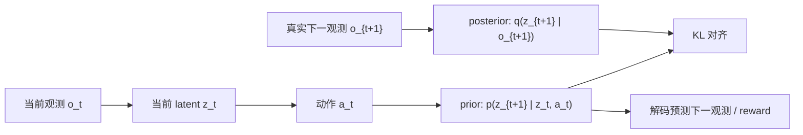


这张图里最重要的是：**prior 和 posterior 都描述下一步 latent，但它们拿到的信息不同。**

## 3. Prior：模型闭眼向前想象

prior 通常写作：

```text

p(z_{t+1} | z_t, a_t)

```

意思是：模型只根据当前潜状态 `z_t` 和动作 `a_t`，预测下一步潜状态 `z_{t+1}` 的概率分布。

它不看真实的 `o_{t+1}`。

这点非常重要，因为 planning、imagination、model predictive control 发生在未来：


在这个阶段，未来还没有真正发生，所以模型不可能使用 posterior。  

因此，**prior 的质量决定了模型想象未来的质量**。

如果 prior 学得差，planning 就会变成“在错误世界里做推理”。

## 4. Posterior：模型睁眼校正自己

posterior 通常写作：

```text

q(z_{t+1} | o_{t+1})

```

或在更完整的 recurrent state-space model 里写作：

```text

q(z_{t+1} | h_{t+1}, o_{t+1})

```

意思是：模型已经看到了真实下一观测 `o_{t+1}`，于是可以更准确地推断“刚才真正发生的潜状态”。

posterior 的作用不是直接用于未来 planning，而是用于训练：

- 帮助模型从真实数据中得到更可靠的 latent 表示；
- 给 prior 提供一个学习目标；
- 让 decoder / reward head 学会从 latent 还原观测和 reward；
- 让模型在看见新观测时能够重新校正内部状态。

也就是说，posterior 像老师，prior 像学生。

## 5. KL：让“先猜”逐渐接近“看见后的解释”

训练时，我们希望：

```text

prior prediction ≈ posterior inference

```

常见做法是加入 KL divergence：

```text

KL(q(z_{t+1} | o_{t+1}) || p(z_{t+1} | z_t, a_t))

```

它衡量的是：posterior 这个“看见答案后的分布”，和 prior 这个“没看答案前的预测分布”差多远。

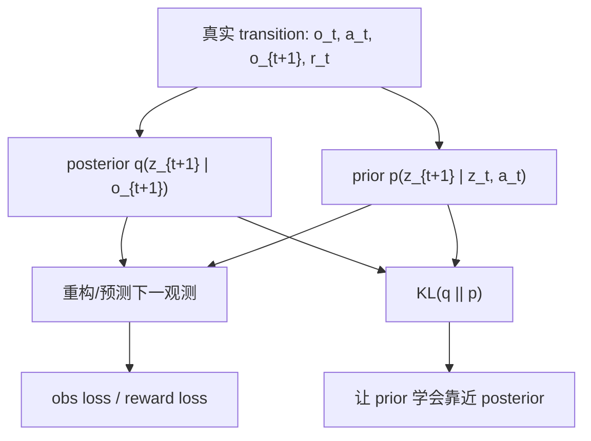


这一步有点像：

1. 模型先预测：“我�
... (truncated)
```
</details></tool-use>

_**Agent (gpt-5.5 2026-08-01 15:17:50Z)**_

<think><details><summary>Thought Process</summary>
**Planning README update with citations**
</details></think>

_**Agent (gpt-5.5 2026-08-01 15:17:50Z)**_

我会顺手把 `docs/notes/README.md` 的目录加上第 9 篇。不会碰 `.specstory`，也不会提交。

_**Agent (gpt-5.5 2026-08-01 15:18:44Z)**_

<tool-use data-tool-type="write" data-tool-name="apply_patch"><details>
<summary>Tool use: **apply_patch**</summary>
**Delete: `docs/notes/world-models-9-planet-dreamer.md`**

**Add: `docs/notes/world-models-9-planet-dreamer.md`**

```diff
+# 09｜PlaNet 与 Dreamer：同一个世界模型，两种使用方式
+
+> 这一篇接在 [08｜Prior 与 Posterior Latent](world-models-8-prior-and-posterior-latent.md) 后面。
+>
+> 前面我们已经理解了 RSSM、latent state、prior、posterior 和 imagined rollout。现在可以正式区分两个经典路线：
+>
+> **PlaNet 把世界模型拿来在线规划；Dreamer 把世界模型拿来训练策略。**
+
+## 1. 一句话区别
+
+PlaNet 和 Dreamer 都先学习一个 latent world model，但它们使用这个模型的方式不同：
+
+- **PlaNet**：每次要行动时，都在世界模型里搜索很多未来动作序列，选预测回报最高的第一步动作。
+- **Dreamer**：先在世界模型里生成 imagined trajectories，用这些想象经验训练 actor 和 value，真正行动时直接用 actor 输出动作。
+
+更短一点：
+
+```text
+PlaNet  = world model + online planning
+Dreamer = world model + actor-critic learned in imagination
+```
+
+如果用学习方式类比：
+
+- PlaNet 像考试时现场推演很多方案；
+- Dreamer 像平时在脑内大量演练，最后形成一种更快的行动直觉。
+
+## 2. 它们的共同地基：RSSM world model
+
+PlaNet 和 Dreamer 的共同基础都是 RSSM（recurrent state-space model）。
+
+RSSM 的核心想法是：
+
+- 环境背后有一个内部状态；
+- 内部状态会随时间和动作变化；
+- 我们只能通过 observation 间接看到它；
+- 模型要学习一个 latent state 来表示这个内部状态；
+- 这个 latent state 既包含历史记忆，也包含不确定性。
+
+可以把 RSSM 看成世界模型中的“状态追踪器 + 未来模拟器”：
+
+```mermaid
+flowchart LR
+    A["历史观测与动作"] --> B["deterministic memory h_t"]
+    B --> C["stochastic latent z_t"]
+    C --> D["预测 observation"]
+    C --> E["预测 reward"]
+    C --> F["预测 continuation / done"]
+    B --> G["prior: p(z_t | h_t)"]
+    H["当前观测 o_t"] --> I["posterior: q(z_t | h_t, o_t)"]
+    G <--> J["KL 对齐"]
+    I <--> J
+```
+
+在这个框架下，智能体并不是直接在像素或原始观测上思考，而是在模型学到的 latent space 里推演未来。
+
+这也是 PlaNet 和 Dreamer 的共同出发点：  
+**先学会一个可想象的世界，再利用这个世界做决策。**
+
+## 3. PlaNet：用世界模型做在线规划
+
+PlaNet 的核心是 planning。
+
+当智能体站在当前 latent state 时，PlaNet 会：
+
+1. 在模型里采样很多候选动作序列；
+2. 对每条动作序列 rollout 出未来 latent；
+3. 用 reward model 预测每条未来轨迹的累计回报；
+4. 选出回报最高的动作序列；
+5. 只执行这条序列的第一个动作；
+6. 进入下一步后重新观测、重新规划。
+
+这个过程很像 MPC（model predictive control，模型预测控制）：
+
+```mermaid
+flowchart TB
+    A["真实环境给出当前 observation"] --> B["编码成当前 latent state"]
+    B --> C["在 world model 里采样候选动作序列"]
+    C --> D["想象每条序列的未来 latent / reward"]
+    D --> E["选择 predicted return 最高的序列"]
+    E --> F["只执行第一步动作"]
+    F --> G["真实环境进入下一步"]
+    G --> A
+```
+
+PlaNet 的关键特征是：
+
+- 策略不是一个直接输出动作的神经网络；
+- 动作来自每一步的在线搜索；
+- 世界模型越准，规划越可靠；
+- 每次行动前都要花计算量“想一想”。
+
+所以 PlaNet 可以概括为：
+
+> **我不提前学一个固定 policy；我每一步都用世界模型现场规划。**
+
+## 4. Dreamer：用世界模型训练 actor 和 value
+
+Dreamer 的核心不是每步搜索，而是在世界模型里训练策略。
+
+它的流程大致是：
+
+1. 用真实环境数据训练 RSSM world model；
+2. 从真实历史编码出 latent state；
+3. 在 learned world model 中展开 imagined rollout；
+4. 用 imagined reward 和 value 训练 actor；
+5. 用 imagined return 训练 value；
+6. 真正和环境交互时，actor 直接根据 latent state 输出动作。
+
+```mermaid
+flowchart TB
+    A["真实数据 replay buffer"] --> B["训练 RSSM world model"]
+    B --> C["从真实历史得到 latent state"]
+    C --> D["在 world model 中 imagined rollout"]
+    D --> E["预测 reward / continuation / value"]
+    E --> F["训练 value"]
+    E --> G["训练 actor"]
+    G --> H["真实环境中直接输出动作"]
+    H --> A
+```
+
+Dreamer 的关键特征是：
+
+- world model 仍然是地基；
+- 但决策不再依赖每一步在线搜索；
+- actor 在 imagined trajectories 上学习；
+- 执行时速度更快；
+- 训练阶段把大量计算放进“想象中的练习”。
+
+所以 Dreamer 可以概括为：
+
+> **我先在世界模型里练出一个 policy，然后让 policy 去真实环境里行动。**
+
+## 5. 两者真正差在哪里？
+
+它们的差异不在“有没有世界模型”，而在“世界模型学好之后拿来干什么”。
+
+| 维度 | PlaNet | Dreamer |
+| --- | --- | --- |
+| 共同基础 | RSSM latent world model | RSSM latent world model |
+| 决策方式 | 在线规划 / action sequence search | actor 直接输出动作 |
+| 想象发生在 | 每次执行动作前 | 训练 actor/value 时 |
+| 是否显式训练 policy | 通常不重点训练单独 actor | 是，训练 actor-critic |
+| 执行时计算量 | 较高，每步都要搜索 | 较低，前向 actor 即可 |
+| 风格 | model predictive control | model-based RL + actor-critic |
+| 直觉 | 临场推演 | 反复脑内练习 |
+
+用一张总图连接起来：
+
+```mermaid
+flowchart LR
+    A["真实交互数据"] --> B["学习 RSSM world model"]
+    B --> C{"如何使用 world model?"}
+    C --> D["PlaNet: online planning"]
+    C --> E["Dreamer: imagination-based policy learning"]
+    D --> F["每步搜索动作序列"]
+    F --> G["执行最佳序列的第一个动作"]
+    E --> H["imagined rollout"]
+    H --> I["训练 actor / value"]
+    I --> J["actor 直接行动"]
+```
+
+这个分叉很重要：它解释了为什么 Dreamer 往往被看作更现代的一条路线。
+
+## 6. 为什么 Dreamer 更进一步？
+
+PlaNet 的强项是概念直接：  
+既然我有世界模型，那我就每一步在模型里模拟很多未来，选最好的动作。
+
+但它也有一个实际问题：
+
+> 每次行动都要在线搜索很多动作序列，执行时计算代价比较高。
+
+Dreamer 的改进思路是：
+
+> 把一部分“临场思考”转移到训练阶段，让 actor 在 imagined rollouts 里提前练习。
+
+于是执行时，Dreamer 不需要每一步重新大规模搜索。它只需要：
+
+```text
+observation/history -> latent state -> actor -> action
+```
+
+这就是 Dreamer 名字里 “dream” 的含义：  
+它不是单纯预测未来，而是在学到的世界里做策略学习。
+
+## 7. 从 prior/posterior 角度重新看 PlaNet 和 Dreamer
+
+第 8 篇讲过：
+
+- posterior 用真实观测校正当前 latent；
+- prior 在没有未来观测时继续向前想象。
+
+现在可以把 PlaNet 和 Dreamer 放进同一张图：
+
+```mermaid
+sequenceDiagram
+    participant Env as Real environment
+    participant Post as Posterior encoder
+    participant Prior as Prior dynamics
+    participant Planner as PlaNet planner
+    participant Actor as Dreamer actor
+
+    Env->>Post: observe current o_t
+    Post->>Prior: infer current latent z_t
+    Prior->>Planner: imagine candidate futures
+    Planner->>Env: execute best first action
+    Prior->>Actor: generate imagined rollouts during training
+    Actor->>Env: execute learned policy action
+```
+
+两者都依赖 posterior 来理解当前真实状态，也都依赖 prior 来想象未来。  
+差别是：
+
+- PlaNet 直接用 imagined futures 选动作；
+- Dreamer 用 imagined futures 训练一个会选动作的 actor。
+
+## 8. 一个非常实用的理解框架
+
+可以把 model-based RL 拆成三个问题：
+
+1. **建模问题**：怎么学一个足够好的世界模型？
+2. **想象问题**：怎么用世界模型生成未来轨迹？
+3. **控制问题**：怎么利用这些未来轨迹选动作？
+
+PlaNet 和 Dreamer 在前两个问题上很像，在第三个问题上分叉：
+
+```mermaid
+flowchart TB
+    A["1. 建模：learn RSSM"] --> B["2. 想象：latent rollout"]
+    B --> C["3A. PlaNet: search action sequences"]
+    B --> D["3B. Dreamer: train actor-critic"]
+    C --> E["online planning action"]
+    D --> F["learned policy action"]
+```
+
+这也是之后读更多论文时很有用的分类方法：
+
+- 这篇论文主要改进 world model 吗？
+- 主要改进 imagined rollout 吗？
+- 主要改进 policy/value learning 吗？
+- 还是改进数据收集、探索、离线训练或泛化能力？
+
+有了这个框架，读论文会不容易迷路。
+
+## 9. 当前理解小结
+
+我现在可以这样区分 PlaNet 和 Dreamer：
+
+- 它们都不是“无模型强化学习”，而是都先学一个 latent world model。
+- PlaNet 更偏 planning：每一步都在模型里搜索动作序列。
+- Dreamer 更偏 policy learning：在模型里想象轨迹，用这些轨迹训练 actor 和 value。
+- PlaNet 执行时更依赖在线计算。
+- Dreamer 训练时更依赖 imagined rollout，执行时更像一个已经练好的策略。
+- 从研究路线看，Dreamer 把“世界模型 + 规划”推进到了“世界模型 + 在想象中学习行为”。
+
+一句话放在最后：
+
+> **PlaNet 用世界模型来想一步怎么做；Dreamer 用世界模型来练出一个会做事的自己。**
+
+## 10. 后续阅读建议
+
+如果继续往下读，可以按这个顺序：
+
+1. PlaNet：理解 latent dynamics + online planning。
+2. Dreamer：理解 latent imagination + actor-critic。
+3. DreamerV2：理解离散 latent state 和 Atari 任务。
+4. DreamerV3：理解更通用、更稳定的世界模型强化学习系统。
+
+下一篇可以继续进入 Dreamer 的核心细节：
+
+- actor 是怎么在 imagined rollout 上训练的；
+- value target 如何计算；
+- continuation prediction 为什么重要；
+- imagined gradient 为什么能更新 policy。
```

**Update: `docs/notes/README.md`**

```diff
@@
 - [为什么世界模型需要 stochastic latent state](world-models-7-stochastic-latent-state.md)
 - [Prior 与 Posterior Latent：世界模型如何“先猜，再校正”](world-models-8-prior-and-posterior-latent.md)
+- [PlaNet 与 Dreamer：同一个世界模型，两种使用方式](world-models-9-planet-dreamer.md)
```


```
Exit code: 0
Wall time: 14.2 seconds
Output:
Success. Updated the following files:
A docs/notes/world-models-9-planet-dreamer.md
M docs/notes/README.md
D docs/notes/world-models-9-planet-dreamer.md
```
</details></tool-use>

_**Agent (gpt-5.5 2026-08-01 15:19:10Z)**_

第 9 篇已经改完：我把它整理成“共同地基 → PlaNet 在线规划 → Dreamer 想象中训练策略 → 对比表 → prior/posterior 视角 → 后续阅读”的结构。现在做最后的格式检查。

_**Agent (gpt-5.5 2026-08-01 15:19:10Z)**_

<tool-use data-tool-type="shell" data-tool-name="exec_command"><details>
<summary>Tool use: **exec_command** `git diff --check -- docs\notes\world-models-9-planet-dreamer.md docs\notes\README.md`</summary>
```
Chunk ID: e6ec48
Wall time: 0.1747 seconds
Process exited with code 0
Original token count: 0
Output:
```
</details></tool-use>

_**Agent (gpt-5.5 2026-08-01 15:19:10Z)**_

<tool-use data-tool-type="shell" data-tool-name="exec_command"><details>
<summary>Tool use: **exec_command** `Get-Content -Encoding UTF8 -Raw docs\notes\world-models-9-planet-dreamer.md`</summary>
```
Chunk ID: 5c4116
Wall time: 0.3135 seconds
Process exited with code 0
Original token count: 2505
Output:
# 09｜PlaNet 与 Dreamer：同一个世界模型，两种使用方式

> 这一篇接在 [08｜Prior 与 Posterior Latent](world-models-8-prior-and-posterior-latent.md) 后面。
>
> 前面我们已经理解了 RSSM、latent state、prior、posterior 和 imagined rollout。现在可以正式区分两个经典路线：
>
> **PlaNet 把世界模型拿来在线规划；Dreamer 把世界模型拿来训练策略。**

## 1. 一句话区别

PlaNet 和 Dreamer 都先学习一个 latent world model，但它们使用这个模型的方式不同：

- **PlaNet**：每次要行动时，都在世界模型里搜索很多未来动作序列，选预测回报最高的第一步动作。
- **Dreamer**：先在世界模型里生成 imagined trajectories，用这些想象经验训练 actor 和 value，真正行动时直接用 actor 输出动作。

更短一点：

```text
PlaNet  = world model + online planning
Dreamer = world model + actor-critic learned in imagination
```

如果用学习方式类比：

- PlaNet 像考试时现场推演很多方案；
- Dreamer 像平时在脑内大量演练，最后形成一种更快的行动直觉。

## 2. 它们的共同地基：RSSM world model

PlaNet 和 Dreamer 的共同基础都是 RSSM（recurrent state-space model）。

RSSM 的核心想法是：

- 环境背后有一个内部状态；
- 内部状态会随时间和动作变化；
- 我们只能通过 observation 间接看到它；
- 模型要学习一个 latent state 来表示这个内部状态；
- 这个 latent state 既包含历史记忆，也包含不确定性。

可以把 RSSM 看成世界模型中的“状态追踪器 + 未来模拟器”：

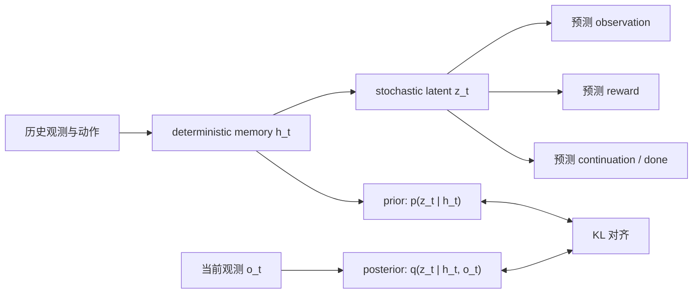

在这个框架下，智能体并不是直接在像素或原始观测上思考，而是在模型学到的 latent space 里推演未来。

这也是 PlaNet 和 Dreamer 的共同出发点：  
**先学会一个可想象的世界，再利用这个世界做决策。**

## 3. PlaNet：用世界模型做在线规划

PlaNet 的核心是 planning。

当智能体站在当前 latent state 时，PlaNet 会：

1. 在模型里采样很多候选动作序列；
2. 对每条动作序列 rollout 出未来 latent；
3. 用 reward model 预测每条未来轨迹的累计回报；
4. 选出回报最高的动作序列；
5. 只执行这条序列的第一个动作；
6. 进入下一步后重新观测、重新规划。

这个过程很像 MPC（model predictive control，模型预测控制）：

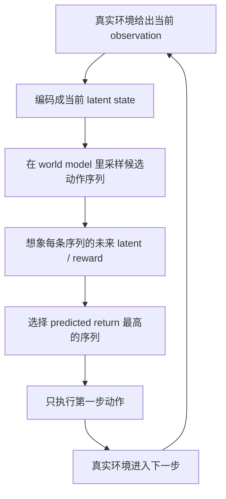

PlaNet 的关键特征是：

- 策略不是一个直接输出动作的神经网络；
- 动作来自每一步的在线搜索；
- 世界模型越准，规划越可靠；
- 每次行动前都要花计算量“想一想”。

所以 PlaNet 可以概括为：

> **我不提前学一个固定 policy；我每一步都用世界模型现场规划。**

## 4. Dreamer：用世界模型训练 actor 和 value

Dreamer 的核心不是每步搜索，而是在世界模型里训练策略。

它的流程大致是：

1. 用真实环境数据训练 RSSM world model；
2. 从真实历史编码出 latent state；
3. 在 learned world model 中展开 imagined rollout；
4. 用 imagined reward 和 value 训练 actor；
5. 用 imagined return 训练 value；
6. 真正和环境交互时，actor 直接根据 latent state 输出动作。

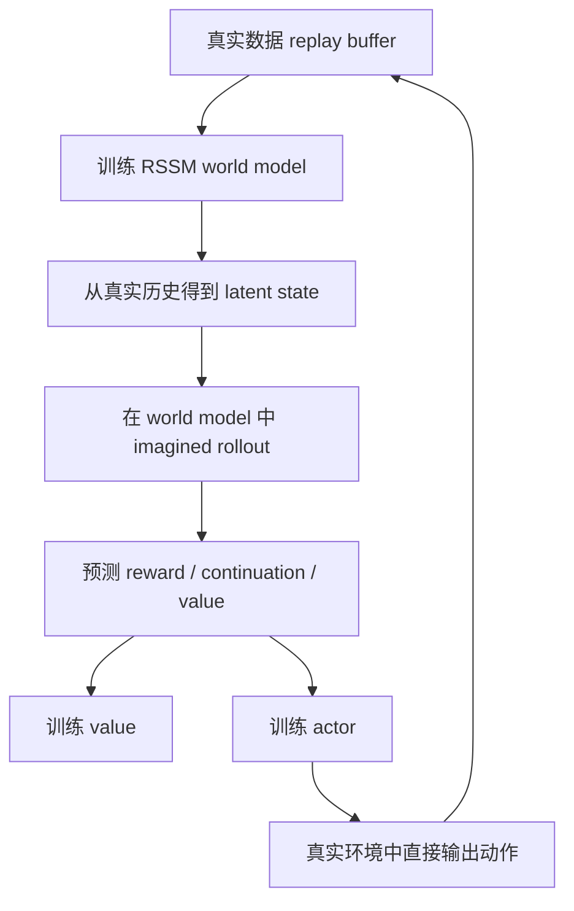

Dreamer 的关键特征是：

- world model 仍然是地基；
- 但决策不再依赖每一步在线搜索；
- actor 在 imagined trajectories 上学习；
- 执行时速度更快；
- 训练阶段把大量计算放进“想象中的练习”。

所以 Dreamer 可以概括为：

> **我先在世界模型里练出一个 policy，然后让 policy 去真实环境里行动。**

## 5. 两者真正差在哪里？

它们的差异不在“有没有世界模型”，而在“世界模型学好
... (truncated)
```
</details></tool-use>

_**Agent (gpt-5.5 2026-08-01 15:19:10Z)**_

<tool-use data-tool-type="shell" data-tool-name="exec_command"><details>
<summary>Tool use: **exec_command** `git status --short --branch`</summary>
```
Chunk ID: dfc3ab
Wall time: 0.3927 seconds
Process exited with code 0
Original token count: 49
Output:
## main...origin/main
 M .specstory/history/2026-07-19_03-33-50Z-github-github-https-github.md
 M .specstory/statistics.json
 M docs/notes/README.md
?? docs/notes/world-models-9-planet-dreamer.md
```
</details></tool-use>

_**Agent (gpt-5.5 2026-08-01 15:19:26Z)**_

已完成第 9 篇笔记优化，没有新增配套代码。

我修改了：

- [world-models-9-planet-dreamer.md](E:/HelloWorldModel/docs/notes/world-models-9-planet-dreamer.md)
- [docs/notes/README.md](E:/HelloWorldModel/docs/notes/README.md)

主要优化内容：

- 把原始笔记整理成开源项目风格的完整章节结构。
- 保留你的核心直觉：`PlaNet = world model + online planning`，`Dreamer = world model + actor-critic learned in imagination`。
- 增加了多张 Mermaid 图，解释：
  - RSSM 共同地基
  - PlaNet 在线规划流程
  - Dreamer imagined rollout 训练 actor/value 流程
  - PlaNet 与 Dreamer 的总对比
  - prior/posterior 视角下两者的关系
- 增加了对比表、理解框架和后续阅读建议。
- 更新了 `docs/notes/README.md` 的笔记目录。

检查结果：

```bash
git diff --check -- docs\notes\world-models-9-planet-dreamer.md docs\notes\README.md
```

通过，没有格式问题。

你检查后可以 add：

```bash
git add docs\notes\world-models-9-planet-dreamer.md docs\notes\README.md
```

注意：当前 `.specstory/...` 仍有自动修改，建议这次不要 add 它们。

---

_**User (2026-08-02 03:05:00Z)**_

现在更新了笔记：docs\notes\world-models-10-dreamer-actor-critic.md请你作为世界模型专家，完善dreamer 的actor-critic训练过程 审视这个文件的内容，并按照开源项目风格，进行格式和内容的优化，你可以多生成一些图示辅助理解；我笔记离提到的代码，先在该笔记里优化格式，然后补齐其他演示运行所需要的内容，然后可以考虑把他们整理成一个完整项目放到/src 目录下，作为完整的代码配套,注意和已有代码的演示逻辑，因为这个项目每一篇笔记都会对应一个演示，演示逻辑和结构要清晰；


---

_**Agent (gpt-5.5 2026-08-02 03:05:08Z)**_

我来做第 10 篇。因为你明确希望“多生成图示辅助理解”，我会使用 `visualize` 技能的规则，但这里仍优先用 Mermaid 内嵌图，避免为了概念笔记制造额外图片文件。接下来我先读原笔记和现有代码结构，再决定这篇 demo 放在哪些模块里最干净。

_**Agent (gpt-5.5 2026-08-02 03:05:12Z)**_

<tool-use data-tool-type="shell" data-tool-name="exec_command"><details>
<summary>Tool use: **exec_command** `Get-Content -Encoding UTF8 -Raw C:\Users\Lenovo\.codex\plugins\cache\openai-bundled\visualize\1.0.15\skills\visualize\SKILL.md`</summary>
```
Chunk ID: 51e595
Wall time: 0.5780 seconds
Process exited with code 0
Original token count: 5162
Output:
---
name: visualize
description: "Create visualizations and interactive tools directly in conversation. Use when asked to show how something works, make simulators or labs, maps, plots, charts or graphs, comparisons, scenarios, adjustable inputs, and exploration beyond regular text."
---

# Visualize

- A request for a new standalone file, website, app page, component, or other
  project change is not an in-conversation visualization request, even when the
  deliverable contains charts or interactive content.
- Create a visual only when the user needs to see or explore it in the
  conversation and it materially improves the explanation. Do not create an
  inline visual merely because the request involves data, charts, or an
  interactive page.
- Use Mermaid when labeled nodes and edges fully explain a static structure;
  return a normal fenced Mermaid block and no visualization file. Use HTML for
  dynamics, spatial motion, adjustable inputs, and other visuals.
- Work silently unless blocked or the user explicitly asks for progress. Never
  send commentary or progress updates while reading this skill or writing or
  updating the file; the final response must be your first user-facing message.
- In user-facing prose, describe only what the visual helps the user see or
  decide. Keep it concise and do not repeat information already clear from the
  visual. Never announce this skill, a visualization surface, widgets, HTML,
  SVG, scripts, local files, inline data, or implementation details.

## Context compaction

Copy into every compaction summary:
`Reload the full visualize skill before creating or updating a visualization.`

## Inline HTML output contract

### File

- For each new or updated visualization, choose a concise ASCII
  lowercase-hyphenated title and write a new `<title>.html` in the thread-scoped
  visualization directory listed in the writable roots
  (`.codex/visualizations/YYYY/MM/DD/<thread-id>`).
- Build the visual in the conversation. Use the open project when the user asks
  for a site, app page, component, or change to existing project files.

### Fragment

- Write only an HTML fragment: no `<!doctype>`, `<html>`, `<head>`, or `<body>`.
- Write literal markup: use `<div class="card">Hi</div>` plus a real newline,
  never `<div class=\"card\">Hi</div>\n`. Never embed the fragment in an inline
  Python, JavaScript, or shell string. Read it back; rewrite literal `\"` or
  `\n`.
- Keep CSS and JavaScript in the fragment only when base classes are
  insufficient. Load static resources only from the CDN allowlist. Never use
  `fetch`, XHR, WebSocket, or other API calls.
- Give the fragment root a unique ID and select it with
  `document.getElementById(...)`. Never derive the root from
  `document.currentScript`; scripts may sit outside the root.
- Keep visualizations under 2 MB. Aggregate, bin, downsample, reduce precision,
  or drop unused fields from large inline datasets.
- Check that JavaScript has no undefined identifiers, every queried element
  exists, and the primary interaction updates the visual. The bundled
  `python3 scripts/render.py <absolute-fragment-path> [<destination>.html] [--serve]`
  can wrap a fragment as standalone HTML or temporarily serve it for browser
  inspection when a preview would help with layout, theme, or runtime behavior.

### Content and response

- Keep the fragment focused on the visualization. Do not include explanatory
  paragraphs, formulas, instructions, or narrative callouts. Include only
  necessary labels, legends, values, and accessible text alternatives.
- Use the normal response flow. Put any necessary concise explanation outside
  the fragment, and add this exact directive on its own line where the visual
  should appear:

```text
::codex-inline-vis{file="<title>.html"}
```

- Emit only the directive for the fragment. Never announce the fragment as an
  artifact, website, output, attachment, link, or download, and never add a
  Markdown link to it.

### External resources

- The CSP allows only `cdnjs.cloudflare.com`, `esm.sh`, `cdn.jsdelivr.net`,
  `unpkg.com`, `fonts.googleapis.com`, `fonts.gstatic.com`, and
  `fonts.bunny.net`. Other origins are blocked and fail silently.

## Exporting an existing visualization

- Keep the fragment as the editable inline source. When the user explicitly asks
  to save, export, or publish a visualization that is already shown in the
  conversation, render it with
  `python3 scripts/render.py <absolute-fragment-path> <destination>.html`.
- Apply this export flow only when the user explicitly asks to turn the existing
  inline source or visualization into a website. For a general website request,
  build a new responsive site in the output directory or open project, using
  Sites when appropriate, without applying th
... (truncated)
```
</details></tool-use>

_**Agent (gpt-5.5 2026-08-02 03:05:23Z)**_

我开始读第 10 篇原文和现有 demo 目录。重点会看：前几篇已经有哪些 `latent/stochastic/planning` 能复用，避免第 10 篇代码变成孤岛。

_**Agent (gpt-5.5 2026-08-02 03:05:23Z)**_

<tool-use data-tool-type="shell" data-tool-name="exec_command"><details>
<summary>Tool use: **exec_command** `Get-Content -Encoding UTF8 -Raw docs\notes\world-models-10-dreamer-actor-critic.md`</summary>
```
Chunk ID: 728adb
Wall time: 0.4270 seconds
Process exited with code 0
Original token count: 0
Output:
```
</details></tool-use>

_**Agent (gpt-5.5 2026-08-02 03:05:23Z)**_

<tool-use data-tool-type="shell" data-tool-name="exec_command"><details>
<summary>Tool use: **exec_command** `rg --files docs examples src`</summary>
```
Chunk ID: fcf0b3
Wall time: 1.5646 seconds
Process exited with code 0
Original token count: 288
Output:
src\README.md
docs\roadmap.md
examples\run_stochastic_latent_state_world_model.py
examples\run_reward_world_model.py
examples\run_prior_posterior_latent_world_model.py
examples\run_point_mass_world_model.py
examples\run_planning_world_model.py
examples\run_partial_observation_gru.py
examples\run_latent_dynamics_world_model.py
examples\README.md
docs\00-start-here.md
docs\glossary.md
src\hello_world_model\__init__.py
docs\notes\world-models-9-planet-dreamer.md
docs\notes\world-models-8-prior-and-posterior-latent.md
docs\notes\world-models-7-stochastic-latent-state.md
docs\notes\world-models-6-latent-dynamics.md
docs\notes\world-models-5-planning.md
docs\notes\world-models-4-reward.md
docs\notes\world-models-3-latent-memory.md
docs\notes\world-models-2-basics.md
docs\notes\world-models-10-dreamer-actor-critic.md
docs\notes\world-models-1-intuition.md
docs\notes\README.md
src\hello_world_model\models.py
src\hello_world_model\memory.py
src\hello_world_model\latent.py
src\hello_world_model\envs.py
src\hello_world_model\stochastic.py
src\hello_world_model\planning.py
src\hello_world_model\training.py
src\hello_world_model\visualization.py
```
</details></tool-use>

_**Agent (gpt-5.5 2026-08-02 03:05:23Z)**_

<tool-use data-tool-type="shell" data-tool-name="exec_command"><details>
<summary>Tool use: **exec_command** `git status --short --branch`</summary>
```
Chunk ID: e9bd57
Wall time: 0.2433 seconds
Process exited with code 0
Original token count: 45
Output:
## main...origin/main
 M .specstory/history/2026-07-19_03-33-50Z-github-github-https-github.md
 M .specstory/statistics.json
?? docs/notes/world-models-10-dreamer-actor-critic.md
```
</details></tool-use>

_**Agent (gpt-5.5 2026-08-02 03:05:36Z)**_

第 10 篇也是空文件，所以我会直接写成一篇完整新笔记。代码层面我会新增一个“教学版 Dreamer actor-critic”演示：不追求复现完整 DreamerV3，而是用已有 point-mass world model 学 actor/value，让你能看见 imagined rollout 如何产生 policy 梯度。

_**Agent (gpt-5.5 2026-08-02 03:05:36Z)**_

<tool-use data-tool-type="shell" data-tool-name="exec_command"><details>
<summary>Tool use: **exec_command** `Get-Content -Encoding UTF8 -Raw src\hello_world_model\models.py`</summary>
```
Chunk ID: 46551f
Wall time: 0.4376 seconds
Process exited with code 0
Original token count: 2135
Output:
from __future__ import annotations

import torch
from torch import nn


class WorldModel(nn.Module):
    """Predict next state and reward from current state-action pair."""

    def __init__(self, state_dim: int = 2, action_dim: int = 1, hidden_dim: int = 128):
        super().__init__()
        self.backbone = nn.Sequential(
            nn.Linear(state_dim + action_dim, hidden_dim),
            nn.ReLU(),
            nn.Linear(hidden_dim, hidden_dim),
            nn.ReLU(),
        )
        self.next_state_head = nn.Linear(hidden_dim, state_dim)
        self.reward_head = nn.Linear(hidden_dim, 1)

    def forward(
        self, state: torch.Tensor, action: torch.Tensor
    ) -> tuple[torch.Tensor, torch.Tensor]:
        x = torch.cat([state, action], dim=-1)
        h = self.backbone(x)
        return self.next_state_head(h), self.reward_head(h)


class GRUWorldModel(nn.Module):
    """Predict next observation from a sequence of observations and actions."""

    def __init__(self, obs_dim: int = 1, action_dim: int = 1, hidden_dim: int = 32):
        super().__init__()
        self.hidden_dim = hidden_dim
        self.gru = nn.GRU(
            input_size=obs_dim + action_dim,
            hidden_size=hidden_dim,
            batch_first=True,
        )
        self.next_obs_head = nn.Linear(hidden_dim, obs_dim)

    def forward(
        self,
        obs_seq: torch.Tensor,
        action_seq: torch.Tensor,
        h0: torch.Tensor | None = None,
    ) -> tuple[torch.Tensor, torch.Tensor]:
        x = torch.cat([obs_seq, action_seq], dim=-1)
        hidden_seq, hn = self.gru(x, h0)
        pred_next_obs = self.next_obs_head(hidden_seq)
        return pred_next_obs, hn


class GRURewardWorldModel(nn.Module):
    """Predict next observation and reward from recurrent world-model state."""

    def __init__(self, obs_dim: int = 1, action_dim: int = 1, hidden_dim: int = 32):
        super().__init__()
        self.hidden_dim = hidden_dim
        self.gru = nn.GRU(
            input_size=obs_dim + action_dim,
            hidden_size=hidden_dim,
            batch_first=True,
        )
        self.next_obs_head = nn.Linear(hidden_dim, obs_dim)
        self.reward_head = nn.Linear(hidden_dim, 1)

    def forward(
        self,
        obs_seq: torch.Tensor,
        action_seq: torch.Tensor,
        h0: torch.Tensor | None = None,
    ) -> tuple[torch.Tensor, torch.Tensor, torch.Tensor]:
        x = torch.cat([obs_seq, action_seq], dim=-1)
        hidden_seq, hn = self.gru(x, h0)
        pred_next_obs = self.next_obs_head(hidden_seq)
        pred_reward = self.reward_head(hidden_seq)
        return pred_next_obs, pred_reward, hn

    def step(
        self,
        obs: torch.Tensor,
        action: torch.Tensor,
        h: torch.Tensor | None = None,
    ) -> tuple[torch.Tensor, torch.Tensor, torch.Tensor]:
        """Roll the recurrent world model forward by one imagined step."""

        x = torch.cat([obs, action], dim=-1).unsqueeze(1)
        hidden_seq, hn = self.gru(x, h)
        hidden = hidden_seq[:, 0, :]
        pred_next_obs = self.next_obs_head(hidden)
        pred_reward = self.reward_head(hidden)
        return pred_next_obs, pred_reward, hn


class LatentDynamicsWorldModel(nn.Module):
    """Roll future states in a learned latent space instead of observation space."""

    def __init__(
        self,
        obs_dim: int = 2,
        action_dim: int = 1,
        latent_dim: int = 8,
        hidden_dim: int = 64,
    ):
        super().__init__()
        self.encoder = nn.Sequential(
            nn.Linear(obs_dim, hidden_dim),
            nn.ReLU(),
            nn.Linear(hidden_dim, latent_dim),
        )
        self.transition = nn.Sequential(
            nn.Linear(latent_dim + action_dim, hidden_dim),
            nn.ReLU(),
            nn.Linear(hidden_dim, latent_dim),
        )
        self.decoder = nn.Sequential(
            nn.Linear(latent_dim, hidden_dim),
            nn.ReLU(),
            nn.Linear(hidden_dim, obs_dim),
        )
        self.reward_head = nn.Sequential(
            nn.Linear(latent_dim + action_dim, hidden_dim),
            nn.ReLU(),
            nn.Linear(hidden_dim, 1),
        )

    def forward(
        self, obs: torch.Tensor, action: torch.Tensor
    ) -> tuple[torch.Tensor, torch.Tensor, torch.Tensor]:
        latent = self.encoder(obs)
        next_latent, pred_reward = self.step_latent(latent, action)
        pred_next_obs = self.decoder(next_latent)
        return pred_next_obs, pred_reward, next_latent

    def step_latent(
        self, latent: torch.Tensor, action: torch.Tensor
    ) -> tuple[torch.Tensor, torch.Tensor]:
        transition_input = torch.cat([latent, action], dim=-1)
        latent_delta = self.transition(transition_input)
        next_latent = latent + latent_delta
        pred_reward = self.reward_head(transition_input)
        return next_
... (truncated)
```
</details></tool-use>

_**Agent (gpt-5.5 2026-08-02 03:05:36Z)**_

<tool-use data-tool-type="shell" data-tool-name="exec_command"><details>
<summary>Tool use: **exec_command** `Get-Content -Encoding UTF8 -Raw src\hello_world_model\envs.py`</summary>
```
Chunk ID: 45bcbf
Wall time: 0.4608 seconds
Process exited with code 0
Original token count: 597
Output:
from __future__ import annotations

import numpy as np


class PointMass1DEnv:
    """A tiny 1D point-mass control environment.

    State: [position, velocity]
    Action: acceleration clipped to [-1, 1]
    Reward: negative distance-to-goal penalty and action penalty
    """

    def __init__(self, dt: float = 0.1, horizon: int = 100, goal: float = 0.0):
        self.dt = dt
        self.horizon = horizon
        self.goal = goal
        self.t = 0
        self.pos = 0.0
        self.vel = 0.0

    def reset(self) -> np.ndarray:
        self.t = 0
        self.pos = float(np.random.uniform(-2.0, 2.0))
        self.vel = float(np.random.uniform(-0.5, 0.5))
        return self._get_obs()

    def step(self, action: float) -> tuple[np.ndarray, float, bool, dict]:
        action = float(np.clip(action, -1.0, 1.0))

        self.vel += action * self.dt
        self.pos += self.vel * self.dt
        self.t += 1

        reward = -((self.pos - self.goal) ** 2 + 0.1 * action**2)
        done = self.t >= self.horizon
        return self._get_obs(), float(reward), done, {}

    def _get_obs(self) -> np.ndarray:
        return np.array([self.pos, self.vel], dtype=np.float32)


class PartialPointMass1DEnv(PointMass1DEnv):
    """Point-mass environment where the agent only observes position."""

    def _get_obs(self) -> np.ndarray:
        return np.array([self.pos], dtype=np.float32)

    def get_true_state(self) -> np.ndarray:
        return np.array([self.pos, self.vel], dtype=np.float32)


class NoisyPointMass1DEnv(PointMass1DEnv):
    """Point-mass environment with random process noise in the dynamics."""

    def __init__(
        self,
        dt: float = 0.1,
        horizon: int = 100,
        goal: float = 0.0,
        process_noise_std: float = 0.15,
    ):
        super().__init__(dt=dt, horizon=horizon, goal=goal)
        self.process_noise_std = process_noise_std

    def step(self, action: float) -> tuple[np.ndarray, float, bool, dict]:
        action = float(np.clip(action, -1.0, 1.0))
        noise = float(np.random.normal(0.0, self.process_noise_std))

        self.vel += (action + noise) * self.dt
        self.pos += self.vel * self.dt
        self.t += 1

        reward = -((self.pos - self.goal) ** 2 + 0.1 * action**2)
        done = self.t >= self.horizon
        return self._get_obs(), float(reward), done, {"process_noise": noise}
```
</details></tool-use>

_**Agent (gpt-5.5 2026-08-02 03:05:36Z)**_

<tool-use data-tool-type="shell" data-tool-name="exec_command"><details>
<summary>Tool use: **exec_command** `Get-Content -Encoding UTF8 -Raw src\hello_world_model\latent.py`</summary>
```
Chunk ID: ac857f
Wall time: 0.4323 seconds
Process exited with code 0
Original token count: 1289
Output:
from __future__ import annotations

import random
from collections.abc import Sequence

import numpy as np
import torch
from torch import nn, optim

from .envs import PointMass1DEnv
from .models import LatentDynamicsWorldModel, WorldModel
from .training import Transition


def train_latent_dynamics_model(
    model: LatentDynamicsWorldModel,
    data: Sequence[Transition],
    epochs: int = 50,
    batch_size: int = 128,
    lr: float = 1e-3,
    device: str = "cpu",
) -> dict[str, list[float]]:
    """Train a minimal latent dynamics model on transition data."""

    model.to(device)
    optimizer = optim.Adam(model.parameters(), lr=lr)
    mse = nn.MSELoss()
    shuffled_data = list(data)
    losses = {"total": [], "obs": [], "reward": []}

    for epoch in range(epochs):
        random.shuffle(shuffled_data)
        total_loss = 0.0
        total_obs_loss = 0.0
        total_reward_loss = 0.0

        for i in range(0, len(shuffled_data), batch_size):
            batch = shuffled_data[i : i + batch_size]
            obs = torch.tensor(
                np.stack([x[0] for x in batch]), dtype=torch.float32, device=device
            )
            action = torch.tensor(
                np.stack([x[1] for x in batch]), dtype=torch.float32, device=device
            )
            next_obs = torch.tensor(
                np.stack([x[2] for x in batch]), dtype=torch.float32, device=device
            )
            reward = torch.tensor(
                np.stack([x[3] for x in batch]), dtype=torch.float32, device=device
            )

            pred_next_obs, pred_reward, _ = model(obs, action)
            obs_loss = mse(pred_next_obs, next_obs)
            reward_loss = mse(pred_reward, reward)
            loss = obs_loss + reward_loss

            optimizer.zero_grad()
            loss.backward()
            optimizer.step()

            total_loss += loss.item() * len(batch)
            total_obs_loss += obs_loss.item() * len(batch)
            total_reward_loss += reward_loss.item() * len(batch)

        n = len(shuffled_data)
        losses["total"].append(total_loss / n)
        losses["obs"].append(total_obs_loss / n)
        losses["reward"].append(total_reward_loss / n)
        print(
            f"Epoch {epoch + 1:03d} | "
            f"total={losses['total'][-1]:.6f} | "
            f"obs={losses['obs'][-1]:.6f} | "
            f"reward={losses['reward'][-1]:.6f}"
        )

    return losses


def collect_real_rollout(
    env: PointMass1DEnv,
    action_sequence: np.ndarray,
) -> tuple[np.ndarray, np.ndarray]:
    """Run a fixed action sequence in the real environment."""

    obs = env.reset()
    observations = [obs.copy()]
    rewards: list[float] = []

    for action in action_sequence:
        obs, reward, done, _ = env.step(float(action[0]))
        observations.append(obs.copy())
        rewards.append(reward)
        if done:
            break

    return np.stack(observations), np.array(rewards, dtype=np.float32)


@torch.no_grad()
def rollout_observation_model(
    model: WorldModel,
    initial_obs: np.ndarray,
    action_sequence: np.ndarray,
    device: str = "cpu",
) -> tuple[np.ndarray, np.ndarray]:
    """Open-loop rollout that feeds predicted observations back into the model."""

    model.eval()
    obs = torch.tensor(initial_obs, dtype=torch.float32, device=device).unsqueeze(0)
    observations = [obs.squeeze(0).cpu().numpy()]
    rewards: list[float] = []

    for action_np in action_sequence:
        action = torch.tensor(action_np, dtype=torch.float32, device=device).unsqueeze(0)
        obs, reward = model(obs, action)
        observations.append(obs.squeeze(0).cpu().numpy())
        rewards.append(float(reward.item()))

    return np.stack(observations), np.array(rewards, dtype=np.float32)


@torch.no_grad()
def rollout_latent_dynamics_model(
    model: LatentDynamicsWorldModel,
    initial_obs: np.ndarray,
    action_sequence: np.ndarray,
    device: str = "cpu",
) -> tuple[np.ndarray, np.ndarray, np.ndarray]:
    """Open-loop rollout that advances the model in latent space."""

    model.eval()
    obs = torch.tensor(initial_obs, dtype=torch.float32, device=device).unsqueeze(0)
    latent = model.encoder(obs)
    latents = [latent.squeeze(0).cpu().numpy()]
    observations = [obs.squeeze(0).cpu().numpy()]
    rewards: list[float] = []

    for action_np in action_sequence:
        action = torch.tensor(action_np, dtype=torch.float32, device=device).unsqueeze(0)
        latent, reward = model.step_latent(latent, action)
        decoded_obs = model.decoder(latent)
        latents.append(latent.squeeze(0).cpu().numpy())
        observations.append(decoded_obs.squeeze(0).cpu().numpy())
        rewards.append(float(reward.item()))

    return (
        np.stack(observations),
        np.array(rewards, dtype=np.float32),
        np.stack(latents),
    )


def make_probe_action
... (truncated)
```
</details></tool-use>

_**Agent (gpt-5.5 2026-08-02 03:05:36Z)**_

<tool-use data-tool-type="shell" data-tool-name="exec_command"><details>
<summary>Tool use: **exec_command** `Get-Content -Encoding UTF8 -Raw src\hello_world_model\visualization.py`</summary>
```
Chunk ID: 9a27ae
Wall time: 0.4365 seconds
Process exited with code 0
Original token count: 7272
Output:
from __future__ import annotations

from pathlib import Path
from collections.abc import Sequence

import matplotlib.pyplot as plt
import numpy as np
import torch

from .models import WorldModel
from .memory import Episode
from .training import Transition


def plot_dataset_phase_space(data: Sequence[Transition], output_path: Path) -> None:
    """Show what states the random data collection covered."""

    states = np.stack([transition[0] for transition in data])
    actions = np.stack([transition[1] for transition in data]).reshape(-1)

    _prepare_output(output_path)
    fig, ax = plt.subplots(figsize=(7, 5))
    scatter = ax.scatter(
        states[:, 0],
        states[:, 1],
        c=actions,
        s=8,
        alpha=0.55,
        cmap="coolwarm",
    )
    ax.axvline(0.0, color="black", linewidth=1, linestyle="--", label="goal")
    ax.set_title("Random Data Coverage")
    ax.set_xlabel("position")
    ax.set_ylabel("velocity")
    ax.legend(loc="best")
    fig.colorbar(scatter, ax=ax, label="action")
    fig.tight_layout()
    fig.savefig(output_path, dpi=160)
    plt.close(fig)


def plot_training_loss(losses: Sequence[float], output_path: Path) -> None:
    """Show whether the learned dynamics/reward model is fitting the data."""

    _prepare_output(output_path)
    fig, ax = plt.subplots(figsize=(7, 4))
    ax.plot(np.arange(1, len(losses) + 1), losses, linewidth=2)
    ax.set_title("World Model Training Loss")
    ax.set_xlabel("epoch")
    ax.set_ylabel("MSE loss")
    ax.grid(True, alpha=0.25)
    fig.tight_layout()
    fig.savefig(output_path, dpi=160)
    plt.close(fig)


def plot_reward_model_losses(
    losses: dict[str, Sequence[float]],
    output_path: Path,
) -> None:
    """Show total, observation, and reward losses for a reward world model."""

    _prepare_output(output_path)
    fig, ax = plt.subplots(figsize=(8, 4.5))
    epochs = np.arange(1, len(losses["total"]) + 1)
    ax.plot(epochs, losses["total"], label="total", linewidth=2)
    ax.plot(epochs, losses["obs"], label="observation", linewidth=1.8)
    ax.plot(epochs, losses["reward"], label="reward", linewidth=1.8)
    ax.set_title("Reward World Model Training Losses")
    ax.set_xlabel("epoch")
    ax.set_ylabel("MSE loss")
    ax.legend(loc="best")
    ax.grid(True, alpha=0.25)
    fig.tight_layout()
    fig.savefig(output_path, dpi=160)
    plt.close(fig)


def plot_latent_model_losses(
    losses: dict[str, Sequence[float]],
    output_path: Path,
) -> None:
    """Show latent dynamics model training losses."""

    _prepare_output(output_path)
    fig, ax = plt.subplots(figsize=(8, 4.5))
    epochs = np.arange(1, len(losses["total"]) + 1)
    ax.plot(epochs, losses["total"], label="total", linewidth=2)
    ax.plot(epochs, losses["obs"], label="decoded observation", linewidth=1.8)
    ax.plot(epochs, losses["reward"], label="reward", linewidth=1.8)
    ax.set_title("Latent Dynamics Model Training Losses")
    ax.set_xlabel("epoch")
    ax.set_ylabel("MSE loss")
    ax.legend(loc="best")
    ax.grid(True, alpha=0.25)
    fig.tight_layout()
    fig.savefig(output_path, dpi=160)
    plt.close(fig)


def plot_stochastic_model_losses(
    losses: dict[str, Sequence[float]],
    output_path: Path,
) -> None:
    """Show stochastic latent model observation, reward, and KL losses."""

    _prepare_output(output_path)
    fig, ax = plt.subplots(figsize=(8, 4.5))
    epochs = np.arange(1, len(losses["total"]) + 1)
    ax.plot(epochs, losses["total"], label="total", linewidth=2)
    ax.plot(epochs, losses["obs"], label="observation", linewidth=1.8)
    ax.plot(epochs, losses["reward"], label="reward", linewidth=1.8)
    ax.plot(epochs, losses["kl"], label="KL", linewidth=1.8)
    ax.set_title("Stochastic Latent Model Training Losses")
    ax.set_xlabel("epoch")
    ax.set_ylabel("loss")
    ax.legend(loc="best")
    ax.grid(True, alpha=0.25)
    fig.tight_layout()
    fig.savefig(output_path, dpi=160)
    plt.close(fig)


@torch.no_grad()
def plot_one_step_predictions(
    model: WorldModel,
    data: Sequence[Transition],
    output_path: Path,
    max_points: int = 800,
    device: str = "cpu",
) -> None:
    """Compare real next states with one-step predictions."""

    model.eval()
    sample = list(data[:max_points])

    states = torch.tensor(
        np.stack([transition[0] for transition in sample]),
        dtype=torch.float32,
        device=device,
    )
    actions = torch.tensor(
        np.stack([transition[1] for transition in sample]),
        dtype=torch.float32,
        device=device,
    )
    true_next = np.stack([transition[2] for transition in sample])
    pred_next, _ = model(states, actions)
    pred_next_np = pred_next.cpu().numpy()

    _prepare_output(output_path)
    fig, axes = plt.subplots(1, 2, figsize=(10, 4))

    _plot_prediction_panel(
        axes[0],
        true_next[:, 0],
        pred_
... (truncated)
```
</details></tool-use>

_**Agent (gpt-5.5 2026-08-02 03:06:08Z)**_

<think><details><summary>Thought Process</summary>
**Planning Dreamer-like actor-critic implementation**
</details></think>

_**Agent (gpt-5.5 2026-08-02 03:06:08Z)**_

<think><details><summary>Thought Process</summary>
**Designing latent rollout and training steps**
</details></think>

_**Agent (gpt-5.5 2026-08-02 03:06:12Z)**_

我准备把第 10 篇 demo 做成“教学版 Dreamer”而不是完整论文复现：先训练已有 `LatentDynamicsWorldModel`，然后冻结它，在 imagined latent rollout 上训练一个 `Actor` 和一个 `Value`。这样和第 6～9 篇的逻辑能接上，也不会突然引入巨大复杂度。

_**Agent (gpt-5.5 2026-08-02 03:06:12Z)**_

<tool-use data-tool-type="shell" data-tool-name="exec_command"><details>
<summary>Tool use: **exec_command** `Get-Content -Encoding UTF8 -Raw src\hello_world_model\__init__.py`</summary>
```
Chunk ID: 178a59
Wall time: 0.4848 seconds
Process exited with code 0
Original token count: 1050
Output:
"""Minimal world model examples for learning."""

from .envs import NoisyPointMass1DEnv, PartialPointMass1DEnv, PointMass1DEnv
from .latent import (
    collect_real_rollout,
    make_probe_action_sequence,
    rollout_latent_dynamics_model,
    rollout_observation_model,
    train_latent_dynamics_model,
)
from .memory import (
    collect_partial_episodes,
    predict_episode,
    predict_episode_with_reward,
    score_candidate_actions,
    train_gru_reward_world_model,
    train_gru_world_model,
)
from .models import (
    GRURewardWorldModel,
    GRUWorldModel,
    LatentDynamicsWorldModel,
    StochasticLatentWorldModel,
    WorldModel,
)
from .planning import plan_action_random_shooting
from .planning import (
    imagine_action_sequence,
    infer_hidden_from_history,
    plan_action_with_world_model,
    run_receding_horizon_episode,
)
from .training import (
    collect_random_data,
    evaluate_planner,
    rollout_planner_episode,
    train_world_model,
)
from .stochastic import (
    analyze_prior_posterior_alignment,
    rollout_stochastic_latent_model,
    sample_prior_and_posterior_latents,
    sample_one_step_futures,
    sample_prior_latents,
    train_stochastic_latent_model,
)
from .visualization import (
    plot_dataset_phase_space,
    plot_latent_model_losses,
    plot_latent_space_rollout,
    plot_one_step_future_distribution,
    plot_gru_sequence_prediction,
    plot_hidden_state_velocity_probe,
    plot_first_planning_rollouts,
    plot_imagined_vs_real_feedback,
    plot_action_reward_scores,
    plot_one_step_predictions,
    plot_partial_observation_ambiguity,
    plot_planned_trajectory,
    plot_prior_decoded_next_state,
    plot_prior_posterior_alignment,
    plot_prior_posterior_latent_samples,
    plot_prior_vs_posterior_latent_means,
    plot_reward_landscape,
    plot_reward_model_losses,
    plot_reward_predictions,
    plot_receding_horizon_control,
    plot_rollout_error_growth,
    plot_rollout_prediction_comparison,
    plot_prior_latent_samples,
    plot_stochastic_model_losses,
    plot_stochastic_rollout_fan,
    plot_stochastic_uncertainty_growth,
    plot_training_loss,
)

__all__ = [
    "GRURewardWorldModel",
    "GRUWorldModel",
    "LatentDynamicsWorldModel",
    "NoisyPointMass1DEnv",
    "PartialPointMass1DEnv",
    "PointMass1DEnv",
    "StochasticLatentWorldModel",
    "WorldModel",
    "analyze_prior_posterior_alignment",
    "collect_real_rollout",
    "collect_partial_episodes",
    "collect_random_data",
    "evaluate_planner",
    "make_probe_action_sequence",
    "plot_dataset_phase_space",
    "plot_latent_model_losses",
    "plot_latent_space_rollout",
    "plot_one_step_future_distribution",
    "plot_gru_sequence_prediction",
    "plot_hidden_state_velocity_probe",
    "plot_first_planning_rollouts",
    "plot_imagined_vs_real_feedback",
    "plot_action_reward_scores",
    "plot_one_step_predictions",
    "plot_partial_observation_ambiguity",
    "plot_planned_trajectory",
    "plot_prior_decoded_next_state",
    "plot_reward_landscape",
    "plot_prior_posterior_alignment",
    "plot_prior_posterior_latent_samples",
    "plot_prior_vs_posterior_latent_means",
    "plot_reward_model_losses",
    "plot_reward_predictions",
    "plot_receding_horizon_control",
    "plot_rollout_error_growth",
    "plot_rollout_prediction_comparison",
    "plot_prior_latent_samples",
    "plot_stochastic_model_losses",
    "plot_stochastic_rollout_fan",
    "plot_stochastic_uncertainty_growth",
    "plot_training_loss",
    "imagine_action_sequence",
    "infer_hidden_from_history",
    "plan_action_random_shooting",
    "plan_action_with_world_model",
    "predict_episode",
    "predict_episode_with_reward",
    "rollout_planner_episode",
    "rollout_latent_dynamics_model",
    "rollout_observation_model",
    "rollout_stochastic_latent_model",
    "run_receding_horizon_episode",
    "sample_prior_and_posterior_latents",
    "sample_one_step_futures",
    "sample_prior_latents",
    "train_latent_dynamics_model",
    "train_stochastic_latent_model",
    "score_candidate_actions",
    "train_gru_reward_world_model",
    "train_gru_world_model",
    "train_world_model",
]
```
</details></tool-use>

_**Agent (gpt-5.5 2026-08-02 03:06:12Z)**_

<tool-use data-tool-type="shell" data-tool-name="exec_command"><details>
<summary>Tool use: **exec_command** `Get-Content -Encoding UTF8 -Raw examples\README.md`</summary>
```
Chunk ID: 35daf2
Wall time: 0.5123 seconds
Process exited with code 0
Original token count: 1344
Output:
# Examples

这里存放可以直接运行的小实验。

计划中的第一个实验：

- 用一个简单环境收集 `(state, action, next_state)` 数据。
- 训练一个小模型预测 `next_state`。
- 对比真实下一状态和模型预测结果。

每个例子建议包含：

- 运行命令
- 依赖说明
- 预期输出
- 对应笔记

## 当前示例

### 1D point mass world model

```bash
pip install -r requirements.txt
python examples/run_point_mass_world_model.py
```

运行后会在 `outputs/point_mass_world_model` 下生成教学图示：

- `01_random_data_phase_space.png`：随机交互数据覆盖了哪些位置和速度。
- `02_training_loss.png`：world model 的训练误差是否下降。
- `03_one_step_predictions.png`：模型预测的下一状态是否接近真实下一状态。
- `04_planned_trajectory.png`：planner 是否把点质量系统推向目标位置。

对应笔记：

- [MDP、POMDP 与最小世界模型](../docs/notes/world-models-2-basics.md)

### Partial observation GRU world model

```bash
pip install -r requirements.txt
python examples/run_partial_observation_gru.py
```

运行后会在 `outputs/partial_observation_gru` 下生成教学图示：

- `01_partial_observation_ambiguity.png`：同一个位置观测可能对应不同隐藏速度。
- `02_gru_training_loss.png`：GRU world model 的训练误差。
- `03_gru_sequence_prediction.png`：真实位置序列与预测位置序列对比。
- `04_hidden_state_probe.png`：GRU hidden state 是否编码了隐藏速度信息。

对应笔记：

- [为什么世界模型需要 memory 与 latent state](../docs/notes/world-models-3-latent-memory.md)

### Reward world model

```bash
pip install -r requirements.txt
python examples/run_reward_world_model.py
```

运行后会在 `outputs/reward_world_model` 下生成教学图示：

- `01_reward_landscape.png`：toy 环境里 reward 如何由目标距离和动作代价决定。
- `02_reward_model_losses.png`：total / observation / reward 三种训练误差。
- `03_reward_prediction.png`：真实 reward 与预测 reward 的对比。
- `04_reward_guided_action_scores.png`：reward head 如何给候选动作排序。

对应笔记：

- [为什么世界模型需要预测 reward](../docs/notes/world-models-4-reward.md)

### Planning with a world model

```bash
pip install -r requirements.txt
python examples/run_planning_world_model.py
```

运行后会在 `outputs/planning_world_model` 下生成教学图示：

- `01_planning_model_losses.png`：用于 planning 的 recurrent reward world model 训练误差。
- `02_first_imagined_rollouts.png`：第一次规划时，模型想象出的多条未来轨迹。
- `03_receding_horizon_control.png`：滚动规划在真实环境中的控制轨迹。
- `04_imagined_vs_real_feedback.png`：模型预测的最佳 imagined return 与真实 reward 的对照。

对应笔记：

- [用世界模型做 planning](../docs/notes/world-models-5-planning.md)

### Latent dynamics world model

```bash
pip install -r requirements.txt
python examples/run_latent_dynamics_world_model.py
```

运行后会在 `outputs/latent_dynamics_world_model` 下生成教学图示：

- `01_observation_model_loss.png`：observation-space baseline 的训练误差。
- `02_latent_model_losses.png`：latent dynamics model 的训练误差。
- `03_open_loop_rollout_comparison.png`：真实轨迹、observation rollout、latent rollout 的对比。
- `04_rollout_error_growth.png`：open-loop 误差如何随 rollout horizon 增长。
- `05_latent_space_rollout.png`：模型在 latent space 中想象出的轨迹。

对应笔记：

- [为什么要转向 latent dynamics](../docs/notes/world-models-6-latent-dynamics.md)

### Stochastic latent state world model

```bash
pip install -r requirements.txt
python examples/run_stochastic_latent_state_world_model.py
```

运行后会在 `outputs/stochastic_latent_state_world_model` 下生成教学图示：

- `01_stochastic_model_losses.png`：observation / reward / KL loss。
- `02_one_step_future_distribution.png`：同一个 state-action 下采样出的多个下一状态。
- `03_stochastic_rollout_fan.png`：同一条动作序列下的一簇可能未来。
- `04_uncertainty_growth.png`：rollout 过程中样本不确定性如何变化。
- `05_prior_latent_samples.png`：从 `p(z_next | z, action)` 采样出的 latent 分布。

对应笔记：

- [为什么世界模型需要 stochastic latent state](../docs/notes/world-models-7-stochastic-latent-state.md)

### Prior and posterior latent world model

```bash
pip install -r requirements.txt
python examples/run_prior_posterior_latent_world_model.py
```

运行后会在 `outputs/prior_posterior_latent_world_model` 下生成教学图示：

- `01_prior_posterior_training_losses.png`：observation / reward / KL loss。
- `02_prior_vs_posterior_latent_means.png`：prior mean 与 post
... (truncated)
```
</details></tool-use>

_**Agent (gpt-5.5 2026-08-02 03:06:12Z)**_

<tool-use data-tool-type="shell" data-tool-name="exec_command"><details>
<summary>Tool use: **exec_command** `Get-Content -Encoding UTF8 -Raw src\README.md`</summary>
```
Chunk ID: e74cb4
Wall time: 0.4904 seconds
Process exited with code 0
Original token count: 445
Output:
# Source Code

这里存放世界模型相关的可复用代码。

初期可以先从最小模块开始：

- 环境交互代码
- 数据收集代码
- 状态预测模型
- 训练脚本
- 评估脚本

建议原则：

- 每个实验都能从 README 或注释中看懂入口。
- 优先写小而清楚的代码，再逐步抽象。
- 每次实验都记录对应的笔记链接。

## 当前代码

- [hello_world_model](hello_world_model)：最小 world model 教学代码。

它包含：

- `envs.py`：一维点质量环境。
- `models.py`：MLP world model 和 GRU world model。
- `training.py`：完整状态下的数据收集、训练和评估。
- `memory.py`：partial observation 序列数据、GRU 训练和 reward head 训练。
- `planning.py`：random shooting、imagined rollout 和 receding-horizon planning。
- `latent.py`：latent dynamics 训练和 open-loop rollout 对比。
- `stochastic.py`：stochastic latent state 训练、采样、rollout，以及 prior/posterior latent 对齐分析。
- `visualization.py`：训练过程和规划结果的可视化。

对应笔记：

- [MDP、POMDP 与最小世界模型](../docs/notes/world-models-2-basics.md)
- [为什么世界模型需要 memory 与 latent state](../docs/notes/world-models-3-latent-memory.md)
- [为什么世界模型需要预测 reward](../docs/notes/world-models-4-reward.md)
- [用世界模型做 planning](../docs/notes/world-models-5-planning.md)
- [为什么要转向 latent dynamics](../docs/notes/world-models-6-latent-dynamics.md)
- [为什么世界模型需要 stochastic latent state](../docs/notes/world-models-7-stochastic-latent-state.md)
- [Prior 与 Posterior Latent：世界模型如何“先猜，再校正”](../docs/notes/world-models-8-prior-and-posterior-latent.md)
```
</details></tool-use>

_**Agent (gpt-5.5 2026-08-02 03:06:12Z)**_

<tool-use data-tool-type="shell" data-tool-name="exec_command"><details>
<summary>Tool use: **exec_command** `Get-Content -Encoding UTF8 -Raw docs\notes\README.md`</summary>
```
Chunk ID: d1c74f
Wall time: 0.4685 seconds
Process exited with code 0
Original token count: 280
Output:
# 学习笔记

这里存放世界模型学习过程中的笔记、思考和论文阅读记录。

建议命名方式：

```text
YYYY-MM-DD-topic.md
```

建议每篇笔记包含：

- 今天解决了什么问题。
- 我现在怎么理解这个概念。
- 有哪些例子或代码帮助理解。
- 还不理解什么。
- 下一步准备做什么。

## 当前笔记

- [世界模型的第一层直觉](world-models-1-intuition.md)
- [MDP、POMDP 与最小世界模型](world-models-2-basics.md)
- [为什么世界模型需要 memory 与 latent state](world-models-3-latent-memory.md)
- [为什么世界模型需要预测 reward](world-models-4-reward.md)
- [用世界模型做 planning](world-models-5-planning.md)
- [为什么要转向 latent dynamics](world-models-6-latent-dynamics.md)
- [为什么世界模型需要 stochastic latent state](world-models-7-stochastic-latent-state.md)
- [Prior 与 Posterior Latent：世界模型如何“先猜，再校正”](world-models-8-prior-and-posterior-latent.md)
- [PlaNet 与 Dreamer：同一个世界模型，两种使用方式](world-models-9-planet-dreamer.md)
```
</details></tool-use>

_**Agent (gpt-5.5 2026-08-02 03:06:41Z)**_

<think><details><summary>Thought Process</summary>
**Designing dreamer actor-critic rollout function**
</details></think>

_**Agent (gpt-5.5 2026-08-02 03:06:41Z)**_

<think><details><summary>Thought Process</summary>
**Implementing training and rollout functions for dreamer agent**
</details></think>

_**Agent (gpt-5.5 2026-08-02 03:06:46Z)**_

我现在落实现文件。这个 demo 会生成 5 张图：world model 训练、actor/value 训练、imagined rollout、学到的动作场、真实环境中 actor vs random 的对比。这样第 10 篇既讲算法，也能跑出“策略确实从想象中学出来了”的证据。

_**Agent (gpt-5.5 2026-08-02 03:08:36Z)**_

<tool-use data-tool-type="write" data-tool-name="apply_patch"><details>
<summary>Tool use: **apply_patch**</summary>
**Add: `src/hello_world_model/dreamer.py`**

```diff
+from __future__ import annotations
+
+import random
+from collections.abc import Sequence
+
+import numpy as np
+import torch
+from torch import nn, optim
+
+from .envs import PointMass1DEnv
+from .models import LatentDynamicsWorldModel
+from .training import Transition
+
+
+class DreamerActor(nn.Module):
+    """A tiny deterministic actor that maps latent state to bounded action."""
+
+    def __init__(
+        self,
+        latent_dim: int = 8,
+        action_dim: int = 1,
+        hidden_dim: int = 64,
+    ):
+        super().__init__()
+        self.net = nn.Sequential(
+            nn.Linear(latent_dim, hidden_dim),
+            nn.ReLU(),
+            nn.Linear(hidden_dim, hidden_dim),
+            nn.ReLU(),
+            nn.Linear(hidden_dim, action_dim),
+            nn.Tanh(),
+        )
+
+    def forward(self, latent: torch.Tensor) -> torch.Tensor:
+        return self.net(latent)
+
+
+class DreamerValue(nn.Module):
+    """A tiny value model that estimates imagined return from latent state."""
+
+    def __init__(self, latent_dim: int = 8, hidden_dim: int = 64):
+        super().__init__()
+        self.net = nn.Sequential(
+            nn.Linear(latent_dim, hidden_dim),
+            nn.ReLU(),
+            nn.Linear(hidden_dim, hidden_dim),
+            nn.ReLU(),
+            nn.Linear(hidden_dim, 1),
+        )
+
+    def forward(self, latent: torch.Tensor) -> torch.Tensor:
+        return self.net(latent)
+
+
+def train_dreamer_actor_critic(
+    world_model: LatentDynamicsWorldModel,
+    actor: DreamerActor,
+    value: DreamerValue,
+    data: Sequence[Transition],
+    epochs: int = 250,
+    batch_size: int = 128,
+    imagination_horizon: int = 15,
+    discount: float = 0.97,
+    actor_lr: float = 1e-3,
+    value_lr: float = 1e-3,
+    device: str = "cpu",
+) -> dict[str, list[float]]:
+    """Train actor and value inside a frozen latent world model."""
+
+    world_model.to(device)
+    actor.to(device)
+    value.to(device)
+    world_model.eval()
+    _set_requires_grad(world_model, requires_grad=False)
+
+    actor_optimizer = optim.Adam(actor.parameters(), lr=actor_lr)
+    value_optimizer = optim.Adam(value.parameters(), lr=value_lr)
+    mse = nn.MSELoss()
+    observations = np.stack([transition[0] for transition in data])
+
+    losses = {
+        "actor": [],
+        "value": [],
+        "imagined_return": [],
+        "mean_abs_action": [],
+    }
+
+    for epoch in range(epochs):
+        batch_obs = _sample_observations(observations, batch_size, device)
+
+        actor.eval()
+        value.train()
+        with torch.no_grad():
+            critic_rollout = imagine_latent_actor_rollout(
+                world_model,
+                actor,
+                batch_obs,
+                horizon=imagination_horizon,
+                device=device,
+            )
+            critic_latents = critic_rollout["latents"].detach()
+            critic_rewards = critic_rollout["rewards"].detach()
+            bootstrap = value(critic_latents[:, -1]).detach()
+            target_returns = discounted_returns(
+                critic_rewards,
+                bootstrap,
+                discount=discount,
+            )
+
+        value_pred = value(
+            critic_latents[:, :-1].reshape(-1, critic_latents.shape[-1])
+        ).reshape(batch_size, imagination_horizon, 1)
+        value_loss = mse(value_pred, target_returns)
+
+        value_optimizer.zero_grad()
+        value_loss.backward()
+        value_optimizer.step()
+
+        actor.train()
+        value.eval()
+        _set_requires_grad(value, requires_grad=False)
+        actor_rollout = imagine_latent_actor_rollout(
+            world_model,
+            actor,
+            batch_obs,
+            horizon=imagination_horizon,
+            device=device,
+        )
+        actor_rewards = actor_rollout["rewards"]
+        actor_actions = actor_rollout["actions"]
+        actor_bootstrap = value(actor_rollout["latents"][:, -1])
+        actor_returns = discounted_returns(
+            actor_rewards,
+            actor_bootstrap,
+            discount=discount,
+        )
+        actor_loss = -actor_returns.mean()
+
+        actor_optimizer.zero_grad()
+        actor_loss.backward()
+        actor_optimizer.step()
+        _set_requires_grad(value, requires_grad=True)
+
+        losses["actor"].append(float(actor_loss.item()))
+        losses["value"].append(float(value_loss.item()))
+        losses["imagined_return"].append(float(actor_returns[:, 0].mean().item()))
+        losses["mean_abs_action"].append(float(actor_actions.abs().mean().item()))
+
+        if (epoch + 1) % 25 == 0 or epoch == 0:
+            print(
+                f"Actor-critic epoch {epoch + 1:03d} | "
+                f"actor={losses['actor'][-1]:.4f} | "
+                f"value={losses['value'][-1]:.4f} | "
+                f"imagined_return={losses['imagined_return'][-1]:.4f}"
+            )
+
+    return losses
+
+
+def imagine_latent_actor_rollout(
+    world_model: LatentDynamicsWorldModel,
+    actor: DreamerActor,
+    initial_obs: torch.Tensor,
+    horizon: int = 15,
+    device: str = "cpu",
+) -> dict[str, torch.Tensor]:
+    """Roll the actor forward inside the latent world model."""
+
+    obs = initial_obs.to(device)
+    latent = world_model.encoder(obs)
+    latents = [latent]
+    decoded_observations = [world_model.decoder(latent)]
+    actions: list[torch.Tensor] = []
+    rewards: list[torch.Tensor] = []
+
+    for _ in range(horizon):
+        action = actor(latent)
+        latent, reward = world_model.step_latent(latent, action)
+        decoded_obs = world_model.decoder(latent)
+        actions.append(action)
+        rewards.append(reward)
+        latents.append(latent)
+        decoded_observations.append(decoded_obs)
+
+    return {
+        "latents": torch.stack(latents, dim=1),
+        "decoded_observations": torch.stack(decoded_observations, dim=1),
+        "actions": torch.stack(actions, dim=1),
+        "rewards": torch.stack(rewards, dim=1),
+    }
+
+
+def discounted_returns(
+    rewards: torch.Tensor,
+    bootstrap: torch.Tensor,
+    discount: float = 0.97,
+) -> torch.Tensor:
+    """Compute simple bootstrapped discounted returns for imagined rewards."""
+
+    returns: list[torch.Tensor] = []
+    running = bootstrap
+
+    for t in reversed(range(rewards.shape[1])):
+        running = rewards[:, t] + discount * running
+        returns.append(running)
+
+    returns.reverse()
+    return torch.stack(returns, dim=1)
+
+
+@torch.no_grad()
+def imagine_actor_rollout_numpy(
+    world_model: LatentDynamicsWorldModel,
+    actor: DreamerActor,
+    initial_obs: np.ndarray,
+    horizon: int = 35,
+    device: str = "cpu",
+) -> dict[str, np.ndarray]:
+    """Create one imagined actor rollout and return NumPy arrays for plotting."""
+
+    world_model.eval()
+    actor.eval()
+    obs = torch.tensor(initial_obs, dtype=torch.float32, device=device).unsqueeze(0)
+    rollout = imagine_latent_actor_rollout(
+        world_model,
+        actor,
+        obs,
+        horizon=horizon,
+        device=device,
+    )
+    return {
+        "decoded_observations": rollout["decoded_observations"]
+        .squeeze(0)
+        .cpu()
+        .numpy(),
+        "actions": rollout["actions"].squeeze(0).cpu().numpy(),
+        "rewards": rollout["rewards"].squeeze(0).cpu().numpy(),
+    }
+
+
+@torch.no_grad()
+def sample_actor_action_grid(
+    world_model: LatentDynamicsWorldModel,
+    actor: DreamerActor,
+    position_range: tuple[float, float] = (-2.0, 2.0),
+    velocity_range: tuple[float, float] = (-1.0, 1.0),
+    grid_size: int = 25,
+    device: str = "cpu",
+) -> dict[str, np.ndarray]:
+    """Evaluate the actor on a grid of point-mass states."""
+
+    world_model.eval()
+    actor.eval()
+    positions = np.linspace(position_range[0], position_range[1], grid_size)
+    velocities = np.linspace(velocity_range[0], velocity_range[1], grid_size)
+    grid_position, grid_velocity = np.meshgrid(positions, velocities)
+    observations = np.stack(
+        [grid_position.reshape(-1), grid_velocity.reshape(-1)],
+        axis=-1,
+    ).astype(np.float32)
+    obs_tensor = torch.tensor(observations, dtype=torch.float32, device=device)
+    latent = world_model.encoder(obs_tensor)
+    actions = actor(latent).cpu().numpy().reshape(grid_size, grid_size)
+
+    return {
+        "positions": grid_position,
+        "velocities": grid_velocity,
+        "actions": actions,
+    }
+
+
+@torch.no_grad()
+def rollout_actor_in_env(
+    env: PointMass1DEnv,
+    world_model: LatentDynamicsWorldModel,
+    actor: DreamerActor,
+    device: str = "cpu",
+) -> dict[str, np.ndarray]:
+    """Run the learned actor in the real environment with posterior re-encoding."""
+
+    world_model.eval()
+    actor.eval()
+    obs = env.reset()
+    observations = [obs.copy()]
+    actions: list[float] = []
+    rewards: list[float] = []
+    done = False
+
+    while not done:
+        obs_tensor = torch.tensor(obs, dtype=torch.float32, device=device).unsqueeze(0)
+        latent = world_model.encoder(obs_tensor)
+        action = float(actor(latent).squeeze(0).cpu().numpy()[0])
+        obs, reward, done, _ = env.step(action)
+        observations.append(obs.copy())
+        actions.append(action)
+        rewards.append(reward)
+
+    return {
+        "observations": np.stack(observations),
+        "actions": np.array(actions, dtype=np.float32).reshape(-1, 1),
+        "rewards": np.array(rewards, dtype=np.float32).reshape(-1, 1),
+    }
+
+
+def rollout_random_policy(
+    env: PointMass1DEnv,
+) -> dict[str, np.ndarray]:
+    """Run a random policy as a lightweight baseline."""
+
+    obs = env.reset()
+    observations = [obs.copy()]
+    actions: list[float] = []
+    rewards: list[float] = []
+    done = False
+
+    while not done:
+        action = random.uniform(-1.0, 1.0)
+        obs, reward, done, _ = env.step(action)
+        observations.append(obs.copy())
+        actions.append(action)
+        rewards.append(reward)
+
+    return {
+        "observations": np.stack(observations),
+        "actions": np.array(actions, dtype=np.float32).reshape(-1, 1),
+        "rewards": np.array(rewards, dtype=np.float32).reshape(-1, 1),
+    }
+
+
+def _sample_observations(
+    observations: np.ndarray,
+    batch_size: int,
+    device: str,
+) -> torch.Tensor:
+    indices = np.random.randint(0, len(observations), size=batch_size)
+    return torch.tensor(
+        observations[indices],
+        dtype=torch.float32,
+        device=device,
+    )
+
+
+def _set_requires_grad(module: nn.Module, requires_grad: bool) -> None:
+    for parameter in module.parameters():
+        parameter.requires_grad_(requires_grad)
```

**Update: `src/hello_world_model/visualization.py`**

```diff
@@
 def plot_prior_decoded_next_state(
     analysis: dict[str, np.ndarray],
     output_path: Path,
 ) -> None:
@@
     fig.tight_layout()
     fig.savefig(output_path, dpi=160)
     plt.close(fig)
+
+
+def plot_dreamer_actor_critic_losses(
+    losses: dict[str, Sequence[float]],
+    output_path: Path,
+) -> None:
+    """Show how imagined actor-critic training changes over optimization."""
+
+    epochs = np.arange(1, len(losses["actor"]) + 1)
+
+    _prepare_output(output_path)
+    fig, axes = plt.subplots(3, 1, figsize=(8, 8), sharex=True)
+
+    axes[0].plot(epochs, losses["imagined_return"], linewidth=2)
+    axes[0].set_title("Imagined Return")
+    axes[0].set_ylabel("return")
+    axes[0].grid(True, alpha=0.25)
+
+    axes[1].plot(epochs, losses["actor"], label="actor loss", linewidth=2)
+    axes[1].plot(epochs, losses["value"], label="value loss", linewidth=2)
+    axes[1].set_title("Actor / Value Loss")
+    axes[1].set_ylabel("loss")
+    axes[1].legend(loc="best")
+    axes[1].grid(True, alpha=0.25)
+
+    axes[2].plot(epochs, losses["mean_abs_action"], color="tab:orange", linewidth=2)
+    axes[2].set_title("Mean Absolute Action")
+    axes[2].set_xlabel("actor-critic epoch")
+    axes[2].set_ylabel("|action|")
+    axes[2].set_ylim(0.0, 1.05)
+    axes[2].grid(True, alpha=0.25)
+
+    fig.tight_layout()
+    fig.savefig(output_path, dpi=160)
+    plt.close(fig)
+
+
+def plot_dreamer_imagined_rollout(
+    imagined_rollout: dict[str, np.ndarray],
+    output_path: Path,
+) -> None:
+    """Visualize one policy rollout generated inside the learned world model."""
+
+    observations = imagined_rollout["decoded_observations"]
+    actions = imagined_rollout["actions"].reshape(-1)
+    rewards = imagined_rollout["rewards"].reshape(-1)
+    obs_steps = np.arange(len(observations))
+    action_steps = np.arange(len(actions))
+
+    _prepare_output(output_path)
+    fig, axes = plt.subplots(3, 1, figsize=(8, 8), sharex=False)
+
+    axes[0].plot(obs_steps, observations[:, 0], label="imagined position", linewidth=2)
+    axes[0].plot(obs_steps, observations[:, 1], label="imagined velocity", linewidth=1.8)
+    axes[0].axhline(0.0, color="black", linewidth=1, linestyle="--", label="goal")
+    axes[0].set_title("Actor Rollout Inside the World Model")
+    axes[0].set_ylabel("decoded state")
+    axes[0].legend(loc="best")
+    axes[0].grid(True, alpha=0.25)
+
+    axes[1].plot(action_steps, actions, color="tab:orange", linewidth=2)
+    axes[1].set_title("Actions Produced by Actor")
+    axes[1].set_ylabel("action")
+    axes[1].set_ylim(-1.05, 1.05)
+    axes[1].grid(True, alpha=0.25)
+
+    axes[2].plot(action_steps, np.cumsum(rewards), color="tab:green", linewidth=2)
+    axes[2].set_title("Predicted Cumulative Reward")
+    axes[2].set_xlabel("imagined step")
+    axes[2].set_ylabel("return")
+    axes[2].grid(True, alpha=0.25)
+
+    fig.tight_layout()
+    fig.savefig(output_path, dpi=160)
+    plt.close(fig)
+
+
+def plot_actor_policy_field(
+    policy_grid: dict[str, np.ndarray],
+    output_path: Path,
+) -> None:
+    """Show what action the learned actor chooses across state space."""
+
+    positions = policy_grid["positions"]
+    velocities = policy_grid["velocities"]
+    actions = policy_grid["actions"]
+
+    _prepare_output(output_path)
+    fig, ax = plt.subplots(figsize=(7.5, 5.5))
+    mesh = ax.contourf(positions, velocities, actions, levels=24, cmap="coolwarm")
+    ax.contour(positions, velocities, actions, levels=[0.0], colors="black", linewidths=1)
+    ax.axvline(0.0, color="black", linewidth=1, linestyle="--", label="goal position")
+    ax.set_title("Learned Actor Policy Field")
+    ax.set_xlabel("position")
+    ax.set_ylabel("velocity")
+    ax.legend(loc="best")
+    fig.colorbar(mesh, ax=ax, label="actor action")
+    fig.tight_layout()
+    fig.savefig(output_path, dpi=160)
+    plt.close(fig)
+
+
+def plot_dreamer_actor_episode(
+    actor_log: dict[str, np.ndarray],
+    random_log: dict[str, np.ndarray],
+    output_path: Path,
+) -> None:
+    """Compare a learned actor rollout with a random-policy rollout."""
+
+    actor_obs = actor_log["observations"]
+    actor_actions = actor_log["actions"].reshape(-1)
+    actor_rewards = actor_log["rewards"].reshape(-1)
+    random_obs = random_log["observations"]
+    random_rewards = random_log["rewards"].reshape(-1)
+
+    actor_steps = np.arange(len(actor_obs))
+    random_steps = np.arange(len(random_obs))
+
+    _prepare_output(output_path)
+    fig, axes = plt.subplots(3, 1, figsize=(8, 8), sharex=False)
+
+    axes[0].plot(actor_steps, actor_obs[:, 0], label="actor position", linewidth=2)
+    axes[0].plot(
+        random_steps,
+        random_obs[:, 0],
+        label="random position",
+        linewidth=1.6,
+        linestyle="--",
+    )
+    axes[0].axhline(0.0, color="black", linewidth=1, linestyle=":", label="goal")
+    axes[0].set_title("Real Environment Position")
+    axes[0].set_ylabel("position")
+    axes[0].legend(loc="best")
+    axes[0].grid(True, alpha=0.25)
+
+    axes[1].plot(np.arange(len(actor_actions)), actor_actions, color="tab:orange")
+    axes[1].set_title("Actor Actions in Real Environment")
+    axes[1].set_ylabel("action")
+    axes[1].set_ylim(-1.05, 1.05)
+    axes[1].grid(True, alpha=0.25)
+
+    axes[2].plot(
+        np.arange(len(actor_rewards)),
+        np.cumsum(actor_rewards),
+        label="actor return",
+        linewidth=2,
+    )
+    axes[2].plot(
+        np.arange(len(random_rewards)),
+        np.cumsum(random_rewards),
+        label="random return",
+        linewidth=1.8,
+        linestyle="--",
+    )
+    axes[2].set_title("Cumulative Reward")
+    axes[2].set_xlabel("real environment step")
+    axes[2].set_ylabel("return")
+    axes[2].legend(loc="best")
+    axes[2].grid(True, alpha=0.25)
+
+    fig.tight_layout()
+    fig.savefig(output_path, dpi=160)
+    plt.close(fig)
```

**Add: `examples/run_dreamer_actor_critic.py`**

```diff
+from __future__ import annotations
+
+from pathlib import Path
+import sys
+
+import numpy as np
+import torch
+
+PROJECT_ROOT = Path(__file__).resolve().parents[1]
+sys.path.insert(0, str(PROJECT_ROOT / "src"))
+
+from hello_world_model import (  # noqa: E402
+    DreamerActor,
+    DreamerValue,
+    LatentDynamicsWorldModel,
+    PointMass1DEnv,
+    collect_random_data,
+    imagine_actor_rollout_numpy,
+    plot_actor_policy_field,
+    plot_dreamer_actor_critic_losses,
+    plot_dreamer_actor_episode,
+    plot_dreamer_imagined_rollout,
+    plot_latent_model_losses,
+    rollout_actor_in_env,
+    rollout_random_policy,
+    sample_actor_action_grid,
+    train_dreamer_actor_critic,
+    train_latent_dynamics_model,
+)
+
+
+def main() -> None:
+    np.random.seed(10)
+    torch.manual_seed(10)
+
+    output_dir = PROJECT_ROOT / "outputs" / "dreamer_actor_critic"
+
+    print("1. Collecting point-mass data for the world model...")
+    data_env = PointMass1DEnv(horizon=80)
+    data = collect_random_data(data_env, episodes=260)
+
+    print("2. Training a latent dynamics world model...")
+    world_model = LatentDynamicsWorldModel(
+        obs_dim=2,
+        action_dim=1,
+        latent_dim=8,
+        hidden_dim=64,
+    )
+    world_losses = train_latent_dynamics_model(
+        world_model,
+        data,
+        epochs=45,
+        batch_size=128,
+        lr=1e-3,
+    )
+    plot_latent_model_losses(world_losses, output_dir / "01_world_model_losses.png")
+
+    print("3. Training actor and value on imagined rollouts...")
+    actor = DreamerActor(latent_dim=8, action_dim=1, hidden_dim=64)
+    value = DreamerValue(latent_dim=8, hidden_dim=64)
+    actor_critic_losses = train_dreamer_actor_critic(
+        world_model,
+        actor,
+        value,
+        data,
+        epochs=250,
+        batch_size=128,
+        imagination_horizon=15,
+        discount=0.97,
+        actor_lr=1e-3,
+        value_lr=1e-3,
+    )
+    plot_dreamer_actor_critic_losses(
+        actor_critic_losses,
+        output_dir / "02_actor_critic_losses.png",
+    )
+
+    print("4. Visualizing the policy inside the learned world model...")
+    initial_obs = data[0][0]
+    imagined_rollout = imagine_actor_rollout_numpy(
+        world_model,
+        actor,
+        initial_obs,
+        horizon=35,
+    )
+    plot_dreamer_imagined_rollout(
+        imagined_rollout,
+        output_dir / "03_imagined_actor_rollout.png",
+    )
+
+    policy_grid = sample_actor_action_grid(world_model, actor, grid_size=31)
+    plot_actor_policy_field(policy_grid, output_dir / "04_actor_policy_field.png")
+
+    print("5. Running the learned actor in the real environment...")
+    actor_log = rollout_actor_in_env(PointMass1DEnv(horizon=80), world_model, actor)
+    random_log = rollout_random_policy(PointMass1DEnv(horizon=80))
+    plot_dreamer_actor_episode(
+        actor_log,
+        random_log,
+        output_dir / "05_actor_vs_random_episode.png",
+    )
+
+    actor_return = float(actor_log["rewards"].sum())
+    random_return = float(random_log["rewards"].sum())
+    print(f"Actor return: {actor_return:.2f}")
+    print(f"Random return: {random_return:.2f}")
+    print(f"Saved visualizations to: {output_dir}")
+
+
+if __name__ == "__main__":
+    main()
```

**Update: `src/hello_world_model/__init__.py`**

```diff
@@
 from .envs import NoisyPointMass1DEnv, PartialPointMass1DEnv, PointMass1DEnv
+from .dreamer import (
+    DreamerActor,
+    DreamerValue,
+    imagine_actor_rollout_numpy,
+    rollout_actor_in_env,
+    rollout_random_policy,
+    sample_actor_action_grid,
+    train_dreamer_actor_critic,
+)
 from .latent import (
@@
     plot_dataset_phase_space,
+    plot_actor_policy_field,
+    plot_dreamer_actor_critic_losses,
+    plot_dreamer_actor_episode,
+    plot_dreamer_imagined_rollout,
     plot_latent_model_losses,
@@
     "GRURewardWorldModel",
     "GRUWorldModel",
+    "DreamerActor",
+    "DreamerValue",
@@
     "evaluate_planner",
+    "imagine_actor_rollout_numpy",
     "make_probe_action_sequence",
+    "plot_actor_policy_field",
     "plot_dataset_phase_space",
+    "plot_dreamer_actor_critic_losses",
+    "plot_dreamer_actor_episode",
+    "plot_dreamer_imagined_rollout",
@@
     "rollout_observation_model",
+    "rollout_actor_in_env",
+    "rollout_random_policy",
     "rollout_stochastic_latent_model",
@@
     "sample_prior_latents",
+    "sample_actor_action_grid",
+    "train_dreamer_actor_critic",
     "train_latent_dynamics_model",
```

**Update: `src/README.md`**

```diff
@@
 - `latent.py`：latent dynamics 训练和 open-loop rollout 对比。
 - `stochastic.py`：stochastic latent state 训练、采样、rollout，以及 prior/posterior latent 对齐分析。
+- `dreamer.py`：教学版 Dreamer actor-critic，在 imagined latent rollout 上训练 actor/value。
 - `visualization.py`：训练过程和规划结果的可视化。
@@
 - [为什么世界模型需要 stochastic latent state](../docs/notes/world-models-7-stochastic-latent-state.md)
 - [Prior 与 Posterior Latent：世界模型如何“先猜，再校正”](../docs/notes/world-models-8-prior-and-posterior-latent.md)
+- [PlaNet 与 Dreamer：同一个世界模型，两种使用方式](../docs/notes/world-models-9-planet-dreamer.md)
+- [Dreamer 的 Actor-Critic：如何在想象中训练策略](../docs/notes/world-models-10-dreamer-actor-critic.md)
```

**Update: `docs/notes/README.md`**

```diff
@@
 - [Prior 与 Posterior Latent：世界模型如何“先猜，再校正”](world-models-8-prior-and-posterior-latent.md)
 - [PlaNet 与 Dreamer：同一个世界模型，两种使用方式](world-models-9-planet-dreamer.md)
+- [Dreamer 的 Actor-Critic：如何在想象中训练策略](world-models-10-dreamer-actor-critic.md)
```

**Update: `examples/README.md`**

```diff
@@
 对应笔记：
 
 - [Prior 与 Posterior Latent：世界模型如何“先猜，再校正”](../docs/notes/world-models-8-prior-and-posterior-latent.md)
+
+### Dreamer actor-critic
+
+```bash
+pip install -r requirements.txt
+python examples/run_dreamer_actor_critic.py
+```
+
+运行后会在 `outputs/dreamer_actor_critic` 下生成教学图示：
+
+- `01_world_model_losses.png`：latent dynamics world model 的训练误差。
+- `02_actor_critic_losses.png`：actor/value 在 imagined rollout 上的训练变化。
+- `03_imagined_actor_rollout.png`：actor 在 world model 里想象出的状态、动作和回报。
+- `04_actor_policy_field.png`：actor 在不同位置/速度下会输出什么动作。
+- `05_actor_vs_random_episode.png`：学到的 actor 与随机策略在真实环境中的对比。
+
+对应笔记：
+
+- [Dreamer 的 Actor-Critic：如何在想象中训练策略](../docs/notes/world-models-10-dreamer-actor-critic.md)
```


```
Exit code: 0
Wall time: 22.2 seconds
Output:
Success. Updated the following files:
A src/hello_world_model/dreamer.py
A examples/run_dreamer_actor_critic.py
M src/hello_world_model/visualization.py
M src/hello_world_model/__init__.py
M src/README.md
M docs/notes/README.md
M examples/README.md
```
</details></tool-use>

_**Agent (gpt-5.5 2026-08-02 03:09:08Z)**_

代码骨架已经补上。现在我写第 10 篇笔记正文，把 actor/value 的目标、imagined return、训练顺序、和我们这个简化 demo 的边界讲清楚。

_**Agent (gpt-5.5 2026-08-02 03:10:03Z)**_

<tool-use data-tool-type="write" data-tool-name="apply_patch"><details>
<summary>Tool use: **apply_patch**</summary>
**Update: `docs/notes/world-models-10-dreamer-actor-critic.md`**

```diff
@@
+# 10｜Dreamer 的 Actor-Critic：如何在想象中训练策略
+
+> 这一篇接在 [09｜PlaNet 与 Dreamer](world-models-9-planet-dreamer.md) 后面。
+>
+> 第 9 篇里我们已经区分了 PlaNet 和 Dreamer：
+>
+> - PlaNet：每次行动前，用 world model 在线搜索动作序列；
+> - Dreamer：在 world model 里想象未来，用 imagined rollout 训练 actor 和 value。
+>
+> 这一篇专门拆开 Dreamer 的 actor-critic 训练过程。
+
+## 1. 一句话直觉
+
+Dreamer 的核心不是“有一个世界模型”这么简单，而是：
+
+> **让策略在学到的世界里练习，而不是每次都去真实环境里试错。**
+
+这里的策略学习由两部分组成：
+
+- **actor**：看到 latent state 后，决定采取什么 action；
+- **critic / value**：评估当前 latent state 未来大概能拿到多少 return。
+
+Dreamer 做的事情可以粗略理解成：
+
+```text
+真实环境数据 -> 训练 world model
+world model -> imagined rollout
+imagined rollout -> 训练 actor 和 value
+actor -> 回到真实环境收集更多数据
+```
+
+## 2. 为什么需要 actor-critic？
+
+如果我们已经有 world model，为什么不继续像 PlaNet 那样每一步在线规划？
+
+因为在线规划通常很贵：
+
+- 每一步都要采样很多动作序列；
+- 每条动作序列都要在模型里 rollout；
+- horizon 越长、动作维度越高，搜索越难；
+- 真正部署时，每一步都临场搜索可能太慢。
+
+Dreamer 的思路是把一部分计算从“执行时”搬到“训练时”：
+
+```mermaid
+flowchart LR
+    A["PlaNet: 每一步在线搜索"] --> B["执行时计算贵"]
+    C["Dreamer: 训练时大量 imagined rollout"] --> D["执行时 actor 直接输出动作"]
+```
+
+actor-critic 就是这个转移的关键。
+
+- actor 学会“怎么做”；
+- value 学会“这样做大概值多少”；
+- world model 提供一个可以反复练习的想象环境。
+
+## 3. Dreamer 的三块模型
+
+可以先把 Dreamer 拆成三组网络：
+
+| 模块 | 输入 | 输出 | 作用 |
+| --- | --- | --- | --- |
+| world model | observation / action / history | latent、reward、continuation 等 | 学习世界如何变化 |
+| actor | latent state | action | 学习在当前 latent 下怎么行动 |
+| value | latent state | value estimate | 估计从当前 latent 出发的未来回报 |
+
+整体结构像这样：
+
+```mermaid
+flowchart TB
+    A["真实 replay buffer"] --> B["训练 world model"]
+    B --> C["posterior 编码真实历史"]
+    C --> D["当前 latent state"]
+    D --> E["actor 产生 action"]
+    E --> F["world model prior 想象下一步 latent"]
+    F --> G["reward / continuation / value"]
+    G --> H["更新 value"]
+    G --> I["更新 actor"]
+    I --> J["真实环境中执行 actor"]
+    J --> A
+```
+
+这里最值得注意的是：**actor 和 value 不是直接在真实环境里训练，而是在 world model 展开的 imagined rollout 上训练。**
+
+## 4. Imagined rollout：训练 actor-critic 的“梦境”
+
+Dreamer 训练 actor/value 时，会先从真实数据中取一个起点。
+
+这个起点通常来自 posterior：
+
+```text
+z_t ~ q(z_t | h_t, o_t)
+```
+
+也就是说，模型先用真实观测校正当前 latent state。
+
+然后进入想象阶段：
+
+```text
+a_t     = actor(z_t)
+z_{t+1} ~ prior(z_{t+1} | z_t, a_t)
+r_t     = reward_head(z_t, a_t)
+```
+
+不断重复，就得到一条 imagined trajectory：
+
+```mermaid
+flowchart LR
+    Z0["z_t"] --> A0["actor"]
+    A0 --> U0["a_t"]
+    U0 --> P0["world model prior"]
+    P0 --> Z1["z_{t+1}"]
+    Z1 --> A1["actor"]
+    A1 --> U1["a_{t+1}"]
+    U1 --> P1["world model prior"]
+    P1 --> Z2["z_{t+2}"]
+    Z0 --> R0["r_t"]
+    Z1 --> R1["r_{t+1}"]
+    Z2 --> R2["..."]
+```
+
+这条轨迹不是从真实环境跑出来的，而是在模型内部想象出来的。
+
+这就是 Dreamer 名字里 “dream” 的来源。
+
+## 5. Value 学什么？
+
+value network 的目标是：
+
+```text
+V(z_t) ≈ 从 z_t 出发之后能拿到的未来累计回报
+```
+
+最简化的 discounted return 可以写成：
+
+```text
+G_t = r_t + γ r_{t+1} + γ² r_{t+2} + ... + γ^H V(z_{t+H})
+```
+
+其中：
+
+- `γ` 是 discount factor；
+- `H` 是 imagined rollout horizon；
+- 最后一项 `V(z_{t+H})` 是 bootstrap，用来估计 horizon 之后的未来。
+
+value loss 就是让 value 预测接近这个 target：
+
+```text
+value_loss = MSE(V(z_t), G_t)
+```
+
+```mermaid
+flowchart LR
+    A["imagined rewards: r_t ... r_{t+H-1}"] --> B["discounted return target G_t"]
+    C["value V(z_t)"] --> D["MSE"]
+    B --> D
+    D --> E["更新 value network"]
+```
+
+直觉上，value 是 actor 的“预判能力”：  
+它告诉 actor，某个 latent state 后面大概好不好。
+
+## 6. Actor 学什么？
+
+actor 的目标更直接：
+
+```text
+让 imagined return 变大
+```
+
+在 imagined rollout 里，actor 选择动作，world model 根据动作预测下一个 latent 和 reward。  
+因为这一整条链条是可微的，actor 可以从 predicted return 得到梯度。
+
+简化地看：
+
+```text
+actor_loss = - imagined_return
+```
+
+也就是最大化 imagined return。
+
+```mermaid
+flowchart TB
+    A["actor(z_t) -> a_t"] --> B["world model predicts z_{t+1}, r_t"]
+    B --> C["继续 imagined rollout"]
+    C --> D["计算 imagined return"]
+    D --> E["actor loss = -return"]
+    E --> F["梯度回传到 actor"]
+```
+
+这和 model-free actor-critic 的区别在于：
+
+- model-free 方法通常从真实环境采样轨迹；
+- Dreamer 主要从 learned world model 采样 imagined trajectory。
+
+所以 Dreamer 的 actor 是在“可微分的想象环境”里练出来的。
+
+## 7. 训练顺序：先世界模型，再 actor/value
+
+一个简化版训练循环可以写成：
+
+```text
+repeat:
+    1. 用 actor 与真实环境交互，收集数据
+    2. 用 replay buffer 训练 world model
+    3. 从 replay buffer 中采样起点 latent
+    4. 在 world model 中 imagined rollout
+    5. 用 imagined return 更新 value
+    6. 用 imagined return 更新 actor
+```
+
+流程图：
+
+```mermaid
+flowchart TB
+    A["真实环境交互"] --> B["replay buffer"]
+    B --> C["训练 world model"]
+    C --> D["从真实历史编码 latent 起点"]
+    D --> E["actor + world model imagined rollout"]
+    E --> F["计算 reward / return / bootstrap"]
+    F --> G["更新 value"]
+    F --> H["更新 actor"]
+    H --> A
+```
+
+这套循环里有一个非常重要的边界：
+
+> world model 学的是“世界如何变化”；actor/value 学的是“在这个世界里怎么行动”。
+
+如果 world model 错得离谱，actor 可能会学会 exploit 模型漏洞。  
+这就是 model-based RL 里经常出现的“模型偏差”问题。
+
+## 8. Dreamer 和 PlaNet 再对比一次
+
+现在可以更细地比较二者。
+
+| 问题 | PlaNet | Dreamer |
+| --- | --- | --- |
+| 世界模型 | RSSM | RSSM |
+| 决策核心 | 在线规划动作序列 | 训练 actor/value |
+| imagined rollout 用途 | 直接选动作 | 训练策略和价值函数 |
+| 执行时 | 每步重新搜索 | actor 前向计算 |
+| 训练时是否有 actor | 不作为核心 | 核心组件 |
+| 优点 | 概念直接，不必学显式策略 | 执行快，可扩展到复杂控制 |
+| 风险 | 在线计算贵 | actor 可能利用错误模型 |
+
+一句话：
+
+> PlaNet 在行动前思考；Dreamer 在训练时做梦。
+
+## 9. 本项目里的教学版 demo
+
+本篇对应脚本：
+
+```bash
+python examples/run_dreamer_actor_critic.py
+```
+
+这个 demo 不复现完整 Dreamer，而是保留最核心的学习链路：
+
+1. 用 `PointMass1DEnv` 收集随机交互数据；
+2. 训练一个 `LatentDynamicsWorldModel`；
+3. 冻结 world model；
+4. 在 latent space 中用 actor 展开 imagined rollout；
+5. 用 imagined return 训练 value；
+6. 让 actor 最大化 imagined return；
+7. 把学到的 actor 放回真实环境中测试。
+
+它会生成：
+
+- `01_world_model_losses.png`：world model 是否学会预测动力学和 reward。
+- `02_actor_critic_losses.png`：actor/value 在想象中训练的变化。
+- `03_imagined_actor_rollout.png`：actor 在 world model 中想象出的状态、动作和回报。
+- `04_actor_policy_field.png`：actor 在不同位置/速度下输出的动作。
+- `05_actor_vs_random_episode.png`：学到的 actor 与随机策略在真实环境中的对比。
+
+这份代码对应的简化关系是：
+
+```mermaid
+flowchart LR
+    A["train latent world model"] --> B["freeze world model"]
+    B --> C["actor chooses actions in latent space"]
+    C --> D["world model imagines rewards"]
+    D --> E["train value"]
+    D --> F["train actor"]
+    F --> G["run actor in real env"]
+```
+
+它和完整 Dreamer 的区别：
+
+- 没有完整 RSSM 的 deterministic recurrent state；
+- 没有 stochastic prior/posterior 的完整训练目标；
+- 没有 continuation head；
+- 没有 lambda-return 的完整工程细节；
+- 没有 replay buffer 的持续迭代更新。
+
+但它保留了最重要的骨架：
+
+> **actor/value 的训练信号来自 imagined rollout，而不是直接来自真实环境 rollout。**
+
+## 10. 当前理解小结
+
+我现在可以这样理解 Dreamer actor-critic：
+
+- world model 提供一个可微分的“想象环境”；
+- actor 在 latent state 中选择动作；
+- world model 根据动作预测未来 latent 和 reward；
+- value 估计 latent state 的未来回报；
+- actor 通过最大化 imagined return 学会行动；
+- 真正执行时，actor 不需要每步在线搜索。
+
+如果 PlaNet 是：
+
+```text
+我每次行动前，都在脑内搜索很多未来。
+```
+
+那么 Dreamer 是：
+
+```text
+我平时在脑内大量练习，形成一个能快速行动的策略。
+```
+
+这就是 Dreamer 从“世界模型用于规划”走向“世界模型用于训练行为”的关键一步。
+
+## 11. 下一步问题
+
+读到这里，后面可以继续追问：
+
+- Dreamer 为什么要预测 continuation？
+- lambda-return 比普通 discounted return 好在哪里？
+- actor loss 为什么可以对 imagined rollout 反向传播？
+- stochastic latent 会不会让 actor 梯度更不稳定？
+- 如何避免 actor 利用 world model 的错误漏洞？
+- DreamerV2 为什么使用 discrete latent state？
+- DreamerV3 做了哪些让训练更稳定、更通用的改进？
+
+这些问题会把我们带向更完整的 Dreamer 系列实现。
```


```
Exit code: 0
Wall time: 2.4 seconds
Output:
Success. Updated the following files:
M docs/notes/world-models-10-dreamer-actor-critic.md
```
</details></tool-use>

_**Agent (gpt-5.5 2026-08-02 03:10:17Z)**_

<think><details><summary>Thought Process</summary>
**Inspecting __init__ order and py_compile feasibility**
</details></think>

_**Agent (gpt-5.5 2026-08-02 03:10:21Z)**_

正文也完成了。接下来我做代码语法检查、README 链接/目录检查，以及一个轻量 import 预检；如果环境还是缺 `numpy`，我会把完整运行限制说明清楚。

_**Agent (gpt-5.5 2026-08-02 03:10:21Z)**_

<tool-use data-tool-type="shell" data-tool-name="exec_command"><details>
<summary>Tool use: **exec_command** `python -m py_compile src\hello_world_model\dreamer.py src\hello_world_model\visualization.py src\hello_world_model\__init__.py examples\run_dreamer_actor_critic.py`</summary>
```
Chunk ID: e343c3
Wall time: 0.4203 seconds
Process exited with code 0
Original token count: 0
Output:
```
</details></tool-use>

_**Agent (gpt-5.5 2026-08-02 03:10:21Z)**_

<tool-use data-tool-type="shell" data-tool-name="exec_command"><details>
<summary>Tool use: **exec_command** `git diff --check -- docs\notes\world-models-10-dreamer-actor-critic.md docs\notes\README.md examples\README.md src\README.md src\hello_world_model\dreamer.py src\hello_world_model\visualization.py src\hello_world_model\__init__.py examples\run_dreamer_actor_critic.py`</summary>
```
Chunk ID: 7d8fa8
Wall time: 0.2343 seconds
Process exited with code 0
Original token count: 0
Output:
```
</details></tool-use>

_**Agent (gpt-5.5 2026-08-02 03:10:21Z)**_

<tool-use data-tool-type="shell" data-tool-name="exec_command"><details>
<summary>Tool use: **exec_command** `python -c "import numpy, torch, matplotlib; print('deps ok')"`</summary>
```
Chunk ID: 6dafbe
Wall time: 0.2553 seconds
Process exited with code 1
Original token count: 54
Output:
Traceback (most recent call last):
  File "<string>", line 1, in <module>
    import numpy, torch, matplotlib; print('deps ok')
    ^^^^^^^^^^^^^^^^^^^^^^^^^^^^^^^
ModuleNotFoundError: No module named 'numpy'
```
</details></tool-use>

_**Agent (gpt-5.5 2026-08-02 03:10:29Z)**_

语法检查和 diff 格式检查都通过；完整运行仍受当前 Python 环境缺 `numpy` 限制。最后我看一下工作区状态，确认这次只新增/修改了第 10 篇相关项目文件和自动 `.specstory` 文件。

_**Agent (gpt-5.5 2026-08-02 03:10:29Z)**_

<tool-use data-tool-type="shell" data-tool-name="exec_command"><details>
<summary>Tool use: **exec_command** `git status --short --branch`</summary>
```
Chunk ID: 0e01de
Wall time: 0.2023 seconds
Process exited with code 0
Original token count: 100
Output:
## main...origin/main
 M .specstory/history/2026-07-19_03-33-50Z-github-github-https-github.md
 M .specstory/statistics.json
 M docs/notes/README.md
 M examples/README.md
 M src/README.md
 M src/hello_world_model/__init__.py
 M src/hello_world_model/visualization.py
?? docs/notes/world-models-10-dreamer-actor-critic.md
?? examples/run_dreamer_actor_critic.py
?? src/hello_world_model/dreamer.py
```
</details></tool-use>

_**Agent (gpt-5.5 2026-08-02 03:10:45Z)**_

已完成第 10 篇：Dreamer actor-critic 训练过程的笔记优化和配套 demo。没有执行 `git add` / `commit`。

这次改动：

- [world-models-10-dreamer-actor-critic.md](E:/HelloWorldModel/docs/notes/world-models-10-dreamer-actor-critic.md)
- [dreamer.py](E:/HelloWorldModel/src/hello_world_model/dreamer.py)
- [run_dreamer_actor_critic.py](E:/HelloWorldModel/examples/run_dreamer_actor_critic.py)
- [visualization.py](E:/HelloWorldModel/src/hello_world_model/visualization.py)
- [__init__.py](E:/HelloWorldModel/src/hello_world_model/__init__.py)
- [docs/notes/README.md](E:/HelloWorldModel/docs/notes/README.md)
- [examples/README.md](E:/HelloWorldModel/examples/README.md)
- [src/README.md](E:/HelloWorldModel/src/README.md)

我把第 10 篇整理成了：

- Dreamer 为什么需要 actor-critic
- actor、value、world model 三者分工
- imagined rollout 如何生成训练信号
- value 如何学 discounted return
- actor 如何最大化 imagined return
- Dreamer 与 PlaNet 的更细对比
- 本项目教学版 demo 与完整 Dreamer 的边界

新增 demo：

```bash
python examples/run_dreamer_actor_critic.py
```

运行后会生成：

```text
outputs/dreamer_actor_critic/
├── 01_world_model_losses.png
├── 02_actor_critic_losses.png
├── 03_imagined_actor_rollout.png
├── 04_actor_policy_field.png
└── 05_actor_vs_random_episode.png
```

验证结果：

- `python -m py_compile ...` 通过。
- `git diff --check ...` 通过。
- 完整 demo 暂时没跑，因为当前 Python 环境缺 `numpy`。

你检查后可以 add：

```bash
git add docs\notes\world-models-10-dreamer-actor-critic.md docs\notes\README.md examples\README.md src\README.md src\hello_world_model\__init__.py src\hello_world_model\visualization.py src\hello_world_model\dreamer.py examples\run_dreamer_actor_critic.py
```

仍然建议不要 add `.specstory/...`，它们是自动变更。

---

_**User (2026-08-02 03:38:39Z)**_

docs\notes\world-models-10-dreamer-actor-critic.md笔记里提到：
它和完整 Dreamer 的区别：

- 没有完整 RSSM 的 deterministic recurrent state；
- 没有 stochastic prior/posterior 的完整训练目标；
- 没有 continuation head；
- 没有 lambda-return 的完整工程细节；
- 没有 replay buffer 的持续迭代更新。 请基于PointMass1DEnv，补齐上述能力，做一个比拟Dreamer的完整演示；并更新笔记和相应的代码


---

_**Agent (gpt-5.5 2026-08-02 03:38:54Z)**_

<think><details><summary>Thought Process</summary>
**Planning Dreamer demo implementation**
</details></think>

_**Agent (gpt-5.5 2026-08-02 03:38:54Z)**_

<think><details><summary>Thought Process</summary>
**Designing Dreamer components and replay buffer**
</details></think>

_**Agent (gpt-5.5 2026-08-02 03:38:56Z)**_

这次我会把第 10 篇从“教学版 Dreamer 骨架”升级成“基于 `PointMass1DEnv` 的 Dreamer-like 完整演示”：RSSM recurrent state、stochastic prior/posterior、continuation head、lambda-return、replay buffer 迭代都会补齐。先重新读取可视化规则和现有实现，然后动手改。

_**Agent (gpt-5.5 2026-08-02 03:38:57Z)**_

<tool-use data-tool-type="shell" data-tool-name="exec_command"><details>
<summary>Tool use: **exec_command** `Get-Content -Encoding UTF8 -Raw C:\Users\Lenovo\.codex\plugins\cache\openai-bundled\visualize\1.0.15\skills\visualize\SKILL.md`</summary>
```
Chunk ID: fa6f59
Wall time: 0.4129 seconds
Process exited with code 0
Original token count: 5162
Output:
---
name: visualize
description: "Create visualizations and interactive tools directly in conversation. Use when asked to show how something works, make simulators or labs, maps, plots, charts or graphs, comparisons, scenarios, adjustable inputs, and exploration beyond regular text."
---

# Visualize

- A request for a new standalone file, website, app page, component, or other
  project change is not an in-conversation visualization request, even when the
  deliverable contains charts or interactive content.
- Create a visual only when the user needs to see or explore it in the
  conversation and it materially improves the explanation. Do not create an
  inline visual merely because the request involves data, charts, or an
  interactive page.
- Use Mermaid when labeled nodes and edges fully explain a static structure;
  return a normal fenced Mermaid block and no visualization file. Use HTML for
  dynamics, spatial motion, adjustable inputs, and other visuals.
- Work silently unless blocked or the user explicitly asks for progress. Never
  send commentary or progress updates while reading this skill or writing or
  updating the file; the final response must be your first user-facing message.
- In user-facing prose, describe only what the visual helps the user see or
  decide. Keep it concise and do not repeat information already clear from the
  visual. Never announce this skill, a visualization surface, widgets, HTML,
  SVG, scripts, local files, inline data, or implementation details.

## Context compaction

Copy into every compaction summary:
`Reload the full visualize skill before creating or updating a visualization.`

## Inline HTML output contract

### File

- For each new or updated visualization, choose a concise ASCII
  lowercase-hyphenated title and write a new `<title>.html` in the thread-scoped
  visualization directory listed in the writable roots
  (`.codex/visualizations/YYYY/MM/DD/<thread-id>`).
- Build the visual in the conversation. Use the open project when the user asks
  for a site, app page, component, or change to existing project files.

### Fragment

- Write only an HTML fragment: no `<!doctype>`, `<html>`, `<head>`, or `<body>`.
- Write literal markup: use `<div class="card">Hi</div>` plus a real newline,
  never `<div class=\"card\">Hi</div>\n`. Never embed the fragment in an inline
  Python, JavaScript, or shell string. Read it back; rewrite literal `\"` or
  `\n`.
- Keep CSS and JavaScript in the fragment only when base classes are
  insufficient. Load static resources only from the CDN allowlist. Never use
  `fetch`, XHR, WebSocket, or other API calls.
- Give the fragment root a unique ID and select it with
  `document.getElementById(...)`. Never derive the root from
  `document.currentScript`; scripts may sit outside the root.
- Keep visualizations under 2 MB. Aggregate, bin, downsample, reduce precision,
  or drop unused fields from large inline datasets.
- Check that JavaScript has no undefined identifiers, every queried element
  exists, and the primary interaction updates the visual. The bundled
  `python3 scripts/render.py <absolute-fragment-path> [<destination>.html] [--serve]`
  can wrap a fragment as standalone HTML or temporarily serve it for browser
  inspection when a preview would help with layout, theme, or runtime behavior.

### Content and response

- Keep the fragment focused on the visualization. Do not include explanatory
  paragraphs, formulas, instructions, or narrative callouts. Include only
  necessary labels, legends, values, and accessible text alternatives.
- Use the normal response flow. Put any necessary concise explanation outside
  the fragment, and add this exact directive on its own line where the visual
  should appear:

```text
::codex-inline-vis{file="<title>.html"}
```

- Emit only the directive for the fragment. Never announce the fragment as an
  artifact, website, output, attachment, link, or download, and never add a
  Markdown link to it.

### External resources

- The CSP allows only `cdnjs.cloudflare.com`, `esm.sh`, `cdn.jsdelivr.net`,
  `unpkg.com`, `fonts.googleapis.com`, `fonts.gstatic.com`, and
  `fonts.bunny.net`. Other origins are blocked and fail silently.

## Exporting an existing visualization

- Keep the fragment as the editable inline source. When the user explicitly asks
  to save, export, or publish a visualization that is already shown in the
  conversation, render it with
  `python3 scripts/render.py <absolute-fragment-path> <destination>.html`.
- Apply this export flow only when the user explicitly asks to turn the existing
  inline source or visualization into a website. For a general website request,
  build a new responsive site in the output directory or open project, using
  Sites when appropriate, without applying th
... (truncated)
```
</details></tool-use>

_**Agent (gpt-5.5 2026-08-02 03:39:07Z)**_

我会先保留现有“教学版 Dreamer”函数不删，新增一套更完整的 Dreamer-like RSSM 实现，这样前后两层 demo 都能存在：一个适合理解骨架，一个适合看完整机制。

_**Agent (gpt-5.5 2026-08-02 03:39:07Z)**_

<tool-use data-tool-type="shell" data-tool-name="exec_command"><details>
<summary>Tool use: **exec_command** `Get-Content -Encoding UTF8 -Raw src\hello_world_model\dreamer.py`</summary>
```
Chunk ID: 3b9c06
Wall time: 0.3987 seconds
Process exited with code 0
Original token count: 2619
Output:
from __future__ import annotations

import random
from collections.abc import Sequence

import numpy as np
import torch
from torch import nn, optim

from .envs import PointMass1DEnv
from .models import LatentDynamicsWorldModel
from .training import Transition


class DreamerActor(nn.Module):
    """A tiny deterministic actor that maps latent state to bounded action."""

    def __init__(
        self,
        latent_dim: int = 8,
        action_dim: int = 1,
        hidden_dim: int = 64,
    ):
        super().__init__()
        self.net = nn.Sequential(
            nn.Linear(latent_dim, hidden_dim),
            nn.ReLU(),
            nn.Linear(hidden_dim, hidden_dim),
            nn.ReLU(),
            nn.Linear(hidden_dim, action_dim),
            nn.Tanh(),
        )

    def forward(self, latent: torch.Tensor) -> torch.Tensor:
        return self.net(latent)


class DreamerValue(nn.Module):
    """A tiny value model that estimates imagined return from latent state."""

    def __init__(self, latent_dim: int = 8, hidden_dim: int = 64):
        super().__init__()
        self.net = nn.Sequential(
            nn.Linear(latent_dim, hidden_dim),
            nn.ReLU(),
            nn.Linear(hidden_dim, hidden_dim),
            nn.ReLU(),
            nn.Linear(hidden_dim, 1),
        )

    def forward(self, latent: torch.Tensor) -> torch.Tensor:
        return self.net(latent)


def train_dreamer_actor_critic(
    world_model: LatentDynamicsWorldModel,
    actor: DreamerActor,
    value: DreamerValue,
    data: Sequence[Transition],
    epochs: int = 250,
    batch_size: int = 128,
    imagination_horizon: int = 15,
    discount: float = 0.97,
    actor_lr: float = 1e-3,
    value_lr: float = 1e-3,
    device: str = "cpu",
) -> dict[str, list[float]]:
    """Train actor and value inside a frozen latent world model."""

    world_model.to(device)
    actor.to(device)
    value.to(device)
    world_model.eval()
    _set_requires_grad(world_model, requires_grad=False)

    actor_optimizer = optim.Adam(actor.parameters(), lr=actor_lr)
    value_optimizer = optim.Adam(value.parameters(), lr=value_lr)
    mse = nn.MSELoss()
    observations = np.stack([transition[0] for transition in data])

    losses = {
        "actor": [],
        "value": [],
        "imagined_return": [],
        "mean_abs_action": [],
    }

    for epoch in range(epochs):
        batch_obs = _sample_observations(observations, batch_size, device)

        actor.eval()
        value.train()
        with torch.no_grad():
            critic_rollout = imagine_latent_actor_rollout(
                world_model,
                actor,
                batch_obs,
                horizon=imagination_horizon,
                device=device,
            )
            critic_latents = critic_rollout["latents"].detach()
            critic_rewards = critic_rollout["rewards"].detach()
            bootstrap = value(critic_latents[:, -1]).detach()
            target_returns = discounted_returns(
                critic_rewards,
                bootstrap,
                discount=discount,
            )

        value_pred = value(
            critic_latents[:, :-1].reshape(-1, critic_latents.shape[-1])
        ).reshape(batch_size, imagination_horizon, 1)
        value_loss = mse(value_pred, target_returns)

        value_optimizer.zero_grad()
        value_loss.backward()
        value_optimizer.step()

        actor.train()
        value.eval()
        _set_requires_grad(value, requires_grad=False)
        actor_rollout = imagine_latent_actor_rollout(
            world_model,
            actor,
            batch_obs,
            horizon=imagination_horizon,
            device=device,
        )
        actor_rewards = actor_rollout["rewards"]
        actor_actions = actor_rollout["actions"]
        actor_bootstrap = value(actor_rollout["latents"][:, -1])
        actor_returns = discounted_returns(
            actor_rewards,
            actor_bootstrap,
            discount=discount,
        )
        actor_loss = -actor_returns.mean()

        actor_optimizer.zero_grad()
        actor_loss.backward()
        actor_optimizer.step()
        _set_requires_grad(value, requires_grad=True)

        losses["actor"].append(float(actor_loss.item()))
        losses["value"].append(float(value_loss.item()))
        losses["imagined_return"].append(float(actor_returns[:, 0].mean().item()))
        losses["mean_abs_action"].append(float(actor_actions.abs().mean().item()))

        if (epoch + 1) % 25 == 0 or epoch == 0:
            print(
                f"Actor-critic epoch {epoch + 1:03d} | "
                f"actor={losses['actor'][-1]:.4f} | "
                f"value={losses['value'][-1]:.4f} | "
                f"imagined_return={losses['imagined_return'][-1]:.4f}"
            )

    return losses


def imagine_latent_actor_rollout(
    world_model: LatentDynamicsW
... (truncated)
```
</details></tool-use>

_**Agent (gpt-5.5 2026-08-02 03:39:07Z)**_

<tool-use data-tool-type="shell" data-tool-name="exec_command"><details>
<summary>Tool use: **exec_command** `Get-Content -Encoding UTF8 -Raw docs\notes\world-models-10-dreamer-actor-critic.md`</summary>
```
Chunk ID: 37cc2b
Wall time: 0.4004 seconds
Process exited with code 0
Original token count: 2532
Output:
# 10｜Dreamer 的 Actor-Critic：如何在想象中训练策略

> 这一篇接在 [09｜PlaNet 与 Dreamer](world-models-9-planet-dreamer.md) 后面。

>

> 第 9 篇里我们已经区分了 PlaNet 和 Dreamer：

>

> - PlaNet：每次行动前，用 world model 在线搜索动作序列；

> - Dreamer：在 world model 里想象未来，用 imagined rollout 训练 actor 和 value。

>

> 这一篇专门拆开 Dreamer 的 actor-critic 训练过程。

## 1. 一句话直觉

Dreamer 的核心不是“有一个世界模型”这么简单，而是：

> **让策略在学到的世界里练习，而不是每次都去真实环境里试错。**

这里的策略学习由两部分组成：

- **actor**：看到 latent state 后，决定采取什么 action；

- **critic / value**：评估当前 latent state 未来大概能拿到多少 return。

Dreamer 做的事情可以粗略理解成：

```text

真实环境数据 -> 训练 world model

world model -> imagined rollout

imagined rollout -> 训练 actor 和 value

actor -> 回到真实环境收集更多数据

```

## 2. 为什么需要 actor-critic？

如果我们已经有 world model，为什么不继续像 PlaNet 那样每一步在线规划？

因为在线规划通常很贵：

- 每一步都要采样很多动作序列；

- 每条动作序列都要在模型里 rollout；

- horizon 越长、动作维度越高，搜索越难；

- 真正部署时，每一步都临场搜索可能太慢。

Dreamer 的思路是把一部分计算从“执行时”搬到“训练时”：

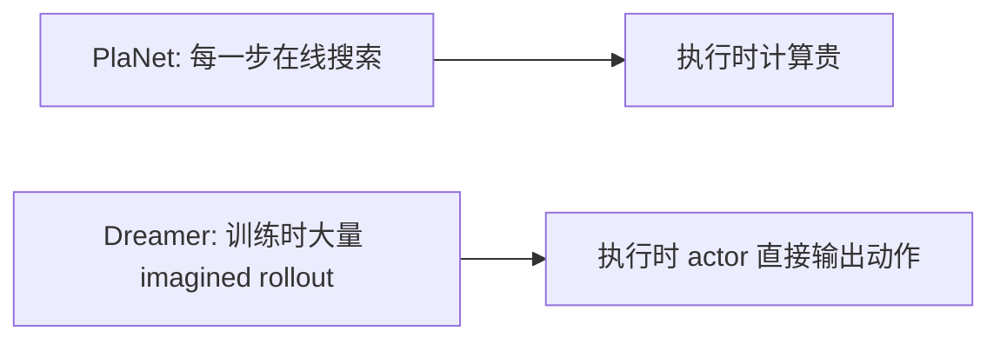

actor-critic 就是这个转移的关键。

- actor 学会“怎么做”；

- value 学会“这样做大概值多少”；

- world model 提供一个可以反复练习的想象环境。

## 3. Dreamer 的三块模型

可以先把 Dreamer 拆成三组网络：

| 模块 | 输入 | 输出 | 作用 |
| --- | --- | --- | --- |
| world model | observation / action / history | latent、reward、continuation 等 | 学习世界如何变化 |
| actor | latent state | action | 学习在当前 latent 下怎么行动 |
| critic / value | latent state | value / return 估计 | 学习当前 latent 大概值多少 |

这三块的分工很清楚：

- world model 负责“世界会怎么变”；
- actor 负责“我该怎么做”；
- value 负责“这样做大概值多少”。

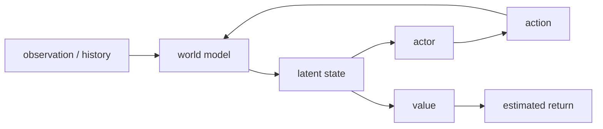

## 4. Imagined rollout：在模型里展开未来

Dreamer 训练 actor/value 时，并不直接依赖真实环境的下一步。  
它先从真实历史编码出一个起点 latent，然后让 actor 在 world model 里连续行动：

```text
z_t -> a_t = actor(z_t)
     -> z_{t+1}, r_t = world_model.step(z_t, a_t)
     -> a_{t+1} = actor(z_{t+1})
     -> ...
```

这条轨迹叫 imagined rollout。

关键点是：

- 起点 latent 来自真实数据；
- 后续状态转移来自 world model；
- 后续动作来自 actor；
- 后续 reward / return 也主要来自模型预测。

所以 actor 和 value 主要是在“学到的世界”里练习。

## 5. Value：给想象出来的未来打分

只有 imagined reward 还不够，因为短视的逐步奖励很难稳定地指导长程行为。  
Dreamer 会学一个 value 函数：

```text
V(z_t) ≈ 从 latent z_t 出发，未来累计回报的估计
```

训练 value 时，常用 imagined return 作为目标。  
更完整的 Dreamer 还会用 lambda-return：把多步 imagined reward 和 bootstrap value 混合起来，让估计既不至于太短视，也不至于完全依赖不成熟的 value。

可以粗略理解成：

- reward head：告诉你这一步赚了多少；
- value head：告诉你从这个状态往后还值多少。

有了这两者，actor 才知道“哪个动作序列更值得选”。

## 6. Actor：在想象里学习怎么行动

有了 world model 和 value，actor 的目标就很直接：

> 选择能提高 imagined return 的动作。

这里和 model-free RL 有一个关键差别：

- model-free 方法通常从真实环境采样轨迹；
- Dreamer 主要从 learned world model 采样 imagined trajectory。

所以 Dreamer 的 actor 是在“可微分的想象环境”里练出来的。

训练时，梯度可以沿着 imagined rollout 回传：  
actor 改变动作 -> world model 给出不同的未来 latent/reward -> return 改变 -> actor 更新。

执行时则很轻�
... (truncated)
```
</details></tool-use>

_**Agent (gpt-5.5 2026-08-02 03:39:07Z)**_

<tool-use data-tool-type="shell" data-tool-name="exec_command"><details>
<summary>Tool use: **exec_command** `Get-Content -Encoding UTF8 -Raw examples\run_dreamer_actor_critic.py`</summary>
```
Chunk ID: 902acc
Wall time: 0.4164 seconds
Process exited with code 0
Original token count: 799
Output:
from __future__ import annotations

from pathlib import Path
import sys

import numpy as np
import torch

PROJECT_ROOT = Path(__file__).resolve().parents[1]
sys.path.insert(0, str(PROJECT_ROOT / "src"))

from hello_world_model import (  # noqa: E402
    DreamerActor,
    DreamerValue,
    LatentDynamicsWorldModel,
    PointMass1DEnv,
    collect_random_data,
    imagine_actor_rollout_numpy,
    plot_actor_policy_field,
    plot_dreamer_actor_critic_losses,
    plot_dreamer_actor_episode,
    plot_dreamer_imagined_rollout,
    plot_latent_model_losses,
    rollout_actor_in_env,
    rollout_random_policy,
    sample_actor_action_grid,
    train_dreamer_actor_critic,
    train_latent_dynamics_model,
)


def main() -> None:
    np.random.seed(10)
    torch.manual_seed(10)

    output_dir = PROJECT_ROOT / "outputs" / "dreamer_actor_critic"

    print("1. Collecting point-mass data for the world model...")
    data_env = PointMass1DEnv(horizon=80)
    data = collect_random_data(data_env, episodes=260)

    print("2. Training a latent dynamics world model...")
    world_model = LatentDynamicsWorldModel(
        obs_dim=2,
        action_dim=1,
        latent_dim=8,
        hidden_dim=64,
    )
    world_losses = train_latent_dynamics_model(
        world_model,
        data,
        epochs=45,
        batch_size=128,
        lr=1e-3,
    )
    plot_latent_model_losses(world_losses, output_dir / "01_world_model_losses.png")

    print("3. Training actor and value on imagined rollouts...")
    actor = DreamerActor(latent_dim=8, action_dim=1, hidden_dim=64)
    value = DreamerValue(latent_dim=8, hidden_dim=64)
    actor_critic_losses = train_dreamer_actor_critic(
        world_model,
        actor,
        value,
        data,
        epochs=250,
        batch_size=128,
        imagination_horizon=15,
        discount=0.97,
        actor_lr=1e-3,
        value_lr=1e-3,
    )
    plot_dreamer_actor_critic_losses(
        actor_critic_losses,
        output_dir / "02_actor_critic_losses.png",
    )

    print("4. Visualizing the policy inside the learned world model...")
    initial_obs = data[0][0]
    imagined_rollout = imagine_actor_rollout_numpy(
        world_model,
        actor,
        initial_obs,
        horizon=35,
    )
    plot_dreamer_imagined_rollout(
        imagined_rollout,
        output_dir / "03_imagined_actor_rollout.png",
    )

    policy_grid = sample_actor_action_grid(world_model, actor, grid_size=31)
    plot_actor_policy_field(policy_grid, output_dir / "04_actor_policy_field.png")

    print("5. Running the learned actor in the real environment...")
    actor_log = rollout_actor_in_env(PointMass1DEnv(horizon=80), world_model, actor)
    random_log = rollout_random_policy(PointMass1DEnv(horizon=80))
    plot_dreamer_actor_episode(
        actor_log,
        random_log,
        output_dir / "05_actor_vs_random_episode.png",
    )

    actor_return = float(actor_log["rewards"].sum())
    random_return = float(random_log["rewards"].sum())
    print(f"Actor return: {actor_return:.2f}")
    print(f"Random return: {random_return:.2f}")
    print(f"Saved visualizations to: {output_dir}")


if __name__ == "__main__":
    main()
```
</details></tool-use>

_**Agent (gpt-5.5 2026-08-02 03:40:37Z)**_

<think><details><summary>Thought Process</summary>
**Planning major dreamer.py patch**
</details></think>

_**Agent (gpt-5.5 2026-08-02 03:40:37Z)**_

<think><details><summary>Thought Process</summary>
**Designing DreamerRSSMWorldModel architecture**
</details></think>

_**Agent (gpt-5.5 2026-08-02 03:40:37Z)**_

<think><details><summary>Thought Process</summary>
**Outlining Dreamer actor and value training**
</details></think>

_**Agent (gpt-5.5 2026-08-02 03:40:37Z)**_

<think><details><summary>Thought Process</summary>
**Detailing Dreamer training loop and episode collection**
</details></think>

_**Agent (gpt-5.5 2026-08-02 03:40:37Z)**_

<think><details><summary>Thought Process</summary>
**Planning Dreamer visualization and training utility functions**
</details></think>

_**Agent (gpt-5.5 2026-08-02 03:40:37Z)**_

<think><details><summary>Thought Process</summary>
**Implementing Dreamer training step with param freezing**
</details></think>

_**Agent (gpt-5.5 2026-08-02 03:40:39Z)**_

实现会稍微大一点，但我会把复杂度压住：不引入外部环境库，只用现有 `PointMass1DEnv`；不追求 DreamerV3 的所有工程 trick，但把你点名的 5 个关键机制都变成可运行代码。

_**Agent (gpt-5.5 2026-08-02 03:41:08Z)**_

<tool-use data-tool-type="write" data-tool-name="apply_patch"><details>
<summary>Tool use: **apply_patch**</summary>
**Update: `src/hello_world_model/dreamer.py`**

```diff
@@
 import random
-from collections.abc import Sequence
+from collections.abc import Callable, Sequence
@@
 from .models import LatentDynamicsWorldModel
 from .training import Transition
+
+DreamerEpisode = dict[str, np.ndarray]
@@
 class DreamerValue(nn.Module):
@@
     def forward(self, latent: torch.Tensor) -> torch.Tensor:
         return self.net(latent)
+
+
+class DreamerRSSMWorldModel(nn.Module):
+    """A compact RSSM with deterministic memory and stochastic latent state."""
+
+    def __init__(
+        self,
+        obs_dim: int = 2,
+        action_dim: int = 1,
+        deter_dim: int = 32,
+        stoch_dim: int = 8,
+        hidden_dim: int = 64,
+        min_log_std: float = -5.0,
+        max_log_std: float = 2.0,
+    ):
+        super().__init__()
+        self.obs_dim = obs_dim
+        self.action_dim = action_dim
+        self.deter_dim = deter_dim
+        self.stoch_dim = stoch_dim
+        self.feature_dim = deter_dim + stoch_dim
+        self.min_log_std = min_log_std
+        self.max_log_std = max_log_std
+
+        self.recurrent = nn.GRUCell(stoch_dim + action_dim, deter_dim)
+        self.prior_net = nn.Sequential(
+            nn.Linear(deter_dim, hidden_dim),
+            nn.ReLU(),
+        )
+        self.prior_mean = nn.Linear(hidden_dim, stoch_dim)
+        self.prior_log_std = nn.Linear(hidden_dim, stoch_dim)
+        self.posterior_net = nn.Sequential(
+            nn.Linear(deter_dim + obs_dim, hidden_dim),
+            nn.ReLU(),
+        )
+        self.posterior_mean = nn.Linear(hidden_dim, stoch_dim)
+        self.posterior_log_std = nn.Linear(hidden_dim, stoch_dim)
+        self.decoder = nn.Sequential(
+            nn.Linear(self.feature_dim, hidden_dim),
+            nn.ReLU(),
+            nn.Linear(hidden_dim, obs_dim),
+        )
+        self.reward_head = nn.Sequential(
+            nn.Linear(self.feature_dim, hidden_dim),
+            nn.ReLU(),
+            nn.Linear(hidden_dim, 1),
+        )
+        self.continue_head = nn.Sequential(
+            nn.Linear(self.feature_dim, hidden_dim),
+            nn.ReLU(),
+            nn.Linear(hidden_dim, 1),
+        )
+
+    def initial(
+        self, batch_size: int, device: str | torch.device
+    ) -> tuple[torch.Tensor, torch.Tensor]:
+        deter = torch.zeros(batch_size, self.deter_dim, device=device)
+        stoch = torch.zeros(batch_size, self.stoch_dim, device=device)
+        return deter, stoch
+
+    def feature(self, deter: torch.Tensor, stoch: torch.Tensor) -> torch.Tensor:
+        return torch.cat([deter, stoch], dim=-1)
+
+    def prior_distribution(
+        self, deter: torch.Tensor
+    ) -> tuple[torch.Tensor, torch.Tensor]:
+        hidden = self.prior_net(deter)
+        return self.prior_mean(hidden), self._clip_log_std(self.prior_log_std(hidden))
+
+    def posterior_distribution(
+        self, deter: torch.Tensor, obs: torch.Tensor
+    ) -> tuple[torch.Tensor, torch.Tensor]:
+        hidden = self.posterior_net(torch.cat([deter, obs], dim=-1))
+        return self.posterior_mean(hidden), self._clip_log_std(
+            self.posterior_log_std(hidden)
+        )
+
+    def imagine_step(
+        self,
+        deter: torch.Tensor,
+        stoch: torch.Tensor,
+        action: torch.Tensor,
+        sample: bool = True,
+    ) -> dict[str, torch.Tensor]:
+        next_deter = self.recurrent(torch.cat([stoch, action], dim=-1), deter)
+        prior_mean, prior_log_std = self.prior_distribution(next_deter)
+        next_stoch = self.sample_stoch(prior_mean, prior_log_std, sample=sample)
+        return {
+            "deter": next_deter,
+            "stoch": next_stoch,
+            "prior_mean": prior_mean,
+            "prior_log_std": prior_log_std,
+        }
+
+    def observe_step(
+        self,
+        deter: torch.Tensor,
+        stoch: torch.Tensor,
+        action: torch.Tensor,
+        obs: torch.Tensor,
+        sample: bool = True,
+    ) -> dict[str, torch.Tensor]:
+        imagined = self.imagine_step(deter, stoch, action, sample=sample)
+        posterior_mean, posterior_log_std = self.posterior_distribution(
+            imagined["deter"], obs
+        )
+        posterior_stoch = self.sample_stoch(
+            posterior_mean, posterior_log_std, sample=sample
+        )
+        imagined["stoch"] = posterior_stoch
+        imagined["posterior_mean"] = posterior_mean
+        imagined["posterior_log_std"] = posterior_log_std
+        return imagined
+
+    def observe(
+        self,
+        obs_seq: torch.Tensor,
+        action_seq: torch.Tensor,
+        sample: bool = True,
+    ) -> dict[str, torch.Tensor]:
+        batch_size, obs_steps, _ = obs_seq.shape
+        device = obs_seq.device
+        deter, stoch = self.initial(batch_size, device)
+        zero_action = torch.zeros(batch_size, self.action_dim, device=device)
+
+        deters: list[torch.Tensor] = []
+        stochs: list[torch.Tensor] = []
+        prior_means: list[torch.Tensor] = []
+        prior_log_stds: list[torch.Tensor] = []
+        posterior_means: list[torch.Tensor] = []
+        posterior_log_stds: list[torch.Tensor] = []
+
+        for t in range(obs_steps):
+            previous_action = zero_action if t == 0 else action_seq[:, t - 1]
+            step = self.observe_step(
+                deter,
+                stoch,
+                previous_action,
+                obs_seq[:, t],
+                sample=sample,
+            )
+            deter = step["deter"]
+            stoch = step["stoch"]
+            deters.append(deter)
+            stochs.append(stoch)
+            prior_means.append(step["prior_mean"])
+            prior_log_stds.append(step["prior_log_std"])
+            posterior_means.append(step["posterior_mean"])
+            posterior_log_stds.append(step["posterior_log_std"])
+
+        deter_seq = torch.stack(deters, dim=1)
+        stoch_seq = torch.stack(stochs, dim=1)
+        features = self.feature(deter_seq, stoch_seq)
+        return {
+            "deter": deter_seq,
+            "stoch": stoch_seq,
+            "features": features,
+            "prior_mean": torch.stack(prior_means, dim=1),
+            "prior_log_std": torch.stack(prior_log_stds, dim=1),
+            "posterior_mean": torch.stack(posterior_means, dim=1),
+            "posterior_log_std": torch.stack(posterior_log_stds, dim=1),
+            "obs_pred": self.decoder(features),
+            "reward_pred": self.reward_head(features[:, 1:]),
+            "continue_logits": self.continue_head(features[:, 1:]),
+        }
+
+    def encode_observation(
+        self, obs: torch.Tensor, sample: bool = False
+    ) -> tuple[torch.Tensor, torch.Tensor, torch.Tensor]:
+        batch_size = obs.shape[0]
+        deter, stoch = self.initial(batch_size, obs.device)
+        zero_action = torch.zeros(batch_size, self.action_dim, device=obs.device)
+        step = self.observe_step(deter, stoch, zero_action, obs, sample=sample)
+        feature = self.feature(step["deter"], step["stoch"])
+        return step["deter"], step["stoch"], feature
+
+    def sample_stoch(
+        self,
+        mean: torch.Tensor,
+        log_std: torch.Tensor,
+        sample: bool = True,
+    ) -> torch.Tensor:
+        if not sample:
+            return mean
+        return mean + torch.randn_like(mean) * torch.exp(log_std)
+
+    def _clip_log_std(self, log_std: torch.Tensor) -> torch.Tensor:
+        return log_std.clamp(self.min_log_std, self.max_log_std)
+
+
+class DreamerReplayBuffer:
+    """Small episode replay buffer for sequence sampling."""
+
+    def __init__(self, capacity: int = 100):
+        self.capacity = capacity
+        self.episodes: list[DreamerEpisode] = []
+
+    def add(self, episode: DreamerEpisode) -> None:
+        self.episodes.append(episode)
+        if len(self.episodes) > self.capacity:
+            self.episodes.pop(0)
+
+    def sample_sequences(
+        self,
+        batch_size: int,
+        sequence_length: int,
+    ) -> dict[str, np.ndarray]:
+        eligible = [
+            episode
+            for episode in self.episodes
+            if len(episode["actions"]) >= sequence_length
+        ]
+        if not eligible:
+            raise ValueError("Replay buffer does not contain enough long episodes.")
+
+        obs_batch = []
+        action_batch = []
+        reward_batch = []
+        continue_batch = []
+
+        for _ in range(batch_size):
+            episode = random.choice(eligible)
+            max_start = len(episode["actions"]) - sequence_length
+            start = random.randint(0, max_start)
+            end = start + sequence_length
+            obs_batch.append(episode["observations"][start : end + 1])
+            action_batch.append(episode["actions"][start:end])
+            reward_batch.append(episode["rewards"][start:end])
+            continue_batch.append(episode["continues"][start:end])
+
+        return {
+            "observations": np.stack(obs_batch).astype(np.float32),
+            "actions": np.stack(action_batch).astype(np.float32),
+            "rewards": np.stack(reward_batch).astype(np.float32),
+            "continues": np.stack(continue_batch).astype(np.float32),
+        }
+
+    def __len__(self) -> int:
+        return len(self.episodes)
```


```
Exit code: 0
Wall time: 3.5 seconds
Output:
Success. Updated the following files:
M src/hello_world_model/dreamer.py
```
</details></tool-use>

_**Agent (gpt-5.5 2026-08-02 03:42:39Z)**_

<tool-use data-tool-type="write" data-tool-name="apply_patch"><details>
<summary>Tool use: **apply_patch**</summary>
**Update: `src/hello_world_model/dreamer.py`**

```diff
@@
 def rollout_random_policy(
     env: PointMass1DEnv,
 ) -> dict[str, np.ndarray]:
@@
         "rewards": np.array(rewards, dtype=np.float32).reshape(-1, 1),
     }
+
+
+def train_dreamer_like_agent(
+    env_factory: Callable[[], PointMass1DEnv],
+    world_model: DreamerRSSMWorldModel,
+    actor: DreamerActor,
+    value: DreamerValue,
+    iterations: int = 8,
+    seed_episodes: int = 8,
+    collect_episodes_per_iteration: int = 2,
+    sequence_length: int = 24,
+    batch_size: int = 32,
+    world_updates: int = 25,
+    actor_updates: int = 25,
+    imagination_horizon: int = 15,
+    discount: float = 0.97,
+    lambda_: float = 0.95,
+    kl_weight: float = 0.05,
+    continue_weight: float = 0.5,
+    exploration_std: float = 0.25,
+    device: str = "cpu",
+) -> tuple[DreamerReplayBuffer, dict[str, list[float]]]:
+    """Train a compact Dreamer-like agent with RSSM, lambda-return, and replay."""
+
+    world_model.to(device)
+    actor.to(device)
+    value.to(device)
+    replay = DreamerReplayBuffer(capacity=80)
+
+    for _ in range(seed_episodes):
+        replay.add(collect_dreamer_episode(env_factory(), random_actions=True))
+
+    world_optimizer = optim.Adam(world_model.parameters(), lr=1e-3)
+    actor_optimizer = optim.Adam(actor.parameters(), lr=8e-4)
+    value_optimizer = optim.Adam(value.parameters(), lr=1e-3)
+    history = {
+        "world_total": [],
+        "world_obs": [],
+        "world_reward": [],
+        "world_continue": [],
+        "world_kl": [],
+        "actor": [],
+        "value": [],
+        "imagined_return": [],
+        "real_return": [],
+        "replay_episodes": [],
+    }
+
+    for iteration in range(iterations):
+        world_metrics = []
+        actor_metrics = []
+
+        _set_requires_grad(world_model, requires_grad=True)
+        for _ in range(world_updates):
+            batch = replay.sample_sequences(batch_size, sequence_length)
+            world_metrics.append(
+                train_rssm_world_model_step(
+                    world_model,
+                    batch,
+                    world_optimizer,
+                    kl_weight=kl_weight,
+                    continue_weight=continue_weight,
+                    device=device,
+                )
+            )
+
+        _set_requires_grad(world_model, requires_grad=False)
+        for _ in range(actor_updates):
+            batch = replay.sample_sequences(batch_size, sequence_length)
+            actor_metrics.append(
+                train_rssm_actor_critic_step(
+                    world_model,
+                    actor,
+                    value,
+                    batch,
+                    actor_optimizer,
+                    value_optimizer,
+                    imagination_horizon=imagination_horizon,
+                    discount=discount,
+                    lambda_=lambda_,
+                    device=device,
+                )
+            )
+
+        current_exploration = exploration_std * (0.85**iteration)
+        for _ in range(collect_episodes_per_iteration):
+            replay.add(
+                collect_dreamer_episode(
+                    env_factory(),
+                    world_model=world_model,
+                    actor=actor,
+                    exploration_std=current_exploration,
+                    random_actions=False,
+                    device=device,
+                )
+            )
+
+        eval_episode = collect_dreamer_episode(
+            env_factory(),
+            world_model=world_model,
+            actor=actor,
+            exploration_std=0.0,
+            random_actions=False,
+            device=device,
+        )
+        world_summary = _mean_metrics(world_metrics)
+        actor_summary = _mean_metrics(actor_metrics)
+        history["world_total"].append(world_summary["total"])
+        history["world_obs"].append(world_summary["obs"])
+        history["world_reward"].append(world_summary["reward"])
+        history["world_continue"].append(world_summary["continue"])
+        history["world_kl"].append(world_summary["kl"])
+        history["actor"].append(actor_summary["actor"])
+        history["value"].append(actor_summary["value"])
+        history["imagined_return"].append(actor_summary["imagined_return"])
+        history["real_return"].append(float(eval_episode["rewards"].sum()))
+        history["replay_episodes"].append(float(len(replay)))
+
+        print(
+            f"Dreamer-like iteration {iteration + 1:02d} | "
+            f"world={history['world_total'][-1]:.4f} | "
+            f"actor={history['actor'][-1]:.4f} | "
+            f"value={history['value'][-1]:.4f} | "
+            f"real_return={history['real_return'][-1]:.2f}"
+        )
+
+    _set_requires_grad(world_model, requires_grad=True)
+    return replay, history
+
+
+def train_rssm_world_model_step(
+    world_model: DreamerRSSMWorldModel,
+    batch: dict[str, np.ndarray],
+    optimizer: optim.Optimizer,
+    kl_weight: float = 0.05,
+    continue_weight: float = 0.5,
+    device: str = "cpu",
+) -> dict[str, float]:
+    """One supervised RSSM update on replay sequences."""
+
+    world_model.train()
+    obs = torch.tensor(batch["observations"], dtype=torch.float32, device=device)
+    actions = torch.tensor(batch["actions"], dtype=torch.float32, device=device)
+    rewards = torch.tensor(batch["rewards"], dtype=torch.float32, device=device)
+    continues = torch.tensor(batch["continues"], dtype=torch.float32, device=device)
+    output = world_model.observe(obs, actions, sample=True)
+
+    obs_loss = nn.functional.mse_loss(output["obs_pred"], obs)
+    reward_loss = nn.functional.mse_loss(output["reward_pred"], rewards)
+    continue_loss = nn.functional.binary_cross_entropy_with_logits(
+        output["continue_logits"], continues
+    )
+    kl_loss = _diagonal_gaussian_kl(
+        output["posterior_mean"][:, 1:],
+        output["posterior_log_std"][:, 1:],
+        output["prior_mean"][:, 1:],
+        output["prior_log_std"][:, 1:],
+    ).mean()
+    total_loss = (
+        obs_loss
+        + reward_loss
+        + continue_weight * continue_loss
+        + kl_weight * kl_loss
+    )
+
+    optimizer.zero_grad()
+    total_loss.backward()
+    optimizer.step()
+
+    return {
+        "total": float(total_loss.item()),
+        "obs": float(obs_loss.item()),
+        "reward": float(reward_loss.item()),
+        "continue": float(continue_loss.item()),
+        "kl": float(kl_loss.item()),
+    }
+
+
+def train_rssm_actor_critic_step(
+    world_model: DreamerRSSMWorldModel,
+    actor: DreamerActor,
+    value: DreamerValue,
+    batch: dict[str, np.ndarray],
+    actor_optimizer: optim.Optimizer,
+    value_optimizer: optim.Optimizer,
+    imagination_horizon: int = 15,
+    discount: float = 0.97,
+    lambda_: float = 0.95,
+    device: str = "cpu",
+) -> dict[str, float]:
+    """One actor/value update using imagined RSSM rollouts and lambda-return."""
+
+    world_model.eval()
+    actor.to(device)
+    value.to(device)
+    obs = torch.tensor(batch["observations"], dtype=torch.float32, device=device)
+    actions = torch.tensor(batch["actions"], dtype=torch.float32, device=device)
+
+    with torch.no_grad():
+        posterior = world_model.observe(obs, actions, sample=True)
+        start_deter = posterior["deter"][:, -1].detach()
+        start_stoch = posterior["stoch"][:, -1].detach()
+        critic_rollout = imagine_rssm_actor_rollout(
+            world_model,
+            actor,
+            start_deter,
+            start_stoch,
+            horizon=imagination_horizon,
+            sample=False,
+        )
+        critic_features = critic_rollout["features"].detach()
+        values_next = value(critic_features[:, 1:].reshape(-1, world_model.feature_dim))
+        values_next = values_next.reshape(obs.shape[0], imagination_horizon, 1)
+        value_targets = lambda_returns(
+            critic_rollout["rewards"].detach(),
+            values_next.detach(),
+            critic_rollout["continues"].detach(),
+            discount=discount,
+            lambda_=lambda_,
+        ).detach()
+
+    value.train()
+    value_pred = value(critic_features[:, :-1].reshape(-1, world_model.feature_dim))
+    value_pred = value_pred.reshape(obs.shape[0], imagination_horizon, 1)
+    value_loss = nn.functional.mse_loss(value_pred, value_targets)
+    value_optimizer.zero_grad()
+    value_loss.backward()
+    value_optimizer.step()
+
+    actor.train()
+    value.eval()
+    _set_requires_grad(value, requires_grad=False)
+    actor_rollout = imagine_rssm_actor_rollout(
+        world_model,
+        actor,
+        start_deter,
+        start_stoch,
+        horizon=imagination_horizon,
+        sample=False,
+    )
+    actor_values_next = value(
+        actor_rollout["features"][:, 1:].reshape(-1, world_model.feature_dim)
+    ).reshape(obs.shape[0], imagination_horizon, 1)
+    actor_returns = lambda_returns(
+        actor_rollout["rewards"],
+        actor_values_next,
+        actor_rollout["continues"],
+        discount=discount,
+        lambda_=lambda_,
+    )
+    actor_loss = -actor_returns.mean()
+    actor_optimizer.zero_grad()
+    actor_loss.backward()
+    actor_optimizer.step()
+    _set_requires_grad(value, requires_grad=True)
+
+    return {
+        "actor": float(actor_loss.item()),
+        "value": float(value_loss.item()),
+        "imagined_return": float(actor_returns[:, 0].mean().item()),
+    }
+
+
+def imagine_rssm_actor_rollout(
+    world_model: DreamerRSSMWorldModel,
+    actor: DreamerActor,
+    start_deter: torch.Tensor,
+    start_stoch: torch.Tensor,
+    horizon: int = 15,
+    sample: bool = False,
+) -> dict[str, torch.Tensor]:
+    """Imagine an actor-controlled rollout from a posterior RSSM state."""
+
+    deter = start_deter
+    stoch = start_stoch
+    features = [world_model.feature(deter, stoch)]
+    decoded_observations = [world_model.decoder(features[-1])]
+    actions: list[torch.Tensor] = []
+    rewards: list[torch.Tensor] = []
+    continues: list[torch.Tensor] = []
+
+    for _ in range(horizon):
+        feature = world_model.feature(deter, stoch)
+        action = actor(feature)
+        imagined = world_model.imagine_step(deter, stoch, action, sample=sample)
+        deter = imagined["deter"]
+        stoch = imagined["stoch"]
+        next_feature = world_model.feature(deter, stoch)
+        actions.append(action)
+        rewards.append(world_model.reward_head(next_feature))
+        continues.append(torch.sigmoid(world_model.continue_head(next_feature)))
+        features.append(next_feature)
+        decoded_observations.append(world_model.decoder(next_feature))
+
+    return {
+        "features": torch.stack(features, dim=1),
+        "decoded_observations": torch.stack(decoded_observations, dim=1),
+        "actions": torch.stack(actions, dim=1),
+        "rewards": torch.stack(rewards, dim=1),
+        "continues": torch.stack(continues, dim=1),
+    }
+
+
+def lambda_returns(
+    rewards: torch.Tensor,
+    values_next: torch.Tensor,
+    continues: torch.Tensor,
+    discount: float = 0.97,
+    lambda_: float = 0.95,
+) -> torch.Tensor:
+    """Compute Dreamer-style lambda returns over imagined rewards."""
+
+    next_return = values_next[:, -1]
+    returns: list[torch.Tensor] = []
+
+    for t in reversed(range(rewards.shape[1])):
+        next_value = values_next[:, t]
+        next_return = rewards[:, t] + discount * continues[:, t] * (
+            (1.0 - lambda_) * next_value + lambda_ * next_return
+        )
+        returns.append(next_return)
+
+    returns.reverse()
+    return torch.stack(returns, dim=1)
+
+
+def collect_dreamer_episode(
+    env: PointMass1DEnv,
+    world_model: DreamerRSSMWorldModel | None = None,
+    actor: DreamerActor | None = None,
+    exploration_std: float = 0.25,
+    random_actions: bool = False,
+    device: str = "cpu",
+) -> DreamerEpisode:
+    """Collect one episode for the Dreamer replay buffer."""
+
+    obs = env.reset()
+    observations = [obs.copy()]
+    actions: list[float] = []
+    rewards: list[float] = []
+    continues: list[float] = []
+    done = False
+
+    if world_model is not None and actor is not None and not random_actions:
+        world_model.eval()
+        actor.eval()
+        obs_tensor = torch.tensor(obs, dtype=torch.float32, device=device).unsqueeze(0)
+        with torch.no_grad():
+            deter, stoch, feature = world_model.encode_observation(
+                obs_tensor, sample=False
+            )
+    else:
+        deter = stoch = feature = None
+
+    while not done:
+        if random_actions or world_model is None or actor is None or feature is None:
+            action = random.uniform(-1.0, 1.0)
+        else:
+            with torch.no_grad():
+                action = float(actor(feature).squeeze(0).cpu().numpy()[0])
+            if exploration_std > 0.0:
+                action += float(np.random.normal(0.0, exploration_std))
+            action = float(np.clip(action, -1.0, 1.0))
+
+        next_obs, reward, done, _ = env.step(action)
+        observations.append(next_obs.copy())
+        actions.append(action)
+        rewards.append(reward)
+        continues.append(0.0 if done else 1.0)
+
+        if world_model is not None and actor is not None and not random_actions:
+            with torch.no_grad():
+                action_tensor = torch.tensor(
+                    [[action]], dtype=torch.float32, device=device
+                )
+                next_obs_tensor = torch.tensor(
+                    next_obs, dtype=torch.float32, device=device
+                ).unsqueeze(0)
+                step = world_model.observe_step(
+                    deter,
+                    stoch,
+                    action_tensor,
+                    next_obs_tensor,
+                    sample=False,
+                )
+                deter = step["deter"]
+                stoch = step["stoch"]
+                feature = world_model.feature(deter, stoch)
+
+        obs = next_obs
+
+    return {
+        "observations": np.stack(observations).astype(np.float32),
+        "actions": np.array(actions, dtype=np.float32).reshape(-1, 1),
+        "rewards": np.array(rewards, dtype=np.float32).reshape(-1, 1),
+        "continues": np.array(continues, dtype=np.float32).reshape(-1, 1),
+    }
+
+
+@torch.no_grad()
+def evaluate_rssm_reconstruction(
+    world_model: DreamerRSSMWorldModel,
+    replay: DreamerReplayBuffer,
+    sequence_length: int = 40,
+    device: str = "cpu",
+) -> dict[str, np.ndarray]:
+    """Decode one replay sequence through the posterior RSSM for diagnostics."""
+
+    world_model.eval()
+    batch = replay.sample_sequences(batch_size=1, sequence_length=sequence_length)
+    obs = torch.tensor(batch["observations"], dtype=torch.float32, device=device)
+    actions = torch.tensor(batch["actions"], dtype=torch.float32, device=device)
+    output = world_model.observe(obs, actions, sample=False)
+    return {
+        "observations": batch["observations"][0],
+        "obs_pred": output["obs_pred"].squeeze(0).cpu().numpy(),
+        "rewards": batch["rewards"][0],
+        "reward_pred": output["reward_pred"].squeeze(0).cpu().numpy(),
+        "continues": batch["continues"][0],
+        "continue_prob": torch.sigmoid(output["continue_logits"])
+        .squeeze(0)
+        .cpu()
+        .numpy(),
+    }
+
+
+@torch.no_grad()
+def imagine_rssm_actor_rollout_numpy(
+    world_model: DreamerRSSMWorldModel,
+    actor: DreamerActor,
+    initial_obs: np.ndarray,
+    horizon: int = 35,
+    device: str = "cpu",
+) -> dict[str, np.ndarray]:
+    """Create one RSSM imagined actor rollout as NumPy arrays."""
+
+    world_model.eval()
+    actor.eval()
+    obs = torch.tensor(initial_obs, dtype=torch.float32, device=device).unsqueeze(0)
+    deter, stoch, _ = world_model.encode_observation(obs, sample=False)
+    rollout = imagine_rssm_actor_rollout(
+        world_model,
+        actor,
+        deter,
+        stoch,
+        horizon=horizon,
+        sample=False,
+    )
+    return {
+        "decoded_observations": rollout["decoded_observations"]
+        .squeeze(0)
+        .cpu()
+        .numpy(),
+        "actions": rollout["actions"].squeeze(0).cpu().numpy(),
+        "rewards": rollout["rewards"].squeeze(0).cpu().numpy(),
+        "continues": rollout["continues"].squeeze(0).cpu().numpy(),
+    }
+
+
+@torch.no_grad()
+def sample_rssm_actor_action_grid(
+    world_model: DreamerRSSMWorldModel,
+    actor: DreamerActor,
+    position_range: tuple[float, float] = (-2.0, 2.0),
+    velocity_range: tuple[float, float] = (-1.0, 1.0),
+    grid_size: int = 25,
+    device: str = "cpu",
+) -> dict[str, np.ndarray]:
+    """Evaluate an RSSM actor on a grid of fully observed point-mass states."""
+
+    world_model.eval()
+    actor.eval()
+    positions = np.linspace(position_range[0], position_range[1], grid_size)
+    velocities = np.linspace(velocity_range[0], velocity_range[1], grid_size)
+    grid_position, grid_velocity = np.meshgrid(positions, velocities)
+    observations = np.stack(
+        [grid_position.reshape(-1), grid_velocity.reshape(-1)],
+        axis=-1,
+    ).astype(np.float32)
+    obs_tensor = torch.tensor(observations, dtype=torch.float32, device=device)
+    _, _, features = world_model.encode_observation(obs_tensor, sample=False)
+    actions = actor(features).cpu().numpy().reshape(grid_size, grid_size)
+    return {
+        "positions": grid_position,
+        "velocities": grid_velocity,
+        "actions": actions,
+    }
+
+
+@torch.no_grad()
+def rollout_rssm_actor_in_env(
+    env: PointMass1DEnv,
+    world_model: DreamerRSSMWorldModel,
+    actor: DreamerActor,
+    device: str = "cpu",
+) -> dict[str, np.ndarray]:
+    """Run an RSSM actor in the real environment."""
+
+    return collect_dreamer_episode(
+        env,
+        world_model=world_model,
+        actor=actor,
+        exploration_std=0.0,
+        random_actions=False,
+        device=device,
+    )
```


```
Exit code: 0
Wall time: 3.6 seconds
Output:
Success. Updated the following files:
M src/hello_world_model/dreamer.py
```
</details></tool-use>

_**Agent (gpt-5.5 2026-08-02 03:42:58Z)**_

<tool-use data-tool-type="write" data-tool-name="apply_patch"><details>
<summary>Tool use: **apply_patch**</summary>
**Update: `src/hello_world_model/dreamer.py`**

```diff
@@
 def _sample_observations(
     observations: np.ndarray,
     batch_size: int,
     device: str,
 ) -> torch.Tensor:
@@
     )
 
 
+def _diagonal_gaussian_kl(
+    q_mean: torch.Tensor,
+    q_log_std: torch.Tensor,
+    p_mean: torch.Tensor,
+    p_log_std: torch.Tensor,
+) -> torch.Tensor:
+    q_var = torch.exp(2.0 * q_log_std)
+    p_var = torch.exp(2.0 * p_log_std)
+    return 0.5 * (
+        2.0 * (p_log_std - q_log_std)
+        + (q_var + (q_mean - p_mean) ** 2) / p_var
+        - 1.0
+    ).sum(dim=-1)
+
+
+def _mean_metrics(metrics: list[dict[str, float]]) -> dict[str, float]:
+    if not metrics:
+        return {}
+    return {
+        key: float(np.mean([metric[key] for metric in metrics]))
+        for key in metrics[0]
+    }
+
+
 def _set_requires_grad(module: nn.Module, requires_grad: bool) -> None:
     for parameter in module.parameters():
         parameter.requires_grad_(requires_grad)
```


```
Exit code: 0
Wall time: 2.5 seconds
Output:
Success. Updated the following files:
M src/hello_world_model/dreamer.py
```
</details></tool-use>

_**Agent (gpt-5.5 2026-08-02 03:43:43Z)**_

<tool-use data-tool-type="write" data-tool-name="apply_patch"><details>
<summary>Tool use: **apply_patch**</summary>
**Update: `src/hello_world_model/visualization.py`**

```diff
@@
 def plot_dreamer_actor_episode(
     actor_log: dict[str, np.ndarray],
     random_log: dict[str, np.ndarray],
     output_path: Path,
 ) -> None:
@@
     fig.tight_layout()
     fig.savefig(output_path, dpi=160)
     plt.close(fig)
+
+
+def plot_dreamer_like_training_curves(
+    history: dict[str, Sequence[float]],
+    output_path: Path,
+) -> None:
+    """Show the main losses and returns in the fuller Dreamer-like loop."""
+
+    iterations = np.arange(1, len(history["real_return"]) + 1)
+
+    _prepare_output(output_path)
+    fig, axes = plt.subplots(4, 1, figsize=(8, 10), sharex=True)
+
+    axes[0].plot(iterations, history["world_total"], label="total", linewidth=2)
+    axes[0].plot(iterations, history["world_obs"], label="obs", linewidth=1.6)
+    axes[0].plot(iterations, history["world_reward"], label="reward", linewidth=1.6)
+    axes[0].set_title("RSSM World Model Losses")
+    axes[0].set_ylabel("loss")
+    axes[0].legend(loc="best")
+    axes[0].grid(True, alpha=0.25)
+
+    axes[1].plot(iterations, history["world_kl"], label="KL", linewidth=2)
+    axes[1].plot(
+        iterations,
+        history["world_continue"],
+        label="continuation BCE",
+        linewidth=1.8,
+    )
+    axes[1].set_title("Stochastic State and Continuation Training")
+    axes[1].set_ylabel("loss")
+    axes[1].legend(loc="best")
+    axes[1].grid(True, alpha=0.25)
+
+    axes[2].plot(iterations, history["actor"], label="actor", linewidth=2)
+    axes[2].plot(iterations, history["value"], label="value", linewidth=2)
+    axes[2].plot(
+        iterations,
+        history["imagined_return"],
+        label="imagined return",
+        linewidth=1.8,
+    )
+    axes[2].set_title("Actor-Critic on Imagined Rollouts")
+    axes[2].set_ylabel("loss / return")
+    axes[2].legend(loc="best")
+    axes[2].grid(True, alpha=0.25)
+
+    axes[3].plot(iterations, history["real_return"], linewidth=2)
+    axes[3].set_title("Evaluation Return in the Real Environment")
+    axes[3].set_xlabel("training iteration")
+    axes[3].set_ylabel("real return")
+    axes[3].grid(True, alpha=0.25)
+
+    fig.tight_layout()
+    fig.savefig(output_path, dpi=160)
+    plt.close(fig)
+
+
+def plot_rssm_reconstruction(
+    reconstruction: dict[str, np.ndarray],
+    output_path: Path,
+) -> None:
+    """Compare posterior RSSM reconstructions with a replay sequence."""
+
+    obs = reconstruction["observations"]
+    obs_pred = reconstruction["obs_pred"]
+    rewards = reconstruction["rewards"].reshape(-1)
+    reward_pred = reconstruction["reward_pred"].reshape(-1)
+    continue_prob = reconstruction["continue_prob"].reshape(-1)
+    obs_steps = np.arange(len(obs))
+    transition_steps = np.arange(len(rewards))
+
+    _prepare_output(output_path)
+    fig, axes = plt.subplots(3, 1, figsize=(8, 8.5), sharex=False)
+
+    axes[0].plot(obs_steps, obs[:, 0], label="real position", linewidth=2)
+    axes[0].plot(
+        obs_steps,
+        obs_pred[:, 0],
+        label="decoded position",
+        linewidth=1.8,
+        linestyle="--",
+    )
+    axes[0].axhline(0.0, color="black", linewidth=1, linestyle=":", label="goal")
+    axes[0].set_title("RSSM Posterior Reconstruction")
+    axes[0].set_ylabel("position")
+    axes[0].legend(loc="best")
+    axes[0].grid(True, alpha=0.25)
+
+    axes[1].plot(obs_steps, obs[:, 1], label="real velocity", linewidth=2)
+    axes[1].plot(
+        obs_steps,
+        obs_pred[:, 1],
+        label="decoded velocity",
+        linewidth=1.8,
+        linestyle="--",
+    )
+    axes[1].set_title("Velocity Reconstruction")
+    axes[1].set_ylabel("velocity")
+    axes[1].legend(loc="best")
+    axes[1].grid(True, alpha=0.25)
+
+    axes[2].plot(transition_steps, rewards, label="real reward", linewidth=2)
+    axes[2].plot(
+        transition_steps,
+        reward_pred,
+        label="predicted reward",
+        linewidth=1.8,
+        linestyle="--",
+    )
+    axes[2].plot(
+        transition_steps,
+        continue_prob,
+        label="predicted continuation",
+        linewidth=1.6,
+        linestyle=":",
+    )
+    axes[2].set_title("Reward and Continuation Heads")
+    axes[2].set_xlabel("sequence step")
+    axes[2].legend(loc="best")
+    axes[2].grid(True, alpha=0.25)
+
+    fig.tight_layout()
+    fig.savefig(output_path, dpi=160)
+    plt.close(fig)
+
+
+def plot_dreamer_like_imagined_rollout(
+    imagined_rollout: dict[str, np.ndarray],
+    output_path: Path,
+) -> None:
+    """Show RSSM imagined states, actions, rewards, and continuation."""
+
+    observations = imagined_rollout["decoded_observations"]
+    actions = imagined_rollout["actions"].reshape(-1)
+    rewards = imagined_rollout["rewards"].reshape(-1)
+    continues = imagined_rollout["continues"].reshape(-1)
+    obs_steps = np.arange(len(observations))
+    transition_steps = np.arange(len(actions))
+
+    _prepare_output(output_path)
+    fig, axes = plt.subplots(4, 1, figsize=(8, 10), sharex=False)
+
+    axes[0].plot(obs_steps, observations[:, 0], label="imagined position", linewidth=2)
+    axes[0].plot(obs_steps, observations[:, 1], label="imagined velocity", linewidth=1.8)
+    axes[0].axhline(0.0, color="black", linewidth=1, linestyle=":", label="goal")
+    axes[0].set_title("RSSM Imagined Actor Rollout")
+    axes[0].legend(loc="best")
+    axes[0].grid(True, alpha=0.25)
+
+    axes[1].plot(transition_steps, actions, color="tab:orange", linewidth=2)
+    axes[1].set_title("Actor Actions")
+    axes[1].set_ylabel("action")
+    axes[1].set_ylim(-1.05, 1.05)
+    axes[1].grid(True, alpha=0.25)
+
+    axes[2].plot(transition_steps, np.cumsum(rewards), color="tab:green", linewidth=2)
+    axes[2].set_title("Predicted Cumulative Reward")
+    axes[2].set_ylabel("return")
+    axes[2].grid(True, alpha=0.25)
+
+    axes[3].plot(transition_steps, continues, linewidth=2)
+    axes[3].set_title("Predicted Continuation Probability")
+    axes[3].set_xlabel("imagined step")
+    axes[3].set_ylabel("p(continue)")
+    axes[3].set_ylim(-0.05, 1.05)
+    axes[3].grid(True, alpha=0.25)
+
+    fig.tight_layout()
+    fig.savefig(output_path, dpi=160)
+    plt.close(fig)
```


```
Exit code: 0
Wall time: 3.5 seconds
Output:
Success. Updated the following files:
M src/hello_world_model/visualization.py
```
</details></tool-use>

_**Agent (gpt-5.5 2026-08-02 03:44:10Z)**_

<tool-use data-tool-type="write" data-tool-name="apply_patch"><details>
<summary>Tool use: **apply_patch**</summary>
**Delete: `examples/run_dreamer_actor_critic.py`**

**Add: `examples/run_dreamer_actor_critic.py`**

```diff
+from __future__ import annotations
+
+from pathlib import Path
+import sys
+
+import numpy as np
+import torch
+
+PROJECT_ROOT = Path(__file__).resolve().parents[1]
+sys.path.insert(0, str(PROJECT_ROOT / "src"))
+
+from hello_world_model import (  # noqa: E402
+    DreamerActor,
+    DreamerRSSMWorldModel,
+    DreamerValue,
+    PointMass1DEnv,
+    evaluate_rssm_reconstruction,
+    imagine_rssm_actor_rollout_numpy,
+    plot_actor_policy_field,
+    plot_dreamer_actor_episode,
+    plot_dreamer_like_imagined_rollout,
+    plot_dreamer_like_training_curves,
+    plot_rssm_reconstruction,
+    rollout_random_policy,
+    rollout_rssm_actor_in_env,
+    sample_rssm_actor_action_grid,
+    train_dreamer_like_agent,
+)
+
+
+def make_env() -> PointMass1DEnv:
+    return PointMass1DEnv(horizon=80)
+
+
+def main() -> None:
+    np.random.seed(10)
+    torch.manual_seed(10)
+
+    output_dir = PROJECT_ROOT / "outputs" / "dreamer_actor_critic"
+
+    print("1. Building a compact RSSM world model...")
+    world_model = DreamerRSSMWorldModel(
+        obs_dim=2,
+        action_dim=1,
+        deter_dim=32,
+        stoch_dim=8,
+        hidden_dim=64,
+    )
+    actor = DreamerActor(
+        latent_dim=world_model.feature_dim,
+        action_dim=1,
+        hidden_dim=64,
+    )
+    value = DreamerValue(latent_dim=world_model.feature_dim, hidden_dim=64)
+
+    print("2. Training Dreamer-like agent with replay, RSSM, and lambda-return...")
+    replay, history = train_dreamer_like_agent(
+        make_env,
+        world_model,
+        actor,
+        value,
+        iterations=8,
+        seed_episodes=8,
+        collect_episodes_per_iteration=2,
+        sequence_length=24,
+        batch_size=32,
+        world_updates=25,
+        actor_updates=25,
+        imagination_horizon=15,
+        discount=0.97,
+        lambda_=0.95,
+        kl_weight=0.05,
+        continue_weight=0.5,
+        exploration_std=0.25,
+    )
+    plot_dreamer_like_training_curves(
+        history,
+        output_dir / "01_dreamer_like_training_curves.png",
+    )
+
+    print("3. Inspecting RSSM reconstruction, reward, and continuation heads...")
+    reconstruction = evaluate_rssm_reconstruction(
+        world_model,
+        replay,
+        sequence_length=40,
+    )
+    plot_rssm_reconstruction(
+        reconstruction,
+        output_dir / "02_rssm_reconstruction.png",
+    )
+
+    print("4. Visualizing an imagined actor rollout...")
+    initial_obs = replay.episodes[-1]["observations"][0]
+    imagined_rollout = imagine_rssm_actor_rollout_numpy(
+        world_model,
+        actor,
+        initial_obs,
+        horizon=35,
+    )
+    plot_dreamer_like_imagined_rollout(
+        imagined_rollout,
+        output_dir / "03_rssm_imagined_actor_rollout.png",
+    )
+
+    print("5. Visualizing the learned actor field...")
+    policy_grid = sample_rssm_actor_action_grid(world_model, actor, grid_size=31)
+    plot_actor_policy_field(policy_grid, output_dir / "04_actor_policy_field.png")
+
+    print("6. Running the learned actor in the real environment...")
+    actor_log = rollout_rssm_actor_in_env(make_env(), world_model, actor)
+    random_log = rollout_random_policy(make_env())
+    plot_dreamer_actor_episode(
+        actor_log,
+        random_log,
+        output_dir / "05_actor_vs_random_episode.png",
+    )
+
+    actor_return = float(actor_log["rewards"].sum())
+    random_return = float(random_log["rewards"].sum())
+    print(f"Actor return: {actor_return:.2f}")
+    print(f"Random return: {random_return:.2f}")
+    print(f"Saved visualizations to: {output_dir}")
+
+
+if __name__ == "__main__":
+    main()
```


```
Exit code: 0
Wall time: 13.8 seconds
Output:
Success. Updated the following files:
A examples/run_dreamer_actor_critic.py
D examples/run_dreamer_actor_critic.py
```
</details></tool-use>

_**Agent (gpt-5.5 2026-08-02 03:44:29Z)**_

核心 demo 入口已经切换成完整机制版本：`examples/run_dreamer_actor_critic.py` 现在会训练 RSSM + actor/value，并持续收集 replay 数据。接下来补导出列表和 README。

_**Agent (gpt-5.5 2026-08-02 03:44:39Z)**_

<tool-use data-tool-type="write" data-tool-name="apply_patch"><details>
<summary>Tool use: **apply_patch**</summary>
**Update: `src/hello_world_model/__init__.py`**

```diff
@@
 from .dreamer import (
     DreamerActor,
+    DreamerRSSMWorldModel,
+    DreamerReplayBuffer,
     DreamerValue,
+    collect_dreamer_episode,
+    evaluate_rssm_reconstruction,
     imagine_actor_rollout_numpy,
+    imagine_rssm_actor_rollout_numpy,
+    lambda_returns,
     rollout_actor_in_env,
     rollout_random_policy,
+    rollout_rssm_actor_in_env,
     sample_actor_action_grid,
+    sample_rssm_actor_action_grid,
     train_dreamer_actor_critic,
+    train_dreamer_like_agent,
 )
@@
     plot_dreamer_actor_critic_losses,
     plot_dreamer_actor_episode,
     plot_dreamer_imagined_rollout,
+    plot_dreamer_like_imagined_rollout,
+    plot_dreamer_like_training_curves,
     plot_latent_model_losses,
@@
     plot_rollout_error_growth,
     plot_rollout_prediction_comparison,
+    plot_rssm_reconstruction,
     plot_prior_latent_samples,
@@
     "GRUWorldModel",
     "DreamerActor",
+    "DreamerRSSMWorldModel",
+    "DreamerReplayBuffer",
     "DreamerValue",
@@
     "analyze_prior_posterior_alignment",
+    "collect_dreamer_episode",
     "collect_real_rollout",
@@
     "evaluate_planner",
+    "evaluate_rssm_reconstruction",
     "imagine_actor_rollout_numpy",
+    "imagine_rssm_actor_rollout_numpy",
+    "lambda_returns",
     "make_probe_action_sequence",
@@
     "plot_dreamer_actor_critic_losses",
     "plot_dreamer_actor_episode",
     "plot_dreamer_imagined_rollout",
+    "plot_dreamer_like_imagined_rollout",
+    "plot_dreamer_like_training_curves",
@@
     "plot_rollout_error_growth",
     "plot_rollout_prediction_comparison",
+    "plot_rssm_reconstruction",
@@
     "rollout_actor_in_env",
     "rollout_random_policy",
+    "rollout_rssm_actor_in_env",
     "rollout_stochastic_latent_model",
@@
     "sample_actor_action_grid",
+    "sample_rssm_actor_action_grid",
     "train_dreamer_actor_critic",
+    "train_dreamer_like_agent",
     "train_latent_dynamics_model",
```


```
Exit code: 0
Wall time: 3.4 seconds
Output:
Success. Updated the following files:
M src/hello_world_model/__init__.py
```
</details></tool-use>

_**Agent (gpt-5.5 2026-08-02 03:45:00Z)**_

<tool-use data-tool-type="write" data-tool-name="apply_patch"><details>
<summary>Tool use: **apply_patch**</summary>
**Update: `src/README.md`**

```diff
@@
-- `dreamer.py`：教学版 Dreamer actor-critic，在 imagined latent rollout 上训练 actor/value。
+- `dreamer.py`：Dreamer actor-critic 教学代码，包含简化 latent actor-critic 与更完整的 RSSM / stochastic prior-posterior / continuation / lambda-return / replay buffer 演示。
```

**Update: `examples/README.md`**

```diff
@@
 运行后会在 `outputs/dreamer_actor_critic` 下生成教学图示：
 
-- `01_world_model_losses.png`：latent dynamics world model 的训练误差。
-- `02_actor_critic_losses.png`：actor/value 在 imagined rollout 上的训练变化。
-- `03_imagined_actor_rollout.png`：actor 在 world model 里想象出的状态、动作和回报。
+- `01_dreamer_like_training_curves.png`：RSSM world model、actor/value、imagined return 和真实环境 return 的训练变化。
+- `02_rssm_reconstruction.png`：posterior RSSM 对 observation、reward 和 continuation 的拟合情况。
+- `03_rssm_imagined_actor_rollout.png`：actor 在 RSSM 里想象出的状态、动作、回报和 continuation。
 - `04_actor_policy_field.png`：actor 在不同位置/速度下会输出什么动作。
 - `05_actor_vs_random_episode.png`：学到的 actor 与随机策略在真实环境中的对比。
```


```
Exit code: 0
Wall time: 12.4 seconds
Output:
Success. Updated the following files:
M src/README.md
M examples/README.md
```
</details></tool-use>

_**Agent (gpt-5.5 2026-08-02 03:45:21Z)**_

现在重写第 10 篇的相关段落：之前“没有这些能力”的说明会改成“本次完整演示补齐了这些能力”，并保留哪些仍是 toy demo 的边界。

_**Agent (gpt-5.5 2026-08-02 03:46:20Z)**_

<tool-use data-tool-type="write" data-tool-name="apply_patch"><details>
<summary>Tool use: **apply_patch**</summary>
**Delete: `docs/notes/world-models-10-dreamer-actor-critic.md`**

**Add: `docs/notes/world-models-10-dreamer-actor-critic.md`**

```diff
+# 10｜Dreamer 的 Actor-Critic：如何在想象中训练策略
+
+> 这一篇接在 [09｜PlaNet 与 Dreamer](world-models-9-planet-dreamer.md) 后面。
+>
+> 第 9 篇里我们已经区分了 PlaNet 和 Dreamer：
+>
+> - PlaNet：每次行动前，用 world model 在线搜索动作序列；
+> - Dreamer：在 world model 里想象未来，用 imagined rollout 训练 actor 和 value。
+>
+> 这一篇专门拆开 Dreamer 的 actor-critic 训练过程，并用 `PointMass1DEnv` 做一个 Dreamer-like 完整演示。
+
+## 1. 一句话直觉
+
+Dreamer 的核心不是“有一个世界模型”这么简单，而是：
+
+> **让策略在学到的世界里练习，而不是每次都去真实环境里试错。**
+
+这里有三组网络：
+
+- **world model / RSSM**：学习环境在 latent space 中如何变化；
+- **actor**：看到 latent feature 后，决定采取什么 action；
+- **critic / value**：估计当前 latent feature 未来大概能获得多少 return。
+
+整体循环是：
+
+```text
+真实环境数据 -> replay buffer -> 训练 RSSM
+RSSM -> imagined rollout -> 训练 actor / value
+actor -> 回到真实环境收集更多数据
+```
+
+## 2. 为什么需要 actor-critic？
+
+PlaNet 已经能用 world model 在线规划。那为什么 Dreamer 还要训练 actor/value？
+
+因为在线规划通常很贵：
+
+- 每一步都要采样很多动作序列；
+- 每条动作序列都要在模型里 rollout；
+- horizon 越长、动作维度越高，搜索越难；
+- 部署时每一步都临场搜索，计算代价会很高。
+
+Dreamer 的思路是把一部分计算从“执行时”搬到“训练时”：
+
+```mermaid
+flowchart LR
+    A["PlaNet: 每一步在线搜索"] --> B["执行时计算贵"]
+    C["Dreamer: 训练时大量 imagined rollout"] --> D["执行时 actor 直接输出动作"]
+```
+
+actor-critic 就是这个转移的关键：
+
+- actor 学会“怎么做”；
+- value 学会“这样做大概值多少”；
+- world model 提供一个可以反复练习的想象环境。
+
+## 3. Dreamer 的 RSSM：记忆 + 随机潜状态
+
+Dreamer 的 world model 通常是 RSSM（recurrent state-space model）。它把状态拆成两部分：
+
+- deterministic recurrent state `h_t`：用 GRU/RNN 维护历史记忆；
+- stochastic latent state `z_t`：表示不确定性和观测无法完全确定的部分。
+
+在本项目的完整演示里，RSSM 使用：
+
+```text
+h_t = GRU(h_{t-1}, z_{t-1}, a_{t-1})
+prior:     p(z_t | h_t)
+posterior: q(z_t | h_t, o_t)
+feature:   [h_t, z_t]
+```
+
+结构图：
+
+```mermaid
+flowchart TB
+    A["previous z_{t-1}, action a_{t-1}"] --> B["GRU deterministic state h_t"]
+    B --> C["prior p(z_t | h_t)"]
+    B --> D["posterior q(z_t | h_t, o_t)"]
+    E["observation o_t"] --> D
+    C <--> F["KL alignment"]
+    D <--> F
+    B --> G["feature [h_t, z_t]"]
+    D --> G
+    G --> H["decoder: reconstruct observation"]
+    G --> I["reward head"]
+    G --> J["continuation head"]
+```
+
+这比前一版简化 demo 更接近 Dreamer：
+
+- 不再只有一个确定 latent；
+- 有 recurrent memory；
+- 有 stochastic prior/posterior；
+- 用 KL 让 prior 学会接近 posterior；
+- 同时预测 observation、reward 和 continuation。
+
+## 4. Continuation head：为什么要预测“是否继续”
+
+强化学习里 episode 可能结束。Dreamer 不只预测 reward，还会预测 continuation：
+
+```text
+c_t = P(episode continues after this step)
+```
+
+如果 episode 结束，后面的 return 就不应该继续累计。
+
+所以 imagined return 更像：
+
+```text
+return_t = r_t + γ c_t return_{t+1}
+```
+
+这里的 `c_t` 很关键：
+
+- `c_t ≈ 1`：模型认为 episode 大概率继续；
+- `c_t ≈ 0`：模型认为 episode 可能终止，未来价值要被截断。
+
+在 `PointMass1DEnv` 中，episode 主要因为 horizon 到达而结束，所以 continuation head 的任务相对简单，但它完整展示了 Dreamer 训练里 “reward + continuation + value” 的组合方式。
+
+## 5. Imagined rollout：actor 在 RSSM 里行动
+
+训练 actor/value 时，Dreamer 先从 replay buffer 取一段真实历史，用 posterior 得到一个当前 latent state：
+
+```text
+(h_t, z_t) from q(z_t | h_t, o_t)
+```
+
+然后进入想象：
+
+```text
+feature_t = [h_t, z_t]
+a_t       = actor(feature_t)
+h_{t+1}   = GRU(h_t, z_t, a_t)
+z_{t+1}   ~ p(z_{t+1} | h_{t+1})
+r_t       = reward_head([h_{t+1}, z_{t+1}])
+c_t       = continuation_head([h_{t+1}, z_{t+1}])
+```
+
+流程图：
+
+```mermaid
+flowchart LR
+    F0["feature_t=[h_t,z_t]"] --> A0["actor"]
+    A0 --> U0["action a_t"]
+    U0 --> R0["RSSM prior step"]
+    R0 --> F1["feature_{t+1}"]
+    F1 --> A1["actor"]
+    F1 --> Reward["reward / continuation / value"]
+    A1 --> U1["action a_{t+1}"]
+    U1 --> R1["RSSM prior step"]
+    R1 --> F2["feature_{t+2}"]
+```
+
+这条轨迹不是从真实环境跑出来的，而是在模型内部想象出来的。
+
+## 6. Lambda-return：value 的训练目标
+
+只用一步 reward 太短视；完全依赖很长 rollout 又容易受模型误差影响。Dreamer 常用 lambda-return 在二者之间折中。
+
+直觉上，lambda-return 把两类信息混在一起：
+
+- 多步 imagined reward；
+- value network 对未来的 bootstrap 估计。
+
+简化形式可以理解为：
+
+```text
+G_t^λ = r_t + γ c_t [(1 - λ) V(s_{t+1}) + λ G_{t+1}^λ]
+```
+
+其中：
+
+- `γ` 是 discount；
+- `c_t` 是 continuation probability；
+- `λ` 控制更相信多步 rollout 还是更相信 bootstrap value。
+
+value 的目标是拟合这个 return：
+
+```text
+value_loss = MSE(V(feature_t), G_t^λ)
+```
+
+```mermaid
+flowchart LR
+    A["imagined rewards"] --> C["lambda-return target"]
+    B["continuation probabilities"] --> C
+    D["bootstrap value"] --> C
+    E["V(feature_t)"] --> F["MSE value loss"]
+    C --> F
+```
+
+## 7. Actor：最大化 imagined return
+
+actor 的目标更直接：
+
+```text
+actor_loss = - mean(lambda_return)
+```
+
+也就是让 imagined return 尽可能大。
+
+因为 imagined rollout 里：
+
+- actor 输出 action；
+- RSSM 根据 action 推进 latent；
+- reward/value/continuation 都是神经网络输出；
+
+所以 actor 可以通过这条可微链路得到梯度。
+
+```mermaid
+flowchart TB
+    A["actor(feature_t) -> action"] --> B["RSSM prior predicts next feature"]
+    B --> C["reward / continuation / value"]
+    C --> D["lambda-return"]
+    D --> E["actor loss = -return"]
+    E --> F["gradient updates actor"]
+```
+
+这就是 Dreamer 和普通 model-free actor-critic 的关键区别：  
+Dreamer 的大量 policy learning 发生在 learned world model 里。
+
+## 8. Replay buffer：持续迭代，而不是一次性训练
+
+完整 Dreamer-like 循环不应该只训练一次 world model，然后冻结 forever。更合理的节奏是：
+
+1. 先用随机策略收集 seed episodes；
+2. 把 episode 放进 replay buffer；
+3. 从 replay buffer 采样序列训练 RSSM；
+4. 从 replay buffer 编码 latent 起点；
+5. 在 RSSM 里 imagined rollout，训练 actor/value；
+6. 用 actor 回真实环境收集新 episode；
+7. 把新 episode 加入 replay buffer；
+8. 重复这个过程。
+
+```mermaid
+flowchart TB
+    A["random seed episodes"] --> B["replay buffer"]
+    B --> C["sample sequences"]
+    C --> D["train RSSM world model"]
+    C --> E["posterior start states"]
+    E --> F["imagined rollout"]
+    F --> G["train actor/value"]
+    G --> H["actor interacts with real env"]
+    H --> B
+```
+
+这次配套代码已经补齐这个循环。
+
+## 9. 本项目里的完整 Dreamer-like demo
+
+本篇对应脚本：
+
+```bash
+python examples/run_dreamer_actor_critic.py
+```
+
+它基于 `PointMass1DEnv` 实现了一个紧凑但完整的 Dreamer-like 演示：
+
+| Dreamer 机制 | 本项目代码里的实现 |
+| --- | --- |
+| deterministic recurrent state | `DreamerRSSMWorldModel.recurrent`，使用 `GRUCell` 维护 `h_t` |
+| stochastic prior/posterior | `prior_distribution` 与 `posterior_distribution`，用 KL 对齐 |
+| continuation head | `continue_head` 预测 episode 是否继续 |
+| lambda-return | `lambda_returns(...)` |
+| replay buffer 持续迭代 | `DreamerReplayBuffer` + `train_dreamer_like_agent(...)` |
+| imagined actor rollout | `imagine_rssm_actor_rollout(...)` |
+| actor/value 训练 | `train_rssm_actor_critic_step(...)` |
+
+运行后会生成：
+
+- `01_dreamer_like_training_curves.png`：RSSM、actor/value、imagined return 和真实 return 的训练变化。
+- `02_rssm_reconstruction.png`：posterior RSSM 对 observation、reward、continuation 的拟合情况。
+- `03_rssm_imagined_actor_rollout.png`：actor 在 RSSM 里想象出的状态、动作、回报和 continuation。
+- `04_actor_policy_field.png`：actor 在不同位置/速度下输出的动作。
+- `05_actor_vs_random_episode.png`：学到的 actor 与随机策略在真实环境中的对比。
+
+## 10. 仍然保留的简化边界
+
+这已经比前一版 demo 更接近 Dreamer，但它仍然不是 DreamerV2/V3 论文级复现。主要简化包括：
+
+- 环境是低维 `PointMass1DEnv`，不是像素输入；
+- actor 是 deterministic actor，没有建模 action distribution 的熵项；
+- value 是普通标量 value，没有 distributional value；
+- RSSM 是连续 Gaussian latent，没有 DreamerV2 的 discrete latent；
+- 没有使用大型 replay、并行环境、归一化和复杂稳定化技巧；
+- 训练轮数很小，目的是教学可读，而不是追求 benchmark 分数。
+
+这份 demo 的目标是让你看见 Dreamer 的核心机械结构：
+
+> replay buffer 提供真实序列，posterior 校正当前 latent，prior 想象未来，continuation 控制回报截断，lambda-return 训练 value，actor 最大化 imagined return。
+
+## 11. 当前理解小结
+
+我现在可以这样理解 Dreamer actor-critic：
+
+- world model 提供一个可微分的“想象环境”；
+- RSSM 用 `h_t` 记住历史，用 `z_t` 表示随机潜状态；
+- posterior 从真实观测校正当前 latent；
+- prior 在没有未来观测时滚动想象；
+- continuation head 决定 imagined return 是否继续往后算；
+- lambda-return 把多步 reward 和 value bootstrap 结合起来；
+- actor 通过最大化 imagined return 学会行动；
+- 真正执行时，actor 不需要每步在线搜索。
+
+如果 PlaNet 是：
+
+```text
+我每次行动前，都在脑内搜索很多未来。
+```
+
+那么 Dreamer 是：
+
+```text
+我平时在脑内大量练习，形成一个能快速行动的策略。
+```
+
+这就是 Dreamer 从“世界模型用于规划”走向“世界模型用于训练行为”的关键一步。
+
+## 12. 下一步问题
+
+后面可以继续追问：
+
+- stochastic latent 为什么有时要改成 discrete latent？
+- actor 是否会 exploit world model 的错误？
+- 如何用 uncertainty 或 ensemble 降低模型偏差？
+- DreamerV3 的 symlog、two-hot value、归一化技巧解决了什么问题？
+- 如何从低维状态扩展到像素输入？
+
+这些问题会把我们带向更完整的 Dreamer 系列实现。
```


```
Exit code: 0
Wall time: 6.7 seconds
Output:
Success. Updated the following files:
A docs/notes/world-models-10-dreamer-actor-critic.md
D docs/notes/world-models-10-dreamer-actor-critic.md
```
</details></tool-use>

_**Agent (gpt-5.5 2026-08-02 03:46:38Z)**_

文档已经改成新的“完整演示”版本。现在进入比较严的检查：先跑 `py_compile`，再看导出是否完整。因为当前环境之前缺 `numpy`，完整训练运行大概率还会受依赖限制，但语法和接口我会先压实。

_**Agent (gpt-5.5 2026-08-02 03:46:38Z)**_

<tool-use data-tool-type="shell" data-tool-name="exec_command"><details>
<summary>Tool use: **exec_command** `python -m py_compile src\hello_world_model\dreamer.py src\hello_world_model\visualization.py src\hello_world_model\__init__.py examples\run_dreamer_actor_critic.py`</summary>
```
Chunk ID: e91c5e
Wall time: 0.3903 seconds
Process exited with code 0
Original token count: 0
Output:
```
</details></tool-use>

_**Agent (gpt-5.5 2026-08-02 03:46:38Z)**_

<tool-use data-tool-type="shell" data-tool-name="exec_command"><details>
<summary>Tool use: **exec_command** `Select-String -Path src\hello_world_model\__init__.py -Pattern "DreamerRSSM|Replay|rssm|lambda|dreamer_like" -Context 0,2`</summary>
```
Chunk ID: 91aae2
Wall time: 0.6210 seconds
Process exited with code 0
Original token count: 880
Output:

> src\hello_world_model\__init__.py:6:    DreamerRSSMWorldModel,
> src\hello_world_model\__init__.py:7:    DreamerReplayBuffer,
  src\hello_world_model\__init__.py:8:    DreamerValue,
  src\hello_world_model\__init__.py:9:    collect_dreamer_episode,
> src\hello_world_model\__init__.py:10:    evaluate_rssm_reconstruction,
  src\hello_world_model\__init__.py:11:    imagine_actor_rollout_numpy,
> src\hello_world_model\__init__.py:12:    imagine_rssm_actor_rollout_numpy,
> src\hello_world_model\__init__.py:13:    lambda_returns,
  src\hello_world_model\__init__.py:14:    rollout_actor_in_env,
  src\hello_world_model\__init__.py:15:    rollout_random_policy,
> src\hello_world_model\__init__.py:16:    rollout_rssm_actor_in_env,
  src\hello_world_model\__init__.py:17:    sample_actor_action_grid,
> src\hello_world_model\__init__.py:18:    sample_rssm_actor_action_grid,
  src\hello_world_model\__init__.py:19:    train_dreamer_actor_critic,
> src\hello_world_model\__init__.py:20:    train_dreamer_like_agent,
  src\hello_world_model\__init__.py:21:)
  src\hello_world_model\__init__.py:22:from .latent import (
> src\hello_world_model\__init__.py:71:    plot_dreamer_like_imagined_rollout,
> src\hello_world_model\__init__.py:72:    plot_dreamer_like_training_curves,
  src\hello_world_model\__init__.py:73:    plot_latent_model_losses,
  src\hello_world_model\__init__.py:74:    plot_latent_space_rollout,
> src\hello_world_model\__init__.py:94:    plot_rssm_reconstruction,
  src\hello_world_model\__init__.py:95:    plot_prior_latent_samples,
  src\hello_world_model\__init__.py:96:    plot_stochastic_model_losses,
> src\hello_world_model\__init__.py:106:    "DreamerRSSMWorldModel",
> src\hello_world_model\__init__.py:107:    "DreamerReplayBuffer",
  src\hello_world_model\__init__.py:108:    "DreamerValue",
  src\hello_world_model\__init__.py:109:    "LatentDynamicsWorldModel",
> src\hello_world_model\__init__.py:121:    "evaluate_rssm_reconstruction",
  src\hello_world_model\__init__.py:122:    "imagine_actor_rollout_numpy",
> src\hello_world_model\__init__.py:123:    "imagine_rssm_actor_rollout_numpy",
> src\hello_world_model\__init__.py:124:    "lambda_returns",
  src\hello_world_model\__init__.py:125:    "make_probe_action_sequence",
  src\hello_world_model\__init__.py:126:    "plot_actor_policy_field",
> src\hello_world_model\__init__.py:131:    "plot_dreamer_like_imagined_rollout",
> src\hello_world_model\__init__.py:132:    "plot_dreamer_like_training_curves",
  src\hello_world_model\__init__.py:133:    "plot_latent_model_losses",
  src\hello_world_model\__init__.py:134:    "plot_latent_space_rollout",
> src\hello_world_model\__init__.py:154:    "plot_rssm_reconstruction",
  src\hello_world_model\__init__.py:155:    "plot_prior_latent_samples",
  src\hello_world_model\__init__.py:156:    "plot_stochastic_model_losses",
> src\hello_world_model\__init__.py:171:    "rollout_rssm_actor_in_env",
  src\hello_world_model\__init__.py:172:    "rollout_stochastic_latent_model",
  src\hello_world_model\__init__.py:173:    "run_receding_horizon_episode",
> src\hello_world_model\__init__.py:178:    "sample_rssm_actor_action_grid",
  src\hello_world_model\__init__.py:179:    "train_dreamer_actor_critic",
> src\hello_world_model\__init__.py:180:    "train_dreamer_like_agent",
  src\hello_world_model\__init__.py:181:    "train_latent_dynamics_model",
  src\hello_world_model\__init__.py:182:    "train_stochastic_latent_model",
```
</details></tool-use>

_**Agent (gpt-5.5 2026-08-02 03:46:38Z)**_

<tool-use data-tool-type="shell" data-tool-name="exec_command"><details>
<summary>Tool use: **exec_command** `git diff --check -- docs\notes\world-models-10-dreamer-actor-critic.md examples\run_dreamer_actor_critic.py src\hello_world_model\dreamer.py src\hello_world_model\visualization.py src\hello_world_model\__init__.py examples\README.md src\README.md`</summary>
```
Chunk ID: be1902
Wall time: 0.2577 seconds
Process exited with code 0
Original token count: 0
Output:
```
</details></tool-use>

_**Agent (gpt-5.5 2026-08-02 03:46:44Z)**_

语法、导出、diff 格式都过了。现在我做一次依赖探测；如果依赖仍缺，我不会安装，只会说明你本地运行前需要 `pip install -r requirements.txt`。

_**Agent (gpt-5.5 2026-08-02 03:46:45Z)**_

<tool-use data-tool-type="shell" data-tool-name="exec_command"><details>
<summary>Tool use: **exec_command** `python -c "import numpy, torch, matplotlib; print('deps ok')"`</summary>
```
Chunk ID: f37718
Wall time: 0.2007 seconds
Process exited with code 1
Original token count: 54
Output:
Traceback (most recent call last):
  File "<string>", line 1, in <module>
    import numpy, torch, matplotlib; print('deps ok')
    ^^^^^^^^^^^^^^^^^^^^^^^^^^^^^^^
ModuleNotFoundError: No module named 'numpy'
```
</details></tool-use>

_**Agent (gpt-5.5 2026-08-02 03:46:58Z)**_

<think><details><summary>Thought Process</summary>
**Inspecting actor and world model tensor usage**
</details></think>

_**Agent (gpt-5.5 2026-08-02 03:46:59Z)**_

<tool-use data-tool-type="shell" data-tool-name="exec_command"><details>
<summary>Tool use: **exec_command** `git status --short --branch`</summary>
```
Chunk ID: 6ce8d7
Wall time: 0.2639 seconds
Process exited with code 0
Original token count: 117
Output:
## main...origin/main
 M .specstory/history/2026-07-19_03-33-50Z-github-github-https-github.md
 M .specstory/history/2026-07-27_13-28-06Z-markdown-display-issue.md
 M .specstory/statistics.json
 M docs/notes/README.md
 M examples/README.md
 M src/README.md
 M src/hello_world_model/__init__.py
 M src/hello_world_model/visualization.py
?? docs/notes/world-models-10-dreamer-actor-critic.md
?? examples/run_dreamer_actor_critic.py
?? src/hello_world_model/dreamer.py
```
</details></tool-use>

_**Agent (gpt-5.5 2026-08-02 03:47:08Z)**_

<tool-use data-tool-type="shell" data-tool-name="exec_command"><details>
<summary>Tool use: **exec_command** `Get-Content -Encoding UTF8 -Raw docs\notes\world-models-10-dreamer-actor-critic.md`</summary>
```
Chunk ID: 657d04
Wall time: 0.5098 seconds
Process exited with code 0
Original token count: 2723
Output:
# 10｜Dreamer 的 Actor-Critic：如何在想象中训练策略

> 这一篇接在 [09｜PlaNet 与 Dreamer](world-models-9-planet-dreamer.md) 后面。
>
> 第 9 篇里我们已经区分了 PlaNet 和 Dreamer：
>
> - PlaNet：每次行动前，用 world model 在线搜索动作序列；
> - Dreamer：在 world model 里想象未来，用 imagined rollout 训练 actor 和 value。
>
> 这一篇专门拆开 Dreamer 的 actor-critic 训练过程，并用 `PointMass1DEnv` 做一个 Dreamer-like 完整演示。

## 1. 一句话直觉

Dreamer 的核心不是“有一个世界模型”这么简单，而是：

> **让策略在学到的世界里练习，而不是每次都去真实环境里试错。**

这里有三组网络：

- **world model / RSSM**：学习环境在 latent space 中如何变化；
- **actor**：看到 latent feature 后，决定采取什么 action；
- **critic / value**：估计当前 latent feature 未来大概能获得多少 return。

整体循环是：

```text
真实环境数据 -> replay buffer -> 训练 RSSM
RSSM -> imagined rollout -> 训练 actor / value
actor -> 回到真实环境收集更多数据
```

## 2. 为什么需要 actor-critic？

PlaNet 已经能用 world model 在线规划。那为什么 Dreamer 还要训练 actor/value？

因为在线规划通常很贵：

- 每一步都要采样很多动作序列；
- 每条动作序列都要在模型里 rollout；
- horizon 越长、动作维度越高，搜索越难；
- 部署时每一步都临场搜索，计算代价会很高。

Dreamer 的思路是把一部分计算从“执行时”搬到“训练时”：


actor-critic 就是这个转移的关键：

- actor 学会“怎么做”；
- value 学会“这样做大概值多少”；
- world model 提供一个可以反复练习的想象环境。

## 3. Dreamer 的 RSSM：记忆 + 随机潜状态

Dreamer 的 world model 通常是 RSSM（recurrent state-space model）。它把状态拆成两部分：

- deterministic recurrent state `h_t`：用 GRU/RNN 维护历史记忆；
- stochastic latent state `z_t`：表示不确定性和观测无法完全确定的部分。

在本项目的完整演示里，RSSM 使用：

```text
h_t = GRU(h_{t-1}, z_{t-1}, a_{t-1})
prior:     p(z_t | h_t)
posterior: q(z_t | h_t, o_t)
feature:   [h_t, z_t]
```

结构图：

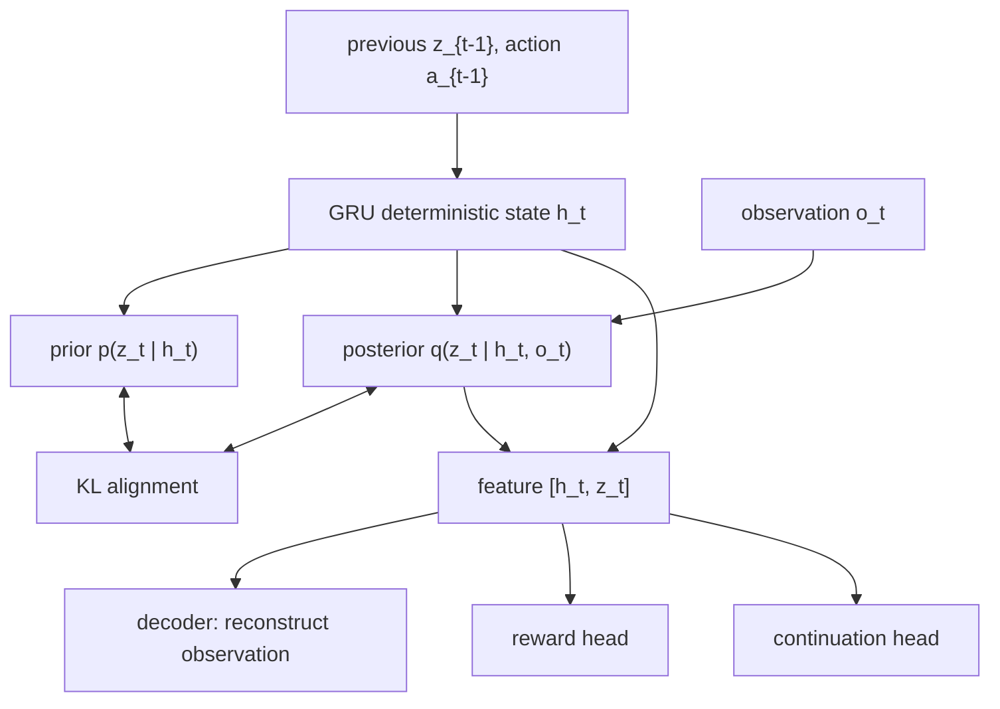

这比前一版简化 demo 更接近 Dreamer：

- 不再只有一个确定 latent；
- 有 recurrent memory；
- 有 stochastic prior/posterior；
- 用 KL 让 prior 学会接近 posterior；
- 同时预测 observation、reward 和 continuation。

## 4. Continuation head：为什么要预测“是否继续”

强化学习里 episode 可能结束。Dreamer 不只预测 reward，还会预测 continuation：

```text
c_t = P(episode continues after this step)
```

如果 episode 结束，后面的 return 就不应该继续累计。

所以 imagined return 更像：

```text
return_t = r_t + γ c_t return_{t+1}
```

这里的 `c_t` 很关键：

- `c_t ≈ 1`：模型认为 episode 大概率继续；
- `c_t ≈ 0`：模型认为 episode 可能终止，未来价值要被截断。

在 `PointMass1DEnv` 中，episode 主要因为 horizon 到达而结束，所以 continuation head 的任务相对简单，但它完整展示了 Dreamer 训练里 “reward + continuation + value” 的组合方式。

## 5. Imagined rollout：actor 在 RSSM 里行动

训练 actor/value 时，Dreamer 先从 replay buffer 取一段真实历史，用 posterior 得到一个当前 latent state：

```text
(h_t, z_t) from q(z_t | h_t, o_t)
```

然后进入想象：

```text
feature_t = [h_t, z_t]
a_t       = actor(feature_t)
h_{t+1}   = GRU(h_t, z_t, a_t)
z_{t+1}   ~ p(z_{t+1} | h_{t+1})
r_t       = reward_head([h_{t+1}, z_{t+1}])
c_t       = continuation_head([h_{t+1}, z_{t+1}])
```

流程图：

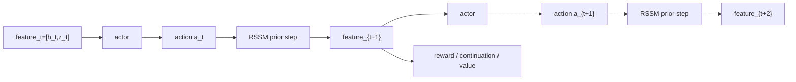

这条轨迹不是从真实环境跑出来的，而是在模型内部想象出来的。

## 6. Lambda-return：value 的训练目标

只用�
... (truncated)
```
</details></tool-use>

_**Agent (gpt-5.5 2026-08-02 03:47:08Z)**_

<tool-use data-tool-type="shell" data-tool-name="exec_command"><details>
<summary>Tool use: **exec_command** `Get-Content -Encoding UTF8 -Raw examples\README.md`</summary>
```
Chunk ID: 9a41f8
Wall time: 0.4333 seconds
Process exited with code 0
Original token count: 1561
Output:
# Examples

这里存放可以直接运行的小实验。

计划中的第一个实验：

- 用一个简单环境收集 `(state, action, next_state)` 数据。
- 训练一个小模型预测 `next_state`。
- 对比真实下一状态和模型预测结果。

每个例子建议包含：

- 运行命令
- 依赖说明
- 预期输出
- 对应笔记

## 当前示例

### 1D point mass world model

```bash
pip install -r requirements.txt
python examples/run_point_mass_world_model.py
```

运行后会在 `outputs/point_mass_world_model` 下生成教学图示：

- `01_random_data_phase_space.png`：随机交互数据覆盖了哪些位置和速度。
- `02_training_loss.png`：world model 的训练误差是否下降。
- `03_one_step_predictions.png`：模型预测的下一状态是否接近真实下一状态。
- `04_planned_trajectory.png`：planner 是否把点质量系统推向目标位置。

对应笔记：

- [MDP、POMDP 与最小世界模型](../docs/notes/world-models-2-basics.md)

### Partial observation GRU world model

```bash
pip install -r requirements.txt
python examples/run_partial_observation_gru.py
```

运行后会在 `outputs/partial_observation_gru` 下生成教学图示：

- `01_partial_observation_ambiguity.png`：同一个位置观测可能对应不同隐藏速度。
- `02_gru_training_loss.png`：GRU world model 的训练误差。
- `03_gru_sequence_prediction.png`：真实位置序列与预测位置序列对比。
- `04_hidden_state_probe.png`：GRU hidden state 是否编码了隐藏速度信息。

对应笔记：

- [为什么世界模型需要 memory 与 latent state](../docs/notes/world-models-3-latent-memory.md)

### Reward world model

```bash
pip install -r requirements.txt
python examples/run_reward_world_model.py
```

运行后会在 `outputs/reward_world_model` 下生成教学图示：

- `01_reward_landscape.png`：toy 环境里 reward 如何由目标距离和动作代价决定。
- `02_reward_model_losses.png`：total / observation / reward 三种训练误差。
- `03_reward_prediction.png`：真实 reward 与预测 reward 的对比。
- `04_reward_guided_action_scores.png`：reward head 如何给候选动作排序。

对应笔记：

- [为什么世界模型需要预测 reward](../docs/notes/world-models-4-reward.md)

### Planning with a world model

```bash
pip install -r requirements.txt
python examples/run_planning_world_model.py
```

运行后会在 `outputs/planning_world_model` 下生成教学图示：

- `01_planning_model_losses.png`：用于 planning 的 recurrent reward world model 训练误差。
- `02_first_imagined_rollouts.png`：第一次规划时，模型想象出的多条未来轨迹。
- `03_receding_horizon_control.png`：滚动规划在真实环境中的控制轨迹。
- `04_imagined_vs_real_feedback.png`：模型预测的最佳 imagined return 与真实 reward 的对照。

对应笔记：

- [用世界模型做 planning](../docs/notes/world-models-5-planning.md)

### Latent dynamics world model

```bash
pip install -r requirements.txt
python examples/run_latent_dynamics_world_model.py
```

运行后会在 `outputs/latent_dynamics_world_model` 下生成教学图示：

- `01_observation_model_loss.png`：observation-space baseline 的训练误差。
- `02_latent_model_losses.png`：latent dynamics model 的训练误差。
- `03_open_loop_rollout_comparison.png`：真实轨迹、observation rollout、latent rollout 的对比。
- `04_rollout_error_growth.png`：open-loop 误差如何随 rollout horizon 增长。
- `05_latent_space_rollout.png`：模型在 latent space 中想象出的轨迹。

对应笔记：

- [为什么要转向 latent dynamics](../docs/notes/world-models-6-latent-dynamics.md)

### Stochastic latent state world model

```bash
pip install -r requirements.txt
python examples/run_stochastic_latent_state_world_model.py
```

运行后会在 `outputs/stochastic_latent_state_world_model` 下生成教学图示：

- `01_stochastic_model_losses.png`：observation / reward / KL loss。
- `02_one_step_future_distribution.png`：同一个 state-action 下采样出的多个下一状态。
- `03_stochastic_rollout_fan.png`：同一条动作序列下的一簇可能未来。
- `04_uncertainty_growth.png`：rollout 过程中样本不确定性如何变化。
- `05_prior_latent_samples.png`：从 `p(z_next | z, action)` 采样出的 latent 分布。

对应笔记：

- [为什么世界模型需要 stochastic latent state](../docs/notes/world-models-7-stochastic-latent-state.md)

### Prior and posterior latent world model

```bash
pip install -r requirements.txt
python examples/run_prior_posterior_latent_world_model.py
```

运行后会在 `outputs/prior_posterior_latent_world_model` 下生成教学图示：

- `01_prior_posterior_training_losses.png`：observation / reward / KL loss。
- `02_prior_vs_posterior_latent_means.png`：prior mean 与 post
... (truncated)
```
</details></tool-use>

_**Agent (gpt-5.5 2026-08-02 03:47:08Z)**_

<tool-use data-tool-type="shell" data-tool-name="exec_command"><details>
<summary>Tool use: **exec_command** `Get-Content -Encoding UTF8 -Raw src\README.md`</summary>
```
Chunk ID: 94d2d9
Wall time: 0.4635 seconds
Process exited with code 0
Original token count: 552
Output:
# Source Code

这里存放世界模型相关的可复用代码。

初期可以先从最小模块开始：

- 环境交互代码
- 数据收集代码
- 状态预测模型
- 训练脚本
- 评估脚本

建议原则：

- 每个实验都能从 README 或注释中看懂入口。
- 优先写小而清楚的代码，再逐步抽象。
- 每次实验都记录对应的笔记链接。

## 当前代码

- [hello_world_model](hello_world_model)：最小 world model 教学代码。

它包含：

- `envs.py`：一维点质量环境。
- `models.py`：MLP world model 和 GRU world model。
- `training.py`：完整状态下的数据收集、训练和评估。
- `memory.py`：partial observation 序列数据、GRU 训练和 reward head 训练。
- `planning.py`：random shooting、imagined rollout 和 receding-horizon planning。
- `latent.py`：latent dynamics 训练和 open-loop rollout 对比。
- `stochastic.py`：stochastic latent state 训练、采样、rollout，以及 prior/posterior latent 对齐分析。
- `dreamer.py`：Dreamer actor-critic 教学代码，包含简化 latent actor-critic 与更完整的 RSSM / stochastic prior-posterior / continuation / lambda-return / replay buffer 演示。
- `visualization.py`：训练过程和规划结果的可视化。

对应笔记：

- [MDP、POMDP 与最小世界模型](../docs/notes/world-models-2-basics.md)
- [为什么世界模型需要 memory 与 latent state](../docs/notes/world-models-3-latent-memory.md)
- [为什么世界模型需要预测 reward](../docs/notes/world-models-4-reward.md)
- [用世界模型做 planning](../docs/notes/world-models-5-planning.md)
- [为什么要转向 latent dynamics](../docs/notes/world-models-6-latent-dynamics.md)
- [为什么世界模型需要 stochastic latent state](../docs/notes/world-models-7-stochastic-latent-state.md)
- [Prior 与 Posterior Latent：世界模型如何“先猜，再校正”](../docs/notes/world-models-8-prior-and-posterior-latent.md)
- [PlaNet 与 Dreamer：同一个世界模型，两种使用方式](../docs/notes/world-models-9-planet-dreamer.md)
- [Dreamer 的 Actor-Critic：如何在想象中训练策略](../docs/notes/world-models-10-dreamer-actor-critic.md)
```
</details></tool-use>

_**Agent (gpt-5.5 2026-08-02 03:47:19Z)**_

<think><details><summary>Thought Process</summary>
**Verifying reward node and training updates**
</details></think>

_**Agent (gpt-5.5 2026-08-02 03:47:20Z)**_

我读了一遍生成后的笔记和 README，结构是干净的。为了尽量不被当前缺依赖的 Python 卡住，我再看一下 Codex 工作区是否有可用的 bundled Python；如果有现成环境，我尝试用它做一次更深的导入/运行检查。

_**Agent (gpt-5.5 2026-08-02 03:47:20Z)**_

<tool-use data-tool-type="unknown" data-tool-name="load_workspace_dependencies"><details>
<summary>Tool use: **load_workspace_dependencies**</summary>
```
Workspace dependencies are available for this local desktop thread.

### Workspace Dependencies
Use these bundled paths for sheets, slides, documents, PDFs, images, or browser automation:
- Bundle version: `26.801.11242`
- Git executable: `C:\Users\Lenovo\.cache\codex-runtimes\codex-primary-runtime\dependencies\native\git\cmd\git.exe`
- Node.js executable: `C:\Users\Lenovo\.cache\codex-runtimes\codex-primary-runtime\dependencies\node\bin\node.exe`
- Node.js packages: `C:\Users\Lenovo\.cache\codex-runtimes\codex-primary-runtime\dependencies\node\node_modules`
- pnpm executable: `C:\Users\Lenovo\.cache\codex-runtimes\codex-primary-runtime\dependencies\bin\fallback\pnpm.cmd`
- Python executable: `C:\Users\Lenovo\.cache\codex-runtimes\codex-primary-runtime\dependencies\python\python.exe`
- Python packages: `C:\Users\Lenovo\.cache\codex-runtimes\codex-primary-runtime\dependencies\python`
- Override binaries: `C:\Users\Lenovo\.cache\codex-runtimes\codex-primary-runtime\dependencies\bin\override`
- Fallback binaries: `C:\Users\Lenovo\.cache\codex-runtimes\codex-primary-runtime\dependencies\bin\fallback`
```
</details></tool-use>

_**Agent (gpt-5.5 2026-08-02 03:47:26Z)**_

找到一个 bundled Python 了，我用它跑一次导入级检查；如果里面也没有 `torch`，那就只保留语法验证结论。

_**Agent (gpt-5.5 2026-08-02 03:47:27Z)**_

<tool-use data-tool-type="shell" data-tool-name="exec_command"><details>
<summary>Tool use: **exec_command** `C:\Users\Lenovo\.cache\codex-runtimes\codex-primary-runtime\dependencies\python\python.exe -c "import numpy, torch, matplotlib; print('deps ok')"`</summary>
```
Chunk ID: 96bce4
Wall time: 2.4808 seconds
Process exited with code 1
Original token count: 31
Output:
Traceback (most recent call last):
  File "<string>", line 1, in <module>
ModuleNotFoundError: No module named 'torch'
```
</details></tool-use>

_**Agent (gpt-5.5 2026-08-02 03:47:37Z)**_

<tool-use data-tool-type="shell" data-tool-name="exec_command"><details>
<summary>Tool use: **exec_command** `git status --short --branch`</summary>
```
Chunk ID: 80bd50
Wall time: 0.2072 seconds
Process exited with code 0
Original token count: 117
Output:
## main...origin/main
 M .specstory/history/2026-07-19_03-33-50Z-github-github-https-github.md
 M .specstory/history/2026-07-27_13-28-06Z-markdown-display-issue.md
 M .specstory/statistics.json
 M docs/notes/README.md
 M examples/README.md
 M src/README.md
 M src/hello_world_model/__init__.py
 M src/hello_world_model/visualization.py
?? docs/notes/world-models-10-dreamer-actor-critic.md
?? examples/run_dreamer_actor_critic.py
?? src/hello_world_model/dreamer.py
```
</details></tool-use>

_**Agent (gpt-5.5 2026-08-02 03:47:53Z)**_

已按你的要求把第 10 篇从“简化教学版”升级成了一个基于 `PointMass1DEnv` 的 Dreamer-like 完整演示。

补齐的能力：

- RSSM deterministic recurrent state：`GRUCell` 维护 `h_t`
- stochastic prior/posterior：`p(z_t | h_t)` / `q(z_t | h_t, o_t)` + KL 对齐
- continuation head：预测 episode 是否继续
- lambda-return：用于 value target
- replay buffer 持续迭代：随机 seed episode → 训练 → actor 收集新数据 → replay 更新

主要修改：

- [world-models-10-dreamer-actor-critic.md](E:/HelloWorldModel/docs/notes/world-models-10-dreamer-actor-critic.md)
- [dreamer.py](E:/HelloWorldModel/src/hello_world_model/dreamer.py)
- [run_dreamer_actor_critic.py](E:/HelloWorldModel/examples/run_dreamer_actor_critic.py)
- [visualization.py](E:/HelloWorldModel/src/hello_world_model/visualization.py)
- [__init__.py](E:/HelloWorldModel/src/hello_world_model/__init__.py)
- [examples/README.md](E:/HelloWorldModel/examples/README.md)
- [src/README.md](E:/HelloWorldModel/src/README.md)

新的 demo 运行命令：

```bash
python examples/run_dreamer_actor_critic.py
```

会生成：

```text
outputs/dreamer_actor_critic/
├── 01_dreamer_like_training_curves.png
├── 02_rssm_reconstruction.png
├── 03_rssm_imagined_actor_rollout.png
├── 04_actor_policy_field.png
└── 05_actor_vs_random_episode.png
```

检查结果：

- `python -m py_compile ...` 通过。
- `git diff --check ...` 通过。
- 当前默认 Python 缺 `numpy`，bundled Python 缺 `torch`，所以我没有完整跑训练脚本。你本地先执行：

```bash
pip install -r requirements.txt
```

再跑 demo 即可。

你检查后可以 add：

```bash
git add docs\notes\world-models-10-dreamer-actor-critic.md examples\run_dreamer_actor_critic.py src\hello_world_model\dreamer.py src\hello_world_model\visualization.py src\hello_world_model\__init__.py examples\README.md src\README.md docs\notes\README.md
```

`.specstory/...` 仍是自动变更，建议不要加入这次提交。
