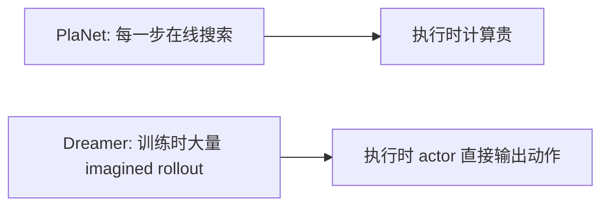
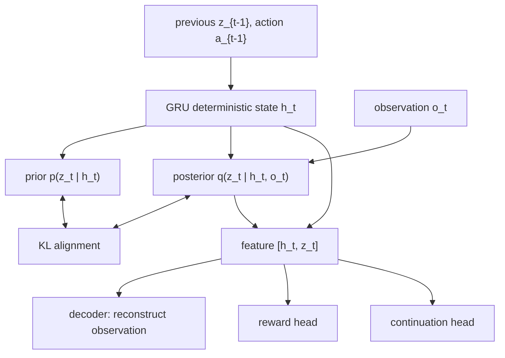
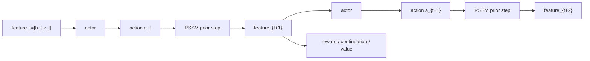
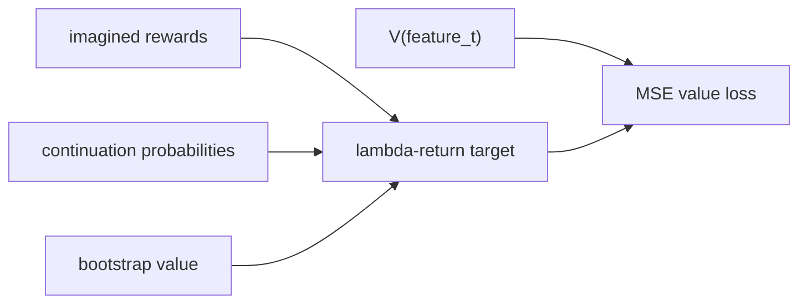
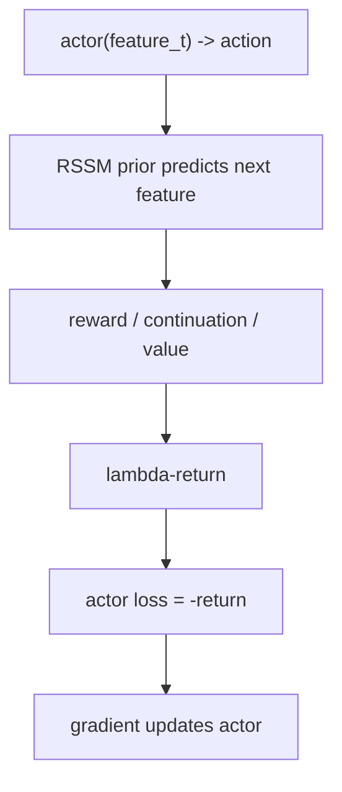
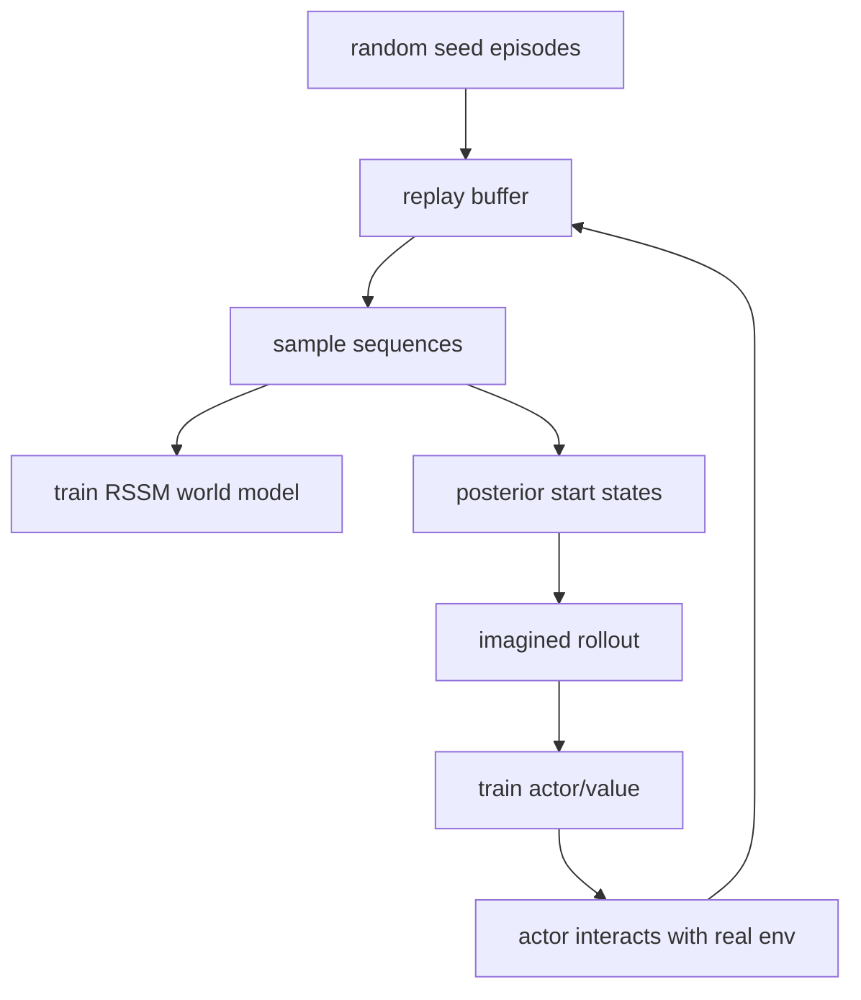

# 10｜Dreamer 的 Actor-Critic：如何在想象中训练策略

> 这一篇接在 [09｜PlaNet 与 Dreamer](world-models-9-planet-dreamer.md) 后面。
>
> 第 9 篇里我们已经区分了 PlaNet 和 Dreamer：
>
> - PlaNet：每次行动前，用 world model 在线搜索动作序列；
> - Dreamer：在 world model 里想象未来，用 imagined rollout 训练 actor 和 value。
>
> 这一篇专门拆开 Dreamer 的 actor-critic 训练过程，并用 `PointMass1DEnv` 做一个 Dreamer-like 完整演示。

## 1. 一句话直觉

Dreamer 的核心不是“有一个世界模型”这么简单，而是：

> **让策略在学到的世界里练习，而不是每次都去真实环境里试错。**

这里有三组网络：

- **world model / RSSM**：学习环境在 latent space 中如何变化；
- **actor**：看到 latent feature 后，决定采取什么 action；
- **critic / value**：估计当前 latent feature 未来大概能获得多少 return。

整体循环是：

```text
真实环境数据 -> replay buffer -> 训练 RSSM
RSSM -> imagined rollout -> 训练 actor / value
actor -> 回到真实环境收集更多数据
```


## 2. 为什么需要 actor-critic？

PlaNet 已经能用 world model 在线规划。那为什么 Dreamer 还要训练 actor/value？

因为在线规划通常很贵：

- 每一步都要采样很多动作序列；
- 每条动作序列都要在模型里 rollout；
- horizon 越长、动作维度越高，搜索越难；
- 部署时每一步都临场搜索，计算代价会很高。

Dreamer 的思路是把一部分计算从“执行时”搬到“训练时”：




actor-critic 就是这个转移的关键：

- actor 学会“怎么做”；
- value 学会“这样做大概值多少”；
- world model 提供一个可以反复练习的想象环境。


## 3. Dreamer 的 RSSM：记忆 + 随机潜状态

Dreamer 的 world model 通常是 RSSM（recurrent state-space model）。它把状态拆成两部分：

- deterministic recurrent state `h_t`：用 GRU/RNN 维护历史记忆；
- stochastic latent state `z_t`：表示不确定性和观测无法完全确定的部分。

在本项目的完整演示里，RSSM 使用：

$$
\begin{aligned}
h_t &= \mathrm{GRU}(h_{t-1}, z_{t-1}, a_{t-1}) \\
\text{prior: } &\ p(z_t \mid h_t) \\
\text{posterior: } &\ q(z_t \mid h_t, o_t) \\
\text{feature: } &\ [h_t, z_t]
\end{aligned}
$$

结构图：




这比前一版简化 demo 更接近 Dreamer：

- 不再只有一个确定 latent；
- 有 recurrent memory；
- 有 stochastic prior/posterior；
- 用 KL 让 prior 学会接近 posterior；
- 同时预测 observation、reward 和 continuation。


## 4. Continuation head：为什么要预测“是否继续”

强化学习里 episode 可能结束。Dreamer 不只预测 reward，还会预测 continuation：

$$
c_t = P(\text{episode continues after this step})
$$

如果 episode 结束，后面的 return 就不应该继续累计。

所以 imagined return 更像：

$$
\mathrm{return}_t = r_t + \gamma c_t \,\mathrm{return}_{t+1}
$$

这里的 `c_t` 很关键：

- `c_t ≈ 1`：模型认为 episode 大概率继续；
- `c_t ≈ 0`：模型认为 episode 可能终止，未来价值要被截断。

在 `PointMass1DEnv` 中，episode 主要因为 horizon 到达而结束，所以 continuation head 的任务相对简单，但它完整展示了 Dreamer 训练里 “reward + continuation + value” 的组合方式。

## 5. Imagined rollout：actor 在 RSSM 里行动

训练 actor/value 时，Dreamer 先从 replay buffer 取一段真实历史，用 posterior 得到一个当前 latent state：

$$
(h_t, z_t) \leftarrow q(z_t \mid h_t, o_t)
$$

然后进入想象：

$$
\begin{aligned}
\mathrm{feature}_t &= [h_t, z_t] \\
a_t &= \mathrm{actor}(\mathrm{feature}_t) \\
h_{t+1} &= \mathrm{GRU}(h_t, z_t, a_t) \\
z_{t+1} &\sim p(z_{t+1} \mid h_{t+1}) \\
r_t &= \mathrm{reward\_head}([h_{t+1}, z_{t+1}]) \\
c_t &= \mathrm{continuation\_head}([h_{t+1}, z_{t+1}])
\end{aligned}
$$

流程图：




这条轨迹不是从真实环境跑出来的，而是在模型内部想象出来的。

## 6. Lambda-return：value 的训练目标

只用一步 reward 太短视；完全依赖很长 rollout 又容易受模型误差影响。Dreamer 常用 lambda-return 在二者之间折中。

直觉上，lambda-return 把两类信息混在一起：

- 多步 imagined reward；
- value network 对未来的 bootstrap 估计。

简化形式可以理解为：

$$
G_t^{\lambda} = r_t + \gamma c_t \big[(1 - \lambda) V(s_{t+1}) + \lambda G_{t+1}^{\lambda}\big]
$$

其中：

- `γ` 是 discount；
- `c_t` 是 continuation probability；
- `λ` 控制更相信多步 rollout 还是更相信 bootstrap value。

value 的目标是拟合这个 return：

$$
\mathcal{L}_{\mathrm{value}} = \mathrm{MSE}\big(V(\mathrm{feature}_t), G_t^{\lambda}\big)
$$




## 7. Actor：最大化 imagined return

actor 的目标更直接：

$$
\mathcal{L}_{\mathrm{actor}} = -\,\mathrm{mean}(G^{\lambda})
$$

也就是让 imagined return 尽可能大。

因为 imagined rollout 里：

- actor 输出 action；
- RSSM 根据 action 推进 latent；
- reward/value/continuation 都是神经网络输出；

所以 actor 可以通过这条可微链路得到梯度。




这就是 Dreamer 和普通 model-free actor-critic 的关键区别：  
Dreamer 的大量 policy learning 发生在 learned world model 里。

## 8. Replay buffer：持续迭代，而不是一次性训练

完整 Dreamer-like 循环不应该只训练一次 world model，然后冻结 forever。更合理的节奏是：

1. 先用随机策略收集 seed episodes；
2. 把 episode 放进 replay buffer；
3. 从 replay buffer 采样序列训练 RSSM；
4. 从 replay buffer 编码 latent 起点；
5. 在 RSSM 里 imagined rollout，训练 actor/value；
6. 用 actor 回真实环境收集新 episode；
7. 把新 episode 加入 replay buffer；
8. 重复这个过程。




这次配套代码已经补齐这个循环。

## 9. 本项目里的完整 Dreamer-like demo

本篇对应脚本：

```bash
python examples/run_dreamer_actor_critic.py
```

它基于 `PointMass1DEnv` 实现了一个紧凑但完整的 Dreamer-like 演示：


| Dreamer 机制                    | 本项目代码里的实现                                               |
| ----------------------------- | ------------------------------------------------------- |
| deterministic recurrent state | `DreamerRSSMWorldModel.recurrent`，使用 `GRUCell` 维护 `h_t` |
| stochastic prior/posterior    | `prior_distribution` 与 `posterior_distribution`，用 KL 对齐 |
| continuation head             | `continue_head` 预测 episode 是否继续                         |
| lambda-return                 | `lambda_returns(...)`                                   |
| replay buffer 持续迭代            | `DreamerReplayBuffer` + `train_dreamer_like_agent(...)` |
| imagined actor rollout        | `imagine_rssm_actor_rollout(...)`                       |
| actor/value 训练                | `train_rssm_actor_critic_step(...)`                     |


运行后会生成：

- `01_dreamer_like_training_curves.png`：RSSM、actor/value、imagined return 和真实 return 的训练变化。
- `02_rssm_reconstruction.png`：posterior RSSM 对 observation、reward、continuation 的拟合情况。
- `03_rssm_imagined_actor_rollout.png`：actor 在 RSSM 里想象出的状态、动作、回报和 continuation。
- `04_actor_policy_field.png`：actor 在不同位置/速度下输出的动作。
- `05_actor_vs_random_episode.png`：学到的 actor 与随机策略在真实环境中的对比。


## 10. 仍然保留的简化边界

这已经比前一版 demo 更接近 Dreamer，但它仍然不是 DreamerV2/V3 论文级复现。主要简化包括：

- 环境是低维 `PointMass1DEnv`，不是像素输入；
- actor 是 deterministic actor，没有建模 action distribution 的熵项；
- value 是普通标量 value，没有 distributional value；
- RSSM 是连续 Gaussian latent，没有 DreamerV2 的 discrete latent；
- 没有使用大型 replay、并行环境、归一化和复杂稳定化技巧；
- 训练轮数很小，目的是教学可读，而不是追求 benchmark 分数。

这份 demo 的目标是让你看见 Dreamer 的核心机械结构：

> replay buffer 提供真实序列，posterior 校正当前 latent，prior 想象未来，continuation 控制回报截断，lambda-return 训练 value，actor 最大化 imagined return。


## 11. 当前理解小结

我现在可以这样理解 Dreamer actor-critic：

- world model 提供一个可微分的“想象环境”；
- RSSM 用 `h_t` 记住历史，用 `z_t` 表示随机潜状态；
- posterior 从真实观测校正当前 latent；
- prior 在没有未来观测时滚动想象；
- continuation head 决定 imagined return 是否继续往后算；
- lambda-return 把多步 reward 和 value bootstrap 结合起来；
- actor 通过最大化 imagined return 学会行动；
- 真正执行时，actor 不需要每步在线搜索。

如果 PlaNet 是：

```text
我每次行动前，都在脑内搜索很多未来。
```

那么 Dreamer 是：

```text
我平时在脑内大量练习，形成一个能快速行动的策略。
```

这就是 Dreamer 从“世界模型用于规划”走向“世界模型用于训练行为”的关键一步。


