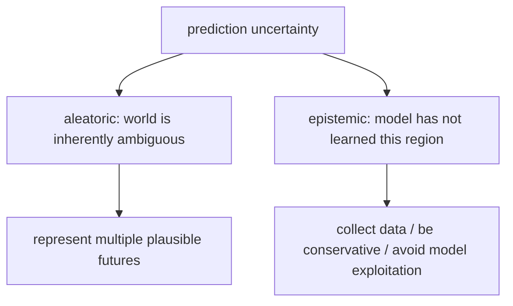
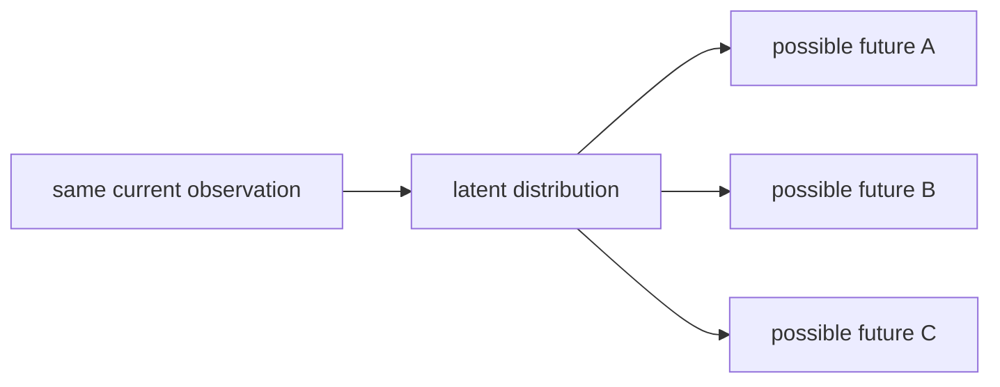
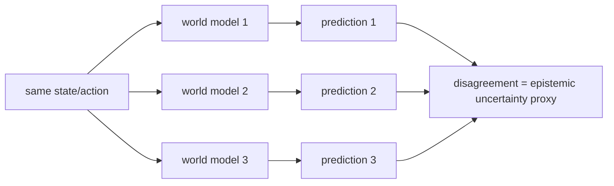
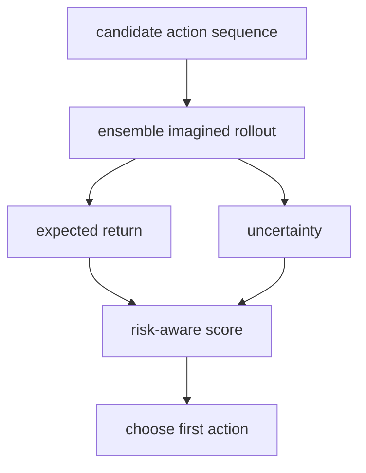
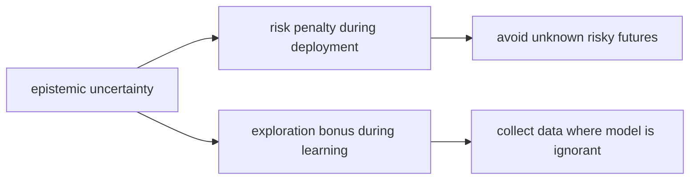

# 11｜Uncertainty：世界模型不仅要预测未来，还要知道自己哪里不确定

> 这一篇接在 [10｜Dreamer 的 Actor-Critic](world-models-10-dreamer-actor-critic.md) 后面。
>
> 前面我们已经看到：world model 可以预测未来、想象 rollout、训练 actor/value。现在要补上一个更深的能力：
>
> **一个可靠的世界模型，不应该只给出预测，还应该知道自己对哪些预测没有把握。**

## 1. 定位

世界模型的预测不只是：

```text
未来会发生什么？
```

还应该包括：

```text
我对这个未来有多确定？
这种不确定来自世界本身，还是来自我没学过？
```

这就是 uncertainty 的意义。

如果模型知道“哪里不确定”，智能体就能：

- 避免盲目相信错误预测；
- 在规划时对高风险未来打折；
- 发现自己没见过的新区域；
- 更主动地探索能减少无知的数据。

## 2. 最重要的区分：不是所有不确定都一样

在世界模型里，至少要区分两类 uncertainty：


| 类型                    | 中文直觉    | 来源                   | 能不能靠更多数据减少？ |
| --------------------- | ------- | -------------------- | ----------- |
| aleatoric uncertainty | 世界本身随机  | 环境噪声、多模态未来、观测不完整     | 通常不能完全消除    |
| epistemic uncertainty | 模型自己不知道 | 数据不足、OOD 状态、没见过的动作组合 | 可以靠更多有效数据减少 |


这两类不确定性长得都像“预测不准”，但含义完全不同。




一句话：

> **aleatoric 是世界不唯一；epistemic 是模型还无知。**


## 3. Aleatoric uncertainty：世界本来就有多种可能

aleatoric uncertainty 不是模型的失败，而是世界本身的信息不足。

例子：

- 骰子下一次会掷出什么，本来就是随机的；
- 传感器观测有噪声；
- 在 partial observation 下，同一个观测可能对应多个真实状态；
- 同一个 state-action 之后，环境可能随机走向多个未来。

在世界模型中，这类不确定常表现为：

```text
p(z_{t+1} | z_t, a_t)
```

不是一个点，而是一个分布。

这就是 stochastic latent state 的价值：它允许模型表达“一族可能的未来”，而不是强行把未来压成一个平均答案。




如果模型只输出平均未来，在多模态场景里会很危险。  
比如未来可能“向左”也可能“向右”，平均后变成“站在中间”，但中间可能根本不是一个真实会发生的未来。

## 4. Epistemic uncertainty：模型没见过，所以不该太自信

epistemic uncertainty 来自模型知识不足。

例子：

- 机器人只在平地训练过，突然来到冰面；
- 模型只见过小动作，规划器却尝试极端动作序列；
- replay buffer 没覆盖某个状态区域；
- actor 在 imagined rollout 中找到一个模型漏洞，看起来 reward 很高，但真实环境里完全不成立。

这类不确定最危险的地方是：

> 模型可能错得很离谱，但输出看起来很自信。

这就是 model-based RL 里的经典问题：**model exploitation**。  
actor 或 planner 可能会找到世界模型的错误缝隙，在“假世界”里拿高分，在真实环境里翻车。

## 5. Stochastic latent 主要解决哪一种？

前面学过的 stochastic latent state，主要帮助表达：

- 同一个当前信息下，未来可能不唯一；
- partial observation 导致多个 latent explanation 都合理；
- 环境本身带随机性。

也就是更偏向：

```text
aleatoric uncertainty
```

但要小心：

> stochastic latent 不等于 epistemic uncertainty。

原因是：  
一个模型即使完全没见过某个区域，也可能在那里输出一个很窄的 Gaussian 分布，看起来“很确定”。这不代表它真的懂，只代表它没有机制表达“我不知道”。

所以：

- stochastic latent：表达未来的多样性；
- epistemic uncertainty：表达模型知识的空白。

这两件事相关，但不能混为一谈。

## 6. Ensemble：估计 epistemic uncertainty 的朴素方法

估计 epistemic uncertainty 的经典方法之一是 ensemble。

做法很直接：

1. 训练多个 world models；
2. 给它们同一个 state/action；
3. 比较它们的预测是否一致；
4. 分歧越大，说明模型越没把握。




最小伪代码：

```python
import torch


@torch.no_grad()
def ensemble_reward_stats(models, obs, action):
    """Return mean reward and model disagreement for one state-action batch."""

    preds = []
    for model in models:
        _, pred_reward, _ = model(obs, action)
        preds.append(pred_reward)

    preds = torch.stack(preds, dim=0)  # [num_models, batch, 1]
    mean_reward = preds.mean(dim=0)
    uncertainty = preds.std(dim=0)
    return mean_reward, uncertainty
```

这里：

- `mean_reward` 表示模型平均认为能拿多少 reward；
- `uncertainty` 表示不同模型之间有多大分歧。

这个 `uncertainty` 不是完美答案，但它是一个非常实用的 epistemic uncertainty proxy。

## 7. Uncertainty 如何进入 planning？

如果只最大化预测 reward，planner 可能会偏爱“模型没见过但幻想很美”的区域。

更稳的做法是引入 risk-aware score：

```text
score = expected_return - α × uncertainty
```

其中：

- `expected_return` 是模型预测的平均回报；
- `uncertainty` 是模型不确定性；
- `α` 控制保守程度。




最小伪代码：

```python
def risk_aware_score(mean_return, uncertainty, alpha=1.0):
    return mean_return - alpha * uncertainty


best_score = -float("inf")
best_first_action = None

for action_seq in candidate_sequences:
    mean_return, uncertainty = rollout_with_ensemble(
        models,
        current_state,
        action_seq,
    )
    score = risk_aware_score(mean_return, uncertainty, alpha=1.0)

    if score > best_score:
        best_score = score
        best_first_action = action_seq[0]
```

这个想法很朴素，但非常重要：

> 高 reward 但高 uncertainty 的未来，不一定真的好。


## 8. Uncertainty 也可以鼓励探索

上面讲的是保守决策：不确定就少信一点。

但在探索阶段，不确定也可以变成“去看看”的信号。

```text
exploration_bonus = β × epistemic_uncertainty
```

也就是说：

- 如果目标是安全执行，可以惩罚 uncertainty；
- 如果目标是主动学习，可以奖励 epistemic uncertainty；
- 关键是不要把两种目的混在一起。




这也是为什么 epistemic uncertainty 很有价值：它不仅告诉模型“别乱信”，也告诉智能体“哪里值得补课”。

## 9. 容易踩的坑


### 9.1 把 stochastic latent 当成万能 uncertainty

stochastic latent 能表达未来多样性，但不一定知道 OOD。  
如果模型没见过冰面，它可能依然给出很自信的错误预测。

### 9.2 只看预测方差，不看校准

模型输出的方差不一定等于真实错误。  
一个模型可能“方差小但错得大”，这叫过度自信。

### 9.3 Ensemble 分歧低，不代表一定正确

如果多个模型共享同样的数据偏差和结构偏差，它们可能一起错。  
ensemble disagreement 是 proxy，不是绝对正确。

### 9.4 一味惩罚不确定会阻止探索

训练早期到处都不确定，如果太保守，智能体可能永远不去新区域。  
所以 uncertainty 在不同阶段有不同用法：

- 学习时：可以鼓励探索；
- 执行时：可以帮助保守决策。


## 10. 当前理解小结

我现在可以这样理解 uncertainty：

- uncertainty 不是单一概念；
- aleatoric uncertainty 是世界本身随机或信息不足；
- epistemic uncertainty 是模型没学明白、数据没覆盖；
- stochastic latent 更偏向表达 aleatoric / 多模态未来；
- ensemble disagreement 更偏向估计 epistemic / 模型无知；
- planning 时可以用 uncertainty penalty 减少模型漏洞利用；
- exploration 时可以用 epistemic uncertainty 指导数据收集。

最后：

> **世界模型越强，越不能只问“我预测了什么”；还要问“我凭什么这么确定”。**


## 11. 下一步问题

后面可以继续追问：

- 如何校准世界模型的不确定性？
- ensemble、dropout、Bayesian neural network 各有什么取舍？
- Dreamer 这类方法如何避免 actor exploit model error？
- uncertainty 如何和 exploration bonus、risk-sensitive planning 结合？
- 在大模型和机器人里，怎样判断模型是否正在 OOD 区域行动？

