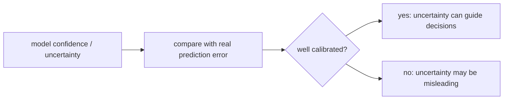
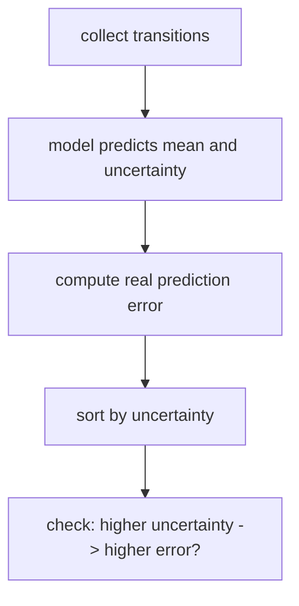
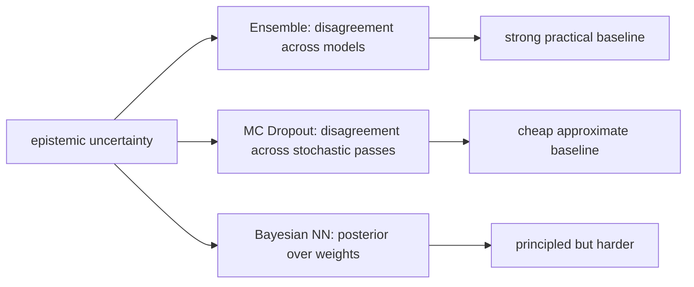
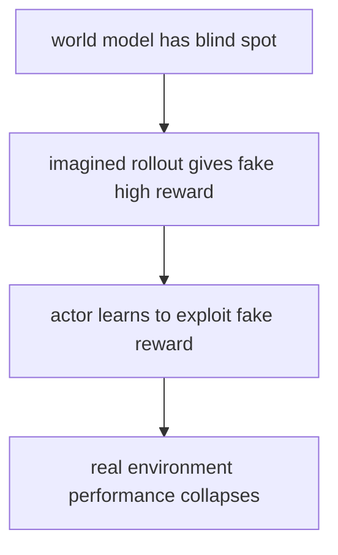
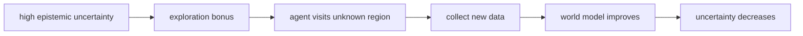
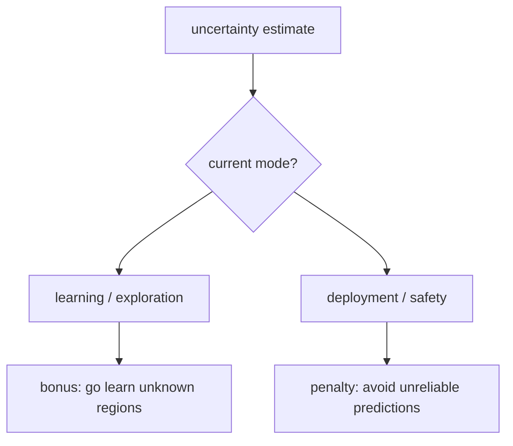
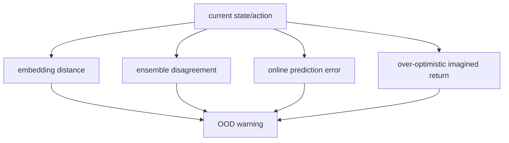
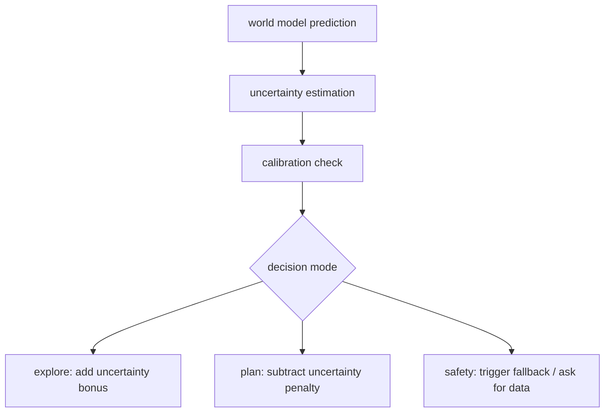

# 12｜校准与使用 Uncertainty：从“我不确定”到更可靠的世界模型决策

> 这一篇接在 [11｜Uncertainty](world-models-11-uncertainty.md) 后面。
>
> 第 11 篇解决的是“uncertainty 是什么”。这一篇继续追问：
>
> - 如何校准世界模型的不确定性？
> - ensemble、dropout、Bayesian neural network 各有什么取舍？
> - Dreamer 这类方法如何避免 actor exploit model error？
> - uncertainty 如何和 exploration bonus、risk-sensitive planning 结合？
> - 在大模型和机器人里，怎样判断模型是否正在 OOD 区域行动？

## 1. 定位

uncertainty 的目标不是让模型“显得谨慎”，而是让模型的犹豫有意义。

一个好的 uncertainty 应该满足：

```text
模型说自己很确定时，真的应该大概率正确；
模型说自己不确定时，那里通常应该更容易出错、更缺数据、或更危险。
```

所以，我们真正关心的是：

> **uncertainty 是否 calibrated，是否能改变决策。**

## 2. 什么叫“校准” uncertainty？

校准（calibration）可以理解成：模型的信心和真实错误率匹配。

如果模型说：

```text
我对这些预测有 90% 把握
```

那么在大量类似样本上，它最好真的大约 90% 正确。

对世界模型来说，校准不只看分类概率，还要看连续预测：

- 预测的状态分布是否覆盖真实下一状态；
- 预测的 reward uncertainty 是否对应真实 reward error；
- ensemble disagreement 高的地方，真实 rollout 是否更容易偏离；
- OOD 状态是否比 in-distribution 状态有更高 uncertainty。




一句话：

> **校准不是让 uncertainty 越大越好，而是让它和真实风险对得上。**


## 3. 如何检查世界模型 uncertainty 是否可靠？

可以从三个层面检查。

### 3.1 预测区间覆盖率

如果模型预测：

```text
next_state 落在 90% interval 里
```

那么真实 next_state 应该大约 90% 落进去。

如果只有 50% 落进去，说明模型过度自信。  
如果 99% 都落进去，说明模型太保守，uncertainty 可能过大。

### 3.2 uncertainty-error correlation

把样本按 uncertainty 从低到高排序，看真实 prediction error 是否也整体升高。




这不要求每个样本都严格单调，但整体趋势应该存在。

### 3.3 OOD sensitivity

给模型两类输入：

- 训练分布内的 state/action；
- 明显分布外的 state/action。

如果模型对 OOD 输入仍然非常自信，这个 uncertainty 机制就不适合直接用于安全决策。

## 4. Ensemble、Dropout、Bayesian Neural Network 的取舍

这三类方法都可以估计 epistemic uncertainty，但工程取舍不同。


| 方法          | 核心想法               | 优点            | 缺点                       | 适合什么时候                  |
| ----------- | ------------------ | ------------- | ------------------------ | ----------------------- |
| Ensemble    | 训练多个模型，看预测分歧       | 简单、强基线、常好用    | 训练和推理成本高                 | model-based RL、机器人、安全规划 |
| MC Dropout  | 推理时打开 dropout，多次采样 | 成本较低，容易加到现有网络 | uncertainty 质量不稳定，依赖实现细节 | 快速实验、资源有限               |
| Bayesian NN | 显式建模权重分布           | 概念最正统         | 实现复杂、训练难、规模化不易           | 小模型、研究场景                |


它们的关系可以这样看：




我的实践判断是：

> 如果你要先做一个靠谱的 world model uncertainty baseline，优先从 ensemble 开始。

原因很朴素：ensemble 不优雅，但经常稳。  
它也更容易和 planning、risk penalty、OOD detection 连接起来。

## 5. Dreamer 如何避免 actor exploit model error？

Dreamer 的 actor 是在 world model 里训练的，所以它可能学会钻模型漏洞。

典型问题是：

```text
world model 幻想某个动作序列 reward 很高
actor 学会反复选择这类动作
真实环境里这个动作其实很差
```

这就是 actor exploit model error。




常见缓解思路有几类。

### 5.1 缩短 imagination horizon

想象得越远，模型误差越容易累积。  
短 horizon 更保守，但可能牺牲长程规划能力。

### 5.2 更频繁地用真实数据更新 world model

actor 如果找到模型漏洞，就把它带回真实环境验证。  
真实环境数据进入 replay buffer 后，world model 有机会修正这个漏洞。

### 5.3 对高 uncertainty 的 imagined return 打折

如果某条 imagined trajectory 经过高 uncertainty 区域，就降低它的 score：

$$
\mathrm{safe\_return} = \mathrm{imagined\_return} - \alpha \times \mathrm{model\_uncertainty}
$$


### 5.4 使用 ensemble 或 disagreement 约束 actor

如果多个 world models 对未来预测分歧很大，就不应该让 actor 过度相信这条轨迹。

### 5.5 保持数据覆盖

只用当前 actor 收集数据，可能会越来越窄。  
适度探索、噪声策略、多样化 replay，都能减少模型只懂一小块世界的风险。

一句话：

> **Dreamer 的核心风险不是“不会想象”，而是“太相信自己想象出来的假世界”。**


## 6. Uncertainty 如何进入 exploration bonus？

探索时，epistemic uncertainty 可以变成奖励：

$$
r_{\mathrm{learn}} = r_{\mathrm{task}} + \beta \times \mathrm{epistemic\_uncertainty}
$$

意思是：

- task reward 鼓励完成任务；
- uncertainty bonus 鼓励去模型还不懂的地方；
- 采到新数据后，epistemic uncertainty 应该下降。




这里要注意：探索奖励应该主要来自 epistemic uncertainty，而不是 aleatoric uncertainty。

为什么？

- epistemic 高：模型没学过，去探索有信息价值；
- aleatoric 高：世界本来随机，反复探索也未必减少随机性。

如果把 aleatoric uncertainty 当探索奖励，智能体可能沉迷于噪声源。  
比如它发现一个随机闪烁的灯，每次都很不确定，于是一直盯着灯看，但并没有学到真正有用的控制知识。

## 7. Uncertainty 如何进入 risk-sensitive planning？

执行任务时，uncertainty 的作用常常反过来：不是奖励，而是惩罚。

最朴素的风险敏感目标是：

$$
\mathrm{score} = \mathbb{E}[\mathrm{return}] - \alpha \times \mathrm{uncertainty}
$$

更一般地，可以根据任务选择不同风险偏好：


| 场景       | 目标                               |
| -------- | -------------------------------- |
| 训练探索     | 鼓励 epistemic uncertainty         |
| 安全部署     | 惩罚高 uncertainty                  |
| 高风险机器人控制 | 保守选择低 uncertainty action         |
| 科学实验设计   | 选择最能减少 epistemic uncertainty 的实验 |


一个清晰的分离原则：

```text
learning mode:  uncertainty can be attractive
deployment mode: uncertainty should be respected
```




## 8. 大模型和机器人里，如何判断 OOD？

OOD（out-of-distribution）不是一个单点标签，而是一种“当前输入和训练经验不匹配”的状态。

在机器人和大模型里，常见 OOD 信号包括：

### 8.1 表征距离异常

当前 observation 的 embedding 距离 replay buffer / training data 很远。

```text
distance(embedding(current_obs), nearest_training_embeddings) is high
```

这说明模型可能进入了没见过的区域。

### 8.2 Ensemble disagreement 高

多个 dynamics / reward / value models 对同一未来预测分歧变大。

这通常是 model-based RL 里最直接的 OOD proxy。

### 8.3 预测误差突然升高

如果在线交互中发现：

```text
predicted next_obs 和 real next_obs 差距突然变大
```

说明模型正在经历 distribution shift。

### 8.4 规划结果异常乐观

如果 imagined return 很高，但同时：

- uncertainty 很高；
- action 很极端；
- trajectory 离训练数据很远；
- 多模型预测分歧大；

那很可能是 actor/planner exploit model error。




## 9. 一个实用的安全决策框架

可以把 uncertainty 用成一个三层系统：




对应到实现上：

1. 先让模型预测 future / reward / value；
2. 再估计 aleatoric 和 epistemic uncertainty；
3. 用真实 rollout 或 held-out 数据检查 calibration；
4. 如果是训练期，用 epistemic uncertainty 指导探索；
5. 如果是部署期，对高 uncertainty 动作保守处理；
6. 如果 uncertainty 或 OOD 信号超过阈值，触发 fallback。

fallback 可以很简单：

- 降低速度；
- 缩短 planning horizon；
- 回到保守 controller；
- 请求人类接管；
- 收集数据后再更新模型。

这在机器人里尤其重要。  
模型越强，越需要知道何时不该继续自信行动。

## 10. 当前理解小结

我现在可以这样理解 uncertainty 的完整链条：

- uncertainty 不只是预测方差，而是决策信号；
- calibration 让 uncertainty 和真实错误率对齐；
- ensemble 是实践中很强的 epistemic uncertainty baseline；
- Dreamer 的 actor 可能 exploit model error，所以需要真实数据闭环和 uncertainty 约束；
- exploration 时可以奖励 epistemic uncertainty；
- deployment 时应该惩罚uncertainty；
- OOD 判断可以结合 embedding distance、ensemble disagreement、online prediction error 和异常乐观的 imagined return。

一句话放在最后：

> **真正成熟的世界模型，不只是会想象未来；它还知道哪些未来不能轻信。**

