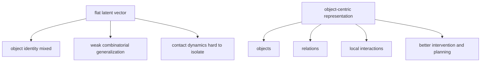
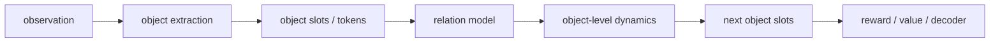
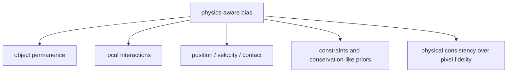
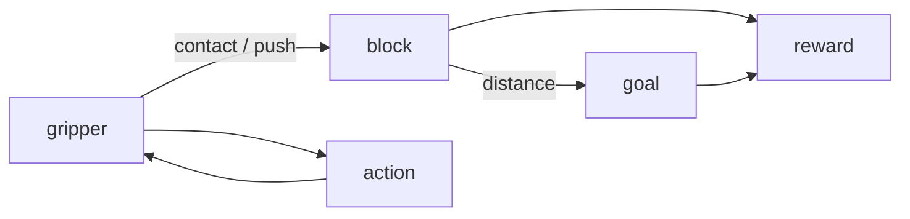
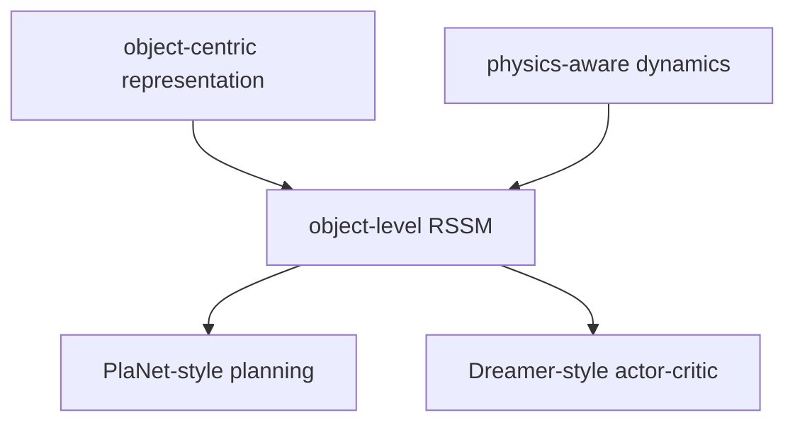

# 13｜Object-Centric 与 Physics-Aware：世界模型如何从“预测画面”走向“理解对象和关系”

> 这一篇接在 [12｜校准与使用 Uncertainty](world-models-12-uncertainty-calibration-and-risk.md) 后面。
>
> 前面我们主要讨论了 RSSM、Dreamer、uncertainty 和 imagined rollout。现在进入一个更接近具身智能和机器人研究的问题：
>
> **为什么很多现代世界模型不满足于一个大 latent 向量，而开始强调 object-centric 和 physics-aware？**

## 1. 一句话直觉

普通 latent world model 常常在学：

```text
整段观测压成一个向量，然后预测下一步。
```

object-centric / physics-aware world model 想进一步学：

```text
世界由哪些对象组成？
对象之间如何相互作用？
哪些变化符合物理规律，哪些只是像素上看起来像？
```

它的目标不是把画面预测得更漂亮，而是让模型内部的世界表示更接近真实交互结构。

一句话：

> **object-centric 关心“谁和谁”；physics-aware 关心“它们为什么这样变”。**

## 2. 为什么一个大 latent 向量不够？

一个整体 latent 很方便，但在对象丰富、接触频繁、关系变化快的环境里，它容易遇到三个问题。

### 2.1 对象混在一起

如果一个球动了，模型需要知道：

- 是球自己在滚？
- 是机械臂碰了它？
- 是另一个物体撞了它？
- 还是相机视角变化造成的错觉？

整体 latent 可能把这些因素混在一起。  
object-centric 表示则试图把“对象是谁”和“谁影响谁”拆开。

### 2.2 组合泛化差

训练时见过：

```text
红色方块 + 蓝色圆柱
```

测试时变成：

```text
红色圆柱 + 蓝色方块
```

整体 latent 可能把颜色、形状、位置和交互模式绑定在一起。  
对象化表示更容易复用：

```text
对象属性 + 对象关系 + 交互规则
```


### 2.3 接触和局部物理难学

很多机器人任务的关键不是整张图，而是局部关系：

- 夹爪是否接触方块；
- 方块是否被推到目标区域；
- 两个物体是否发生碰撞；
- 支撑、遮挡、约束是否改变。

这些问题天然是对象级、关系级、物理级的。




## 3. Object-centric 到底是什么意思？

object-centric world model 的核心不是“把图片切成小块”，而是：

> **把场景表示成一组对象级 token / slot，并在这些对象之间建模动态关系。**

例如桌面机器人场景可以表示成：

```text
scene_t = {
    robot_gripper_t,
    red_block_t,
    blue_cylinder_t,
    table_t,
    goal_region_t
}
```

每个对象可以有自己的状态：

$$
\mathrm{object}_i = [\mathrm{position},\ \mathrm{velocity},\ \mathrm{shape},\
\mathrm{color},\ \mathrm{contact\_state},\ \ldots]
$$

然后模型学习：

$$
\mathrm{object}_i^{t+1} = f\!\left(\mathrm{object}_i^t,
\mathrm{messages}_i^t, a_t\right)
$$

也就是说，世界模型不再只问：

```text
下一帧是什么？
```

而是问：

```text
每个对象会怎么变？
对象之间的关系会怎么变？
动作影响了哪些对象？
```


## 4. 一个最小 object-centric 架构

可以把 object-centric world model 拆成四块。




### 4.1 对象提取

从观测里得到一组对象表示：

$$
o_t \rightarrow \{s_t^{1}, s_t^{2}, \ldots, s_t^{K}\}
$$

这里的 `s_t^i` 可以来自：

- 显式检测器；
- slot attention；
- segmentation；
- object tokens；
- 手工构造的对象状态。


### 4.2 关系建模

对象之间交换信息：

$$
m_{i \leftarrow j} = g(s_t^{i}, s_t^{j})
$$

直觉是：每个对象都在“听”其他对象对自己的影响。

### 4.3 对象级动态

每个对象根据自身状态、其他对象消息和动作更新：

$$
s_{t+1}^{i} = f(s_t^{i}, m_i, a_t)
$$


### 4.4 任务头

从对象集合预测：

- reward；
- value；
- success；
- continuation；
- 或必要时重建 observation。


## 5. 最小伪代码示意

```python
class ObjectCentricWorldModel(nn.Module):
    def forward(self, object_states, action):
        # object_states: [batch, num_objects, object_dim]

        slots = encode_each_object(object_states)
        messages = relation_model(slots)
        next_slots = dynamics(slots, messages, action)
        reward = reward_head(pool(next_slots))
        return next_slots, reward
```

最关键的是 `relation_model`：

```python
def relation_model(slots):
    messages = []
    for obj_i in slots:
        msg_i = sum(pair_network(obj_i, obj_j) for obj_j in slots if obj_j is not obj_i)
        messages.append(msg_i)
    return messages
```

真实实现通常会用 graph neural network、attention 或 transformer 来替代双重循环，但思想不变：

> **对象不是孤立更新的；它们通过关系影响彼此。**


## 6. Physics-aware 又是什么意思？

physics-aware 不等于把完整物理引擎塞进神经网络。

更准确地说，它是在模型里加入物理世界的归纳偏置，让模型更容易学到：

- 对象持续存在；
- 运动通常连续；
- 接触是局部的；
- 远处物体通常不会瞬间强相互作用；
- 位置、速度、接触、约束比纯像素纹理更接近控制所需状态；
- 预测不应只追求像素像，还要追求物理一致。




一句话：

> **physics-aware 的核心是让模型少走违反物理常识的捷径。**


## 7. 一个最小 physics-aware 改动：局部交互

最朴素的物理先验是：

```text
离得近的对象更可能发生强交互；
离得远的对象暂时影响较弱。
```

示意伪代码：

```python
def local_interaction_mask(object_states, threshold=0.5):
    positions = object_states[..., :2]
    distances = pairwise_distance(positions)
    return distances < threshold
```

然后只在近邻对象之间传递 message：

```python
messages = relation_model(slots, mask=local_interaction_mask(object_states))
```

这个改动很小，但味道已经变了：

- 普通模型：所有对象默认都强相关；
- physics-aware 模型：先假设局部接触更重要。

这类先验在机器人推、抓、堆叠、碰撞任务中尤其自然。

## 8. 推箱子例子：两种模型在学什么？

设想一个简单任务：

```text
机械臂推动方块，把方块推到目标区域。
```

整体 latent 模型可能在学：

```text
整张图 + 动作 -> 下一张图 / 下一状态
```

object-centric + physics-aware 模型则更像在学：

```text
夹爪怎么移动？
方块在哪里？
夹爪和方块是否接触？
接触后方块如何移动？
方块离目标还有多远？
```




后者更像真正理解任务结构，因为它把 reward、动作效果和对象关系连接了起来。

## 9. 和 RSSM / Dreamer / PlaNet 的关系

object-centric / physics-aware 不是要替代 Dreamer 或 PlaNet。

它解决的是不同层面的问题：


| 问题                    | 代表方向           |
| --------------------- | -------------- |
| 如何学习 latent dynamics？ | RSSM           |
| 如何用 world model 在线规划？ | PlaNet         |
| 如何在想象中训练 actor/value？ | Dreamer        |
| latent state 应该如何组织？  | object-centric |
| dynamics 应该带什么物理偏置？   | physics-aware  |


所以它们可以叠加：




可以想象：

- object-centric Dreamer；
- physics-aware PlaNet；
- object-token RSSM；
- graph world model + latent planning；
- object-level actor-critic。

重点不是换掉 Dreamer，而是让 Dreamer 的 latent state 更有结构。

## 10. 它为什么更适合泛化和干预？

object-centric 表示天然更接近因果和组合结构。

如果模型知道：

```text
红色方块、蓝色圆柱、机械臂、目标区域
```

它就更容易回答：

- 如果把红色方块换成绿色方块，会怎样？
- 如果目标区域移动，reward 怎么变？
- 如果机械臂不接触方块，方块为什么不动？
- 如果增加一个新物体，哪些关系需要重新计算？

这就是对象表示的力量：  
它让模型更容易  。

整体 latent 也可能学到这些，但通常更难解释、更难控制、更容易过拟合训练分布。

## 11. 但 object-centric 也不容易

这条路线有自己的难点。

### 11.1 对象发现并不容易

真实视觉里，什么算一个对象？

- 遮挡怎么办？
- 透明物体怎么办？
- 柔性物体怎么办？
- 背景、工具、液体算不算对象？

对象不是天然写在像素里的，模型必须学会发现或对齐它们。

### 11.2 对象数量可能变化

场景里对象可能出现、消失、分裂、合并。  
固定 `K` 个 slots 很方便，但真实世界不一定这么整齐。

### 11.3 物理先验可能过强

如果先验太硬，模型可能无法表达真实世界中的复杂现象。  
physics-aware 应该帮助学习，而不是把模型锁死在错误假设里。

### 11.4 像素保真和物理一致之间有取舍

一个模型可以生成很漂亮的视频，但物体穿模、质量乱变、接触不对。  
也可以物理结构很合理，但画面不够逼真。

对于控制任务，物理一致通常比像素好看更重要。

## 12. 当前理解小结

我现在可以这样理解这条路线：

- object-centric 的核心不是“切图”，而是把世界表示成对象及其关系；
- physics-aware 的核心不是“内置完整物理引擎”，而是加入有用的物理归纳偏置；
- 整体 latent 适合快速建模，但容易混合对象、关系和接触；
- 对象级表示更利于组合泛化、局部交互、反事实推理和机器人控制；
- physics-aware 让模型更关心接触、约束、连续运动和物理一致；
- 它们可以和 RSSM、PlaNet、Dreamer 叠加，而不是互相替代。

最后：

> **世界模型要走向真实物理世界，不能只学“下一帧像什么”，还要学“哪些对象因为什么关系而改变”。**


## 这里真正的研究难点是什么

### 难点 1：对象怎么得到

是：

- 已知检测框？
- 已知 instance segmentation？
- 自己无监督学 slot？
- 用视觉 token 再分组？

这一块本身就是一个大方向。

### 难点 2：对象数目可能变化

有的场景物体多，有的少。  
如何保持表示稳定，是很现实的问题。

### 难点 3：哪些对象最重要

任务不一样，关注点不一样。  
一个好的 actor/critic 不该平均看所有对象。

### 难点 4：关系是动态变化的

上一秒没接触，下一秒接触了。  
对象之间关系图不是固定的。

这些正是 object-centric world model 真正的研究价值所在。

## 参考论文：

[https://arxiv.org/pdf/2511.14262](https://arxiv.org/pdf/2511.14262)

