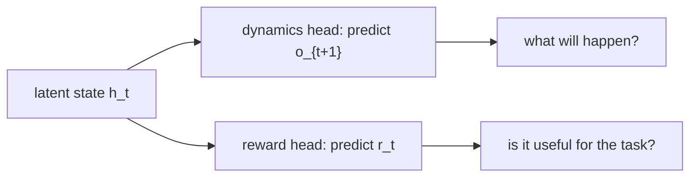
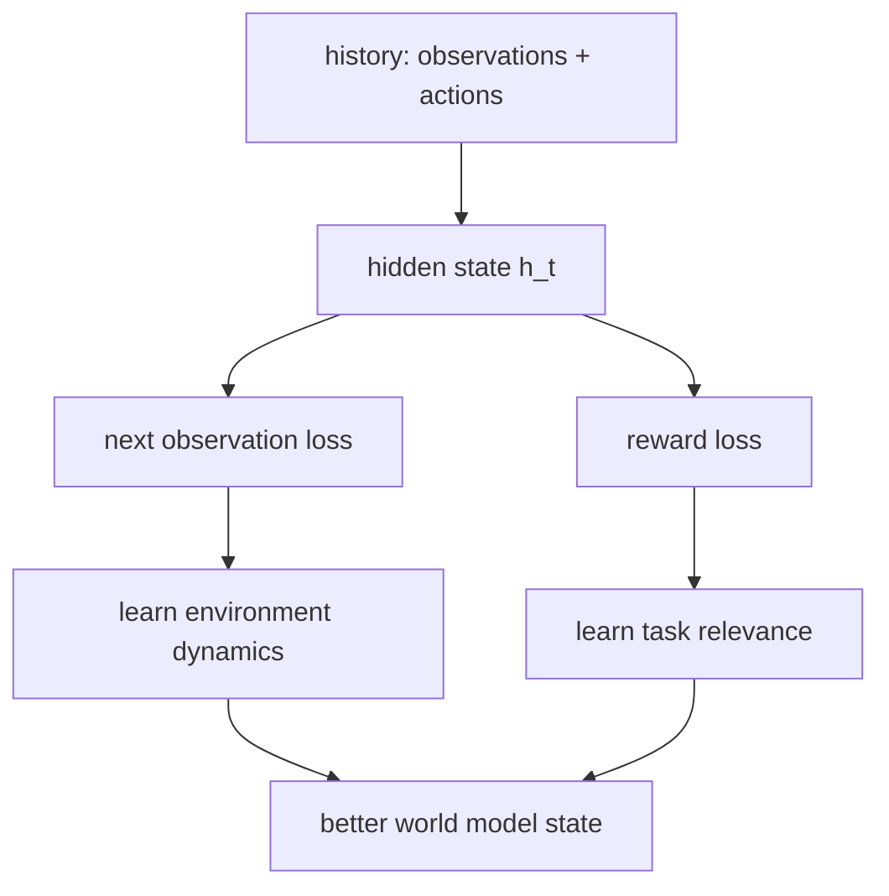

# 为什么世界模型需要预测 reward

上一篇笔记里，GRU world model 已经能处理部分可观测环境：

$$
(o_t, a_t, h_{t-1}) \rightarrow h_t \rightarrow o_{t+1}
$$

也就是说，模型能：

- 看到当前观测 $o_t$。
- 读入当前动作 $a_t$。
- 更新内部记忆 $h_t$。
- 预测下一步观测 $o_{t+1}$。

但这还不够。控制任务不只关心“世界接下来会变成什么样”，还关心：

- 这个未来是好还是坏？
- 我会得到多大 reward？
- 这个动作是不是把我带向目标？

所以这一篇要回答：为什么 world model 通常不仅预测 dynamics，还要预测 reward？

## 1. Dynamics 只告诉我们世界如何变化

如果模型只预测下一观测：

$$
p(o_{t+1} \mid h_t, a_t)
$$

它学到的是环境变化规律。这个模型知道“接下来会看到什么”，但还不一定知道“这个未来对任务意味着什么”。

举个最小例子：两个动作都会让位置发生变化。

- 动作 A 让智能体更靠近目标。
- 动作 B 让智能体远离目标。

如果没有 reward，模型只知道两种变化都可能发生；如果有 reward，模型才知道哪种变化更值得选择。



这就是 reward head 的意义：它把“环境模拟器”推进成“服务决策的世界模型”。

## 2. Toy 环境里的 reward 是什么

在我们的一维 point mass 环境里，目标是让点靠近 `goal = 0.0`，同时避免动作过大。

环境中的 reward 是：

$$
r_t = -\left((x_{t+1} - goal)^2 + 0.1a_t^2\right)
$$

它表达了两件事：

- 离目标越远，reward 越低。
- 加速度越大，也要付出代价。

所以 reward 本质上在告诉模型：

> 不是所有未来都一样，有些未来更值得去。

## 3. 为什么 reward prediction 会改变表示学习

只预测 observation 时，模型可能把能力花在和任务无关的细节上。比如视觉任务里，它可能努力预测背景纹理，却没有学好和行动相关的风险或目标距离。

加入 reward prediction 后，hidden state 会被迫包含任务相关信息：

- 什么状态更接近目标？
- 什么动作代价更大？
- 哪些变化会带来更高或更低回报？

这并不是说 observation prediction 不重要，而是说 reward head 给 learned state 加了一个任务方向。



## 4. 最小代码改动：给 GRU 加 reward head

前一篇的 GRU 只输出下一观测：

$$
h_t \rightarrow \hat{o}_{t+1}
$$

这一篇把它扩展为：

$$
h_t \rightarrow (\hat{o}_{t+1}, \hat{r}_t)
$$

训练目标也从单一 observation loss 变成：

$$
L = L_{obs} + \lambda L_{reward}
$$

入门版本里先取 $\lambda = 1$：

$$
L = \text{MSE}(\hat{o}_{t+1}, o_{t+1}) + \text{MSE}(\hat{r}_t, r_t)
$$

完整代码已经整理到：

- [src/hello_world_model](../../src/hello_world_model)
- [examples/run_reward_world_model.py](../../examples/run_reward_world_model.py)

运行方式：

```bash
pip install -r requirements.txt
python examples/run_reward_world_model.py
```

运行后会生成：

- `01_reward_landscape.png`：不同位置和动作对应的真实 reward。
- `02_reward_model_losses.png`：total / observation / reward 三种 loss。
- `03_reward_prediction.png`：真实 reward 与模型预测 reward 的对比。
- `04_reward_guided_action_scores.png`：模型如何用预测 reward 给候选动作打分。

## 5. 这和 planning 有什么关系

只会预测下一观测的模型，可以告诉我们：

> 如果我这样做，世界可能怎么变？

会预测 reward 的模型，可以进一步告诉我们：

> 如果我这样做，这个变化对任务是否更好？

在 model-based control 里，这一步非常关键。planner 可以在模型内部 rollout 多条未来轨迹，然后比较预测累计 reward：

$$
\sum_{t=0}^{H-1} \hat{r}_t
$$

最后选择预测回报最高的动作序列。

这也是前面 random shooting planner 的核心逻辑：不是随便想象未来，而是用 reward 给想象出来的未来排序。

## 6. 从 reward 到更完整的 world model

很多现代 world model 不只预测 observation 和 reward，还会预测更多任务相关信号：

- dynamics：世界会如何演化。
- reward：这个状态或动作结果有多好。
- continuation / termination：episode 是否会继续。
- value：从当前状态往后看，长期回报大概是多少。

这些 head 的共同目标是：让 hidden state 不只是“像世界”，而是“对决策有用”。

## 7. 容易误解的一点

reward prediction 不等于 reward hacking。

reward head 的作用是学习环境给出的任务反馈，而不是让模型自己发明目标。真正危险的是 reward 设计错了，或者 planner 只优化 reward model 的漏洞。这个问题后续进入 model-based RL 的安全性和泛化时会更重要。
