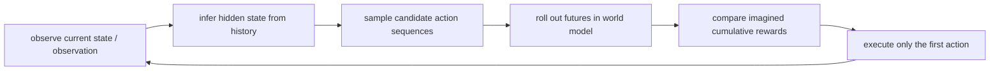
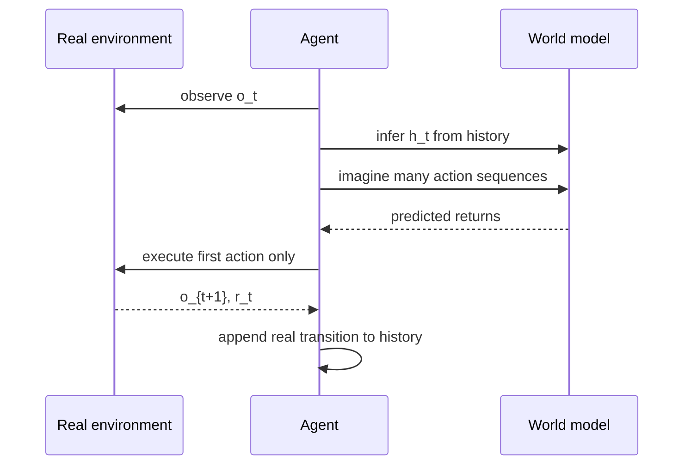
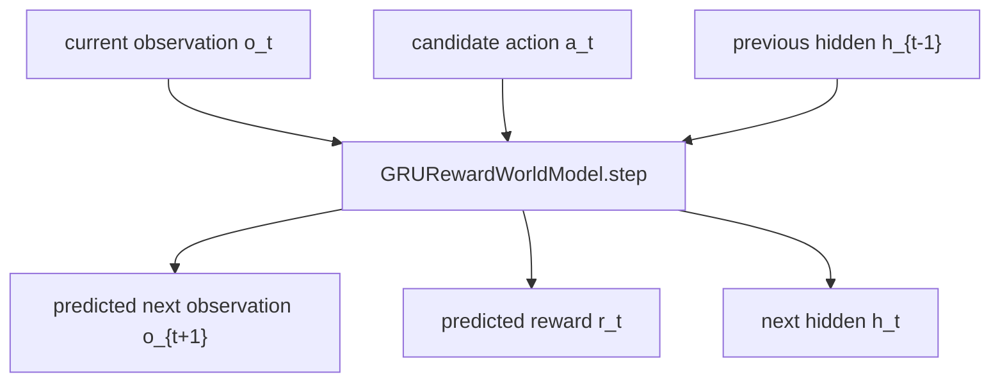
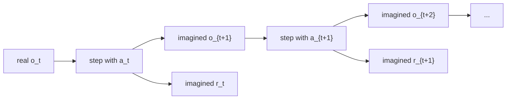
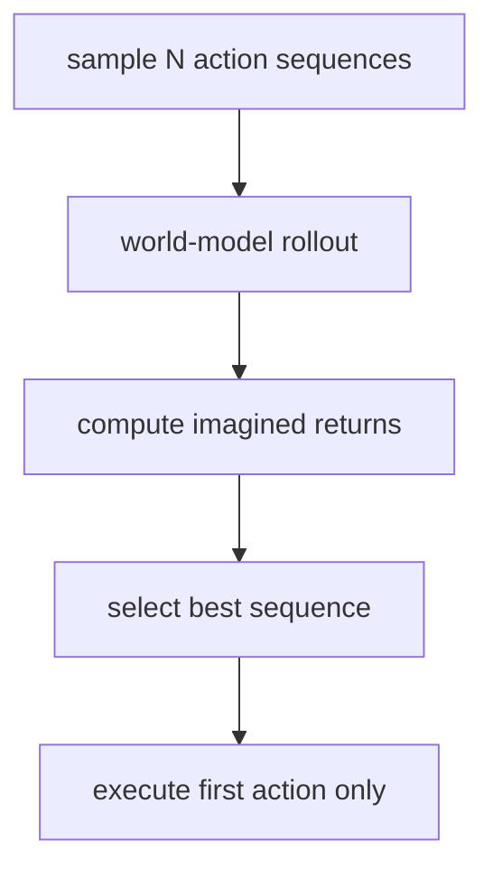
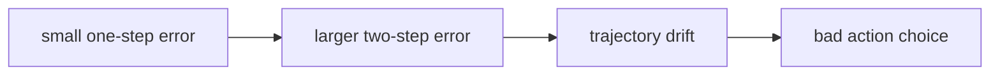

# 5. 用世界模型做 planning


## 这篇笔记解决什么问题

前几篇笔记已经搭起了世界模型的几个关键部件：

- dynamics：预测世界会如何变化。
- memory / latent state：在部分可观测环境里，用历史形成内部信念。
- reward head：判断某个未来对任务来说是好还是坏。

这一篇进入世界模型真正“开始像智能体”的地方：planning。

一句话理解：

> Planning with a world model，就是让模型先在内部试很多动作序列，再把预测回报最高的那个动作拿到真实环境里执行。

它不是盲目执行动作，而是先想象、比较、再行动。

## 1. 先说人话：为什么需要 planning

假设你现在处在某个状态，手里有三种动作：

- 往左一点。
- 不动。
- 往右一点。

你不急着马上执行，而是先在模型里想：

- 如果我连续往左几步，会发生什么？
- 如果我先右后左，会怎样？
- 哪条动作序列的累计 reward 更高？

最后你只执行最好序列的第一步。走完这一步之后，再重新观察、重新规划。

这个过程叫 receding horizon planning，也叫滚动时域规划。



## 2. 为什么只执行第一步

因为模型不是完美的。

如果你一次性把未来 10 步动作都执行完，后面的动作可能已经基于错误预测。更稳妥的做法是：

1. 用模型想象未来 $H$ 步。
2. 选出预测累计 reward 最高的动作序列。
3. 只执行这条序列的第一步。
4. 回到真实环境重新观察。
5. 根据新历史重新 planning。

这就是 model-based control 里很经典的思想：计划可以长一点，但现实中每次只迈一步。



## 3. Planning 需要模型支持单步 rollout

训练时，我们的 `GRURewardWorldModel` 可以吃一整段序列：

$$
(o_{1:t}, a_{1:t}) \rightarrow (\hat{o}_{2:t+1}, \hat{r}_{1:t})
$$

但 planning 时更需要一个单步接口：

$$
(o_t, a_t, h_{t-1}) \rightarrow (\hat{o}_{t+1}, \hat{r}_t, h_t)
$$

这个接口做三件事：

- 用当前观测和动作更新 hidden state。
- 预测下一步观测。
- 预测当前动作带来的 reward。

在代码里，这对应 `GRURewardWorldModel.step()`。



## 4. 当前 hidden state 从哪里来

Planning 不能从空白状态开始。模型需要先根据真实历史形成当前内部信念：

$$
h_t = f(o_{1:t}, a_{1:t-1})
$$

也就是说，智能体在真实环境里走到当前这一步时，已经看过一段历史。我们先把这段历史喂给 recurrent world model，得到当前 hidden state，然后从这个 hidden state 开始想象未来。

这一步对应代码里的 `infer_hidden_from_history()`。

## 5. 在模型里评估一条动作序列

给定当前观测、当前 hidden state 和一条候选动作序列：

$$
a_t, a_{t+1}, \dots, a_{t+H-1}
$$

world model 会在内部做 imagined rollout：

$$
(\hat{o}_{t+1}, \hat{r}_t, h_{t+1}) = model.step(o_t, a_t, h_t)
$$

然后把预测出来的下一观测继续喂回模型：

$$
(\hat{o}_{t+2}, \hat{r}_{t+1}, h_{t+2}) = model.step(\hat{o}_{t+1}, a_{t+1}, h_{t+1})
$$

最关键的一点是：

> rollout 过程中，后续输入不再来自真实环境，而来自模型自己的预测。

这就是“在脑中想象未来”的具体含义。



一条动作序列的分数就是 imagined cumulative reward：

$$
J(a_{t:t+H-1}) = \sum_{k=0}^{H-1} \hat{r}_{t+k}
$$

## 6. Random shooting：最简单的 planner

本项目先实现最朴素的 random shooting：

1. 随机采样很多条动作序列。
2. 用世界模型 rollout 每条序列。
3. 计算每条序列的 imagined cumulative reward。
4. 选择分数最高的序列。
5. 只执行它的第一个动作。



Random shooting 很粗糙，只是为了理解，因为它让 planning 的核心思想完全暴露出来：比较未来，而不是直接反应。

## 7. 把 planning 接回真实环境

完整控制闭环是：

1. 在真实环境中观察当前 $o_t$。
2. 根据真实历史推断 hidden state $h_t$。
3. 在世界模型中采样并评估很多条未来动作序列。
4. 执行最好序列的第一步动作。
5. 从真实环境得到 $o_{t+1}, r_t$。
6. 把真实 transition 加入历史，回到第 1 步。

注意一个很重要的区别：

- planning 时比较的是模型预测的 imagined reward。
- 最终成绩由真实环境返回的 real reward 决定。

这正是世界模型方法最核心的张力：

> 你靠模型思考，但最后由真实世界裁判。

## 8. 配套代码演示

这一篇对应的完整演示是：

- [examples/run_planning_world_model.py](../../examples/run_planning_world_model.py)
- [src/hello_world_model/planning.py](../../src/hello_world_model/planning.py)

运行方式：

```bash
pip install -r requirements.txt
python examples/run_planning_world_model.py
```

运行后会生成：

- `01_planning_model_losses.png`：用于 planning 的 recurrent reward world model 训练误差。
- `02_first_imagined_rollouts.png`：第一次规划时，模型想象出的多条未来轨迹。
- `03_receding_horizon_control.png`：滚动规划在真实环境中的控制轨迹。
- `04_imagined_vs_real_feedback.png`：模型预测的最佳 imagined return 与真实 reward 的对照。

## 9. 最小版本的明显限制

这个最小版本有几个重要限制：

- 它在 observation space 里 rollout，长 horizon 下容易累计误差。
- hidden state 是确定性的，还不能显式表达多种可能未来。
- planner 使用 random shooting，采样效率很低。
- reward model 一旦不准，planner 可能会选择“模型以为好、现实很差”的动作。

其中最值得盯住的是 compounding error。

当模型把 $\hat{o}_{t+1}$ 继续当作下一步输入时，误差会一步步滚大：



这也是为什么更高级的 world model 往往会：

- 在 latent space 而不是 pixel / observation space 中 rollout。
- 用 stochastic latent state 表达不确定性。
- 学 value function 或 actor，减少纯采样 planning 的成本。
- 做多步一致性训练或其他稳健化处理。

## 10. 和 PlaNet / Dreamer 的关系

到这里，我们的最小系统已经有了 PlaNet / Dreamer 的雏形：

- 有内部状态。
- 有 dynamics。
- 有 reward prediction。
- 有 imagined rollout。
- 有基于 imagined return 的动作选择。

但它还很初级,很多工作都在其中的某个环节做了改进：

- PlaNet 在 latent state 中做 planning,而不是observation /pixel level 做planning;
- Dreamer 在 latent imagination 中训练 actor-critic。
- MuZero 更进一步，不要求重建观测，而是学习对 planning 有用的表征、动态和价值。

所以这篇笔记的位置很关键：它把“世界模型会预测”推进到了“世界模型能辅助决策”。

## 11. 这一篇只要抓住三句话

第一句：

> Planning 的本质，是在模型内部比较不同动作序列带来的未来累计 reward。

第二句：

> 真正执行时，通常只执行最好序列的第一步，然后重新观察、重新规划。

第三句：

> World model 的价值不在于“会预测下一帧”，而在于“能帮助你选择动作”。

## 下一步

下一篇笔记可以继续拆：

> 为什么在 observation space 中 rollout 容易出错？latent rollout 为什么更稳？
