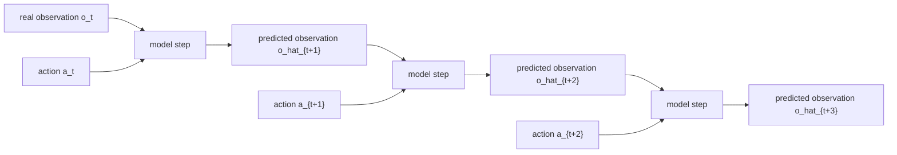
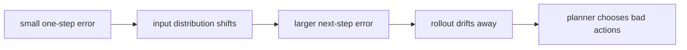
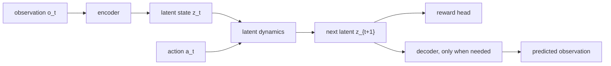
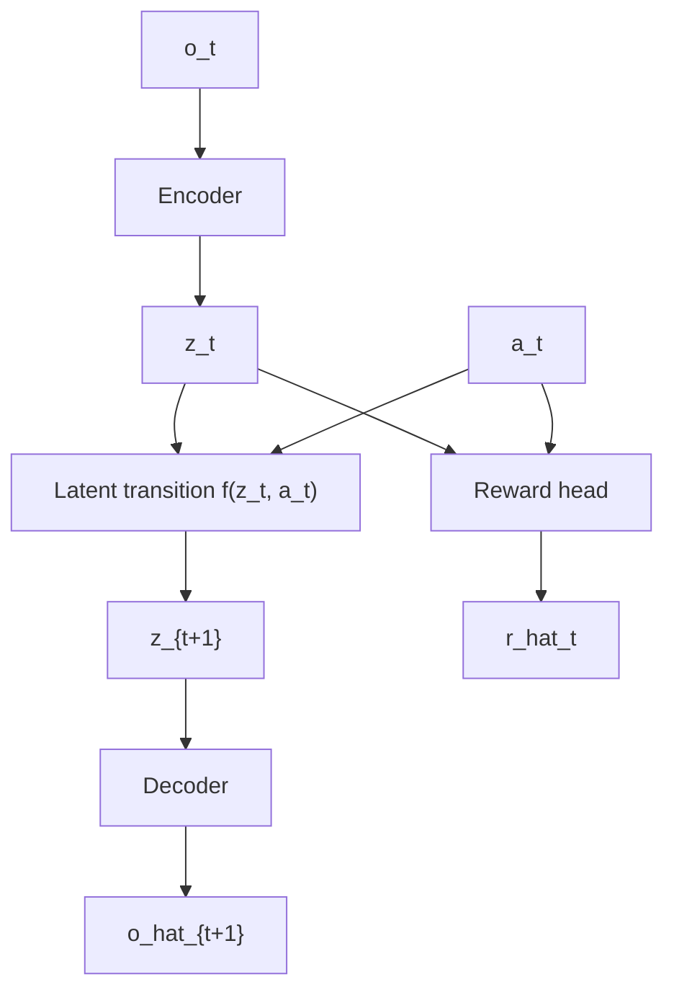

# 6. 为什么要转向 latent dynamics

## 这篇笔记解决什么问题

上一篇笔记已经把 world model 用到了 planning：模型先在内部 rollout 多条未来轨迹，再根据 imagined reward 选择动作。

但那里有一个很脆的地方：

> 我们把模型预测出来的 next observation 继续当成下一步输入。

也就是：

$$
o_t \rightarrow \hat{o}_{t+1} \rightarrow \hat{o}_{t+2}
$$

这篇笔记要解释：为什么 observation space 里的 rollout 容易崩，以及为什么现代 world model 通常转向 latent dynamics。

## 1. Observation rollout 为什么容易积累误差

在 observation rollout 中，每一步预测都会成为下一步输入：




关键问题是：每一步的小误差，都会变成下一步的输入误差。

这就是 compounding error。




模型训练时通常看到的是真实 observation 分布；但 rollout 时，它越来越多地看到自己生成的 observation。一旦这些预测偏离真实分布，后续预测就会越来越不可靠。

## 2. 为什么 observation space 特别麻烦

Observation 往往具备几个特点：

- 高维，例如图像像素。
- 噪声大，例如传感器抖动或视觉噪声。
- 含有大量任务无关细节，例如背景纹理、光照、阴影。
- 很难一步不差地重建。

如果 observation 是图像，问题会更明显。模型可能在背景、纹理或遮挡细节上出现一点误差；这些误差对单帧图片来说不大，但如果把预测帧继续喂回模型，误差就会沿时间传播。

所以 observation rollout 的根本问题不是“完全不能预测”，而是：

> 它把很多不稳定、未必和决策相关的细节也放进了 rollout 状态里。


## 3. 更好的方向：在 latent space 中 rollout

Latent dynamics 的核心直觉是：不要直接在 observation space 里滚动未来，而是先把 observation 编码成更紧凑的 latent state，再在 latent space 中推进动态。

其中 z_t 是模型学出来的内部表示。




这时 rollout 主要发生在 latent space 里，observation 只在需要可视化、重建或训练监督时才解码出来。

## 4. Latent rollout 为什么更合理

理想情况下，latent state 应该保留：

- 对未来动态有用的信息。
- 对 reward 有用的信息。
- 对 planning 有用的信息。

它不需要完整保留所有观测细节。

可以这样对比：


| 方式                  | 直觉                   | 风险                    |
| ------------------- | -------------------- | --------------------- |
| Observation rollout | 每一步都重新画一张图，再拿这张图继续推演 | 高维细节误差会滚大             |
| Latent rollout      | 每一步只更新世界的内部摘要        | 依赖 encoder 是否学到任务相关信息 |


注意：latent rollout 不是魔法。它更稳的前提是 latent representation 学得好。如果 encoder 把关键因素丢掉，latent dynamics 同样会失败。

## 5. 最小 latent dynamics 架构

一个最小 latent dynamics world model 可以拆成三块：

1. Encoder：把 observation 压成 latent。
2. Latent transition：在 latent space 中根据 action 推进未来。
3. Prediction heads：从 latent 预测 observation 和 reward。




这比前一篇的 recurrent reward model 多了一层明确的 representation learning：先把观测转换成更适合建模的 latent，再在 latent 中做动态更新。

## 6. 这和前一版模型差在哪里

上一版模型的输入是：

$$
[o_t, a_t] \rightarrow GRU \rightarrow h_t
$$

这一版变成：

$$
o_t \rightarrow z_t,\quad [z_t, a_t] \rightarrow z_{t+1}
$$

换句话说，模型不再把原始 observation 当作 rollout 状态，而是把 encoded latent 当作内部动力学状态。

在这个仓库的 toy 环境里，，维度很低观测只有位置和速度，所以 latent dynamics 的优势未必会非常夸张。但一旦换成图像、机器人传感器或复杂场景，这一步会变得非常关键。

## 7. 配套代码演示

这一篇对应的完整演示是：

- [examples/run_latent_dynamics_world_model.py](../../examples/run_latent_dynamics_world_model.py)
- [src/hello_world_model/latent.py](../../src/hello_world_model/latent.py)
- [src/hello_world_model/models.py](../../src/hello_world_model/models.py)

运行方式：

```bash
pip install -r requirements.txt
python examples/run_latent_dynamics_world_model.py
```

运行后会生成：

- `01_observation_model_loss.png`：observation-space baseline 的训练误差。
- `02_latent_model_losses.png`：latent dynamics model 的训练误差。
- `03_open_loop_rollout_comparison.png`：真实轨迹、observation rollout、latent rollout 的对比。
- `04_rollout_error_growth.png`：open-loop 误差如何随 rollout horizon 增长。
- `05_latent_space_rollout.png`：模型在 latent space 中想象出的轨迹。


## 8. 这个 toy demo 应该怎么看

这次演示不是为了证明“latent 一定比 observation 更准”。在低维 point mass 环境中，原始 observation 已经很干净，latent model 不一定有明显优势。

它真正想展示的是结构差异：

- observation model：把预测状态继续当下一步输入。
- latent dynamics model：先编码成 latent，再在 latent 中推进未来。
- 两者都会有 open-loop 误差，误差会影响 planning。

这正是进入 PlaNet、Dreamer、RSSM 前必须理解的一步。

## 9. 和 PlaNet / Dreamer 的关系

PlaNet 和 Dreamer 的核心之一，就是在 latent space 中进行动态建模和 imagination。

更完整的系统通常会进一步加入：

- deterministic state：稳定记忆历史。
- stochastic state：表达不确定性和多种可能未来。
- reward / continuation / value heads：让 latent state 服务决策。
- actor-critic：减少纯 random shooting 的采样成本。

我们这里的 `LatentDynamicsWorldModel` 只是最小版本。它还没有 stochastic latent，也没有完整 RSSM，但已经把方向从“预测下一帧”推进到“维护一个内部动态状态”。

## 10. 这一篇只要抓住三句话

第一句：

> Observation rollout 容易把小误差变成下一步输入误差，导致 compounding error。

第二句：

> Latent dynamics 的核心，是在更紧凑、更任务相关的内部状态中推进未来。

第三句：

> 好的 world model 不一定要预测所有观测细节，但必须保留对 dynamics、reward 和 planning 有用的信息。


## 下一步

下一篇可以继续拆：

> Dreamer / RSSM 为什么还要加入 stochastic latent state，而不是只用一个确定性的 latent dynamics？

