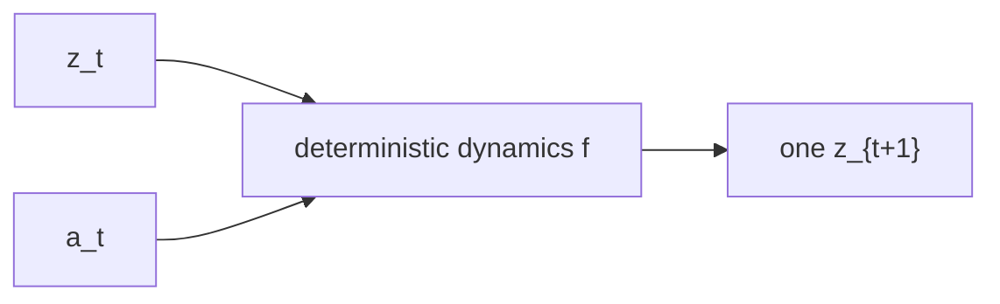
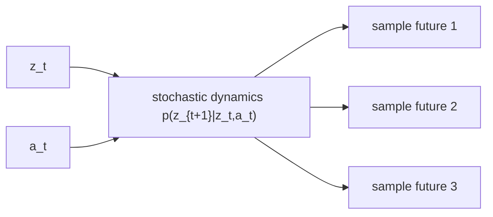
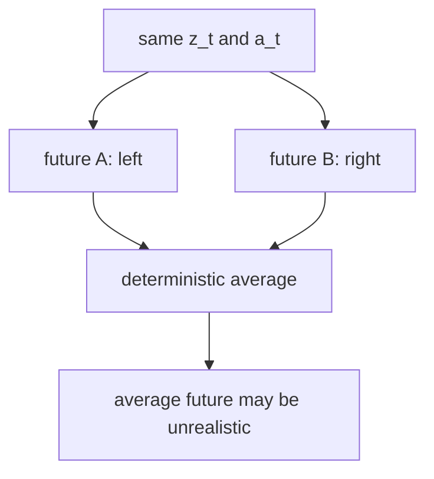
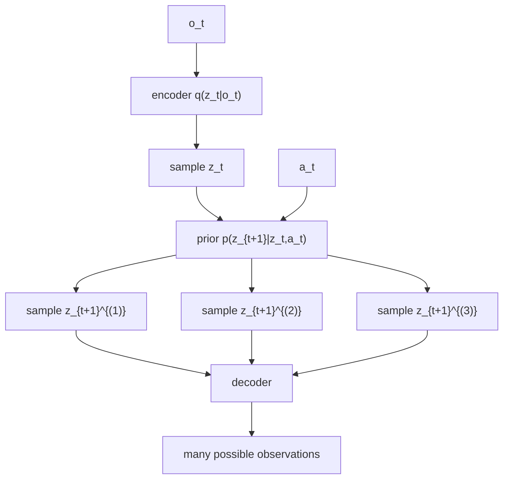

# 7. 为什么世界模型需要 stochastic latent state


## 这篇笔记解决什么问题

上一篇笔记讲了 latent dynamics：不要直接在 observation space 里 rollout，而是在更紧凑的 latent state 中推进未来。

但如果 latent state 只有一个确定性结果，仍然会遇到一个重要问题：

> 真实世界的未来经常不是唯一的。

同一个当前状态和动作，可能产生多个合理未来。例如：

- 机器人推一个物体，物体可能滑动，也可能卡住。
- 自动驾驶看到路口，行人可能停下，也可能继续走。
- 视频里一个球被遮挡后，可能从左边出来，也可能从右边出来。
- noisy control 中，同样的动作会受到随机扰动影响。

这篇笔记要回答：为什么 world model 需要 stochastic latent state，而不只是 deterministic latent state？

## 1. 确定性 latent dynamics 的限制

第 6 篇里的最小 latent dynamics 可以写成：

$$
z_{t+1} = f(z_t, a_t)
$$

这意味着：给定 z_t 和 a_t，模型只能给出一个下一 latent state。




这种模型适合近似确定性的环境。但如果未来本来就有多种可能，它容易把多种未来“平均掉”。

比如一个物体可能向左，也可能向右。确定性模型可能预测它停在中间。这个平均结果看起来数值误差不大，但物理上可能是不存在的未来。

## 2. Stochastic latent 的核心想法

Stochastic latent dynamics 不再预测一个点，而是预测一个分布：

$$
p(z_{t+1} \mid z_t, a_t)
$$

也就是说，模型承认：

> 我知道当前状态和动作，但未来仍然可能有不确定性。




这不是模型“变得不确定”这么简单，而是让模型能显式表达多模态未来和环境噪声。

## 3. 为什么不能只预测平均值

假设同一个状态和动作后，未来有两种可能：


| 未来  | 概率  | 结果  |
| --- | --- | --- |
| A   | 50% | 向左滑 |
| B   | 50% | 向右滑 |


确定性 MSE 模型很可能学出平均结果：

$$
\hat{x}_{t+1} \approx 0
$$

但真实未来从来不是“停在中间”，而是左或右。




Stochastic latent state 的意义就是：保留多种可能，而不是过早平均。

## 4. 最小随机 latent 架构

一个最小 stochastic latent world model 可以这样写：

$$
z_t \sim q(z_t \mid o_t)
$$

$$
z_{t+1} \sim p(z_{t+1} \mid z_t, a_t)
$$

$$
\hat{o}*{t+1} = Dec(z*{t+1}), \quad \hat{r}_t = g(z_t, a_t)
$$

其中：

- q(z_t \mid o_t)：encoder / posterior，用观测推断当前 latent。
- p(z_{t+1} \mid z_t, a_t)：transition prior，预测下一 latent 的分布。
- Dec(z_{t+1})：把 latent 解码回 observation，用于训练和可视化。
- g(z_t, a_t)：reward head，让 latent 对任务有用。




## 5. 训练时为什么会有 KL loss

训练 stochastic latent model 时，常见做法是同时学习：

- posterior：看到了真实下一观测后，应该把下一 latent 放在哪里。
- prior：只根据当前 latent 和 action，提前预测下一 latent 分布。

我们希望 prior 不要和 posterior 差太远，所以会加入 KL 项：

$$
KL(q(z_{t+1}\mid o_{t+1}) \parallel p(z_{t+1}\mid z_t, a_t))
$$

最小训练目标可以写成：

$$
L = L_{obs} + L_{reward} + \beta L_{KL}
$$

其中：

- L_{obs}：解码出的下一观测是否接近真实下一观测。
- L_{reward}：预测 reward 是否接近真实 reward。
- L_{KL}：prior 分布是否接近 posterior 分布。
- \beta：控制 KL 项权重。

这已经非常接近 Dreamer / RSSM 里的关键味道：让模型同时学习“从观测推断 latent”和“在 latent 中预测未来”。

## 6. 配套代码演示

这一篇对应的完整演示是：

- [examples/run_stochastic_latent_state_world_model.py](../../examples/run_stochastic_latent_state_world_model.py)
- [src/hello_world_model/stochastic.py](../../src/hello_world_model/stochastic.py)
- [src/hello_world_model/models.py](../../src/hello_world_model/models.py)

运行方式：

```bash
pip install -r requirements.txt
python examples/run_stochastic_latent_state_world_model.py
```

运行后会生成：

- `01_stochastic_model_losses.png`：observation / reward / KL loss。
- `02_one_step_future_distribution.png`：同一个 state-action 下采样出的多个下一状态。
- `03_stochastic_rollout_fan.png`：同一条动作序列下的一簇可能未来。
- `04_uncertainty_growth.png`：rollout 过程中样本不确定性如何变化。
- `05_prior_latent_samples.png`：从 p(z_{t+1}\mid z_t,a_t) 采样出的 latent 分布。


## 7. 这个 toy demo 应该怎么看

这次演示会使用 `NoisyPointMass1DEnv`，也就是在点质量系统里加入过程噪声。这样，同样的状态和动作不再严格对应唯一下一状态。

你应该重点看三件事：

- 单步预测不再只有一个点，而是一团 samples。
- 多步 rollout 不再是一条线，而是一簇未来轨迹。
- 不确定性会随着 open-loop rollout 传播。

这正是 stochastic latent state 的价值：它让模型承认并表达未来的不确定性。

## 8. 和 RSSM / Dreamer 的关系

Dreamer 的 RSSM 通常同时包含：

- deterministic state h_t：负责稳定记忆历史。
- stochastic state z_t：负责表达不确定性。

简化地看：

$$
h_t = f(h_{t-1}, z_{t-1}, a_{t-1})
$$

$$
z_t \sim p(z_t \mid h_t)
$$

其中 h_t 像是长期上下文，z_t 像是在当前上下文下对具体世界状态的一次随机解释。

我们的最小 demo 还没有完整实现 RSSM，但已经抓住了关键一步：

> world model 不只维护一个内部状态，还可以维护一个内部状态分布。


## 9. 容易误解的一点

Stochastic latent 不代表模型“更随便”。它的目标不是产生随机噪声，而是把真实环境中无法确定的部分建模为概率分布。

好的 stochastic model 应该做到：

- 在确定性很强的地方，分布收窄。
- 在多种未来都合理的地方，分布变宽。
- 在 planning 时，让智能体看到风险，而不是只看到平均未来。


## 10. 总结

第一句：

> Deterministic latent dynamics 给出一个未来，stochastic latent dynamics 给出一组可能未来。

第二句：

> 如果真实未来是多模态的，只预测平均值可能会产生不真实的未来。

第三句：

> Stochastic latent state 是 Dreamer / RSSM 能表达不确定性的重要基础。

