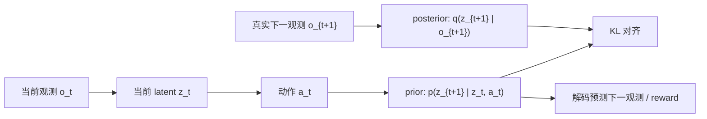
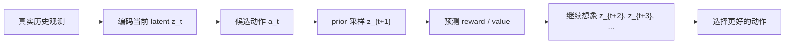
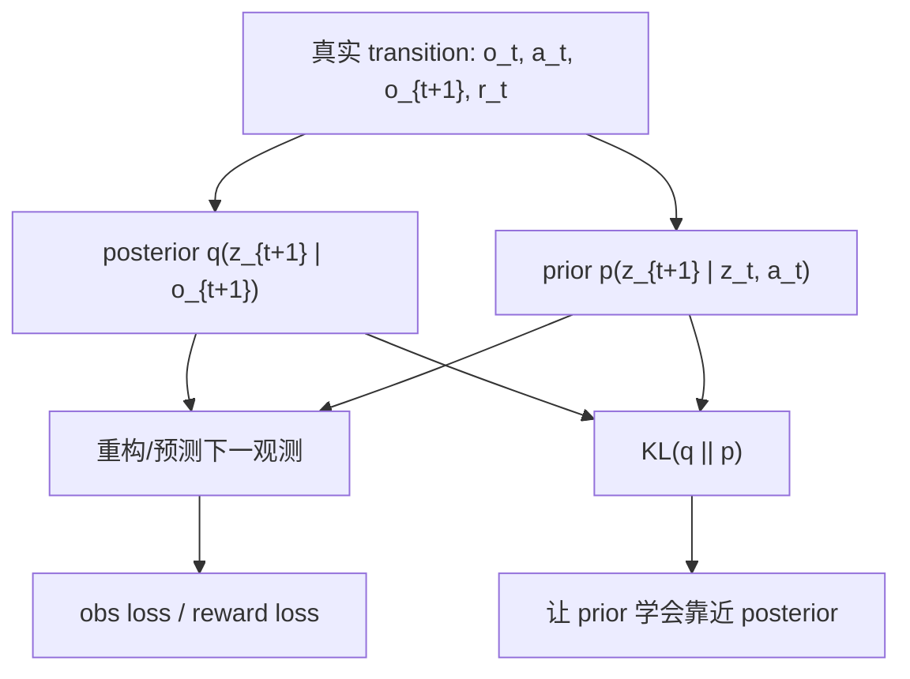
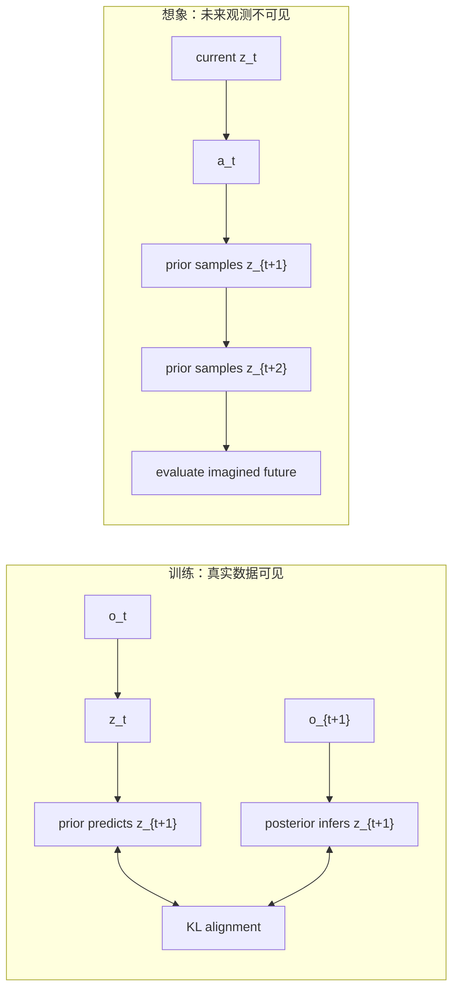

# 08｜Prior 与 Posterior Latent：世界模型如何“先猜，再校正”

> 这一篇接在 [07｜为什么世界模型需要 stochastic latent state]([world-models-7-stochastic-latent-state.md](http://world-models-7-stochastic-latent-state.md)) 后面。

> 第 7 篇已经让 latent state 从一个确定向量变成了一个分布；这一篇回答一个更关键的问题：

> **为什么随机 latent world model 里经常同时出现 prior latent 和 posterior latent？它们到底各自负责什么？**

## 1. 一句话直觉

在世界模型里：

- **prior latent** 是模型在还没看到新观测前，对下一个潜状态的预测。
- **posterior latent** 是模型看到真实观测后，对潜状态的修正估计。

如果用人的学习来类比：

- prior 像是“我根据经验先猜接下来会发生什么”；
- posterior 像是“我真正看到结果后，更新自己脑中的解释”。

世界模型训练时，需要让 prior 向 posterior 靠近；世界模型 planning 时，只能依赖 prior 去想象未来。

这就是它们的核心分工。

## 2. 为什么只靠一个 latent 不够？

前面几篇里，我们已经逐步看到：

1. 直接在 observation space 预测未来，容易受噪声、遮挡和高维观测影响。
2. latent dynamics 把观测压缩到潜空间，再在潜空间里预测未来。
3. stochastic latent state 进一步承认：同一个当前状态和动作，未来不一定只有一个答案。

但是一旦 latent state 变成分布，就会出现一个训练与使用之间的差异：

- 训练时，我们有真实的下一帧观测 `o_{t+1}`，可以用它帮助推断“真实发生后”的 latent。
- 想象未来时，我们没有未来观测，只能靠模型自己从当前 latent 和 action 推出下一步 latent。

于是模型自然拆成两条路径：




这张图里最重要的是：**prior 和 posterior 都描述下一步 latent，但它们拿到的信息不同。**

## 3. Prior：模型闭眼向前想象

prior 通常写作：

```text

p(z_{t+1} | z_t, a_t)

```

意思是：模型只根据当前潜状态 `z_t` 和动作 `a_t`，预测下一步潜状态 `z_{t+1}` 的概率分布。

它不看真实的 `o_{t+1}`。

这点非常重要，因为 planning、imagination、model predictive control 发生在未来：




在这个阶段，未来还没有真正发生，所以模型不可能使用 posterior。  

因此，**prior 的质量决定了模型想象未来的质量**。

如果 prior 学得差，planning 就会变成“在错误世界里做推理”。

## 4. Posterior：模型睁眼校正自己

posterior 通常写作：

```text

q(z_{t+1} | o_{t+1})

```

或在更完整的 recurrent state-space model 里写作：

```text

q(z_{t+1} | h_{t+1}, o_{t+1})

```

意思是：模型已经看到了真实下一观测 `o_{t+1}`，于是可以更准确地推断“刚才真正发生的潜状态”。

posterior 的作用不是直接用于未来 planning，而是用于训练：

- 帮助模型从真实数据中得到更可靠的 latent 表示；
- 给 prior 提供一个学习目标；
- 让 decoder / reward head 学会从 latent 还原观测和 reward；
- 让模型在看见新观测时能够重新校正内部状态。

也就是说，posterior 像老师，prior 像学生。

## 5. KL：让“先猜”逐渐接近“看见后的解释”

训练时，我们希望：

```text

prior prediction ≈ posterior inference

```

常见做法是加入 KL divergence：

```text

KL(q(z_{t+1} | o_{t+1}) || p(z_{t+1} | z_t, a_t))

```

它衡量的是：posterior 这个“看见答案后的分布”，和 prior 这个“没看答案前的预测分布”差多远。




这一步有点像：

1. 模型先预测：“我觉得下一步 latent 会在这里。”
2. 真实观测来了，posterior 说：“根据事实，latent 更可能在那里。”
3. KL loss 推着 prior 下次猜得更准。


## 6. 训练时和想象时，信息流不一样

用流程图看会更清楚：




一句话总结：

> **posterior 负责从现实中学习，prior 负责在没有现实输入时继续往前想象。**


## 7. 和 Dreamer / RSSM 的关系

在 Dreamer 系列和很多 model-based RL 方法里，会使用 RSSM（recurrent state-space model）。RSSM 通常把 state 分成两部分：

- deterministic hidden state：例如 RNN/GRU 维护的历史记忆；
- stochastic latent state：表示当前状态中不确定、不可完全观测、或多模态的部分。

在这种结构里：

```text

prior:     p(z_t | h_t)

posterior: q(z_t | h_t, o_t)

```

其中 `h_t` 是从过去动作和 latent 更新来的 deterministic memory。

我们的代码为了保持最小化，没有完整实现 Dreamer 的 RSSM，而是用了更直观的一步版本：

```text

prior:     p(z_{t+1} | z_t, a_t)

posterior: q(z_{t+1} | o_{t+1})

```

这个版本足够展示 prior/posterior 的本质区别：**一个靠模型预测，一个靠观测校正。**

## 8. 容易踩的坑


### 8.1 KL 太强：posterior 被迫太像 prior

如果 KL 权重太大，posterior 可能还没学会解释观测，就被强行拉向 prior。  

结果是 latent 变得贫乏，decoder 和 reward head 都学不到足够信息。

这有点像老师还没讲清楚，就要求学生答案必须一致。

### 8.2 KL 太弱：prior 学不会自己想象

如果 KL 权重太小，posterior 可能学得很好，但 prior 和 posterior 距离很远。  

训练时看起来 reconstruction 不错，但一到 planning，模型只能用 prior 滚动未来，就会快速跑偏。

这就是“训练时有答案，考试时没答案”的尴尬场景。

### 8.3 把 posterior 用进 imagined future

planning 时不能偷看未来真实观测。  

如果 imagined rollout 里使用了 posterior，就等于把答案塞进了模型，评估结果会过于乐观。

因此，一个健康的世界模型 demo 应该明确区分：

- posterior：训练和现实校正时使用；
- prior：未来想象和 planning 时使用。


## 9. 配套代码演示

本篇对应脚本：

```bash

python examples/run_prior_posterior_latent_world_[model.py](http://model.py)

```

它会复用第 7 篇的 `StochasticLatentWorldModel`，并额外生成 prior/posterior 对齐相关图示：

- `01_prior_posterior_training_losses.png`：训练时 observation / reward / KL loss 的变化。
- `02_prior_vs_posterior_latent_means.png`：同一批 transition 中，prior mean 与 posterior mean 在 latent space 的位置。
- `03_prior_posterior_latent_samples.png`：对同一个 transition，从 prior 和 posterior 采样得到的 latent 分布。
- `04_prior_posterior_alignment.png`：KL 与 latent mean distance 的分布。
- `05_prior_decoded_next_state.png`：只用 prior mean 解码下一状态时，和真实下一状态的对比。

这些图想展示一件事：

> 一个能用于想象未来的世界模型，不能只会“看到观测后解释过去”；它还必须让 prior 学会在看不到未来观测时，预测出接近 posterior 的 latent 分布。


## 10. 当前理解小结

我现在可以这样理解 prior/posterior latent：

- latent state 是模型内部的“世界状态摘要”。
- stochastic latent state 承认这个摘要不是唯一答案，而是一个分布。
- prior 是模型根据过去和动作，对未来 latent 的预测。
- posterior 是模型看到真实观测后，对 latent 的校正。
- KL loss 把 prior 和 posterior 连接起来。
- training 依赖 posterior 学表示，planning 依赖 prior 想象未来。

如果要把世界模型继续往 Dreamer 推进，下一步就可以引入：

- deterministic recurrent state `h_t`；
- stochastic state `z_t`；
- encoder / decoder / reward / continuation heads；
- actor-critic 在 imagined rollout 上学习策略。

到这里，世界模型已经不只是“预测下一帧”，而是逐渐变成一个可以在脑内试错的可学习环境。