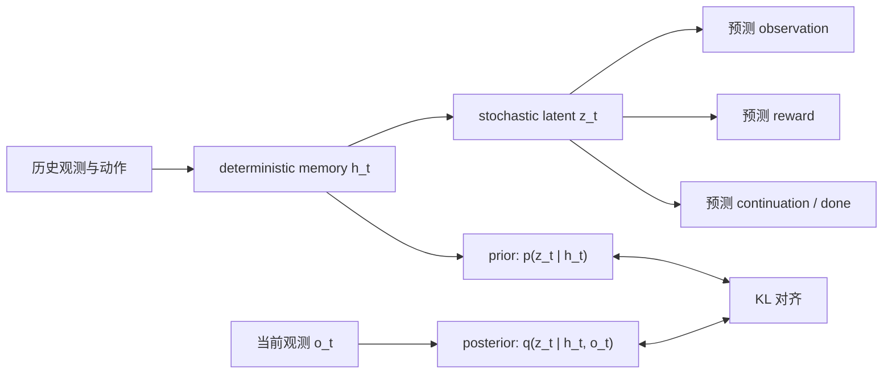
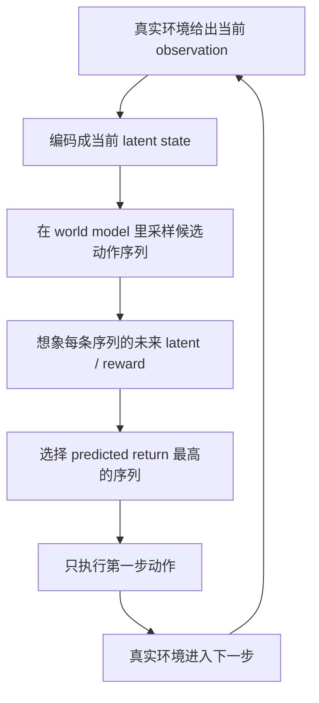
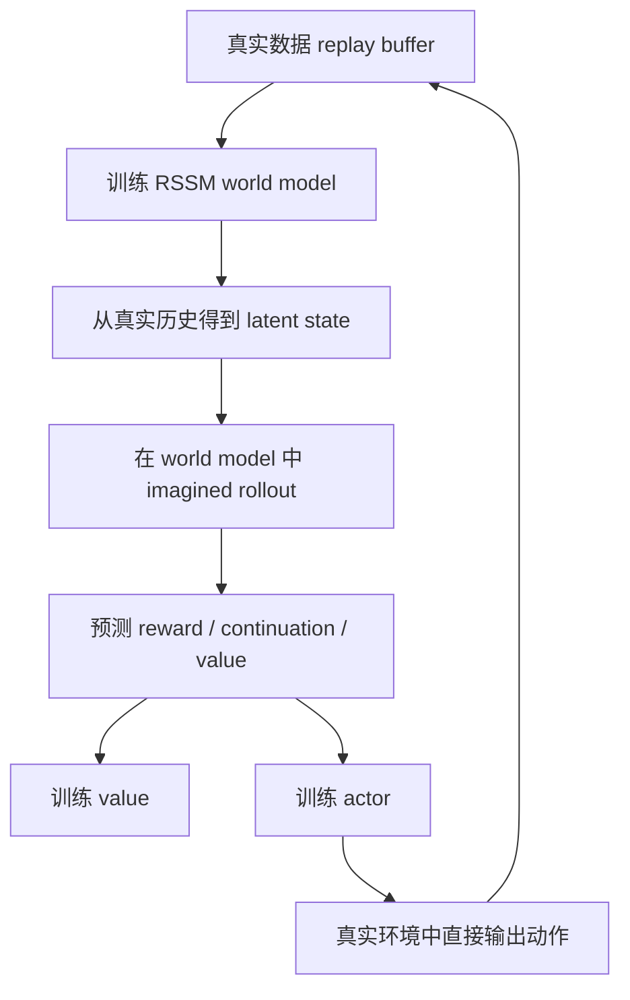
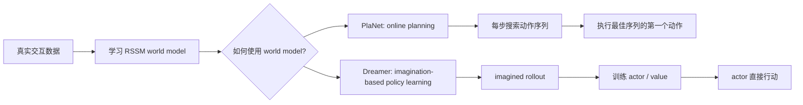
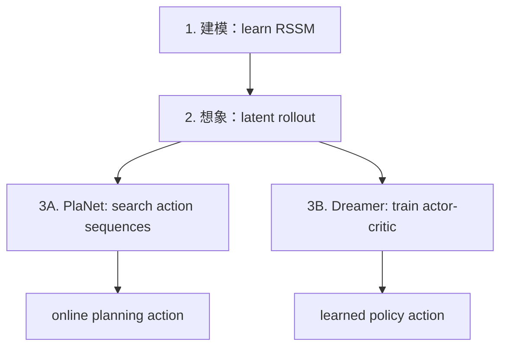

# 09｜PlaNet 与 Dreamer：同一个世界模型，两种使用方式

> 这一篇接在 [08｜Prior 与 Posterior Latent](world-models-8-prior-and-posterior-latent.md) 后面。
>
> 前面我们已经理解了 RSSM、latent state、prior、posterior 和 imagined rollout。现在可以正式区分两个经典路线：
>
> **PlaNet 把世界模型拿来在线规划；Dreamer 把世界模型拿来训练策略。**

## 1. 一句话区别

PlaNet 和 Dreamer 都先学习一个 latent world model，但它们使用这个模型的方式不同：

- **PlaNet**：每次要行动时，都在世界模型里搜索很多未来动作序列，选预测回报最高的第一步动作。
- **Dreamer**：先在世界模型里生成 imagined trajectories，用这些想象经验训练 actor 和 value，真正行动时直接用 actor 输出动作。

更短一点：

```text
PlaNet  = world model + online planning
Dreamer = world model + actor-critic learned in imagination
```

如果用学习方式类比：

- PlaNet 像考试时现场推演很多方案；
- Dreamer 像平时在脑内大量演练，最后形成一种更快的行动直觉。


## 2. 它们的共同地基：RSSM world model

PlaNet 和 Dreamer 的共同基础都是 RSSM（recurrent state-space model）。

RSSM 的核心想法是：

- 环境背后有一个内部状态；
- 内部状态会随时间和动作变化；
- 我们只能通过 observation 间接看到它；
- 模型要学习一个 latent state 来表示这个内部状态；
- 这个 latent state 既包含历史记忆，也包含不确定性。

可以把 RSSM 看成世界模型中的“状态追踪器 + 未来模拟器”：




在这个框架下，智能体并不是直接在像素或原始观测上思考，而是在模型学到的 latent space 里推演未来。

这也是 PlaNet 和 Dreamer 的共同出发点：  
**先学会一个可想象的世界，再利用这个世界做决策。**

## 3. PlaNet：用世界模型做在线规划

PlaNet 的核心是 planning。

当智能体站在当前 latent state 时，PlaNet 会：

1. 在模型里采样很多候选动作序列；
2. 对每条动作序列 rollout 出未来 latent；
3. 用 reward model 预测每条未来轨迹的累计回报；
4. 选出回报最高的动作序列；
5. 只执行这条序列的第一个动作；
6. 进入下一步后重新观测、重新规划。

这个过程很像 MPC（model predictive control，模型预测控制）：




PlaNet 的关键特征是：

- 策略不是一个直接输出动作的神经网络；
- 动作来自每一步的在线搜索；
- 世界模型越准，规划越可靠；
- 每次行动前都要花计算量“想一想”。

所以 PlaNet 可以概括为：

> **我不提前学一个固定 policy；我每一步都用世界模型现场规划。**


## 4. Dreamer：用世界模型训练 actor 和 value

Dreamer 的核心不是每步搜索，而是在世界模型里训练策略。

它的流程大致是：

1. 用真实环境数据训练 RSSM world model；
2. 从真实历史编码出 latent state；
3. 在 learned world model 中展开 imagined rollout；
4. 用 imagined reward 和 value 训练 actor；
5. 用 imagined return 训练 value；
6. 真正和环境交互时，actor 直接根据 latent state 输出动作。




Dreamer 的关键特征是：

- world model 仍然是地基；
- 但决策不再依赖每一步在线搜索；
- actor 在 imagined trajectories 上学习；
- 执行时速度更快；
- 训练阶段把大量计算放进“想象中的练习”。

所以 Dreamer 可以概括为：

> **我先在世界模型里练出一个 policy，然后让 policy 去真实环境里行动。**


## 5. 两者真正差在哪里？

它们的差异不在“有没有世界模型”，而在“世界模型学好之后拿来干什么”。


| 维度            | PlaNet                        | Dreamer                       |
| ------------- | ----------------------------- | ----------------------------- |
| 共同基础          | RSSM latent world model       | RSSM latent world model       |
| 决策方式          | 在线规划 / action sequence search | actor 直接输出动作                  |
| 想象发生在         | 每次执行动作前                       | 训练 actor/value 时              |
| 是否显式训练 policy | 通常不重点训练单独 actor               | 是，训练 actor-critic             |
| 执行时计算量        | 较高，每步都要搜索                     | 较低，前向 actor 即可                |
| 风格            | model predictive control      | model-based RL + actor-critic |
| 直觉            | 临场推演                          | 反复脑内练习                        |


用一张总图连接起来：




这个分叉很重要：它解释了为什么 Dreamer 往往被看作更现代的一条路线。

## 6. 为什么 Dreamer 更进一步？

PlaNet 的强项是概念直接：  
既然我有世界模型，那我就每一步在模型里模拟很多未来，选最好的动作。

但它也有一个实际问题：

> 每次行动都要在线搜索很多动作序列，执行时计算代价比较高。

Dreamer 的改进思路是：

> 把一部分“临场思考”转移到训练阶段，让 actor 在 imagined rollouts 里提前练习。

于是执行时，Dreamer 不需要每一步重新大规模搜索。它只需要：

```text
observation/history -> latent state -> actor -> action
```

这就是 Dreamer 名字里 “dream” 的含义：  
它不是单纯预测未来，而是在学到的世界里做策略学习。

## 7. 从 prior/posterior 角度重新看 PlaNet 和 Dreamer

第 8 篇讲过：

- posterior 用真实观测校正当前 latent；
- prior 在没有未来观测时继续向前想象。

现在可以把 PlaNet 和 Dreamer 放进同一张图：

```mermaid
sequenceDiagram
    participant Env as Real environment
    participant Post as Posterior encoder
    participant Prior as Prior dynamics
    participant Planner as PlaNet planner
    participant Actor as Dreamer actor

    Env->>Post: observe current o_t
    Post->>Prior: infer current latent z_t
    Prior->>Planner: imagine candidate futures
    Planner->>Env: execute best first action
    Prior->>Actor: generate imagined rollouts during training
    Actor->>Env: execute learned policy action
```


两者都依赖 posterior 来理解当前真实状态，也都依赖 prior 来想象未来。  
差别是：

- PlaNet 直接用 imagined futures 选动作；
- Dreamer 用 imagined futures 训练一个会选动作的 actor。


## 8. 一个非常实用的理解框架

可以把 model-based RL 拆成三个问题：

1. **建模问题**：怎么学一个足够好的世界模型？
2. **想象问题**：怎么用世界模型生成未来轨迹？
3. **控制问题**：怎么利用这些未来轨迹选动作？

PlaNet 和 Dreamer 在前两个问题上很像，在第三个问题上分叉：




这也是之后读更多论文时很有用的分类方法：

- 这篇论文主要改进 world model 吗？
- 主要改进 imagined rollout 吗？
- 主要改进 policy/value learning 吗？
- 还是改进数据收集、探索、离线训练或泛化能力？

有了这个框架，读论文会不容易迷路。

## 9. 当前理解小结

我现在可以这样区分 PlaNet 和 Dreamer：

- 它们都不是“无模型强化学习”，而是都先学一个 latent world model。
- PlaNet 更偏 planning：每一步都在模型里搜索动作序列。
- Dreamer 更偏 policy learning：在模型里想象轨迹，用这些轨迹训练 actor 和 value。
- PlaNet 执行时更依赖在线计算。
- Dreamer 训练时更依赖 imagined rollout，执行时更像一个已经练好的策略。
- 从研究路线看，Dreamer 把“世界模型 + 规划”推进到了“世界模型 + 在想象中学习行为”。

一句话放在最后：

> **PlaNet 用世界模型来想一步怎么做；Dreamer 用世界模型来练出一个会做事的自己。**


## 10. 后续阅读建议

如果继续往下读，可以按这个顺序：

1. PlaNet：理解 latent dynamics + online planning。
2. Dreamer：理解 latent imagination + actor-critic。
3. DreamerV2：理解离散 latent state 和 Atari 任务。
4. DreamerV3：理解更通用、更稳定的世界模型强化学习系统。

下一篇可以继续进入 Dreamer 的核心细节：

- actor 是怎么在 imagined rollout 上训练的；
- value target 如何计算；
- continuation prediction 为什么重要；
- imagined gradient 为什么能更新 policy。

