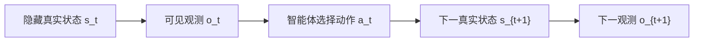
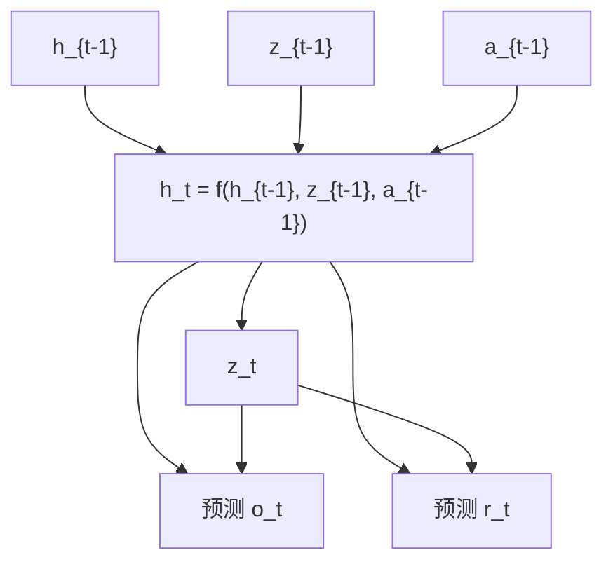
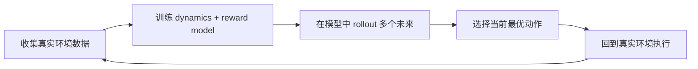

# MDP、POMDP 与最小世界模型

这篇笔记围绕四个问题展开：

- MDP 里的 state、action、reward、transition 分别是什么？
- 为什么真实任务通常更接近 POMDP？
- PlaNet 和 Dreamer 为什么常用 RSSM 这类结构？
- 如何写一个最小可运行的 toy world model？

## 1. MDP：强化学习的基础形式化

强化学习最经典的形式化框架是 MDP（Markov Decision Process，马尔可夫决策过程）。

在最常见的写法里，一次环境交互可以表示为：

$$
(s_t, a_t, r_t, s_{t+1})

$$

其中：

- \(s_t\)：当前状态（state）。
- \(a_t\)：智能体执行的动作（action）。
- \(r_t\)：环境返回的奖励（reward）。
- \(s_{t+1}\)：执行动作之后的下一个状态（next state）。

在这个设定下，世界模型最理想的目标是学习：

$$
p(s_{t+1}, r_t \mid s_t, a_t)

$$

也就是说：给定当前状态和动作，模型要预测下一步世界会如何变化，以及这个变化会带来什么奖励。

### MDP 的关键假设

MDP 的核心假设是 Markov property：

> 只要知道当前状态 \(s_t\)，就已经包含了预测未来所需的全部相关信息。

换句话说，如果状态定义足够完整，智能体不需要知道完整历史，只看当前状态就能决策。

这个假设在很多教学环境里成立，例如 CartPole 的位置、速度、角度、角速度组合起来基本就是一个足够用的状态。但在真实世界里，这个假设经常太强。

## 2. POMDP：真实世界通常不是完全可观测的

真实任务往往不是 MDP，而更接近 POMDP（Partially Observable Markov Decision Process，部分可观测马尔可夫决策过程）。

机器人看到的是摄像头图像、关节角度、力传感器读数；自动驾驶系统看到的是相机、雷达和地图信号；游戏智能体看到的是屏幕像素。它们看到的是观测 \(o_t\)，而不是完整真实状态 \(s_t\)。



因此，智能体通常需要根据历史观测和动作形成一个内部信念：

$$
b_t \approx p(s_t \mid o_{\le t}, a_{<t})

$$

在深度学习系统里，这个内部信念常常被表示为 latent state，例如 \(z_t\) 或 \(h_t\)。它不是环境直接给出的，而是模型从历史中学出来的压缩表示。

## 3. RSSM：为什么 Dreamer 这条线常用它

PlaNet 和 Dreamer 系列常用 RSSM（Recurrent State-Space Model，循环状态空间模型）来表示 latent dynamics。

一个简化版 RSSM 可以理解为两部分：

- deterministic state \(h_t\)：负责稳定记忆历史信息。
- stochastic state \(z_t\)：负责表达不确定性和多种可能未来。

简化形式可以写成：

$$
h_t = f(h_{t-1}, z_{t-1}, a_{t-1})

$$

$$
z_t \sim p(z_t \mid h_t)

$$

$$
o_t \sim p(o_t \mid h_t, z_t), \quad
r_t \sim p(r_t \mid h_t, z_t)

$$

对应关系大致是：

- \(h_t\)：确定性记忆，像模型的“长期上下文”。
- \(z_t\)：随机潜变量，用来表达不可观测因素和不确定未来。
- \(o_t\)：观测。
- \(r_t\)：奖励。

为什么要同时有 \(h_t\) 和 \(z_t\)？

- 如果只有 deterministic hidden state，模型容易把多种未来平均掉。
- 如果只有 stochastic variable，模型又可能缺少稳定的历史记忆。
- 把二者结合起来，通常更适合复杂、部分可观测、带不确定性的环境。



这也是 PlaNet 和 Dreamer 的核心直觉之一：不要直接在原始像素空间里规划，而是在更紧凑、更适合预测的 latent space 里进行想象和决策。

## 4. 最小可运行世界模型：1D point mass

在真正进入 Dreamer 之前，可以先写一个低维 toy example。它不复杂，但能把 model-based RL 的最小闭环讲清楚。

这个例子的设定是：

- 环境：一维点质量系统。
- 状态：位置和速度，即 \([position, velocity]\)。
- 动作：加速度，范围是 \([-1, 1]\)。
- 目标：把点移动到目标位置 \(0.0\)。
- 世界模型：学习 \((s_t, a_t) -> (s_{t+1}, r_t)\)。
- 规划器：随机采样多条未来动作序列，选择模型预测回报最高的那条。

完整代码已经整理到：

- [src/hello_world_model](../../src/hello_world_model)
- [examples/run_point_mass_world_model.py](../../examples/run_point_mass_world_model.py)

运行方式：

```bash
pip install -r requirements.txt
python examples/run_point_mass_world_model.py
```

## 5. 最小闭环

这个 toy example 对应的闭环是：



更具体一点：

1. 随机动作和真实环境交互，收集 \((s_t, a_t, s_{t+1}, r_t)\)。
2. 用这些数据训练一个 MLP world model。
3. 在 learned model 里模拟很多条候选动作序列。
4. 选择预测累计奖励最高的序列，把第一个动作拿到真实环境执行。
5. 重复这个过程。

这就是 model-based RL 的最小原型。它没有 Dreamer 那么强，但已经包含了世界模型最核心的思想：学习环境、想象未来、辅助决策。

## 6. 这个 toy example 的局限

这个例子故意保持简单，所以它也有明显局限：

- 状态是完全可观测的，还没有真正处理 POMDP。
- world model 是普通 MLP，没有 latent state。
- planning 使用 random shooting，效率很低。
- 数据只来自随机策略，没有做持续的数据再收集和模型更新。
- 没有显式 uncertainty，模型错了也不会知道自己错了。

这些局限正好指向后续学习路线：

- 从 MDP 走向 POMDP。
- 从 state prediction 走向 latent dynamics。
- 从 random shooting 走向更强的 planning 或 actor-critic。
- 从离线训练走向数据收集、训练、规划的闭环迭代。
