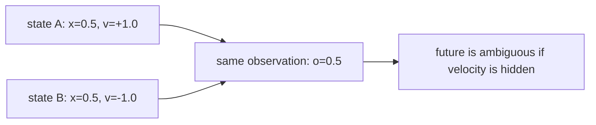
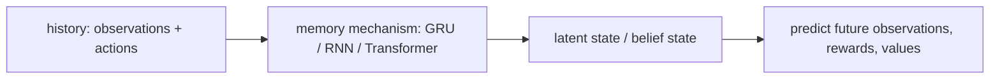
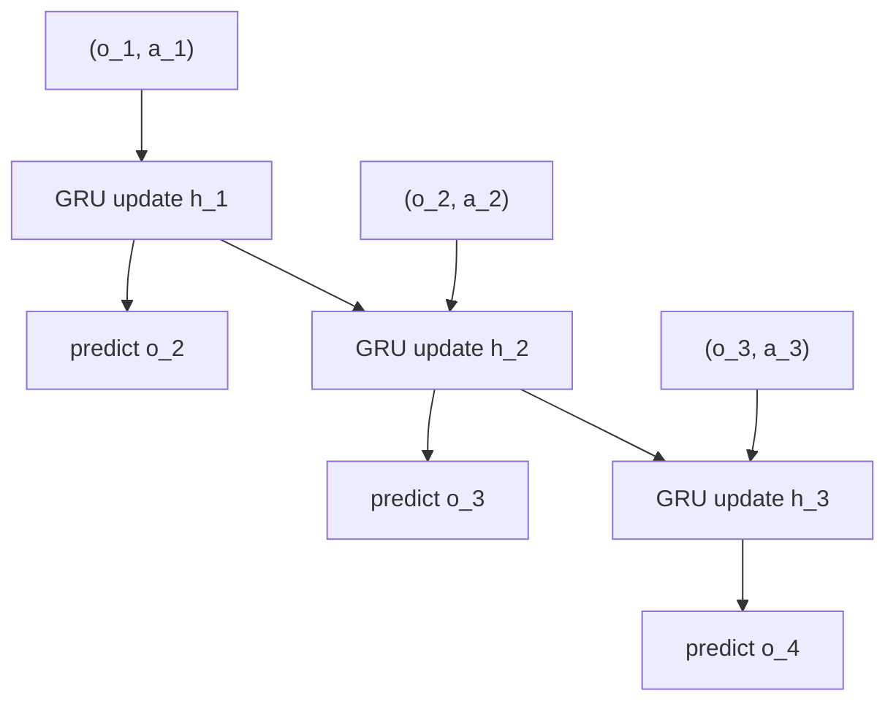

# 为什么世界模型需要 memory 与 latent state

日期：2026-07-22

状态：学习笔记草稿

## 这篇笔记解决什么问题

上一篇笔记里的 toy world model 假设智能体能直接看到完整状态：

$$
s_t = [x_t, v_t]
$$

也就是位置 \(x_t\) 和速度 \(v_t\) 都能观测到。此时世界模型学习的是：

$$
(s_t, a_t) \rightarrow (s_{t+1}, r_t)
$$

这个设定很适合入门，但真实世界经常没有这么慷慨。很多时候智能体只能看到一部分信息：

- 摄像头只看到当前位置，不能直接读出速度。
- 单帧图像看不出物体正在向左还是向右运动。
- 当前画面看不出门后有没有人。
- 机械臂单帧传感器读数看不出刚才是否发生过打滑或接触。

这篇笔记要回答的问题是：当当前观测 \(o_t\) 不足以决定未来时，世界模型为什么必须引入 memory 或 latent state？

## 1. 当前观测不等于完整状态

假设真实环境状态仍然是：

$$
s_t = [x_t, v_t]
$$

但智能体只能看到位置：

$$
o_t = x_t
$$

动作仍然是加速度 \(a_t\)。这时会出现一个关键问题：同一个观测可能对应多个不同真实状态。

例如：

| 真实状态 | 位置 \(x_t\) | 速度 \(v_t\) | 当前观测 \(o_t\) |
| --- | ---: | ---: | ---: |
| A | 0.5 | +1.0 | 0.5 |
| B | 0.5 | -1.0 | 0.5 |

这两个状态“看起来一样”，因为观测都是 \(0.5\)。但下一步会完全不同：A 可能继续往右走，B 可能继续往左走。



这说明：只靠当前观测，世界模型无法唯一预测未来。它需要利用历史。

## 2. 历史可以恢复隐藏信息

虽然单帧位置看不出速度，但连续两帧就能提供运动趋势：

| 前一帧位置 | 当前帧位置 | 可以推断 |
| ---: | ---: | --- |
| 0.4 | 0.5 | 速度大概率为正 |
| 0.6 | 0.5 | 速度大概率为负 |

因此，更合理的建模目标不是只看当前观测：

$$
o_t \rightarrow o_{t+1}
$$

而是让模型根据历史形成内部状态：

$$
(o_{1:t}, a_{1:t-1}) \rightarrow z_t
$$

这里的 \(z_t\) 可以理解为 latent state 或 belief state。它不是环境直接给出的变量，而是模型根据历史自己总结出来的“当前世界可能是什么样”的内部信念。

## 3. Memory 与 latent state 的关系

在世界模型里，可以先粗略区分两个概念：

- memory：模型处理历史信息的机制，例如 RNN、GRU、LSTM 或 Transformer context。
- latent state：模型从历史中形成的内部表示，例如 \(h_t\)、\(z_t\) 或 belief state。

memory 是“怎么记”，latent state 是“记成了什么”。



在入门阶段，可以把 GRU 理解成一个会滚动更新的记忆单元。每来一步新输入，它都会把当前信息和过去记忆合并起来：

$$
h_t = f(h_{t-1}, o_t, a_t)
$$

其中：

- \(o_t\)：当前观测。
- \(a_t\)：当前动作。
- \(h_{t-1}\)：上一步的内部记忆。
- \(h_t\)：更新后的内部记忆，也可以看成最朴素的 latent state。

## 4. 最小演示：GRU 预测下一观测

这次我们先不追求完整 Dreamer，只做一个最小递进版本：

- 环境真实状态仍然包含位置和速度。
- 智能体只能观察位置，看不到速度。
- 模型输入一段 \((o_t, a_t)\) 序列。
- GRU 逐步更新 hidden state。
- 模型预测下一步观测 \(o_{t+1}\)。



这个演示最重要的不是“GRU 会跑”，而是让读者看到：当速度被隐藏时，模型必须从历史观测里压缩出运动趋势，否则下一步预测会模糊。

完整代码已经整理到：

- [src/hello_world_model](../../src/hello_world_model)
- [examples/run_partial_observation_gru.py](../../examples/run_partial_observation_gru.py)

运行方式：

```bash
pip install -r requirements.txt
python examples/run_partial_observation_gru.py
```

运行后会生成：

- `01_partial_observation_ambiguity.png`：同一个位置观测可能对应不同速度。
- `02_gru_training_loss.png`：GRU world model 的训练误差。
- `03_gru_sequence_prediction.png`：真实位置序列与模型预测位置序列对比。
- `04_hidden_state_probe.png`：GRU hidden state 是否编码了隐藏速度的信息。

## 5. 固定窗口 vs 递归记忆

一个自然的替代方案是手工拼接历史窗口：

$$
[o_{t-2}, o_{t-1}, o_t, a_{t-2}, a_{t-1}, a_t] \rightarrow o_{t+1}
$$

这叫“显式保留历史”。它简单直接，但窗口长度是人为指定的，长依赖会变麻烦。

GRU 的方式是让输入一步一步流入模型：

$$
(o_1, a_1) \rightarrow h_1,\quad
(o_2, a_2) \rightarrow h_2,\quad
\cdots,\quad
(o_t, a_t) \rightarrow h_t
$$

然后用 \(h_t\) 预测未来。

两者的本质区别是：

- 固定窗口：把历史原样塞给模型。
- GRU memory：把历史压缩进递归更新的 hidden state。

## 6. Hidden state 到底是什么

很多人第一次学 RNN/GRU 时，会把 hidden state 理解成普通中间层向量。但在 world model 里，更好的理解是：

> hidden state 是模型当前对世界状态的内部信念。

在这个 toy 环境中，环境没有把速度给模型。为了预测下一步位置，GRU hidden state 必须从历史位置变化中恢复某种“运动趋势”。如果 hidden state 完全没有编码速度信息，下一步观测预测就会很差。

这也是 memory 在世界模型里的核心价值：它把不可直接观测的信息，从历史中重新组织成对预测和决策有用的内部状态。

## 7. 和 Dreamer/RSSM 的关系

Dreamer 里的 RSSM 比这个 toy GRU 更完整。它通常会同时使用：

- deterministic state：类似 \(h_t\)，负责稳定记忆历史。
- stochastic state：类似 \(z_t\)，负责表达不确定性。
- prediction heads：预测观测、奖励、继续概率或价值相关信号。

我们的 GRU toy model 只保留了第一层核心思想：历史不是装饰，而是部分可观测任务中恢复世界状态的必要条件。

## 下一步

下一篇笔记可以继续拆：

> Dreamer 中的 RSSM 为什么要同时使用 deterministic state 和 stochastic state？
